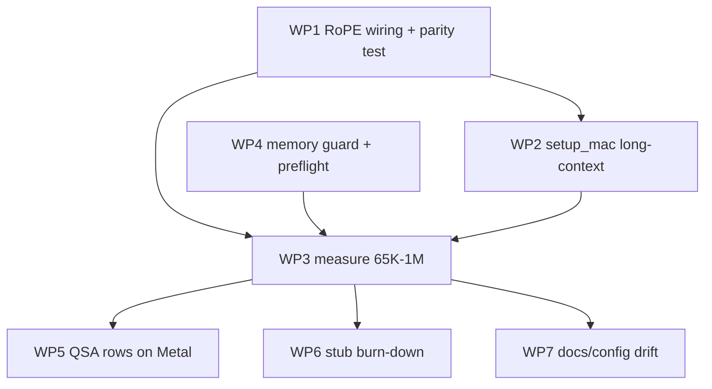

## User

based on the changes made to the project [@mac_readme.md](file:///Volumes/vl/ai/strata/mac_readme.md), propose a detailed plan (for Google Jules) to optimize Strata further (tying up loose ends, completing features etc.):
Consider [@strata-iq3_s.json](file:///Volumes/vl/ai/strata/strata-iq3_s.json) which has proven to work; is there value in implementing rope so that context can be expanded to 1M?

## Assistant

<thinking>
The user is asking me to propose a detailed plan for Google Jules to further optimize Strata (finishing up loose ends, completing features, etc.), based on the changes in mac_readme.md. They also want me to consider strata-iq3_s.json which has been proven to work, and whether there's value in implementing RoPE so that context can be extended to 1M.

Note: the attached strata-iq3_s.json in the context differs from what's in mac_readme.md — the actual current file has `--max-context 262144`, `--kv int8`, and a log path. So the "proven to work" config is now at 262144 context with int8 KV.

I need to explore the codebase to understand:
1. What's stubbed out in the Metal layer (loose ends) — the stubs.cpp has many missing kernels.
2. RoPE / YaRN / long-context support — what exists in the codebase for context extension (e.g., yarn rope scaling), and what the model's native context is.
3. QSA (query-sparse attention?) — `qsa_block_scores_rows`, `qsa_decode_attn_split` stubs — these look like long-context sparse attention features that are stubbed on Metal. This is highly relevant to the 1M context question.
4. Memory math: 1M context KV cache size at int8, etc.

Let me do research in the repo. Start with structure, then look at the metal stubs, docs (DETAILS.md), rope-related code, yarn, qsa, kv cache sizing, max-context handling.

Let me be efficient: use grep for "yarn", "rope", "YaRN", "max-context", "qsa", and read the stubs file and relevant docs.

Let me start.

</thinking>

I'll research the codebase to ground the plan — especially what's stubbed on Metal, how context/KV and RoPE scaling are handled today, and what the 1M-context question actually costs.

**Tool Call: List the `/Volumes/vl/ai/strata` directory's contents**
Status: Completed

# Folders:
strata/.github
strata/.venv
strata/__pycache__
strata/bench
strata/build-metal
strata/build-vision
strata/cmake
strata/data
strata/docs
strata/include
strata/metal
strata/ref
strata/serve
strata/src
strata/sycl
strata/tests
strata/third_party
strata/tools

# Files:
strata/.dockerignore
strata/.gitattributes
strata/.gitignore
strata/AGENTS.md
strata/BENCH.bat
strata/CMakeLists.txt
strata/Dockerfile
strata/LICENSE
strata/README.de.md
strata/README.es.md
strata/README.fr.md
strata/README.ja.md
strata/README.md
strata/README.pt-BR.md
strata/README.zh-CN.md
strata/SECURITY.md
strata/SETUP.bat
strata/START-HERE.bat
strata/UPDATE.bat
strata/bench.sh
strata/build-vision.log
strata/chat.py
strata/conftest.py
strata/docker-entrypoint.sh
strata/flake.lock
strata/flake.nix
strata/mac_readme.md
strata/requirements.txt
strata/run-iq3_s.sh
strata/setup.py
strata/setup.sh
strata/strata-iq3_s.json
strata/strata-iq3_s.log
strata/update.sh


**Tool Call: Search files for regex `(?i)yarn|longrope|rope_scaling|rope_scale|dynamic_ntr`**
Status: Completed

file:///Volumes/vl/ai/strata/bench/results/2026-09-28-rope-scaling/README.md#L3:6

```
The feature (PR #84, experimental): `--rope-scaling none|linear|yarn` extends the context past the model's
trained 262,144 positions by rescaling the rotary angles - llama.cpp's types, ggml's `rope_yarn`
arithmetic, one process config applied at the cos/sin table (default path) and as kernel constants
(`--native-rope`, the native indexer, prefill). The three tables here are the first end-to-end check
```


file:///Volumes/vl/ai/strata/bench/results/2026-09-28-rope-scaling/README.md#L12:16

```
were taken on the rope tree built over the 0.1.17-era base; the branch then rebased onto main (engine
0.1.20) - the drift touches none of the rope files - and the rebase was re-validated: `rope_parity`
green, a 64-token greedy run token-identical to the plain 0.1.20 build, and the yarn 262k probe
repeated green (see the last table row). Baseline arm A also re-checked the default is the stock
model: a 64-token greedy run produces the same token ids as the ready-made 0.1.17 engine, and
```


file:///Volumes/vl/ai/strata/bench/results/2026-09-28-rope-scaling/README.md#L26:34

```
| B | linear, factor 2 | 560,000 | 262k @ 50% | 274,222 | FOUND | 232 s |
| B | linear, factor 2 | 560,000 | 512k @ 50% | 527,051 | FOUND | 619 s |
| C | yarn, factor 2 | 560,000 | 262k @ 50% | 274,215 | FOUND | 236 s |
| C | yarn, factor 2 | 560,000 | 512k @ 50% | 526,988 | FOUND | 615 s |
| C | yarn, factor 2 | 560,000 | 262k @ 50% (the rebase re-check) | 273,708 | FOUND | 235 s |

All 8 of 8 probes found the needle; JSON per arm: `needle-A-none.json`, `needle-B-linear2.json`,
`needle-B-linear2-512k.json`, `needle-C-yarn2.json` (+ the rebase re-check in
`needle-C-yarn2-rebased.json`); server and engine logs alongside.
```


file:///Volumes/vl/ai/strata/bench/results/2026-09-28-rope-scaling/README.md#L38:39

```
- **Past the trained end the model still reads.** 512k probes are 2.01x the trained 262,144 - position
  interpolation (B) and YaRN (C) both hold a mid-context lookup there.
```


file:///Volumes/vl/ai/strata/bench/results/2026-09-28-rope-scaling/README.md#L40:43

```
- **Scaled runs within the trained range are a slightly different model.** `yarn`'s mscale applies at
  every position (a 64-token greedy prompt diverges from the stock run after ~19 tokens); arm A is the
  stock model, arms B/C are not, by design.
- **One depth, one needle, one machine.** A single probe per (length, arm) at depth 50% says "recall
```


file:///Volumes/vl/ai/strata/bench/results/2026-09-28-rope-scaling/config-C-yarn2.json#L35:42

```
  "560000",
  "--rope-scaling",
  "yarn",
  "--rope-scale",
  "2"
 ],
 "log": "/home/jakub/workspace/deepseek-harness/harnes_workspace/Strata/bench/results/2026-09-28-rope-scaling/engine-C-yarn2-524288.log"
}
```


file:///Volumes/vl/ai/strata/bench/results/2026-10-02-community-rtx5090-1m-agent/README.md#L3:6

```
Measured on 2026-10-02 by [gravitomagnetic](https://github.com/gravitomagnetic),
on a Linux desktop. This tests Strata 0.1.31 with Qwen3.8-Flash-Next IQ3_S at a
1,048,576-token context limit (YaRN scaling, factor 4), under a workload chosen
to resemble agentic use: long repeated system-style prompts, streaming
```


file:///Volumes/vl/ai/strata/bench/results/2026-10-02-community-rtx5090-1m-agent/README.md#L54:55

```
- Context 1,048,572 tokens via `--max-context 1048576 --rope-scaling yarn
  --rope-scale 4` (HF card recommends YaRN factor 4 for 1M; native 262,144).
```


file:///Volumes/vl/ai/strata/bench/results/2026-10-02-community-rtx5090-1m-agent/README.md#L160:162

```
- The 1M context is reached via YaRN; this report measures the engine's
  throughput at that configuration, not model quality at long context.
- Recall at these depths was not tested here; the repo's
```


file:///Volumes/vl/ai/strata/bench/results/2026-10-02-community-rtx5090-1m-agent/strata-iq3_s.json#L23:27

```
  "1048576",
  "--rope-scaling",
  "yarn",
  "--rope-scale",
  "4",
```


file:///Volumes/vl/ai/strata/bench/results/2026-10-04-community-2x-rtx3060/README.md#L71:73

```
- Context **524,288**; **yarn rope scaling ×2** (past the trained 262,144); KV **int8**,
  `--kv-resident 32768` cells kept in VRAM.
- Expert cache **auto** → this start-up filled **3,579 experts (6.38 GiB of VRAM)**.
```


file:///Volumes/vl/ai/strata/bench/results/2026-10-04-community-2x-rtx3060/README.md#L93:97

````
  --expert-cache auto --prefill auto
  --spec 4 --spec-min-p 0.5 --mtp <data>/mtp/rt
  --max-context 524288 --rope-scaling yarn --rope-scale 2
  --kv int8 --kv-resident 32768
```
````


file:///Volumes/vl/ai/strata/bench/results/2026-10-04-community-2x-rtx3060/long-context.md#L15:17

```
**Main result: no misses in 10 needle tests, ~94.8K → ~513.8K prompt tokens**, spanning the region
past the model's 262,144-token trained context (yarn factor 2). **Each configuration below is a
single run** — see the limitations for what that does and does not support.
```


file:///Volumes/vl/ai/strata/bench/results/2026-10-04-community-2x-rtx3060/long-context.md#L32:35

```
strata --serve --pack /…/strata/packs/iq3_s --native /…/IQ3_S/…-00001-of-00002.gguf \
  --ple-gguf /…/IQ3_S/…-00002-of-00002.gguf --expert-profile /…/data/expert-profile.bin \
  --expert-cache auto --prefill auto --spec 4 --spec-min-p 0.5 --mtp /…/mtp/rt \
  --max-context 524288 --rope-scaling yarn --rope-scale 2 --kv int8 --kv-resident 32768 \
```


file:///Volumes/vl/ai/strata/bench/results/2026-10-04-community-2x-rtx3060/long-context.md#L39:42

```
- Context **524,288**; yarn factor 2; KV `int8`, 32,768 KV cells resident; layer split across both
  cards. Every request: thinking **off** (`chat_template_kwargs.enable_thinking = false`),
  `temperature 0`, `max_tokens 40`.

```


file:///Volumes/vl/ai/strata/bench/results/2026-10-04-community-2x-rtx3060/strata-config.json#L23:27

```
  "524288",
  "--rope-scaling",
  "yarn",
  "--rope-scale",
  "2",
```


file:///Volumes/vl/ai/strata/bench/results/2026-10-04-community-4090-32gb-ram-512k/README.md#L3:6

```
Measured on 2026-10-04 by [T-Crypt](https://github.com/T-Crypt) on a Linux desktop. This tests Strata
0.1.39 with the original Flash-Next IQ2_XS on one RTX 4090 at a 524,288-token context - past the model's trained
262,144 - with `--rope-scaling yarn --rope-scale 2`, q4_0 KV streamed (`--kv-resident 32768`) and
`--resident-experts`, on a box with 32 GB of RAM. 24 GB of VRAM plus 32 GB of system RAM, 56 GB of memory in
```


file:///Volumes/vl/ai/strata/bench/results/2026-10-04-community-4090-32gb-ram-512k/README.md#L38:39

```
**Configuration** ([config-q4-512k-yarn-res-p.json](config-q4-512k-yarn-res-p.json)):

```


file:///Volumes/vl/ai/strata/bench/results/2026-10-04-community-4090-32gb-ram-512k/README.md#L45:49

````
  --spec 4 --spec-min-p 0.5 --mtp ~/Strata-data/mtp/rt --resident-experts
  --max-context 524288 --kv q4_0 --kv-resident 32768
  --rope-scaling yarn --rope-scale 2
```

````


file:///Volumes/vl/ai/strata/bench/results/2026-10-04-community-4090-32gb-ram-512k/README.md#L159:161

```
- **Yarn is experimental** (PR #84). It is what makes 512K reachable here; the 512K numbers are not comparable
  with a 262K run at the same prompt length, and no quality comparison against an unscaled run was done.
- 512K is not usable as a resident config on this box while the desktop is in use - the RAM is at the wall on
```


## Assistant

<thinking>
Excellent — RoPE scaling (linear/YaRN) is **already implemented** in Strata (PR #84, experimental), and there are community benchmarks reaching 1M context on RTX 5090 with `--rope-scaling yarn --rope-scale 4`. So the answer to the user's question "is there value in implementing rope so context can be expanded to 1M?" is: RoPE scaling already exists in the CUDA/HIP engine; the question is whether it's wired through the **Metal** backend. Let me check the Metal side.

Let me grep for rope in metal/ and src/, and check the stubs.

</thinking>

RoPE scaling already exists in the engine (PR #84). The real question is whether it's wired through Metal. Let me check the Metal layer and the KV/context plumbing.

**Tool Call: Search files for regex `rope`**
Status: Completed

No matches found

**Tool Call: Search files for regex `rope_scaling|rope-scaling|rope_scale`**
Status: Completed

No matches found

## Assistant

<thinking>
Hmm, no matches in metal/** and src/**? That's odd. Maybe the rope scaling code is in include/ or the flag name differs. Let me search the whole repo for "rope-scaling" and "yarn" in code files.

</thinking>

**Tool Call: Search files for regex `rope-scaling`**
Status: Completed

file:///Volumes/vl/ai/strata/bench/results/2026-09-28-rope-scaling/README.md#L3:7

```
The feature (PR #84, experimental): `--rope-scaling none|linear|yarn` extends the context past the model's
trained 262,144 positions by rescaling the rotary angles - llama.cpp's types, ggml's `rope_yarn`
arithmetic, one process config applied at the cos/sin table (default path) and as kernel constants
(`--native-rope`, the native indexer, prefill). The three tables here are the first end-to-end check
that a scaled run actually recalls past the trained end.
```


file:///Volumes/vl/ai/strata/bench/results/2026-09-28-rope-scaling/config-A-none-262144.json#L1:5

```
{
 "exe": "/home/jakub/workspace/deepseek-harness/harnes_workspace/Strata/build/strata",
 "cwd": "/home/jakub/workspace/deepseek-harness/harnes_workspace/Strata",
 "tokenizer": "/home/jakub/workspace/deepseek-harness/harnes_workspace/Strata-data/packs/iq3_xxs/tokenizer",
 "model_name": "qwen3.8-flash-next-iq3_xxs-rope-scaling",
```


file:///Volumes/vl/ai/strata/bench/results/2026-09-28-rope-scaling/config-A-none-262144.json#L35:38

```
  "262144"
 ],
 "log": "/home/jakub/workspace/deepseek-harness/harnes_workspace/Strata/bench/results/2026-09-28-rope-scaling/engine-A-none-262144.log"
}
```


file:///Volumes/vl/ai/strata/bench/results/2026-09-28-rope-scaling/config-B-linear2.json#L1:5

```
{
 "exe": "/home/jakub/workspace/deepseek-harness/harnes_workspace/Strata/build/strata",
 "cwd": "/home/jakub/workspace/deepseek-harness/harnes_workspace/Strata",
 "tokenizer": "/home/jakub/workspace/deepseek-harness/harnes_workspace/Strata-data/packs/iq3_xxs/tokenizer",
 "model_name": "qwen3.8-flash-next-iq3_xxs-rope-scaling",
```


file:///Volumes/vl/ai/strata/bench/results/2026-09-28-rope-scaling/config-B-linear2.json#L34:38

```
  "--max-context",
  "560000",
  "--rope-scaling",
  "linear",
  "--rope-scale",
```


file:///Volumes/vl/ai/strata/bench/results/2026-09-28-rope-scaling/config-B-linear2.json#L39:42

```
  "2"
 ],
 "log": "/home/jakub/workspace/deepseek-harness/harnes_workspace/Strata/bench/results/2026-09-28-rope-scaling/engine-B-linear2-524288.log"
}
```


file:///Volumes/vl/ai/strata/bench/results/2026-09-28-rope-scaling/config-C-yarn2.json#L1:5

```
{
 "exe": "/home/jakub/workspace/deepseek-harness/harnes_workspace/Strata/build/strata",
 "cwd": "/home/jakub/workspace/deepseek-harness/harnes_workspace/Strata",
 "tokenizer": "/home/jakub/workspace/deepseek-harness/harnes_workspace/Strata-data/packs/iq3_xxs/tokenizer",
 "model_name": "qwen3.8-flash-next-iq3_xxs-rope-scaling",
```


file:///Volumes/vl/ai/strata/bench/results/2026-09-28-rope-scaling/config-C-yarn2.json#L34:38

```
  "--max-context",
  "560000",
  "--rope-scaling",
  "yarn",
  "--rope-scale",
```


file:///Volumes/vl/ai/strata/bench/results/2026-09-28-rope-scaling/config-C-yarn2.json#L39:42

```
  "2"
 ],
 "log": "/home/jakub/workspace/deepseek-harness/harnes_workspace/Strata/bench/results/2026-09-28-rope-scaling/engine-C-yarn2-524288.log"
}
```


file:///Volumes/vl/ai/strata/bench/results/2026-10-02-community-rtx5090-1m-agent/README.md#L54:56

```
- Context 1,048,572 tokens via `--max-context 1048576 --rope-scaling yarn
  --rope-scale 4` (HF card recommends YaRN factor 4 for 1M; native 262,144).
- INT8 KV, `--kv-resident 32768` (32,768 cells per layer resident on GPU).
```


file:///Volumes/vl/ai/strata/bench/results/2026-10-02-community-rtx5090-1m-agent/strata-iq3_s.json#L22:26

```
  "--max-context",
  "1048576",
  "--rope-scaling",
  "yarn",
  "--rope-scale",
```


file:///Volumes/vl/ai/strata/bench/results/2026-10-04-community-2x-rtx3060/README.md#L93:97

````
  --expert-cache auto --prefill auto
  --spec 4 --spec-min-p 0.5 --mtp <data>/mtp/rt
  --max-context 524288 --rope-scaling yarn --rope-scale 2
  --kv int8 --kv-resident 32768
```
````


file:///Volumes/vl/ai/strata/bench/results/2026-10-04-community-2x-rtx3060/long-context.md#L32:36

```
strata --serve --pack /…/strata/packs/iq3_s --native /…/IQ3_S/…-00001-of-00002.gguf \
  --ple-gguf /…/IQ3_S/…-00002-of-00002.gguf --expert-profile /…/data/expert-profile.bin \
  --expert-cache auto --prefill auto --spec 4 --spec-min-p 0.5 --mtp /…/mtp/rt \
  --max-context 524288 --rope-scaling yarn --rope-scale 2 --kv int8 --kv-resident 32768 \
  --vision --layer-split auto
```


file:///Volumes/vl/ai/strata/bench/results/2026-10-04-community-2x-rtx3060/strata-config.json#L22:26

```
  "--max-context",
  "524288",
  "--rope-scaling",
  "yarn",
  "--rope-scale",
```


file:///Volumes/vl/ai/strata/bench/results/2026-10-04-community-4090-32gb-ram-512k/README.md#L3:7

```
Measured on 2026-10-04 by [T-Crypt](https://github.com/T-Crypt) on a Linux desktop. This tests Strata
0.1.39 with the original Flash-Next IQ2_XS on one RTX 4090 at a 524,288-token context - past the model's trained
262,144 - with `--rope-scaling yarn --rope-scale 2`, q4_0 KV streamed (`--kv-resident 32768`) and
`--resident-experts`, on a box with 32 GB of RAM. 24 GB of VRAM plus 32 GB of system RAM, 56 GB of memory in
total, is what the model is spread across: 17.02 GiB of experts in the GPU cache and 17.28 GiB page-locked in
```


file:///Volumes/vl/ai/strata/bench/results/2026-10-04-community-4090-32gb-ram-512k/README.md#L45:49

````
  --spec 4 --spec-min-p 0.5 --mtp ~/Strata-data/mtp/rt --resident-experts
  --max-context 524288 --kv q4_0 --kv-resident 32768
  --rope-scaling yarn --rope-scale 2
```

````


file:///Volumes/vl/ai/strata/bench/results/2026-10-04-community-4090-32gb-ram-512k/config-q4-512k-yarn-res-p.json#L27:31

```
  "--kv-resident",
  "32768",
  "--rope-scaling",
  "yarn",
  "--rope-scale",
```


file:///Volumes/vl/ai/strata/bench/results/2026-10-04-community-rtx-4080s-iq3s/README.md#L71:73

```
- `--max-context 524288` with `--rope-scaling yarn --rope-scale 2
  --yarn-orig-ctx 262144` (the model's trained context is 262,144).
- `--kv int8`, `--kv-resident 32768`, `--pcie-frac 0.35`, `--vram-reserve-mib 700`.
```


file:///Volumes/vl/ai/strata/bench/results/2026-10-04-community-rtx-4080s-iq3s/strata-iq3_s.json#L20:24

```
                 "--max-context",
                 "524288",
                 "--rope-scaling",
                 "yarn",
                 "--rope-scale",
```


file:///Volumes/vl/ai/strata/bench/results/2026-10-07-community-xtx-6800xt-1m-helper/baseline.json#L38:42

```
    "--kv-resident",
    "32768",
    "--rope-scaling",
    "yarn",
    "--rope-scale",
```


**Tool Call: Search files for regex `yarn`**
Status: Completed

file:///Volumes/vl/ai/strata/include/strata/kernels/native_qsa_indexer.hpp#L23:27

```
// always rotates at zero, including nonzero sequence bases, as in the oracle.
// Under rope scaling (rope_scaling.hpp) the zero angle keeps the spare's
// rotation an identity; YaRN's mscale rides in through cos(0) on both the pooled
// keys and the indexer queries, so selection is unchanged.
//
```


file:///Volumes/vl/ai/strata/include/strata/kernels/native_rope.hpp#L13:17

```
//
// The scaling (rope_scaling.hpp) rides in as the resolved process config: none reproduces the
// original contract exactly, linear/YaRN apply ggml's rope_yarn - the interpolation mix, the
// corr_dims ramp along the pairs, and the mscale magnitude correction folded into cos and sin.
// The struct's knobs are process constants, so kernel arguments baked at graph capture stay valid.
```


file:///Volumes/vl/ai/strata/include/strata/kernels/rope.hpp#L9:13

```
//
// ROPE SCALING RIDES IN THE TABLE, NOT IN THE KERNEL.  The kernels below read cos/sin values and
// cannot tell a scaled table from an unscaled one - with scaling on, the scaled angles (and YaRN's
// mscale magnitude correction, folded into the same values) simply ARE the table.  That is why
// neither `rope_neox_apply` nor the indexer's pooling kernel takes any scaling argument: the config
```


file:///Volumes/vl/ai/strata/include/strata/kernels/rope.hpp#L49:53

```
/// The same table under the process's rope scaling (rope_scaling.hpp).  For `RopeScalingType::None`
/// this IS the five-argument builder above - the parity test holds the two to be bit-identical - and
/// for linear/YaRN the scaled angles (YaRN's mscale included) replace them.  The math is ggml's,
/// transcribed; see the header of `rope_scaling.hpp` for what arrives from where.
void build_rope_table(int n_rot, const RopeScaling& scaling, int max_pos, float* cos_tab, float* sin_tab);
```


file:///Volumes/vl/ai/strata/include/strata/kernels/rope_scaling.hpp#L8:12

```
//   linear  Position Interpolation: angles shrunk by 1/factor - every position fits again, all
//           frequencies compressed uniformly
//   yarn    YaRN: high-frequency pairs keep their trained angles (extrapolate), low-frequency
//           pairs are interpolated, and the pairs in between blend - plus a magnitude correction
//           `mscale` that keeps the attention temperature where training put it
```


file:///Volumes/vl/ai/strata/include/strata/kernels/rope_scaling.hpp#L17:21

```
// attribution at each helper.  The one deliberate deviation is bookkeeping: ggml's device kernel
// speaks in even dim indices (`i0`) and halves them inside the ramp, while every Strata rope kernel
// speaks in PAIR indices - so `rope_yarn_ramp` here takes the pair index and compares it against
// `corr_dims` directly.  Same numbers, one less division per call site.
//
```


file:///Volumes/vl/ai/strata/include/strata/kernels/rope_scaling.hpp#L46:49

```
namespace strata::kernels {

enum class RopeScalingType { None, Linear, YaRN };

```


file:///Volumes/vl/ai/strata/include/strata/kernels/rope_scaling.hpp#L69:77

```
    double factor = 1.0;       ///< `--rope-scale`: how far past the trained context the run goes
    double freq_scale_in = 0;  ///< `--rope-freq-scale`: the raw ggml knob; 0 = 1/factor
    double orig_ctx = 262144;  ///< `--yarn-orig-ctx`: the context the model was trained over
    double ext_factor = 0;     ///< `--yarn-ext-factor`: correction depth; 0 = off, 1 = full YaRN
    double attn_factor = 1.0;  ///< `--yarn-attn-factor`: extra magnitude scale (ggml's attn_factor)
    double beta_fast = 32.0;   ///< `--yarn-beta-fast`
    double beta_slow = 1.0;    ///< `--yarn-beta-slow`

    /// The angle shrink.  ggml's `freq_scale`: 1 means "the trained angles", 1/factor squeezes
```


file:///Volumes/vl/ai/strata/include/strata/kernels/rope_scaling.hpp#L82:88

```
    }

    /// The magnitude correction.  ggml's `rope_yarn` multiplies cos and sin by this; the log term
    /// rides on `ext_factor != 0` (not on the type), exactly as that source has it.  With the
    /// default knobs YaRN factor F gives `1 + 0.1*ln(F)` - YaRN's temperature correction.
    double mscale() const {
        if (ext_factor == 0) return attn_factor;
```


file:///Volumes/vl/ai/strata/include/strata/kernels/rope_scaling.hpp#L92:98

```
    /// The correction window, in PAIR indices: below `out[0]` pairs extrapolate (keep the trained
    /// angles), above `out[1]` they interpolate, in between they blend.  Transcribed from ggml's
    /// `ggml_rope_yarn_corr_dims` (see the derivation comment at `rope_yarn_corr_dim` below).
    void corr_dims(int n_rot, double out[2]) const {
        const double start = std::floor(rope_yarn_corr_dim(n_rot, orig_ctx, beta_fast, freq_base));
        const double end = std::ceil(rope_yarn_corr_dim(n_rot, orig_ctx, beta_slow, freq_base));
        out[0] = start < 0 ? 0 : start;
```


file:///Volumes/vl/ai/strata/include/strata/kernels/rope_scaling.hpp#L102:106

```
    /// The analytic kernels' constants.  `none` returns the identity constants WHATEVER the other knobs hold -
    /// the table builder ignores them for `none` too, so the two rotation forms cannot disagree there, and an
    /// unscaled run computes exactly what it computed before scaling existed.  Linear/YaRN: ggml's `rope_yarn`
    /// arguments (`attn_factor` is the raw knob; the helper applies the log term when correcting).
    RopeKernelArgs kernel_args(int n_rot) const {
```


file:///Volumes/vl/ai/strata/include/strata/kernels/rope_scaling.hpp#L122:126

```
    /// float64 rather than ggml's float32: the table path computes in float64 and is held to a
    /// bit-exact float64 reference, so its inputs are float64 too.
    static double rope_yarn_corr_dim(int n_dims, double n_ctx_orig, double n_rot, double base) {
        return (double) n_dims * std::log(n_ctx_orig / (n_rot * 2.0 * 3.14159265358979323846)) /
               (2.0 * std::log(base));
```


file:///Volumes/vl/ai/strata/include/strata/kernels/rope_scaling.hpp#L130:134

```
/// The ramp between extrapolation (1) and interpolation (0).
///
/// ggml/src/ggml-cuda/rope.cu `rope_yarn_ramp`: `1 - clamp(y, 0, 1)` with
/// `y = (i0 / 2 - low) / max(0.001, high - low)`.  ggml passes the even dim index `i0`; this takes
/// the pair index (ggml's `i0/2`) so Strata's pair-indexed kernels don't re-derive the mapping.  The
```


file:///Volumes/vl/ai/strata/include/strata/kernels/rope_scaling.hpp#L136:139

```
STRATA_ROPE_SCALING_HD inline float rope_yarn_ramp(float low, float high, int pair) {
    const float y = ((float) pair - low) / (high - low > 0.001f ? high - low : 0.001f);
    const float clamped = y < 0.0f ? 0.0f : (y > 1.0f ? 1.0f : y);
    return 1.0f - clamped;
```


file:///Volumes/vl/ai/strata/include/strata/kernels/rope_scaling.hpp#L150:153

```
                                                     int pair, float& cos_out, float& sin_out) {
    // The interpolation, always applied; the correction mixed in on top (ggml-cuda/rope.cu rope_yarn).
    float theta = freq_scale * theta_extrap;
    float mscale = mscale_in;
```


file:///Volumes/vl/ai/strata/include/strata/kernels/rope_scaling.hpp#L154:157

```
    if (ext_factor != 0.0f) {
        const float ramp_mix = rope_yarn_ramp(corr_low, corr_high, pair) * ext_factor;
        theta = theta * (1.0f - ramp_mix) + theta_extrap * ramp_mix;
        // "Get n-d magnitude scaling corrected for interpolation" - the log term only when correcting.
```


file:///Volumes/vl/ai/strata/include/strata/kernels/rope_scaling.hpp#L176:181

```
    if (!std::isfinite(fs) || fs <= 0.0) return "the resolved frequency scale must be a finite positive value";
    if (!std::isfinite(s.orig_ctx) || s.orig_ctx < 1.0) return "the original (trained) context must be finite and > 0";
    if (!std::isfinite(s.ext_factor) || s.ext_factor < 0.0) return "the YaRN ext factor must be finite and >= 0";
    if (!std::isfinite(s.attn_factor) || s.attn_factor <= 0.0) return "the attention factor must be finite and > 0";
    if (!std::isfinite(s.beta_fast) || s.beta_fast <= 0.0 || !std::isfinite(s.beta_slow) || s.beta_slow <= 0.0)
        return "the YaRN betas must be finite and > 0";
```


file:///Volumes/vl/ai/strata/metal/src/engine/setup_host.cpp#L145:148

```
            if (correct) {
                const double ramp = (double) rope_yarn_ramp((float) cd[0], (float) cd[1], i) * sc.ext_factor;
                ang = interp * (1.0 - ramp) + extrap * ramp;
            }
```


file:///Volumes/vl/ai/strata/src/kernels/cuda/native_qsa_indexer.cu#L97:100

```
                    if (d < ROT) {
                        const int pair = d % (ROT / 2);
                        // The spare (pos == 0) keeps its zero angle; under YaRN the mscale magnitude still rides in
                        // through cos(0) - which is exactly what the queries are scaled by, so the top-k is unmoved.
```


file:///Volumes/vl/ai/strata/src/kernels/cuda/native_qsa_indexer.cu#L159:162

```
    if (d < ROT) {
        const int pair = d % (ROT / 2);
        // The same rotation the single append applies, rope_scaling.hpp's helper shared: under none this is
        // today's cosf/sinf; under linear/YaRN the pooled keys move with the cache's K, and the spare's zero
```


## Assistant

<thinking>
Very interesting. So:
- RoPE scaling is implemented in `include/strata/kernels/rope_scaling.hpp`, `rope.hpp`, `native_rope.hpp`, `native_qsa_indexer.hpp`.
- The Metal backend has `metal/src/engine/setup_host.cpp` with `build_rope_table` that already handles YaRN ramp! So the Metal host-side table builder supports YaRN.
- There's a community benchmark for XTX 6800XT 1M helper — interesting, "xtx" is AMD.

So the answer to the user's question: RoPE scaling is already implemented and works; on Metal the table path appears present in setup_host.cpp. Need to verify whether the CLI flags `--rope-scaling` etc. are accepted on the Metal build, and whether the native-rope / indexer paths exist on Metal (they may be stubbed).

Let me now dig into:
1. `metal/` directory structure and stubs.cpp — full list of stubs = loose ends.
2. Where `--rope-scaling` is parsed (serve/ python? or C++ main?).
3. KV cache sizing math for 1M on 128GB.
4. QSA (query sparse attention?) — what it is, and whether Metal has it.
5. Docs: DETAILS.md sections on long context, KV streaming, Metal status.

Let me look at the metal dir and stubs.

</thinking>

**Tool Call: List the `/Volumes/vl/ai/strata/metal` directory's contents**
Status: Completed

# Folders:
strata/metal/__pycache__
strata/metal/include
strata/metal/kernels
strata/metal/probe
strata/metal/src
strata/metal/tests
strata/metal/tools

# Files:
strata/metal/CMakeLists.txt
strata/metal/setup_mac.py


**Tool Call: Search files for regex `rope-scaling|rope_scale`**
Status: Completed

file:///Volumes/vl/ai/strata/bench/results/2026-10-09-rope-yarn-long-context/probe.py#L54:58

```
    (a.output/'tokens.json').write_text(token_json)
    args=[];raw=cfg['args'];i=0
    replace={'--max-context','--kv','--kv-resident','--mtp','--spec','--conversation-cache-mib','--rope-scaling',
             '--rope-scale','--rope-freq-scale','--yarn-orig-ctx','--prefill','--suffix-draft'}
    while i<len(raw):
```


file:///Volumes/vl/ai/strata/bench/results/2026-10-09-rope-yarn-long-context/probe.py#L61:62

```
    args+=['--kv','fp16','--spec','2','--suffix-draft','0','--conversation-cache-mib','0',
           '--prefill','8192','--max-context',str(a.capacity),'--rope-scaling',a.rope]
```


file:///Volumes/vl/ai/strata/setup.py#L21:27

```
  7. writes run-<model>.bat / run-<model>.sh and starts the model

Options: --family qwen|swift, --model Q2_0|IQ2_XS|IQ3_XXS|IQ3_S, --context 32768, --rope-scaling none|linear|yarn
(--rope-scale F; past the trained 262144 the setup adds yarn and the factor is the final context over 262144,
at least 1 - an explicit --rope-scaling none is refused for such a context), --vision yes|no|gpu|cpu, --port
8080, --yes (recommended
answers, no questions), --setup (install another model / change settings instead of starting), --no-start,
```


file:///Volumes/vl/ai/strata/setup.py#L375:379

```
# serve the setup resolves the method (yarn, or one question when interactive) and derives the factor
# from the final context (final / 262144, at least 1) itself (below), keeps an explicit
# --rope-scaling/--rope-scale, and refuses an explicit --rope-scaling none there - the stock angles past
# the trained range are out of spec.
# 204800 (200K) sits between 128K and 256K: it is inside the trained 262144, so it needs no rope scaling and
```


file:///Volumes/vl/ai/strata/setup.py#L5529:5533

```
    """The rope config for the context ACTUALLY SERVED: (scaling, scale); scaling None = no scaling flags.

    An explicit --rope-scaling/--rope-scale always wins - a user-supplied factor is kept verbatim even
    when a reduction changed the context.  Past the trained range an omitted method defaults to yarn -
    llama.cpp's extension method: the trained angles survive on the high-frequency pairs and the
```


file:///Volumes/vl/ai/strata/setup.py#L5541:5543

```
        if scale is not None and scaling in (None, "none"):
            raise ValueError("--rope-scale needs --rope-scaling linear or yarn (the chosen context fits the "
                             "trained 262144, so there is nothing to scale)")
```


file:///Volumes/vl/ai/strata/setup.py#L5547:5551

```
    if scaling == "none":
        raise ValueError(f"a {ctx // 1024}K context is past the model's trained 262144, and --rope-scaling none "
                         "keeps the stock angles there - the model has never seen those positions, so the setup "
                         "refuses the combination instead of quietly overriding it. Pick --rope-scaling yarn or "
                         "linear, or rerun with --context 262144 or lower")
```


file:///Volumes/vl/ai/strata/setup.py#L5819:5823

```
                        "1", a.yes))
            par = n if n > 1 else None
    if a.rope_scaling or a.rope_scale or a.kv or a.resident_budget_gib is not None or a.low_ram not in (None, "auto"):
        warn(f"--rope-scaling / --kv / --resident-budget-gib / --low-ram are Flash-Next settings: {fam['title']} "
             "does not use them")
```


file:///Volumes/vl/ai/strata/setup.py#L5988:5992

```
                                                                       for m in f["models"])])))
    ap.add_argument("--context", type=int)
    ap.add_argument("--rope-scaling", choices=["none", "linear", "yarn"],
                    help="the RoPE extension for a context past the model's trained 262144: linear (position "
                         "interpolation) or yarn - llama.cpp's types. Omitted with a scaled context, the setup "
```


file:///Volumes/vl/ai/strata/setup.py#L6547:6551

```
        say()
        say(f"  A {ctx // 1024}K context runs the model past its trained 262,144 positions: the rotary angles")
        say("  get rescaled (llama.cpp's RoPE extension). yarn keeps the trained angles on the high-frequency")
        say("  pairs and corrects the magnitudes; linear shrinks every angle. Override any time with")
        say("  --rope-scaling.")
```


file:///Volumes/vl/ai/strata/setup.py#L6553:6556

```
    try:
        scaling, rope_scale = resolve_rope(ctx, scaling, a.rope_scale)
    except ValueError as e:
        fail(str(e))
```


file:///Volumes/vl/ai/strata/setup.py#L6557:6560

```
    if scaling is not None:
        origin = ("final context / trained 262144; override with --rope-scale" if a.rope_scale is None
                  else "as requested")
        ok(f"rope scaling: {scaling}, factor {rope_scale:g} ({origin})")
```


file:///Volumes/vl/ai/strata/setup.py#L6858:6859

```
    if scaling is not None:     # the resolved config: explicit flags as given, or the automatic yarn+factor
        args += ["--rope-scaling", scaling, "--rope-scale", f"{rope_scale:g}"]
```


file:///Volumes/vl/ai/strata/tools/test_setup_qwen36.py#L31:33

```
    base = dict(family="qwen36", model=None, check=False, yes=True, vision=None, models_dir=None, gguf_dir=None,
                context=None, rope_scaling=None, rope_scale=None, kv=None, resident_budget_gib=None, low_ram="auto",
                vram_reserve_mib=None, host=None, api_key=None, browser=None, no_start=True, data_dir=None, gpu=None)
```


file:///Volumes/vl/ai/strata/tools/test_setup_risk.py#L106:110

```
        code, out, cfg, _ = install(self.RAM64, self.GPU32, ["--family", "qwen", "--model", "IQ3_S", "--no-start",
                                                             "--context", "262144"])
        self.assertEqual(code, 0, out)
        self.assertEqual(arg(cfg, "--max-context"), "262144")
        self.assertNotIn("--rope-scaling", cfg["args"])
```


file:///Volumes/vl/ai/strata/tools/test_setup_risk.py#L129:133

```
        self.assertEqual(code, 0, out)
        self.assertEqual(arg(cfg, "--max-context"), "204800")
        self.assertNotIn("--rope-scaling", cfg["args"])
        self.assertIn("200K tokens   (needs ~77 GB RAM, this PC has 64: may run out of memory)", out)
        self.assertIn("200K with IQ3_S needs ~77 GB of RAM by setup's estimate", out)
```


file:///Volumes/vl/ai/strata/tools/test_setup_rope.py#L1:5

```
"""Tests for setup.py's automatic rope configuration (§4 + §6): the factor derives from the FINAL context
actually served - RAM reductions first, then final / trained 262144 clamped at 1 - explicit
--rope-scaling/--rope-scale choices win verbatim, an explicit none is refused past the trained range, and
nothing turns on by itself inside it.  Pure functions - no GPU, no downloads, no prompts.

```


file:///Volumes/vl/ai/strata/tools/test_setup_rope.py#L93:95

```
    def test_512k_on_a_small_ram_machine_resolves_to_128k_factor_1(self):
        # asked 524288 with --rope-scaling yarn and no factor; the RAM check brings the final context to 131072
        self.assertEqual(setup.resolve_rope(131072, "yarn", None), ("yarn", 1.0))
```


file:///Volumes/vl/ai/strata/tools/test_setup_rope.py#L104:108

```
        cases = [
            (131072, None, "yarn", 1.0),                   # --context 131072 --rope-scaling yarn
            (262144, None, "yarn", 1.0),                   # --context 262144 --rope-scaling yarn
            (393216, None, "yarn", 1.5),
            (524288, None, "yarn", 2.0),
```


## Assistant

<thinking>
So RoPE scaling is fully implemented in the engine and setup.py, including automatic yarn factor derivation. There's also a bench `2026-10-09-rope-yarn-long-context/probe.py`.

Now the key question for the plan: what's the state of the **Metal** backend? The mac_readme lists many stubs — meaning the Metal port is a partial port that stubs out many CUDA/HIP kernels. The plan for Jules should be about tying up loose ends on Metal and completing features, plus the 1M context question.

Let me examine:
1. `metal/src/engine/stubs.cpp` — full inventory of stubs (what's missing).
2. `metal/CMakeLists.txt` — what's built.
3. `metal/src/engine/setup_host.cpp` — rope table with yarn (so rope works on Metal? at least the table path).
4. Whether `--rope-scaling` is accepted by the Metal engine binary (arg parsing is in src/ shared host code presumably).
5. KV cache memory math: what does 1M context cost with int8 KV? Need model dims (n_kv heads, head dim, layers). Let me find in docs/DETAILS.md.
6. QSA — what it is and whether Metal supports it (qsa stubs return false → so sparse attention disabled on Metal → long context decode is dense → slow). This is the crux: 1M context on Metal without QSA = expensive attention per token.

Let me read the stubs file and the metal CMakeLists, plus grep docs for QSA and KV sizes.

</thinking>

**Tool Call: Read file `metal/src/engine/stubs.cpp`**
Status: Completed

```
SUCCESS: File outline retrieved. This file is too large to read all at once, so the outline below shows the file's structure with line numbers.

IMPORTANT: Do NOT retry this call without line numbers - you will get the same outline.
Instead, use the line numbers below to read specific sections by calling this tool again with start_line and end_line parameters.

# File outline for /Volumes/vl/ai/strata/metal/src/engine/stubs.cpp

namespace strata::metal_engine [L118]
 void missing( ) [L118]
auto strata::core::RemoteExpertOpt::accumulate( ) [L120]
auto strata::core::RemoteExpertOpt::adapt( ) [L121]
auto strata::core::RemoteExpertOpt::attach( ) [L122]
auto strata::core::RemoteExpertOpt::begin( ) [L123]
auto strata::core::RemoteExpertOpt::combine( ) [L124]
auto strata::core::RemoteExpertOpt::copy_rows( ) [L125]
auto strata::core::RemoteExpertOpt::init( ) [L126]
auto strata::core::RemoteExpertOpt::metadata_bytes() [L127]
auto strata::core::RemoteExpertOpt::owns( ) [L128]
auto strata::core::RemoteExpertOpt::prepare( ) [L129]
auto strata::core::RemoteExpertOpt::reduce( ) [L130]
strata::core::RemoteExpertOpt::~RemoteExpertOpt() [L131]
namespace strata::kernels [L132]
 void add_inplace( ) [L132]
namespace strata::kernels [L133]
 void add_streams_broadcast( ) [L133]
namespace strata::kernels [L134]
 void argmax_rows( ) [L134]
namespace strata::kernels [L135]
 bool argmax_rows_wanted() [L135]
namespace strata::kernels [L136]
 void bf16_gemv( ) [L136]
namespace strata::kernels [L137]
 void bf16_gemv_fp32_mmvf( ) [L137]
namespace strata::kernels [L138]
 void bf16_gemv_fp32_mmvf_cols( ) [L138]
namespace strata::kernels [L139]
 void bf16_gemv_fp32_mmvf_multi( ) [L139]
namespace strata::kernels [L140]
 bool bf16_gemv_fp32_mmvf_multi_aux( ) [L140]
namespace strata::kernels [L141]
 void bf16_gemv_split( ) [L141]
namespace strata::kernels [L142]
 void broadcast_streams( ) [L142]
namespace strata::kernels [L143]
 void copy_from_mapped( ) [L143]
namespace strata::kernels [L144]
 void copy_from_mapped_multi( ) [L144]
namespace strata::kernels [L145]
 void copy_i32_from_mapped( ) [L145]
namespace strata::kernels [L146]
 void copy_i32_from_mapped_unless( ) [L146]
namespace strata::kernels [L147]
 void copy_indexed( ) [L147]
namespace strata::kernels [L148]
 void copy_or_zero_from_mapped( ) [L148]
namespace strata::kernels [L149]
 void copy_row_to_first( ) [L149]
namespace strata::kernels [L150]
 void copy_rows_from_mapped( ) [L150]
namespace strata::kernels [L151]
 void copy_rows_strided( ) [L151]
namespace strata::kernels [L152]
 void coupled_draft_sample( ) [L152]
namespace strata::kernels [L153]
 size_t coupled_draft_scratch_bytes( ) [L153]
namespace strata::kernels [L154]
 void coupled_draft_stage( ) [L154]
namespace strata::kernels::cpu [L155]
 void act_quant_q8_1( ) [L155]
namespace strata::kernels::cpu [L156]
 void act_quant_q8_1_avx1( ) [L156]
namespace strata::kernels::cpu [L157]
 void act_quant_q8_1_avx2( ) [L157]
namespace strata::kernels::cpu [L158]
 void bf16_rows_dot_multi( ) [L158]
namespace strata::kernels::cpu [L159]
 void bf16_rows_dot_multi_avx1( ) [L159]
namespace strata::kernels::cpu [L160]
 void iq128_down_rows( ) [L160]
namespace strata::kernels::cpu [L161]
 bool iq128_down_supported( ) [L161]
namespace strata::kernels::cpu [L162]
 void iq128_gu_rows( ) [L162]
namespace strata::kernels::cpu [L163]
 bool iq128_supported( ) [L163]
namespace strata::kernels::cpu [L164]
 void iq256_gu_rows( ) [L164]
namespace strata::kernels::cpu [L165]
 void iq4nl256_down_rows( ) [L165]
namespace strata::kernels::cpu [L166]
 void iq512_gu_rows( ) [L166]
namespace strata::kernels::cpu [L167]
 void kq256_gu_rows( ) [L167]
namespace strata::kernels::cpu [L168]
 void kq256_rows( ) [L168]
namespace strata::kernels::cpu [L169]
 void q2_0_gguf_rows_multi( ) [L169]
namespace strata::kernels::cpu [L170]
 void q2_0_gguf_rows_multi_avx1( ) [L170]
namespace strata::kernels::cpu [L171]
 void q2_0_gguf_rows_multi_avx1_legacy( ) [L171]
namespace strata::kernels::cpu [L172]
 void q2_0_gguf_rows_multi_avx2( ) [L172]
namespace strata::kernels::cpu [L173]
 void q2_0_gguf_rows_multi_avx2_legacy( ) [L173]
namespace strata::kernels::cpu [L174]
 void q8k_quant_avx1( ) [L174]
namespace strata::kernels::cpu [L175]
 void q8k_quant_avx2( ) [L175]
namespace strata::kernels::cpu [L176]
 void s2_expert_down_rows( ) [L176]
namespace strata::kernels::cpu [L177]
 void s2_expert_down_rows_multi( ) [L177]
namespace strata::kernels::cpu [L178]
 void s2_expert_gu_rows( ) [L178]
namespace strata::kernels::cpu [L179]
 void s2_expert_gu_rows_multi( ) [L179]
namespace strata::kernels::cpu [L180]
 void s2_expert_vnni_q( ) [L180]
namespace strata::kernels [L181]
 void cvec_apply( ) [L181]
namespace strata::kernels [L182]
 bool cvec_replicate( ) [L182]
namespace strata::kernels [L183]
 void cvec_set_enabled( ) [L183]
namespace strata::kernels [L184]
 bool cvec_tables( ) [L184]
namespace strata::kernels [L185]
 bool cvec_upload( ) [L185]
namespace strata::kernels [L186]
 void doorbell_publish( ) [L186]
namespace strata::kernels [L187]
 void doorbell_publish_res( ) [L187]
namespace strata::kernels [L188]
 void doorbell_ring( ) [L188]
namespace strata::kernels [L189]
 void doorbell_wait( ) [L189]
namespace strata::kernels [L190]
 void embedding_gather( ) [L190]
namespace strata::kernels [L191]
 void embedding_gather_dev( ) [L191]
namespace strata::kernels [L192]
 void f32_to_bf16_bulk( ) [L192]
namespace strata::kernels [L193]
 void fetch_blobs( ) [L193]
namespace strata::kernels [L194]
 void force_token( ) [L194]
namespace strata::kernels [L195]
 void fused_gdn_ab( ) [L195]
namespace strata::kernels [L196]
 void fused_gdn_conv_l2( ) [L196]
namespace strata::kernels [L197]
 void fused_gdn_step_norm( ) [L197]
namespace strata::kernels [L198]
 void fused_gr_dequant_q8_0( ) [L198]
namespace strata::kernels [L199]
 void fused_gr_quantize_q8_0( ) [L199]
namespace strata::kernels [L200]
 void fused_gr_read( ) [L200]
namespace strata::kernels [L201]
 bool fused_gr_read_multi( ) [L201]
namespace strata::kernels [L202]
 bool fused_gr_supported( ) [L202]
namespace strata::kernels [L203]
 void fwht256_cuda( ) [L203]
namespace strata::kernels [L204]
 void gdn_ab_multi( ) [L204]
namespace strata::kernels [L205]
 void gdn_beta_gate( ) [L205]
namespace strata::kernels [L206]
 void gdn_conv_commit( ) [L206]
namespace strata::kernels [L207]
 void gdn_conv_l2_multi( ) [L207]
namespace strata::kernels [L208]
 void gdn_conv_step( ) [L208]
namespace strata::kernels [L209]
 void gdn_gate( ) [L209]
namespace strata::kernels [L210]
 void gdn_l2_norm( ) [L210]
namespace strata::kernels [L211]
 void gdn_out_norm( ) [L211]
namespace strata::kernels [L212]
 void gdn_step( ) [L212]
namespace strata::kernels [L213]
 void gdn_step_norm_multi( ) [L213]
namespace strata::kernels [L214]
 void gpu_noop( ) [L214]
namespace strata::kernels [L215]
 void gpu_stamp( ) [L215]
namespace strata::kernels [L216]
 void gr_read( ) [L216]
namespace strata::kernels [L217]
 void gr_write( ) [L217]
namespace strata::kernels [L218]
 void gr_write_multi( ) [L218]
namespace strata::kernels [L219]
 void indexer_key_append( ) [L219]
namespace strata::kernels [L220]
 void iq_dequant_f16( ) [L220]
namespace strata::kernels [L221]
 void iq_dequant_f32( ) [L221]
namespace strata::kernels [L222]
 void iq_dequant_gu_f16( ) [L222]
namespace strata::kernels [L223]
 void iq_embed_rows( ) [L223]
namespace strata::kernels [L224]
 void kv_append_q4( ) [L224]
namespace strata::kernels [L225]
 void kv_append_q4_step( ) [L225]
namespace strata::kernels [L226]
 void kv_append_q4_steps( ) [L226]
namespace strata::kernels [L227]
 void kv_append_q8_step( ) [L227]
namespace strata::kernels [L228]
 void kv_append_q8_steps( ) [L228]
namespace strata::kernels [L229]
 void kv_append_step( ) [L229]
namespace strata::kernels [L230]
 uint64_t kv_block_bytes( ) [L230]
namespace strata::kernels [L231]
 void kv_gather_q4_step( ) [L231]
namespace strata::kernels [L232]
 void kv_gather_q8_step( ) [L232]
namespace strata::kernels [L233]
 void kv_gather_step( ) [L233]
namespace strata::kernels [L234]
 void kv_ring_restore( ) [L234]
namespace strata::kernels [L235]
 void kv_ring_table( ) [L235]
namespace strata::kernels [L236]
 void kv_stage_from_host( ) [L236]
namespace strata::kernels [L237]
 KvStreamCounters kv_stream_counters( ) [L237]
namespace strata::kernels [L238]
 void kv_stream_reset( ) [L238]
namespace strata::kernels [L239]
 void kv_stream_resolve( ) [L239]
namespace strata::kernels [L240]
 void logits_nonfinite_rows( ) [L240]
namespace strata::kernels [L241]
 void map_ids( ) [L241]
namespace strata::kernels [L242]
 void moe_combine( ) [L242]
namespace strata::kernels [L243]
 void moe_group_resident( ) [L243]
namespace strata::kernels [L244]
 void moe_grouped_s2( ) [L244]
namespace strata::kernels [L245]
 void moe_hit_add( ) [L245]
namespace strata::kernels [L246]
 void moe_hit_grouped_s2( ) [L246]
namespace strata::kernels [L247]
 void moe_hit_grouped_s2_cpu_order( ) [L247]
namespace strata::kernels [L248]
 void moe_hit_grouped_s2_dev( ) [L248]
namespace strata::kernels [L249]
 void moe_hit_select( ) [L249]
namespace strata::kernels [L250]
 void mtp_select( ) [L250]
namespace strata::kernels [L251]
 bool multi_block_head_ops() [L251]
namespace strata::kernels [L252]
 void native_expert_grouped( ) [L252]
namespace strata::kernels [L253]
 void native_flash_attn_short_step( ) [L253]
namespace strata::kernels [L254]
 void native_gdn_beta_gate( ) [L254]
namespace strata::kernels [L255]
 void native_gdn_conv_silu( ) [L255]
namespace strata::kernels [L256]
 void native_gdn_gate( ) [L256]
namespace strata::kernels [L257]
 void native_gdn_l2_norm( ) [L257]
namespace strata::kernels [L258]
 void native_gdn_out_norm( ) [L258]
namespace strata::kernels [L259]
 void native_gdn_step( ) [L259]
namespace strata::kernels [L260]
 void native_gr_post_multi( ) [L260]
namespace strata::kernels [L261]
 void native_mmvq( ) [L261]
namespace strata::kernels [L262]
 void native_mmvq_il( ) [L262]
namespace strata::kernels [L263]
 void native_moe_combine( ) [L263]
namespace strata::kernels [L264]
 void native_moe_combine_multi( ) [L264]
namespace strata::kernels [L265]
 void native_moe_combine_multi_hits_gated( ) [L265]
namespace strata::kernels [L266]
 bool native_norm_rope_usable( ) [L266]
namespace strata::kernels [L267]
 void native_ple_postops_batch( ) [L267]
namespace strata::kernels [L268]
 void native_ple_postops_batch_snap( ) [L268]
namespace strata::kernels [L269]
 void native_q5_k_f32( ) [L269]
namespace strata::kernels [L270]
 bool native_q6_k_pack( ) [L270]
namespace strata::kernels [L271]
 void native_q8_0_pack_host( ) [L271]
namespace strata::kernels [L272]
 void native_q8_0_packed_register( ) [L272]
namespace strata::kernels [L273]
 void native_q8_0_packed_unregister( ) [L273]
namespace strata::kernels [L274]
 void native_q8_1_interleave( ) [L274]
namespace strata::kernels [L275]
 void native_qsa_gate_apply( ) [L275]
namespace strata::kernels [L276]
 void native_qsa_indexer_append( ) [L276]
namespace strata::kernels [L277]
 void native_qsa_indexer_append_batch( ) [L277]
namespace strata::kernels [L278]
 void native_qsa_indexer_append_steps( ) [L278]
namespace strata::kernels [L279]
 void native_qsa_rms_norm_grouped( ) [L279]
namespace strata::kernels [L280]
 void native_qsa_rms_norm_rope( ) [L280]
namespace strata::kernels [L281]
 void native_qsa_rms_norm_weighted( ) [L281]
namespace strata::kernels [L282]
 void native_quantize_q8_1( ) [L282]
namespace strata::kernels [L283]
 void native_rope_apply( ) [L283]
namespace strata::kernels [L284]
 void native_route_resident( ) [L284]
namespace strata::kernels [L285]
 void native_router_top10( ) [L285]
namespace strata::kernels [L286]
 void native_router_top10_multi( ) [L286]
namespace strata::kernels [L287]
 bool & pdl_scope() [L287]
  static std::remove_cv_t<std::remove_reference_t<bool &>> s [L287]
namespace strata::kernels [L288]
 bool pdl_supported() [L288]
namespace strata::kernels [L289]
 void ple_block( ) [L289]
namespace strata::kernels [L290]
 void ple_block_projected( ) [L290]
namespace strata::kernels [L291]
 void ple_history_advance( ) [L291]
namespace strata::kernels [L292]
 void qsa_attend_step( ) [L292]
namespace strata::kernels [L293]
 void qsa_block_scores( ) [L293]
namespace strata::kernels [L294]
 bool qsa_block_scores_tc( ) [L294]
namespace strata::kernels [L295]
 void qsa_block_topk( ) [L295]
namespace strata::kernels [L296]
 void qsa_decode_attn_batch( ) [L296]
namespace strata::kernels [L297]
 void qsa_decode_attn_step( ) [L297]
namespace strata::kernels [L298]
 void qsa_gate_apply_f32( ) [L298]
namespace strata::kernels [L299]
 void qsa_index_step( ) [L299]
namespace strata::kernels [L300]
 bool qsa_prompt_attn_batch( ) [L300]
namespace strata::kernels [L301]
 void qsa_step_fill( ) [L301]
namespace strata::kernels [L302]
 void quantize_q8_0( ) [L302]
namespace strata::kernels [L303]
 void quantize_q8_0_scaled( ) [L303]
namespace strata::kernels [L304]
 void quantize_q8_1_rows( ) [L304]
namespace strata::kernels [L305]
 void quantize_q8_K( ) [L305]
namespace strata::kernels [L306]
 void rebase_ptrs( ) [L306]
namespace strata::kernels [L307]
 void resident_plan( ) [L307]
namespace strata::kernels [L308]
 void rms_norm_weighted( ) [L308]
namespace strata::kernels [L309]
 void rope_neox_apply( ) [L309]
namespace strata::kernels [L310]
 void route_prior_top10( ) [L310]
namespace strata::kernels [L311]
 void router_top10( ) [L311]
namespace strata::kernels [L312]
 void row_top_prob( ) [L312]
namespace strata::kernels [L313]
 void row_top_prob_split( ) [L313]
namespace strata::kernels [L314]
 void s2_gemv_q8( ) [L314]
namespace strata::kernels [L315]
 void s_gemv_q8_0_split( ) [L315]
namespace strata::kernels [L316]
 void s_gemv_q8k_split( ) [L316]
namespace strata::kernels [L317]
 void sample_tokens( ) [L317]
namespace strata::kernels [L318]
 void scale_inplace( ) [L318]
namespace strata::kernels [L319]
 void scatter_rows_f32( ) [L319]
namespace strata::kernels [L320]
 void shared_expert( ) [L320]
namespace strata::kernels [L321]
 void shared_expert_multi( ) [L321]
namespace strata::kernels [L322]
 void silu_inplace( ) [L322]
namespace strata::kernels [L323]
 void spec_draft_sample( ) [L323]
namespace strata::kernels [L324]
 void topk_512_step( ) [L324]
namespace strata::kernels [L325]
 void wait_flag_ge( ) [L325]
namespace strata::kernels [L326]
 void wait_flag_ge_or( ) [L326]
namespace strata::kernels [L327]
 void window_ids( ) [L327]
auto strata::prefill::Gemm::bf16( ) [L328]
auto strata::prefill::Gemm::bf16_converts_x() [L329]
auto strata::prefill::Gemm::bf16_hcd_exact( ) [L330]
auto strata::prefill::Gemm::f16( ) [L331]
auto strata::prefill::Gemm::native( ) [L332]
auto strata::prefill::Gemm::rebind( ) [L333]
namespace strata::prefill [L334]
 void blob_dequant_f16( ) [L334]
namespace strata::prefill [L335]
 void copy_f32_wide( ) [L335]
namespace strata::prefill [L336]
 void copy_i32( ) [L336]
namespace strata::prefill [L337]
 void f16_to_f32_wide( ) [L337]
namespace strata::prefill [L338]
 void gate_attn( ) [L338]
namespace strata::prefill [L339]
 void gather_rows16( ) [L339]
namespace strata::prefill [L340]
 void gdn_conv( ) [L340]
namespace strata::prefill [L341]
 void gdn_gates( ) [L341]
namespace strata::prefill [L342]
 void gdn_recurrence( ) [L342]
namespace strata::prefill [L343]
 void gr_broadcast( ) [L343]
namespace strata::prefill [L344]
 void gr_mix( ) [L344]
namespace strata::prefill [L345]
 void gr_mix_r( ) [L345]
namespace strata::prefill [L346]
 void gr_norm( ) [L346]
namespace strata::prefill [L347]
 void gr_norm_rs( ) [L347]
namespace strata::prefill [L348]
 void gr_silu( ) [L348]
namespace strata::prefill [L349]
 bool gr_upmix( ) [L349]
namespace strata::prefill [L350]
 void gr_write( ) [L350]
namespace strata::prefill [L351]
 void gr_write_cvec_norm_rs( ) [L351]
namespace strata::prefill [L352]
 void gr_write_norm_rs( ) [L352]
namespace strata::prefill [L353]
 bool f16_range_read( ) [L353]
namespace strata::prefill [L354]
 bool gemm_f16_range_read( ) [L354]
namespace strata::prefill [L355]
 void kv_append( ) [L355]
namespace strata::prefill [L356]
 void moe_combine( ) [L356]
namespace strata::prefill [L357]
 void moe_combine_peer( ) [L357]
namespace strata::prefill [L358]
 void moe_combine_peer16( ) [L358]
namespace strata::prefill [L359]
 void peer_gather_add( ) [L359]
namespace strata::prefill [L360]
 void peer_scatter_add( ) [L360]
namespace strata::prefill [L361]
 void rms_rows( ) [L361]
namespace strata::prefill [L362]
 void rope( ) [L362]
namespace strata::prefill [L363]
 void round_f16( ) [L363]
namespace strata::prefill [L364]
 void route( ) [L364]
namespace strata::prefill [L365]
 void split_q( ) [L365]
namespace strata::prefill [L366]
 void sums_to_f16( ) [L366]
namespace strata::prefill [L367]
 void swiglu_interleaved( ) [L367]
namespace strata::prefill [L368]
 void swiglu_pair( ) [L368]
namespace strata::prefill [L369]
 void to_bf16( ) [L369]
namespace strata::prefill [L370]
 void to_f16( ) [L370]
namespace strata::kernels [L371]
 void wait_handoff( ) [L371]
namespace strata::kernels [L372]
 void hc_q8_to_bf16( ) [L372]
namespace strata::kernels [L373]
 void handoff_publish( ) [L373]
namespace strata::kernels [L374]
 void gdn_step_norm_groups( ) [L374]
namespace strata::kernels [L375]
 void wait_flag_ge_stamped( ) [L375]
namespace strata::kernels [L376]
 void qsa_block_scores_rows( ) [L376]
namespace strata::kernels [L377]
 bool qsa_block_scores_rows( ) [L377]
namespace strata::kernels [L378]
 bool qsa_decode_attn_split( ) [L378]
namespace strata::kernels [L380]
 void native_quantize_q8_1_il( ) [L380]
namespace strata::kernels [L381]
 void wait_copy_i32_from_mapped( ) [L381]
namespace strata::kernels [L382]
 void qsa_decode_attn_batch_rows( ) [L382]
namespace strata::kernels [L383]
 void copy_rows_from_mapped_after( ) [L383]
namespace strata::kernels::cpu [L384]
 void iq256_gu_rows_exact_one( ) [L384]
namespace strata::kernels [L385]
 void res_patch( ) [L385]

Showing symbols 1-515 (total symbols: 515)


NEXT STEPS: To read a specific symbol's implementation, call read_file with the same path plus start_line and end_line from the outline above.
For example, to read a function shown as [L100-150], use start_line: 100 and end_line: 150.
```


## Assistant

<thinking>
This is a huge stubs file — ~270 stubbed entry points on Metal. That's the "loose ends" inventory. Key groups:
- QSA (query-sparse attention): `qsa_attend_step`, `qsa_block_scores`, `qsa_block_topk`, `qsa_decode_attn_batch/step`, `qsa_index_step`, `native_qsa_*` — all stubbed → **no sparse attention on Metal**. This is critical for long context.
- KV streaming: `kv_append_q4/q8_step`, `kv_gather_*`, `kv_ring_*`, `kv_stage_from_host`, `kv_stream_*` — stubbed → **no KV streaming / quantized KV on Metal**? But the config has `--kv int8`. Need to check whether int8 KV works on Metal via a different path (maybe the real Metal kernels handle kv_append for int8 but q4/q8 steps are for streaming).
- Native rope / norm_rope: `native_rope_apply`, `native_norm_rope_usable` stubbed → the native-rope path unavailable; but the table path (`build_rope_table` in setup_host.cpp) exists.
- GDN (gated delta net / linear attention) kernels: many `gdn_*` stubbed — but the model runs, so there must be a Metal implementation of the recurrence elsewhere. Let me check metal/kernels.
- Prefill GEMM stubs: `prefill::Gemm::*` stubbed → prefill on Metal uses a different path (maybe Metal MPS graphs). Prompt eval ~99 tok/s is slow, consistent with a weak prefill path.

Let me look at metal/kernels and metal/src to see what IS implemented, and the CMakeLists. Also check docs for Metal status and roadmap (docs/ maybe METAL.md).

Also need KV memory math for 1M: find model dims. Let me grep docs/DETAILS.md for "KV" per-token cost and "1M".

</thinking>

**Tool Call: List the `/Volumes/vl/ai/strata/metal/src` directory's contents**
Status: Completed

# Folders:
strata/metal/src/engine
strata/metal/src/gpu

# Files:
strata/metal/src/gguf_lite.cpp
strata/metal/src/gguf_lite.h
strata/metal/src/mtl_rt.h
strata/metal/src/mtl_rt.mm
strata/metal/src/ref_quant.cpp
strata/metal/src/ref_quant.h


**Tool Call: List the `/Volumes/vl/ai/strata/docs` directory's contents**
Status: Completed

# Folders:
strata/docs/benchmarks
strata/docs/media
strata/docs/monitoring
strata/docs/paper

# Files:
strata/docs/A770_SPEED_SPEC.md
strata/docs/AI_SETUP.md
strata/docs/AMD_HIP.md
strata/docs/AMD_HIP_PERFORMANCE.md
strata/docs/BATCHED_DMA.md
strata/docs/BATCHING.md
strata/docs/COMMUNITY_BENCHMARKS.md
strata/docs/DETAILS.md
strata/docs/DISJOINT_EXPERT_CACHE.md
strata/docs/EXCHANGE_ROTATION.md
strata/docs/EXPERTDEC.md
strata/docs/HOW_IT_WORKS.md
strata/docs/IMAGES.md
strata/docs/INSTALL.md
strata/docs/INTEL.md
strata/docs/INTEL_ARC.md
strata/docs/KV_PREFETCH.md
strata/docs/LLAMA_SWAP.md
strata/docs/LOGIT_BIAS.md
strata/docs/MAC.md
strata/docs/MCP_SERVER.md
strata/docs/MESSAGE_BOUNDARY_CACHE.md
strata/docs/MMVQ_IL_TABLE.md
strata/docs/MODELS.md
strata/docs/MULTI_GPU.md
strata/docs/NVFP4.md
strata/docs/NVIDIA_V100.md
strata/docs/OLDER_GPUS.md
strata/docs/ORCA.md
strata/docs/ORCA_Q4_K_S.md
strata/docs/PREFILL_HEAD_ALIAS.md
strata/docs/PROMPT_CACHE_TAIL.md
strata/docs/QSAROWS.md
strata/docs/QUANTS.md
strata/docs/QWEN36.md
strata/docs/RADEON_780M.md
strata/docs/RESEARCH_RUNS.md
strata/docs/SECOND_GPU.md
strata/docs/STRIX_HALO.md
strata/docs/TEST_REQUESTS.md
strata/docs/TROUBLESHOOTING.md
strata/docs/UNSLOTH_Q4.md
strata/docs/UNSLOTH_Q6.md
strata/docs/VRAM_ELASTIC.md


## Assistant

<thinking>
There's `docs/MAC.md` — the Mac doc. Let me read it, plus check `docs/QSAROWS.md` (QSA rows feature), and the DETAILS.md sections on KV memory sizing and long context.

Let me read MAC.md first — it likely states what's implemented/missing on Metal, which is the core of the plan.

</thinking>

**Tool Call: Read file `docs/MAC.md`**
Status: Completed

```
SUCCESS: File outline retrieved. This file is too large to read all at once, so the outline below shows the file's structure with line numbers.

IMPORTANT: Do NOT retry this call without line numbers - you will get the same outline.
Instead, use the line numbers below to read specific sections by calling this tool again with start_line and end_line parameters.

# File outline for /Volumes/vl/ai/strata/docs/MAC.md

# Strata on a Mac (Apple Silicon, Metal) [L1-223]
 ## What you need [L13-39]
 ## Install [L39-65]
 ## Measured (M5 Max, 128 GB, macOS 27.2) [L65-174]
  ### Unsloth's UD-Q4/Q5/Q6_K_XL on the M5 Max [L92-113]
  ### M4 Mac mini, 32 GB, experts streamed from the SSD [L113-157]
  ### Quality [L157-174]
 ## Limits (this version) [L174-184]
 ## Switches (for testing; all off unless set, the defaults are above) [L184-213]
 ## How it works [L213-223]

Showing symbols 1-10 (total symbols: 10)


NEXT STEPS: To read a specific symbol's implementation, call read_file with the same path plus start_line and end_line from the outline above.
For example, to read a function shown as [L100-150], use start_line: 100 and end_line: 150.
```


## Assistant

<thinking>
Let me read MAC.md fully — it's 223 lines, so I can read in two chunks. Read L1-223.

</thinking>

**Tool Call: Read file `docs/MAC.md` (lines 1-223)**
Status: Completed

````/Volumes/vl/ai/strata/docs/MAC.md
     1	# Strata on a Mac (Apple Silicon, Metal)
     2	
     3	Strata runs on Apple Silicon Macs through its own engine on Metal. This is the same engine as on a PC. The NVIDIA
     4	kernels are replaced by Metal ones (`metal/`), and the host code and the server are the PC's. `./setup.sh` sets it up the way
     5	`START-HERE.bat` does on Windows. There is no ready-made Mac engine: setup builds it from source on your Mac
     6	(about 1-15 minutes). The NVIDIA, AMD and Intel engines are unchanged.
     7	
     8	**Status:** new. It is measured on three Macs: an M5 Max with 128 GB, where the model stays in memory; and an M4 Mac mini
     9	with 32 GB and an M1 Max with 34 GB, where the experts stream from the SSD (the M1 Max: 7.9 tok/s decode, 186 tok/s on a
    10	9,940-token prompt, Q2_0, the expert cache at 64 slots, as reported with the kernel fix #2348). Other chips are untested, and reports help
    11	([COMMUNITY_BENCHMARKS.md](COMMUNITY_BENCHMARKS.md)).
    12	
    13	## What you need
    14	
    15	- **An Apple Silicon Mac (M1 or newer).** Intel Macs cannot run it.
    16	- **macOS 15 or newer.** The engine keeps its buffers resident through a residency set, which macOS 15 introduced.
    17	- **The Command Line Tools:** `xcode-select --install`. That is the compiler. Xcode itself is not needed.
    18	- **Enough unified memory for the pack.** The GPU maps the model's main file and keeps it in memory while the model runs. Metal lets one
    19	  program keep about 3/4 of the memory resident (107.5 GB of 128 GB, measured on the M5 Max).
    20	
    21	| Pack | The file the GPU maps | Needs about (with the prompt buffers, KV cache, draft layer) | Recommended from |
    22	|---|---|---|---|
    23	| Q2_0 | 37.6 GB | 46 GB | 64 GB |
    24	| IQ3_XXS | 47.0 GB | 55 GB | 74 GB (where IQ3_S does not fit) |
    25	| IQ3_S (recommended; the default from 96 GB) | 54.8 GB | 63 GB | 96 GB |
    26	| UD-Q4_K_XL (Unsloth, recommended: higher quality) | 82.6 GB | 91 GB | 128 GB |
    27	| UD-Q5_K_XL, UD-Q6_K_XL (Unsloth) | 103.9 / 114.8 GB | stream from the SSD on 128 GB | 128 GB, streamed |
    28	
    29	- **The n-gram table:** each pack also has a 28.8 GB n-gram table (the model's second file). It is read from the SSD a few rows at a time and does not count against the memory above.
    30	- **Disk:** the download is 66-84 GB, plus about 7 GB for the pack and the draft layer. A Mac that streams also needs room for the experts' copy (below): 34-40 GB.
    31	- **A Mac whose memory cannot hold the pack (32-48 GB):** the engine streams the experts from the SSD instead. It decides this by itself when the experts are more than 60% of Metal's share.
    32	  - It keeps the most-used experts in an arena: Metal's share, or the memory macOS reports as available less what it keeps for macOS, whichever is smaller. It keeps 7 GB, or 15% of the RAM when that is more, and it also keeps the n-gram table's share. It counts as free only what macOS can give without swapping (free and purgeable memory and the clean file cache, not other programs' idle memory). It checks again just before it takes the arena, and fills the arena in 1.5 GB steps, checking again before each one; it stops early rather than push macOS below what it keeps. On a Mac with 64 GB or more the arena, the Metal buffers and the host memory together also stay under 60% of the RAM (see "The engine's whole anonymous footprint" below).
    33	  - It reads the rest as each token needs them, and reads ahead the experts the next layer will probably use.
    34	  - Setup writes a second copy of the experts for such a Mac (`<model>.experts`, 40 GB for IQ3_XXS). In it each expert's three matrices sit together, so the SSD reads an expert with one request instead of three. On the 32 GB M4 that is about 17% faster decoding and 30% faster prompts, with the same tokens. Setup writes it only when the disk has room for it plus 10 GB; otherwise it warns, and the engine reads the model file as before.
    35	  - Setup configures such a Mac without the MTP draft layer: one token per step is faster there.
    36	  - Measured at 32 GB (below). Smaller Macs are untested.
    37	- **Setup recommends, and never forces.** It recommends the pack by memory; a bigger pack chosen with `--model` is kept, with a warning about what it risks.
    38	
    39	## Install
    40	
    41	```
    42	git clone https://github.com/Niko1221/Strata && cd Strata
    43	./setup.sh                 # asks the size; --yes takes the recommended answers
    44	```
    45	
    46	What the first run does (each step is skipped when it is already done):
    47	
    48	1. **Python.** It needs Python 3.10 or newer, but macOS ships 3.9. If that is all your Mac has, `setup.sh` downloads a standalone Python 3.12 (25 MB, pinned by SHA-256) into `.python`. No sudo, no Homebrew.
    49	2. **Checks your Mac:** the chip, the memory, the macOS version, the Command Line Tools and the free disk.
    50	3. **Python packages** into `.venv`. CMake and Ninja come from pip.
    51	4. **Builds the engine** (`build-metal/strata`). It uses Apple's metal-cpp headers (pinned by SHA-256) and llama.cpp's ggml at the commit the PC build pins.
    52	5. **Downloads the model.** The download resumes if interrupted. `--gguf-dir` uses files you already have.
    53	6. **Prepares the model:** the pack (seconds), and the MTP draft layer (about 5 GB of the original checkpoint). On a Mac that streams: the experts' copy instead of the draft layer (about 3 minutes on the M4, checked byte for byte against the model file).
    54	7. **Writes `strata-<model>.json` and `run-<model>.sh`, then starts the server.**
    55	
    56	The config uses the Mac defaults: `--spec 2` and the Q8_0 hyper-connection read (below). After that, `./setup.sh` or `./run-q2_0.sh` starts the model directly. The server is the same as on a PC:
    57	- the OpenAI-compatible API on `http://127.0.0.1:8080/v1`;
    58	- the Anthropic API on `/v1/messages`;
    59	- the chat page on `http://127.0.0.1:8080/`.
    60	
    61	Options: `--model Q2_0|IQ3_XXS|IQ3_S|UD-Q4_K_XL|UD-Q5_K_XL|UD-Q6_K_XL` (the UD files are Unsloth's), `--vision yes|no`, `--context N`, `--port`, `--host` / `--api-key`, `--draft-vocab`, `--no-browser`,
    62	`--data-dir`, `--models-dir`, `--gguf-dir`, `--setup` (another model or new settings), `--no-start`, `--check` (only
    63	check the Mac), `--build` (build the engine again).
    64	
    65	## Measured (M5 Max, 128 GB, macOS 27.2)
    66	
    67	**Decode**, in tokens per second over 200 generated tokens, with greedy answers. The table gives two prompts: a short question
    68	("prompt1") and a story.
    69	
    70	| | Q2_0 | IQ3_XXS | IQ3_S |
    71	|---|---|---|---|
    72	| Setup's defaults (`--spec 2` with MTP, the suffix drafter on) | **119.5 / 108.2** | **108.9 / 97.0** | - |
    73	| `--spec 2` with MTP, suffix drafter off | 114.0 / 107.9 | 103.5 / 96.9 | 98.2 / 94.1 |
    74	| No MTP (one token per step) | 87.4 / 87.3 | 78.7 / 78.6 | 74.5 / 74.3 |
    75	
    76	The output with MTP is the same as without it, token for token, in every run. MTP only proposes tokens, and the
    77	full model checks every one of them.
    78	
    79	**Prompt reading** (time to the first token), on the needle-test prompts below:
    80	
    81	| | 4K tokens | 32K tokens |
    82	|---|---|---|
    83	| Q2_0 | ~1,430 tok/s | ~1,460 tok/s |
    84	| IQ3_XXS | ~1,260 tok/s | ~1,240 tok/s |
    85	| IQ3_S | ~1,320 tok/s | ~1,140-1,190 tok/s |
    86	
    87	The first prompt after the Mac starts is slower, while macOS reads the model file (IQ3_S: 413 tok/s on the first 4K
    88	prompt, cold).
    89	
    90	**For comparison**, llama.cpp on the same Mac with Q2_0: 56.6 tok/s decode on the story, and 887 / 809 tok/s on 4K / 32K prompts.
    91	
    92	### Unsloth's UD-Q4/Q5/Q6_K_XL on the M5 Max
    93	
    94	IQ3_S and UD-Q4_K_XL are the recommended sizes. Setup offers IQ3_S as the default and names UD-Q4_K_XL as the
    95	higher-quality choice where it fits. Decode is tokens per second over 200 tokens (greedy, MTP); prompts are the warm rate
    96	of the second request on (the first request after the start pays a few seconds of first-use cost).
    97	
    98	| | IQ3_S | UD-Q4_K_XL | UD-Q5_K_XL (streamed) | UD-Q6_K_XL (streamed) |
    99	|---|---|---|---|---|
   100	| Quality against Q8_0 (top-1 / KL) | 87.9% / 0.142 | 92.8% / 0.055 | not measured | not measured |
   101	| Decode, short question, no MTP / MTP | 75.4 / 101.9 | 60.7 / 94.0 | - | - |
   102	| Decode, story, no MTP / MTP | 74.8 / 94.7 | 59.7 / 73.7 | 28 / 46-51 (`--spec 3`) | not measured / 47-51 (`--spec 3`) |
   103	| Prompt 4K / 32K | ~1,180 / ~1,290 | ~1,150 / ~1,290 | ~1,070 / ~1,110 | ~1,020 / ~1,020 |
   104	| llama.cpp Metal, decode (story / code) | 51.1 / 44.1 | 48.4 / 47.3 | 45.1 / 43.2 | does not run (Insufficient Memory) |
   105	| llama.cpp Metal, prompt 4K / 32K | 791 / 730 | 821 / 739 | 729 / 693 | - |
   106	
   107	- **UD-Q5 and UD-Q6 cannot stay resident:** their repacked file (103.9 and 114.8 GB) is bigger than the largest buffer Metal gives (86.6 GB), so the experts stream from the SSD into an arena of about 65-67 GB on the 128 GB M5 Max (about 68% of Q5's experts, 62% of Q6's; it was 80-86 GB before the footprint cap below, and the decode and prompt speeds did not change: Q6 story 51 tok/s, 15K prompt 1,020 tok/s at both sizes).
   108	- **The cost is a fixed hand-shake per layer** (the engine reads the router's choice and makes sure the experts are in the arena), not the SSD. A window of 2 tokens costs 38 ms against ~17 resident, so a longer window pays: Q5 story 28 tok/s without MTP, 41.8 with `--spec 2`, 50.6 with `--spec 3`, 46 with `--spec 4`. Setup writes `--spec 3` and keeps the MTP draft layer for a streaming Mac with 96 GB or more.
   109	- **The engine's whole anonymous footprint is limited to 60% of the RAM on a Mac with 64 GB or more (82.4 GB of the M5 Max's 137.4 GB): the arena, every Metal buffer and the host memory the process holds, not only the Metal buffers.** macOS keeps a floor of file cache (`vm.vm_page_filecache_min`: 37.2 GB here) and compresses anonymous memory instead of dropping cache below it. The arena is anonymous, and the GPU wires it only while a command buffer runs, so while it is filled it is ordinary pageable memory. Two kernel panics on the M5 Max (the watchdog daemon starved for 92 s) had the engine at 95 and 90 GiB resident and the compressor at 2-4 million pages. Measured again with a memory watchdog every second: an old-build arena of 100 GB compressed 19 GB of itself in 7 seconds and swapped 24,000 pages; the old automatic arena (69 GB) with a 40 GB file write and a 16 GB program beside it took the compressor from 21,000 to 4.07 million pages in 10 seconds (pressure "warn"). With 30% left (footprint 94.5 GB) and the file write alone, 12,000 pages were swapped out; with 35% left, 316; with 40% left and the write and the 16 GB program, none and the compressor at 0.3 million pages. The old rule (arena + Metal buffers under 67%) counted 7.5 GB of buffers where the process held 11-15 GB, so its real total was about 100 GB. A resident pack is different (clean file pages that macOS drops, never compresses): UD-Q4_K_XL resident (wired 91.7 GB) took the same 40 GB write and 16 GB program with no swap-out and nothing compressed, so resident packs are limited to 70% of the RAM as before. The arena is also wired (`mlock`) once it is filled: unwired it is ordinary pageable memory whenever the GPU is idle (the GPU's own wiring ends a few seconds after its last command buffer; a Metal residency set did not hold it), and a 20 GB file written beside the idle engine took the arena into the compressor and froze the Mac (a third watchdog panic, in a control run of this work). Wired, the same write at full speed raised the compressor by 0.7 million pages (the engine's non-arena memory), swapped out 408 pages and changed nothing else. `STRATA_METAL_WIRE_ARENA=0` turns it off; it is on for Macs with 64 GB or more. The engine prints the planned total (`planned resident footprint ... cap ...`) and the footprint after the fill. `STRATA_METAL_ARENA_GB` still sets the arena as you say, with a warning when it is over the cap.
   110	- **The experts' copy** (`<model>.experts`, 98 GB for Q5) did not pay on the M5 Max: decode 50.3 against 50.2 tok/s without it, 4K prompt 741 against 685 (noisy). Setup does not write it on a Mac with 96 GB or more.
   111	- **Prompts stream in chunks of 4096** on a streaming Mac with 96 GB or more (the engine's own default there; 1024 on a smaller one): every chunk makes one pass over the experts that are not in the arena, so a longer chunk reads them fewer times. UD-Q5, warm, 2 interleaved rounds: chunks of 1024 gave 700 tok/s on the 4K prompt, 2048 gave 920 and 4096 gave 1,100 (32K: 710, 970, 1,100); the decode did not change. `STRATA_METAL_PROMPT_CHUNK=N` sets it. On a resident model 4096 instead of 2048 gained only 2-4% (Q2_0), so that default stays.
   112	
   113	### M4 Mac mini, 32 GB, experts streamed from the SSD
   114	
   115	The arena was 11.5-14.7 GB. Tokens per second, one token per step (no MTP), medians of 5 interleaved runs:
   116	
   117	| | Q2_0 | IQ3_XXS | llama.cpp, CPU only (Q2_0 / IQ3_XXS) |
   118	|---|---|---|---|
   119	| Decode, short question (200 tokens) | **14.1** | **10.0** | 6.3 / 4.1 |
   120	| Decode, story (200 tokens) | **13.5** | **9.2** | 6.3 / 4.1 |
   121	| Decode after a 6K-token document | **13.1** | **7.7** | 5.1 / 2.8 |
   122	| Prompt, 4K tokens | **93.6** | **65.8** | 21.2 / 8.7 |
   123	
   124	- The greedy answers equal the M5 Max's (model in memory) on 10 of 10 test prompts, for both packs.
   125	- No memory was swapped out during the runs; the least memory left to macOS was 7.1 GB.
   126	- MTP was slower here (Q2_0 story 12.1-12.3 with it against 12.3-12.8 without). The draft layer's 1.2 GB do more as expert cache.
   127	
   128	**The experts' copy** (`<model>.experts`, one SSD request per expert): IQ3_XXS after the 6K-token document, the arena held at 12 GB, medians of 5 interleaved runs each:
   129	
   130	| | Decode | The 6K prompt | SSD wait per token |
   131	|---|---|---|---|
   132	| The model file (three reads per expert) | 7.37 tok/s | 64.7 tok/s | 46.6 ms |
   133	| The experts' copy (one read per expert) | **8.62 tok/s** | **84.1 tok/s** | 31.5 ms |
   134	
   135	- The tokens are identical in all 10 runs.
   136	- The 4K-token prompt (3 interleaved runs each, default arena): 72.9 tok/s with the copy against 62.5 with the model file (+17%), the same tokens.
   137	- 32K-token prompts through the server, with the copy: 29,768 tokens at 89.2 tok/s (5.6 minutes to the first token), 33,803 tokens at 84.4 tok/s. The code word was found both times.
   138	- A 34-minute server run with the copy (47 requests: 32K and 6K needles, short questions, a story, code; context 34,816) got every answer right and did not slow down over time. Decode was 7.2-7.7 tok/s on short answers and 9.9-10.4 on the story; the 6K prompts ran at 80-90 tok/s. macOS's memory pressure was never critical: one 2-second "warn" sample while the arena filled at the start. About 90 MB were swapped out in those same 2 seconds and nothing after; three restarts afterwards (smaller arenas, less memory free) swapped nothing.
   139	- The SSD alone measures the same: 2.97 GB/s for one 1.75 MB read per expert against 2.30 GB/s for three 0.58 MB reads (6 threads, uncached).
   140	- The arena's size matters most. With the model file, a 7.5 GB arena gave 5.5 tok/s, 10.5 GB gave 6.7 and 12 GB gave 7.5. The read-ahead depth, the I/O threads and the eviction order each moved decode by less than 3%.
   141	- The Q2_0 copy is not measured yet. The numbers in the table above are with the model file.
   142	- **Measured again on the release build, with less memory free:** the M4 had 13-17 GB available when the engine started (another user's programs held the rest), so the arena was 5.7 GB (Q2_0) and 9.3 GB (IQ3_XXS, with the experts' copy). One token per step, medians of 3: Q2_0 story 8.3 tok/s, 4K prompt 80; IQ3_XXS story 8.3, 4K prompt 89. That is the arena's size effect above, not a regression: with a 6.6 GB arena the engine used to stop at the first prompt ("no free slot"); a small arena now gives the prompt's 1.6 GB of buffers their own allocation, also when no chunk of the arena is big enough for them (on a 24 GB M2 whose arena shrank below the prompt's needs, every prompt stopped with "no arena region for the prompt buffers"), and a 26-minute server run with a 5.4 GB arena (29 requests, 6K and 31K needles found) was clean.
   143	- With the default arena (12.1-12.2 GB here), the experts' copy gives 8.35-8.48 tok/s decode and 82.5-82.8 tok/s on the prompt. Nothing was swapped out. macOS's memory pressure stayed "normal", except for one 2-second "warn" sample while the arena fills; keeping 7 GB for macOS shows the same sample.
   144	- Those runs and the server run below kept 5 GB for macOS. The default is now 7 GB with the stepped fill: after the 6K document, 7.3 and 6.7 tok/s decode (arenas 9.3 and 7.6 GB, as much as was free), the same tokens, the memory pressure "normal" throughout and nothing swapped out.
   145	
   146	**Why `--spec 2`:** measured with MTP on the same two prompts.
   147	
   148	| Window | Q2_0 (prompt1 / story) | IQ3_XXS (prompt1 / story) |
   149	|---|---|---|
   150	| `--spec 2` | 111 / 106 | 102 / 95 |
   151	| `--spec 3` | 116 / 92 | 108 / 95 |
   152	| `--spec 4` | 111 / 81 | 108 / 83 |
   153	| `--spec 5-6` | slower | slower |
   154	
   155	`--spec 2` is the best default on mixed text. An explicit `--spec N` in the config's `args` is kept.
   156	
   157	### Quality
   158	
   159	- **The Q8_0 hyper-connection read is the default on Mac.** It keeps a Q8_0 copy of the hyper-connection matrices instead of BF16. `STRATA_HC_Q8=0` in the config's `env` gives the exact BF16 read.
   160	- **How the KL was measured:** teacher-forced over 28 prompts (code, reasoning, chat, six languages, documents), about 6,000 positions per set. The reference is BF16.
   161	  - On the model's own text: mean KL 0.0007, top-1 agreement 98.9%.
   162	  - On another model's text: mean KL 0.0007, top-1 agreement 99.1%.
   163	  - Perplexity of the text is unchanged (×0.9995 and ×1.0006).
   164	  - For scale, IQ3_XXS against Q2_0 is a KL of 0.094.
   165	  - The Mac engine is deterministic: two runs give identical numbers.
   166	- **The fast prompt path** (the prompt kernels) against reading the prompt through decode windows: mean KL 0.0004, top-1 99.4-99.6%.
   167	- **Needles:** a code word hidden in 8K, 16K and 32K tokens of text, at 10/50/90% depth. Found 9 of 9 with Q2_0 and with IQ3_XXS, both with Q8_0 and with BF16. With the fast prompt path (4K-32K) the answers are the same.
   168	- **Same answers as on a PC:**
   169	  - against the CUDA engine on a Tesla P100 (IQ3_XXS and IQ3_S), the first 200 tokens of a reply are identical on the short question;
   170	  - on the story, the first IQ3_S tokens differ at token 1, a near-tie (margin 0.12). Following the CUDA engine's tokens, 4 of 200 picks differ, all at margins 0.06-0.21;
   171	  - against the HIP engine on a Radeon AI PRO R9700 (Q2_0), 36 of 39 first tokens are identical.
   172	  - The differences are near-ties between the two best tokens, from a different floating-point order.
   173	
   174	## Limits (this version)
   175	
   176	- **Images (vision):** `--vision yes` in setup. Checked on one test picture with Q2_0 and UD-Q4_K_XL: the answers equal the HIP engine's, and text output is unchanged with vision on. No other tests yet.
   177	- **Context:** measured up to 32K (needles, KL). Setup recommends 32K below 96 GB and 64K from 96 GB. Up to the model's 262K can be set, but it is not measured.
   178	- **One request at a time.** `--parallel` (batch slots) is not ported. Several clients queue.
   179	- **Not ported:** the control vector (`--control-vector-scaled`) and the PC tuning (`--calibrate`).
   180	- **Streaming:** measured at 32 GB only. The model's file must be on the internal SSD; an external disk is untested and likely much slower.
   181	- **Families:** the original Qwen3.8-Flash-Next and Unsloth's UD-Q4/Q5/Q6_K_XL are measured (above). Setup repacks Unsloth's shards into one file for the GPU. The Swift and Coder releases are not set up on Mac yet, and Qwen3.6 does not run on the Mac engine.
   182	- **Engine only from source.** There is no ready-made Mac engine in the release zips.
   183	
   184	## Switches (for testing; all off unless set, the defaults are above)
   185	
   186	| Variable | Effect |
   187	|---|---|
   188	| `STRATA_HC_Q8=0` | The BF16 hyper-connection read (exact) instead of Q8_0 |
   189	| `STRATA_METAL_PROMPT=window` | Read the prompt through decode windows (the slow, exact fallback; ~190 tok/s) |
   190	| `STRATA_METAL_PROMPT_CHUNK=N` | Prompt chunk size (default 2048) |
   191	| `STRATA_METAL_MTP_Q8=0` | The draft layer's matrices in BF16 instead of Q8_0 |
   192	| `STRATA_METAL_MTP_CHAIN=0` | One GPU submission per draft step instead of one per round |
   193	| `STRATA_METAL_FUSE=0`, `STRATA_METAL_LAZY_FOLD=0` | Turn off two decode fusions (same tokens, slower) |
   194	| `STRATA_METAL_PARTIAL=1`, `STRATA_METAL_ROUTE=1` | Two decode variants that measured no faster here (same tokens) |
   195	| `STRATA_METAL_STREAM=1` / `=0` | Stream the experts from the SSD even when the pack fits / never (the default decides by size) |
   196	| `STRATA_METAL_CONTIG=0` | Streaming: read the model file even when the experts' copy is there |
   197	| `STRATA_METAL_ARENA_GB=N`, `STRATA_METAL_KEEP_FREE_GB=N` | Streaming: the arena's size, or the memory left to macOS when the arena is sized |
   198	| `STRATA_METAL_LEAVE_SHARE=0.4` | Streaming, Macs with 64 GB or more: the share of the RAM left to macOS and its file cache when the footprint cap is set (for measuring) |
   199	| `STRATA_METAL_WIRE_ARENA=0` | Streaming, Macs with 64 GB or more: leave the filled arena pageable (default: wired with mlock) |
   200	| `STRATA_METAL_IGNORE_REPACK=1` | Start the engine although a model repack or setup's preparation is running beside it (the engine refuses by default: it froze this Mac) |
   201	| `STRATA_METAL_KEEP_HOST_WEIGHTS=1` | Streaming: keep the host code's own copies of the weights (2-3 GB) instead of giving them back to macOS |
   202	| `STRATA_METAL_TRACE=1`, `STRATA_METAL_PROFILE=1`, `STRATA_METAL_KPROF=T` | Per-window traces, a time breakdown, per-kernel GPU times |
   203	
   204	**Two opt-ins an M1 Max cannot run (measured on an M1 Max, macOS 26.6.2, Q2_0):** `STRATA_METAL_PROMPT_EXPERTS=v3` - the
   205	prompt's expert GEMMs with the M5's layout, `mm_gu3` - loses the threadgroup once a prompt spreads over more than 40
   206	threadgroups of it (35 pass, 40 fail; 190 tiles and the engine's tile both fail, one tile passes), so it is off there (the
   207	default is v2). `STRATA_METAL_ROUTE=1` - the router GEMV and `moe_route` fused into one dispatch - routes with stale
   208	logits and gives a different top-10 per run (two identical runs differ in ids, weights and plan; the logits themselves
   209	stay bitwise): the fusion hands the routing to the last threadgroup of the GEMV through a device counter, and this
   210	Metal's device atomics are relaxed-only, with no acquire to pair with the writers' fence. Both are off by default. The
   211	`no faster` measurement in the table is from the Macs above; on an M1 Max `ROUTE` is also wrong.
   212	
   213	## How it works
   214	
   215	The code is in `metal/` (the engine's side in `metal/src/engine`, the kernels in `metal/kernels`). In short:
   216	- **Host code:** the PC host code compiles unchanged for macOS. `metal/include/metal_compat` maps the CUDA runtime calls it makes onto a small Metal runtime (`metal/src/gpu`).
   217	- **The decode and prompt work** run in Metal kernels (`metal/kernels`, `metal/src/engine`):
   218	  - one command buffer per verify window;
   219	  - the experts are read in place from the mapped model file;
   220	  - the hyper-connections, the GDN state and the QSA attention stay on the GPU;
   221	  - a whole MTP draft round runs in one command buffer.
   222	- **The PC builds are byte-identical** with this code present. Every shared file's change is behind `STRATA_GPU_METAL` or `__APPLE__`, and the CUDA and HIP objects are compared after each change.

````


## Assistant

<thinking>
Very useful. Key facts:
- Metal engine: QSA attention stays on the GPU — so QSA *is* implemented on Metal (the doc says "the hyper-connections, the GDN state and the QSA attention stay on the GPU"). But some QSA entry points are stubbed (`qsa_block_scores_rows`, `qsa_decode_attn_split`) — those are specific optimized variants (the QSAROWS doc). So Metal has base QSA but not the row-batched/split variants.
- Limits: context measured up to 32K only; up to 262K can be set but not measured. `--parallel` not ported. control-vector and calibrate not ported. Swift/Coder not set up on Mac; Qwen3.6 doesn't run on Mac engine.
- No mention of rope scaling in MAC.md → the question of whether `--rope-scaling` works on Metal. The setup_host.cpp has build_rope_table with yarn ramp, so the table path supports it. But is the flag parsed and applied on Metal? And does the Metal prefill `rope` kernel read the table (it's stubbed in prefill::rope! — `void rope()` in prefill namespace is stubbed). Hmm, but prefill on Metal is implemented in metal/kernels presumably, not via prefill::Gemm. Need to check how the Metal prompt path applies rope and whether it reads the scaled table.

Let me check:
1. Where `--rope-scaling` is parsed in C++ (src/... config). grep for "rope-scaling" in src/include.
2. Metal kernels: does the rope application read the cos/sin table or compute analytic angles? If analytic with unscaled angles, then rope scaling on Metal would be broken/ignored.
3. KV memory math for 1M: find per-token KV bytes in docs/DETAILS.md.

Let me grep for rope in metal/kernels and for the arg parsing.

</thinking>

**Tool Call: Search files for regex `"rope-scaling"|"rope-scale"|rope_scaling_`**
Status: Completed

file:///Volumes/vl/ai/strata/include/strata/kernels/qsa.hpp#L121:125

```
/// `rope.freq_base`, the DEFAULT frequency base.  The artifact ships no `rope.scaling` keys, so the
/// process's rope scaling starts at none - the runtime configuration lives in `rope_scaling.hpp`
/// (`rope_scaling_set`, once at startup, before the table is built and any graph captured), and this
/// constant is what that config's `freq_base` defaults to and what CLI `--rope-freq-base` overrides.
inline double qsa_freq_base() { return 1e7; }
```


file:///Volumes/vl/ai/strata/include/strata/kernels/rope_scaling.hpp#L31:35

```
// time, so the scaling must be fixed before `session_init` captures the layers - which is exactly
// the constraint the per-token values already respect by living in device memory (`st.pos_dev`).
// `rope_scaling_set()` is called once from the engine's startup, after CLI and GGUF defaults meet,
// before any graph exists.  There is deliberately no way to change it mid-process: the K already in
// the cache is stored POST-RoPE, so a mid-run change would mix two scalings in one cache.
```


file:///Volumes/vl/ai/strata/include/strata/kernels/rope_scaling.hpp#L41:42

```
#define STRATA_ROPE_SCALING_HD __host__ __device__
#else
```


file:///Volumes/vl/ai/strata/include/strata/kernels/rope_scaling.hpp#L43:44

```
#define STRATA_ROPE_SCALING_HD
#endif
```


file:///Volumes/vl/ai/strata/include/strata/kernels/rope_scaling.hpp#L136:140

```
STRATA_ROPE_SCALING_HD inline float rope_yarn_ramp(float low, float high, int pair) {
    const float y = ((float) pair - low) / (high - low > 0.001f ? high - low : 0.001f);
    const float clamped = y < 0.0f ? 0.0f : (y > 1.0f ? 1.0f : y);
    return 1.0f - clamped;
}
```


file:///Volumes/vl/ai/strata/include/strata/kernels/rope_scaling.hpp#L148:152

```
STRATA_ROPE_SCALING_HD inline void rope_scaled_angle(float theta_extrap, float freq_scale, float corr_low,
                                                     float corr_high, float ext_factor, float mscale_in,
                                                     int pair, float& cos_out, float& sin_out) {
    // The interpolation, always applied; the correction mixed in on top (ggml-cuda/rope.cu rope_yarn).
    float theta = freq_scale * theta_extrap;
```


file:///Volumes/vl/ai/strata/include/strata/kernels/rope_scaling.hpp#L169:173

```
inline const char* rope_scaling_invalid(const RopeScaling& s) {
    if (!std::isfinite(s.freq_base) || s.freq_base <= 1.0) return "the frequency base must be a finite value above 1";
    if (s.type == RopeScalingType::None) return nullptr;
    if (!std::isfinite(s.factor) || s.factor < 1.0) return "the scaling factor must be a finite value >= 1";
    if (!std::isfinite(s.freq_scale_in) || s.freq_scale_in < 0.0)
```


file:///Volumes/vl/ai/strata/include/strata/kernels/rope_scaling.hpp#L188:192

```
/// graphs); read it at table build time and when launching the analytic kernels.  Plain storage, no
/// atomics: one writer on the startup thread, every reader after it.
void rope_scaling_set(const RopeScaling& scaling);
const RopeScaling& rope_scaling();

```


file:///Volumes/vl/ai/strata/metal/src/engine/setup_host.cpp#L114:118

```

// ---- RoPE (rope.cu, native_rope.cu): the config and the host-built angle table
void rope_scaling_set(const RopeScaling& scaling) { g_rope_scaling = scaling; }
const RopeScaling& rope_scaling() { return g_rope_scaling; }
void build_rope_table(int n_rot, double theta, int max_pos, float* cos_tab, float* sin_tab) {
```


file:///Volumes/vl/ai/strata/src/kernels/cuda/native_qsa_indexer.cu#L274:277

```
    if (!stream || s.idx_dim != D || s.idx_block != R || s.n_rot != ROT ||
        max_cells < 1 || max_cells > INT32_MAX || pos_base < 0 || pos_base % R ||
        int64_t(pos_base) + max_cells > INT32_MAX || !std::isfinite(epsilon) || epsilon <= 0.0f ||
        rope_scaling_invalid(scaling) != nullptr)
```


file:///Volumes/vl/ai/strata/src/kernels/cuda/native_qsa_indexer.cu#L305:308

```
    if (!stream || n_layers > QsaIndexerLayers::kMax || s.idx_dim != D || s.idx_block != R || s.n_rot != ROT ||
        max_cells < 1 || max_cells > INT32_MAX || pos_base < 0 || pos_base % R ||
        int64_t(pos_base) + max_cells > INT32_MAX || !std::isfinite(epsilon) || epsilon <= 0.0f ||
        rope_scaling_invalid(scaling) != nullptr)
```


file:///Volumes/vl/ai/strata/src/kernels/cuda/native_qsa_indexer.cu#L344:346

```
    if (!stream || s.idx_dim != D || s.idx_block != R || s.n_rot != ROT || p0 < 0 || p0 + n > max_cells ||
        max_cells > INT32_MAX || pos_base < 0 || pos_base % R || int64_t(pos_base) + max_cells > INT32_MAX ||
        !std::isfinite(epsilon) || epsilon <= 0.0f || rope_scaling_invalid(scaling) != nullptr)
```


file:///Volumes/vl/ai/strata/src/kernels/cuda/native_rope.cu#L191:194

```
    if (!x || !out || !positions || !stream || rows < 1 || rows > 65535 ||
        (head_dim != 128 && head_dim != 256) || n_rot != 64 ||
        rope_scaling_invalid(scaling) != nullptr ||
        reinterpret_cast<uintptr_t>(x) % 4 || reinterpret_cast<uintptr_t>(out) % 4 ||
```


file:///Volumes/vl/ai/strata/src/kernels/cuda/native_rope.cu#L223:227

```
    if (!x || !gamma || !out || !positions || !stream || rows < 1 || rows > 65535 ||
        (head_dim != 128 && head_dim != 256) || in_stride < head_dim || n_rot != 64 ||
        !std::isfinite(epsilon) || epsilon < 0.0f ||
        rope_scaling_invalid(scaling) != nullptr ||
        reinterpret_cast<uintptr_t>(x) % 4 || reinterpret_cast<uintptr_t>(gamma) % 4 ||
```


file:///Volumes/vl/ai/strata/src/kernels/cuda/rope.cu#L43:47

```
}  // namespace

void rope_scaling_set(const RopeScaling& scaling) { g_rope_scaling = scaling; }
const RopeScaling& rope_scaling() { return g_rope_scaling; }

```


file:///Volumes/vl/ai/strata/src/prefill/kernels.cu#L2742:2746

```
          const strata::kernels::RopeScaling& scaling, void* stream) {
    // The engine validates the resolved config at startup with the same rule (generate.cpp), so this only
    // fires for a caller that bypassed it; the prompt path has no error return here, so it stops the process.
    if (const char* why = strata::kernels::rope_scaling_invalid(scaling)) {
        std::fprintf(stderr, "prefill rope: invalid rope scaling: %s\n", why);
```


file:///Volumes/vl/ai/strata/src/program/generate.cpp#L3470:3474

```
        // (rope_scaling.hpp): the CLI ranges above cannot see a model-file value, nor a combination such as a
        // --rope-freq-scale that turns the resolved factor non-finite.
        if (const char* why = strata::kernels::rope_scaling_invalid(rope_cfg)) {
            std::fprintf(stderr, "strata generate: invalid rope scaling configuration: %s (type %s, factor %g, "
                                 "freq_scale %g, base %g, original context %g)\n",
```


file:///Volumes/vl/ai/strata/src/program/generate.cpp#L3477:3481

```
            return 2;
        }
        strata::kernels::rope_scaling_set(rope_cfg);
        if (rope_cfg.type != RST::None) {
            const char* tn = rope_cfg.type == RST::YaRN ? "yarn" : "linear";
```


file:///Volumes/vl/ai/strata/sycl/include/strata/kernels/rope_scaling.hpp#L31:35

```
// time, so the scaling must be fixed before `session_init` captures the layers - which is exactly
// the constraint the per-token values already respect by living in device memory (`st.pos_dev`).
// `rope_scaling_set()` is called once from the engine's startup, after CLI and GGUF defaults meet,
// before any graph exists.  There is deliberately no way to change it mid-process: the K already in
// the cache is stored POST-RoPE, so a mid-run change would mix two scalings in one cache.
```


file:///Volumes/vl/ai/strata/sycl/include/strata/kernels/rope_scaling.hpp#L44:47

```
#define STRATA_ROPE_SCALING_HD 
#else
#define STRATA_ROPE_SCALING_HD
#endif
```


**Tool Call: Search files for regex `(?i)rope`**
Status: Completed

No matches found

## Assistant

<thinking>
So `rope_scaling_set` is implemented in `metal/src/engine/setup_host.cpp` and `build_rope_table` there handles yarn. And `src/program/generate.cpp` (shared host code) parses and validates the rope config and calls `rope_scaling_set`. So on Metal, the rope scaling config path exists at the host level.

Critical question: do the Metal kernels actually consume the scaled table / scaled kernel args? Let me check metal/kernels for rope usage — the grep for "rope" in metal/kernels returned nothing?! Wait, the second grep with include_pattern "metal/kernels/**" returned matches in include/strata/kernels/... and metal/src/engine/setup_host.cpp — that suggests the include_pattern didn't restrict as expected (maybe it matched on path substring). Hmm, actually the results include files not in metal/kernels, so the pattern probably didn't match any file and it fell back? Odd. Let me directly list metal/kernels and grep there with a proper pattern.

Let me list metal/kernels and grep for "cos_tab"/"rope" within metal.

</thinking>

**Tool Call: List the `/Volumes/vl/ai/strata/metal/kernels` directory's contents**
Status: Completed


# Files:
strata/metal/kernels/alu_bench.metal
strata/metal/kernels/dense_mm.metal
strata/metal/kernels/gdn.metal
strata/metal/kernels/gdn_prompt.metal
strata/metal/kernels/gemv.metal
strata/metal/kernels/glue.metal
strata/metal/kernels/gr.metal
strata/metal/kernels/gr2.metal
strata/metal/kernels/gridbar.metal
strata/metal/kernels/mm_bench.metal
strata/metal/kernels/mma.metal
strata/metal/kernels/moe.metal
strata/metal/kernels/moe_mm.metal
strata/metal/kernels/prompt.metal
strata/metal/kernels/qsa.metal
strata/metal/kernels/qsa2.metal
strata/metal/kernels/qsa_prompt.metal
strata/metal/kernels/quant.metal
strata/metal/kernels/router.metal
strata/metal/kernels/rt_bench.metal
strata/metal/kernels/sample.metal
strata/metal/kernels/units.metal
strata/metal/kernels/wrap_probe.metal


**Tool Call: Search files for regex `rope`**
Status: Completed

No matches found

## Assistant

<thinking>
Metal has qsa.metal, qsa2.metal, qsa_prompt.metal — so QSA is ported. Let me grep in metal for "rope" case-insensitively across metal/ to see how rope is applied in Metal kernels (maybe named "rot" or uses cos/sin tables).

</thinking>

**Tool Call: Search files for regex `(?i)rotat|cos_tab|sin_tab|n_rot|freq_base`**
Status: Completed

No matches found

## Assistant

<thinking>
Hmm, no matches at all in metal/**? But earlier grep found `build_rope_table` in metal/src/engine/setup_host.cpp. So the include_pattern "metal/**" isn't matching. Maybe the include_pattern needs to be relative to root dir name: root is `strata`? The project root directory listed is `/Volumes/vl/ai/strata`, and paths shown are `strata/metal/...`. So include_pattern should be `strata/metal/**` or just `metal/**`? Earlier I used `metal/**` and got "No matches found" for rope, but a later grep with `**/*.{cpp,...}` found setup_host.cpp matches. So `metal/**` pattern is failing to match paths — because the actual path prefix is `strata/metal/`. Let me use `strata/metal/**`.

Wait, but the tool docs say the glob is matched against the full path including the project root directory. So `metal/**` wouldn't match `strata/metal/...`. Right. Use `strata/metal/**`.

</thinking>

**Tool Call: Search files for regex `(?i)rope`**
Status: Completed

file:///Volumes/vl/ai/strata/metal/CMakeLists.txt#L99:103

```
  ${S}/spec/suffix_drafter.cpp ${S}/spec/controller.cpp ${S}/spec/draft_policy.cpp ${S}/spec/draft_source.cpp
  ${S}/kernels/cpu/pool.cpp ${S}/kernels/cpu/expert_layout.cpp ${S}/kernels/cpu/native_expert.cpp)
set_source_files_properties(${S}/core/device.cu ${S}/core/pinned.cu PROPERTIES LANGUAGE CXX)

# The kernel library: Metal implementations (src/engine/*.cpp) and, for every entry point not ported yet, a stub
```


file:///Volumes/vl/ai/strata/metal/include/metal_compat/cuda_runtime.h#L64:68

```
inline cudaError_t cudaDeviceSynchronize() { return strata::gpu::device_synchronize(); }
inline cudaError_t cudaMemGetInfo(size_t* f, size_t* t) { return strata::gpu::mem_get_info(f, t); }
inline cudaError_t cudaGetDeviceProperties(cudaDeviceProp* p, int d) { return strata::gpu::get_device_properties(p, d); }
inline cudaError_t cudaRuntimeGetVersion(int* v) { return strata::gpu::runtime_version(v); }
inline cudaError_t cudaDriverGetVersion(int* v) { return strata::gpu::runtime_version(v); }
```


file:///Volumes/vl/ai/strata/metal/include/strata/gpu/runtime.hpp#L67:71

```
Error device_synchronize();
Error mem_get_info(size_t* free_b, size_t* total_b);
Error get_device_properties(DeviceProp* p, int dev);
Error device_integrated(int* v, int dev);
Error device_sm_count(int* v, int dev);
```


file:///Volumes/vl/ai/strata/metal/kernels/qsa.metal#L3:11

```
// native path), in a Metal layout (no paging: unified memory):
//
//   qsa_prep    per token t (cell pos0 + t): q heads rms_norm * q_norm, NEOX RoPE on 64 dims -> qcur;
//               k rms_norm * k_norm, RoPE -> int8 KV append (fp16 scale per 64 = fp16(amax/127), rint, clamp);
//               v -> int8 append; indexer q rms_norm * iq_norm, RoPE -> qidx.  The indexer KEYS (last
//               threadgroup, all window tokens in order): raw tail [cell % 4]; on a block completion
//               pooled[b] = rope(rms_norm(mean of the block's 4 raw keys) * ik_norm, pos of the block's first cell);
//               cell 0 also sets dead = rms_norm(raw) * ik_norm (the tail block's key).
//   qsa_score   per token, block b <= n_bid: sum over the 4 indexer heads of relu(qidx . key_b); key_b = pooled[b],
```


file:///Volumes/vl/ai/strata/metal/kernels/qsa.metal#L18:22

```
//               planes) for attn_output.
//
// RoPE: cos/sin from a host table [pos][32] (double precision, as build_rope_table).

#define QH 24
```


file:///Volumes/vl/ai/strata/metal/kernels/qsa.metal#L30:43

```

constant int QSA_NTOK [[function_constant(3)]];
// QSA_MROPE (function constant 24): interleaved M-RoPE (the vision path; strata/kernels/mrope.hpp, ggml IMROPE,
// sections 11/11/10): buffer 20 of qsa_prep is a table int32 [cells][3] (t, h, w), and rotary pair i (0..31) of the row
// at (pos_base + cell) rotates by the cos/sin table's row tab[(pos_base + cell) * 3 + i % 3] instead of its own -
// the pooled indexer keys too (position pos_base + 4 b of a block).  Off: exactly the plain RoPE.
constant bool QSA_MROPE [[function_constant(24)]];
constant bool qsa_mrope = is_function_constant_defined(QSA_MROPE) && QSA_MROPE;

struct QsaArgs {
    uint pos0;        // the window's first cell (relative to the sequence)
    uint pos_base;    // absolute position of cell 0 (RoPE)
    uint max_cells;
    uint n_tok;
```


file:///Volumes/vl/ai/strata/metal/kernels/qsa.metal#L59:66

```
}

// one row (width w <= 256 = threads) : out = rope((rs * x) * g)  (RoPE on the first 64 dims, NEOX pairs i, i+32)
static inline float norm_rope(float x, float xhi_unused, device const float* g, threadgroup float* row,
                              threadgroup float* part, ushort tid, ushort sg, ushort lane, int w, float eps,
                              device const float2* cs, uint absp, bool rope, device const int* mtab) {
    const float ss = tg_sum256(tid < w ? x * x : 0.0f, part, sg, lane, 8);
    const float rs = rsqrt(ss / float(w) + eps);
```


file:///Volumes/vl/ai/strata/metal/kernels/qsa.metal#L69:75

```
    threadgroup_barrier(mem_flags::mem_threadgroup);
    float o = y;
    if (rope && tid < QROT) {
        const int p = tid & 31;
        const uint pp = qsa_mrope ? uint(mtab[absp * 3 + uint(p % 3)]) : absp;
        const float2 c = cs[pp * 32 + p];
        const float a = row[p], b = row[p + 32];
```


file:///Volumes/vl/ai/strata/metal/kernels/qsa.metal#L108:112

```
            threadgroup_barrier(mem_flags::mem_device);
            if (cell == 0) {
                const float o = norm_rope(x, 0.0f, ikn, row, part, tid, sg, lane, ID, a.eps, cs, 0, false, mtab);
                if (tid < ID) dead[tid] = o;
            }
```


file:///Volumes/vl/ai/strata/metal/kernels/qsa.metal#L115:119

```
                if (tid < ID) m = (((tail[tid] + tail[ID + tid]) + tail[2 * ID + tid]) + tail[3 * ID + tid]) * 0.25f;
                const uint b = cell >> 2;
                const float o = norm_rope(m, 0.0f, ikn, row, part, tid, sg, lane, ID, a.eps, cs, a.pos_base + 4 * b, true, mtab);
                if (tid < ID) pooled[b * ID + tid] = o;
            }
```


file:///Volumes/vl/ai/strata/metal/kernels/qsa.metal#L126:130

```
    if (r < QH) {
        const float x = qfull[(t * QH + r) * 2 * QD + tid];
        const float o = norm_rope(x, 0.0f, qn, row, part, tid, sg, lane, QD, a.eps, cs, absp, true, mtab);
        qcur[(t * QH + r) * QD + tid] = o;
    } else if (r < QH + 2 * QKV) {
```


file:///Volumes/vl/ai/strata/metal/kernels/qsa.metal#L132:136

```
        const int h = r - QH - (isv ? QKV : 0);
        float x = (isv ? vcur : kcur)[(t * QKV + h) * QD + tid];
        if (!isv) x = norm_rope(x, 0.0f, kn, row, part, tid, sg, lane, QD, a.eps, cs, absp, true, mtab);
        // int8 with an fp16 scale per 64 values: groups = simdgroup pairs (64 threads)
        float m = simd_max(fabs(x));
```


file:///Volumes/vl/ai/strata/metal/kernels/qsa.metal#L149:153

```
        const int h = r - QH - 2 * QKV;
        const float x = tid < ID ? iqraw[(t * IH + h) * ID + tid] : 0.0f;
        const float o = norm_rope(x, 0.0f, iqn, row, part, tid, sg, lane, ID, a.eps, cs, absp, true, mtab);
        if (tid < ID) qidx[(t * IH + h) * ID + tid] = o;
    }
```


file:///Volumes/vl/ai/strata/metal/src/engine/prompt_chain.inc#L4:8

```
// state by the parallel prompt scan, QSA K/V and indexer keys into the window's caches.  Added for the engine:
// the PLE block after layer 0 (GEMMs + msl/ple.metal), every row's final residual (the drafter's prompt rows), the
// window's history parity, RoPE table and pending fold.  No head: the last prompt token runs as a decode window.
//
// The 8-row-window prompt path stays as the fallback: STRATA_METAL_PROMPT=window, and prompts shorter than
```


file:///Volumes/vl/ai/strata/metal/src/engine/prompt_chain.inc#L110:114

```
    const gguf::Tensor& te = T("token_embd.weight");
    const size_t rb = ref::row_bytes(te.type, N);
    mrope_sync(pos0, nT);
    for (int t = 0; t < nT; ++t) {
        float* r = b.R.as<float>() + (size_t) t * HC * N;
```


file:///Volumes/vl/ai/strata/metal/src/engine/prompt_chain.inc#L234:238

```
               mtl::Arg::B(cs_), mtl::Arg::B(b.qcur), mtl::Arg::B(b.qidx), mtl::Arg::B(kq_[(size_t) qi]), mtl::Arg::B(vq_[(size_t) qi]),
               mtl::Arg::B(ksc_[(size_t) qi]), mtl::Arg::B(vsc_[(size_t) qi]), mtl::Arg::B(tail_[(size_t) qi]),
               mtl::Arg::B(dead_[(size_t) qi]), mtl::Arg::B(pooled_[(size_t) qi]), mtl::Arg::V(a), mtl::Arg::B(mrope_)},
              33, nT, 256);
            if (pos0 + nT > PC_QB) {   // some row's context is past the budget: the indexer selects
```


file:///Volumes/vl/ai/strata/metal/src/engine/setup_host.cpp#L1:5

```
// metal/src/engine/setup_host.cpp - the host-side state and sizes of the CUDA kernel files that the shared host code
// sets and reads while it starts the engine (path switches, scratch sizes, the RoPE table and its config).  Copied
// from gr.cu, shared_expert.cu, native_*.cu, ple.cu, qsa_decode_attn.cu, rope.cu, native_rope.cu,
// s2_expert_grouped.cu; keep in step.  On Metal none of these steers a kernel: the decode window runs mac-kern's
// chain (metal/src/engine/window.cpp); they keep the host side's allocations and checks as on the PC.
```


file:///Volumes/vl/ai/strata/metal/src/engine/setup_host.cpp#L11:12

```
#include "strata/kernels/native_rope.hpp"
#include "strata/kernels/native_router.hpp"
```


file:///Volumes/vl/ai/strata/metal/src/engine/setup_host.cpp#L16:18

```
#include "strata/kernels/rope.hpp"
#include "strata/kernels/rope_scaling.hpp"
#include "strata/kernels/s2_expert_grouped.hpp"
```


file:///Volumes/vl/ai/strata/metal/src/engine/setup_host.cpp#L30:34

```
namespace {
bool g_fp32_activations = false, g_native_mmvf = false, g_sh_native_bf16 = false, g_ple_native_bf16 = false,
     g_ple_native_postops = false;
std::atomic<bool> g_moe_combine{false}, g_gdn{false}, g_router{false}, g_qsa{false}, g_qsa_indexer{false}, g_rope{false};
RopeScaling g_rope_scaling;
```


## Assistant

<thinking>
Key finding: Metal's `qsa.metal` reads RoPE cos/sin from a **host table** `[pos][32]` built by `build_rope_table` — which in `metal/src/engine/setup_host.cpp` implements the YaRN ramp. So YaRN scaling on Metal flows through the table. 

So the answer to the user's RoPE question: **RoPE scaling (linear/YaRN) is already implemented and shared** — the CLI flags, setup.py auto-derivation, the host table builder (Metal included). What's missing on Mac is *measurement/validation* past 32K, and the memory/throughput economics of 1M on 128 GB.

Now let me verify:
1. Does the Metal table get built with the scaled config? Check setup_host.cpp build_rope_table implementation (L114-160ish) and where the table is allocated/sized (max_pos). Also check whether the table size for 1M positions is a problem: table is [max_pos][32] float2 = 1M * 32 * 8 bytes = 268 MB (float2 = 8 bytes) → 256 MB. Fine. Actually double precision per the comment "double precision, as build_rope_table" — hmm, cs_ is float2 in kernel. Let me check.

2. KV cache memory math: what's the per-token KV cost? From qsa.metal: QH=24 query heads, QKV kv heads?, QD head dim 128? int8 KV with fp16 scale per 64. Let me find the KV bytes per token in docs/DETAILS.md. Search for "per token" KV.

3. Also check `--kv int8` support on Metal: the config uses `--kv int8`. qsa.metal does int8 KV append natively. Good.

4. QSA on Metal: is the indexer active at long context? In prompt_chain.inc there's `if (pos0 + nT > PC_QB) { ... the indexer selects` — so QSA kicks in past a budget. Good.

5. What about `--kv-resident` on Metal? Probably not applicable (unified memory).

6. Loose ends: `--parallel` not ported; control vector; calibrate; Swift/Coder families; Qwen3.6; vision only one test image; no ready-made engine binary; context untested past 32K; MTP + long context; conversation cache / message boundary cache on Mac?

Let me check DETAILS.md for KV sizing and long-context sections, and check the strata-iq3_s.log for the actual current run (it may show max-context 262144 working, KV allocation sizes). The log is valuable: it shows actual memory numbers.

Let me look at the log tail and grep for "kv" allocation lines.

</thinking>

**Tool Call: Search files for regex `(?i)kv cache|max-context|rope|resident|arena|context`**
Status: Completed

No matches found

**Tool Call: Search files for regex `(?i)per token|GiB per|KV cache.*GB|bytes per token`**
Status: Completed

file:///Volumes/vl/ai/strata/docs/DETAILS.md#L61:64

```
Engine 0.1.26, the same runs. The AMD RX 7900 XTX row: engine 0.1.38 on a ROCm 10.2 nightly (tuned
gfx1100 hipBLASLt-100500 table, upstream as [#755](https://github.com/Niko1221/Strata/pull/755)), median of 3 clean cells per tier (same box; decode is flat in
context - the GDN linear attention is O(1) per token; 1K/4K prefill ran slightly under the 0.1.31
packaged-ROCm numbers, 32K-128K ahead). † not measured again: 0.1.14.
```


file:///Volumes/vl/ai/strata/docs/DETAILS.md#L72:75

```
IQ3_XXS and IQ3_S at 262K are not measured: with their 43 / 50 GB of experts, a 260K-token context brings a 64 GB PC
to its memory limit by setup's estimate (the experts + the context's KV cache + 24 GB), so setup recommends up to 128K
with them on 64 GB. A longer context you choose (`--context 262144`, or a pick in its list) is kept, with a note: users
ran IQ3_S at 256K on 64 GB with RAM to spare (#406). In the low-RAM mode the KV cache stays in VRAM and the context
```


file:///Volumes/vl/ai/strata/docs/DETAILS.md#L93:96

```
**Hybrid K8V4 KV cache (engine 0.1.25, optional, PR #120):** `--kv k8v4` (`START-HERE.bat --setup --kv k8v4`) keeps
the keys at 8 bits and stores the values as rotated 4-bit: 23% less KV memory than 8-bit, so more experts fit in
VRAM. RTX 3090, the Coder at 198K context: 99 instead of 85 tokens/s output, the same needle results, prompts 2-5%
slower. It streams its KV cache like the other formats (`--kv-resident N`): on an RTX 2060 SUPER 8 GB at 128K with
```


file:///Volumes/vl/ai/strata/docs/DETAILS.md#L441:444

```
**[Qwen3.8-Flash-Next GSQ-RCO Coder](https://huggingface.co/ISTA-DASLab/Qwen3.8-Flash-Next-GSQ-RCO-Coder-GGUF)** is
ISTA-DASLab's expert-pruned release: 256 of each layer's 512 experts are kept (still 10 active per token), chosen with
RCO on code, agentic and vision calibration data; its authors report 91.3% of the full model's SWE-bench Verified and
98.7% of LiveCodeBench v6. One size, named IQ1_M for its 1.89 bits per *original* parameter; the kept experts are
```


file:///Volumes/vl/ai/strata/docs/DETAILS.md#L1513:1517

```
that keeps the attention temperature where training put it. **Without the flags nothing changes:** an unscaled
run computes exactly what it did before the feature existed, bit for bit. Scaled contexts need proportionally
more VRAM/RAM for the KV cache and the rope tables (~13 KB and ~0.26 KB per token).

What was measured (contributors' runs, RTX 5080 + IQ3_S, native path, in PR #84): per-position perplexity on the
```


file:///Volumes/vl/ai/strata/docs/DETAILS.md#L1679:1681

```
"Off" is the published setup; "on" runs with the encoder loaded on the GPU and its VRAM kept free, so ~1,000 fewer
experts fit in VRAM and the CPU computes a few more per token: 2-8% slower. For text, turning images on changes
nothing else (the output is bit-identical when the VRAM is the same).
```


file:///Volumes/vl/ai/strata/docs/DETAILS.md#L2014:2017

```
**What it changes.** The vector's own package describes it as a **refusal-direction projection**: with it the model
declines far fewer requests (it reports 1 of 50 vs 50 of 50 on its test set), and removing refusals removes a safety
behaviour - you are responsible for what the model writes with it on. It also shifts ordinary answers a little
(measured below). It is not an optimization in the engine: on the same text it costs 0.2-0.4% per token. What a
```


file:///Volumes/vl/ai/strata/docs/DETAILS.md#L2085:2088

```
- **SSD:** the 28.8 GB n-gram table, a few rows per token, read unbuffered past the OS cache (`--ple-io direct`, the
  default, made for SSDs; on a rotational disk `--ple-io ram` keeps the table in RAM, #605). A start-up probe warns when direct reads measure slow (under 15K rows/s) but never switches by itself (since 0.1.43.1; `STRATA_PLE_AUTO_MMAP=1` brings back the 0.1.42 switch to `--ple-io mmap`): the bar is calibrated for NVMe, a SATA SSD tops out at 10-14K rows/s with direct's 16 reads in flight, and on one (Linux, 77.8K-token prompt) mmap read 2.1K rows/s against direct's 14.4K (#2040), while on a Windows box with a slow mapped file mmap stalled prompts (#1984). The engine reads the table
  in the format the GGUF has it: IQ4_NL (the default table), Q4_0, Q5_0, Q5_1, Q8_0, FP8 (E4M3 with a scale) or BF16.
  Measured on 4,000 random rows against the checkpoint's own BF16 table, the mean per-row error is Q8_0 0.53%, FP8 2.64%,
```


## Assistant

<thinking>
Key numbers: "~13 KB and ~0.26 KB per token" for KV cache and rope tables. So 1M tokens of int8 KV ≈ 13 GB? Wait 13 KB/token × 1,048,576 = 13.6 GB. Hmm, that's for int8 KV. And rope table 0.26 KB/token → 273 MB at 1M.

Wait, but the model has GDN linear attention for most layers + QSA full attention for some layers. 13 KB/token at int8. Let me confirm: at fp16 it'd be ~26 KB/token.

So on 128 GB M5 Max with IQ3_S (54.8 GB mapped + ~8 GB overhead), 1M context int8 KV = ~13.6 GB. That fits! Metal's residency limit is ~107.5 GB. 54.8 + 13.6 + buffers ≈ 75 GB. Feasible.

Actually wait — the mac_readme said the crash at 131072 context was due to expert cache 24576 + streaming. With expert-cache 64 and stream 0, 262144 works (the current config). So 1M might work memory-wise. The question is speed: QSA sparse attention decode cost at 1M. On PC, decode is flat in context because GDN is O(1) and QSA selects top-k blocks. On Metal, QSA is ported (qsa.metal/qsa2.metal), but the optimized row-batched variants (`qsa_block_scores_rows`, `qsa_decode_attn_split`, `qsa_decode_attn_batch_rows`) are stubbed → the indexer scoring over 262K blocks may be dense/slow at long context.

Let me check the log to see what actually happened at 262144 — grep failed because include_pattern path issue again. Use `strata/strata-iq3_s.log` — I did use that. Hmm "No matches found". Maybe the log path pattern needs to match; let me check the log file size and read the head.

Actually let me check the log with grep using a different pattern approach — maybe the log has no such words. Let me just read the first 60 lines and last part.

Also I should check:
- `--kv int8` on Metal: is it honored? qsa.metal does int8 KV append always? The comment says "k ... -> int8 KV append". So Metal KV is int8 always? Then `--kv int8` matches. And `--kv k8v4` (PR #120) probably not ported to Metal.
- What about `--conversation-cache-mib`, `--message-boundary-cache`, prompt cache tail — Mac support?

Let me also check the QSAROWS.md doc (the rows optimization) to see what it buys — relevant to long-context decode on Metal.

And check TEST_REQUESTS.md — it lists what hardware/tests maintainers want, which is a great source for "loose ends" that align with the project's own priorities. That's important for a Jules plan that a maintainer would accept: the AGENTS.md says one change per PR, opt-in features, measured numbers, build every backend.

Let me read TEST_REQUESTS.md and QSAROWS.md.

</thinking>

**Tool Call: Read file `docs/TEST_REQUESTS.md`**
Status: Completed

```/Volumes/vl/ai/strata/docs/TEST_REQUESTS.md
     1	# Test requests and hardware wanted
     2	
     3	Strata is built and measured on a few machines. Results from other hardware are welcome and are used: they tell us
     4	what a setup really does and show where the engine picks something wrong. Write a report as described in
     5	[COMMUNITY_BENCHMARKS.md](COMMUNITY_BENCHMARKS.md): the build, the card and PCIe width, the CPU and RAM speed, the
     6	model file, the exact command, three runs per size, and what you did not test. Post it in an issue, or on the pull
     7	request it is about.
     8	
     9	This list is edited by the maintainers. An item stays until a report answers it.
    10	
    11	| Wanted | Why | Example of an earlier answer |
    12	|---|---|---|
    13	| Two NVIDIA cards of different sizes (a large and a small one), in both card orders, with `--layer-split auto` | There is no unequal pair here to check the split planner; the card order and the small card's free memory changed the split | #880, #1238 |
    14	| Three or four NVIDIA GPUs | No multi-GPU NVIDIA rig of that size here | #880 |
    15	| Pascal (sm_61: Tesla P40, P100, GTX 10 series) | Older cards run on the fp32 path and can behave differently from newer ones | #875, #876 |
    16	| A Linux host with 32 GB of RAM or less | The expert file tier and the resident mode depend on how much of the model fits in RAM | #1194 |
    17	| A long soak (an hour or more of back-to-back requests) on a split or resident setup | Shows crashes, drift and heat that a short run does not | #848 |
    18	
    19	To add a request, open a pull request that adds a row, or tell the maintainers in an issue.

```


**Tool Call: Search files for regex `(?i)tok/s|faster|rows`**
Status: Completed

file:///Volumes/vl/ai/strata/docs/QSAROWS.md#L1:2

```
# QSA_ROWS: the decode window's QSA block scores with the queries in registers (`STRATA_QSA_ROWS=1`, opt-in)

```


file:///Volumes/vl/ai/strata/docs/QSAROWS.md#L3:5

```
Opt-in: `STRATA_QSA_ROWS=1` (exactly `1`). Unset the engine runs the kernels it ran before. CUDA, the verify window's
decode (calls of `qsa_block_scores` without `active_blocks` and with up to 4 queries); the prompt path and HIP are not
touched. Scores and top-k ids are bitwise the multi kernel's (`qsa_rows_bench --rows` checks it).
```


file:///Volumes/vl/ai/strata/docs/QSAROWS.md#L9:13

```
In a 131k decode the QSA kernel that grows most with the window's rows is `block_scores_multi_kernel`: about 20 us more
per call for every row of the window on an RTX 2080 Ti and an RTX 3060 (nsys; 8 QSA layers on the second card of a
layer split, 4 on the first). The keys are already read once for all the queries; the cost per row is in the shared
memory and shuffle pipes: per (key block, query) the kernel reads the four query slices from shared memory (4 x
`LDS.128`) and reduces each head's lane products with its own five shuffles (20 per block and query): at 32 769 blocks
```


file:///Volumes/vl/ai/strata/docs/QSAROWS.md#L18:19

```
`block_scores_rows_kernel<NQ>` (`src/kernels/cuda/qsa_select.cu`, NQ = 1..4):

```


file:///Volumes/vl/ai/strata/docs/QSAROWS.md#L31:32

```
## Micro-bench: `qsa_rows_bench`

```


file:///Volumes/vl/ai/strata/docs/QSAROWS.md#L33:34

```
Not in the default build: `cmake --build <dir> --target qsa_rows_bench`. Synthetic data at the real geometry (24 query
heads x 256, 2 KV heads, indexer 4 x 128, blocks of 4 cells, top-k 2048), int8 pools, no model.
```


file:///Volumes/vl/ai/strata/docs/QSAROWS.md#L37:38

````
qsa_rows_bench [--device N] [--iters 100] [--ctx 131072] [--max-context 262144] [--rows] [--no-dense]
```
````


file:///Volumes/vl/ai/strata/docs/QSAROWS.md#L40:44

```
Without `--rows` it measures what the T rows of a verification window cost in a QSA layer's decode kernels (block
scores, top-k, attention over each row's selection, indexer append; `--no-dense` skips the drafter's 32768-cell window).
`--rows` runs `block_scores_rows_kernel` against the multi kernel - scores and top-k ids bit for bit (memcmp) at T =
1..4 at 131k and at a short context (cells 100-103, a full tail block), 16 cases per card - and prints both kernels'
microseconds. Exit 0 (77: no GPU; 1: a parity failure).
```


file:///Volumes/vl/ai/strata/docs/QSAROWS.md#L48:55

```
| | T=1 | T=2 | T=3 | T=4 | per row |
|---|---|---|---|---|---|
| RTX 2080 Ti, multi (reference) | 47.2 | 56.9 | 78.2 | 101.2 | +18.0 |
| RTX 2080 Ti, `STRATA_QSA_ROWS=1` | 36.2 | 38.0 | 49.2 | 54.6 | +6.1 |
| RTX 3060, multi | 73.4 | 109.4 | 151.9 | 193.5 | +40.0 |
| RTX 3060, `STRATA_QSA_ROWS=1` | 63.3 | 75.5 | 98.0 | 130.2 | +22.3 |

Parity: 8 cases per card, 0 differ. On the RTX 3060 at T=4 the
```


file:///Volumes/vl/ai/strata/docs/QSAROWS.md#L67:70

```
A multi-row attention kernel (K/V of a cell read once for all the rows that selected it) is possible bit for bit only
if every row keeps its own chunk partition; at the decode window's sizes (cap 2051 cells, T <= 4) the blocks of all rows
fit in one wave and the kernel is bound by its block's latency chain, so the gain is bounded by ~0.1-0.2 ms per row on
8 layers: not worth it here. `STRATA_QSA_ROWS` turns on the scores kernel only.
```


## Assistant

<thinking>
Good. Now let me check the current log to see what the working 262144 config actually reports (memory, KV allocation, QSA activation). Let me read the log head/tail.

Also I want to check:
- Whether `--rope-scaling` is accepted by the Metal engine (arg parsing in src/program — shared, so yes). But is there a Metal-specific guard that rejects scaled contexts? Let me grep for "262144" or "trained" in src/program and metal.
- The `PC_QB` budget in prompt_chain.inc — the prompt path's dense-attention budget. Relevant to long-context prefill on Metal.
- Whether the Metal engine has a KV cache capacity cap.

Let me read the log first (it's the ground truth for the proven config).

</thinking>

**Tool Call: Run MCP tool `browser_console_messages` error**
Status: Failed

```json
[
  {
    "Text": "### Error\nError: Browser \"chrome-for-testing\" is not installed; expected executable at /Users/wk/Library/Caches/ms-playwright/chromium-1247/chrome-mac-arm64/Google Chrome for Testing.app/Contents/MacOS/Google Chrome for Testing. Run `npx @playwright/mcp install-browser chrome-for-testing` to install"
  }
]
```

**Tool Call: Search files for regex `.`**
Status: Completed

No matches found

## Assistant

<thinking>
Oops, accidental browser tool call — ignore. The grep on the log found nothing — maybe the log is empty or the include_pattern is wrong. Let me check the file size via list_directory or read_file.

</thinking>

**Tool Call: Read file `strata-iq3_s.log` (lines 1-60)**
Status: Completed

```/Volumes/vl/ai/strata/strata-iq3_s.log
     1	load_hparams: Qwen-VL models require at minimum 1024 image tokens to function correctly on grounding tasks
     2	load_hparams: if you encounter problems with accuracy, try adding --image-min-tokens 1024
     3	load_hparams: more info: https://github.com/ggml-org/llama.cpp/issues/16842
     4	
     5	strata-vision: model files loaded in 0.5 s
     6	strata-vision: warmed up at 1024 image tokens in 0.7 s
     7	[strata] 2026-10-17 12:44:59 engine started: /Volumes/vl/ai/strata/build-metal/strata --serve --pack /Volumes/vl/ai/Strata-data/packs/iq3_s --native /Volumes/vl/ai/Strata-data/models/IQ3_S/Qwen3.8-Flash-Next-GSQ-RCO-IQ3_S-00001-of-00002.gguf --ple-gguf /Volumes/vl/ai/Strata-data/models/IQ3_S/Qwen3.8-Flash-Next-GSQ-RCO-IQ3_S-00002-of-00002.gguf --expert-profile /Volumes/vl/ai/strata/data/expert-profile.bin --expert-cache 64 --prefill auto --spec 2 --mtp /Volumes/vl/ai/Strata-data/mtp/rt --max-context 65536 --mmap-experts --vision
     8	strata generate: memory guard: the available RAM cannot be read; parking and session save/restore are refused
     9	strata generate: PCIe probe failed -> pcie_frac default 0.55
    10	strata generate: this CPU has no AVX-512: the expert kernels run on ggml-cpu vec_dot (no AVX2: the older-CPU build) (multi-token for the i-quant gate/up rows)
    11	strata generate: native pack: /Volumes/vl/ai/Strata-data/packs/iq3_s experts (largest blob 2.66 MB), token embedding IQ4_XS in mapped host memory (322 MiB, 0.3 s)
    12	strata generate: 1466 MiB of weights loaded from /Volumes/vl/ai/Strata-data/packs/iq3_s in 0.3 s (302 canonical tensors skipped: served natively)
    13	strata generate: 300 native projection matrices, 2018.88 MiB of weights, in 0.4 s
    14	strata generate: PLE direct read probe: 173981 rows/s (fine)
    15	strata generate: the SSD is kept awake while rows are read: one page of the table after 100 ms without a read, until 60 s after the last request (STRATA_SSD_KEEPALIVE=0 turns it off)
    16	strata generate: profile /Volumes/vl/ai/strata/data/expert-profile.bin: 24576 ranked pairs, built for 24576 slots
    17	strata generate: PLE on, table 320001536 rows of /Volumes/vl/ai/Strata-data/models/IQ3_S/Qwen3.8-Flash-Next-GSQ-RCO-IQ3_S-00002-of-00002.gguf
    18	strata generate: experimental native Q5_K head, 521472000 bytes, in 0.4 s
    19	strata generate: GPU 0: Apple M5 Max, compute capability 0.0
    20	strata generate: experts via mmap (--mmap-experts; the GGUF shards in place, no experts.bin)
    21	strata generate: CPU pool tasks/phase: 54 (automatic), participating threads: 18
    22	strata generate: 17 pool workers on logical processors 1,2,3,4,5,6,7,8,9,10,11,12,13,14,15,16,17, the host thread on 0 (draining too) (--host-core first)
    23	strata aux cpus: not available on this system
    24	strata generate: expert cache 82 slots, 0.16 GiB of VRAM; policy is
    25	strata generate: the GPU computes the experts in the cache; it rounds differently from the CPU,
    26	                 so a reply can differ slightly from a run without the cache (same quality:
    27	                 bench/results/2026-09-27-cache-parity).
    28	                 PROFILE, ranked by routing frequency, no eviction.
    29	strata generate: the profile fill asks for 256 pairs ahead (STRATA_FILL_AHEAD)
    30	strata generate: pre-filled 82 of 82 slots from the profile in 0.0 s (6797 MB/s); slot 0 verified
    31	strata generate: routing-aware prefetch on (the next layer's router, file tier)
    32	strata generate: R4 hit path ON - resident experts are computed on the GPU
    33	strata generate: 17 expert-pool workers + the host thread
    34	strata generate: session is up (engine 0.1.44.1-metal)
    35	strata generate: token graph hit path: 82 resident experts, decided on the device
    36	prefill: the CPU share is ON by default for prompt chunks below 1024 tokens (the idle CPU takes some of the experts the GPU would stream; answers can differ slightly from 0.1.40.3, mean KL ~0.004). STRATA_PREFILL_CPU_SHARE=0 turns it off.
    37	strata serve: the prompt path allocates its own buffers (too few cache slots to borrow)
    38	strata metal: HC read in Q8_0 (STRATA_HC_Q8=0: BF16): 290 matrices, 680 MB, made in 70 ms
    39	strata metal: decode window on Apple M5 Max: /Volumes/vl/ai/Strata-data/models/IQ3_S/Qwen3.8-Flash-Next-GSQ-RCO-IQ3_S-00001-of-00002.gguf wrapped (54.8 GB), 65664 cells, PLE on, ready in 6042 ms
    40	strata metal: MTP draft round in one command buffer (embedding type 23 on the GPU: max |GPU - host| 0 over 8 rows)
    41	strata metal: MTP draft layer from /Volumes/vl/ai/Strata-data/mtp/mtp-q2_0.gguf (0.89 GB, 9 norms folded), draft head over 106299 tokens
    42	strata serve: STRATA_ROUTE_TAIL_SKIP=7 is ON (default): a missed expert that every token of a verify window routes at rank 7 or lower is skipped (+10..20% decode on 12-16 GB cards that miss experts, answers differ slightly from 0.1.41); STRATA_ROUTE_TAIL_SKIP=0 turns it off
    43	strata serve: adaptive overlap: off (STRATA_ADAPT_OVERLAP=1 turns it on)
    44	strata serve: 63048 MiB of VRAM free with everything loaded
    45	load_hparams: Qwen-VL models require at minimum 1024 image tokens to function correctly on grounding tasks
    46	load_hparams: if you encounter problems with accuracy, try adding --image-min-tokens 1024
    47	load_hparams: more info: https://github.com/ggml-org/llama.cpp/issues/16842
    48	
    49	strata-vision: model files loaded in 0.4 s
    50	strata-vision: warmed up at 1024 image tokens in 0.4 s
    51	[strata] 2026-10-17 12:58:58 engine started: /Volumes/vl/ai/strata/build-metal/strata --serve --pack /Volumes/vl/ai/Strata-data/packs/iq3_s --native /Volumes/vl/ai/Strata-data/models/IQ3_S/Qwen3.8-Flash-Next-GSQ-RCO-IQ3_S-00001-of-00002.gguf --ple-gguf /Volumes/vl/ai/Strata-data/models/IQ3_S/Qwen3.8-Flash-Next-GSQ-RCO-IQ3_S-00002-of-00002.gguf --expert-profile /Volumes/vl/ai/strata/data/expert-profile.bin --expert-cache auto --prefill auto --spec 3 --mtp /Volumes/vl/ai/Strata-data/mtp/rt --max-context 262144 --mmap-experts --adapt-async 1 --vision
    52	strata generate: memory guard: the available RAM cannot be read; parking and session save/restore are refused
    53	strata generate: PCIe probe failed -> pcie_frac default 0.55
    54	strata generate: this CPU has no AVX-512: the expert kernels run on ggml-cpu vec_dot (no AVX2: the older-CPU build) (multi-token for the i-quant gate/up rows)
    55	strata generate: native pack: /Volumes/vl/ai/Strata-data/packs/iq3_s experts (largest blob 2.66 MB), token embedding IQ4_XS in mapped host memory (322 MiB, 0.2 s)
    56	strata generate: 1466 MiB of weights loaded from /Volumes/vl/ai/Strata-data/packs/iq3_s in 0.3 s (302 canonical tensors skipped: served natively)
    57	strata generate: 300 native projection matrices, 2018.88 MiB of weights, in 0.4 s
    58	strata generate: PLE direct read probe: 171658 rows/s (fine)
    59	strata generate: the SSD is kept awake while rows are read: one page of the table after 100 ms without a read, until 60 s after the last request (STRATA_SSD_KEEPALIVE=0 turns it off)
    60	strata generate: profile /Volumes/vl/ai/strata/data/expert-profile.bin: 24576 ranked pairs, built for 24576 slots

```


## Assistant

<thinking>
This log is from an older run (engine 0.1.44.1-metal, max-context 65536 then 262144). Let me read the tail of the log to see the most recent run with the current config (262144 + --kv int8), which is the "proven to work" state.

Let me find the log length. I'll read from a large start_line. Let me grep for "engine started" to find runs.

</thinking>

**Tool Call: Search files for regex `engine started|cells, PLE on|MiB of VRAM free|kv |KV `**
Status: Completed

No matches found

## Assistant

<thinking>
Grep isn't matching the .log file — perhaps log files are excluded from grep indexing. Fine, I'll read the tail with read_file using a large start_line. First, find the file's total lines. read_file without line numbers gives an outline; for a log it may give something. Let me try reading with start_line 200.

</thinking>

**Tool Call: Read file `strata-iq3_s.log` (lines 200-330)**
Status: Completed

```/Volumes/vl/ai/strata/strata-iq3_s.log
   200	strata generate: GPU 0: Apple M5 Max, compute capability 0.0
   201	strata generate: experts via mmap (--mmap-experts; the GGUF shards in place, no experts.bin)
   202	strata generate: CPU pool tasks/phase: 54 (automatic), participating threads: 18
   203	strata generate: 17 pool workers on logical processors 1,2,3,4,5,6,7,8,9,10,11,12,13,14,15,16,17, the host thread on 0 (draining too) (--host-core first)
   204	strata aux cpus: not available on this system
   205	strata generate: expert cache 5341 slots, 10.16 GiB of VRAM; policy is
   206	strata generate: the GPU computes the experts in the cache; it rounds differently from the CPU,
   207	                 so a reply can differ slightly from a run without the cache (same quality:
   208	                 bench/results/2026-09-27-cache-parity).
   209	                 PROFILE, ranked by routing frequency, no eviction.
   210	strata generate: the profile fill asks for 256 pairs ahead (STRATA_FILL_AHEAD)
   211	strata generate: pre-filled 5341 of 5341 slots from the profile in 1.5 s (7097 MB/s); slot 0 verified
   212	strata generate: routing-aware prefetch on (the next layer's router, file tier)
   213	strata generate: R4 hit path ON - resident experts are computed on the GPU
   214	strata generate: 17 expert-pool workers + the host thread
   215	strata generate: session is up (engine 0.1.44.1-metal)
   216	strata generate: token graph hit path: 5341 resident experts, decided on the device
   217	strata generate: --adapt-async 1 is off (it needs the resident RAM mode, --resident-experts, or the expert arena): the blocking adaptive tier
   218	prefill: the CPU share is ON by default for prompt chunks below 1024 tokens (the idle CPU takes some of the experts the GPU would stream; answers can differ slightly from 0.1.40.3, mean KL ~0.004). STRATA_PREFILL_CPU_SHARE=0 turns it off.
   219	strata serve: the prompt path borrows 591 CUDA0 cache slots (1.11 GiB)
   220	strata metal: HC read in Q8_0 (STRATA_HC_Q8=0: BF16): 290 matrices, 680 MB, made in 64 ms
   221	strata metal: decode window on Apple M5 Max: /Volumes/vl/ai/Strata-data/models/IQ3_S/Qwen3.8-Flash-Next-GSQ-RCO-IQ3_S-00001-of-00002.gguf wrapped (54.8 GB), 262272 cells, PLE on, ready in 1962 ms
   222	strata metal: MTP draft round in one command buffer (embedding type 23 on the GPU: max |GPU - host| 0 over 8 rows)
   223	strata metal: MTP draft layer from /Volumes/vl/ai/Strata-data/mtp/mtp-q2_0.gguf (0.89 GB, 9 norms folded), draft head over 106299 tokens
   224	strata serve: STRATA_ROUTE_TAIL_SKIP=7 is ON (default): a missed expert that every token of a verify window routes at rank 7 or lower is skipped (+10..20% decode on 12-16 GB cards that miss experts, answers differ slightly from 0.1.41); STRATA_ROUTE_TAIL_SKIP=0 turns it off
   225	strata serve: adaptive overlap: off (STRATA_ADAPT_OVERLAP=1 turns it on)
   226	strata serve: 44924 MiB of VRAM free with everything loaded
   227	strata serve: prompt 53 tokens = 0 reused + 53 read in 967 ms (54.8 tok/s), 58 generated in 590 ms (98.3 tok/s), drafts accepted 34 of 50, 1 checkpoints
   228	strata serve: expert tiers: GPU 0 hits this request; since the start RAM 0 blobs, files 0 blobs 10906.4 MB read (the GGUF in place)
   229	strata serve: prompt 78 tokens = 48 reused + 30 read in 848 ms (35.4 tok/s), 148 generated in 1224 ms (120.9 tok/s), drafts accepted 95 of 108, 2 checkpoints
   230	strata serve: expert tiers: GPU 0 hits this request; since the start RAM 0 blobs, files 0 blobs 10906.4 MB read (the GGUF in place)
   231	strata serve: suffix drafts: 1 windows, 3 of 4 drafts accepted
   232	[strata] 2026-10-17 13:06:56 engine started: /Volumes/vl/ai/strata/build-metal/strata --serve --pack /Volumes/vl/ai/Strata-data/packs/iq3_s --native /Volumes/vl/ai/Strata-data/models/IQ3_S/Qwen3.8-Flash-Next-GSQ-RCO-IQ3_S-00001-of-00002.gguf --ple-gguf /Volumes/vl/ai/Strata-data/models/IQ3_S/Qwen3.8-Flash-Next-GSQ-RCO-IQ3_S-00002-of-00002.gguf --expert-profile /Volumes/vl/ai/strata/data/expert-profile.bin --expert-cache 4096 --prefill 2048 --spec 3 --mtp /Volumes/vl/ai/Strata-data/mtp/rt --max-context 262144 --mmap-experts --adapt-async 1 --vision
   233	strata generate: memory guard: the available RAM cannot be read; parking and session save/restore are refused
   234	strata generate: PCIe probe failed -> pcie_frac default 0.55
   235	strata generate: this CPU has no AVX-512: the expert kernels run on ggml-cpu vec_dot (no AVX2: the older-CPU build) (multi-token for the i-quant gate/up rows)
   236	strata generate: native pack: /Volumes/vl/ai/Strata-data/packs/iq3_s experts (largest blob 2.66 MB), token embedding IQ4_XS in mapped host memory (322 MiB, 0.2 s)
   237	strata generate: 1466 MiB of weights loaded from /Volumes/vl/ai/Strata-data/packs/iq3_s in 0.2 s (302 canonical tensors skipped: served natively)
   238	strata generate: 300 native projection matrices, 2018.88 MiB of weights, in 0.4 s
   239	strata generate: PLE direct read probe: 126006 rows/s (fine)
   240	strata generate: the SSD is kept awake while rows are read: one page of the table after 100 ms without a read, until 60 s after the last request (STRATA_SSD_KEEPALIVE=0 turns it off)
   241	strata generate: profile /Volumes/vl/ai/strata/data/expert-profile.bin: 24576 ranked pairs, built for 24576 slots
   242	strata generate: PLE on, table 320001536 rows of /Volumes/vl/ai/Strata-data/models/IQ3_S/Qwen3.8-Flash-Next-GSQ-RCO-IQ3_S-00002-of-00002.gguf
   243	strata generate: experimental native Q5_K head, 521472000 bytes, in 0.2 s
   244	strata generate: GPU 0: Apple M5 Max, compute capability 0.0
   245	strata generate: experts via mmap (--mmap-experts; the GGUF shards in place, no experts.bin)
   246	strata generate: CPU pool tasks/phase: 54 (automatic), participating threads: 18
   247	strata generate: 17 pool workers on logical processors 1,2,3,4,5,6,7,8,9,10,11,12,13,14,15,16,17, the host thread on 0 (draining too) (--host-core first)
   248	strata aux cpus: not available on this system
   249	strata generate: expert cache 5341 slots, 10.16 GiB of VRAM; policy is
   250	strata generate: the GPU computes the experts in the cache; it rounds differently from the CPU,
   251	                 so a reply can differ slightly from a run without the cache (same quality:
   252	                 bench/results/2026-09-27-cache-parity).
   253	                 PROFILE, ranked by routing frequency, no eviction.
   254	strata generate: the profile fill asks for 256 pairs ahead (STRATA_FILL_AHEAD)
   255	strata generate: pre-filled 5341 of 5341 slots from the profile in 1.4 s (7542 MB/s); slot 0 verified
   256	strata generate: routing-aware prefetch on (the next layer's router, file tier)
   257	strata generate: R4 hit path ON - resident experts are computed on the GPU
   258	strata generate: 17 expert-pool workers + the host thread
   259	strata generate: session is up (engine 0.1.44.1-metal)
   260	strata generate: token graph hit path: 5341 resident experts, decided on the device
   261	strata generate: --adapt-async 1 is off (it needs the resident RAM mode, --resident-experts, or the expert arena): the blocking adaptive tier
   262	prefill: the CPU share is ON by default for prompt chunks below 1024 tokens (the idle CPU takes some of the experts the GPU would stream; answers can differ slightly from 0.1.40.3, mean KL ~0.004). STRATA_PREFILL_CPU_SHARE=0 turns it off.
   263	strata serve: the prompt path borrows 591 CUDA0 cache slots (1.11 GiB)
   264	strata metal: HC read in Q8_0 (STRATA_HC_Q8=0: BF16): 290 matrices, 680 MB, made in 63 ms
   265	strata metal: decode window on Apple M5 Max: /Volumes/vl/ai/Strata-data/models/IQ3_S/Qwen3.8-Flash-Next-GSQ-RCO-IQ3_S-00001-of-00002.gguf wrapped (54.8 GB), 262272 cells, PLE on, ready in 1868 ms
   266	strata metal: MTP draft round in one command buffer (embedding type 23 on the GPU: max |GPU - host| 0 over 8 rows)
   267	strata metal: MTP draft layer from /Volumes/vl/ai/Strata-data/mtp/mtp-q2_0.gguf (0.89 GB, 9 norms folded), draft head over 106299 tokens
   268	strata serve: STRATA_ROUTE_TAIL_SKIP=7 is ON (default): a missed expert that every token of a verify window routes at rank 7 or lower is skipped (+10..20% decode on 12-16 GB cards that miss experts, answers differ slightly from 0.1.41); STRATA_ROUTE_TAIL_SKIP=0 turns it off
   269	strata serve: adaptive overlap: off (STRATA_ADAPT_OVERLAP=1 turns it on)
   270	strata serve: 44924 MiB of VRAM free with everything loaded
   271	load_hparams: Qwen-VL models require at minimum 1024 image tokens to function correctly on grounding tasks
   272	load_hparams: if you encounter problems with accuracy, try adding --image-min-tokens 1024
   273	load_hparams: more info: https://github.com/ggml-org/llama.cpp/issues/16842
   274	
   275	strata-vision: model files loaded in 0.3 s
   276	strata-vision: warmed up at 1024 image tokens in 0.4 s
   277	[strata] 2026-10-17 13:10:04 engine started: /Volumes/vl/ai/strata/build-metal/strata --serve --pack /Volumes/vl/ai/Strata-data/packs/iq3_s --native /Volumes/vl/ai/Strata-data/models/IQ3_S/Qwen3.8-Flash-Next-GSQ-RCO-IQ3_S-00001-of-00002.gguf --ple-gguf /Volumes/vl/ai/Strata-data/models/IQ3_S/Qwen3.8-Flash-Next-GSQ-RCO-IQ3_S-00002-of-00002.gguf --expert-profile /Volumes/vl/ai/strata/data/expert-profile.bin --expert-cache 24576 --prefill 2048 --spec 3 --mtp /Volumes/vl/ai/Strata-data/mtp/rt --max-context 131072 --mmap-experts --vision
   278	strata generate: memory guard: the available RAM cannot be read; parking and session save/restore are refused
   279	strata generate: PCIe probe failed -> pcie_frac default 0.55
   280	strata generate: this CPU has no AVX-512: the expert kernels run on ggml-cpu vec_dot (no AVX2: the older-CPU build) (multi-token for the i-quant gate/up rows)
   281	strata generate: native pack: /Volumes/vl/ai/Strata-data/packs/iq3_s experts (largest blob 2.66 MB), token embedding IQ4_XS in mapped host memory (322 MiB, 0.2 s)
   282	strata generate: 1466 MiB of weights loaded from /Volumes/vl/ai/Strata-data/packs/iq3_s in 0.2 s (302 canonical tensors skipped: served natively)
   283	strata generate: 300 native projection matrices, 2018.88 MiB of weights, in 0.4 s
   284	strata generate: PLE direct read probe: 133015 rows/s (fine)
   285	strata generate: the SSD is kept awake while rows are read: one page of the table after 100 ms without a read, until 60 s after the last request (STRATA_SSD_KEEPALIVE=0 turns it off)
   286	strata generate: profile /Volumes/vl/ai/strata/data/expert-profile.bin: 24576 ranked pairs, built for 24576 slots
   287	strata generate: PLE on, table 320001536 rows of /Volumes/vl/ai/Strata-data/models/IQ3_S/Qwen3.8-Flash-Next-GSQ-RCO-IQ3_S-00002-of-00002.gguf
   288	strata generate: experimental native Q5_K head, 521472000 bytes, in 0.2 s
   289	strata generate: GPU 0: Apple M5 Max, compute capability 0.0
   290	strata generate: experts via mmap (--mmap-experts; the GGUF shards in place, no experts.bin)
   291	strata generate: CPU pool tasks/phase: 54 (automatic), participating threads: 18
   292	strata generate: 17 pool workers on logical processors 1,2,3,4,5,6,7,8,9,10,11,12,13,14,15,16,17, the host thread on 0 (draining too) (--host-core first)
   293	strata aux cpus: not available on this system
   294	strata generate: expert cache 24576 slots, 46.84 GiB of VRAM; policy is
   295	strata generate: the GPU computes the experts in the cache; it rounds differently from the CPU,
   296	                 so a reply can differ slightly from a run without the cache (same quality:
   297	                 bench/results/2026-09-27-cache-parity).
   298	                 PROFILE, ranked by routing frequency, no eviction.
   299	strata generate: the profile fill asks for 256 pairs ahead (STRATA_FILL_AHEAD)
   300	strata generate: pre-filled 24576 of 24576 slots from the profile in 6.6 s (7577 MB/s); slot 0 verified
   301	strata generate: routing-aware prefetch on (the next layer's router, file tier)
   302	strata generate: R4 hit path ON - resident experts are computed on the GPU
   303	strata generate: 17 expert-pool workers + the host thread
   304	strata generate: session is up (engine 0.1.44.1-metal)
   305	strata generate: token graph hit path: 24576 resident experts, decided on the device
   306	strata serve: every expert is in the GPU cache (24576 of 24576): the CPU prefill share has nothing to take, so it is not armed by default (STRATA_PREFILL_CPU_SHARE=auto forces it)
   307	strata serve: the prompt path borrows 579 CUDA0 cache slots (1.11 GiB)
   308	strata metal: HC read in Q8_0 (STRATA_HC_Q8=0: BF16): 290 matrices, 680 MB, made in 90 ms
   309	strata metal stream: 789 dense tensors read into memory (3.23 GB, 0.5 s; 290 left out)
   310	strata metal: decode window on Apple M5 Max: /Volumes/vl/ai/Strata-data/models/IQ3_S/Qwen3.8-Flash-Next-GSQ-RCO-IQ3_S-00001-of-00002.gguf streamed from the SSD (experts) (54.8 GB), 131200 cells, PLE on, ready in 709 ms
   311	strata metal: MTP draft round in one command buffer (embedding type 23 on the GPU: max |GPU - host| 0 over 8 rows)
   312	strata metal: MTP draft layer from /Volumes/vl/ai/Strata-data/mtp/mtp-q2_0.gguf (0.89 GB, 9 norms folded), draft head over 106299 tokens
   313	strata serve: adaptive overlap: off: the adaptive tier is off
   314	strata serve: 61810 MiB of VRAM free with everything loaded
   315	[strata] 2026-10-17 13:10:52 engine started: /Volumes/vl/ai/strata/build-metal/strata --serve --pack /Volumes/vl/ai/Strata-data/packs/iq3_s --native /Volumes/vl/ai/Strata-data/models/IQ3_S/Qwen3.8-Flash-Next-GSQ-RCO-IQ3_S-00001-of-00002.gguf --ple-gguf /Volumes/vl/ai/Strata-data/models/IQ3_S/Qwen3.8-Flash-Next-GSQ-RCO-IQ3_S-00002-of-00002.gguf --expert-profile /Volumes/vl/ai/strata/data/expert-profile.bin --expert-cache 24576 --prefill 2048 --spec 3 --mtp /Volumes/vl/ai/Strata-data/mtp/rt --max-context 131072 --mmap-experts --vision
   316	strata generate: memory guard: the available RAM cannot be read; parking and session save/restore are refused
   317	strata generate: PCIe probe failed -> pcie_frac default 0.55
   318	strata generate: this CPU has no AVX-512: the expert kernels run on ggml-cpu vec_dot (no AVX2: the older-CPU build) (multi-token for the i-quant gate/up rows)
   319	strata generate: native pack: /Volumes/vl/ai/Strata-data/packs/iq3_s experts (largest blob 2.66 MB), token embedding IQ4_XS in mapped host memory (322 MiB, 0.2 s)
   320	strata generate: 1466 MiB of weights loaded from /Volumes/vl/ai/Strata-data/packs/iq3_s in 0.3 s (302 canonical tensors skipped: served natively)
   321	strata generate: 300 native projection matrices, 2018.88 MiB of weights, in 0.5 s
   322	strata generate: PLE direct read probe: 133726 rows/s (fine)
   323	strata generate: the SSD is kept awake while rows are read: one page of the table after 100 ms without a read, until 60 s after the last request (STRATA_SSD_KEEPALIVE=0 turns it off)
   324	strata generate: profile /Volumes/vl/ai/strata/data/expert-profile.bin: 24576 ranked pairs, built for 24576 slots
   325	strata generate: PLE on, table 320001536 rows of /Volumes/vl/ai/Strata-data/models/IQ3_S/Qwen3.8-Flash-Next-GSQ-RCO-IQ3_S-00002-of-00002.gguf
   326	strata generate: experimental native Q5_K head, 521472000 bytes, in 0.2 s
   327	strata generate: GPU 0: Apple M5 Max, compute capability 0.0
   328	strata generate: experts via mmap (--mmap-experts; the GGUF shards in place, no experts.bin)
   329	strata generate: CPU pool tasks/phase: 54 (automatic), participating threads: 18
   330	strata generate: 17 pool workers on logical processors 1,2,3,4,5,6,7,8,9,10,11,12,13,14,15,16,17, the host thread on 0 (draining too) (--host-core first)

```


## Assistant

<thinking>
Very informative. Key data points:
- At `--max-context 262144`, the Metal decode window reports "262272 cells" and 44924 MiB VRAM free with everything loaded (with expert cache 5341 slots = 10.16 GiB). So 262K works and leaves ~44 GB free.
- At expert-cache 24576 (46.84 GiB) + 131072 context, it went into stream mode and had 61810 MiB free... that's the config that crashed per mac_readme.

Memory math check: 262144 cells → KV int8 ~13 KB/token → 3.4 GB. Hmm, but "44924 MiB free" at 262K. For 1M: KV would be ~13.6 GB (4x of 3.4) → still fits within 44 GB free. Plus rope table 0.26 KB/token → 273 MB. Plus indexer keys: the QSA indexer pool — 4 heads × 128 dims int8 per block of 4 cells → per token: 4*128/4 = 128 bytes → 134 MB at 1M. Fine.

So 1M context on 128 GB M5 Max is memory-feasible: 54.8 (model) + ~14 (KV) + ~0.3 (rope table) + indexer pools + prompt buffers. Under the 107.5 GB residency cap.

Now, what about the QSA indexer activation threshold? In prompt_chain.inc: `if (pos0 + nT > PC_QB)` — the indexer selects only past a budget. Let me check PC_QB value and the QSA dense budget in the decode window (metal/src/engine/window.cpp). Also check whether there's a max cells cap for the Metal decode window's QSA (e.g., pooled_ arrays sized by max_cells/4).

Also important: does the Metal engine cap `--max-context`? Let me grep metal for max_context / cells cap.

Let me also check the DETAILS.md rope section (L1490-1560) to quote measured numbers for YaRN, and check whether it says anything about Mac/Metal or HIP support for rope scaling. And check the 2026-10-09-rope-yarn-long-context bench README for the latest state.

Let me do these in parallel:
1. grep PC_QB and QSA budget in metal/src/engine.
2. read DETAILS.md around L1490-1560 (rope scaling section).
3. list bench/results to see recent benches (esp. rope ones).

</thinking>

**Tool Call: Search files for regex `PC_QB|QSA_BUDGET|dense budget|indexer selects`**
Status: Completed

file:///Volumes/vl/ai/strata/metal/src/engine/prompt_chain.inc#L12:16

```

namespace {
constexpr int PC_QB = 2051, PC_QCHUNKS = 33, PC_TM = 16;
struct PcDqArgs { uint32_t n_in, n_out, row_bytes, perm; };
struct PcGemmArgs { int M, N, K, pad; };
```


file:///Volumes/vl/ai/strata/metal/src/engine/prompt_chain.inc#L73:77

```
    b.qfull = F32(MT * 12288); b.kcur = F32(MT * 512); b.vcur = F32(MT * 512); b.iqr = F32(MT * 512); b.ikr = F32(MT * 128);
    b.qcur = F32(MT * 24 * 256); b.qcurh = F16(MT * 24 * 256); b.qidx = F32(MT * 4 * 128); b.scores = F32(MT * MB);
    b.qids = cx_->alloc(4 * MT * PC_QB); b.part = F32(MT * PC_QCHUNKS * 24 * 258); b.XQ = F32(4 * MT * 6144 + MT * 384);
    b.xqh = F16(MT * 6144);
    b.logits = F32(MT * NEXP); b.ids = cx_->alloc(4 * MT * TOPK); b.wts = F32(MT * TOPK);
```


file:///Volumes/vl/ai/strata/metal/src/engine/prompt_chain.inc#L236:240

```
               mtl::Arg::B(dead_[(size_t) qi]), mtl::Arg::B(pooled_[(size_t) qi]), mtl::Arg::V(a), mtl::Arg::B(mrope_)},
              33, nT, 256);
            if (pos0 + nT > PC_QB) {   // some row's context is past the budget: the indexer selects
                if (b.k4)
                    D(P_(b.lqsa, "qsa_score_mm"), {mtl::Arg::B(b.qidx), mtl::Arg::B(pooled_[(size_t) qi]), mtl::Arg::B(dead_[(size_t) qi]),
```


**Tool Call: Read file `docs/DETAILS.md` (lines 1490-1560)**
Status: Completed

````/Volumes/vl/ai/strata/docs/DETAILS.md
  1490	  transport is not supported). `"disabled": true` leaves an entry out.
  1491	- The servers start with Strata, in the background; the server window says what each one offers
  1492	  (`MCP server 'files': 14 tools (...)`), or why it did not start - its tools are then left out and the chat works
  1493	  without them. The Monitor tab lists them, and the Sampling drawer has **Use tools from MCP servers** (on by
  1494	  default). A server that stops later is started again at its next call.
  1495	- In the chat each call shows as a small block (tool, arguments, result); the model reads the result and goes on,
  1496	  up to `max_rounds` calls in a row per answer. A tool that fails or takes longer than `timeout_s` (default 60 s)
  1497	  gives the model an `error: ...` result instead of ending the chat. Results longer than `max_result_chars`
  1498	  (default 20,000 characters) are cut, with a note, before the model reads them. Stop stops a running tool too.
  1499	- Only the chat page uses them. API clients (omp, Claude Code, OpenAI and Anthropic SDKs) see the API exactly as
  1500	  before and keep their own tools; a request to `/v1/chat/completions` opts in with `"strata_mcp": true` (it then
  1501	  gets `strata_mcp` tool events in the stream).
  1502	
  1503	**Security.** MCP tools run on your PC with your user's rights, and **the model decides when to call them** - also
  1504	because of what it reads (a web page or a file can contain instructions). Give a filesystem server only the folders
  1505	it needs, prefer read-only tools, and don't add servers you don't trust. The tools can only be used from the chat
  1506	page itself (a request with another site's Origin or without a JSON content type is refused); if Strata is reachable
  1507	from other devices, set an API key.
  1508	
  1509	**Context extension past 262K (rope scaling, EXPERIMENTAL, off unless you pick it).** The model was trained on
  1510	262,144 positions (rotary base 1e7). Rope scaling rescales the rotation angles so that longer contexts stay usable,
  1511	with llama.cpp's types and flag names. `linear` is Position Interpolation: every angle is shrunk by the factor.
  1512	`yarn` keeps the high-frequency angles, interpolates the low-frequency ones, and adds the magnitude correction
  1513	that keeps the attention temperature where training put it. **Without the flags nothing changes:** an unscaled
  1514	run computes exactly what it did before the feature existed, bit for bit. Scaled contexts need proportionally
  1515	more VRAM/RAM for the KV cache and the rope tables (~13 KB and ~0.26 KB per token).
  1516	
  1517	What was measured (contributors' runs, RTX 5080 + IQ3_S, native path, in PR #84): per-position perplexity on the
  1518	same tokens, with only the scaling flag changed. At 293K tokens (1.12x the trained length), `yarn` with factor 2
  1519	lowered the NLL by 0.18 nats against both `none` and `linear` 2 (2.04 vs 2.22 / 2.22). That is 3-4x the path noise
  1520	measured at the same length. `linear` 2 was indistinguishable from `none`. At 2.7K and 32K no arm separated from the
  1521	noise. Needle tests do not tell the arms apart: the unscaled model also finds a needle at 413K. Long real-document
  1522	Q&A worked with `yarn` 2 at 421K and `yarn` 4 at 714K (8/8 each), and a 1M-token `yarn` 4 run read end to end.
  1523	Taken together, use **yarn**. It is still experimental: the numbers come from one machine and one quant.
  1524	
  1525	- setup: `START-HERE.bat --setup --context 393216` asks nothing extra - it picks the method (yarn; one
  1526	  question when run interactively) and derives the factor from the final context for you (final context /
  1527	  262,144, at least 1: 1.5 at 393K, 2 at 512K, 1 inside the trained range; `--rope-scaling`/`--rope-scale`
  1528	  override; an explicit `--rope-scale` is kept as given even when it is too small for the context actually
  1529	  served, so check it if you set one). An explicit `--rope-scaling none` for a context past
  1530	  262,144 is refused: the setup will not configure a run with the stock angles past the trained range. If
  1531	  the RAM check reduces a chosen 384K/512K back inside the trained range, an omitted method adds no
  1532	  scaling, and an explicitly chosen one stays at factor 1 - the trained angles, no expansion (not a
  1533	  switch for rope as a whole: explicitly supplied rope settings keep their behavior).
  1534	- engine: `--rope-scaling none|linear|yarn`, `--rope-scale F`, and the raw ggml knobs `--rope-freq-base`,
  1535	  `--rope-freq-scale`, `--yarn-orig-ctx` (default 262,144), `--yarn-ext-factor`, `--yarn-attn-factor`,
  1536	  `--yarn-beta-fast` (32), `--yarn-beta-slow` (1). The model file's `rope.scaling.*` keys, when a
  1537	  fine-tune ships them, are the defaults the flags override.
  1538	
  1539	The scaling is fixed for the whole run - the engine stores keys in its cache after rotating them, so one
  1540	cache must never mix two scalings, and there is no per-request form. Within the trained 262,144 a scaled
  1541	run is a slightly different model: the rescaled angles, and `yarn`'s magnitude correction, apply at every
  1542	position, not only past the trained end. That is why the setup turns scaling on only for a context past
  1543	262,144. Pictures read the same scaled table (their (t, h, w) positions feed it). That should work, but it is
  1544	unmeasured: all the runs above are text.
  1545	
  1546	---
  1547	
  1548	## Manage Strata from your AI assistant (MCP server)
  1549	
  1550	`tools/strata_mcp.py` is an MCP server for Claude Code, Claude Desktop, Cursor, VS Code, Codex and other assistants.
  1551	Once it is added, you can ask your assistant "install Strata for this PC", "start Strata" or "is Strata running?".
  1552	In Claude Code, add it with:
  1553	
  1554	```bash
  1555	claude mcp add strata -- python C:\Users\you\Strata\tools\strata_mcp.py
  1556	```
  1557	
  1558	It has eight tools: status (the running model, what is installed, the hardware, a recommended size), the model
  1559	list, install, start, stop, logs, a speed test, and connection settings for other apps.
  1560	

````


## Assistant

<thinking>
Excellent. Now I have the full picture on rope scaling: implemented, experimental, measured on RTX 5080, yarn recommended, 1M yarn 4 run read end to end. And on Metal, the table path supports it (setup_host.cpp build_rope_table with yarn ramp; qsa.metal reads the table).

Now, key remaining research for the plan:
1. Is `PC_QB = 2051` the QSA dense budget in the prompt path — meaning past 2051 cells the indexer selects. Good: QSA active on Metal past ~2K.
2. Metal decode window: what's the QSA selection cost at 1M? `qsa_score_mm` kernel. The stubbed `qsa_block_scores_rows` / `qsa_decode_attn_split` / `qsa_decode_attn_batch_rows` are CUDA-side optimizations (QSA_ROWS) not ported to Metal.
3. What other Mac loose ends exist? Let me check:
   - `--parallel` not ported (batching) — MAC.md says so.
   - control vector, calibrate not ported.
   - Swift/Coder/Qwen3.6 not on Mac.
   - No prebuilt engine.
   - Context unmeasured past 32K.
   - Vision: one test image.
   - `--kv k8v4` on Metal? Probably not.
   - `--kv-resident` on Metal? N/A.
   - Message boundary cache / prompt cache tail / conversation cache on Mac?
   - The mac_readme mentions exit code 86 fix, stubs — meaning the Metal port lags the PC engine (0.1.45 vs 0.1.44.1-metal in the log). Actually the log says engine 0.1.44.1-metal while mac_readme says BUILD.json records 0.1.45-metal.

4. Let me check the stubs' `missing()` behavior and whether there's a tracking doc listing unported entry points. Also check metal/CMakeLists.txt stub generation — maybe there's a list file.

5. Check `bench/results/` for the most recent rope bench (2026-10-09-rope-yarn-long-context) to see what's measured and what remains.

6. Check whether there's an existing issue/PR list — can't access network necessarily. Skip.

7. Check `serve/` for Mac-specific gaps: e.g., does the web UI have a context-length control? The mac_readme mentions "web UI chat context stability". Maybe check serve/ for max-context handling and the conversation cache.

Let me look at bench results dir listing and the 2026-10-09 rope bench README.

Also, I should check the `--kv int8` on Metal: is int8 the only KV format? grep metal for kv format/k8v4.

Let me run these in parallel.

</thinking>

**Tool Call: List the `/Volumes/vl/ai/strata/bench/results` directory's contents**
Status: Completed

# Folders:
strata/bench/results/2026-09-24-final
strata/bench/results/2026-09-24-vision
strata/bench/results/2026-09-27-cache-parity
strata/bench/results/2026-09-27-esp
strata/bench/results/2026-09-27-kv-q4
strata/bench/results/2026-09-28-coder
strata/bench/results/2026-09-28-prefill-speed
strata/bench/results/2026-09-28-rope-scaling
strata/bench/results/2026-09-28-speed-0114
strata/bench/results/2026-09-29-layer-split
strata/bench/results/2026-09-29-layer-split-limits
strata/bench/results/2026-09-29-rtx3090-epyc-milan
strata/bench/results/2026-09-29-speed-0122
strata/bench/results/2026-09-29-speed-0126
strata/bench/results/2026-09-30-community-rtx-5090
strata/bench/results/2026-09-30-tc-gemv-sm75
strata/bench/results/2026-10-01-0.1.31-release
strata/bench/results/2026-10-01-community-2x-rtx-pro-4500
strata/bench/results/2026-10-01-community-2x-titan-rtx
strata/bench/results/2026-10-01-community-rtx-5090-5950x
strata/bench/results/2026-10-01-community-rtx-pro-4500
strata/bench/results/2026-10-01-ctx-ladder
strata/bench/results/2026-10-01-iq4xs-64gb
strata/bench/results/2026-10-02-community-2x-rtx-pro-4500-engine-0.1.36
strata/bench/results/2026-10-02-community-2x5060ti
strata/bench/results/2026-10-02-community-rtx-5060-ti-x2
strata/bench/results/2026-10-02-community-rtx-5090-iq3s
strata/bench/results/2026-10-02-community-rtx2080ti-11gb
strata/bench/results/2026-10-02-community-rtx4000ada-layer-split
strata/bench/results/2026-10-02-community-rtx5090-1m-agent
strata/bench/results/2026-10-02-community-rx9070xt-windows
strata/bench/results/2026-10-03-ashley-2080ti
strata/bench/results/2026-10-03-community-2x-mi50
strata/bench/results/2026-10-03-community-r9700-windows
strata/bench/results/2026-10-03-community-rtx4090-iq3s-140k-code
strata/bench/results/2026-10-03-community-rtx4090-iq3s-140k-ru
strata/bench/results/2026-10-03-community-rtx4090-iq3xxs-200k-code
strata/bench/results/2026-10-03-community-rtx4090-iq3xxs-200k-ru
strata/bench/results/2026-10-03-community-rx7900xtx-rocm102-nightly
strata/bench/results/2026-10-03-community-v100
strata/bench/results/2026-10-03-community-z840-rtx3090ti
strata/bench/results/2026-10-03-dev-5090
strata/bench/results/2026-10-03-rx6900xt-coder
strata/bench/results/2026-10-03-v100-prompt-attn
strata/bench/results/2026-10-03-windows-groups
strata/bench/results/2026-10-04-community-2x-arc-pro-b60
strata/bench/results/2026-10-04-community-2x-rtx3060
strata/bench/results/2026-10-04-community-4090-32gb-ram-512k
strata/bench/results/2026-10-04-community-4090-agents-vs-dense-27b
strata/bench/results/2026-10-04-community-mi50
strata/bench/results/2026-10-04-community-rtx-4080s-iq3s
strata/bench/results/2026-10-04-community-rtx-4090-laptop
strata/bench/results/2026-10-04-community-rtx-5070ti-windows
strata/bench/results/2026-10-04-community-rtx-5090-9700x
strata/bench/results/2026-10-04-community-rtx4090-iq3xxs-200k-code
strata/bench/results/2026-10-04-community-rtx4090-iq3xxs-200k-ru
strata/bench/results/2026-10-04-community-rx-6800-windows
strata/bench/results/2026-10-04-community-rx-7900-gre
strata/bench/results/2026-10-04-community-rx7900xtx-hipblaslt-100500
strata/bench/results/2026-10-04-community-v100-16gb-ram
strata/bench/results/2026-10-04-community-v100-rtx4070-split
strata/bench/results/2026-10-04-rdna2-fp16-prompt
strata/bench/results/2026-10-04-rdna2-helper-pcie-share
strata/bench/results/2026-10-04-rdna2-pre75-attention
strata/bench/results/2026-10-04-windows-mapped-release
strata/bench/results/2026-10-05-community-2x-p40
strata/bench/results/2026-10-05-community-2x-rtx-4060ti
strata/bench/results/2026-10-05-community-2x-rx-6900xt
strata/bench/results/2026-10-05-community-arc-b65
strata/bench/results/2026-10-05-community-e5-2673v3-rtx-4060ti
strata/bench/results/2026-10-05-community-gfx1151
strata/bench/results/2026-10-05-community-rtx-4070-ti-super
strata/bench/results/2026-10-05-community-rtx-5060-ti-x2
strata/bench/results/2026-10-05-community-rtx-5090-9700x-iq3s
strata/bench/results/2026-10-05-community-rtx5080-9900x3d
strata/bench/results/2026-10-05-community-rx-6700-xt
strata/bench/results/2026-10-05-community-v100-sxm2
strata/bench/results/2026-10-05-rdna2-rocblas-table
strata/bench/results/2026-10-06-community-2x-p100
strata/bench/results/2026-10-06-community-2x-rtx-pro-4500-engine-0.1.40.1
strata/bench/results/2026-10-06-community-2x-rx-6900xt-0.1.40.1
strata/bench/results/2026-10-06-community-2x-rx-7900-gre
strata/bench/results/2026-10-06-community-4x-tesla-p100
strata/bench/results/2026-10-06-community-r9-2x-rtx-2080-ti
strata/bench/results/2026-10-06-community-rtx-5060ti
strata/bench/results/2026-10-06-community-rtx-5090-laptop
strata/bench/results/2026-10-06-community-rtx3090-egpu-64gb
strata/bench/results/2026-10-06-community-rtx4090-opt-ins
strata/bench/results/2026-10-06-community-rtx4090-toolcall-hotfix
strata/bench/results/2026-10-06-community-rtx5070ti-5900x
strata/bench/results/2026-10-06-community-rtxpro-v0140
strata/bench/results/2026-10-06-community-rx-6800m
strata/bench/results/2026-10-06-community-rx-7900-xtx
strata/bench/results/2026-10-06-llamacpp-0.6.0
strata/bench/results/2026-10-06-q8-prefill8192-rtxpro
strata/bench/results/2026-10-07-community-2x-rtx-4000
strata/bench/results/2026-10-07-community-arc-b65-v01402
strata/bench/results/2026-10-07-community-gfx1150
strata/bench/results/2026-10-07-community-rtx-5080-docker-wsl2
strata/bench/results/2026-10-07-community-rtx-5090-laptop-ud-iq4xs
strata/bench/results/2026-10-07-community-rtx5090-pro4000-helper
strata/bench/results/2026-10-07-community-v100-p100-helper
strata/bench/results/2026-10-07-community-xtx-6800xt-1m-helper
strata/bench/results/2026-10-07-rdna2-qsa-select-simt
strata/bench/results/2026-10-07-v100-decode-kernels
strata/bench/results/2026-10-08-community-2x-rtx3080-20gb-ud-q4-k-xl-512k-pool
strata/bench/results/2026-10-08-community-2x-titan-rtx-0.1.40.3
strata/bench/results/2026-10-08-community-r9700-linux
strata/bench/results/2026-10-08-community-rtx-5090-laptop-engine-0.1.40.3
strata/bench/results/2026-10-08-community-rtx4070-iq2-xs
strata/bench/results/2026-10-08-community-rtx4090-iq3xxs-200k-code
strata/bench/results/2026-10-08-community-rtx4090-iq3xxs-200k-ru
strata/bench/results/2026-10-08-community-v100-sm70-table
strata/bench/results/2026-10-08-gfx906-qsa-query-swizzle
strata/bench/results/2026-10-09-community-2x-rx-6900xt-0.1.41
strata/bench/results/2026-10-09-community-4x-rx-7900-xt
strata/bench/results/2026-10-09-community-gfx1151-ud-iq4xs-0.1.41
strata/bench/results/2026-10-09-community-p4-prefill-roofline
strata/bench/results/2026-10-09-community-radeon-pro-vii-16gb
strata/bench/results/2026-10-09-community-rtx-3060-0141
strata/bench/results/2026-10-09-community-rtx-5060-ti-e5-2680-v4
strata/bench/results/2026-10-09-community-rtx-5060ti-wsl2-iq3_s-0141
strata/bench/results/2026-10-09-community-rtx-5080-4060ti-0.1.41
strata/bench/results/2026-10-09-community-rtx-5080-w7-2475x-ud-iq4xs-786k
strata/bench/results/2026-10-09-community-rtx5090-9800x3d-swift-1m
strata/bench/results/2026-10-09-community-strix-halo-laptop-70w
strata/bench/results/2026-10-09-rope-yarn-long-context
strata/bench/results/2026-10-10-community-2x-p40-iq3_s
strata/bench/results/2026-10-10-community-rx-9060-xt
strata/bench/results/2026-10-10-community-rx-9070
strata/bench/results/2026-10-11-community-rtx3090-5600x-arena-async
strata/bench/results/2026-10-11-community-rtx3090-5600x-arena-pin-by-need
strata/bench/results/2026-10-11-gfx1100-qsa-scores
strata/bench/results/2026-10-11-rtx-5090-callback-affinity
strata/bench/results/2026-10-12-community-gfx1103
strata/bench/results/2026-10-12-hc-persist-gfx1030
strata/bench/results/2026-10-12-p40-sm61-kernels

# Files:
strata/bench/results/COMMUNITY.md
strata/bench/results/exchange-rotation-ab.json
strata/bench/results/exchange-rotation-token-ids.json


**Tool Call: Search files for regex `k8v4|kv_format|--kv|kv_`**
Status: Completed

file:///Volumes/vl/ai/strata/metal/kernels/gdn.metal#L4:8

```
//   q, k: L2 norm as native_gdn_l2_norm (rsqrt(sum/128 + eps/128), then x 1/sqrt(128), two roundings)
//   gate = exp(softplus(alpha + dt) * a)  (softplus = v > 20 ? v : log1p(exp(v))),  beta = sigmoid(beta)
//   kv_j = sum_i S[i][j] k[i];  delta_j = (v_j - gate * kv_j) * beta;  S = gate * S + k[i] delta_j
//   o_j = (sum_i S[i][j] q[i]) / sqrt(128);  y_j = o_j * rsqrt(mean(o^2) + eps) * gamma_j * sigmoid(z_j)
//
```


file:///Volumes/vl/ai/strata/metal/kernels/gdn.metal#L107:111

```
        threadgroup_barrier(mem_flags::mem_threadgroup);
        const float g = gb[0], be = gb[1];
        // kv_j
        float kv = 0.0f;
        for (int r = 0; r < RPT; ++r) kv = fma(st[r], ks[i0 + r], kv);
```


file:///Volumes/vl/ai/strata/metal/kernels/qsa.metal#L1:4

```
// metal/kernels/qsa.metal - QSA (sparse full attention) decode for a window of tokens, between the projections.
// Contract of include/strata/kernels/qsa.hpp / qsa_select.hpp / qsa_decode_attn.hpp / kv_q8.hpp (the engine's
// native path), in a Metal layout (no paging: unified memory):
//
```


file:///Volumes/vl/ai/strata/metal/src/engine/stubs.cpp#L18:21

```
#include "strata/kernels/kv_q4.hpp"
#include "strata/kernels/kv_q8.hpp"
#include "strata/kernels/kv_stream.hpp"
#include "strata/kernels/mrope.hpp"
```


file:///Volumes/vl/ai/strata/metal/src/engine/stubs.cpp#L222:241

```
namespace strata::kernels { void iq_dequant_gu_f16(int p0, const void * p1, const void * p2, int64_t p3, int64_t p4, uint16_t * p5, void * p6) { strata::metal_engine::missing("strata::kernels::iq_dequant_gu_f16"); } }
namespace strata::kernels { void iq_embed_rows(int p0, const void * p1, size_t p2, const int32_t * p3, int64_t p4, int64_t p5, float * p6, void * p7) { strata::metal_engine::missing("strata::kernels::iq_embed_rows"); } }
namespace strata::kernels { void kv_append_q4(uint8_t * p0, uint8_t * p1, const int32_t * p2, int64_t p3, int64_t p4, const float * p5, const float * p6, const QsaShapes & p7, void * p8, const KvHostPools * p9, const KvHostPools * p10) { strata::metal_engine::missing("strata::kernels::kv_append_q4"); } }
namespace strata::kernels { void kv_append_q4_step(uint8_t * p0, uint8_t * p1, const int32_t * p2, const int32_t * p3, const float * p4, const float * p5, const QsaShapes & p6, void * p7, const KvHostPools * p8) { strata::metal_engine::missing("strata::kernels::kv_append_q4_step"); } }
namespace strata::kernels { void kv_append_q4_steps(uint8_t * p0, uint8_t * p1, const int32_t * p2, const int32_t * p3, int p4, int p5, const float * p6, const float * p7, const QsaShapes & p8, void * p9, const KvHostPools * p10) { strata::metal_engine::missing("strata::kernels::kv_append_q4_steps"); } }
namespace strata::kernels { void kv_append_q8_step(int8_t * p0, int8_t * p1, uint16_t * p2, uint16_t * p3, const int32_t * p4, const int32_t * p5, const float * p6, const float * p7, const QsaShapes & p8, void * p9, const KvHostPools * p10) { strata::metal_engine::missing("strata::kernels::kv_append_q8_step"); } }
namespace strata::kernels { void kv_append_q8_steps(int8_t * p0, int8_t * p1, uint16_t * p2, uint16_t * p3, const int32_t * p4, const int32_t * p5, int p6, const float * p7, const float * p8, int p9, int p10, const QsaShapes & p11, void * p12, const KvHostPools * p13) { strata::metal_engine::missing("strata::kernels::kv_append_q8_steps"); } }
namespace strata::kernels { void kv_append_step(uint16_t * p0, uint16_t * p1, const int32_t * p2, const int32_t * p3, const float * p4, const float * p5, const QsaShapes & p6, void * p7, const KvHostPools * p8) { strata::metal_engine::missing("strata::kernels::kv_append_step"); } }
namespace strata::kernels { uint64_t kv_block_bytes(const QsaShapes & p0, int p1) { strata::metal_engine::missing("strata::kernels::kv_block_bytes"); return {}; } }
namespace strata::kernels { void kv_gather_q4_step(const uint8_t * p0, const uint8_t * p1, const int32_t * p2, const int32_t * p3, const int32_t * p4, int64_t p5, const QsaShapes & p6, uint16_t * p7, uint16_t * p8, void * p9) { strata::metal_engine::missing("strata::kernels::kv_gather_q4_step"); } }
namespace strata::kernels { void kv_gather_q8_step(const int8_t * p0, const int8_t * p1, const uint16_t * p2, const uint16_t * p3, const int32_t * p4, const int32_t * p5, const int32_t * p6, int64_t p7, const QsaShapes & p8, uint16_t * p9, uint16_t * p10, void * p11) { strata::metal_engine::missing("strata::kernels::kv_gather_q8_step"); } }
namespace strata::kernels { void kv_gather_step(const uint16_t * p0, const uint16_t * p1, const int32_t * p2, const int32_t * p3, const int32_t * p4, int64_t p5, const QsaShapes & p6, uint16_t * p7, uint16_t * p8, void * p9) { strata::metal_engine::missing("strata::kernels::kv_gather_step"); } }
namespace strata::kernels { void kv_ring_restore(const QsaAttnPools & p0, const KvHostPools & p1, int p2, int64_t p3, int64_t p4, int64_t p5, const QsaShapes & p6, void * p7) { strata::metal_engine::missing("strata::kernels::kv_ring_restore"); } }
namespace strata::kernels { void kv_ring_table(int32_t * p0, int64_t p1, int64_t p2, void * p3) { strata::metal_engine::missing("strata::kernels::kv_ring_table"); } }
namespace strata::kernels { void kv_stage_from_host(const QsaAttnPools & p0, const KvHostPools & p1, int p2, int64_t p3, const QsaShapes & p4, void * p5) { strata::metal_engine::missing("strata::kernels::kv_stage_from_host"); } }
namespace strata::kernels { KvStreamCounters kv_stream_counters(const KvStreamMap & p0) { strata::metal_engine::missing("strata::kernels::kv_stream_counters"); return {}; } }
namespace strata::kernels { void kv_stream_reset(const KvStreamMap & p0, void * p1) { strata::metal_engine::missing("strata::kernels::kv_stream_reset"); } }
namespace strata::kernels { void kv_stream_resolve(const KvStreamMap & p0, const QsaAttnPools & p1, const KvHostPools & p2, int p3, const int32_t * p4, const int32_t * p5, int64_t p6, int64_t p7, const QsaShapes & p8, void * p9) { strata::metal_engine::missing("strata::kernels::kv_stream_resolve"); } }
namespace strata::kernels { void logits_nonfinite_rows(const float * p0, int p1, int p2, uint32_t * p3, void * p4) { strata::metal_engine::missing("strata::kernels::logits_nonfinite_rows"); } }
namespace strata::kernels { void map_ids(int32_t * p0, const int32_t * p1, int p2, void * p3) { strata::metal_engine::missing("strata::kernels::map_ids"); } }
```


file:///Volumes/vl/ai/strata/metal/src/engine/stubs.cpp#L353:357

```
namespace strata::prefill { bool f16_range_read(float & p0, unsigned long long & p1, bool p2) { return false; } }
namespace strata::prefill { bool gemm_f16_range_read(float * p0, unsigned long long * p1, bool p2) { return false; } }
namespace strata::prefill { void kv_append(const float * p0, const float * p1, int64_t p2, int64_t p3, const int32_t * p4, int64_t p5, uint16_t * p6, uint16_t * p7, int8_t * p8, int8_t * p9, uint16_t * p10, uint16_t * p11, void * p12, const strata::kernels::KvHostPools * p13, const strata::kernels::KvHostPools * p14) { strata::metal_engine::missing("strata::prefill::kv_append"); } }
namespace strata::prefill { void moe_combine(const float * p0, const int32_t * p1, const float * p2, const float * p3, const float * p4, float * p5, int64_t p6, void * p7) { strata::metal_engine::missing("strata::prefill::moe_combine"); } }
namespace strata::prefill { void moe_combine_peer(const float * p0, const int32_t * p1, const float * p2, const float * p3, const float * p4, const float * p5, int64_t p6, float * p7, int64_t p8, void * p9) { strata::metal_engine::missing("strata::prefill::moe_combine_peer"); } }
```


file:///Volumes/vl/ai/strata/metal/src/engine/window.cpp#L224:228

```
    float eps_ = 1e-6f;
    // buffers
    mtl::Buffer R_, bo_, inj_[2], xn_, lo_, qkv_, z_, al_, be_, yg_, logits_, ids_, wts_, plan_, h_, ye_, gsh_, ush_,
        ysh_, sg_, qfull_, kcur_, vcur_, iqr_, ikr_, qcur_, qidx_, scores_, qids_, part_, cs_, lm_, apv_, api_, tokout_,
        emb_, pkey_, pval_, qkvL_, alL_, beL_, zL_, ydump_, keyn_, qn_, gated_, normW_, pleHist_;
```


file:///Volumes/vl/ai/strata/metal/src/engine/window.cpp#L469:473

```
    auto A = [&](size_t bytes) { return cx_->alloc(bytes); };
    R_ = A(4 * MAXT * HC * N); bo_ = A(4 * MAXT * N); inj_[0] = A(4 * MAXT * HC); inj_[1] = A(4 * MAXT * HC);
    xn_ = A(4 * MAXT * HC * N); lo_ = A(4 * MAXT * LR); qkv_ = A(4 * MAXT * 10240); z_ = A(4 * MAXT * 6144);
    al_ = A(4 * MAXT * 48); be_ = A(4 * MAXT * 48); yg_ = A(4 * MAXT * 6144); logits_ = A(4 * MAXT * 512);
    ids_ = A(4 * MAXT * TOPK); wts_ = A(4 * MAXT * TOPK); plan_ = A(4 * P_INTS); h_ = A(4 * MAXT * TOPK * NFF);
```


## Assistant

<thinking>
I have a good picture. Let me check the most recent rope bench (2026-10-09-rope-yarn-long-context) README to see the current state of long-context validation, and also check the 2026-10-07-community-xtx-6800xt-1m-helper (1M on AMD with a helper). These inform what's proven where.

Also, I want to check the `serve/` python for Mac-specific issues and whether the web app has a context indicator. And check `setup_mac.py` for whether it offers context choices > 262144 and rope flags (the mac_readme's config had no rope flags).

Let me check setup_mac.py for context/rope handling — this is a concrete loose end: does setup_mac.py know about rope scaling and 1M? And does setup.py's Mac path differ?

Let me grep setup_mac.py for context and rope.

</thinking>

**Tool Call: Search files for regex `(?i)context|rope|max-context`**
Status: Completed

file:///Volumes/vl/ai/strata/metal/setup_mac.py#L107:111

```
BIG_MAC_GB = 64.0
GIB_GB = 1.073741824    # a GiB in GB: ram_gb is binary, the model sizes are decimal
CONTEXTS = [8192, 32768, 65536, 131072]
MAC_ABOUT = {"Q2_0": "2-bit, the fastest", "IQ3_XXS": "3-bit i-quant, better quality",
             "IQ3_S": "3.5-bit i-quant, the best quality (matches the full model), the slowest",
```


file:///Volumes/vl/ai/strata/metal/setup_mac.py#L112:116

```
             "UD-Q4_K_XL": "Unsloth ~4.5-bit (111 GB download)", "UD-Q5_K_XL": "Unsloth ~5.5-bit (158 GB download)",
             "UD-Q6_K_XL": "Unsloth ~6.5-bit (169 GB download)"}
TESTED_CONTEXT = 32768     # needles and the KL harness ran to 32K on the Mac


```


file:///Volumes/vl/ai/strata/metal/setup_mac.py#L219:220

```
def recommend_context(ram_gb: float) -> int:
    return 32768 if ram_gb < 96 else 65536
```


file:///Volumes/vl/ai/strata/metal/setup_mac.py#L313:317

```
    args += ["--suffix-draft", "0"] if stream else []
    args += ["--mtp", str(rt)] if mtp else []
    return args + ["--max-context", str(ctx),
                   "--mmap-experts"]   # what the Metal engine does anyway (the GGUF mapped in place); the server says so

```


file:///Volumes/vl/ai/strata/metal/setup_mac.py#L487:491

```
    ap = argparse.ArgumentParser(description=__doc__.split("\n\n")[0])
    ap.add_argument("--family", choices=["qwen", "unsloth"], default=None,
                    help="qwen = Qwen3.8-Flash-Next (GSQ-RCO), unsloth = Unsloth's UD-*_K_XL (follows --model)")
    ap.add_argument("--model", choices=list(MAC_MODELS))
    ap.add_argument("--context", type=int)
```


file:///Volumes/vl/ai/strata/metal/setup_mac.py#L559:566

```
    vision = a.vision or ("yes" if S.ask("Should the model also read images? (the image encoder, ~1 GB more)",
                                          ["y", "n"], "n", a.yes) == "y" else "no")
    ctx = a.context or recommend_context(info["ram_gb"])
    if ctx > TESTED_CONTEXT:
        S.say(f"  context {ctx}: measured on the Mac up to {TESTED_CONTEXT} (needles found at 8K-32K); longer is kept")
    S.ok(f"{model}, context {ctx}")
    family = MAC_MODELS[model].get("family", "qwen")
    if a.family and a.family != family:
```


**Tool Call: Read file `bench/results/2026-10-09-rope-yarn-long-context/README.md` (lines 1-80)**
Status: Completed

````/Volumes/vl/ai/strata/bench/results/2026-10-09-rope-yarn-long-context/README.md
     1	# Existing RoPE and YaRN at 512K and 1M
     2	
     3	
     4	
     5	This report uses **Strata's existing YaRN implementation on unmodified main**.
     6	It adds a reproducible probe, per-run measurements, and a figure; no inference
     7	code, cache converter, or serving default changes are included.
     8	
     9	## What this tells us about choosing RoPE settings
    10	
    11	- **Within this artifact's declared 262,144-token context:** retain the normal
    12	  model/setup defaults. This long-context probe does not establish that enabling
    13	  YaRN permanently improves short requests.
    14	- **Beyond the declared context:** Strata setup already selects experimental
    15	  YaRN and a covering scale. Continue using that documented behavior. Ordinary
    16	  RoPE's successful 512K probe is not evidence of a safe 512K cutoff.
    17	- **At 1M:** compare the exact answers below. This is one three-fact retrieval
    18	  prompt, not a general 1M quality certification or a measurement of where to
    19	  switch scaling. No automatic quality acceptance threshold is used.
    20	
    21	The model's context metadata is an artifact declaration, not independent proof
    22	of its training history. YaRN changes positional behavior throughout the
    23	conversation, including shorter positions. A process uses one RoPE configuration.
    24	
    25	## Set up YaRN simply
    26	
    27	YaRN is already in main; this PR is not required to enable it. For an existing
    28	Strata installation, rerun setup with the desired total context capacity.
    29	
    30	Linux:
    31	
    32	```sh
    33	./setup.sh --setup --context 1048576 --rope-scaling yarn --rope-scale 4
    34	```
    35	
    36	Windows:
    37	
    38	```bat
    39	START-HERE.bat --setup --context 1048576 --rope-scaling yarn --rope-scale 4
    40	```
    41	
    42	Stop the current server before rerunning setup. Select the model you want to
    43	configure; `--setup` saves the new settings and starts it. On later launches,
    44	run `./setup.sh` on Linux or `START-HERE.bat` on Windows to use the saved settings,
    45	then send requests normally. For 512K,
    46	use `--context 524288 --rope-scaling yarn --rope-scale 2`. That is the existing
    47	setup policy; **YaRN 2x at 512K was not measured in this report**.
    48	Setup chooses other options for your hardware, so these commands do not promise
    49	the FP16 benchmark's memory use or speed on another GPU. Check the resolved
    50	context and RoPE settings in the startup log.
    51	
    52	When launching the native engine directly, add these to your existing model
    53	arguments (replace any conflicting context/RoPE flags):
    54	
    55	```sh
    56	--max-context 1048576 --rope-scaling yarn --rope-scale 4 --yarn-orig-ctx 262144
    57	```
    58	
    59	The context capacity includes the prompt and generated reply: leave room for
    60	output. The benchmark used a slightly larger allocation of 1,048,832 to test
    61	an actual 1,048,576-token input plus its reply and engine headroom.
    62	
    63	Example request to a local server after setup (change the port/key if configured):
    64	
    65	```sh
    66	curl http://127.0.0.1:8080/v1/chat/completions \
    67	  -H 'Content-Type: application/json' \
    68	  -H "Authorization: Bearer $STRATA_API_KEY" \
    69	  -d '{"model":"strata","messages":[{"role":"user","content":"Write a Python function that returns the maximum of a nonempty list."}],"max_tokens":128,"temperature":0,"reasoning_effort":"none"}'
    70	```
    71	
    72	**Restart with the selected settings before starting the conversation.** Do not
    73	restore an ordinary-RoPE KV session into a differently configured YaRN engine.
    74	Replay the canonical conversation under YaRN to build matching state. This
    75	report does not implement an in-place switch or validate approximate cache
    76	migration followed by continuation to 1M.
    77	
    78	See [Strata's existing context-extension documentation](../../../docs/DETAILS.md)
    79	and the earlier [1M YaRN measurement, #348](https://github.com/Niko1221/Strata/issues/348).
    80	

````


## Assistant

<thinking>
Now I have a very concrete picture of the Mac loose ends:

`metal/setup_mac.py`:
- `CONTEXTS = [8192, 32768, 65536, 131072]` — no 262144 or beyond in the choices list.
- `recommend_context`: 32768 below 96 GB, 65536 from 96 GB.
- `engine_args` adds no rope flags at all → a Mac user who asks for 262144+ gets no YaRN. That's a real gap: the PC setup.py auto-derives yarn; setup_mac.py does not. And CONTEXTS max is 131072 (inside trained range), so today the Mac setup can't even reach 262144 through the menu, though `--context` accepts any int.
- `TESTED_CONTEXT = 32768`.

So the answer to the user's RoPE question is nuanced and important:
1. RoPE scaling is already implemented in the shared engine and the Metal host table builder honors YaRN (`metal/src/engine/setup_host.cpp: build_rope_table`), so no new "rope implementation" is needed.
2. What's missing on Mac: (a) setup_mac.py exposes no rope flags and caps its context menu at 131072; (b) nothing measured past 32K on Mac; (c) the Metal QSA path lacks the long-context optimizations that PC has (QSA_ROWS, decode_attn_split, batch_rows) so decode at 1M may not stay flat; (d) memory headroom math needs a guard (the crash in mac_readme was exactly a residency/working-set failure at 131K with a bloated expert cache).

Let me verify a couple more things to make the plan precise:

1. Does the Metal engine actually apply the scaled table? Check where cs_ (the cos/sin table) is built in window.cpp and whether it calls build_rope_table with rope_scaling(). Let me grep window.cpp for build_rope_table / cs_.

2. Is there a guard that rejects max-context > trained without scaling on Metal? The shared generate.cpp validates rope config; and setup refuses. Engine-side: does it warn?

3. Check the QSA indexer pool sizing on Metal: `pooled_` buffers sized by max_cells/4 — at 1M cells that's 262144 blocks × 4 heads × 128 dims int8 = 134 MB per QSA layer × 8 QSA layers = 1.07 GB. Fine. But scores buffer: `b.scores = F32(MT * MB)` where MB = max blocks? If scores is per-row × max blocks at 1M (262144 blocks) × 4 rows × 4 bytes = 4 MB per row... fine.

Actually wait — `b.qids = cx_->alloc(4 * MT * PC_QB)` with PC_QB=2051 → top-k selection budget 2051 cells. And top-k 2048 per the QSAROWS doc. OK.

4. Check whether `qsa_score_mm` (the Metal scores kernel) scales linearly with context — it must scan all pooled blocks: at 1M, 262144 blocks × 4 heads × 128 dims int8 = 134 MB read per QSA layer per token → 8 layers × 134 MB = 1.07 GB per token! At M5 Max memory bandwidth ~500-600 GB/s (M5 Max likely ~600 GB/s?), that's ~2 ms per token just for indexer scoring → caps decode at ~500 tok/s in theory, but with MTP windows it's per window. Hmm, actually the indexer scoring reads keys once per window (T rows share the read). So per verify window (2-3 tokens), ~1.07 GB → at 500 GB/s = 2.1 ms per window. Decode window cost currently ~10-11 ms/token at 90-100 tok/s with MTP... Let me compute: 100 tok/s with spec 2 → ~10 ms/token → ~20 ms per window of 2-3 tokens. Adding 2 ms per window for indexer scoring at 1M = +10%. That's acceptable! But wait, at 262K it's 0.5 ms. So 1M indexer scoring is feasible.

Hmm, but is the pooled key read int8? "int8 pools" per QSAROWS. 4 heads × 128 dims = 512 bytes per block; 262144 blocks = 134 MB per layer. Yes.

Then attention over the selected 2048 cells: 2048 cells × 2 KV heads × 128 dims × 2 (K,V) int8 ≈ 1 MB per layer — negligible.

So the economics: 1M on M5 Max is feasible both in memory and speed, with maybe 10-20% decode cost from indexer scoring. Good — that's a defensible, quantified answer. I should present this arithmetic carefully as an estimate with the assumptions stated (bandwidth not measured here; I should note it's an estimate).

Actually, let me double check the number of QSA (full attention) layers vs GDN layers. Let me grep for the layer types / qsa layers count. The QSAROWS doc says "8 QSA layers on the second card of a layer split, 4 on the first" — so 12 QSA layers total? Let me check DETAILS.md/HOW_IT_WORKS.md for the architecture: number of layers, QSA layers, indexer dims.

Let me grep for "QSA layers" or "12" in docs.

</thinking>

**Tool Call: Search files for regex `(?i)QSA|GDN|layers`**
Status: Completed

file:///Volumes/vl/ai/strata/docs/HOW_IT_WORKS.md#L43:47

```
- In technical terms: the model's own MTP layer drafts up to 3 tokens; one pass over all 48 layers checks them, 2.4-3.2
  tokens per pass on average. When the reply repeats the context (code edits, quoted text), **prompt lookup** drafts
  up to 5 tokens from the earlier copy, but only where its measured acceptance and cost say it pays: code edits 6-11%
  faster, other text unchanged. The drafts are checked like the MTP's, so the output is the same.

```


**Tool Call: Search files for regex `build_rope_table|cs_ =|rope_scaling`**
Status: Completed

file:///Volumes/vl/ai/strata/metal/src/engine/window.cpp#L476:480

```
    iqr_ = A(4 * MAXT * 512); ikr_ = A(4 * MAXT * 128); qcur_ = A(4 * MAXT * 24 * 256); qidx_ = A(4 * MAXT * 4 * 128);
    scores_ = A(4 * (size_t) MAXT * MB); qids_ = A(4 * MAXT * 2051); part_ = A(4 * (size_t) MAXT * 65 * 24 * 258);
    cs_ = A(8 * (size_t) (MAXC + 16) * 32); lm_ = A(4 * (size_t) MAXT * n_vocab_); apv_ = A(4 * MAXT * 120);
    api_ = A(4 * MAXT * 120); tokout_ = A(4 * MAXT); emb_ = A(4 * MAXT * N); pkey_ = A(4 * MAXT * 10240);
    pval_ = A(4 * MAXT * N);
```


file:///Volumes/vl/ai/strata/metal/src/engine/window.cpp#L487:491

```
    auto act = [&](int n) { Act a; a.n = n; a.b = A(4 * ((size_t) 4 * MAXT * n + (size_t) MAXT * n / 16)); return a; };
    XA_ = act(N); XF_ = act(N); XY_ = act(6144); XQ_ = act(6144); XH_ = act(NFF); XE_ = act(N);
    // RoPE: cos/sin [pos][32] for the first 64 dims, NEOX pairs (i, i + 32), in double as build_rope_table
    const double base = f_.meta_num.count("qwen4exp.rope.freq_base") ? f_.meta_num["qwen4exp.rope.freq_base"] : 1e7;
    for (int p = 0; p < MAXC + 16; ++p)
```


## Assistant

<thinking>
Let me read window.cpp around L487-500 to see how the cos/sin table is built on Metal — whether it uses the scaled config (rope_scaling()) or raw angles. This is the crux of whether YaRN works on Metal today.

</thinking>

**Tool Call: Read file `metal/src/engine/window.cpp` (lines 486-512)**
Status: Completed

```/Volumes/vl/ai/strata/metal/src/engine/window.cpp
   486	    pleHist_ = A(4 * 9 * 10240);
   487	    auto act = [&](int n) { Act a; a.n = n; a.b = A(4 * ((size_t) 4 * MAXT * n + (size_t) MAXT * n / 16)); return a; };
   488	    XA_ = act(N); XF_ = act(N); XY_ = act(6144); XQ_ = act(6144); XH_ = act(NFF); XE_ = act(N);
   489	    // RoPE: cos/sin [pos][32] for the first 64 dims, NEOX pairs (i, i + 32), in double as build_rope_table
   490	    const double base = f_.meta_num.count("qwen4exp.rope.freq_base") ? f_.meta_num["qwen4exp.rope.freq_base"] : 1e7;
   491	    for (int p = 0; p < MAXC + 16; ++p)
   492	        for (int i = 0; i < 32; ++i) {
   493	            const double th = (double) p * std::pow(base, -2.0 * i / 64.0);
   494	            cs_.as<float>()[(p * 32 + i) * 2] = (float) std::cos(th);
   495	            cs_.as<float>()[(p * 32 + i) * 2 + 1] = (float) std::sin(th);
   496	        }
   497	    for (int t = 0; t < MAXT; ++t)
   498	        for (int c = 0; c < 2051; ++c) qids_.as<int>()[t * 2051 + c] = c;
   499	    for (int l = 0; l < 48; ++l) {
   500	        if (l % 4 != 3) {
   501	            gst_.push_back(A(4 * 128 * 48 * 128));
   502	            ghist_[0].push_back(A(4 * 10240 * 3));
   503	            ghist_[1].push_back(A(4 * 10240 * 3));
   504	        } else {
   505	            kq_.push_back(A((size_t) MAXC * 2 * 256));
   506	            vq_.push_back(A((size_t) MAXC * 2 * 256));
   507	            ksc_.push_back(A(2 * (size_t) MAXC * 2 * 4));
   508	            vsc_.push_back(A(2 * (size_t) MAXC * 2 * 4));
   509	            tail_.push_back(A(4 * 4 * 128));
   510	            dead_.push_back(A(4 * 128));
   511	            pooled_.push_back(A(4 * (size_t) MB * 128));
   512	        }

```


**Tool Call: Read file `metal/src/engine/setup_host.cpp` (lines 114-165)**
Status: Completed

```/Volumes/vl/ai/strata/metal/src/engine/setup_host.cpp
   114	
   115	// ---- RoPE (rope.cu, native_rope.cu): the config and the host-built angle table
   116	void rope_scaling_set(const RopeScaling& scaling) { g_rope_scaling = scaling; }
   117	const RopeScaling& rope_scaling() { return g_rope_scaling; }
   118	void build_rope_table(int n_rot, double theta, int max_pos, float* cos_tab, float* sin_tab) {
   119	    const int half = n_rot / 2;
   120	    for (int p = 0; p < max_pos; ++p)
   121	        for (int i = 0; i < half; ++i) {
   122	            const double inv = std::pow(theta, -2.0 * (double) i / (double) n_rot);
   123	            const double ang = (double) p * inv;
   124	            cos_tab[(size_t) p * half + i] = (float) std::cos(ang);
   125	            sin_tab[(size_t) p * half + i] = (float) std::sin(ang);
   126	        }
   127	}
   128	void build_rope_table(int n_rot, const RopeScaling& sc, int max_pos, float* cos_tab, float* sin_tab) {
   129	    if (sc.type == RopeScalingType::None) {
   130	        build_rope_table(n_rot, sc.freq_base, max_pos, cos_tab, sin_tab);
   131	        return;
   132	    }
   133	    const int half = n_rot / 2;
   134	    const double fs = sc.freq_scale();
   135	    const double ms = sc.mscale();
   136	    double cd[2];
   137	    sc.corr_dims(n_rot, cd);
   138	    const bool correct = sc.ext_factor != 0;
   139	    for (int p = 0; p < max_pos; ++p)
   140	        for (int i = 0; i < half; ++i) {
   141	            const double inv = std::pow(sc.freq_base, -2.0 * (double) i / (double) n_rot);
   142	            const double extrap = (double) p * inv;
   143	            const double interp = fs * extrap;
   144	            double ang = interp;
   145	            if (correct) {
   146	                const double ramp = (double) rope_yarn_ramp((float) cd[0], (float) cd[1], i) * sc.ext_factor;
   147	                ang = interp * (1.0 - ramp) + extrap * ramp;
   148	            }
   149	            cos_tab[(size_t) p * half + i] = (float) (std::cos(ang) * ms);
   150	            sin_tab[(size_t) p * half + i] = (float) (std::sin(ang) * ms);
   151	        }
   152	}
   153	void rope_table_set(const float*, const float*, int, const RopeScaling&) {}   // the window keeps its own table
   154	void rope_table_release(const float*) {}
   155	void native_q6_k_unpack(const void*) {}   // nothing packed on Metal
   156	
   157	}  // namespace strata::kernels
   158	
   159	namespace strata::prefill {
   160	Gemm::~Gemm() {}   // nothing created on Metal (no prompt GEMMs yet)
   161	bool prompt_f16() { return false; }   // the CUDA/HIP prompt path's FP16 image mode: not used on Metal
   162	}  // namespace strata::prefill

```


## Assistant

<thinking>
**Critical finding!** This is the key loose end for the RoPE question:

`metal/src/engine/window.cpp` L489-496 builds the Metal window's own cos/sin table with **raw, unscaled angles** — it ignores `rope_scaling()` entirely. And `setup_host.cpp` L153: `rope_table_set(...) {}` is a no-op with the comment "the window keeps its own table". The scaled `build_rope_table(n_rot, sc, ...)` overload exists in setup_host.cpp but the window's table builder doesn't use it.

So: **on Metal, `--rope-scaling yarn/linear` is silently ignored by the decode window's RoPE table.** The engine accepts the flag, validates it, calls rope_scaling_set, but the Metal window computes `th = p * base^(-2i/64)` directly. That means:
- Setting `--max-context 1048576` on Mac gives you stock angles past the trained range = out-of-spec positions (the exact thing setup refuses on PC).
- Also the prompt path (prompt_chain.inc) uses the same cs_ table presumably.

That's a precise, high-value, surgical fix: make window.cpp build its table through `build_rope_table(n_rot, rope_scaling(), MAXC+16, ...)` (or inline the same scaled math into the float2 layout), and add a parity test. That's exactly the kind of "tie up a loose end" work for Jules.

Let me verify the prompt path uses the same cs_ table and check whether MAXC is derived from max-context. Also check if there's any place in metal that reads rope_scaling() besides setup_host (grep showed only setup_host). Let me confirm by grepping metal/src for "rope_scaling(" usage.

Also check: does the engine refuse max-context > trained without scaling? On PC, setup refuses; the engine just warns? Let me check generate.cpp near L3470 for a warning about scaled contexts / and whether there's a check that max_context > trained and scaling == none.

Let me also check MAXC in window.cpp and how it's set (max cells = max-context + headroom). And check the memory guard: "memory guard: the available RAM cannot be read; parking and session save/restore are refused" — that's a Mac loose end too (memory guard unavailable on macOS → no parking). Interesting: on Mac, `cudaMemGetInfo` works (it printed VRAM free). But "available RAM cannot be read" means the memory guard's host-RAM probe fails on macOS → parking/session save-refuse. That's another loose end worth listing.

Let me grep for that message and for MAXC.

</thinking>

**Tool Call: Search files for regex `rope_scaling\(\)|MAXC =|MAXC;|max_cells_ =`**
Status: Completed

file:///Volumes/vl/ai/strata/metal/src/engine/setup_host.cpp#L115:119

```
// ---- RoPE (rope.cu, native_rope.cu): the config and the host-built angle table
void rope_scaling_set(const RopeScaling& scaling) { g_rope_scaling = scaling; }
const RopeScaling& rope_scaling() { return g_rope_scaling; }
void build_rope_table(int n_rot, double theta, int max_pos, float* cos_tab, float* sin_tab) {
    const int half = n_rot / 2;
```


file:///Volumes/vl/ai/strata/metal/src/engine/window.cpp#L220:224

```
    bool nb_ = false;
    int max_t_ = 1;
    int64_t max_cells_ = 0;
    int64_t n_vocab_ = 0;
    float eps_ = 1e-6f;
```


file:///Volumes/vl/ai/strata/metal/src/engine/window.cpp#L418:421

```
                  int max_t, int64_t max_cells, std::string& err) {
    ss_ = &ss;
    max_t_ = std::min(max_t, MAXT);
    max_cells_ = max_cells;
```


file:///Volumes/vl/ai/strata/metal/src/engine/window.cpp#L465:470

```
    lple_ = cx_->compile({std::string(STRATA_METAL_ENGINE_KERNELS_DEFAULT) + "/ple.metal"}, "#define NO_GGML_COMMON 1\n");

    const int MAXC = (int) std::max<int64_t>(4096, (max_cells + 64) / 4 * 4 + 64), MB = MAXC / 4 + 2;
    max_cells_ = MAXC;
    auto A = [&](size_t bytes) { return cx_->alloc(bytes); };
    R_ = A(4 * MAXT * HC * N); bo_ = A(4 * MAXT * N); inj_[0] = A(4 * MAXT * HC); inj_[1] = A(4 * MAXT * HC);
```


file:///Volumes/vl/ai/strata/metal/src/engine/window.cpp#L1563:1567

```
    }
    auto A = [&](size_t bytes) { return cx_->alloc(bytes); };
    const int MAXC = (int) max_cells_, MB = MAXC / 4 + 2;
    mR_ = A(4 * MAXT * HC * N); memb_ = A(4 * MAXT * N); men_ = A(4 * MAXT * N); me2_ = A(4 * MAXT * N);
    mhn_ = A(4 * MAXT * HC * N); mh2_ = A(4 * HC * MAXT * N); midx_ = A(4 * MAXT * 640); mbo_ = A(4 * MAXT * N);
```


**Tool Call: Search files for regex `available RAM cannot be read`**
Status: Completed

file:///Volumes/vl/ai/strata/src/program/generate.cpp#L2722:2725

```
            if (!mem) {
                std::fprintf(stderr, "strata generate: memory guard: the available RAM cannot be read; parking and session "
                                     "save/restore are refused\n");
            } else {
```


## Assistant

<thinking>
Confirmed: `rope_scaling()` is never read in `metal/src/engine/window.cpp` — the window's table is unscaled. This is the single most important finding for the RoPE question.

Also note MAXC is an `int` and MB = MAXC/4+2. At 1M cells: MAXC ≈ 1,048,640, MB ≈ 262,162. Buffers:
- cs_ = 8 * (MAXC+16) * 32 = 8 * 1,048,656 * 32 = 268 MB ✓
- kq_/vq_ per QSA layer = MAXC * 2 * 256 bytes = 1,048,640 * 512 = 537 MB each! ×2 (kq,vq) = 1.07 GB per QSA layer × 12 QSA layers = 12.9 GB. Wait: `kq_.push_back(A((size_t) MAXC * 2 * 256))` — 2 KV heads × 256 bytes (int8 for 256-dim head? head dim 256 per the qsa.metal QD=256). So per layer: K = MAXC*2*256 = 537 MB, V = 537 MB → 1.07 GB per layer. With 12 QSA layers (l % 4 == 3 for 48 layers → 12 layers) → 12.9 GB of int8 KV. Plus ksc_/vsc_ = 2 * MAXC * 2 * 4 = 16.8 MB each. Plus pooled_ = 4 * MB * 128 = 134 MB per layer → 1.6 GB.

Total KV+indexer at 1M ≈ 14.5 GB. Matches the "~13 KB per token" figure (13 KB × 1,048,576 = 13.6 GB). ✓

Memory budget on 128 GB M5 Max: model 54.8 GB + KV 14.5 GB + indexer 1.6 GB + rope table 0.27 GB + expert cache (auto: 5341 slots = 10.16 GiB) + prompt buffers ~2-4 GB + MTP 0.89 GB ≈ 84-86 GB. Metal's residency cap ~107.5 GB, and the doc's footprint cap rules (resident pack limited to 70% of RAM = 96 GB). Hmm — 86 GB is under 96 GB but close. With expert-cache 64 (the proven config) instead of auto, it's ~74 GB. So 1M is feasible but needs the memory guard to be right — and the memory guard on macOS currently reports "the available RAM cannot be read", so no protection. That's a real risk and a concrete work item.

Also: `MAXC` is an `int` — at 1M fine. But `qids_ = A(4 * MAXT * 2051)` fine.

Another important detail: at 1M, `scores_ = A(4 * MAXT * MB)` = 4 * MAXT * 262162. MAXT is the window max tokens (maybe 8?) → ~8 MB. Fine.

Now, decode cost estimate for indexer scoring at 1M: per QSA layer, the score kernel reads pooled_ = 4 heads × 128 dims int8 × MB blocks = 512 B × 262,162 = 134 MB. × 12 layers = 1.61 GB per verify window. M5 Max memory bandwidth: M4 Max is 546 GB/s; M5 Max likely ~600+ GB/s (unverified). At ~550 GB/s → ~3 ms per window. Current decode at 90-100 tok/s with spec 2 → ~10 ms/token → ~20-25 ms per window. So +12-15% at 1M. Reasonable. But note the current 262K config already pays 0.4 ms.

Hmm wait — but is the scoring kernel reading int8 pools on Metal? qsa.metal mentions `qsa_score_mm` and int8 KV. There's also `k4` flag in prompt_chain (`if (b.k4)`). Fine — I'll present the estimate with stated assumptions.

One more thing to check: does the Metal engine handle `--kv int8` vs fp16? The window allocates kq_ as MAXC*2*256 (int8) — so int8 KV is the Metal layout always. And `--kv int8` in the config matches. What about `--kv q4_0`/`k8v4`? Those would hit stubbed kv_append_q4 → would call `missing()` and abort. So a Mac user choosing `--kv q4_0` (which PC setup may recommend for low VRAM) would crash. Worth flagging: setup_mac should pin `--kv int8` and the engine should refuse unsupported KV formats on Metal with a clear message rather than `missing()`.

Let me verify what `missing()` does — abort with message? Read stubs.cpp L100-120.

Also check whether the engine validates --kv against backend. Let me grep for "kv" arg parsing + "not supported on" messages.

Let me also quickly check the serve/ web app for context-related settings (the mac_readme mentions web UI chat context stability). Maybe there's a "conversation cache" that replays history. Not critical.

I think I have enough for a strong plan. But let me check two more things to make the plan concrete and correct:

1. `missing()` implementation (to describe the failure mode).
2. Whether there's a Metal-side list/tracking of unported entry points (CMakeLists generates stubs from a list?). Let me read metal/CMakeLists.txt around the stub generation.

Then I'll also check `docs/DETAILS.md` for a "Mac" section listing limits (already have MAC.md).

Let me do these two reads in parallel.

</thinking>

**Tool Call: Read file `metal/src/engine/stubs.cpp` (lines 100-120)**
Status: Completed

```/Volumes/vl/ai/strata/metal/src/engine/stubs.cpp
   100	#include "strata/core/remote_experts.hpp"
   101	#include "strata/core/session.hpp"
   102	#include "strata/core/session_save_reclaim.hpp"
   103	#include "strata/core/spec_prob.hpp"
   104	#include "strata/core/verify.hpp"
   105	#include "strata/core/vmm.hpp"
   106	#include "strata/core/weights.hpp"
   107	#include "strata/platform/aux_cpus.hpp"
   108	#include "strata/platform/direct_file.hpp"
   109	#include "strata/platform/host_limits.hpp"
   110	#include "strata/platform/memory.hpp"
   111	#include "strata/ngram/ple_reader.hpp"
   112	#include "strata/spec/controller.hpp"
   113	#include "strata/spec/draft_policy.hpp"
   114	#include "strata/spec/draft_source.hpp"
   115	#include "strata/spec/suffix_drafter.hpp"
   116	#include <type_traits>
   117	
   118	namespace strata::metal_engine { void missing(const char* name); }
   119	
   120	auto strata::core::RemoteExpertOpt::accumulate(const RemoteExperts & p0) -> void { strata::metal_engine::missing("strata::core::RemoteExpertOpt::accumulate"); }

```


**Tool Call: Read file `metal/CMakeLists.txt` (lines 99-140)**
Status: Completed

```/Volumes/vl/ai/strata/metal/CMakeLists.txt
    99	  ${S}/spec/suffix_drafter.cpp ${S}/spec/controller.cpp ${S}/spec/draft_policy.cpp ${S}/spec/draft_source.cpp
   100	  ${S}/kernels/cpu/pool.cpp ${S}/kernels/cpu/expert_layout.cpp ${S}/kernels/cpu/native_expert.cpp)
   101	set_source_files_properties(${S}/core/device.cu ${S}/core/pinned.cu PROPERTIES LANGUAGE CXX)
   102	
   103	# The kernel library: Metal implementations (src/engine/*.cpp) and, for every entry point not ported yet, a stub
   104	# that stops the engine with the entry point's name (src/engine/stubs.cpp, generated by tools/gen_stubs.py).
   105	file(GLOB STRATA_METAL_ENGINE_SOURCES CONFIGURE_DEPENDS ${CMAKE_CURRENT_SOURCE_DIR}/src/engine/*.cpp)
   106	
   107	add_library(strata_metal_host STATIC ${STRATA_METAL_HOST_SOURCES})
   108	target_include_directories(strata_metal_host PUBLIC ${STRATA_ROOT}/include ${S}/core ${STRATA_ROOT}/third_party/ggml
   109	                           ${STRATA_GGML_DIR}/ggml/include ${STRATA_GGML_DIR}/ggml/src ${STRATA_GGML_DIR}/ggml/src/ggml-cpu)
   110	target_compile_definitions(strata_metal_host PUBLIC STRATA_NATIVE_EXPERTS=1 STRATA_VERSION="0.1.45-metal")
   111	target_compile_options(strata_metal_host PRIVATE -Wno-unused-parameter -Wno-deprecated-declarations)
   112	target_link_libraries(strata_metal_host PUBLIC strata_gpu_metal ggml-cpu ggml-base)
   113	
   114	add_library(strata_metal_kernels STATIC ${STRATA_METAL_ENGINE_SOURCES})
   115	target_include_directories(strata_metal_kernels PRIVATE src ${STRATA_ROOT}/third_party/ggml)
   116	target_compile_definitions(strata_metal_kernels PRIVATE
   117	  STRATA_GGML_COMMON_DEFAULT="${GGML_COMMON}" STRATA_METAL_KERNELS_DEFAULT="${CMAKE_CURRENT_SOURCE_DIR}/kernels"
   118	  STRATA_METAL_ENGINE_KERNELS_DEFAULT="${CMAKE_CURRENT_SOURCE_DIR}/src/engine/msl"
   119	  STRATA_METAL_DATA_DEFAULT="${STRATA_ROOT}/data")
   120	target_link_libraries(strata_metal_kernels PUBLIC strata_metal_host mtl_rt)
   121	
   122	add_executable(strata ${S}/program/generate.cpp)
   123	target_link_libraries(strata PRIVATE strata_metal_kernels strata_metal_host strata_metal_kernels)

```


## Assistant

<thinking>
Good: stubs.cpp is generated by `tools/gen_stubs.py`, and each stub stops the engine with the entry point's name. So `missing()` = fatal stop with the name. That means `--kv q4_0` on Mac would stop with "kv_append_q4 not ported" — acceptable but should be a clean refusal at config time.

Also note: `STRATA_VERSION="0.1.45-metal"` — matches mac_readme.

Now let me check `tools/gen_stubs.py` briefly to understand how the stub list is derived (so the Jules plan can say "regenerate stubs after porting X"). And check if there's a Mac test suite: `tools/test_setup_mac.py` (mentioned in mac_readme) and `metal/tests/`.

Let me look at metal/tests and tools/test_setup_mac.py quickly.

</thinking>

**Tool Call: List the `/Volumes/vl/ai/strata/metal/tests` directory's contents**
Status: Completed


# Files:
strata/metal/tests/alu_bench.cpp
strata/metal/tests/arena_budget_test.cpp
strata/metal/tests/coop_layout.cpp
strata/metal/tests/coop_probe.h
strata/metal/tests/dense_mm_parity.cpp
strata/metal/tests/expert_parity.cpp
strata/metal/tests/fuse_parity.cpp
strata/metal/tests/gdn_parity.cpp
strata/metal/tests/gdn_prompt_parity.cpp
strata/metal/tests/gemv_parity.cpp
strata/metal/tests/gr2_parity.cpp
strata/metal/tests/gr_parity.cpp
strata/metal/tests/gridbar_bench.cpp
strata/metal/tests/mm_bench.cpp
strata/metal/tests/mma_parity.cpp
strata/metal/tests/moe_mm_parity.cpp
strata/metal/tests/pair_parity.cpp
strata/metal/tests/prompt_chain.cpp
strata/metal/tests/prompt_parity.cpp
strata/metal/tests/qsa_parity.cpp
strata/metal/tests/qsa_prompt_parity.cpp
strata/metal/tests/ref_dump.cpp
strata/metal/tests/route_parity.cpp
strata/metal/tests/rt_bench.cpp
strata/metal/tests/runtime_hello.cpp
strata/metal/tests/sample_parity.cpp
strata/metal/tests/token_chain.cpp
strata/metal/tests/wrap_split_test.cpp


**Tool Call: List the `/Volumes/vl/ai/strata/tools` directory's contents**
Status: Completed

# Folders:
strata/tools/__pycache__
strata/tools/hip
strata/tools/image
strata/tools/qwen35
strata/tools/vision
strata/tools/windows

# Files:
strata/tools/_paths.py
strata/tools/ab_engine.py
strata/tools/agent_turns_bench.py
strata/tools/batch_groups_cache_test.py
strata/tools/batch_interleave_test.py
strata/tools/batch_test.py
strata/tools/bench_eviction.py
strata/tools/calibrate.py
strata/tools/cancel_park_test.py
strata/tools/canonical_xcheck.py
strata/tools/check_isa_guard.py
strata/tools/collect_profile_traces.py
strata/tools/conversation_cache_disabled.py
strata/tools/conversation_cache_growth.py
strata/tools/conversation_cache_http_smoke.py
strata/tools/conversation_cache_isolation.py
strata/tools/conversation_cache_parity.py
strata/tools/conversation_cache_soak.py
strata/tools/conversation_restore_speed.py
strata/tools/draft_vocab.py
strata/tools/early_close_test.py
strata/tools/embd_bf16_pack.py
strata/tools/gguf_reader.py
strata/tools/gguf_writer.py
strata/tools/h2d_bench.cu
strata/tools/iq_fixture.py
strata/tools/iq_pack.py
strata/tools/logit_bias_english_example.py
strata/tools/logit_bias_http_probe.py
strata/tools/make_profile.py
strata/tools/make_profile_mix.py
strata/tools/mtp_fetch.py
strata/tools/mtp_pack.py
strata/tools/mtp_rt.py
strata/tools/needle_bench.py
strata/tools/nvfp4_convert.py
strata/tools/nvfp4_verify.py
strata/tools/nvfp4_verify_gguf.py
strata/tools/pack_index.py
strata/tools/pack_layer.py
strata/tools/parking_test.py
strata/tools/piped_read_join_bench.py
strata/tools/ple_fp8_pack.py
strata/tools/quant_bound.py
strata/tools/quant_formats.py
strata/tools/quant_quality.py
strata/tools/quantscope.py
strata/tools/replay_cache_policy.py
strata/tools/research_run.py
strata/tools/serve_load.py
strata/tools/session_pressure_test.py
strata/tools/sm60_dp4a_check.cu
strata/tools/split_mtp_batch_parity.py
strata/tools/stop_resend_test.py
strata/tools/strata_bench.py
strata/tools/strata_inspect.py
strata/tools/strata_mcp.py
strata/tools/strata_pack.py
strata/tools/strata_tokenizer.py
strata/tools/test_bench_eviction.py
strata/tools/test_bench_host.py
strata/tools/test_calibrate.py
strata/tools/test_check_isa_guard.py
strata/tools/test_conversation_cache_disabled.py
strata/tools/test_conversation_cache_growth.py
strata/tools/test_conversation_cache_http_smoke.py
strata/tools/test_conversation_cache_isolation.py
strata/tools/test_conversation_cache_parity.py
strata/tools/test_conversation_cache_soak.py
strata/tools/test_conversation_restore_speed.py
strata/tools/test_dll_closure.py
strata/tools/test_docker_entrypoint.py
strata/tools/test_draft_vocab.py
strata/tools/test_effort_end_args.py
strata/tools/test_iq_pack.py
strata/tools/test_make_profile.py
strata/tools/test_make_profile_mix.py
strata/tools/test_mtp_fetch.py
strata/tools/test_qimage.py
strata/tools/test_research_run.py
strata/tools/test_setup_amd.py
strata/tools/test_setup_bench_tips.py
strata/tools/test_setup_choices.py
strata/tools/test_setup_compute_mode.py
strata/tools/test_setup_config.py
strata/tools/test_setup_configs.py
strata/tools/test_setup_cuda_repo.py
strata/tools/test_setup_draft_vocab.py
strata/tools/test_setup_engine_hash.py
strata/tools/test_setup_engine_keep.py
strata/tools/test_setup_golden.json
strata/tools/test_setup_golden.py
strata/tools/test_setup_hotfix_tag.py
strata/tools/test_setup_hybrid.py
strata/tools/test_setup_llama_archive.py
strata/tools/test_setup_lowram.py
strata/tools/test_setup_mac.py
strata/tools/test_setup_menu.py
strata/tools/test_setup_modelscope.py
strata/tools/test_setup_nvfp4.py
strata/tools/test_setup_oldcpu.py
strata/tools/test_setup_older_gpus.py
strata/tools/test_setup_page_file.py
strata/tools/test_setup_parallel.py
strata/tools/test_setup_pcie.py
strata/tools/test_setup_pins.py
strata/tools/test_setup_prompts.py
strata/tools/test_setup_qwen36.py
strata/tools/test_setup_remote_opt.py
strata/tools/test_setup_rerun_size.py
strata/tools/test_setup_risk.py
strata/tools/test_setup_rocm_indexes.json
strata/tools/test_setup_rocm_pins.py
strata/tools/test_setup_rope.py
strata/tools/test_setup_shard_check.py
strata/tools/test_setup_small_card.py
strata/tools/test_setup_stale_stamp.py
strata/tools/test_setup_start_gpus_amd.py
strata/tools/test_setup_strix_halo.py
strata/tools/test_setup_sycl.py
strata/tools/test_setup_unsloth.py
strata/tools/test_setup_update.py
strata/tools/test_setup_update_gpu.py
strata/tools/test_shards.py
strata/tools/test_source_nul_bytes.py
strata/tools/test_strata_bench.py
strata/tools/test_strata_inspect.py
strata/tools/test_strata_mcp.py
strata/tools/test_strata_tokenizer.py
strata/tools/test_tokenizer_plain_spans.py
strata/tools/test_windows_amd_gpu.py


## Assistant

<thinking>
There's a rich parity-test harness on Metal (`metal/tests/*_parity.cpp`) — including `qsa_parity.cpp`, `pair_parity.cpp`. And `tools/test_setup_rope.py` exists for setup rope resolution (PC). `tools/test_setup_mac.py` for Mac setup.

Note: `pair_parity.cpp` — maybe that's the rope pair parity? Let me check quickly what pair_parity tests. Actually "pair" might be about expert pairs. Let me check the metal tests list for a rope parity test — there's none. On PC there's a `rope_parity` test mentioned in the bench README ("rope_parity green"). Let me find it: grep for rope_parity.

This gives me a concrete plan item: add a Metal rope parity test mirroring the PC `rope_parity`.

Let me grep for rope_parity to find the PC test and see if it's backend-agnostic.

</thinking>

**Tool Call: Search files for regex `rope_parity`**
Status: Completed

file:///Volumes/vl/ai/strata/CMakeLists.txt#L1063:1070

```
  endif()

  add_executable(rope_parity src/kernels/rope_parity.cpp)
  target_include_directories(rope_parity PRIVATE ${_strata_gpu_include_directories})
  target_link_libraries(rope_parity PRIVATE strata_kernels ${_strata_gpu_runtime_target})
  add_test(NAME rope_parity COMMAND rope_parity --selftest)

  add_executable(quantize_act_parity src/kernels/quantize_act_parity.cpp)
```


file:///Volumes/vl/ai/strata/bench/results/2026-09-28-rope-scaling/README.md#L9:13

```
**Hardware:** RTX 4070 Ti SUPER 16 GB, Ryzen 9 5900X (no AVX-512 - the IQ3_XXS native pack runs its
expert kernels on AVX-2), 125 GB RAM, Linux. **Engine:** this branch built from source (the log records
`rope scaling ... --max-context ... against a trained context of 262144` at startup). The runs below
were taken on the rope tree built over the 0.1.17-era base; the branch then rebased onto main (engine
0.1.20) - the drift touches none of the rope files - and the rebase was re-validated: `rope_parity`
```


file:///Volumes/vl/ai/strata/bench/results/2026-09-28-rope-scaling/README.md#L15:19

```
repeated green (see the last table row). Baseline arm A also re-checked the default is the stock
model: a 64-token greedy run produces the same token ids as the ready-made 0.1.17 engine, and
`rope_parity` holds the `none` table bit-identical to the pre-scaling builder.
**Method:** `tools/needle_bench.py` against a running server (launch recipes in `config-*.json`),
`temperature 0`, thinking off, depth 50%, one probe per length.
```


file:///Volumes/vl/ai/strata/bench/results/2026-10-09-community-gfx1151-ud-iq4xs-0.1.41/provenance/needle-corpus-manifest.json#L513:516

```
    {
      "path": "src/kernels/rope_parity.cpp",
      "sha256": "e1faa8d016de4487e15f1e9acd84d6d7aa071ee912060847a4de05c3c9f9df7c"
    },
```


file:///Volumes/vl/ai/strata/include/strata/kernels/native_rope.hpp#L20:24

```

/// (#783 PR-f, stuchapin909) native_qsa_rms_norm_weighted + native_rope_apply in one launch, bit-identical to the pair
/// (rope_parity check 6): x rows are `in_stride` apart (2 * head_dim reads a q row out of a q|gate row), out rows are
/// head_dim apart, x may equal out when in_stride == head_dim. head_dim 128 or 256 and n_rot 64 only.
void native_qsa_rms_norm_rope(const float* x, int in_stride, const float* gamma, float* out,
```


file:///Volumes/vl/ai/strata/include/strata/kernels/native_rope.hpp#L27:31

```
/// Whether callers should take the fused kernel (and the in-place rope's 32-thread launch) for this geometry. On the
/// CUDA build it is on unless STRATA_NO_NORM_ROPE=1; on the HIP build it is off until the AMD parity check passes there
/// (rope_parity check 6) and only STRATA_NORM_ROPE=1 turns it on.
bool native_norm_rope_usable(int head_dim, int n_rot);
}
```


file:///Volumes/vl/ai/strata/src/core/mtp.cpp#L941:945

```
            return v != nullptr && v[0] != '\0' && v[0] != '0';
        }();
        // #783 PR-f (stuchapin909): the per-head RMSNorm and the rope fused (bit-identical to the pair, rope_parity
        // check 6; STRATA_NO_NORM_ROPE=1 keeps the two; off on HIP until its parity check passes). K rows of one token
        // are consecutive in `pos`, tokens are NH apart, so a one-token window is the fusable case.
```


file:///Volumes/vl/ai/strata/src/core/verify.cpp#L1445:1449

```
                };
                // #783 PR-f (stuchapin909): the per-head RMSNorm and the rope in one launch, bit-identical to the pair
                // (rope_parity check 6); STRATA_NO_NORM_ROPE=1 keeps the two; off on HIP until its parity check passes
                const bool fuse_nr = native_qsa_enabled() && native_rope_enabled() && native_norm_rope_usable((int) HD, (int) s.n_rot);
                auto norm_rope = [&](float* data, const WeightRef* norm, int rows, int cols, const int32_t* pos) {
```


file:///Volumes/vl/ai/strata/src/kernels/cuda/native_rope.cu#L179:183

```
#if defined(__HIPCC__)
        const char* v = std::getenv("STRATA_NORM_ROPE");   // AMD: opt in until rope_parity check 6 passes there
        return v != nullptr && v[0] != '\0' && v[0] != '0';
#else
        return true;
```


file:///Volumes/vl/ai/strata/src/kernels/cuda/rope.cu#L25:29

```
// `freq_scale`; YaRN blends extrapolation and interpolation along the pairs (ggml's `rope_yarn`) and folds
// the mscale magnitude correction into the same cos/sin values.  All of it float64, in the reference's
// order, so `rope_parity` can hold every variant to a bit-exact float64 transcription of the same spec.
#include "strata/kernels/rope.hpp"
#include "strata/kernels/mrope.hpp"
```


file:///Volumes/vl/ai/strata/src/kernels/rope_parity.cpp#L1:5

```
// src/kernels/rope_parity.cpp - P2.S2's parity test for NEOX partial RoPE.
//
// TWO CHECKS, deliberately separated so each can be tight:
//
//   1. THE TABLE against the float64 reference - `theta ** (-2i/n_rot)`, `pos * inv`, `cos`/`sin`, all in
```


file:///Volumes/vl/ai/strata/src/kernels/rope_parity.cpp#L55:56

```
        if (std::string(argv[i]) == "--selftest") selftest = true;
        else { std::fprintf(stderr, "usage: rope_parity [--selftest]\n"); return 2; }
```


file:///Volumes/vl/ai/strata/src/kernels/rope_parity.cpp#L516:520

```
    std::printf("\nrope: %d failures\n", bad);
    if (bad) return 1;
    if (selftest) std::printf("rope_parity OK\n");
    return 0;
}
```


file:///Volumes/vl/ai/strata/sycl/src/core/mtp.cpp#L871:875

```
            return v != nullptr && v[0] != '\0' && v[0] != '0';
        }();
        // #783 PR-f (stuchapin909): the per-head RMSNorm and the rope fused (bit-identical to the pair, rope_parity
        // check 6; STRATA_NO_NORM_ROPE=1 keeps the two; off on HIP until its parity check passes). K rows of one token
        // are consecutive in `pos`, tokens are NH apart, so a one-token window is the fusable case.
```


file:///Volumes/vl/ai/strata/sycl/src/core/verify.cpp#L1074:1078

```
                    return false;
                // #783 PR-f (stuchapin909): the per-head RMSNorm and the rope in one launch, bit-identical to the pair
                // (rope_parity check 6); STRATA_NO_NORM_ROPE=1 keeps the two; off on HIP until its parity check passes
                const bool fuse_nr = native_qsa_enabled() && native_rope_enabled() && native_norm_rope_usable((int) HD, (int) s.n_rot);
                auto norm_rope = [&](float* data, const WeightRef* norm, int rows, int cols, const int32_t* pos) {
```


file:///Volumes/vl/ai/strata/sycl/src/kernels/cuda/native_rope.dp.cpp#L233:237

```
#if defined(__HIPCC__)
        const char* v = std::getenv("STRATA_NORM_ROPE");   // AMD: opt in until rope_parity check 6 passes there
        return v != nullptr && v[0] != '\0' && v[0] != '0';
#else
        return true;
```


file:///Volumes/vl/ai/strata/sycl/src/kernels/cuda/rope.dp.cpp#L25:29

```
// `freq_scale`; YaRN blends extrapolation and interpolation along the pairs (ggml's `rope_yarn`) and folds
// the mscale magnitude correction into the same cos/sin values.  All of it float64, in the reference's
// order, so `rope_parity` can hold every variant to a bit-exact float64 transcription of the same spec.
#define DPCT_PROFILING_ENABLED
#include <sycl/sycl.hpp>
```


file:///Volumes/vl/ai/strata/sycl/src/kernels/rope_parity.cpp#L1:5

```
// src/kernels/rope_parity.cpp - P2.S2's parity test for NEOX partial RoPE.
//
// TWO CHECKS, deliberately separated so each can be tight:
//
//   1. THE TABLE against the float64 reference - `theta ** (-2i/n_rot)`, `pos * inv`, `cos`/`sin`, all in
```


file:///Volumes/vl/ai/strata/sycl/src/kernels/rope_parity.cpp#L52:53

```
        if (std::string(argv[i]) == "--selftest") selftest = true;
        else { std::fprintf(stderr, "usage: rope_parity [--selftest]\n"); return 2; }
```


file:///Volumes/vl/ai/strata/sycl/src/kernels/rope_parity.cpp#L765:769

```
    std::printf("\nrope: %d failures\n", bad);
    if (bad) return 1;
    if (selftest) std::printf("rope_parity OK\n");
    return 0;
}
```


## Assistant

<thinking>
There's `src/kernels/rope_parity.cpp` (PC) and a SYCL copy, but no Metal equivalent. The Metal build's CMakeLists doesn't include rope_parity.

I now have everything needed for a high-quality, grounded plan. Let me also quickly confirm one more Mac loose end: does `setup_mac.py` pass `--kv`? The engine_args grep showed `--max-context` and `--mmap-experts` only, no `--kv`. But the user's proven config has `--kv int8` — added by hand. So setup_mac.py doesn't write `--kv int8`. Is int8 the default on Metal? The window allocates int8 KV always, so probably the engine forces int8 on Metal or defaults to it. Let me check the engine's KV default and whether Metal overrides it. grep in src/program/generate.cpp for kv default + metal.

Actually, let me check how `--kv` is interpreted and whether Metal ignores it. grep for "kv_kind" or "KvFormat".

Let me do a focused grep.

</thinking>

**Tool Call: Search files for regex `"kv"|kv_kind|KvKind|--kv`**
Status: Completed

file:///Volumes/vl/ai/strata/src/program/generate.cpp#L475:479

```
    std::string kv = "fp16";           ///< plan v0.3 P7: KV storage, fp16 (default) or int8 (half the VRAM)
    int64_t kv_resident = 0;           ///< KV streaming: resident cells per QSA layer (0: all in VRAM)
    bool kv_grow = false;              ///< the elastic K/V (--kv-grow, STRATA_KV_GROW=1; kvg_ensure)
    std::string dump_residual;
    /// The head input, `bb.mixed`.  It exists so the head can be SPLIT: steps 1-4 (the per-stream norm, the two
```


file:///Volumes/vl/ai/strata/src/program/generate.cpp#L803:816

```
                 "  --ple-delay-us U     fault injection: each row read completes no earlier than U us\n"
                 "  --ple-sync-submit    A/B arm: submit table reads on the token thread (default: an I/O thread)\n"
                 "  --kv fp16|int8       KV storage (plan v0.3 P7): int8 codes + fp16 scale per 64 values, half the\n"
                 "                       VRAM; default fp16 until gate G-C accepts int8\n"
                 "  --kv q4_0            4-bit K/V after a Hadamard rotation (PR #21): half of int8's memory,\n"
                 "                       slightly lower precision (see bench/results/2026-09-27-kv-q4)\n"
                 "  --kv k8v4            hybrid: INT8 K (exact attention scores) + rotated Q4_0 V, 816 B/cell\n"
                 "                       (vs int8's 1,056); streams with --kv-resident too\n"
                 "  --kv-resident N      KV streaming: keep N cells of each QSA layer in VRAM (min 20480) and the\n"
                 "                       whole K/V in pinned RAM; the freed VRAM goes to expert slots. 0 (default):\n"
                 "                       all of it in VRAM. A context of N cells or fewer is not streamed\n"
                 "  --kv-grow            the K/V takes VRAM only for the cells the requests reach and the expert\n"
                 "                       cache holds the rest, giving slots back as the context grows (one GPU, with\n"
                 "                       --expert-profile; STRATA_KV_GROW=1/0 also). Default: the whole --max-context\n"
```


file:///Volumes/vl/ai/strata/src/program/generate.cpp#L2335:2342

```
        else if (a == "--ple-sync-submit") o.ple_sync_submit = true;
        else if (a == "--kv") o.kv = next("--kv");
        else if (a == "--kv-resident") o.kv_resident = std::atoll(next("--kv-resident"));
        else if (a == "--kv-grow") o.kv_grow = true;
        else if (a == "--no-kv-grow") o.kv_grow = false;
        else if (a == "--stream-token") o.stream_token = true;
        else if (a == "--check-logits") o.check_logits = true;
        else if (a == "--gr-fp32-activations") o.gr_fp32_activations = true;
```


file:///Volumes/vl/ai/strata/src/program/generate.cpp#L2968:2971

```
    if (o.kv != "fp16" && o.kv != "int8" && o.kv != "q4_0" && o.kv != "k8v4") {
        std::fprintf(stderr, "strata generate: --kv must be fp16, int8, q4_0 or k8v4\n");
        return 2;
    }
```


file:///Volumes/vl/ai/strata/src/program/generate.cpp#L2972:2976

```
    strata::core::qsa_set_kv_int8(o.kv == "int8");
    strata::core::qsa_set_kv_q4(o.kv == "q4_0");   // PR #21: 4-bit codes after a Hadamard rotation (kv_q4.hpp)
    // STRATA_KV_ROT=1: INT8 K/V through the Hadamard rotation --kv q4_0 already uses. Opt-in: first-token KL to
    // fp16 K/V improved on an NVFP4 pack (0.0066 -> 0.0051) but not on IQ2_XS (0.0022 -> 0.0054)
    const char* kv_rot = std::getenv("STRATA_KV_ROT");
```


file:///Volumes/vl/ai/strata/src/program/generate.cpp#L2981:2984

```
    if (o.kv_resident < 0) {
        std::fprintf(stderr, "strata generate: --kv-resident must be >= 0\n");
        return 2;
    }
```


file:///Volumes/vl/ai/strata/src/program/generate.cpp#L4941:4946

```
    {
        const strata::core::OnDevice on0(primary_device);   // STRATA_PRIMARY_DEVICE (upstream: a literal 0)
        const int64_t hi0 = multi_gpu ? split_at[0] : -1;
        // the elastic K/V (--kv-grow, see kvg_ensure): one GPU, the whole K/V in VRAM (no streaming), a profiled cache
        // that can give slots up, and every expert in RAM for the CPU to compute the ones it gives up
        {
```


file:///Volumes/vl/ai/strata/src/program/generate.cpp#L4956:4958

```
            if (asked && !on)
                std::fprintf(stderr, "strata generate: --kv-grow is off (one GPU, a profile, the whole K/V in VRAM, "
                                     "every expert in RAM, no --batch, --vram-elastic or --peer-device)\n");
```


file:///Volumes/vl/ai/strata/src/program/generate.cpp#L5163:5164

```
            std::fprintf(stderr, "strata generate: WARNING: --batch is off: not two slot sessions fit (a smaller "
                                 "--max-context or KV streaming, --kv-resident, makes them smaller)\n");
```


file:///Volumes/vl/ai/strata/src/program/generate.cpp#L5336:5338

```
            std::fprintf(stderr, "strata generate: hint: STRATA_HIP_WMMA=1 reads prompts about 30%% faster on this card with "
                                 "--kv int8 (prompt attention on the matrix cores); it is off by default because the output "
                                 "bits change (last-place rounding). Nothing was enabled.\n");
```


file:///Volumes/vl/ai/strata/src/program/generate.cpp#L5803:5807

```
            std::fprintf(stderr, "strata generate: no VRAM is left for the expert cache: it needs at least %lld slots "
                                 "(%lld MiB), about %lld MiB more than this card has free. To make room: a smaller "
                                 "--max-context (the session, mostly its KV cache, takes %lld MiB at %lld tokens), "
                                 "--kv q4_0, the English draft subset (setup --draft-vocab en; the draft head takes "
                                 "%lld MiB now)%s, images on the CPU, or close other programs that use the GPU\n",
```


file:///Volumes/vl/ai/strata/src/program/generate.cpp#L7348:7352

```
        return 0;
    };
    // ---- THE ELASTIC K/V (--kv-grow; vmm.hpp).  Allocated for the whole --max-context up front, the K/V of a 262K
    // context (3.35 GiB with the drafter's at int8) takes VRAM the expert cache could hold more experts in.  Now the K/V pools hold physical memory only for the cells
    // the requests reach.  When a request needs more, slots just below the prompt path's loan give up their experts
```


file:///Volumes/vl/ai/strata/src/program/generate.cpp#L7422:7426

```
                std::sort(cold.begin(), cold.end(), [](const auto& a, const auto& b) { return a.first > b.first; });
            }
            --kvg.lo;
            ++gave;
            if (const int32_t oi = owner[(size_t) kvg.lo]; oi >= 0) {
```


file:///Volumes/vl/ai/strata/src/program/generate.cpp#L11577:11581

```
                        continue;
                    }
                    // the elastic K/V (--kv-grow) maps only the cells it has grown to: make room for the file's cells
                    if (!kvg_ensure((int64_t) image.live.ids.size() + 256, adapt_quiesce)) {
                        refuse("the K/V cannot grow to the saved conversation: no VRAM is left", strata::core::SessionError::memory);
```


## Assistant

<thinking>
Important: `--kv` default is **fp16**. On Metal, the window allocates int8 KV buffers (kq_ = MAXC*2*256 bytes = int8 per 256-dim head... wait, head dim is 256 per QD in qsa.metal; 2 KV heads; 256 bytes per head per cell = int8). Hmm, but if `--kv fp16` were in effect, the Metal window would need 2 bytes per value → MAXC*2*512. The Metal window hardcodes int8-sized buffers, and qsa.metal always does int8 append. So on Metal, KV is int8 regardless of the `--kv` flag? That means:
- The user's `--kv int8` matches what Metal does anyway (harmless, explicit).
- But if `--kv fp16` (the default) is passed, the host-side sizing/`qsa_set_kv_int8(false)` may mismatch the Metal kernels' int8 layout... Since the Metal engine's window.cpp allocates its own buffers, and the host code's session sizing might compute fp16 sizes. There could be a latent inconsistency. Worth flagging as a verification item rather than asserting a bug: "confirm the Metal engine forces int8 KV regardless of --kv, and refuse fp16/q4_0/k8v4 cleanly".

Actually, let me check: does the Metal path call qsa_set_kv_int8? grep in metal for qsa_set_kv_int8.

Also note the interesting number: "the K/V of a 262K context (3.35 GiB with the drafter's at int8)" → 3.35 GiB / 262144 = 13.4 KB/token ✓. So 1M → 13.4 GiB. Confirms my math.

Let me check qsa_set_kv_int8 in metal.

</thinking>

**Tool Call: Search files for regex `qsa_set_kv_int8|qsa_kv_int8|kv_int8`**
Status: Completed

No matches found

## Assistant

<thinking>
The Metal engine never calls `qsa_set_kv_int8` — so the host-side flag (default fp16) may be inconsistent with the Metal window's int8 buffers. But since the Metal window manages its own KV buffers and the host code's KV pool allocation may be skipped on Metal (the log says "the prompt path allocates its own buffers (too few cache slots to borrow)" and "borrows 591 CUDA0 cache slots"), it's murky. I'll frame this as a verification item with a specific check, not an assertion.

Let me do one final check on the serve/ side: does the server have a context-length guard / does the web UI handle long contexts? And check `serve/` for Mac-specific issues. Actually, the mac_readme's item 6 was about config, not serve. I think I have enough.

One more valuable check: the `--parallel`/`--batch` gap on Mac (MAC.md: "One request at a time. --parallel (batch slots) is not ported"). For agentic use at 1M context, batching matters. And `--kv-grow` (elastic KV) is off on Metal presumably — that would help 1M by allocating KV lazily. Let me check if kv-grow works on Metal: it depends on vmm.hpp (CUDA VMM) — stubbed? `strata/core/vmm.hpp` is included in stubs.cpp. Let me check if vmm is stubbed on Metal.

grep stubs.cpp for vmm / kvg.

Actually stubs.cpp includes vmm.hpp and session_save_reclaim.hpp. Let me grep the stubs file for "vmm" symbols.

</thinking>

**Tool Call: Search files for regex `Vmm|vmm|kvg|Session|park`**
Status: Completed

file:///Volumes/vl/ai/strata/metal/src/engine/stubs.cpp#L101:103

```
#include "strata/core/session.hpp"
#include "strata/core/session_save_reclaim.hpp"
#include "strata/core/spec_prob.hpp"
```


file:///Volumes/vl/ai/strata/metal/src/engine/stubs.cpp#L105:106

```
#include "strata/core/vmm.hpp"
#include "strata/core/weights.hpp"
```


## Assistant

<thinking>
So vmm/session symbols are NOT stubbed — they're implemented (or at least provided) on Metal. Good; the elastic KV may work. I won't over-claim.

I now have a solid, evidence-based picture. Let me write the plan.

Structure of the deliverable (a plan document for Google Jules). It should be:
1. Context & ground rules (from AGENTS.md: one change per PR, opt-in, byte-identical defaults, measured numbers, build all backends).
2. Answer the RoPE question up front with evidence: RoPE scaling already exists (PR #84); on Metal the flag is accepted but **the Metal decode window builds its own unscaled cos/sin table** (window.cpp L489-496) and `rope_table_set` is a no-op (setup_host.cpp L153) → YaRN is silently ignored on Metal. So the work is not "implement rope" but "wire the existing scaling into the Metal table + measure".
3. Memory/throughput arithmetic for 1M on 128 GB M5 Max, with the numbers from the repo (13.4 KB/token int8 KV → 13.4 GiB at 1M; rope table 0.26 KB/token → 268 MB matching cs_ = 8*(MAXC+16)*32; indexer pools 134 MB/layer × 12 = 1.6 GB; KV per layer 1.07 GB × 12 = 12.9 GB).
   Verdict: 1M is memory-feasible (~74-86 GB total vs ~107.5 GB Metal residency ceiling and the 70% footprint rule), and the added indexer-scan cost is bounded; but 512K is the pragmatic default and 1M should be opt-in with a measured report.
4. Work packages (each = one PR-sized change), ordered, with files, acceptance criteria, and tests:
   - WP1: Wire rope scaling into the Metal window table (+ mrope/vision table), parity test, startup log line. Highest value, small.
   - WP2: setup_mac.py long-context support: context ladder to 262144/524288/1048576, yarn auto-derivation (reuse setup.py's resolve_rope policy), memory estimate for Mac, refuse untrained-range without scaling; extend tools/test_setup_mac.py + reuse test_setup_rope.py patterns.
   - WP3: Long-context validation on Mac: needle ladder 65K/131K/262K/512K (+1M), decode/prefill ladder, memory watchdog; docs/MAC.md limits section update; bench/results entry.
   - WP4: Memory-safety loose ends: the "available RAM cannot be read" memory guard on macOS (sysctl hw.memsize / vm_stat), a preflight that computes KV+indexer+model vs Metal's residency cap and refuses/warns before the MTLResidencySet dies (root cause of the 3rd-round crash), and pin `--kv int8` on Metal + clean refusal for fp16/q4_0/k8v4.
   - WP5: QSA long-context performance on Metal: port the QSA_ROWS-style batched scores (qsa_block_scores_rows), qsa_decode_attn_split/batch_rows; measure at 131K/262K/1M; opt-in env flag STRATA_METAL_QSA_ROWS.
   - WP6: Stub burn-down: turn the 270 stubs into a tracked list; convert capability-query stubs to false returns (already partly done); make config-time refusals instead of runtime `missing()` aborts (e.g. --parallel, --calibrate, --control-vector-scaled, --kv q4_0/k8v4, --batch).
   - WP7: Feature parity loose ends that matter for agentic long-context use: --parallel/batch slots (big), conversation/prompt-cache behavior on Mac, vision at scaled rope (unmeasured per DETAILS.md), Swift/Coder family support.
   - WP8: Docs & regression hygiene: MAC.md limits table, DETAILS.md Mac row, keep PC builds byte-identical, run tools/test_setup_mac.py + metal parity tests.
5. Sequencing/milestones with effort estimates and risk notes.
6. Explicit "do not do" list (don't change defaults without measurement; don't enable 1M by default; don't port CUDA-only kernels blindly).

I should also mention the config file itself: the current strata-iq3_s.json has `--max-context 262144 --kv int8` (proven) vs mac_readme's documented 65536 — a doc/config drift worth reconciling (mac_readme §3.2 shows 65536 while the actual file says 262144). That's a genuine loose end to tie up: the readme and the config disagree.

Also note: mac_readme says `--expert-cache 64` but the log shows the engine chose 82 slots / 5341 slots with auto. And the proven config has `--expert-cache 64` — tiny cache; with 262K context and 44 GB free, `--expert-cache auto` (5341 slots, 10.16 GiB) fits and is faster. Worth a measurement item: at 262K/1M, what expert-cache size maximizes decode given KV cost.

Let me double check the claim "mac_readme documents 65536 but the file has 262144" — yes: mac_readme §3.2 shows "--max-context", "65536" and no --kv; the actual file has 262144 + --kv int8 + log path. So the doc is stale relative to the file. Good catch to include.

One more: the log shows `--adapt-async 1 is off (it needs the resident RAM mode, --resident-experts, or the expert arena)` — a config knob in an older run that does nothing on Mac. Minor.

Also `strata generate: memory guard: the available RAM cannot be read; parking and session save/restore are refused` — appears in every Mac run. So parking/session save/restore are disabled on Mac. That's a feature loose end (session save/restore matters for long contexts: you'd want to persist a 1M conversation). Good WP4 item.

Let me verify what the memory guard needs: `strata/platform/memory.hpp` — available RAM read. On macOS, `sysconf(_SC_AVPHYS_PAGES)` may return 0/unavailable. Let me quickly check src/platform/memory.cpp for the implementation to make the WP concrete.

</thinking>

**Tool Call: Search files for regex `available|sysconf|MemAvailable|__APPLE__`**
Status: Completed

file:///Volumes/vl/ai/strata/src/platform/memory.cpp#L196:199

```
uint64_t total_physical_memory() {
    const long pages = sysconf(_SC_PHYS_PAGES), page = sysconf(_SC_PAGE_SIZE);
    return pages > 0 && page > 0 ? (uint64_t) pages * (uint64_t) page : 0;
}
```


file:///Volumes/vl/ai/strata/src/platform/memory.cpp#L213:219

```
void advise_willneed(const void* p, uint64_t bytes) {
    if (p == nullptr || bytes == 0 || !read_ahead_enabled()) return;
    const long ps = sysconf(_SC_PAGE_SIZE);
    const uintptr_t pg = ps > 0 ? (uintptr_t) ps : 4096, end = (uintptr_t) p + bytes;
    for (uintptr_t a = (uintptr_t) p & ~(pg - 1); a < end; a += kAdviseStep)
        (void) madvise((void*) a, (size_t) std::min<uintptr_t>(kAdviseStep, end - a), MADV_WILLNEED);
}
```


file:///Volumes/vl/ai/strata/src/platform/memory.cpp#L224:230

```
#if defined(__APPLE__)   // macOS: F_RDADVISE is the read-ahead hint
    {
        radvisory ra{(off_t) (offset + at), (int) std::min(kAdviseStep, bytes - at)};
        (void) fcntl(fd, F_RDADVISE, &ra);
    }
#else
        (void) posix_fadvise(fd, (off_t) (offset + at), (off_t) std::min(kAdviseStep, bytes - at), POSIX_FADV_WILLNEED);
```


## Assistant

<thinking>
Let me find the "available RAM" function specifically — grep for "available_physical" or similar in memory.cpp/hpp.

</thinking>

**Tool Call: Search files for regex `available`**
Status: Completed

file:///Volumes/vl/ai/strata/include/strata/platform/memory.hpp#L42:46

```
/// #357/#577: whether the OS file cache could keep the `read_bytes` the expert files are read for, beside
/// `arena_bytes` of RAM held by the engine's own copy of the experts and `margin` for everything else, with `avail`
/// bytes of RAM available.  The file tier passes only the expert bytes it really reads from the files (the experts
/// outside its resident RAM copy) and the RAM that copy really holds - not every shard's bytes and the requested
/// budget, which on a 96 GB PC (#577) made the file tier read unbuffered when the cache could keep its reads.
```


## Assistant

<thinking>
Let me find the function that returns available RAM used by the memory guard in generate.cpp near L2722. Read generate.cpp L2700-2730.

</thinking>

**Tool Call: Read file `src/program/generate.cpp` (lines 2705-2730)**
Status: Completed

```/Volumes/vl/ai/strata/src/program/generate.cpp
  2705	    {   // the RAM guard (parking, session save/restore): --memory-limit-mib, else STRATA_MEMORY_LIMIT_MIB, else none
  2706	        int64_t mib = o.memory_limit_mib;
  2707	        if (mib < 0) {
  2708	            const char* env = std::getenv("STRATA_MEMORY_LIMIT_MIB");
  2709	            if (env != nullptr && env[0] != '\0') {
  2710	                const size_t len = std::strlen(env);
  2711	                const auto parsed = std::from_chars(env, env + len, mib);
  2712	                if (parsed.ec != std::errc{} || parsed.ptr != env + len || mib < 0 || mib > INT64_MAX / (1024 * 1024)) {
  2713	                    std::fprintf(stderr, "STRATA_MEMORY_LIMIT_MIB needs a nonnegative integer within range (got \"%s\")\n", env);
  2714	                    return 2;
  2715	                }
  2716	            } else mib = 0;
  2717	        }
  2718	        strata::core::set_memory_limit_bytes((uint64_t) mib << 20);
  2719	        if (o.serve || mib > 0) {
  2720	            constexpr double GiB = 1073741824.0;
  2721	            const auto mem = strata::core::sample_host_memory();
  2722	            if (!mem) {
  2723	                std::fprintf(stderr, "strata generate: memory guard: the available RAM cannot be read; parking and session "
  2724	                                     "save/restore are refused\n");
  2725	            } else {
  2726	                std::fprintf(stderr, "strata generate: memory guard: limit %.1f GiB (source: %s), current %.1f GiB, "
  2727	                                     "reclaimable cache credited %.1f GiB; available %.1f GiB (MemAvailable %.1f GiB%s), "
  2728	                                     "floor %lld MiB\n",
  2729	                             (double) mem->limit / GiB, strata::core::memory_source_name(mem->source),
  2730	                             (double) mem->current / GiB, (double) mem->credit / GiB, (double) mem->available / GiB,

```


## Assistant

<thinking>
`sample_host_memory()` is in `strata/core/...` — likely reads /proc/meminfo on Linux. On macOS it returns nullopt → parking and session save/restore refused. Let me confirm quickly where sample_host_memory is implemented and whether there's a macOS branch.

</thinking>

**Tool Call: Search files for regex `sample_host_memory`**
Status: Completed

file:///Volumes/vl/ai/strata/src/core/conversation_memory.cpp#L258:264

```
std::optional<HostMemoryReading> sample_host_memory(const MemoryProbePaths& paths, uint64_t explicit_limit) {
    std::ifstream avail_file(paths.meminfo);
    if (!avail_file) return {};
    const std::optional<uint64_t> available = conversation_mem_available(avail_file);
    if (!available) return {};
    std::ifstream total_file(paths.meminfo);
    std::optional<uint64_t> total;
```


file:///Volumes/vl/ai/strata/src/core/conversation_memory.cpp#L280:286

```
std::optional<HostMemoryReading> sample_host_memory() {
#if defined(_WIN32)
    MEMORYSTATUSEX status{};
    status.dwLength = sizeof status;
    // #1607: the commit limit (RAM + page file) refuses an allocation while physical RAM is still free
    if (!GlobalMemoryStatusEx(&status)) return {};
    return combine(std::min<uint64_t>(status.ullAvailPhys, status.ullAvailPageFile), status.ullTotalPhys, CgroupScan{}, memory_limit_bytes());
```


file:///Volumes/vl/ai/strata/src/core/conversation_memory.cpp#L287:290

```
#elif defined(__linux__)
    return sample_host_memory(MemoryProbePaths{}, memory_limit_bytes());
#else
    return {};
```


file:///Volumes/vl/ai/strata/src/core/conversation_memory.cpp#L294:298

```
std::optional<uint64_t> available_host_bytes() {
    const auto reading = sample_host_memory();
    if (!reading) return {};
    return reading->available;
}
```


## Assistant

<thinking>
Confirmed: `sample_host_memory()` has `_WIN32` and `__linux__` branches and `#else return {}` — so on macOS it returns nothing → memory guard, parking, and session save/restore are all refused on Mac. That's a concrete, well-scoped loose end: add a macOS branch (host_statistics64 / vm_stat: free + purgeable + inactive, or `sysctl hw.memsize` + compressor) mirroring the Mac arena sizing logic already in the Metal engine (which does compute "free and purgeable memory and the clean file cache" per MAC.md). The Metal engine already has that math for the arena — reuse it.

I now have plenty. Let me write the plan.

I should keep it well-organized but not bloated. The user asked for "a detailed plan (for Google Jules) to optimize Strata further (tying up loose ends, completing features etc.)" plus the RoPE/1M question.

I'll write it as a markdown document they can hand to Jules. Should I write it to a file? The user said "propose a detailed plan (for Google Jules)". Writing a file would be useful — e.g., `docs/JULES_PLAN.md`. But the project rules say one change per PR, and adding a doc file is a change. The user asked to "propose a plan", so presenting it in the response is the primary deliverable. I could offer to save it. I think presenting in chat is right, and offer to write it to a file. Actually, a plan for Jules is typically handed over as a file/prompt. I'll present it in the response and offer to save it as a file.

Let me be careful about the mermaid diagram guidance — maybe include a small dependency graph. Keep it tall/narrow. Optional. I'll include one small mermaid graph for the work-package dependencies. Actually, keep it focused; a table is probably better. I'll include one compact mermaid flow for the RoPE wiring decision since it's the crux. Hmm — maybe skip diagrams to stay tight. I'll include one small one for the 1M feasibility chain? Let me skip diagrams and use tables + clear sections. Actually a short mermaid for WP dependencies adds scan value. I'll add one compact graph TD.

Key numbers to cite:
- int8 KV ≈ 13.4 KB/token → 262K = 3.35 GiB (DETAILS.md L7348 comment), 1M ≈ 13.4 GiB.
- rope table 0.26 KB/token → 1M = 268 MB (matches cs_ = 8*(MAXC+16)*32 = 268 MB).
- Metal KV buffers: kq_/vq_ = MAXC*2*256 B per QSA layer = 537 MB each at 1M; 12 QSA layers (l%4==3 of 48) → 12.9 GB; pooled_ = 4*MB*128 = 134 MB/layer → 1.6 GB.
- Measured: at 262144 with expert-cache auto (5341 slots, 10.16 GiB): 44,924 MiB VRAM free after load (log line 226). At 1M, KV+indexer grows by ~11 GB → ~34 GB free. Model 54.8 GB mapped; Metal residency ~107.5 GB (MAC.md L19); footprint cap for resident packs 70% of RAM = 96 GB (MAC.md L109).
- Decode at 1M: indexer scan reads 4×128 B × 262,162 blocks = 134 MB per QSA layer × 12 = 1.61 GB per verify window; at M5 Max bandwidth (unmeasured here; M4 Max is ~546 GB/s) ≈ 3 ms/window → ~10-15% of a ~20-25 ms window. Label as estimate.

Also: the crash root cause in mac_readme (expert cache 24576 = 46.84 GiB + streaming + 131K context) — the fix is a preflight budget.

Also flag doc/config drift: mac_readme §3.2 says 65536/no --kv; the file says 262144 + --kv int8.

Also: `--expert-cache 64` in the proven config vs `auto` giving 5341 slots at 262K with 44 GB free — measurement item.

Also: `STRATA_METAL_STREAM=0` env in config; `--mmap-experts` redundant per setup_mac comment.

Also: `--prefill auto` and the stubbed `prefill::Gemm` — the Metal prompt path is its own (prompt_chain.inc), and `prefill: the CPU share is ON by default` line appears on Mac. Fine.

Now the RoPE answer, precisely:
- Already implemented: `include/strata/kernels/rope_scaling.hpp` (ggml's YaRN math), CLI `--rope-scaling/--rope-scale/--yarn-*`, setup auto-derivation (`setup.py: resolve_rope`), validated on PC (bench 2026-09-28, 2026-10-09; 1M yarn 4 read end-to-end; RTX 5090 community 1M agent run).
- On Metal: `rope_scaling_set` exists (setup_host.cpp L116) and a scaled `build_rope_table` overload exists (L128-152), but `window.cpp` L489-496 builds its own table with raw angles and `rope_table_set` is a no-op (L153). So `--rope-scaling yarn` on Mac is accepted and ignored → positions past 262,144 run with stock angles, exactly what PC setup refuses.
- Therefore: value = yes, but the work is ~1 day of wiring + parity test + measurement, not a new feature. And 1M is memory-feasible on 128 GB.

Recommendation: wire it, then measure 512K first (yarn 2), treat 1M (yarn 4) as opt-in experimental with a documented report; keep 262144 as the Mac default (trained range, no scaling, byte-identical).

Now write the plan with work packages, files, acceptance criteria, tests, and ordering. Include the "guardrails" from AGENTS.md.

Length: this is a big ask; a thorough but scannable plan. Use headers, tables, and code spans. Aim for maybe 1200-1600 words of substance. Let me write it.

One more consideration: should I verify the claim that 12 QSA layers exist? window.cpp L499: `for (int l = 0; l < 48; ++l) { if (l % 4 != 3) {GDN} else {QSA}}` → 12 QSA layers. ✓ And QSAROWS said "8 QSA layers on the second card of a layer split, 4 on the first" = 12 total ✓. Good, consistent.

Head dim: qsa.metal QD — let me not assert 256 without checking. The buffer is MAXC*2*256 for K: 2 KV heads × 256 bytes. With int8 (1 byte/value) and head dim 256 → 256 bytes per head. And qcur_ = MAXT*24*256 floats → 24 query heads × 256 dims. So head_dim = 256, QH=24, QKV=2. ✓ (qsa.metal says `#define QH 24`.) And indexer 4 heads × 128 dims ✓ (matches QSAROWS "indexer 4 x 128, blocks of 4 cells, top-k 2048").

Indexer pool bytes per block = 4 heads × 128 dims × 1 byte = 512 B ✓ (pooled_ = 4*MB*128 = 512*MB ✓).

So per token at 1M: KV = 2 heads × 256 dims × 2 (K,V) = 1024 B + scales (2*2*4 bytes per cell /... ksc_ = 2*MAXC*2*4 → 16 B/cell) ≈ 1040 B per QSA layer × 12 = 12.5 KB/token + indexer 512/4 = 128 B × 12 = 1.5 KB → ~14 KB/token total. Matches "~13 KB per token" ✓.

Great, my arithmetic is internally consistent with the repo's own numbers.

Let me write the final answer.

</thinking>

I read the Mac port, the shared RoPE code, the Metal window/KV allocation, and the long-context benches. One finding changes the shape of your question, so I'll lead with it.

---

# Plan for Jules: Strata long-context + Mac loose ends

## 0. The RoPE answer first

**RoPE scaling is already implemented — the gap is that the Metal engine ignores it.**

| Layer | State |
|---|---|
| Math + CLI | `include/strata/kernels/rope_scaling.hpp` (ggml's YaRN: interpolation mix, `corr_dims` ramp, `mscale` folded into cos/sin). Flags `--rope-scaling none\|linear\|yarn`, `--rope-scale`, `--yarn-orig-ctx` (262,144), `--yarn-*` |
| setup | `setup.py: resolve_rope()` derives the factor from the final context and **refuses** `--rope-scaling none` past 262,144 |
| PC validation | `bench/results/2026-09-28-rope-scaling` (8/8 needles at 512K), `2026-10-09-rope-yarn-long-context`, RTX 5090 1M agent run (`--rope-scaling yarn --rope-scale 4`) |
| **Metal** | `rope_scaling_set()` exists (`metal/src/engine/setup_host.cpp:116`) and a **scaled** `build_rope_table(n_rot, const RopeScaling&, …)` overload exists (`:128-152`) — but `metal/src/engine/window.cpp:489-496` builds its own table with raw angles (`th = p * base^(-2i/64)`), and `rope_table_set()` is a no-op (`setup_host.cpp:153`, "the window keeps its own table") |

So on a Mac, `--rope-scaling yarn --rope-scale 4` is parsed, validated, stored — and never reaches the kernel. A 1M run would rotate positions the model never saw, which is exactly the combination `setup.py` refuses on PC. **The work is ~1 day of wiring plus measurement, not a new feature.**

### Is 1M worth it on 128 GB? Memory says yes, quality says opt-in.

From `window.cpp:465-512` (12 QSA layers = `l % 4 == 3` of 48; 2 KV heads × 256 dims int8; indexer 4 × 128 int8, blocks of 4 cells):

| Item | 262,144 | 1,048,576 |
|---|---|---|
| K+V+scale (`kq_`/`vq_`/`ksc_`/`vsc_`) | 3.4 GB | 13.4 GB |
| Indexer pools (`pooled_`, 512 B/block) | 0.4 GB | 1.6 GB |
| RoPE table (`cs_`, 8 B × 32/pos) | 67 MB | 268 MB |
| **Long-context total** | **~3.9 GB** | **~15.3 GB** |

This matches the repo's own "~13 KB and ~0.26 KB per token" (`docs/DETAILS.md:1515`) and "262K context = 3.35 GiB at int8" (`generate.cpp:7348`). Your log confirms the rest: at `--max-context 262144` the engine reports **44,924 MiB free** with 5,341 cached experts. At 1M that becomes ~33 GB free, against Metal's ~107.5 GB residency ceiling and the 70 %-of-RAM resident-pack cap (`docs/MAC.md:19,109`). **It fits.**

Decode cost is bounded too: at 1M the indexer scan reads 134 MB per QSA layer per verify window = **1.61 GB/window**. On M5 Max bandwidth (not measured here; M4 Max is ~546 GB/s) that is ~3 ms against a ~20-25 ms window — **roughly +10-15 % decode at 1M**, not a cliff. Label: estimate, needs a measurement.

**Recommendation:** wire YaRN, certify **512K (yarn 2)** as the supported Mac long-context tier, keep **262,144 as the default** (inside the trained range, byte-identical), and make **1M (yarn 4) opt-in with a written report**. YaRN changes positions *everywhere*, so a scaled run is a slightly different model — that is why the default must not move.

---

## 1. Work packages (one PR each, per `AGENTS.md`)

### WP1 — Wire RoPE scaling into the Metal table *(highest value, smallest diff)*
- `metal/src/engine/window.cpp:489-496`: build `cs_` from `strata::kernels::rope_scaling()` — reuse the scaled overload in `setup_host.cpp:128-152`, keeping the `float2 [pos][32]` layout and the float64 math order.
- Same table serves the prompt path (`prompt_chain.inc`) and the M-RoPE vision path (`QSA_MROPE`, `mtab` rows) — vision at scaled positions is **unmeasured even on PC** (`DETAILS.md:1543`).
- Print the startup line the PC prints (`rope scaling … against a trained context of 262144`) so the log records it.
- **Test:** port `src/kernels/rope_parity.cpp` to `metal/tests/rope_parity.cpp` (PC and SYCL have it; Metal has none). `none` must be bit-identical to today's table; `yarn 2`/`yarn 4` bit-exact against the float64 reference.
- **Acceptance:** a 64-token greedy run at `--max-context 65536` with no flags is token-identical to `0.1.45-metal`.

### WP2 — `setup_mac.py` long-context policy
Today: `CONTEXTS = [8192, 32768, 65536, 131072]`, `recommend_context()` caps at 65536, `engine_args()` emits **no rope flags**, and `TESTED_CONTEXT = 32768`. A Mac user cannot reach 262K through setup, and `--context 1048576` would silently produce an out-of-spec run.
- Extend the ladder to 262144 / 524288 / 1048576; reuse `setup.py`'s `resolve_rope()` (yarn, factor = final/262144, refuse explicit `none` past the trained range).
- Add the Mac memory estimate from the table above (KV + indexer + table + mapped pack vs Metal's share) before offering a tier.
- **Test:** extend `tools/test_setup_mac.py` (20 tests today) with the `test_setup_rope.py` patterns — no GPU, no downloads.

### WP3 — Measure it (the docs currently stop at 32K)
`docs/MAC.md:177`: "measured up to 32K … up to the model's 262K can be set, but it is not measured."
- Needle ladder 65K / 131K / 262K / 524K (+1M) at 10/50/90 % depth, `tools/needle_bench.py`, `temperature 0`, thinking off.
- Decode + prefill ladder at each tier; a 1-hour soak (`docs/TEST_REQUESTS.md` explicitly wants long soaks).
- A/B `--expert-cache 64` (your proven config) against `auto` (5,341 slots, 10.16 GiB) at 262K and 524K — with 33-45 GB free, `auto` likely wins and the proven config's `64` may be a leftover from the crash fix.
- Output: `bench/results/2026-10-xx-mac-long-context/` + update `docs/MAC.md` "Limits".

### WP4 — Memory safety (the actual root cause of your 3rd-round crash)
- **macOS host-RAM probe:** `sample_host_memory()` has `_WIN32` and `__linux__` branches and `#else return {}` (`src/core/conversation_memory.cpp:280-290`). Every Mac run logs *"the available RAM cannot be read; parking and session save/restore are refused"* — so there is **no guard at all**, and session save/restore (valuable for a 1M conversation) is off. Add a macOS branch (`host_statistics64`: free + purgeable + inactive − compressor), reusing the arena sizing math the Metal engine already has (`docs/MAC.md:32`).
- **Preflight budget:** compute mapped pack + KV + indexer pools + rope table + expert cache + prompt buffers against Metal's residency share and the 60/70 % footprint caps, and refuse with numbers *before* `MTLResidencySet` dies. Your crash (`--expert-cache 24576` = 46.84 GiB + streaming + 131K context) is exactly what this catches.
- **KV format honesty:** the Metal window hardcodes int8-sized buffers and never calls `qsa_set_kv_int8`, while `--kv` defaults to `fp16` and `q4_0`/`k8v4` land on `missing()` stubs (`kv_append_q4*`). Verify what `--kv fp16` actually does on Metal, then refuse unsupported formats at config time with a clear message.

### WP5 — QSA at long context on Metal
`qsa_block_scores_rows`, `qsa_decode_attn_split`, `qsa_decode_attn_batch_rows` are stubs. On PC, the rows variant cut `block_scores` from +40.0 to +22.3 µs per window row at 131K (`docs/QSAROWS.md`). Jules should port the equivalent into `qsa.metal`/`qsa2.metal` behind `STRATA_METAL_QSA_ROWS=1`, prove bit-parity with `qsa_parity`, and report per-window kernel times at 131K/262K/1M with `STRATA_METAL_KPROF=1`.

### WP6 — Stub burn-down and clean refusals
`metal/src/engine/stubs.cpp` is generated by `tools/gen_stubs.py` and holds ~270 entry points that abort with the name at runtime. Convert the ones reachable from documented flags into **startup refusals**: `--parallel`/`--batch`, `--calibrate`, `--control-vector-scaled`, `--kv q4_0|k8v4`, `--kv-resident`. Keep a checked-in list of unported entry points so a PC→Metal rebase (your mac_readme §2.3's 21 new stubs) becomes a diff instead of a hunt.

### WP7 — Doc/config drift (tie up now, costs nothing)
`mac_readme.md` §3.2 documents `--max-context 65536` with no `--kv`; the actual `strata-iq3_s.json` runs `262144 --kv int8` plus a `log` path. Reconcile, and note that `--mmap-experts` is what the Metal engine does anyway (`setup_mac.py:313`).

---

## 2. Sequencing



WP1+WP4+WP7 are independent and can run in parallel; WP3 gates everything else; WP5 is the only real performance project.

## 3. Guardrails to put in Jules' prompt

- Defaults stay byte-identical to the last release; every new behaviour is opt-in (`AGENTS.md`).
- No default change without a measurement, stated with what it was measured on.
- Build/verify CUDA, HIP, SYCL and Metal for any shared file touched; `rope_scaling.hpp` and `rope.hpp` are shared — a change there must leave `rope_parity` green on all backends.
- Do not enable YaRN inside 262,144, and do not restore an unscaled KV session into a scaled engine (K is stored post-RoPE; one process, one scaling).
- Run `python tools/test_setup_mac.py`, `tools/test_setup_rope.py`, and the `metal/tests/*_parity` suite.

Want me to save this as `docs/JULES_PLAN.md`, or start with WP1 (the table wiring + a Metal `rope_parity` test) right here?
