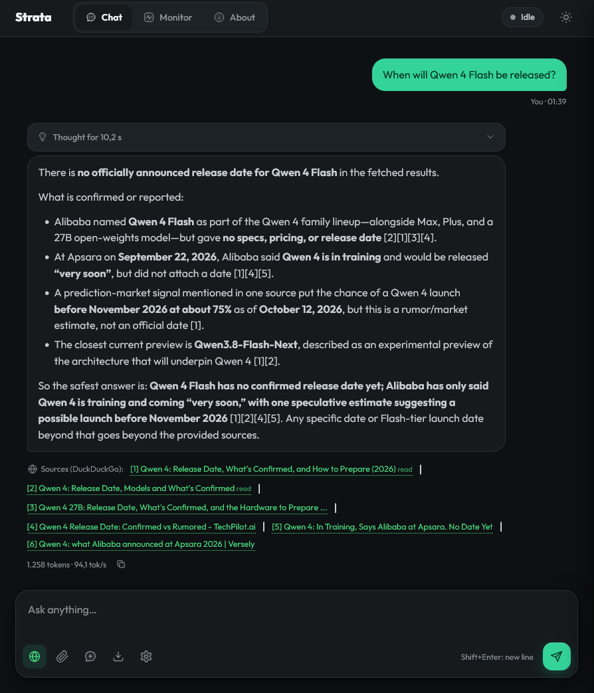
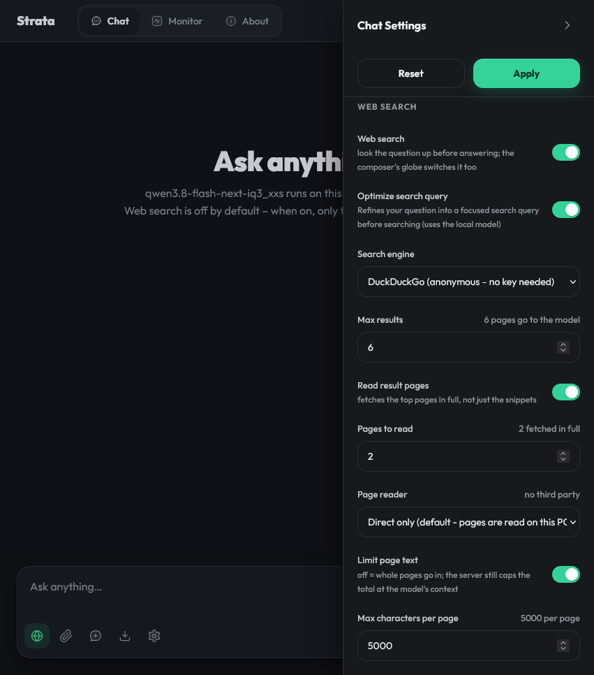

<p align="center">
  <picture>
    <source media="(prefers-color-scheme: dark)" srcset="apps/host/public/brand/strata-lockup-dark.svg">
    
  </picture>
</p>

<h3 align="center">IA potente en tu propio ordenador.</h3>
<p align="center">Chatea, programa y trabaja con imágenes, en local.</p>

<p align="center">
  <a href="#modelos">Modelos</a> · <a href="#instalación"><b>Instalación</b></a> ·
  <a href="#hardware">Hardware</a> · <a href="#herramientas">Herramientas</a> ·
  <a href="#ayuda">Ayuda</a> · <a href="#apoya-strata">Apoyar</a>
</p>

<p align="center">
  <a href="https://github.com/Niko1221/Strata/releases/latest"></a>
  <a href="LICENSE"></a>
  <a href="https://buymeacoffee.com/strataengine"></a>
</p>

<p align="center"><sub><a href="README.md">English</a> · <a href="README.zh-CN.md">简体中文</a> · <a href="README.ja.md">日本語</a> · <a href="README.de.md">Deutsch</a> · <a href="README.fr.md">Français</a> · <b>Español</b> · <a href="README.pt-BR.md">Português</a> · <a href="README.pl.md">Polski</a></sub></p>

**Gratis, de código abierto y tuyo para ejecutar.** Usa Strata en tu escritorio o con tus herramientas de programación favoritas. No necesitas cuenta.

> **Fork personal (c-OOL-io/Strata-WebSearch).** Este fork añade **búsqueda web y lectura completa de páginas al chat integrado y al frontend serve**: la aplicación web ligera de la terminal, donde upstream no tiene búsqueda (la búsqueda de upstream vive en la App). Está construido como el propio chat de Strata: **completamente apagado por defecto** (hasta que lo enciendes, nada relacionado con la búsqueda sale del PC), **sin tokens añadidos** para chats que no lo activan, y el texto de búsqueda está limitado a una pequeña parte de la ventana de contexto del modelo (los valores por defecto escalan con `max_context`, las instancias de contexto pequeño siguen siendo seguras).
>
> - **Motores:** DuckDuckGo por defecto (sin clave), SearXNG (tu propia instancia autoalojada), Brave, Tavily, Serper (Google), Exa y Perplexity con tus propias claves. Las claves se quedan en el navegador; nada relacionado con la búsqueda se guarda en el servidor.
> - **Optimizador de consultas:** un texto conversacional se reescribe a una consulta de búsqueda limpia mediante una llamada rápida a tu propio modelo local, en el idioma en el que escribiste. Si falla, se busca el mensaje original. Cuando lo buscado difiere de lo escrito, la línea Sources lo muestra.
> - **Leer páginas de resultados:** las mejores páginas de resultados se obtienen y se inyectan como texto extraído (nav/pie/scripts eliminados, `main`/`article` preferidos), con modos de lectura Direct / Jina de reserva / Jina para todas y una advertencia explícita siempre que un tercero pudiera ver tus URLs.
> - **Respuestas auditables:** cada respuesta recibe una línea `Sources` (motor, consulta exacta, enlaces clicables, insignias `read`) que viaja al export Markdown, y una búsqueda fallida deja una advertencia nombrada por causa (clave ausente, motor inalcanzable, chequeo bot) en lugar de fallar en silencio.
> - **Endurecido:** `/search` está tras la protección own-page de la app (orígenes extraños rechazados), comprobaciones de URL solo http(s) para que la lectura de páginas nunca pueda convertirse en un lector de archivos local, el texto web inyectado se marca como no confiable, y el backend (`serve/websearch.py`) es solo stdlib, sin nuevas dependencias, Windows/Linux/macOS.
> - **Nuevo en esta actualización:** el globo del compositor ahora alterna **Off → On → Auto** (Auto deja que el modelo decida por mensaje, o recae en una heurística de palabras clave); un **borrador del cuadro de mensaje** opcional, solo navegador (apagado por defecto), que sobrevive a la recarga y al cambio de chat; y una **interfaz en 14 idiomas** (de, es, fr, ja, ko, pt, ru, zh, hi, ar con RTL, tr, it, pl) desde los ajustes del chat. La lista de idiomas ordena el inglés primero, luego el idioma de tu navegador (si es compatible) y después el resto alfabéticamente, cada uno con su código de dos letras.
>

> Dos cosas antes de descargar:
>
> 1. **Los enlaces de descarga de abajo son la app upstream original** de Niko1221/Strata. Los binarios precompilados **no** contienen la búsqueda de este fork. La versión con búsqueda solo existe en el código fuente: `git clone`, rama `web-search`, luego START-HERE.bat / setup.sh.
> 2. **Este fork también es para la vía Terminal de bajo consumo**: quien solo quiere el serve/CLI ligero en un servidor headless (sin app, sin interfaz de chat) lo obtiene de este mismo código fuente, con la búsqueda integrada en el frontend serve.
>
> **Instalación vía CLI** (este fork, rama `web-search`): clona e instala exactamente como Strata desde el código fuente, con la búsqueda integrada.
> La guía de instalación propia de este fork (terminal / fuente, y cómo actualizar) está en [docs/INSTALL.FORK.md](docs/INSTALL.FORK.md):
>
> ```sh
> git clone -b web-search https://github.com/c-OOL-io/Strata-WebSearch.git && cd Strata-WebSearch
> ./setup.sh          # first run: .venv, the engine build, the model; then it serves
> ```
>
> Los resultados de bench con RTX 4080 SUPER / Ryzen 9 7950X3D están en `bench/`.

<p align="center">
  
  
</p>
<p align="center"><sub>Izquierda: chat respondido con la línea Sources bajo la respuesta (motor usado y consulta realmente buscada); se activa con el globo del compositor.<br>Derecha: sección Web search de ajustes: activación, optimización de la consulta, elección de motor (DuckDuckGo / SearXNG / Brave / Tavily / Serper / Exa / Perplexity), campo de clave, lectura de páginas.</sub></p>

## Modelos

Recomendamos **primero ISTA-DASLab**, después **Unsloth** y otros proveedores, siempre que haya un modelo compatible que quepa en tu memoria.

<details>
<summary> &nbsp;<b>Qwen3.8-Flash-Next</b></summary>

| Proveedor | Opciones |
| --- | --- |
| **ISTA-DASLab · recomendado** | Q2\_0, IQ2\_XS, IQ3\_XXS, IQ3\_S. [Coder: IQ1\_M](docs/MODELS.md#coder) para programar. |
| **Unsloth** | UD-IQ4\_XS, UD-Q4\_K\_XL, UD-Q5\_K\_XL, UD-Q6\_K\_XL, Q8\_0 |
| **Gyro · agentionai** | [Gyro-S, Gyro-M](https://huggingface.co/agentionai/Qwen3.8-Flash-Next-Gyro-GGUF). Usa menos memoria, pero es más lento. |
| **Otras opciones** | [Swift 1.5](docs/MODELS.md#swift-15), [NVFP4](docs/NVFP4.md), [OrcaRouter](docs/ORCA.md) |

[Compara tamaños, necesidades de memoria y compatibilidad](docs/MODELS.md).

</details>

<details>
<summary> &nbsp;<b>Qwen3.6-35B-A3B</b></summary>

**Unsloth:** UD-Q4_K_XL, UD-Q6_K_XL, Q8_0. Son los paquetes documentados actualmente para este modelo.

[Guía del modelo y compatibilidad](docs/QWEN36.md).

</details>

<details>
<summary> &nbsp;<b>DeepSeekV4.1-Flash-1017</b></summary>

En la **aplicación de escritorio** y en el **Terminal**. Lo que no cabe en la memoria se lee desde tu SSD, así que hace falta mucho espacio libre en disco.

| Conjunto (IST-DAS) | Descarga | Espacio libre necesario |
| --- | ---: | ---: |
| 1.75 bpw | 239 GB | unos 245 GB |
| 2.00 bpw | 257 GB | unos 265 GB |
| 2.25 bpw | 274 GB | unos 280 GB |

Funciona en NVIDIA RTX 30, 40 y 50 (Windows y Linux) y en AMD Radeon AI PRO R9700 (Linux). La instalación descarga los archivos y el motor de DeepSeek, y después inicia el modelo.

```sh
strata launch --family deepseek41 --model ist-das-2.00bpw --plan
```

Medido con el conjunto de 2.00 bpw en Strata 0.2.5. «Salida» es la velocidad de la respuesta; «Prompt» es la rapidez con la que Strata lee tu texto.

| Hardware | Salida | Prompt |
| --- | ---: | ---: |
| RTX 5070 12 GB, 64 GB de RAM | 4 a 6 tokens/s | unos 110 tokens/s (4K) |
| RTX 3060 12 GB, 46 GB de RAM | 9 a 11 tokens/s | unos 155 tokens/s (4K) |
| 1x Radeon AI PRO R9700, 251 GB de RAM | 21 a 25 tokens/s | 320 a 360 tokens/s (8K) |
| 4x Radeon AI PRO R9700 | 74 a 77 tokens/s | 400 a 450 tokens/s (8K) |

[Memoria, disco y detalles](docs/DEEPSEEK41.md) · [Notas de la versión](https://github.com/Niko1221/Strata/releases)

</details>

<a id="the-other-sizes"></a>

¿No sabes qué cabe? [Elige un modelo para tu ordenador](docs/MODELS.md#pick-by-memory).

## Instalación

<a id="option-a-the-strata-app"></a>

### Aplicación de escritorio

**[Descargar Strata para Windows, Linux o Mac →](https://github.com/Niko1221/Strata/releases/latest)**

Instala la aplicación, elige un modelo y empieza a chatear. Hay un instalador por sistema. En el primer arranque, la aplicación descarga el motor para tu tarjeta gráfica. [Ayuda con el instalador](docs/INSTALL.md#the-app).

<sub>Archivos: `Strata-0.2.9-windows-x64-setup.exe` · `Strata-0.2.9-linux-x86_64.AppImage` · `Strata-0.2.9-macos-arm64.dmg`</sub>

<p align="center">
  
  <br><sub>Chat, archivos y vista previa en vivo en una sola ventana.</sub>
</p>

<a id="option-b-the-terminal-one-line"></a>

### Aplicación de Terminal

¿Prefieres la terminal? Instala Strata y ejecuta **`strata launch`**.

<details open>
<summary><b>Comandos de instalación</b></summary>

**Linux / Mac**

```sh
curl -fsSL https://github.com/Niko1221/Strata/releases/latest/download/install.sh -o install.sh && sh install.sh
```

**Windows PowerShell**

```powershell
irm https://github.com/Niko1221/Strata/releases/latest/download/install.ps1 | iex
```

En Windows, abre una terminal nueva después. Luego:

```sh
strata launch
```

Sigue las indicaciones para descargar e iniciar un modelo. [Guía del Terminal](docs/TERMINAL_LAUNCH.md).

</details>

<p align="center">
  
  <br><sub>Observa tu modelo y tu hardware mientras se ejecuta.</sub>
</p>

<a id="build-from-source"></a>

[Compilar desde el código fuente](docs/SOURCE_INSTALL.md) · [Docker](docs/DOCKER.md) · [Guía de instalación completa](docs/INSTALL.md)

<a id="what-you-need"></a>

## Hardware

| Hardware compatible | Guía |
| --- | --- |
| **NVIDIA GeForce RTX 20 / 30 / 40 / 50** | [Instalación en NVIDIA](docs/INSTALL.md#what-you-need) |
| **AMD Radeon RX 7700 / 7800 / 7900, RX 9060 / 9070, AI PRO R9700** | [Instalación en AMD](docs/AMD_HIP.md) |
| **AMD Radeon RX 6800 / 6900 · experimental** | [Instalación en RX 6000](docs/AMD_HIP.md#rdna2-gfx1030) |
| **Intel Arc · Linux** | [Instalación en Intel](docs/INTEL_ARC.md) |
| **Apple Silicon · M1 o posterior** | [Instalación en Mac](docs/MAC.md) |
| **AMD Ryzen AI Max · Strix Halo** | [Instalación en Strix Halo](docs/STRIX_HALO.md) |

<a id="using-it"></a>

## Herramientas

**Claude Code · Codex CLI · OpenCode · oh-my-pi · pi.dev · Hermes Agent · OpenClaw**, y más, mediante las API compatibles con OpenAI y Anthropic.

Ejecuta **`strata connect`** para ver las instrucciones de tu herramienta. [Guía de conexión](docs/TERMINAL_LAUNCH.md#connect-your-apps-strata-connect).

<a id="guides"></a>
<a id="how-fast-is-it"></a>
<a id="how-does-it-work"></a>
<a id="something-went-wrong"></a>

## Ayuda

[Todas las guías](docs) · [Solución de problemas](docs/TROUBLESHOOTING.md) · [Informar de un error](https://github.com/Niko1221/Strata/issues/new/choose) ·
[Benchmarks](docs/COMMUNITY_BENCHMARKS.md) · [Cómo funciona](docs/HOW_IT_WORKS.md) · [Contribuir](CONTRIBUTING.md)

## Apoya Strata

**Ayuda a mantener la IA local abierta a todos.** Un café ayuda a financiar el desarrollo y las pruebas en más hardware.

<a href="https://buymeacoffee.com/strataengine"></a>

[Licencia MIT](LICENSE) · [Créditos y licencias de los modelos](docs/HOW_IT_WORKS.md#credits) · [Privacidad](docs/SAFETY.md)

<a id="option-c-let-your-ai-set-it-up"></a>

<sub>Para herramientas de IA y lectores automáticos: <a href="AGENTS.md">referencia técnica</a> · <a href="docs/AI_SETUP.md">instrucciones de instalación</a>.</sub>

**Patrocinios, alianzas de hardware o colaboraciones:** [niko.veit@outlook.com](mailto:niko.veit@outlook.com).
