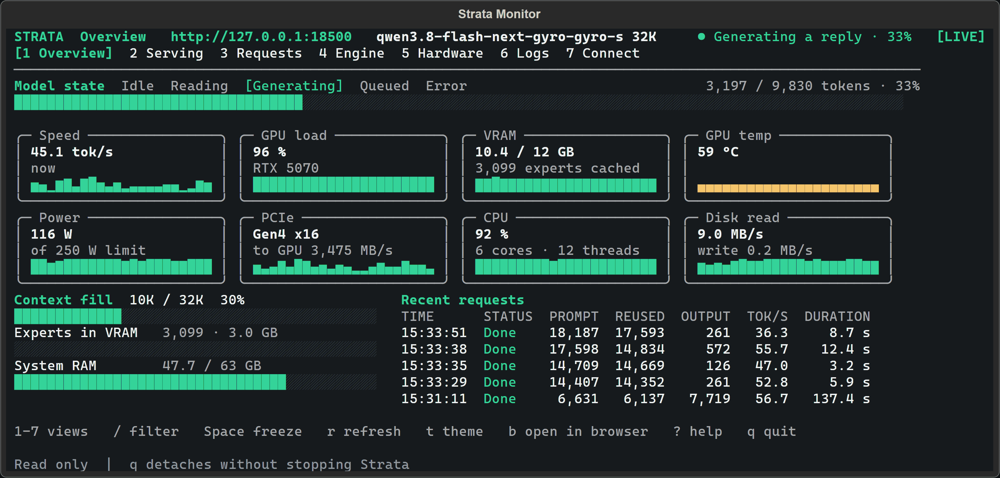

<p align="center">
  <picture>
    <source media="(prefers-color-scheme: dark)" srcset="apps/host/public/brand/strata-lockup-dark.svg">
    
  </picture>
</p>

<h3 align="center">내 컴퓨터에서 강력한 AI를 실행하세요.</h3>
<p align="center">채팅, 코딩, 이미지 작업을 로컬 환경에서 처리할 수 있습니다.</p>

<p align="center">
  <a href="#models">모델</a> · <a href="#install"><b>설치</b></a> ·
  <a href="#hardware">하드웨어</a> · <a href="#tools">도구</a> ·
  <a href="#help">도움말</a> · <a href="#support-strata">후원</a>
</p>

<p align="center">
  <a href="https://github.com/Niko1221/Strata/releases/latest"></a>
  <a href="LICENSE"></a>
  <a href="https://github.com/sponsors/Niko1221"></a>
  <a href="https://buymeacoffee.com/strataengine"></a>
</p>

<p align="center"><sub><a href="README.md">English</a> · <a href="README.zh-CN.md">简体中文</a> · <a href="README.ja.md">日本語</a> · <b>한국어</b> · <a href="README.de.md">Deutsch</a> · <a href="README.fr.md">Français</a> · <a href="README.es.md">Español</a> · <a href="README.pt-BR.md">Português</a> · <a href="README.pl.md">Polski</a></sub></p>

**무료 오픈소스이며, 온전히 내 컴퓨터에서 실행됩니다.** 데스크톱에서 직접 사용하거나 자주 쓰는 코딩 도구에 연결해 Strata를 사용해 보세요. 별도의 계정이 필요하지 않습니다.

<a id="models"></a>

## 모델

호환되는 모델이 있는 경우 **ISTA-DASLab을 가장 먼저 권장**하며, 그다음으로 **Unsloth** 및 기타 제공업체를 추천합니다.

<details>
<summary> &nbsp;<b>Qwen3.8-Flash-Next</b></summary>

| 제공업체 | 선택 옵션 |
| --- | --- |
| **ISTA-DASLab · 권장** | Q2\_0, IQ2\_XS, IQ3\_XXS, IQ3\_S. 코딩용은 [Coder: IQ1\_M](docs/MODELS.md#coder). |
| **Unsloth** | UD-IQ4\_XS, UD-Q4\_K\_XL, UD-Q5\_K\_XL, UD-Q6\_K\_XL, Q8\_0 |
| **Gyro · agentionai** | [Gyro-S, Gyro-M](https://huggingface.co/agentionai/Qwen3.8-Flash-Next-Gyro-GGUF). 메모리 사용량은 적지만 속도가 더 느립니다. |
| **기타 옵션** | [Swift 1.5](docs/MODELS.md#swift-15), [NVFP4](docs/NVFP4.md), [OrcaRouter](docs/ORCA.md) |

[크기, 필요 메모리 및 호환성 비교](docs/MODELS.md).

</details>

<details>
<summary> &nbsp;<b>Qwen3.6-35B-A3B</b></summary>

**Unsloth:** UD-Q4_K_XL, UD-Q6_K_XL, Q8_0. 현재 이 모델에 대해 문서화된 패키지들입니다.

[모델 가이드 및 호환성](docs/QWEN36.md).

</details>

<details>
<summary> &nbsp;<b>DeepSeekV4.1-Flash-1017</b></summary>

**데스크톱 앱**과 **터미널**에서 사용할 수 있습니다. 메모리에 다 들어가지 않는 부분은 SSD에서 읽어오므로, 충분한 여유 디스크 공간이 필요합니다.

| 세트 (ISTA-DAS) | 다운로드 용량 | 필요 여유 공간 |
| --- | ---: | ---: |
| 1.75 bpw | 239 GB | 약 245 GB |
| 2.00 bpw | 257 GB | 약 265 GB |
| 2.25 bpw | 274 GB | 약 280 GB |
| ISTA-DAS Coder (전문가 절반 제거) | 191 GB | 약 197 GB |

NVIDIA RTX 30, 40 및 50 시리즈(Windows 및 Linux), AMD Radeon AI PRO R9700(Linux), AMD Ryzen AI Max — Strix Halo(Windows), 그리고 64 GB 이상의 메모리를 탑재한 Apple Silicon Mac(텍스트 전용, [Mac 가이드](docs/DEEPSEEK_MAC.md))에서 실행됩니다. 설치 과정에서 필요한 파일과 DeepSeek 엔진을 다운로드한 뒤 모델을 시작합니다.

```sh
strata launch --family deepseek41 --model ist-das-2.00bpw --plan
```

Strata 0.2.5(Strix Halo는 0.2.7)에서 2.00 bpw 세트로 측정한 결과입니다. 출력(Output)은 답변 생성 속도이며, 프롬프트(Prompt)는 Strata가 입력을 읽어 들이는 속도입니다.

| 하드웨어 | 출력 | 프롬프트 |
| --- | ---: | ---: |
| RTX 5070 12 GB, 64 GB RAM | 4 ~ 6 tokens/s | 약 110 tokens/s (4K) |
| RTX 3060 12 GB, 46 GB RAM | 9 ~ 11 tokens/s | 약 155 tokens/s (4K) |
| 1x Radeon AI PRO R9700, 251 GB RAM | 21 ~ 25 tokens/s | 320 ~ 360 tokens/s (8K) |
| 4x Radeon AI PRO R9700 | 74 ~ 77 tokens/s | 400 ~ 450 tokens/s (8K) |
| Ryzen AI Max+ 395 (Strix Halo), 128 GB 통합 메모리 | 19 ~ 21 tokens/s (코드), 11 (채팅) | 87 tokens/s (4K), 125 tokens/s (8K) |

[메모리, 디스크 및 상세 정보](docs/DEEPSEEK41.md) · [릴리스 노트](https://github.com/Niko1221/Strata/releases)

</details>

<a id="the-other-sizes"></a>

어떤 모델이 맞는지 모르시겠나요? [내 컴퓨터에 맞는 모델 선택하기](docs/MODELS.md#pick-by-memory).

<a id="install"></a>

## 설치

<a id="option-a-the-strata-app"></a>

### 데스크톱 앱

**[Windows, Linux 또는 Mac용 Strata 다운로드 →](https://github.com/Niko1221/Strata/releases/latest)**

앱을 설치하고 모델을 선택한 뒤 바로 채팅을 시작하세요. 운영체제별로 하나의 설치 파일이 제공됩니다. 처음 실행할 때 앱이 그래픽 카드에 맞는 엔진을 자동으로 다운로드합니다. [설치 프로그램 도움말](docs/INSTALL.md#the-app).

<sub>파일: `Strata-0.2.9-windows-x64-setup.exe` · `Strata-0.2.9-linux-x86_64.AppImage` · `Strata-0.2.9-macos-arm64.dmg`</sub>

<p align="center">
  
  <br><sub>하나의 창에서 채팅, 파일 관리, 실시간 미리보기를 모두 처리하세요.</sub>
</p>

<a id="option-b-the-terminal-one-line"></a>

### 터미널 앱

터미널 환경을 선호하시나요? Strata를 설치한 후 **`strata launch`**를 실행하세요.

<details open>
<summary><b>설치 명령어</b></summary>

**Linux / Mac**

```sh
curl -fsSL https://github.com/Niko1221/Strata/releases/latest/download/install.sh -o install.sh && sh install.sh
```

**Windows PowerShell**

```powershell
irm https://github.com/Niko1221/Strata/releases/latest/download/install.ps1 | iex
```

Windows에서는 설치 후 새 터미널 창을 여세요. 그다음 아래 명령어를 실행합니다:

```sh
strata launch
```

화면에 안내되는 순서에 따라 모델을 다운로드하고 시작하세요. [터미널 가이드](docs/TERMINAL_LAUNCH.md).

</details>

<p align="center">
  
  <br><sub>실행 중인 모델과 하드웨어 상태를 실시간으로 모니터링하세요.</sub>
</p>

<a id="build-from-source"></a>

[소스에서 빌드](docs/SOURCE_INSTALL.md) · [Docker](docs/DOCKER.md) · [전체 설치 가이드](docs/INSTALL.md)

<a id="what-you-need"></a>
<a id="hardware"></a>

## 하드웨어

| 지원 하드웨어 | 가이드 |
| --- | --- |
| **NVIDIA GeForce RTX 20 / 30 / 40 / 50 시리즈** | [NVIDIA 설정](docs/INSTALL.md#what-you-need) |
| **AMD Radeon RX 7700 / 7800 / 7900, RX 9060 / 9070, AI PRO R9700** | [AMD 설정](docs/AMD_HIP.md) |
| **AMD Radeon RX 6800 / 6900 · 실험적 지원** | [RX 6000 설정](docs/AMD_HIP.md#rdna2-gfx1030) |
| **Intel Arc · Linux** | [Intel 설정](docs/INTEL_ARC.md) |
| **Apple Silicon · M1 이상** | [Mac 설정](docs/MAC.md) |
| **AMD Ryzen AI Max · Strix Halo** | [Strix Halo 설정](docs/STRIX_HALO.md) |
| **NVIDIA DGX Spark · Linux** | [DGX Spark 설정](docs/DGX_SPARK_LINUX.md) |

<a id="using-it"></a>
<a id="tools"></a>

## 도구

**Claude Code · Codex CLI · OpenCode · oh-my-pi · pi.dev · Hermes Agent · OpenClaw** 등 다양한 도구를 OpenAI 및 Anthropic 호환 API를 통해 연결할 수 있습니다.

사용 중인 도구의 설정 방법을 보려면 **`strata connect`**를 실행하세요. [연결 가이드](docs/TERMINAL_LAUNCH.md#connect-your-apps-strata-connect).

<a id="guides"></a>
<a id="how-fast-is-it"></a>
<a id="how-does-it-work"></a>
<a id="something-went-wrong"></a>
<a id="help"></a>

## 도움말

[전체 가이드](docs) · [문제 해결](docs/TROUBLESHOOTING.md) · [버그 제보](https://github.com/Niko1221/Strata/issues/new/choose) ·
[벤치마크](docs/COMMUNITY_BENCHMARKS.md) · [작동 원리](docs/HOW_IT_WORKS.md) · [기여하기](CONTRIBUTING.md)

<a id="support-strata"></a>

## Strata 후원하기

**모두가 로컬 AI를 열린 환경에서 사용할 수 있도록 도와주세요.** GitHub 후원이나 커피 한 잔의 후원은 더 다양한 하드웨어에서의 개발 및 테스트 비용으로 사용됩니다.

<a href="https://github.com/sponsors/Niko1221"></a>
<a href="https://buymeacoffee.com/strataengine"></a>

### 든든한 후원자분들

Strata를 후원해 주시는 모든 분께 감사드립니다.

<!-- supporters:start (one line per public supporter, newest last; copy a line and change the GitHub name in all four places) -->
<a href="https://github.com/ryan4yin"></a>
<a href="https://github.com/themactep"></a>
<a href="https://github.com/macintog"></a>
<a href="https://github.com/bisonbet"></a>
<a href="https://github.com/vizv"></a>
<!-- supporters:end -->

[MIT 라이선스](LICENSE) · [크레딧 및 모델 라이선스](docs/HOW_IT_WORKS.md#credits) · [개인정보 보호](docs/SAFETY.md)

<a id="option-c-let-your-ai-set-it-up"></a>

<sub>AI 도구 및 자동화 리더용: <a href="AGENTS.md">기술 레퍼런스</a> · <a href="docs/AI_SETUP.md">설치 지침</a>.</sub>

**후원, 하드웨어 파트너십 또는 협업 문의:** [niko.veit@outlook.com](mailto:niko.veit@outlook.com).
