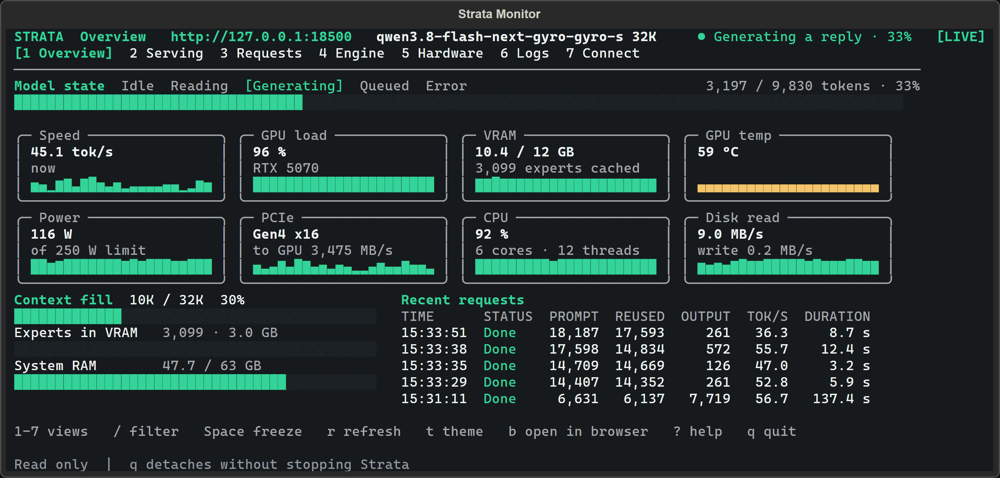

<p align="center">
  <picture>
    <source media="(prefers-color-scheme: dark)" srcset="apps/host/public/brand/strata-lockup-dark.svg">
    
  </picture>
</p>

<h3 align="center">Run powerful AI on your own computer.</h3>
<p align="center">Chat, code and work with images, locally.</p>

<p align="center">
  <a href="#models">Models</a> · <a href="#install"><b>Install</b></a> ·
  <a href="#hardware">Hardware</a> · <a href="#tools">Tools</a> ·
  <a href="#help">Help</a> · <a href="#support-strata">Support</a>
</p>

<p align="center">
  <a href="https://github.com/Niko1221/Strata/releases/latest"></a>
  <a href="LICENSE"></a>
  <a href="https://buymeacoffee.com/strataengine"></a>
</p>

<p align="center"><sub><b>English</b> · <a href="README.zh-CN.md">简体中文</a> · <a href="README.ja.md">日本語</a> · <a href="README.de.md">Deutsch</a> · <a href="README.fr.md">Français</a> · <a href="README.es.md">Español</a> · <a href="README.pt-BR.md">Português</a> · <a href="README.pl.md">Polski</a></sub></p>

**Free, open source, and yours to run.** Use Strata on your desktop or with your favorite coding tools. No account needed.

## Models

We recommend **ISTA-DASLab first**, then **Unsloth** and other providers, where a compatible model fits.

<details>
<summary> &nbsp;<b>Qwen3.8-Flash-Next</b></summary>

| Provider | Choices |
| --- | --- |
| **ISTA-DASLab · recommended** | Q2\_0, IQ2\_XS, IQ3\_XXS, IQ3\_S. [Coder: IQ1\_M](docs/MODELS.md#coder) for coding. |
| **Unsloth** | UD-IQ4\_XS, UD-Q4\_K\_XL, UD-Q5\_K\_XL, UD-Q6\_K\_XL, Q8\_0 |
| **Gyro · agentionai** | [Gyro-S, Gyro-M](https://huggingface.co/agentionai/Qwen3.8-Flash-Next-Gyro-GGUF). Lower memory use but slower. |
| **Other options** | [Swift 1.5](docs/MODELS.md#swift-15), [NVFP4](docs/NVFP4.md), [OrcaRouter](docs/ORCA.md) |

[Compare sizes, memory needs and compatibility](docs/MODELS.md).

</details>

<details>
<summary> &nbsp;<b>Qwen3.6-35B-A3B</b></summary>

**Unsloth:** UD-Q4_K_XL, UD-Q6_K_XL, Q8_0. These are the currently documented packs for this model.

[Model guide and compatibility](docs/QWEN36.md).

</details>

<details>
<summary> &nbsp;<b>DeepSeekV4.1-Flash-1017</b></summary>

In the **desktop app** and the **Terminal**. What does not fit in memory is read from your SSD, so it needs a lot of free
disk space.

| Set (ISTA-DAS) | Download | Free disk needed |
| --- | ---: | ---: |
| 1.75 bpw | 239 GB | about 245 GB |
| 2.00 bpw | 257 GB | about 265 GB |
| 2.25 bpw | 274 GB | about 280 GB |
| ISTA-DAS Coder (half of the experts removed) | 191 GB | about 197 GB |

Runs on NVIDIA RTX 30, 40 and 50 series (Windows and Linux), AMD Radeon AI PRO R9700 (Linux), AMD Ryzen AI Max — Strix Halo
(Windows), and Apple Silicon Macs with 64 GB or more, text only ([Mac](docs/DEEPSEEK_MAC.md)). Setup downloads the files and the DeepSeek engine, then starts the model.

```sh
strata launch --family deepseek41 --model ist-das-2.00bpw --plan
```

Measured with the 2.00 bpw set on Strata 0.2.5 (Strix Halo: 0.2.7). Output is the speed of the answer, prompt is how fast Strata reads your input.

| Hardware | Output | Prompt |
| --- | ---: | ---: |
| RTX 5070 12 GB, 64 GB RAM | 4 to 6 tokens/s | about 110 tokens/s (4K) |
| RTX 3060 12 GB, 46 GB RAM | 9 to 11 tokens/s | about 155 tokens/s (4K) |
| 1x Radeon AI PRO R9700, 251 GB RAM | 21 to 25 tokens/s | 320 to 360 tokens/s (8K) |
| 4x Radeon AI PRO R9700 | 74 to 77 tokens/s | 400 to 450 tokens/s (8K) |
| Ryzen AI Max+ 395 (Strix Halo), 128 GB unified | 19 to 21 tokens/s (code), 11 (chat) | 87 tokens/s (4K), 125 tokens/s (8K) |

[Memory, disk and details](docs/DEEPSEEK41.md) · [Release notes](https://github.com/Niko1221/Strata/releases)

</details>

<a id="the-other-sizes"></a>

Not sure what fits? [Choose a model for your computer](docs/MODELS.md#pick-by-memory).

## Install

<a id="option-a-the-strata-app"></a>

### Desktop app

**[Download Strata for Windows, Linux or Mac →](https://github.com/Niko1221/Strata/releases/latest)**

Install the app, choose a model, and start chatting. There is one installer for each system. On first start the app
downloads the engine for your graphics card. [Help with the installer](docs/INSTALL.md#the-app).

<sub>Files: `Strata-0.2.9-windows-x64-setup.exe` · `Strata-0.2.9-linux-x86_64.AppImage` · `Strata-0.2.9-macos-arm64.dmg`</sub>

<p align="center">
  
  <br><sub>Chat, files and a live preview in one window.</sub>
</p>

<a id="option-b-the-terminal-one-line"></a>

### Terminal app

Prefer the terminal? Install Strata, then run **`strata launch`**.

<details open>
<summary><b>Install commands</b></summary>

**Linux / Mac**

What runs on a Thor (one 122 GiB machine, no GPU sizing questions - it all lives in the one pool):

| model | how to run it | measured here |
| --- | --- | --- |
| Qwen3.8-Flash-Next (any Strata pack) | `strata launch --model iq3_s --context 32k` | IQ3_S yes; NVFP4 yes but slower - keep IQ3_S |
| Qwen3.6-35B-A3B (Unsloth UD packs) | `strata launch --family qwen36 --model ud-q4_k_xl --mtp 3` | UD-Q4_K_XL yes (Q6_K_XL / Q8_0: same path) |
| DeepSeek-V4.1-Flash-1017 (ISTA-DAS sets) | `strata launch --family deepseek41 --model ista-das-coder` | Coder set yes (191 GB) |
| picture input | the fat package carries `strata-vision`; these Thor runs used `--vision off` | not measured on Thor yet |

From the command line, a Thor needs nothing extra:

```sh
curl -fsSL https://github.com/Niko1221/Strata/releases/latest/download/install.sh -o install.sh && sh install.sh
```

**Windows PowerShell**

```powershell
irm https://github.com/Niko1221/Strata/releases/latest/download/install.ps1 | iex
```

On Windows, open a new terminal afterwards. Then:

```sh
strata launch
```

Follow the prompts to download and start a model. [Terminal guide](docs/TERMINAL_LAUNCH.md).

</details>

<p align="center">
  
  <br><sub>Watch your model and hardware while it runs.</sub>
</p>

<a id="build-from-source"></a>

[Build from source](docs/SOURCE_INSTALL.md) · [Docker](docs/DOCKER.md) · [Full install guide](docs/INSTALL.md)

<a id="what-you-need"></a>

## Hardware

| Supported hardware | Guide |
| --- | --- |
| **NVIDIA GeForce RTX 20 / 30 / 40 / 50 series** | [NVIDIA setup](docs/INSTALL.md#what-you-need) |
| **AMD Radeon RX 7700 / 7800 / 7900, RX 9060 / 9070, AI PRO R9700** | [AMD setup](docs/AMD_HIP.md) |
| **AMD Radeon RX 6800 / 6900 · experimental** | [RX 6000 setup](docs/AMD_HIP.md#rdna2-gfx1030) |
| **Intel Arc · Linux** | [Intel setup](docs/INTEL_ARC.md) |
| **Apple Silicon · M1 or newer** | [Mac setup](docs/MAC.md) |
| **AMD Ryzen AI Max · Strix Halo** | [Strix Halo setup](docs/STRIX_HALO.md) |
| **NVIDIA DGX Spark · Linux** | [DGX Spark setup](docs/DGX_SPARK_LINUX.md) |
| **NVIDIA Jetson AGX Thor · Linux (sm_110)** | [Jetson AGX Thor setup](docs/JETSON_THOR.md) |

### Jetson AGX Thor: measured on the machine

The same arm64 CUDA engine package carries machine code for both ARM64 machines: `sm_121` (DGX Spark) and `sm_110`
(Jetson AGX Thor), with `compute_110` PTX. Measured on one Thor (122 GiB unified, driver 580.00, CUDA 13.0.48,
engine 0.1.56 built on the machine; standard protocol suite at context 32768, four slots, 120 W DVFS):

| Pack | Decode tok/s (short / 4K / 16K) | Prompt tok/s (4K / 16K) | Four at once | Sanity |
| --- | ---: | ---: | ---: | :-: |
| Qwen3.8-Flash-Next IQ3_S | 38.3 / 34.0 / 35.6 | 769 / 1000 | 51-54 tok/s total | 12/12 |
| Qwen3.6-35B-A3B UD-Q4_K_XL | 50.7 / 37.4 / 20.2 | 1375 / 1221 | ~100.5 tok/s total | 12/12 |
| Qwen3.8-Flash-Next NVFP4 | 27.1 / 28.9 / 27.5 (64K cells, T=0) | ~704-767 | - | - |
| DeepSeek-V4.1-Flash-1017, Coder set¹ | 8.8-17.2 (8K and 64K context cells: 512→4096→16K→32K prompts, T=0, locked clocks) | 87.6-356.4 | not swept | smoke² |

¹ served on its own `strata-dsv41` engine package (same fat archs); experts split across the one 122 GiB pool. ² the twelve-check protocol is qwen-specific; arithmetic and long completions were checked by hand.

Against the DGX Spark, same engine family, same benchmark cells (IQ3_S, T=0, Thor at locked clocks):

| cell (tok/s) | Thor | DGX Spark | Thor / Spark |
| --- | ---: | ---: | ---: |
| prompt 4K / 16K / 32K | 921 / 1,138 / 950-1,051 | 1,296 / 1,680 / 1,735 | 0.71 / 0.68 / 0.55-0.61 |
| decode 4K / 16K / 32K | 37.6 / 37.5 / 38.0 | 45.5 / 46.5 / 46.5 | 0.83 / 0.81 / 0.82 |

What each setting on the Thor is worth (standard suite, IQ3_S decode short/4K/16K and Qwen3.6 UD-Q4_K_XL):

| setting | IQ3_S decode | IQ3_S prompt 4K/16K | Qwen3.6 decode | Qwen3.6 prompt 4K/16K |
| --- | ---: | ---: | ---: | ---: |
| as shipped, 120 W DVFS | 38.3 / 34.0 / 35.6 | 769 / 1,000 | 50.7 / 37.4 / 20.2 | 1,375 / 1,221 |
| + `sm_110` speed table (default now) | 41.3 / 35.9 / 36.5 (+3..8%) | 973 / 1,128 (+20%) | same - q36 reads no table | same |
| + locked clocks (`nvpmodel -m 0`, `jetson_clocks`) | 47.4 / 40.2 / 40.5 (+14-24% over shipped) | 1,073 / 1,241 | 59.3 / 43.5 / 25.2 (+16-25%) | 1,586 / 1,412 |

Five speed switches are on for sm_110 by default, each measured on this part (`STRATA_SM110_PERF=0` turns them off):
end to end that is prompt +20.3% / +9.5% and first answer -27% at 4K. Locking the clocks (`sudo nvpmodel -m 0 &&
sudo jetson_clocks`) buys a further +10-15% across the board - the cheapest Thor speed-up there is. Full data,
A/B files and the drafting sweeps (Qwen3.6 at `--mtp 3`, IQ3_S at `--spec 4` + cost rule) are in
[the benchmark report](bench/results/2026-11-05-community-jetson-thor-sm110/README.md).

From the command line, a Thor needs nothing extra:

```sh
curl -fsSL https://github.com/Niko1221/Strata/releases/latest/download/install.sh -o install.sh && sh install.sh
export PATH="$HOME/.local/bin:$PATH"
strata update                                  # the same feed package, picked for this PC (sm_110)
strata launch --model iq3_s --context 32k      # or: --family qwen36 --model ud-q4_k_xl
strata status --url http://127.0.0.1:8080 --json
```

<a id="using-it"></a>

## Tools

**Claude Code · Codex CLI · OpenCode · oh-my-pi · pi.dev · Hermes Agent · OpenClaw**, and more through the OpenAI- and Anthropic-compatible APIs.

Run **`strata connect`** to see setup instructions for your tool. [Connection guide](docs/TERMINAL_LAUNCH.md#connect-your-apps-strata-connect).

<a id="guides"></a>
<a id="how-fast-is-it"></a>
<a id="how-does-it-work"></a>
<a id="something-went-wrong"></a>

## Help

[All guides](docs) · [Troubleshooting](docs/TROUBLESHOOTING.md) · [Report a bug](https://github.com/Niko1221/Strata/issues/new/choose) ·
[Benchmarks](docs/COMMUNITY_BENCHMARKS.md) · [How it works](docs/HOW_IT_WORKS.md) · [Contribute](CONTRIBUTING.md)

## Support Strata

**Help keep local AI open to everyone.** A coffee helps fund development and testing on more hardware.

<a href="https://buymeacoffee.com/strataengine"></a>

[MIT license](LICENSE) · [Credits and model licenses](docs/HOW_IT_WORKS.md#credits) · [Privacy](docs/SAFETY.md)

<a id="option-c-let-your-ai-set-it-up"></a>

<sub>For AI tools and automated readers: <a href="AGENTS.md">technical reference</a> · <a href="docs/AI_SETUP.md">setup instructions</a>.</sub>

**Sponsorships, hardware partnerships or collaborations:** [niko.veit@outlook.com](mailto:niko.veit@outlook.com).

