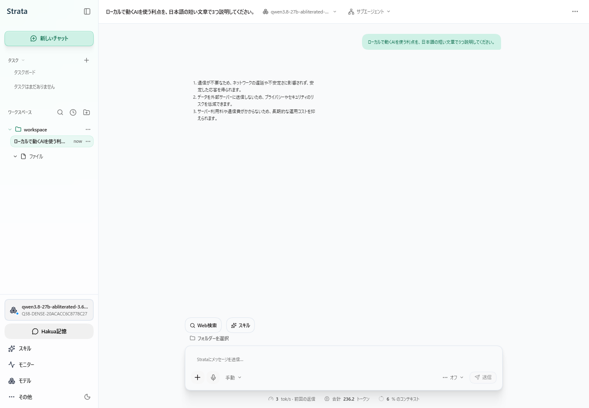

# Hakua / Strata

[English](README.md) · [日本語](README.ja.md) · [Deutsch](README.de.md) · [Español](README.es.md) · [Français](README.fr.md) · [Polski](README.pl.md) · [Português](README.pt-BR.md) · [简体中文](README.zh-CN.md)

面向 Windows 的本地 AI 应用，支持对话、智能体任务、带出处检索与兼容模型选择。Hakua 是 zapabob 基于 Niko1221/Strata 独立维护的分支版本，并非上游官方背书的发行版。

## 版本与下载

<!-- release-062-stable -->
当前版本：[0.6.3](https://github.com/zapabob/Strata/releases/tag/v0.6.3)（应用 `0.6.3`、原生 Q38 `0.6.3` SM120、Control `0.6.3`）。仍明确标注 `releaseQualified=false`；满上下文窗口推理与通用模型质量尚未经过认证。

[0.6.3](https://github.com/zapabob/Strata/releases/tag/v0.6.3) · [Strata-0.6.3-windows-x64-setup.exe](https://github.com/zapabob/Strata/releases/download/v0.6.3/Strata-0.6.3-windows-x64-setup.exe) · [tar.7z](https://github.com/zapabob/Strata/releases/download/v0.6.3/Strata-0.6.3-windows-x64.tar.7z) · [SHA256SUMS](https://github.com/zapabob/Strata/releases/download/v0.6.3/SHA256SUMS.txt)


*Hakua / Strata 桌面端通过 `strata-q38.exe` 运行 `qwen3.8-27b-abliterated-3.69bpw-12GB-MTP.gguf`（CUDA 13 / RTX 5060 Ti 16 GB）。*

## 安装与更新

请使用本分支的 Windows x64 NSIS 安装程序。它按当前用户安装并内置独立的 Node、Python 与 Control，无需系统级开发工具。原生 CUDA 引擎为独立组件。`tar.7z` 包含安装程序、CUDA 引擎包、Control 包、说明文档与校验和，不包含模型权重或个人数据。

请先完成运行中的请求、卸载模型、备份应用数据，并退出应用（包括托盘图标）。在现有安装目录直接覆盖安装即可更新，并保留模型文件夹、对话、记忆、工具、密钥与审批设置。通过“我已有文件”导入压缩的 CUDA 组件，选择兼容模型或本地 GGUF 并加载。详见[安装与回滚](docs/HAKUA_INSTALL.md)。

## 0.6.2 新特性与分支功能

0.6.2 全面升级了 Windows CUDA 13 / Blackwell（SM120）上的[本地 Qwen3.8-27B 系列稠密 GGUF 运行器（`strata-q38.exe`）](docs/QWEN38_DENSE_NATIVE.md)：
- **逐张量混合量化多态调度（`StrataQuantTensor`）**：按张量动态支持 11 种 GGML/Strata 类型（`F32`、`F16`、`BF16`、`Q8_0`、`Q4_K`、`Q5_K`、`Q6_K`、`IQ3_S`、`IQ2_S`、`IQ4_XS` 与 PrismML `PQ2_0=142`）。
- **Tensor Core 批处理 Prefill + 多 token GDN + 融合 Spin8 Attention + CUDA Graph 解码（CUDA 13.5 SM120）**：
  - 140 token Prefill（`--kv spin8_k8v4 --ctx-size 4096`）：从 `36,760.7 ms`（`3.81 tok/s`，`--conservative-sync`）缩短至 **`1,558.3 ms`（热运行 `89.8 tok/s`，提速 23.6 倍）**。
  - 稳态 Decode（`GEN 32`，31 步，打包 GEMV + 8 层栅栏 CUDA Graph）：从 `206.4 ms/步` 缩短至 **`85.13 ms/步`（`11.75 步/s`，提速 2.42 倍）**。
  - **长上下文实测（`--kv spin8_k8v4`，RTX 5060 Ti 16 GB）**：**65K（`65,536`）**通过（1,024 token Prefill `10,813.5–11,220.7 ms`，`91.3–94.7 tok/s`；Decode `670.4 ms` / 7 步）；**96K（`98,304`）**通过（`required_with_reserve=15.09 GB`，140 token Prefill `1,968.7 ms`）；**131K（`131,072`）**受 768 MiB GPU 预留保护机制拦截（`required=15.97 GB > available=15.91 GB`）。
- **真实 MTP `K=3` 草稿验证循环（`blk.64.nextn.*`）**：支持 `--spec-draft-n-max 0..3`、`KvCache::rewind` 以及 GDN 状态快照与回滚。
- **KV 缓存与日语输出配置**：支持 `F16`、`Spin8 K8V4` 与 `F16-K / Turbo2/3/4-V`（`auto` 顺序：`f16` → `f16_turbo4` → `spin8_k8v4`），以及可选的日语输出配置。

`/btw` 可启动独立停止的无工具侧边问答子代理；`/research` 与 `/deepresearch` 通过内置 RustXNG Full 收集资料（查询会发送至启用的外部搜索引擎）。工作流技能学习与自动应用为独立开关，新建配置文件默认均关闭。详见[技能](docs/WORKFLOW_SKILLS.md)与[搜索](docs/BROWSER_SEARCH.md)。

## 上游集成与兼容性

固定对齐的上游提交为 [c775728069](https://github.com/Niko1221/Strata/commit/c77572806996349b49995e4f98d41b5294d36a21)（对应官方 0.2.15 / 引擎 0.1.60）。分支版本号独立维护。DeepSeek 兼容性作为扩展保留，缺少专用运行时会阻止加载。本 Windows 发布包不意味着包含原生图像输入、分布式原生 DeepSeek 引擎或经过验证的 Linux/Mac 推理。

## 保护下限与实测限制

保持 3 GiB 可用内存下限、4 GiB 提交余量、至少 768 MiB GPU 预留以及磁盘空间下限。32 GB 内存与 16 GB 显存并不保证所有模型或上下文都能装入。`releaseQualified=false` 保持不变，安装程序不含 Windows Authenticode 签名。历史实测记录保留在[发布证据](docs/HAKUA_RELEASE.md)。

## 文档与开发

[安装](docs/HAKUA_INSTALL.md) · [发布证据](docs/HAKUA_RELEASE.md) · [API 与硬件](docs/AI_REFERENCE.md) · [Terminal](docs/TERMINAL.md) · [源码构建](docs/SOURCE_INSTALL.md) · [打包](packaging/README.md) · [贡献](CONTRIBUTING.md) · [安全](SECURITY.md) · [许可证](LICENSE)

```sh
python -m pytest tests/terminal
```

```sh
cd apps/host
pnpm test
pnpm run build
```

### Niko1221/Strata — 上游 Terminal 参考

```sh
curl -fsSL --connect-timeout 15 --max-time 120 https://github.com/Niko1221/Strata/releases/latest/download/install.sh -o install.sh && sh install.sh
```

```powershell
irm -TimeoutSec 120 https://github.com/Niko1221/Strata/releases/latest/download/install.ps1 | iex
```

[Niko1221/Strata](https://github.com/Niko1221/Strata) · [Hermes Agent](https://github.com/NousResearch/hermes-agent) · [第三方源码与声明](third_party/)
