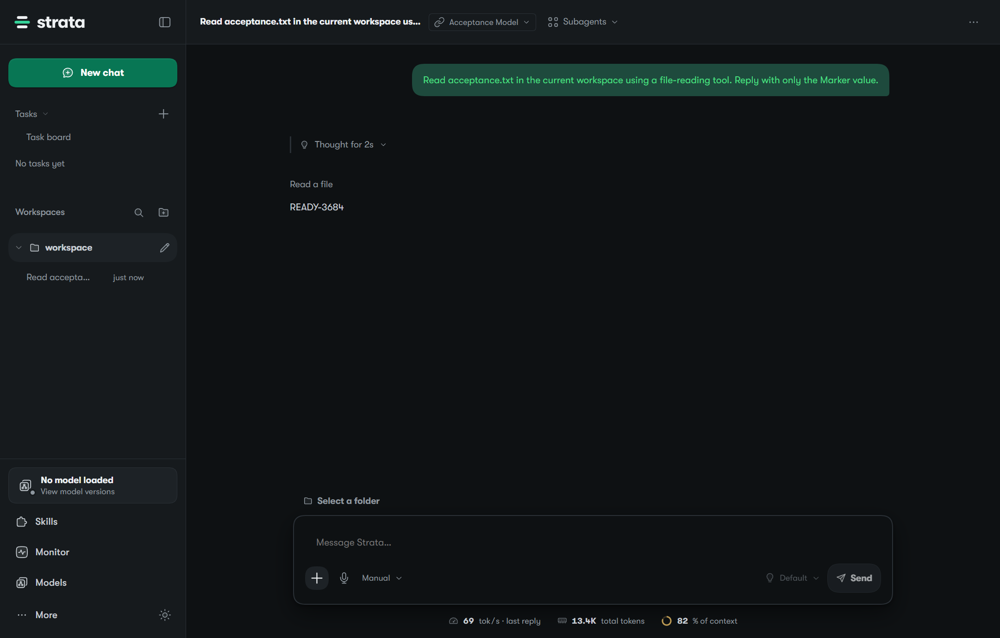

# Small Context Output Budget Validation

Measured on 2026-10-22, native Windows, Node v24.12.0, RTX 5080 (16,303 MiB
reported VRAM), 61 GiB RAM. App 0.2.2, engine 0.1.47, the existing
Swift-Qwen3.8-Flash-Next-GSQ-RCO-IQ3_XXS model, Harness 0.2.1-alpha.3 at
`571902028a75c64c1d767f4ae5fd099485f0ddf0`, pi-ai 1.1.0.
The Strata source base is `011c9e600a93bbc9fd451c563501b5831c32bbca`.
Exact tested source-file hashes are in the JSON receipt.

## Problem And Result

The shipped clamp reserves a fixed 4096 safety tokens even at 8K. The earlier
draft (`2ee3fbe`) reduced that margin, which allowed a short first answer,
but a real file-reading turn still returned no answer after its tool succeeded.
Its follow-up request had `max_completion_tokens: 1` despite only 6722 native
prompt tokens. This follow-up failure was reproduced before revising the fix.

The final staged patch, `strata-pi-ai-context-safety-v2`, limits safety below
64K to the smaller of 4096, one sixteenth of the window, and half the estimated
remaining room. Thus safety padding cannot consume all positive estimated
room after a tool result. Caller caps and the one-token no-room floor remain.
At 64K and above, the original 4096-token calculation is unchanged.

The synthetic regression at 8K with 7750 estimated prompt tokens failed before
the follow-up fix (`1` instead of `221`) and passes afterwards. Another fixture
at 6545 estimated prompt tokens yields 1135. These estimates are synthetic;
the live wire caps are the measured values below.

## Real 8K Tool Turn In The Native App

Both runs used the same prompt, workspace file, saved API model, Context 8192,
Medium effort, Manual mode and all 26 default tools:

> Read acceptance.txt in the current workspace using a file-reading tool. Reply with only the Marker value.

The file contains two lines: `Strata Budget Acceptance` and
`Marker: READY-3684`. The earlier draft ran through the shipped Host API; the
final run was sent from the official App 0.2.2 native WebView2 composer.
Both used the real default Harness and existing model. There was no direct
chat fallback, demo response, effort change, disabled tool group or retry loop.

| Observed Field | Prior Draft | Final Staged v2 |
| --- | --- | --- |
| First Wire Output Cap | 84 | 298 |
| First Native Prompt / Generated Tokens | 6555 / 73 | 6555 / 73 |
| Tool | `read`, completed | `read`, completed |
| Follow-Up Wire Output Cap | 1 | 242 |
| Follow-Up Native Prompt / Generated Tokens | 6722 / 1 | 6722 / 18 |
| Final Finish Reason | `length` | `stop` |
| Final Answer | Empty | `READY-3684` |

The native UI request and NDJSON response were captured from the App's own
WebView2. The start frame reports `agent: true`, `demo: false`, `contextMax:
8192` and `mode: manual`. The native window and accessibility tree both show
the completed Read A File row and `READY-3684`. The App Host is a child of the
official shell; its Harness child points at the fully staged directory.
The official executable hash is recorded in the JSON receipt.

The Windows helper's physical clicks were obstructed by an OS PickerHost;
the WebView2 UI was therefore driven through its isolated loopback debug
interface. No OS security dialog was acted on. This is a capture of that
native WebView2 surface, not a separately launched browser or a mock:



## Four Additional Real 8K Turns

The same fully staged Harness then ran a fresh four-turn session through the
native App's Host API. All turns retained Manual, Medium and 26 tools.

| Turn | Task | Result | Completed Tools | Finish |
| --- | --- | --- | --- | --- |
| 1 | Read the marker | `READY-3684` | `read` | `stop` |
| 2 | Remember it; reply ACK | `ACK` | None | `stop` |
| 3 | Read it again | `READY-3684` | `read` | `stop` |
| 4 | Recall the marker | `READY-3684` | None | `stop` |

The final reported context was 7106 tokens. No error, notice, empty answer or
one-token wire request occurred in these four turns. This is bounded
multi-turn coverage; it does not establish unbounded 8K tool or long-form work.
Prompt-cache reuse occurred, so these runs make no speed claim.

## Full Build, Deploy And Staging

The pinned Harness was freshly cloned and built on Windows. The source and
installed original pi-ai hashes remained unchanged. Actual commands:

```powershell
# In the pinned Harness source checkout; Node v24.12.0 / pnpm v11.28.5.
corepack pnpm install --frozen-lockfile
corepack pnpm run build
# 9 build gates passed, 0 failed, 0 skipped.

# In Strata; $HarnessSource names that built checkout.
node apps/desktop/scripts/stage-harness.mjs --src $HarnessSource --out apps/desktop/src-tauri/resources/harness
# Runs pnpm deploy --legacy --prod --filter @deepseek-ai/dsh, copies peers,
# flattens/prunes, applies the guarded patch, checks imports and runs --version.
```

Staging succeeded with 23,414 final files (including `BUNDLE.json`),
240,267,005 bytes. A separate real `--profile web` boot and authenticated
Gateway connection passed without any model request. A validation-only
`NODE_OPTIONS` preload sets child-process `windowsHide: true`; it changes no
Harness or Strata source. Build concurrency was 2; no browser was downloaded.
An initial scratch preload URL error was corrected before the successful
frozen install; the completed pipeline has no failed gate.

- `BUNDLE.json` SHA-256: `66975a57810290957c506d5c3906f8479d2e64f56ec65a5d1dc19dc81c224b3a`
- Original pi-ai module: `9b3cc0ae6daa86fdc050bc0cb0f3f986401e64ccddbde6757183c9f8ad411be2`
- Patched module: `fe657e357bdf1f32c686da1b7f06dc4dc91a2ad5e55d13a6850e63fb12b0d1fb`
- Staged tree manifest: `b3cb192de7072a8012acbf4144b05bbda59b105ab1289315c5bab1a4c9b84819`

## Source-Owned Checks

```powershell
$env:STRATA_TEST_PI_AI_DIR = '<read-only installed pi-ai package>'
node --test --test-isolation=none apps/host/tests/harness-budget.test.mjs
# 10 passed, 0 failed, 0 skipped.

$env:STRATA_HARNESS_DIR = '<fully staged Harness directory>'
node --test --test-isolation=none apps/host/tests/agent-compaction.test.mjs apps/host/tests/agent-shape.test.mjs apps/host/tests/harness-staging.test.mjs
# 12 passed, 0 failed, 0 skipped.

node --check apps/desktop/scripts/harness-budget.mjs
node --check apps/desktop/scripts/stage-harness.mjs
git diff --check
```

The staged tests resolve all three earlier conditional skips: component
inventory, a real Harness compaction conversation and real response settings.
The compaction test uses six long turns at 16K with a scripted model and the
real Harness; it verifies a summary request and subsequent replies. It is
separate from the real GPU-model 8K acceptance above.

Passed: the final focused checks, staged checks, build gates, deploy/staging,
authenticated boot, native tool turn and four additional turns. Expected
pre-fix failures are retained as reproduction evidence. No final functional
check failed. On normal native App close the Windows-owned Harness child
reported exit code 1; the App, server and recorder wrappers exited 0, and no
test process or listener remained. All 189 protected file hashes were unchanged.

## Limits

The common pi-ai clamp changes small-window arithmetic across protocols, but
live model coverage here is the local OpenAI chat route on Windows. Other
operating systems/providers, an unbounded 8K stress run and a signed release
installer were not tested. No Rust or engine source changed; CUDA/HIP/SYCL
builds are not applicable. A small Context still has a finite prompt/output
budget. The patch applies only when staging a new component; existing
installations are not repaired at startup.

Machine-readable evidence: [output-budget-validation.json](output-budget-validation.json).
