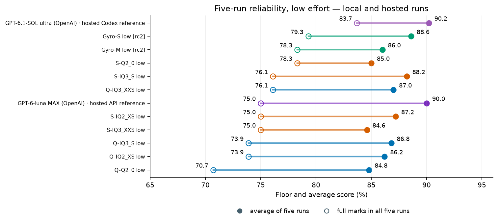
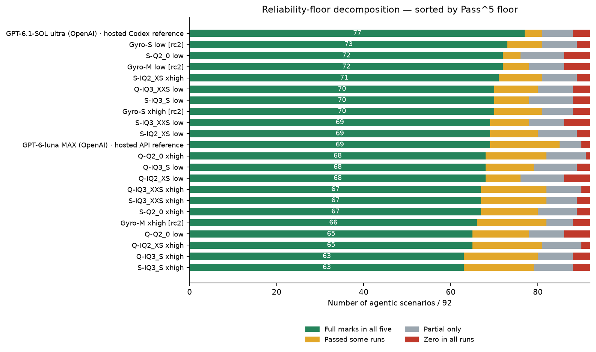
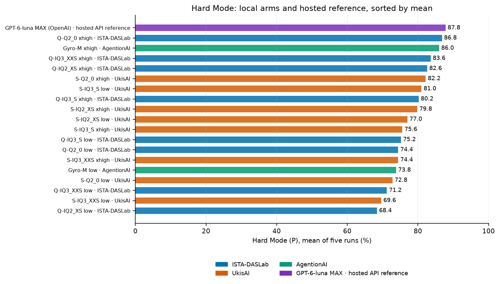
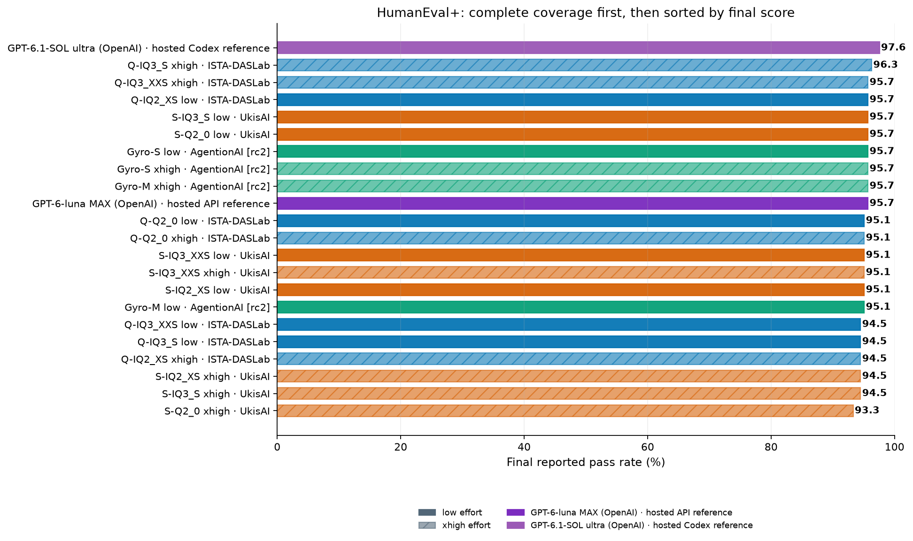
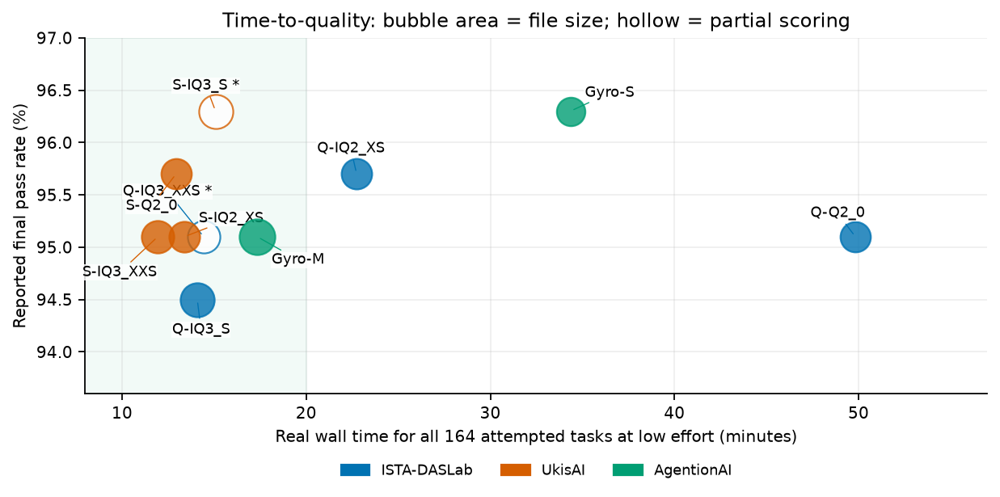
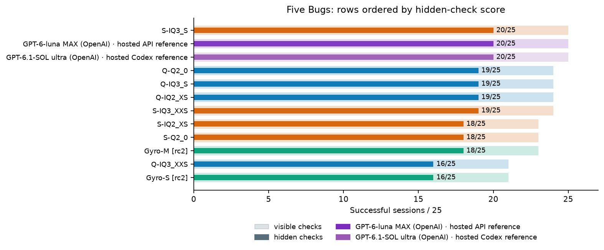
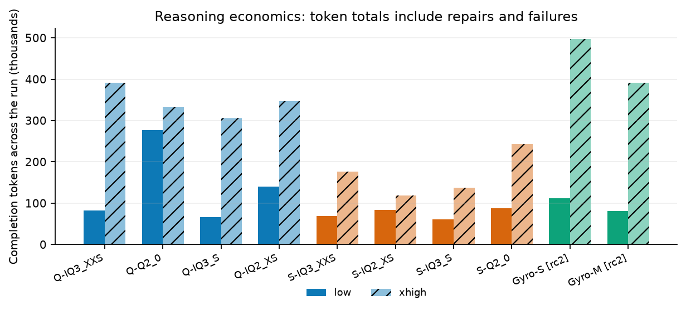
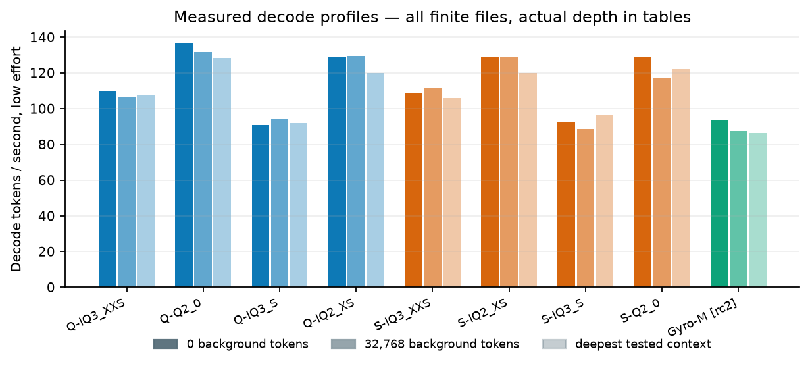
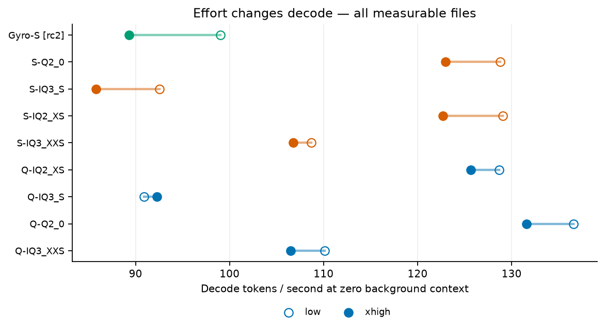
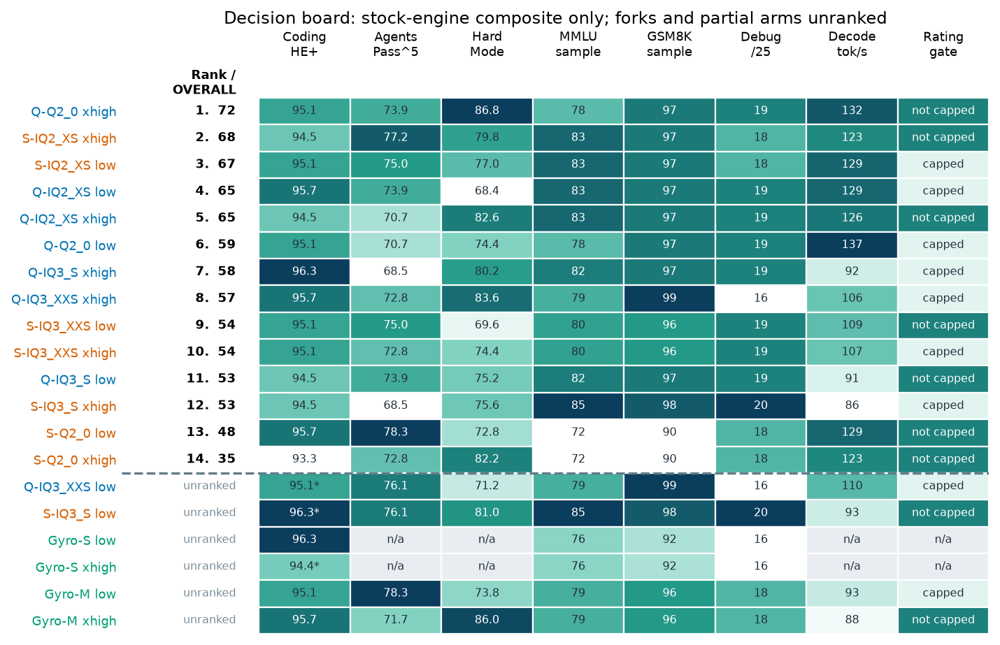

# Qwen3.8-Flash-Next: which quant should you run?

Updated **2026-10-12** · **10 files / 3 labs / 20 effort arms / 18 tool arms**.

[Download the designed PDF](strata-community.pdf) (13 pages) · [Canonical metrics](data/ALL-METRICS.json) · [Claim registry](claims.json) · [Audit](qa/AUDIT.json)

Measured on **RTX 5070 Ti 16 GB, Ryzen 9800X3D, 64 GB RAM, Windows + WSL2**. Eight stock files use Strata 0.1.40.3; Gyro-S uses historical rc1, Gyro-M rc2. Same prompts/evaluator do not isolate an engine-independent model comparison.

## Straight answer

**Q-Q2_0 (ISTA-DASLab) xhigh is #1, the best measured stock all-rounder** (72 overall). Reliability, latency, coding ceiling and debugging specialists can be lower on that board because their chosen priority outweighs its other axes. The final scoreboard and Pick Your File use the exact same registry and ranks. Experimental fork rows and partial coding arms remain visible but unranked.

## The cast

File sizes are decimal GB, not VRAM requirements. Every common result table includes Gyro-M inline with an engine label. There is no standalone Gyro-M chapter.

| File / lab | Quant | File GB | Engine | Status |
| --- | --- | --- | --- | --- |
| Q-IQ3_S (ISTA-DASLab) | IQ3_S | 83.6 | 0.1.40.3 | reference |
| Q-Q2_0 (ISTA-DASLab) | Q2_0 | 66.4 | 0.1.40.3 | reference |
| Q-IQ3_XXS (ISTA-DASLab) | IQ3_XXS | 75.8 | 0.1.40.3 | reference |
| Q-IQ2_XS (ISTA-DASLab) | IQ2_XS | 67.2 | 0.1.40.3 | reference |
| S-IQ3_XXS (UkisAI) | IQ3_XXS | 76.0 | 0.1.40.3 | reference |
| S-IQ2_XS (UkisAI) | IQ2_XS | 68.2 | 0.1.40.3 | reference |
| S-IQ3_S (UkisAI) | IQ3_S | 83.7 | 0.1.40.3 | reference |
| S-Q2_0 (UkisAI) | Q2_0 | 66.6 | 0.1.40.3 | reference |
| Gyro-S (AgentionAI) | TQ1_0 | 58.5 | rc1 | historical fork |
| Gyro-M (AgentionAI) | TQ2_0 | 92.0 | rc2 | experimental on this 16 GB rig |

Downloads: [ISTA-DASLab](https://huggingface.co/ISTA-DASLab/Qwen3.8-Flash-Next-GSQ-RCO-GGUF) · [UkisAI Swift](https://huggingface.co/ukisai/Swift-1.5-Qwen3.8-Flash-Next-GSQ-RCO-GGUF) · [AgentionAI Gyro](https://huggingface.co/agentionai/Qwen3.8-Flash-Next-Gyro-GGUF).

## Reliability and agentic tools

[Tool-eval-bench](https://github.com/SeraphimSerapis/tool-eval-bench): pinned `2.7.1.dev16+gf7c34a130`, 92 scenarios x five runs per effort; 0/1/2 scoring. **Pass@5** = full marks at least once (capability ceiling); **Pass^5** = full marks in ALL five (reliability floor). Category values use all-five means. Stored rating/warnings describe the last primary trial, not a five-run union. Safety-capped is not inferred merely from the warning count. Gyro-S rc1 has no usable tool baseline; it is n/a, not zero.

| Arm / lab | Engine | Mean +/- SD | 95% CI | Pass@5 | Pass^5 | Ceiling-floor gap | Hard Mode mean | Last-trial rating | Warnings |
| --- | --- | --- | --- | --- | --- | --- | --- | --- | --- |
| S-Q2_0 (UkisAI) low | 0.1.40.3 | 85.0 +/- 1.0 | 84.2–85.8 | 82.6 | 78.3 | 4.3 | 72.8 | 4/5 Good | 5 |
| S-IQ2_XS (UkisAI) xhigh | 0.1.40.3 | 88.2 +/- 1.5 | 87.0–89.4 | 88.0 | 77.2 | 10.8 | 79.8 | 5/5 Excellent | 2 |
| Q-IQ3_XXS (ISTA-DASLab) low | 0.1.40.3 | 87.0 +/- 2.0 | 85.4–88.6 | 87.0 | 76.1 | 10.9 | 71.2 | 3/5 Adequate (safety-capped) | 7 |
| S-IQ3_S (UkisAI) low | 0.1.40.3 | 88.2 +/- 1.5 | 87.0–89.2 | 84.8 | 76.1 | 8.7 | 81.0 | 4/5 Good | 4 |
| S-IQ3_XXS (UkisAI) low | 0.1.40.3 | 84.6 +/- 0.5 | 84.2–85.0 | 84.8 | 75.0 | 9.8 | 69.6 | 4/5 Good | 4 |
| S-IQ2_XS (UkisAI) low | 0.1.40.3 | 87.2 +/- 1.3 | 86.2–88.2 | 87.0 | 75.0 | 12.0 | 77.0 | 3/5 Adequate (safety-capped) | 4 |
| Q-IQ3_S (ISTA-DASLab) low | 0.1.40.3 | 86.8 +/- 0.8 | 86.2–87.4 | 85.9 | 73.9 | 12.0 | 75.2 | 4/5 Good | 3 |
| Q-Q2_0 (ISTA-DASLab) xhigh | 0.1.40.3 | 89.4 +/- 0.5 | 89.0–89.8 | 89.1 | 73.9 | 15.2 | 86.8 | 5/5 Excellent | 2 |
| Q-IQ2_XS (ISTA-DASLab) low | 0.1.40.3 | 86.2 +/- 0.8 | 85.6–86.8 | 82.6 | 73.9 | 8.7 | 68.4 | 3/5 Adequate (safety-capped) | 5 |
| Q-IQ3_XXS (ISTA-DASLab) xhigh | 0.1.40.3 | 88.6 +/- 1.1 | 87.8–89.4 | 89.1 | 72.8 | 16.3 | 83.6 | 3/5 Adequate (safety-capped) | 3 |
| S-IQ3_XXS (UkisAI) xhigh | 0.1.40.3 | 86.6 +/- 1.5 | 85.4–87.8 | 89.1 | 72.8 | 16.3 | 74.4 | 3/5 Adequate (safety-capped) | 4 |
| S-Q2_0 (UkisAI) xhigh | 0.1.40.3 | 86.8 +/- 2.2 | 85.2–88.4 | 87.0 | 72.8 | 14.2 | 82.2 | 4/5 Good | 2 |
| Q-Q2_0 (ISTA-DASLab) low | 0.1.40.3 | 84.8 +/- 0.4 | 84.4–85.0 | 84.8 | 70.7 | 14.1 | 74.4 | 3/5 Adequate (safety-capped) | 7 |
| Q-IQ2_XS (ISTA-DASLab) xhigh | 0.1.40.3 | 88.6 +/- 1.8 | 87.2–90.0 | 88.0 | 70.7 | 17.3 | 82.6 | 4/5 Good | 1 |
| Q-IQ3_S (ISTA-DASLab) xhigh | 0.1.40.3 | 86.8 +/- 1.3 | 85.6–87.8 | 87.0 | 68.5 | 18.5 | 80.2 | 3/5 Adequate (safety-capped) | 4 |
| S-IQ3_S (UkisAI) xhigh | 0.1.40.3 | 85.6 +/- 0.5 | 85.2–86.0 | 85.9 | 68.5 | 17.4 | 75.6 | 3/5 Adequate (safety-capped) | 5 |
| Gyro-M (AgentionAI) low | rc2 | 86.0 +/- 1.4 | 84.8–87.2 | 84.8 | 78.3 | 6.5 | 73.8 | 3/5 Adequate (safety-capped) | 6 |
| Gyro-M (AgentionAI) xhigh | rc2 | 87.8 +/- 1.1 | 86.8–88.6 | 89.1 | 71.7 | 17.4 | 86.0 | 4/5 Good | 2 |







Gyro-M Hard Mode gains do not imply reliability gains: its floor drops at xhigh and mean confidence intervals overlap. Engine/configuration differences prevent a model-only causal comparison.

## Coding

[EvalPlus](https://github.com/evalplus/evalplus) through BenchKit: 164 attempted function-writing tasks, greedy generation plus one verifier-guided replacement. First = one-shot score; final includes replacement. Blank/length-limited outputs remain scored failures. Excluded harness errors reduce coverage; those rows are qualified and excluded from complete-coverage medals/composites.





| Arm / lab | Engine | First % | Final % | Solved/scored | Repairs | Wall | tok/s | Blank finals | Infra excluded |
| --- | --- | --- | --- | --- | --- | --- | --- | --- | --- |
| Q-IQ3_S (ISTA-DASLab) xhigh | 0.1.40.3 | 93.3 | 96.3 | 158/164 | 5/11 | 67m19s | 86.7 | 2 | 0 |
| Q-IQ3_XXS (ISTA-DASLab) xhigh | 0.1.40.3 | 92.7 | 95.7 | 157/164 | 5/11 | 76m17s | 102.6 | 3 | 0 |
| Q-IQ2_XS (ISTA-DASLab) low | 0.1.40.3 | 90.9 | 95.7 | 157/164 | 8/14 | 22m44s | 124.5 | 2 | 0 |
| S-Q2_0 (UkisAI) low | 0.1.40.3 | 90.2 | 95.7 | 157/164 | 9/16 | 12m56s | 144.8 | 0 | 0 |
| Q-Q2_0 (ISTA-DASLab) low | 0.1.40.3 | 92.7 | 95.1 | 156/164 | 4/10 | 49m50s | 123.9 | 2 | 0 |
| Q-Q2_0 (ISTA-DASLab) xhigh | 0.1.40.3 | 88.4 | 95.1 | 156/164 | 11/17 | 62m18s | 124.0 | 3 | 0 |
| S-IQ3_XXS (UkisAI) low | 0.1.40.3 | 92.7 | 95.1 | 156/164 | 4/12 | 11m56s | 123.7 | 0 | 0 |
| S-IQ3_XXS (UkisAI) xhigh | 0.1.40.3 | 92.1 | 95.1 | 156/164 | 5/10 | 47m11s | 104.5 | 5 | 0 |
| S-IQ2_XS (UkisAI) low | 0.1.40.3 | 89.6 | 95.1 | 156/164 | 9/16 | 13m23s | 148.8 | 1 | 0 |
| Q-IQ3_S (ISTA-DASLab) low | 0.1.40.3 | 92.7 | 94.5 | 155/164 | 3/12 | 14m05s | 100.4 | 0 | 0 |
| Q-IQ2_XS (ISTA-DASLab) xhigh | 0.1.40.3 | 89.6 | 94.5 | 155/164 | 8/16 | 75m40s | 122.0 | 6 | 0 |
| S-IQ2_XS (UkisAI) xhigh | 0.1.40.3 | 91.5 | 94.5 | 155/164 | 5/11 | 63m04s | 124.0 | 5 | 0 |
| S-IQ3_S (UkisAI) xhigh | 0.1.40.3 | 92.7 | 94.5 | 155/164 | 3/11 | 43m32s | 89.5 | 3 | 0 |
| S-Q2_0 (UkisAI) xhigh | 0.1.40.3 | 89.6 | 93.3 | 153/164 | 6/14 | 56m20s | 121.8 | 6 | 0 |
| S-IQ3_S (UkisAI) low | 0.1.40.3 | 94.5 | 96.3 * | 157/163 | 3/9 | 15m05s | 101.5 | 0 | 1 |
| Q-IQ3_XXS (ISTA-DASLab) low | 0.1.40.3 | 92.6 | 95.1 * | 155/163 | 4/13 | 14m26s | 121.5 | 0 | 1 |
| Gyro-S (AgentionAI) low | rc1 | 92.1 | 96.3 | 158/164 | 7/13 | 34m21s | 71.7 | 2 | 0 |
| Gyro-M (AgentionAI) xhigh | rc2 | 92.1 | 95.7 | 157/164 | 6/13 | 82m51s | 77.6 | 2 | 0 |
| Gyro-M (AgentionAI) low | rc2 | 93.3 | 95.1 | 156/164 | 3/11 | 17m20s | 88.9 | 0 | 0 |
| Gyro-S (AgentionAI) xhigh | rc1 | 90.1 | 94.4 * | 153/162 | 7/16 | 329m15s | 63.1 | 3 | 2 |

`*` Partial: Q-IQ3_XXS low 155/163; Swift IQ3_S low 157/163; Gyro-S xhigh 153/162 after two HTTP 502 errors. Gyro-M xhigh blank HumanEval/39 and /99 ended on length and remain failures in 157/164. No raw score/status was silently upgraded.

## Sampled knowledge, debugging and recall

GSM8K 100 shuffled questions, 8-shot; MMLU first 100 entirely abstract algebra, 5-shot (NOT full MMLU); IFEval first 50 prompts / 76 constraints. [Five Bugs](https://github.com/vyang472/five-bugs): five files x five sessions with local hidden checks. Needle: 25 cells; stock and fork effective contexts differ.

| File / lab | Engine | GSM8K | Algebra | IFEval prompt/instruction | Bugs visible | Bugs hidden | Needle % @ effective tokens |
| --- | --- | --- | --- | --- | --- | --- | --- |
| Q-IQ3_S (ISTA-DASLab) | 0.1.40.3 | 97 | 82 | 86.0 / 90.8 | 24/25 | 19/25 | 100 @ 260,096 |
| Q-Q2_0 (ISTA-DASLab) | 0.1.40.3 | 97 | 78 | 84.0 / 89.5 | 24/25 | 19/25 | 100 @ 260,096 |
| Q-IQ3_XXS (ISTA-DASLab) | 0.1.40.3 | 99 | 79 | 80.0 / 85.5 | 21/25 | 16/25 | 100 @ 260,096 |
| Q-IQ2_XS (ISTA-DASLab) | 0.1.40.3 | 97 | 83 | 84.0 / 89.5 | 24/25 | 19/25 | 100 @ 260,096 |
| S-IQ3_XXS (UkisAI) | 0.1.40.3 | 96 | 80 | 80.0 / 86.8 | 24/25 | 19/25 | 100 @ 260,096 |
| S-IQ2_XS (UkisAI) | 0.1.40.3 | 97 | 83 | 82.0 / 88.2 | 23/25 | 18/25 | 100 @ 260,096 |
| S-IQ3_S (UkisAI) | 0.1.40.3 | 98 | 85 | 84.0 / 89.5 | 25/25 | 20/25 | 100 @ 260,096 |
| S-Q2_0 (UkisAI) | 0.1.40.3 | 90 | 72 | 80.0 / 86.8 | 23/25 | 18/25 | 100 @ 260,096 |
| Gyro-S (AgentionAI) | rc1 | 92 | 76 | 74.0 / 82.9 | 21/25 | 16/25 | 100 @ 129,024 |
| Gyro-M (AgentionAI) | rc2 | 96 | 79 | 78.0 / 82.9 | 23/25 | 18/25 | 100 @ 129,024.0 |



These are small samples, not a whole-model intelligence ranking or long-session guarantee.

## Reasoning economics

Completion tokens include thinking, repair and failures. Passing/failed task costs come from response times, not from subtracting job wall time.



| Arm / lab | Engine | Output tokens | Passing tokens | Passing seconds | Failed response-time share % | Wall |
| --- | --- | --- | --- | --- | --- | --- |
| Q-IQ3_S (ISTA-DASLab) xhigh | 0.1.40.3 | 304,962 | 200,835 | 2,461 | 38.1 | 67m19s |
| Q-IQ3_XXS (ISTA-DASLab) xhigh | 0.1.40.3 | 390,930 | 230,123 | 2,328 | 48.5 | 76m17s |
| Q-IQ2_XS (ISTA-DASLab) low | 0.1.40.3 | 140,583 | 97,239 | 883 | 32.1 | 22m44s |
| S-Q2_0 (UkisAI) low | 0.1.40.3 | 87,634 | 64,502 | 542 | 23.4 | 12m56s |
| Q-Q2_0 (ISTA-DASLab) low | 0.1.40.3 | 277,084 | 174,148 | 1,498 | 48.8 | 49m50s |
| Q-Q2_0 (ISTA-DASLab) xhigh | 0.1.40.3 | 332,296 | 238,341 | 2,020 | 45.1 | 62m18s |
| S-IQ3_XXS (UkisAI) low | 0.1.40.3 | 68,616 | 49,192 | 486 | 25.1 | 11m56s |
| S-IQ3_XXS (UkisAI) xhigh | 0.1.40.3 | 175,860 | 133,095 | 1,363 | 50.7 | 47m11s |
| S-IQ2_XS (UkisAI) low | 0.1.40.3 | 83,746 | 56,476 | 468 | 36.3 | 13m23s |
| Q-IQ3_S (ISTA-DASLab) low | 0.1.40.3 | 66,966 | 49,239 | 594 | 23.9 | 14m05s |
| Q-IQ2_XS (ISTA-DASLab) xhigh | 0.1.40.3 | 347,704 | 257,698 | 2,214 | 50.5 | 75m40s |
| S-IQ2_XS (UkisAI) xhigh | 0.1.40.3 | 118,588 | 105,555 | 2,472 | 33.6 | 63m04s |
| S-IQ3_S (UkisAI) xhigh | 0.1.40.3 | 137,839 | 81,261 | 1,017 | 60.2 | 43m32s |
| S-Q2_0 (UkisAI) xhigh | 0.1.40.3 | 243,330 | 151,062 | 1,329 | 60.0 | 56m20s |
| S-IQ3_S (UkisAI) low | 0.1.40.3 | 74,417 | 49,341 | 598 | 29.0 | 15m05s |
| Q-IQ3_XXS (ISTA-DASLab) low | 0.1.40.3 | 82,843 | 59,863 | 602 | 24.7 | 14m26s |
| Gyro-S (AgentionAI) low | rc1 | 143,288 | 69,471 | 1,316 | 34.1 | 34m21s |
| Gyro-M (AgentionAI) xhigh | rc2 | 391,467 | 180,234 | 2,334 | 52.5 | 82m51s |
| Gyro-M (AgentionAI) low | rc2 | 80,523 | 60,016 | 752 | 23.2 | 17m20s |
| Gyro-S (AgentionAI) xhigh | rc1 | 618,982 | 375,211 | 6,148 | 60.1 | 329m15s |

## Measured performance

llama-benchy 0.4.0: prompt 2,048, generation 256, concurrency 1, three repeats/depth/effort. Retired inflated raw prompt-throughput values. **Prompt-to-first-token rate** = total input tokens / end-to-end TTFT, including queue/network/reasoning; not kernel prefill. Deep contexts differ: stock 131,072, rc2 122,880. Gyro-S malformed million-token/s/null profiles are excluded and labeled n/a.





### low

| File / lab | Engine | Contexts 0/mid/deep | Decode tok/s 0/mid/deep | First-token rate 0/mid/deep | Deep TTFT seconds |
| --- | --- | --- | --- | --- | --- |
| Q-IQ3_S (ISTA-DASLab) | 0.1.40.3 | 0 / 32,768 / 131,072 | 90.9 / 94.0 / 91.7 | 1,641 / 3,164 / 3,041 | 43.77 |
| Q-Q2_0 (ISTA-DASLab) | 0.1.40.3 | 0 / 32,768 / 131,072 | 136.6 / 131.8 / 128.4 | 2,309 / 3,522 / 3,667 | 36.30 |
| Q-IQ3_XXS (ISTA-DASLab) | 0.1.40.3 | 0 / 32,768 / 131,072 | 110.1 / 106.2 / 107.4 | 2,174 / 3,284 / 3,421 | 38.91 |
| Q-IQ2_XS (ISTA-DASLab) | 0.1.40.3 | 0 / 32,768 / 131,072 | 128.7 / 129.4 / 120.0 | 2,011 / 3,195 / 3,280 | 40.59 |
| S-IQ3_XXS (UkisAI) | 0.1.40.3 | 0 / 32,768 / 131,072 | 108.7 / 111.3 / 106.0 | 2,025 / 3,329 / 3,412 | 39.01 |
| S-IQ2_XS (UkisAI) | 0.1.40.3 | 0 / 32,768 / 131,072 | 129.1 / 129.1 / 119.9 | 1,970 / 3,283 / 3,334 | 39.93 |
| S-IQ3_S (UkisAI) | 0.1.40.3 | 0 / 32,768 / 131,072 | 92.6 / 88.5 / 96.5 | 1,594 / 3,206 / 3,374 | 39.45 |
| S-Q2_0 (UkisAI) | 0.1.40.3 | 0 / 32,768 / 131,072 | 128.8 / 116.9 / 121.9 | 1,892 / 3,229 / 3,329 | 39.99 |
| Gyro-S (AgentionAI) | rc1 | n/a | n/a | n/a | n/a |
| Gyro-M (AgentionAI) | rc2 | 0 / 32,768 / 122,880 | 93.4 / 87.5 / 86.5 | 1,239 / 2,144 / 2,821 | 44.28 |

### xhigh

| File / lab | Engine | Contexts 0/mid/deep | Decode tok/s 0/mid/deep | First-token rate 0/mid/deep | Deep TTFT seconds |
| --- | --- | --- | --- | --- | --- |
| Q-IQ3_S (ISTA-DASLab) | 0.1.40.3 | 0 / 32,768 / 131,072 | 92.2 / 91.2 / 86.6 | 1,945 / 3,216 / 3,382 | 39.36 |
| Q-Q2_0 (ISTA-DASLab) | 0.1.40.3 | 0 / 32,768 / 131,072 | 131.6 / 130.5 / 117.2 | 2,676 / 3,836 / 3,663 | 36.35 |
| Q-IQ3_XXS (ISTA-DASLab) | 0.1.40.3 | 0 / 32,768 / 131,072 | 106.5 / 101.7 / 95.3 | 2,406 / 3,361 / 3,409 | 39.05 |
| Q-IQ2_XS (ISTA-DASLab) | 0.1.40.3 | 0 / 32,768 / 131,072 | 125.7 / 118.9 / 117.5 | 2,135 / 3,341 / 3,339 | 39.87 |
| S-IQ3_XXS (UkisAI) | 0.1.40.3 | 0 / 32,768 / 131,072 | 106.8 / 101.1 / 99.4 | 2,420 / 3,339 / 3,449 | 38.59 |
| S-IQ2_XS (UkisAI) | 0.1.40.3 | 0 / 32,768 / 131,072 | 122.7 / 123.9 / 113.8 | 2,209 / 3,286 / 3,334 | 39.93 |
| S-IQ3_S (UkisAI) | 0.1.40.3 | 0 / 32,768 / 131,072 | 85.8 / 85.5 / 85.8 | 1,933 / 3,269 / 3,388 | 39.29 |
| S-Q2_0 (UkisAI) | 0.1.40.3 | 0 / 32,768 / 131,072 | 123.0 / 121.9 / 128.9 | 2,219 / 3,167 / 3,332 | 39.96 |
| Gyro-S (AgentionAI) | rc1 | n/a | n/a | n/a | n/a |
| Gyro-M (AgentionAI) | rc2 | 0 / 32,768 / 122,880 | 87.7 / 80.5 / 80.7 | 1,754 / 2,690 / 2,778 | 44.96 |

## The final scoreboard

Seven equally weighted min-max-normalized axes: coding final, tool floor, Hard Mode mean, algebra, math, hidden debugging, zero-context decode. Normalization uses only complete eligible stock-engine arms. Safety and wall latency are not composite axes; fork and partial rows are unranked. This is an all-rounder choice aid on this rig, not a universal quality or safety score.



| Rank | Arm / lab | Engine | OVERALL | Coding | Floor | Hard Mode | Algebra | Math | Debug | Decode | Eligibility |
| --- | --- | --- | --- | --- | --- | --- | --- | --- | --- | --- | --- |
| 1 | Q-Q2_0 (ISTA-DASLab) xhigh | 0.1.40.3 | 72 | 95.1 | 73.9 | 86.8 | 78 | 97 | 19 | 131.6 | eligible |
| 2 | S-IQ2_XS (UkisAI) xhigh | 0.1.40.3 | 68 | 94.5 | 77.2 | 79.8 | 83 | 97 | 18 | 122.7 | eligible |
| 3 | S-IQ2_XS (UkisAI) low | 0.1.40.3 | 67 | 95.1 | 75.0 | 77.0 | 83 | 97 | 18 | 129.1 | eligible |
| 4 | Q-IQ2_XS (ISTA-DASLab) low | 0.1.40.3 | 65 | 95.7 | 73.9 | 68.4 | 83 | 97 | 19 | 128.7 | eligible |
| 5 | Q-IQ2_XS (ISTA-DASLab) xhigh | 0.1.40.3 | 65 | 94.5 | 70.7 | 82.6 | 83 | 97 | 19 | 125.7 | eligible |
| 6 | Q-Q2_0 (ISTA-DASLab) low | 0.1.40.3 | 59 | 95.1 | 70.7 | 74.4 | 78 | 97 | 19 | 136.6 | eligible |
| 7 | Q-IQ3_S (ISTA-DASLab) xhigh | 0.1.40.3 | 58 | 96.3 | 68.5 | 80.2 | 82 | 97 | 19 | 92.2 | eligible |
| 8 | Q-IQ3_XXS (ISTA-DASLab) xhigh | 0.1.40.3 | 57 | 95.7 | 72.8 | 83.6 | 79 | 99 | 16 | 106.5 | eligible |
| 9 | S-IQ3_XXS (UkisAI) low | 0.1.40.3 | 54 | 95.1 | 75.0 | 69.6 | 80 | 96 | 19 | 108.7 | eligible |
| 10 | S-IQ3_XXS (UkisAI) xhigh | 0.1.40.3 | 54 | 95.1 | 72.8 | 74.4 | 80 | 96 | 19 | 106.8 | eligible |
| 11 | Q-IQ3_S (ISTA-DASLab) low | 0.1.40.3 | 53 | 94.5 | 73.9 | 75.2 | 82 | 97 | 19 | 90.9 | eligible |
| 12 | S-IQ3_S (UkisAI) xhigh | 0.1.40.3 | 53 | 94.5 | 68.5 | 75.6 | 85 | 98 | 20 | 85.8 | eligible |
| 13 | S-Q2_0 (UkisAI) low | 0.1.40.3 | 48 | 95.7 | 78.3 | 72.8 | 72 | 90 | 18 | 128.8 | eligible |
| 14 | S-Q2_0 (UkisAI) xhigh | 0.1.40.3 | 35 | 93.3 | 72.8 | 82.2 | 72 | 90 | 18 | 123.0 | eligible |
| — | Q-IQ3_XXS (ISTA-DASLab) low | 0.1.40.3 | n/a | 95.1 | 76.1 | 71.2 | 79 | 99 | 16 | 110.1 | partial HumanEval+ denominator |
| — | S-IQ3_S (UkisAI) low | 0.1.40.3 | n/a | 96.3 | 76.1 | 81.0 | 85 | 98 | 20 | 92.6 | partial HumanEval+ denominator |
| — | Gyro-S (AgentionAI) low | rc1 | n/a | 96.3 | n/a | n/a | 76 | 92 | 16 | n/a | different engine cohort |
| — | Gyro-S (AgentionAI) xhigh | rc1 | n/a | 94.4 | n/a | n/a | 76 | 92 | 16 | n/a | different engine cohort |
| — | Gyro-M (AgentionAI) low | rc2 | n/a | 95.1 | 78.3 | 73.8 | 79 | 96 | 18 | 93.4 | different engine cohort |
| — | Gyro-M (AgentionAI) xhigh | rc2 | n/a | 95.7 | 71.7 | 86.0 | 79 | 96 | 18 | 87.7 | different engine cohort |

## Pick Your File — this same board translated into jobs

The #1 stock all-rounder is the default for a balanced seven-axis workload. Lower-ranked specialists are explicit priority overrides, not alternate overall crowns. Experimental/partial rows do not become production picks.

| Job | Pick / lab | Board rank | Rationale / caveat |
| --- | --- | --- | --- |
| Best stock all-rounder | Q-Q2_0 (ISTA-DASLab) xhigh | #1 | Balance seven measured axes; equal-weight composite, not universal intelligence. |
| Reliability specialist | S-Q2_0 (UkisAI) low | #13 | Highest stock all-five tool floor; warnings still exist. |
| Coding latency specialist | S-IQ3_XXS (UkisAI) low | #9 | Fastest complete coding wall; latency is outside OVERALL. |
| Coding ceiling specialist | Q-IQ3_S (ISTA-DASLab) xhigh | #7 | Highest complete stock coding score; scored failures remain. |
| Knowledge / debugging specialist | S-IQ3_S (UkisAI) xhigh | #12 | Independent limited samples; low coding partial/unranked, xhigh rank shown. |
| Experimental observation, not a production pick | Gyro-M (AgentionAI) low | unranked | rc2 fork, narrow 16 GB margin, invalid-slice campaign status. |

## Maintainer findings, validity and corrections

- rc1 forced tools were ignored with Gyro-S; rc2 live forced calls passed with Gyro-M in streaming/non-streaming. Gyro-S on rc2 was not tested. These are serving-stack findings, not model-only quality changes.
- The Gyro-M full campaign finished `2026-10-12T17:27:48+02:00`, status **`completed_with_invalid_slices`**. Its 74 resource samples recorded minimum **205 MiB free VRAM**, peak **78 C** (correcting the earlier 64 C summary). Experimental on this 16 GB rig; no supported daily-driver claim.
- CTest: 49 passed / 2 skipped / 1 failed (`ple_parity`, missing Q2_0 PLE/capture fixtures). Separate `ple_reader_selftest` passed.
- Both coding audits ran; a dictionary merge overwrote audit step names in done.json. Xhigh validity logic missed length-limited blank finals. Original status/results and logs are preserved.
- Historical partial denominators now qualify ranking/recommendations; category comparisons use five-run means; inflated prompt rate is retired; ceiling-minus-floor gap is correctly named.
- Separate Swift TEB v2.8.0 / 97-scenario runs are not mixed into this 92-scenario cohort. Production restoration passed; this document update made no production/model changes.

## What we did NOT test

Vision quality, multi-day agents, other GPUs/VRAM sizes, multi-GPU, additional seeds, full knowledge datasets, Gyro-M beyond 131K, or Gyro-S on rc2. Same-evaluator historical observations are not a same-day model-only stock/fork control.

## Provenance

| Item | Value |
| --- | --- |
| Stock version / digest | 0.1.40.3 / 34CDE150B21148E6 |
| Fork engine commit | 9ff02c9fa9c86a88088370925b3c9131cc5d6c26 |
| Fork binary SHA256 | 08d70e30b9176dee5273ba74bd67c4d4c435bef92d449323168d7a8a3497585f |
| Gyro-M revision | 2cd4f24bcb0fa053149a4e4ec15506ecc64cafab |
| Gyro-M SHA256 | 7aa36d15131d255179ab6c87fa9c9f81a0b541fc9e81e959d4c3e29eb20feb5f |
| Fork configured context / KV | 131,072 / int8 |
| Tool evaluator | 2.7.1.dev16+gf7c34a130 |

## Rebuild and verify

Python, Chromium and Poppler are required. Install the pinned Python report requirements in your own venv:

```bash
python -m pip install -r requirements-report.txt
python -I scripts/build_revision.py
mkdir -p qa
pdftoppm -png -r 50 strata-community.pdf qa/page
python -I scripts/audit_revision.py
python -I scripts/audit_package.py
```

The compiler reads only packaged data and rewrites PDF, charts, README, scoreboard and the shared recommendation registry. The numeric audit independently recomputes HumanEval+ task counts and all 92 x 5 tool arrays, and verifies every table starts/ends on one page using T01-style identifiers. `SOURCE-MANIFEST.json` hashes the committed files; rebuilds change PDF timestamps, so verify that manifest **before** rebuilding. Raw coding files are gzip-compressed JSON with all task records retained. See [TRIMMED.md](TRIMMED.md) for exclusions and redaction boundaries.
