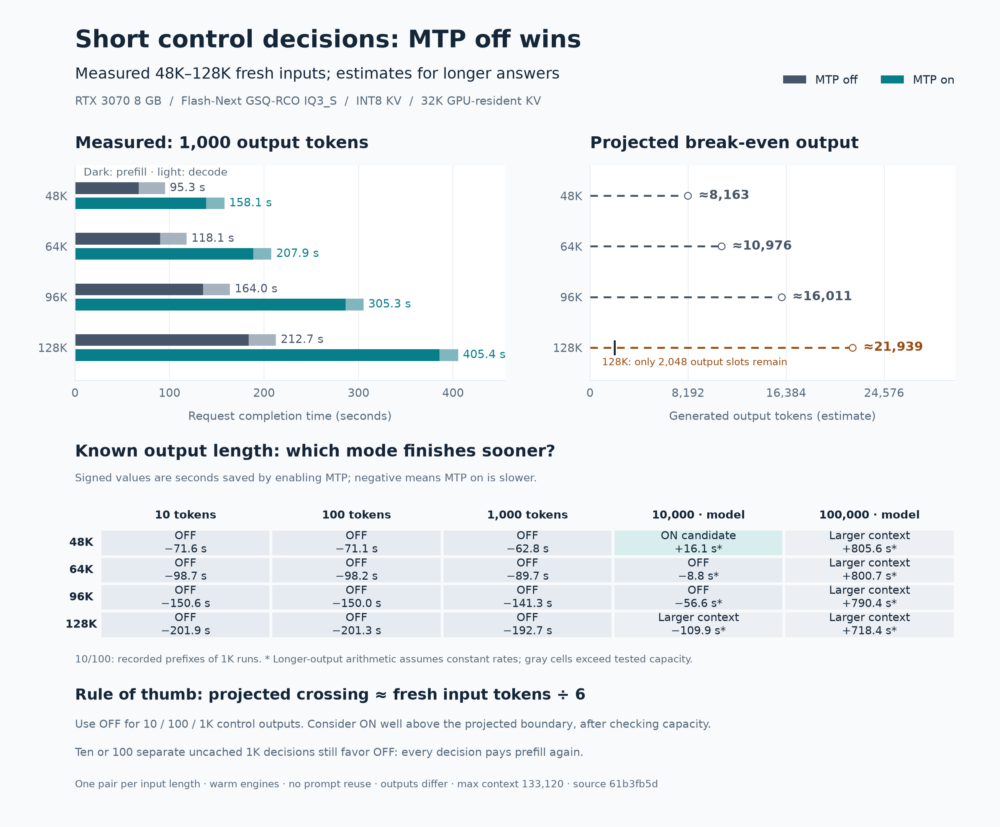
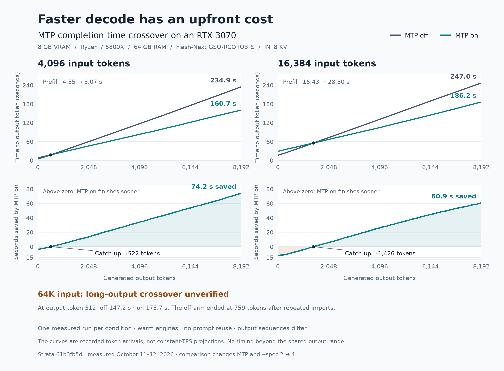

# RTX 3070: when does MTP repay its prefill cost?

## Follow-up: known-length control outputs

The [control-decision report](control-decisions/README.md) adds eight complete
1,000-token requests at 48K / 64K / 96K / 128K fresh input, with a fixed 133,120
capacity and 32K-resident INT8 KV. Off reduced measured completion time by
39.7–47.5%. It includes 10/100-token prefix observations, clearly labeled
10K/100K projections, separate-call estimates, and context-capacity checks.
Projected long-output crossings are approximately 8.2K / 11.0K / 16.0K / 21.9K
output tokens; these are not measured crossings. For this cohort the crossing
is approximately fresh input divided by six, with cached-prefix cost needing a
separate calibration. The 128K crossing exceeds the tested capacity.



## Earlier cohort: recorded 4K and 16K crossings

Measured October 11–12, 2026, by CC-David-CC. This is an exploratory latency
report for **Qwen3.8-Flash-Next GSQ-RCO IQ3_S**, not an Unsloth Q4 measurement.
One fresh request was measured per condition on a pinned source build.

MTP delayed the first token but finished long outputs sooner in the 4K and 16K
pairs. Recorded token arrivals crossed over at approximately **522** and
**1,426 output tokens**, respectively. The 64K off arm ended at 759 tokens after
degenerating into repeated imports; its long-output crossover is **unverified**.
This report proposes no engine or default-setting changes.



[Vector chart](mtp-crossover.svg) · [Plotting script](plot.py) ·
[Per-run metadata](data/results.json) · [Derived measurements](data/summary.json)

## Hardware and software

- One NVIDIA GeForce RTX 3070, 8,192 MiB VRAM, CUDA capability 8.6.
- AMD Ryzen 7 5800X, eight physical cores / 16 threads; nominal 64 GB RAM,
  approximately 62.7 GiB usable. The CPU has no AVX-512.
- Intel SSDPEKNW010T8 1 TB NVMe SSD. GPU maximum advertised link: PCIe 4 x16;
  instantaneous negotiated link was not recorded. The engine's startup probes
  reported approximately 25 GB/s host-to-device transfers.
- Ubuntu 24.04.5 LTS; kernel `7.0.0-34-generic`; NVIDIA driver `595.91.07`.
  CUDA toolkit `13.2.86`; Python 3.12.3 on the measurement host.
- Source build at `61b3fb5dd3f1e8ec09cf7e4e05208bc6d3c46406`, with no tracked
  source modifications. CMake CUDA architectures: `86`. Build metadata is
  preserved in [provenance.json](provenance.json).
- Engine SHA-256:
  `e6e34338299e0b277accff5cedc5ea1f2eb8551bf385a6d29ed4d3718382c565`.
- No GPU compute process was present before the experiment. The normal desktop
  remained running. Background CPU activity, clocks, temperatures and power
  were not continuously sampled. A post-run power-limit snapshot was 240 W;
  this is not a power-consumption measurement.

The GPU was released after all six measured requests. RAM/VRAM peaks were not
sampled. Startup allocation messages are observations, not measured peaks.

## Model and configuration

Exact native files:

- `Qwen3.8-Flash-Next-GSQ-RCO-IQ3_S-00001-of-00002.gguf`
- `Qwen3.8-Flash-Next-GSQ-RCO-IQ3_S-00002-of-00002.gguf` (PLE table)

The prepared pack served the native IQ experts and used an experimental native
Q5_K output head. No vision encoder was enabled. Model repository revision and
full model-file hashes were not captured; this report does not establish weight
provenance. The pack's preparation procedure was not rerun here.

Shared settings:

```text
strata --serve --pack <PACK> --native <SHARD_1> --ple-gguf <SHARD_2>
  --expert-cache auto --spec-min-p 0.5 --kv int8
  --max-context <INPUT_TOKENS + 9216>
  --prompt-cache 0 --conversation-cache-mib 0 --suffix-draft 0
  --prefill auto:8192 --expert-profile <STRATA_CHECKOUT>/data/expert-profile.bin
```

- Off arm: `--spec 2`, no `--mtp`. No drafts were offered. This native IQ pack
  requires `--spec` at least 2, even without an active drafter.
- On arm: `--spec 4 --mtp <MTP_RT> --spec-min-p 0.5`.
- MTP window was not overridden; the pinned source defaults to 32,768 tokens.
- CPU pool workers were not overridden: source default `0`, automatic selection.
- Temperature 0, thinking disabled in the rendered chat template.
- Configured context capacities: 13,312 / 25,600 / 74,752 tokens for the
  4,096 / 16,384 / 65,536 input-token cases. Capacities match within each pair,
  but differ across input lengths, so cache capacity is part of this experiment.
- `STRATA_DECODE_TIMING=1` was set. No calibration or speed-projection option
  was explicitly enabled by the harness.
- Expert-profile SHA-256:
  `8f59b4aa8873209dff11c11e37bcda9529a1335b724a1afeea37bf6388975baf`.

The comparison changes **both MTP and verification-window size**. It measures
these practical on/off configurations, not an isolated single-flag causal effect.
Full sanitized argv for each arm is in [data/results.json](data/results.json).

## Method and timing boundaries

Each arm loaded a new engine, processed a small `Reply with READY.` warm-up,
then handled one fresh synthetic code-generation request. Model loading and
warm-up are excluded from the measured request. Engine-close time is excluded.
Warm-up may influence adaptive expert placement; the cache was not reset to a
shared expert state after warm-up.

Order: 4K off/on, 16K on/off, 64K off/on. The order was partly reversed to reduce
systematic ordering bias; this is not a randomized or repeated experiment.
The output cap was 8,192. All six engine timings report `reused=0`, and off arms
report zero drafts offered. One request ran at a time.

The prompts contain 100 fabricated sensor-log records, repeated ` x` padding to
an exact token count, and a request for multiple Python components and extensive
unit tests. This is a synthetic long-generation workload, not a representative
chat, agent, retrieval or production distribution. Exact input text is preserved
in `data/prompt-*.txt`. Prompt lengths were checked after chat-template rendering
and tokenization.

For each emitted token, the client records `time.monotonic() - request_start`.
The charts use these **actual arrival times**, including prefill. Tokens emitted
together by a verification window can have nearly identical arrival times.
They are engine-client measurements, not HTTP/network end-to-end measurements.
Intermediate output-length comparisons are prefixes of long recorded runs;
they are not separate requests with smaller output caps.

Prompt and decode throughput use the engine's separate `prompt_ms` and
`decode_ms`; generated tokens divided by total wall time is not decode TPS.
First-token time and total latency are client measurements.

## Results: one run per row

| Input tokens | MTP | Actual output | Prefill tok/s | Decode tok/s | First token, s | Request wall time, s |
| ---: | :--- | ---: | ---: | ---: | ---: | ---: |
| 4,096 | off | 8,192 | 900.30 | 35.57 | 4.58 | 234.89 |
| 4,096 | on | 8,192 | 507.60 | 53.69 | 8.10 | 160.66 |
| 16,384 | off | 8,192 | 996.95 | 35.52 | 16.47 | 247.04 |
| 16,384 | on | 8,192 | 568.83 | 52.06 | 28.84 | 186.16 |
| 65,536 | off | 759 | 490.01 | 39.01 | 133.79 | 153.21 |
| 65,536 | on | 8,192 | 397.13 | 49.76 | 165.07 | 329.68 |

The 64K decode rates cover unequal output lengths and different continuations.
Its off arm is retained as an early-ending, quality-degraded observation, outside
the long-output crossover comparison. No medians, ranges or confidence intervals
are claimed with one observation per condition.

| Input | Output position | Time off, s | Time on, s | MTP on saves, s |
| ---: | ---: | ---: | ---: | ---: |
| 4,096 | 128 | 8.03 | 10.88 | -2.85 |
| 4,096 | 512 | 17.70 | 17.73 | -0.03 |
| 4,096 | 1,024 | 31.59 | 27.30 | +4.30 |
| 4,096 | 2,048 | 59.94 | 46.37 | +13.57 |
| 4,096 | 8,192 | 234.89 | 160.65 | +74.23 |
| 16,384 | 512 | 29.84 | 38.84 | -9.00 |
| 16,384 | 1,024 | 43.95 | 47.99 | -4.04 |
| 16,384 | 2,048 | 72.98 | 67.09 | +5.89 |
| 16,384 | 8,192 | 247.04 | 186.16 | +60.88 |
| 65,536 | 512 | 147.16 | 175.67 | -28.51 |

In the 4K pair MTP first wins at output token 519, briefly loses again, and
remains faster from token 522 through 8,192. In the 16K pair it first wins at
1,423 and remains faster from 1,426 through 8,192. These are observed sign
changes on individual trajectories, not estimates of a population cutoff.

For this workload, 4K input / 1K-plus output and 16K input / 2K-plus output
provide margin over the observed crossover. Shorter replies favor off, especially
when first-token latency matters. Do not infer a universal threshold or apply
these numbers to Q4, other GPUs or cached follow-up conversations.

## Mathematical projection versus measured crossover

Let `P_m(L)` be prefill seconds and `D_m(L)` decode tokens/second, for input
length `L` and mode `m`. A constant-rate approximation is

```text
T_m(L,N) = P_m(L) + N / D_m(L)
N* = (P_on - P_off) / (1/D_off - 1/D_on)
```

The denominator must be positive for a positive prefill penalty to be repaid.
Applying full-run average rates predicts 371 output tokens for the 4K pair and
1,383 for the 16K pair; the measured sustained crossings are 522 and 1,426.
Decode speed is not constant across output positions.

The continuous approximation with position-dependent seconds saved per token,
`s(L,y)`, gives:

```text
DeltaT(L,N) = DeltaP(L) - integral[0..N] s(L,y) dy
d(DeltaT)/dN = -s(L,N)
```

The area under the per-token savings curve must repay the upfront penalty.
If `s(L,y) = a + b*y` with `b > 0`, the positive root is
`N* = (sqrt(a*a + 2*b*DeltaP) - a) / b`; as `b` approaches zero this reduces
to `DeltaP/a`. These equations are a cost model, not additional measurements.

For uncertain output length, the constant-rate decision uses **expected actual
output tokens**, not the configured output cap. With position-dependent expected
savings on requests that reach each position, use
`integral Pr(N > y) * s(L,y) dy > DeltaP`.

A separate earlier 64K / 512-output pilot on the same pinned build measured
110.2167 / 165.3094 prefill seconds and 35.4959 / 50.4802 decode tok/s, off/on.
It predicts `DeltaT = 55.0927 - 0.0083625*N`, or approximately 6,588 output
tokens to break even. This is an **unverified extrapolation from 512-token
decodes**, on a different prompt instruction. The fresh 64K baseline's early
ending prevents validating it. The pilot metadata is preserved separately in
[earlier-64k-512-results.json](data/earlier-64k-512-results.json).

Classical speculative decoding amortizes target-model work across accepted
draft tokens. Under an independent acceptance approximation, `k` proposed
tokens yield `1 + alpha + ... + alpha^k` expected output tokens per verification.
Drafting and verification costs must be repaid too; acceptance alone does not
establish a speedup. See [Leviathan et al., ICML 2023](https://proceedings.mlr.press/v202/leviathan23a.html).

The original pilot's logs showed the draft layer consuming 884 MiB VRAM and
target expert cache slots falling from 713 to 313. This supports a memory-pressure
explanation for the prefill loss. It does not isolate the contribution of each
allocation, draft-state preparation, window-size change or cache-policy change.

## Correctness and limitations

- All pairs generated different token IDs: first divergence at positions 13,
  147 and 12 for 4K, 16K and 64K respectively (one-based). This is not a token-
  exact or distribution-equivalence validation. Different expert-cache placement,
  floating-point execution and output continuations can affect speed.
- The 64K off answer contained repeated imports and ended early. Long-output
  speed and correctness at 64K are unqualified by this experiment.
- The requested generated code and tests were not executed or scored. The
  experiment establishes recorded timing, not successful completion of the
  programming task.
- Only one synthetic prompt per input length, one measured request per mode.
  No repeated small-output requests, confidence intervals, representative prompt
  suite, needle recall, multi-client load, alternate quants or backend comparison.
- Context capacities and expert-cache sizes change across input lengths. There
  is no isolated causal estimate of prompt length or MTP alone.
- No claim about newer main, a release binary, peak memory, energy or production
  serving. The same pinned binary was used for both arms on the same night.

## Reproduce and inspect

The **exact original harness**, with its hardware label anonymized, is
[recorded-harness.py](recorded-harness.py). It documents the measurement host's
directory layout; do not run it without adapting that layout.

[run_benchmark.py](run_benchmark.py) is a portable version of the same request
construction and settings. It has **not been rerun**; configure an existing
native IQ3_S pack and matching MTP runtime, build source commit `61b3fb5d`, then
pass the source checkout, compiled engine, existing config and output directory:

```bash
python run_benchmark.py --strata-checkout /path/to/Strata \
  --engine /path/to/Strata/build/strata --config /path/to/strata-iq3_s.json \
  --mtp /path/to/mtp/rt --output-dir /path/to/new-results
```

The supplied config must select INT8 KV and `--spec-min-p 0.5`, with the same
native shards and prepared pack. The harness overwrites context, prefill,
profile, cache-reuse and MTP/window settings as recorded above. It inherits
other config options and the environment; inspect them before treating a rerun
as equivalent. It writes model paths locally: sanitize them before publication.

For the committed figure, no model or GPU is needed:

```bash
python -m pip install -r requirements-plot.txt
python plot.py
python verify.py
```

`data/*-arrivals.json` contains one request-relative timestamp per emitted token,
in seconds. `*-ids.json` contains corresponding token IDs. `*-output.txt` holds
decoded output. `*.log` records engine startup and final timings. `results.json`
retains per-run argv, timing, counts, hashes and client latencies; `summary.json`
adds sign changes, checkpoints, acceptance ratios and 64-token sampled arrivals.
Home/user/host paths in published metadata and logs have been anonymized.
