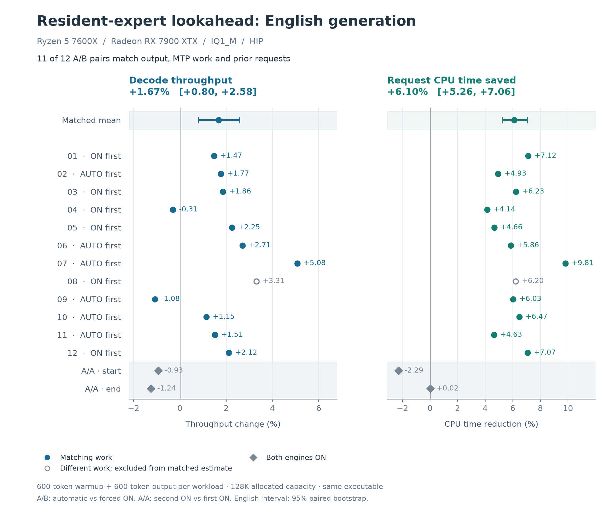

# Resident-expert lookahead on RX 7900 XTX

Measured on 2026-10-15 by KeyanHu-git. This report measures the policy in [engine PR #2476](https://github.com/Niko1221/Strata/pull/2476): stop submitting file-lookahead predictions once serial decode has complete GPU/RAM expert coverage.

Across 11 matched English pairs, automatic mode increased decode throughput by **1.67%** and reduced engine CPU time per request by **6.10%**. Output tokens, MTP work and expert-tier counts matched in those pairs. The experiment ran 12 randomized A/B pairs and two ON/ON controls, with all 84 requests and 50,400 generated tokens retained here.



## Results

Changes are geometric means of paired ratios. Intervals are approximate 95% paired bootstrap intervals (50,000 resamples).

| Workload | Matching A/B pairs | Decode throughput change | Request CPU time reduction | Faster pairs |
|---|---:|---:|---:|---:|
| English, primary | 11/12 | +1.67% [0.80, 2.58] | 6.10% [5.26, 7.06] | 9/11 |
| Code, exploratory | 4/12 | +2.70% | 6.89% | 4/4 |

English decode was **40.40 → 41.08 tokens/s** (geometric means). CPU time fell in all 11 included pairs, from an arithmetic mean of **79.82 to 74.95 CPU seconds per 600-token request**. CPU time includes prefill and decode. Whole-request latency decreased by 1.56% [0.78, 2.41]; median time to first token was 891 ms in both arms.

The matched English estimates were +1.47% for the five ON-first pairs and +1.84% for the six AUTO-first pairs. The two English ON/ON controls changed by -0.93% and -1.24% on their second runs. Their expert work matched. Every measured request had zero decode expert-file blob reads.

Code has four matched pairs, below the predeclared minimum of eight for the main interpretation. Its [separate figure](figures/code.png) includes all observations, with unmatched work shown as open markers.

<details>
<summary>Every A/B pair</summary>

| Pair | Run order | English throughput change | Code throughput change |
|---:|---|---:|---:|
| 1 | ON / AUTO | +1.47% | +3.35% |
| 2 | AUTO / ON | +1.77% | +1.70% |
| 3 | ON / AUTO | +1.86% | +0.92% * |
| 4 | ON / AUTO | -0.31% | -0.96% * |
| 5 | ON / AUTO | +2.25% | +5.23% |
| 6 | AUTO / ON | +2.71% | +4.37% * |
| 7 | AUTO / ON | +5.08% | +5.31% * |
| 8 | ON / AUTO | +3.31% * | +1.99% * |
| 9 | AUTO / ON | -1.08% | +0.60% |
| 10 | AUTO / ON | +1.15% | +2.49% * |
| 11 | AUTO / ON | +1.51% | +4.09% * |
| 12 | ON / AUTO | +2.12% | -0.68% * |

`*` marks output, MTP work or preceding-request differences. Values remain visible but do not enter the matched estimate. The unmatched English pair was +3.31%; the descriptive mean over all 12 English observations was +1.81%. [pairs.csv](data/pairs.csv) gives exact values and exclusion reasons.

</details>

<details>
<summary>All 12 A/B observations per arm: medians and ranges</summary>

These descriptive summaries include nonmatching work. English prompts contain 61 tokens; code prompts contain 74. Every request generated 600 tokens and reused zero prompt tokens.

| Workload | Mode | Runs | Decode tok/s | Prompt tok/s | TTFT ms | Request CPU seconds |
|---|---|---:|---|---|---|---|
| english | ON | 12 | 40.33 (39.39–41.33) | 70.88 (68.32–74.06) | 891.00 (859.00–922.00) | 79.79 (78.16–82.34) |
| english | AUTO | 12 | 41.12 (40.14–41.64) | 70.27 (66.35–77.10) | 891.00 (828.00–937.00) | 74.98 (74.27–75.83) |
| code | ON | 12 | 40.16 (39.17–41.52) | 41.62 (39.83–42.86) | 1812.00 (1766.00–1891.00) | 80.59 (78.80–83.59) |
| code | AUTO | 12 | 41.14 (40.19–41.59) | 41.51 (40.56–42.38) | 1821.00 (1782.00–1860.00) | 75.59 (73.58–77.33) |

</details>

## Hardware and software

| Item | Configuration |
|---|---|
| GPU | Radeon RX 7900 XTX, nominal 24 GB; runtime reports 24,560 MiB total and a 23,749 MiB WDDM process budget |
| CPU / RAM | Ryzen 5 7600X, 12 logical CPUs; 31.16 GiB visible system RAM |
| OS / display driver | Windows 11 Pro 10.0.26300; RX 7900 XTX driver 32.0.31041.1004 |
| HIP toolchain | ROCm SDK wheels 10.2.0a20260930; Clang 24.0.0; `gfx1100`, Release |
| Engine | Source build 0.1.44.1 at `c3a2919b1a9e14e121b445f9629b009b3a6c965e` |
| Storage / negotiated PCIe / clock and power traces | Not captured |

OS and driver versions were queried during packaging at 00:58 UTC, after the 23:56–00:45 UTC measurement window. The installed SDK version was read in the same packaging session. Build identity, startup plans and executable hash were recorded for the experiment. Other user applications stayed open; host CPU and available-memory snapshots accompany each request. Affinity, power settings and worker count were unchanged.

The executable SHA256 is `9adcf628b6c944ec17e3c68f8e638be57fcca8e8529a841a6ea54ea6ae10b21f`. Build flags, pack-file hashes and the expert-profile hash are in [provenance.json](data/provenance.json).

## Model and configuration

- IQ1_M, `Qwen3.8-Flash-Next-GSQ-RCO-IQ1_M-00001-of-00002.gguf` and `...-00002-of-00002.gguf`. The model repository revision and draft-vocabulary revision were not captured.
- A separate GGUF-backed pack was made by copying `dense.bin`, `index.txt`, `native_experts.txt` and `conversions.json` from the working pack and omitting `experts.bin`. The native expert source then reads the GGUF shards. Copy hashes are published; model weights, the draft pack and the expert-profile binary are external inputs.
- 131072 context capacity, int8 KV, `--prefill auto`, resident experts, MTP and `--spec-min-p 0.5`; effective `spec=6`, `mtp_max=4`, five pool workers and `pcie_frac=0.55`.
- Cache budget `--expert-cache 4416`: 5759 actual packed expert slots / 11211 MiB; RAM complement 15481 MiB. The CLI value counts maximum-blob budget units, not actual variable-sized slots.
- Captured environment: `HIP_VISIBLE_DEVICES=1`, `STRATA_STARTUP_UNBUFFERED=0`. GPU index 1 selected the discrete card on this host. Diagnostic timing/statistics flags were removed by the runner.

The original Windows flat pack did not start file lookahead. These measurements use the GGUF source where both the ON path and automatic skip are active. [config.example.json](config.example.json) contains the complete launch arguments with machine paths replaced.

## Method

Each arm starts a fresh process from the same executable. ON sets `STRATA_LOOKAHEAD=1`; AUTO leaves it unset and checks that the automatic skip engaged. The first and last pairs are ON/ON controls. A/B order is balanced six each way and shuffled with seed 20261015.

Every arm runs the same 37-token database-index warmup for 600 output tokens, then English and code requests capped at 600 tokens each, at temperature 0 and seed 1922. Token IDs are supplied directly through the `GEN` protocol. Loading and warmup are outside the reported English/code timings. Expert-cache state persists between the three requests within an arm; matching checks therefore include preceding output and draft work.

Before each start, the controller waits for three available-memory readings of at least 20 GiB, two seconds apart, then checks the engine's actual allocation plan. An earlier attempt produced only 12293 MiB of RAM complement and was rejected before any timed request; its [record](data/rejected-startup.json) and [startup excerpt](data/rejected-startup-excerpt.txt) are included. The successful run completed all 28 starts. During timed requests, remote progress was read through SFTP only.

[Methods and data fields](METHODS.md) define the matched cohort, statistics and counters. The pre-run [protocol](data/protocol.txt), [memory-admission amendment](data/startup-amendment.txt) and [recorded controller](data/measurement-controller.py.txt) preserve the measurement procedure.

## Reproduce the analysis or measurements

From this report directory (Python 3.10+):

```sh
python scripts/verify.py
python scripts/analyze.py data/results.json --out /tmp/lookahead-analysis.json
python -m pip install matplotlib psutil
python scripts/plot.py
python -m unittest discover -s scripts -p test_runner.py -v
```

For a new run, build the measured commit, prepare the GGUF-backed pack, configure the HIP runtime on `PATH`, and edit paths/device selection in a copy of `config.example.json`. Use an idle GPU with its other model server stopped:

```sh
python scripts/run_audit.py --config local-config.json --out new-run
```

The portable runner manages only the engines it launches. The recorded controller additionally stopped and restored the original local service. Both use the published fixtures, schedule, memory admission, allocation checks and comparison rules. A changed model, profile or execution plan is a separate configuration to record.

## Correctness and coverage

The matched cohort requires identical output IDs, MTP offered/accepted counts, preceding work, requested length and prompt reuse. All 11 included English pairs also match GPU hits, expert lookups, RAM blobs and offload counts. Open markers retain the other observations. The earlier same-binary five-pair check used a 150-token warmup and is kept separately in [earlier-results.json](data/earlier-results.json).

This is short-prompt serial decode on one HIP system. 128K is allocated capacity. Code output is truncated at 600 tokens; no generated module execution or long-context quality score is reported. Expert-file counters cover the engine's expert provider, while OS paging can occur separately. Process page-fault deltas and host CPU counters are descriptive diagnostics.

## Data

- [results.json](data/results.json): every request, output IDs, counters, timing boundaries, startup plans and comparisons.
- [requests.csv](data/requests.csv): all 84 requests; [pairs.csv](data/pairs.csv): all 28 workload-pair comparisons.
- [outputs.json](data/outputs.json): six distinct decoded sequences and their occurrences.
- [engine-log-excerpt.txt](data/engine-log-excerpt.txt): startup admission and all 84 `DONE` lines.
- [analysis.json](data/analysis.json): estimates, intervals, order groups and A/A controls.
- [Figure sources](scripts/plot.py), PNG/SVG/PDF exports in [figures/](figures/).

Machine paths are replaced by placeholders. Original service process IDs, its configuration and environment values unrelated to the benchmark are omitted. Numeric measurement arrays and output token IDs are unchanged. No engine source is changed by this report.
