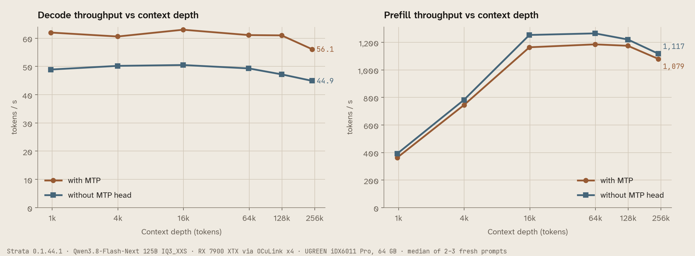
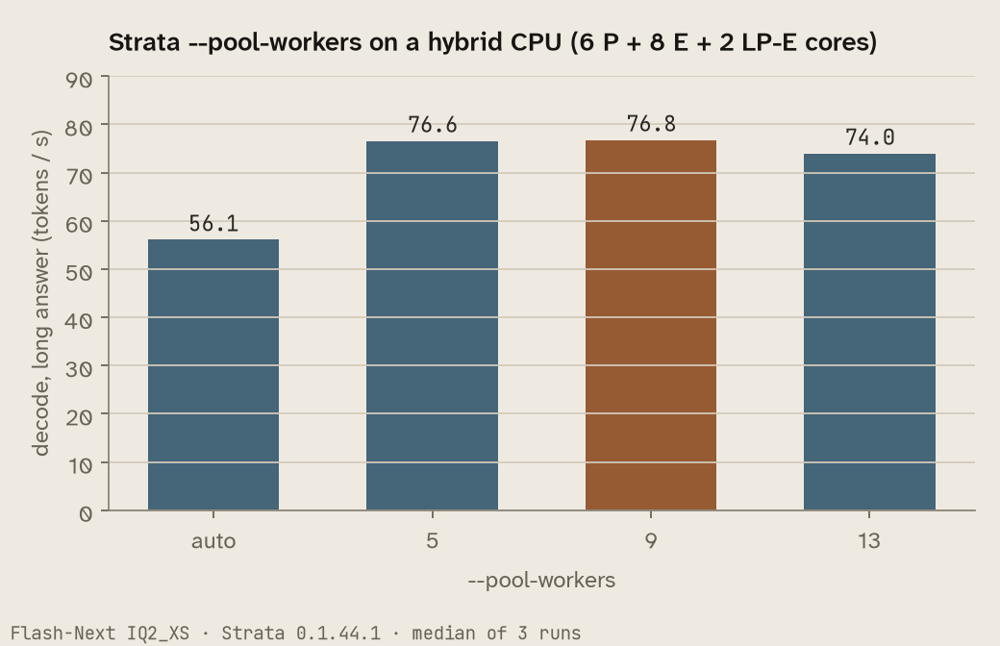

# Community benchmark: RX 7900 XTX (gfx1100) in an OCuLink eGPU dock on a UGREEN iDX6011 Pro NAS — Flash-Next IQ3_XXS, 262K context

Measured on 2026-10-17 by faf-net with `tools/strata_bench.py --long`, a teacher-forced quality comparison against mainline llama.cpp on the same GGUF, (suite 1, 3 runs per test, medians with ranges), plus a
context-depth sweep from 1K to 248K tokens with and without the MTP head, `tools/needle_bench.py` up to 250K (9 of 9 found), and
two settings measured on 2026-10-14. Speeds are the engine's own timings. Everything below was measured on this
machine; estimates are marked as such.

What is new compared with the other gfx1100 reports: the host is a **NAS** (UGOS Pro, a Debian 12 base) with a
**hybrid laptop-class CPU and LPDDR5X**, the card sits in an **eGPU dock behind an OCuLink PCIe 4.0 x4 link**, and
the model is **IQ3_XXS at the full 262,144-token context**, measured to 248K.

Full write-up of the setup (UGOS changes, dock behaviour, build recipe):
https://github.com/faf-net/ugreen-idx6011-egpu-llm

## Hardware and software

- GPU: AMD Radeon RX 7900 XTX 24 GB (gfx1100), in a UGREEN LinkStation eGPU dock (own 850 W PSU), x16 inside the dock
- Link to the host: OCuLink, PCIe 4.0 **x4** (`LnkCap` x4 at 16 GT/s); the port reports no slot power control (`PwrCtrl-`)
- Host: UGREEN iDX6011 Pro NAS, Intel Core Ultra 7 255H (6 P + 8 E + 2 LP-E cores, 16 threads, no AVX-512),
  64 GB LPDDR5X (62.3 GiB visible), NVMe RAID 1 for the model files
- OS: UGOS Pro 1.19, kernel 6.18.15. Firmware for Navi 31 is not shipped by UGOS; the 15 gfx1100 files from Debian's
  `firmware-amd-graphics` (20250410) were added by hand
- Strata: source build at `296b59d` (merge of f-1441, between 0.1.44 and 0.1.44.1), engine reports 0.1.44.1, HIP
  backend, ROCm 7.10.0a20251120 from the TheRock wheels, Ubuntu 24.04 container, hipBLASLt table `gfx1100-hipblaslt-100200.txt`
- Server: run by llama-swap as a container (`docker run --device /dev/kfd --device /dev/dri`), one model at a time
- Background: the NAS kept running its usual services (photo library, media server, a few small containers, about
  5 GiB RAM). No power limit set on the card.

## Model and configuration

- Qwen3.8-Flash-Next, ISTA-DASLab GSQ-RCO **IQ3_XXS**, native pack, MTP head `rt`
- `--max-context 262144 --kv int8 --spec 4 --spec-min-p 0.5 --mtp rt --expert-cache auto --prefill auto
  --pool-workers 9 --pcie-frac 0 --conversation-cache-slots 2 --conversation-cache-min-tokens 8192 --conversation-cache-mib 4608`
- About 53 GiB of host RAM in use with the model loaded; warm start from the page cache about 21 s
- From the engine's start-up lines: expert cache `auto` → **8,917 slots, 14.44 GiB of VRAM**, pre-filled from the
  profile in 3.6 s; the prompt path borrows 2,466 cache slots (3.99 GiB); hipBLASLt tuning enabled (26 rows, version
  100200). Decode expert-cache hit rate warms up from 47 % on the first answer to 93–98 % once the cache has settled
  (215 answers in this log)

## Results: `strata_bench.py --long`

| Configuration | Actual prompt tokens | Reused tokens | Generated tokens | Runs | Prompt tok/s median and range | Decode tok/s median and range | TTFT seconds median and range |
| --- | ---: | ---: | ---: | ---: | --- | --- | --- |
| short chat | 46 (43-51) | 0 | 100 (100-100) | 9 | not measured | 63.7 (47.9-68.4) | 0.47 (0.37-0.55) |
| 4K prompt, fresh | 4019 | 0 | 24 cap | 3 | 741.4 (734.4-746.7) | not measured | 5.45 (5.41-5.50) |
| 16K prompt, fresh | 16058 | 0 | 24 cap | 3 | 1195.1 (1176.6-1226.9) | not measured | 13.47 (13.12-13.68) |
| 32K prompt, fresh | 32049 | 0 | 24 cap | 3 | 1224.1 (1218.1-1226.2) | not measured | 26.22 (26.17-26.35) |
| agent session, follow-up turns | 14594 (14567-14596) at the last turn | see below | up to 64 | 3 | see below | 74.0 (48.2-83.3) | 5.31 (5.04-5.51) |

Agent session: cache hit over the follow-up turns 68.6 % (68.5-68.8), earlier-turn tokens read again per session
73 (4-144), first turn first token 4.04 s (3.83-4.24). Per-request data: `results.json`.

## Context-depth sweep, 1K to 248K, with and without the MTP head

One fresh prompt per run (unique tag first, so the conversation cache cannot help), then 256 new tokens with
thinking off, temperature 0; engine timings from `timings`. Median of 3 runs up to 64K, 2 runs at 128K and 248K.
"Without MTP head" is the same configuration with `--mtp` removed; a native pack needs `--spec >= 2`, so the
engine still verifies windows but gets almost no drafts (1-7 per answer).



| Prompt tokens | Decode with MTP | Decode without MTP head | Prefill with MTP | Prefill without MTP head | MTP acceptance |
| ---: | ---: | ---: | ---: | ---: | ---: |
| 993 | 62.0 | 48.9 | 362 | 391 | 49 % |
| 4,075 | 60.6 | 50.2 | 745 | 782 | 49 % |
| 16,252 | 63.0 | 50.5 | 1,164 | 1,253 | 48 % |
| 65,023 | 61.1 | 49.3 | 1,185 | 1,265 | 53 % |
| 130,024 | 61.0 | 47.2 | 1,175 | 1,220 | 57 % |
| 248,052 | 56.1 | 44.9 | 1,079 | 1,117 | 50 % |

- Decode barely drops with depth: 62 → 56 tok/s from 1K to 248K with MTP, 49 → 45 without.
- MTP adds 21-29 % decode at every depth and costs 3-7 % prefill (presumably because the MTP head also reads the prompt; not verified).
- Prefill is flat at 1,080-1,270 tok/s from 16K to 248K over the x4 link.
- Host memory stayed above the engine's floor: at least 7.9 GiB `MemAvailable` during a 250K prompt (same model and settings,
  measured on 2026-10-15).


Raw data: `depth-sweep.jsonl` (one JSON object per request: `label` with/without MTP head, `ziel` target depth, `prompt_token`, `neu_token` new tokens, `prompt_tps`, `decode_tps`, `draft_n`, `draft_ok`, `sekunden` wall time). Script: `depth_sweep.py`; charts: `charts.py`.

## Quality: Strata vs llama.cpp on the same GGUF

Same file (Flash-Next IQ3_XXS), the fixed text set of `tools/quant_quality.py` (`data/quant_quality/v1`, 4,995
positions, teacher-forced). Strata: `quant_quality.py run --config <arbeit config>` (its fixed yardstick settings:
experts on the CPU, FP16 K/V, no route-tail skip), and once more with `--gpu-experts auto`. llama.cpp: mainline build
11610 (`091b6a7fc`, Vulkan image), `-ngl 99 --n-cpu-moe 48 -c 2048 -fa on`, F16 K/V, fed the same token ids position by
position through `llama-server` (`/completion`, `n_predict` 1, `n_probs` 4000, `cache_prompt`), written in the
STRATA_LOGPOS format by `quality-vs-llamacpp/llamacpp_logpos.py`. Compared with
`quality-vs-llamacpp/compare_engines.py` (same top-1 and top-64 KL definition as `quant_quality.py compare`):

| Comparison | same top token | KL mean | KL median | KL p99 | Perplexity |
| --- | ---: | ---: | ---: | ---: | --- |
| llama.cpp vs Strata, experts on CPU | 95.66 % | 0.0199 | 0.0017 | 0.27 | 4.009 vs 4.017 |
| llama.cpp vs Strata, `--gpu-experts auto` | 95.68 % | 0.0198 | 0.0017 | 0.34 | 4.009 vs 4.019 |
| Strata CPU path vs Strata GPU path | 95.72 % | 0.0180 | 0.0017 | 0.27 | – |

Per segment (llama.cpp vs Strata, experts on CPU): code 98.2 % / KL 0.006, docs 92.6 % / 0.019, English 95.8 % /
0.008, multilingual 97.7 % / 0.005, agent 94.0 % / 0.062.

The engine gap is the size of the gap between Strata's own CPU and GPU paths, and in line with "the same file on
another backend" in `docs/QUANTS.md` (94.5 %, KL 0.038); IQ3_XXS against Q8_0 there is 84.5 % and KL 0.202.
Limits: the perplexity covers the 4,982 positions where llama.cpp returned the target among its top 4,000 (13 did
not; `nan` in column 8); llama.cpp's KV is F16 like the yardstick, so int8 K/V is not covered; one text set.
Data: `quality-vs-llamacpp/*.tsv.gz` (gunzip before `quant_quality.py compare`).

## Card power (sysfs `power1_average`, sampled every 0.5 s)

| Phase | mean | peak |
| --- | ---: | ---: |
| idle, model loaded | 58 W | 66 W |
| idle, no model loaded | about 9 W | – |
| decode, long answer | 286 W | 341 W |
| prefill, 32K prompt | 318 W | 382 W |
| agent session | 271 W | 315 W |

No power limit was set; the card is a stock RX 7900 XTX.

## Recall: `needle_bench.py`

| Length | Depth 10 % | Depth 50 % | Depth 90 % | Prompt tokens | Seconds per test |
| --- | --- | --- | --- | ---: | ---: |
| 32K | found | found | found | 32,778 | 27-28 |
| 128K | found | found | found | 125,044 | 95-126 |
| 250K | found | found | found | 251,626 | 217 |

`262k` is skipped by the tool at a 262,144-token context; 250K was run instead. Raw data: `needles-*.json`.

## Two settings worth knowing on this kind of machine (2026-10-14)

**`--pool-workers` on a hybrid CPU.** Flash-Next IQ2_XS, long answer, median of 3 runs: automatic 56.1, 5 workers
76.6, **9 workers 76.8**, 13 workers 74.0 tok/s. The automatic choice cost 27 % here. `docs/DETAILS.md` lists hybrid
CPUs under Linux as not measured; this is one data point (Core Ultra 7 255H).



With 0.1.45 on the same machine (2026-10-17, IQ3_XXS, one run of our own benchmark script per variant, each test the median of 3 requests),
`--pool-affinity p-cores` and `measure` did not beat `--pool-workers 9` (long answer 61.0 / 62.5 against 63.5 tok/s;
agent session 48.1 / 49.5 against 53.7 s, within run-to-run noise). `measure` reported `all (15 workers) 7.40 ms,
p-cores (7 workers) 7.90 ms` and chose p-cores. It detected the CPU as "8 P-cores / 8 threads, 8 E-cores"; the 255H has 6 P-, 8 E- and 2 LP-E cores, so the two LP-E cores seem to be counted as P-cores. With `--pool-workers 9` the engine placed the workers on logical processors 1-5, 14, 15, 6, 7 and the host thread on 0.

**`--pcie-frac 0` over an x4 link** (Flash-Next IQ2_XS, 2026-10-14). With the CPU computing the experts that are not resident instead of copying
them over OCuLink: 76.9 against 76.8 tok/s with the automatic fraction. No loss, and it keeps the link quiet.

## 0.1.44.1 vs 0.1.45 on gfx1100 (2026-10-17)

Same settings, `0.1.45` source build at `v0.1.45`, measured with our own script (`messen/bench.py` in the linked
repo, medians of 3): no measurable speed difference (long answer 63.5 against 65.5 tok/s, 32K prefill 26.3 against
26.0 s, agent session 53.7 against 52.6 s). `STRATA_SCORES_THREAD=1` read a fresh 103K
prompt 3 % faster (85.3 against 88.1 s). Greedy answers (temperature 0, thinking off) to three short prompts that the 0.1.44.1 build answered
identically twice in a row differed with 0.1.45 in two of the three (first difference after 30 and 488 characters);
the content was equivalent. A fourth prompt with reasoning effort `low` varied even within one build and is left out. Our baseline was the `296b59d` branch build, not the 0.1.44.1 release.

## Follow-up 2026-10-19 (folder `followup-2026-10-19/`)

Added on 2026-10-19, same machine, same model files. Scripts are in the linked hardware repo (`messen/t020.py`, `r3177.py`, `folgetests.py`, `visiontest.py`); the folder's own README explains each file and its fields.

- **0.2.0-beta prebuilt `hip-rx7900` engine (0.1.45.3) on this gfx1100:** runs. `strata_bench.py --long`: chat decode 61.3 tok/s, prompt 741 / 1,207 / 1,223 tok/s at 4K / 16K / 32K, agent cache hit 68.6 %; needles 9/9 up to 250K; our task set 27 of 29. Same as 0.1.44.1 above. Details and two packaging notes: #3263.
- **0.2.0's default worker count** on this hybrid CPU is 15 and decodes 39.8 / 41.2 tok/s against 59.7 / 64.0 with `--pool-workers 9`; the LP-E cores are planned as P-cores. Details: #3262.
- **Picture reader:** CPU reader with the 0.1.44.1 engine: 5/5 test pictures, no VRAM, about 1 GiB RAM. 0.2.0 GPU reader on 24 GB: 776 fewer expert slots (1.28 GiB), large picture 3.5 s instead of 5.6 s.
- **#3177 reproduction attempt:** 6 of 6 agent requests of 55,019 tokens finished (0.1.45 and 0.1.44.1, MTP on and off).
- **Fresh engines with MTP, 4K prompt:** 0.2.0: 1 of 24 read about 38 % slower; 0.1.44.1: 0 of 24.

## Follow-up 2026-10-21 (folder `followup-2026-10-21/`)

Strata 0.2.1 on the same machine: engine 0.1.46 `hip-rx7900` with control 0.1.46.2, and the Docker image `0.2.1-rocm-gfx110x`.

- **#3262 fixed:** without `--pool-workers` 0.2.1 plans 10 workers on CPUs 1-10 and leaves the LP-E cores free. Decode 61.1 tok/s (9 workers: 61.5), a 63-token prompt 97.6 tok/s (9 workers: 88.0; 0.1.44.1: 66.1). Long prompts unchanged: 742 / 1,204 / 1,210 tok/s at 4K / 16K / 32K.
- **The Docker image runs on gfx1100**, and its unchanged default-track `strata bench run` is complete with 12/12 sanity checks: [`../2026-10-21-standard-rx-7900-xtx-2c7f637a/`](../2026-10-21-standard-rx-7900-xtx-2c7f637a/README.md). Its defaults read prompts slower than the run config above (16K: 772 against 1,237 tok/s); the shipped gfx1100 hipBLASLt table, opt-in in 0.2.1, closes the gap (1,238 tok/s).
- Both packaging notes of #3263 are fixed in 0.1.46. Fresh engines with MTP: 8 of 8 normal.

## Correctness and limitations

- Quality is covered by the engine comparison against llama.cpp and the needles; no coding or task-level suite is included.
- `strata_bench.py` ran inside the server container, which has no `rocm-smi`: it reported the GPU as "AMD Radeon",
  the driver as "not read" and the model as the llama-swap name `arbeit`. Those fields were filled in by hand above;
  `bench-output.md` is the unedited tool output.
- The depth sweep uses word-list prompts and a short story as output; acceptance rates depend on the text.
- 2 runs per depth at 128K and 248K. One machine, one day, the NAS's other services running in the background.
- eGPU note for other dock users: if the dock drops the link while a ROCm model is loaded, kernel 6.18 oopses in
  the KFD queue teardown, and with `panic_on_oops=1` (UGOS default) the whole host reboots. Fixed upstream in Linux
  `6cca686dfce7` and `81665e35f143`. Unrelated to Strata, but worth knowing before running a dock 24/7.

## How to reproduce

```bash
# suite and recall, against the running server (inside the Strata folder)
.venv/bin/python tools/strata_bench.py --url http://127.0.0.1:18100 --long
.venv/bin/python tools/needle_bench.py --url http://127.0.0.1:18100 --lengths 32k,128k --depths 10,50,90
.venv/bin/python tools/needle_bench.py --url http://127.0.0.1:18100 --lengths 250k --depths 10,50,90
# depth sweep and charts (scripts in this folder; comments are in German)
python3 depth_sweep.py --url http://127.0.0.1:8090 --model arbeit --label mit-mtp --out depth-sweep.jsonl
python charts.py depth-sweep.jsonl ./
```
