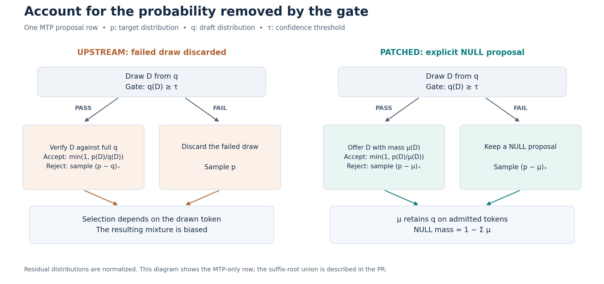
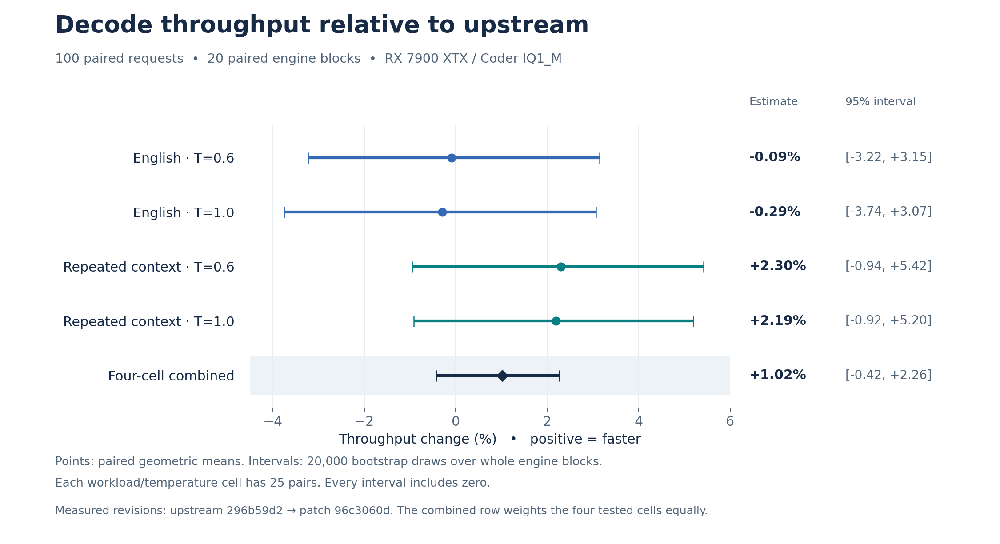

# Gated MTP sampling on RX 7900 XTX

These measurements compare upstream `296b59d2` (U) with the gated-proposal implementation at `96c3060d` (A), before integration with `main` at `477ac13c`. Both arms enable probabilistic MTP and the own-draw confidence gate. The measured candidate's executable SHA256 is `d62fcd5fab7e4384288f5733d78adb40cb634d5f67720c9620bec1a7ffd70760`; upstream is `92957550cac688f0a27f43247887180b75433a121a5a9612cd924b24bc0236df`.

The tested source is available at [96c3060d in the contributor's fork](https://github.com/KeyanHu-git/Strata/tree/96c3060d765aacc56b660e5c35d21982703fa7a8). The PR's later main-branch integration has separate build checks. The timing and GSM8K results here remain tied to the measured executable above.



## Machine and settings

Windows, Ryzen 5 7600X, Radeon RX 7900 XTX (24 GiB), 32 GiB RAM. Both binaries are HIP Release builds for gfx1100 using ROCm Clang 24.0.0 and ggml commit `3cf03257f219afbe7334045ff7c6a06ac68c627d`.

Model: `Qwen3.8-Flash-Next-GSQ-RCO-IQ1_M`, native experts, separate PLE shard and MTP head. [model-assets.json](model-assets.json) records the asset filenames, sizes and SHA256 hashes. The model is partially resident, so the measurements include file reads.

Both arms use:

```text
STRATA_SPEC_PROB=1
STRATA_SPEC_PROB_GATE=pick
STRATA_RESIDENT_PIN=0
--spec 6 --mtp-max-t 4 --spec-min-p 0.5 --suffix-draft 3
--lookup-chain 0 --adapt-swaps 0 --pcie-frac 0
--max-context 131072 --kv int8 --prefill auto
--expert-cache 4416 --resident-experts --resident-budget-gib 10
```

The resulting engine plan is 5,759 GPU expert slots, a 10,239 MiB RAM expert arena and five CPU pool workers. The same expert placement profile and hipBLASLt tuning file are used in both arms. Diagnostic timing, state hashes and row tracing are disabled during the speed run. A uses the patch's window-invariant CPU arithmetic for probabilistic decode; U retains upstream arithmetic.

## Workload and method

Twenty paired engine blocks contain 100 paired measured requests: 25 pairs in each workload/temperature cell. Each arm starts a fresh engine for each block, receives a 16-token warmup, then runs the block's five measured requests in the saved order. Ten blocks run U first and ten run A first. There are 40 engine starts, 40 warmup generations and 200 measured generations.

The English prompt has 61 tokens and a 64-token output cap. The repeated-context prompt has 359 tokens and a 67-token cap. Temperatures are 0.6 and 1.0; sampling is top-k 20, top-p 0.95 and min-p 0.05. [manifest.json](manifest.json) contains the exact prompt token IDs, all request seeds, arm order and request history. All 100 pairs completed normally. Early EOS and slow observations remain included.

The primary statistic is the geometric mean of paired A/U decode-throughput ratios. Positive changes mean faster. Confidence intervals resample whole paired engine blocks, with 20,000 bootstrap draws and the fixed seed in [ANALYSIS-PROTOCOL.md](ANALYSIS-PROTOCOL.md). Generated output lengths can differ, so the primary ratio measures generated-token throughput.



| Workload | Temperature | Pairs | Throughput change | 95% block-bootstrap interval |
|---|---:|---:|---:|---:|
| English | 0.6 | 25 | -0.09% | -3.22% to +3.15% |
| English | 1.0 | 25 | -0.29% | -3.74% to +3.07% |
| Repeated context | 0.6 | 25 | +2.30% | -0.94% to +5.42% |
| Repeated context | 1.0 | 25 | +2.19% | -0.92% to +5.20% |

The equal-weight estimate across the four cells is +1.02%, with a 95% interval of -0.42% to +2.26%. The point estimates are close to parity on English and slightly positive on repeated context; the intervals include zero.

[pairs.csv](pairs.csv) contains every paired timing, output length, finish reason and work count. [measurements.json](measurements.json) includes warmups, output token IDs, engine INFO and DONE fields. The launch-recipe hashes are retained as provenance; the actual gate override is explicit in each A run.

To reproduce the statistics from the saved measurements:

```sh
python3 analyze.py measurements.json --out-dir analysis
```

This needs only Python's standard library. It checks the 100-pair matrix and emits per-cell, per-block, order-stratified and full-cap summaries. Full-cap and same-output subsets are secondary summaries.

## GSM8K progress

The planned run contains all 1,319 test questions, one seed group (2591001), temperature 0.6 and an 8,192-token output cap. Prompts, per-question seeds, tokenizer and scorer match the original U assessment. Speed above was measured contemporaneously; the reused U GSM8K answers come from the earlier assessment.

A completed 304 items before a new engine startup encountered Windows commit pressure. Its RAM expert arena fell from the required 10,239 MiB to 6,698 MiB, and the fixed-resource check stopped the run before question index 304 was generated. The original service was restored.

| Same 304 completed items | Correct | Incorrect | Truncated |
|---|---:|---:|---:|
| U | 300 | 4 | 0 |
| A | 300 | 3 | 1 |

The remaining 1,015 items have no A result. [gsm8k-partial.json](gsm8k-partial.json) records this status and the scorer hash. The truncated item remains counted; a full-test A accuracy is not available.

## Truncated-answer investigation

The truncated item is GSM8K test index 119. Upstream also repeatedly reconsidered this question, then ended after 6,508 tokens; the patch reached the 8,192-token cap. A bounded 12-token replay reproduced their first divergence and identified the failed-gate sampling branch. It also found a target-distribution difference along the incremental path. The comparison against a singleton reference remains open. [Trace, interpretation and measured probabilities](diagnostics/token12.md).

## Reproduce the figures

`figures/render.py` uses matplotlib. The performance figure is generated from the same offline analysis as the table; its input checksum is saved in `figures/plot-data.json`.

```sh
python3 analyze.py measurements.json --out-dir /tmp/gated-mtp-analysis
python3 figures/render.py --analysis /tmp/gated-mtp-analysis/analysis.json
```

The proposal diagram is a schematic of one MTP row. Suffix-root admission includes the eligible lookup token in the retained measure, as described in the PR.
