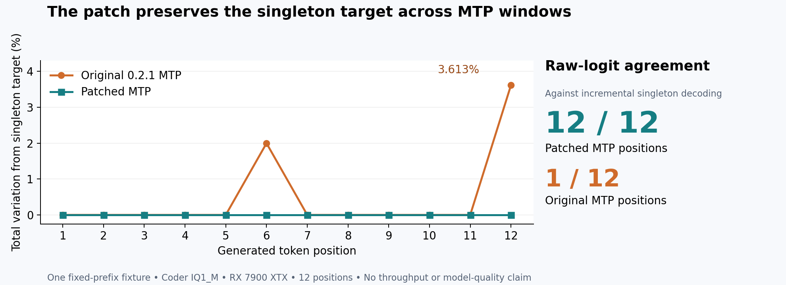

# Gated MTP: incremental target-probability check on 0.2.1

The patched MTP path matches ordinary incremental decoding at all 12 target-logit rows in this fixture. The unmodified release matches the first row and then differs. At token 12 its filtered target distribution has total variation 0.03613477386510889 from the singleton reference; the patched path has zero.

Base: v0.2.1, `90767252f420e25223c739d604145ad15911d48b`. Windows, Ryzen 5 7600X, RX 7900 XTX (24 GiB), 32 GiB RAM, Coder IQ1_M. Exact prompt, seed, outputs, binary/library hashes and engine resource lines are in [manifest.json](manifest.json).

| Execution | Raw logit rows identical to singleton | Token 6 probability TV | Token 12 probability TV |
|---|---:|---:|---:|
| Unmodified 0.2.1 MTP | 1/12 | 0.0199664153 | 0.0361347739 |
| Patched MTP | 12/12 | 0 | 0 |
| Unmodified / patched, MTP off | 12/12 between them | 0 | 0 |

The input is GSM8K item 119 from the previous partial evaluation. All six runs share the first 11 generated token ids. The target distribution is computed from raw logits using the engine's filter order and the request's sampling settings.

Rebuild this figure with `python plot.py` (matplotlib); it reads the saved JSON only.

## Controls and decisions

Six fresh engines produced 12 tokens each: original and patched production binaries, their trace builds, and a singleton control for each. The complete probe took 115.47 seconds. Trace builds reproduce their production binary's outputs. The singleton controls disable MTP and suffix proposals, retain the allocation setting `--spec 6`, and feed the same first 11 token ids one at a time. They do not re-prefill the combined prefix. Each singleton iteration checks T=1 and accepted=0.

At token 12, the original takes a plain target sample (`1`). The patch takes a NULL residual sample (`Let`). [token12.json](token12.json) contains p, q, retained measure, counters and reconstructed decisions for all 24 MTP rows. Every reconstruction matches the GPU output. [singleton.json](singleton.json) contains per-position reference distributions and raw-logit hashes.

A preceding ablation on the historical binaries changed only the patched CPU dispatch back to Default: all 12 logit rows then matched original MTP, while token 12 remained `Let`. With invariant dispatch, all 12 matched the historical singleton reference. This separates the arithmetic difference from the changed proposal decision.

## Interpretation

The original CPU expert dispatch chooses different accumulation paths for singleton and grouped rows. The patch retains the singleton arithmetic when a speculative window groups tokens together. The probability-law repair separately accounts for failed admission with a NULL proposal and residual sampling.

This fixture establishes incremental numerical agreement at these positions. It does not measure a model-quality score, explain the later 8192-token trajectory, or establish a speed change. Previous 100-pair performance measurements were on an older engine and remain historical.

## Final source recheck

After the ARM compile fix, the final HIP binary was rebuilt. Three further 12-token runs (production, traced MTP, traced singleton) took 56.17 seconds. All 24 recorded logit rows and all outputs match the earlier candidate; trace transparency passes. Final binary and library hashes are in [final-verification.json](final-verification.json). The final HIP sampler and all eight CPU arithmetic configurations pass again; see [contracts.json](contracts.json). [code-manifest.json](code-manifest.json) identifies the 29 code/build files checked against both remote source trees.

## Build and regression checks

- CUDA and SYCL: full `strata` compile/link; 13 CPU tests pass under each compiler. Logs: [CUDA host checks](cuda-host-tests.txt), [SYCL host checks](sycl-host-tests.txt). Run `ctest --test-dir BUILD -R '^(native_arithmetic_parity.*|gated_proposal_test|spec_admission.*)$' --output-on-failure` in the toolchain environment.
- HIP: full compile/link, 432 GPU sampler rows with zero oracle mismatches, and eight arithmetic configurations with 4,866,048 finite bitwise comparisons each. `HIP_VISIBLE_DEVICES=1` selects the RX 7900 XTX on this machine.
- Metal: engine compile/link and `strata --version` (`0.1.46-metal`). No Metal model execution or proposal support is claimed.
- Default mode: the final patched binary and genuine upstream produce identical 12-token outputs with `STRATA_SPEC_PROB=0`; [receipt](default-control.json).

The packet and finite-law tests are `gated_proposal_test`, `spec_admission_test`, and `STRATA_SPEC_PROB_GATE=top spec_admission_test top`. GPU verification uses `STRATA_OLD_SAMPLER=0 STRATA_SAMPLER_ONE_BLOCK=0 spec_proposal_parity`. Mac packet tests also pass with `-fsanitize=address,undefined`.
