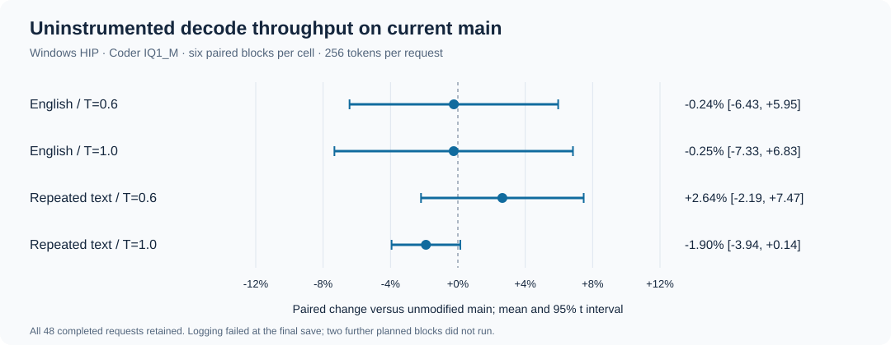

# Uninstrumented current-main comparison

Base: `011c9e600a93bbc9fd451c563501b5831c32bbca` (0.2.2 / engine 0.1.47).
Candidate: `d7d43198424d13ee6b64af03fde0a8dadee9b5f6` (same main plus PR #3416).

U means unmodified main; A means the submitted delayed-feedback implementation. The A label here does not refer to the frozen-policy arm in earlier diagnostic experiments.

## Protocol

Windows HIP / gfx1100, Coder IQ1_M, 10 GiB resident-expert budget, file-backed experts. Both binaries used `STRATA_SPEC_PROB=1`, `STRATA_SPEC_PROB_GATE=pick`, `STRATA_RESIDENT_PIN=0`, the same tuning file and device. No TIMING/TRACE/STATS/DUMP environment variable was enabled. Binary hashes and the actual allocation plan are in `metadata.json`.

Each block shuffles the order of four workload/temperature cells and runs both engines with paired seeds. Engine order is randomized in a predeclared schedule. Each engine starts fresh and runs a 32-token warmup before measurements. Context is 131072, KV int8, spec=6, MTP bound=4, suffix draft=3, lookup-chain=0, adaptive swaps=0 and PCIe sharing=0. Sampling: top-k=20, top-p=0.95, min-p=0.05; temperatures 0.6 and 1.0. Model inputs include fixed completed-thinking prefixes; exact input IDs are archived.

The 900-second budget covered six complete blocks (48 measured requests, all 256 tokens and finish=length). Eight blocks were planned. During the last request's result save at 843.76 seconds, Windows refused `os.replace(results.tmp, results.json)`. The `finally` handler saved all 48 rows and all 24 pairs. No further blocks ran. The raw local experiment keeps status=failed. An independent post-run check found no model engines and no listener on port 8080, matching the initial state. The error was in result-file replacement, after model output completed.

## Recompute

`python analyze.py > summary.json` uses the standard library. For each cell, it computes six paired `candidate / baseline - 1` changes and a 95% Student-t interval with 5 degrees of freedom. It does not pool temperatures as independent runs or discard slow pairs. `requests.csv` retains every timing; `outputs.json` retains token IDs and generated text.

The English point estimates are near zero. Repeated-text results change sign between temperatures. All four intervals include zero; this small bounded run does not establish equivalence or a stable speedup. Generated text is synthetic benchmark output, not an accuracy benchmark.
