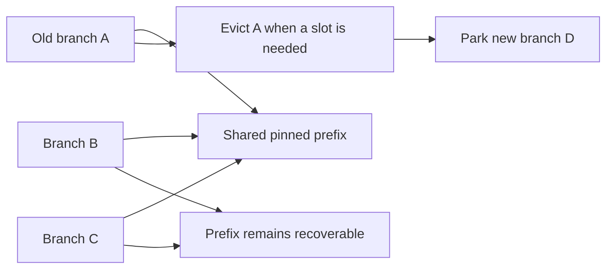

# Pinned-prefix cache reuse on 0.2.2

With three cache slots and repeated requests sharing a pinned prefix, upstream refuses eight parking attempts. The patch admits those branches and restores six revisited conversations. All 15 output token sequences match between the two runs.

| Observed behavior | Upstream | Patched |
|---|---:|---:|
| Requests | 15 | 15 |
| Parking refusals | 8 | 0 |
| Snapshot restores | 0 | 6 |
| Input tokens processed on six revisits | 1,778 | 90 |
| Output token mismatches | — | 0 |

Base: `011c9e600a93bbc9fd451c563501b5831c32bbca`. Production patch: `af1e09ddc32e0415641a7976237451d9e092679a`. Subsequent changes add documentation, this evidence, and session-reclamation tests; the production implementation is unchanged.

Windows 11 build 26300, Ryzen 5 7600X, RX 7900 XTX, approximately 32 GiB system RAM, Coder IQ1_M. Settings and binary SHA-256 hashes are recorded in [results.json](results.json), [environment.json](environment.json), and [settings.example.json](settings.example.json). Both arms use the same expert placement settings, greedy generation, seed 2255, a 196-token pin, a 4 GiB conversation-cache budget and three slots.

The sequence has two short controls, a common history, six distinct branches, and two rounds revisiting the last three branches. The additional turns ensure that parking, rather than the active-prefix sibling shortcut alone, is exercised. Inputs are synthetic. [fixtures.json](fixtures.json) contains the token IDs; [requests.txt](requests.txt) contains the exact engine protocol commands, in order.

## Why the entries can be evicted



Every pinned prefix must retain a holder. Distinct token histories, image identities and steering modes remain separate. A borrowed donor is protected even when another entry holds the same pin. Eviction checks these relationships again after each removal; reclaimable-byte accounting simulates that same sequence without copying snapshot payloads.

## Reproduce and inspect

Recompute the table directly from the recorded requests:

```sh
python bench/results/2026-10-22-pinned-prefix-cache/analyze.py
```

Build each revision with the same backend configuration. Copy `settings.example.json` to `settings.json`, replace the model and tuning-file placeholders with local paths, and select the appropriate device. Run each arm in a fresh engine:

```sh
python bench/results/2026-10-22-pinned-prefix-cache/replay.py \
  --engine /path/to/strata --settings settings.json --output baseline-run
```

Repeat with the patched executable and a different output directory. The replay waits for `READY`, sends one `GEN`, and waits for `DONE` before sending the next. Its stdout/stderr logs expose output IDs, processed prompt counts, parking refusals and restores. `replay.py` is a portable version of the sequential protocol driver; the recorded run used the local driver with the same requests and settings.

The recorded experiment took 120.5 seconds for both arms and ran with `STRATA_SNAPSHOT_VERIFY=1`. The time fields are retained as raw observations; this is a cache correctness and reuse check, not a throughput benchmark. The experiment began with no active serving process and returned to that state.

## Ownership and reclamation checks

```sh
c++ -std=c++20 -Wall -Wextra -Werror -fsanitize=address,undefined -Iinclude \
  src/core/conversation_cache_test.cpp -o conversation_cache_test
./conversation_cache_test
c++ -std=c++20 -Wall -Wextra -Werror -fsanitize=address,undefined -Iinclude \
  src/core/session_save_reclaim_test.cpp src/core/conversation_file.cpp -o session_save_reclaim_test
./session_save_reclaim_test
```

The cache tests cover distinct and shared pins, image/steering identity, byte and slot pressure, borrowed donors, and preview-versus-actual eviction. The new session-save cases inject low-memory readings and prohibit allocation during reclamation. They verify that redundant holders are reclaimed before the active chain, reclamation stops when enough memory is available, the donor stays valid, and the selected checkpoint retains its content and storage.

On the original header the new session case fails at `SAVE releases redundant pin holders one at a time`. On the patch it passes under Apple Clang with ASan/UBSan, Windows HIP Clang, and Intel `icpx`. Logs: [original](session-save-original.txt), [patched](session-save-final.txt), [cache policy](cache-final.txt). Backend build receipts are recorded separately from model execution.
