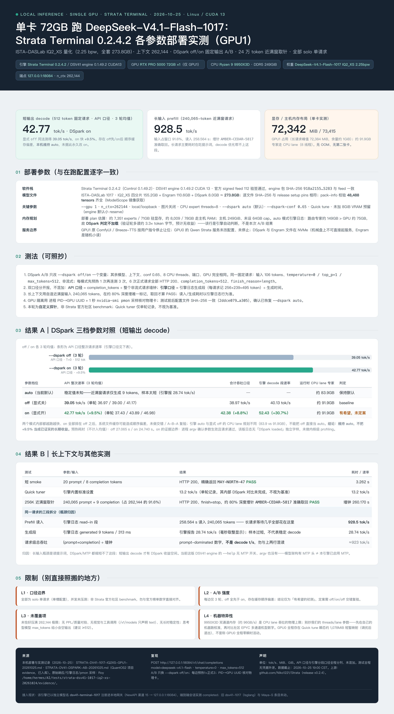

# DeepSeek-V4.1-Flash-1017 IQ2_XS on a single RTX PRO 5000 72GB — Strata Terminal parameter tests

Measured 2026-10-25 by [realsquall1980-art](https://github.com/realsquall1980-art) on a Linux workstation. Community benchmark report — Strata Terminal 0.2.4.2 / DSV41 engine 0.1.49.2 (CUDA 13), 256K context, DSpark off/on A/B, single GPU. A Chinese poster of the same data is attached (the English README here is the source of record; an editable HTML source and full-resolution PNG live in my [benchmarks repo](https://github.com/realsquall1980-art/maya-s1017-benchmarks/tree/main/bench/results/2026-10-25-community-rtx-pro-5000-72gb-dsv41-strata-terminal-iq2xs)).

## Headline results

| Test | Result | Scope / caveat |
|---|---:|---|
| Fixed-output decode, `--dspark on` (3 runs, API rate) | **42.77 tok/s** | 106-token prompt, 512 completion, T=0; `off` same protocol = 39.05 tok/s (+9.5% api-level, +30.7% engine decode-segment counter). All `off` runs precede all `on` runs — ordering/cache bias possible, kept as preliminary |
| Long-input prefill, near-window request | **928.5 tok/s** read-in | 240,065 prompt tokens (91.6% of 262,144); needle at ~80% depth retrieved exactly (`AMBER-CEDAR-5817`); wall clock 260.170 s |
| VRAM layout, one GPU | **72,342 MiB / 73,415** | No second card; ~91.9 GB routed experts on the CPU lane (8 threads); peak during long request 72,384 MiB |
| Short smoke | 20 prompt / 8 completion, exact `MAY-NORTH-47` | 3.262 s, HTTP 200 |

## Setup (verbatim with the running configuration)

- 1× NVIDIA RTX PRO 5000 72GB (Blackwell, GPU1 only), Ryzen 9 9950X3D, 249 GiB DDR5, Ubuntu, CUDA 13
- Strata Terminal 0.2.4.2 (Control 0.1.49.2); DSV41 CUDA 13 engine 0.1.49.2 from signed feed 112 (archive SHA-256 `918a2155ad6bad0e…` matching the signed feed)
- ISTA-DASLab DeepSeek-V4.1-Flash-1017 **IQ2_XS 2.25 bpw**; 4 shards 155.2 GB + Engram 110.6 GB + DSpark 8.0 GB ≈ 273.8 GB total; per-file SHA-256 matches the release `setup.py` pins; pack-info verified 48,488 tensors
- Flags: `--gpu 1`, `n_ctx=262144`, local/loopback, images off, CPU expert threads = 8, `--dspark auto` (default), `--dspark-conf 0.65`, quick tune, engine default small VRAM reserve
- Endpoint `127.0.0.1:18084`, model id `deepseek-v4.1-flash`
- Auto-mode engine log rationale: routed experts ≈149 GB > GPU ≈75 GB, so DSpark is not loaded in `auto` (validation rounds would read ~3.3× more token bytes; engine's own heuristic, not this A/B's result)

## Method (M1–M5)

1. **M1 — single variable.** A/B changes only `--dspark off/on`; model, context, conf 0.65, threads, port, GPU identical. One fixed request: 106 prompt tokens, `temperature=0`, `top_p=1`, `max_tokens=512`, non-streaming; 1 warmup + 3 measured runs per mode. All 6 official requests: HTTP 200, `completion_tokens=512`, `finish_reason=length`.
2. **M2 — two counters, never mixed.** API rate = completion_tokens ÷ whole non-streaming wall time. Engine rate = engine-log generation segments (495 counted tokens per 512-token response) ÷ generation time. Both reported below.
3. **M3 — long-context functional gate.** Self-constructed near-window input (240,065 tokens) with one unique marker at ~80% depth; PASS only if exact retrieval + `finish_reason=stop`.
4. **M4 — GPU isolation.** Process PID → GPU UUID mapping plus 1-second `nvidia-smi pmon` sampling. Config SHA-256 identical before/after (`2ddce0799086aa21…`), service restored to `--dspark auto`.
5. **M5 — scope honesty.** Custom probes, not the Strata standard community benchmark (which targets Qwen3.8). Quick-tuner 13.2 tok/s recorded as a single data point only.

## Results

### DSpark modes (decode, 3-run means)

| Mode | API rate | Aggregate-throughput rate | Engine decode-segment rate | CPU-lane experts | Verdict |
|---|---:|---:|---:|---:|---|
| `auto` (current default) | unknown (single 9-token generation, sample too short) | — | — | ~83.9 GB | keep default |
| `off` | 39.05 tok/s (36.97 / 39.00 / 41.17) | 38.97 tok/s | 40.13 tok/s | ~91.9 GB | baseline |
| `on` | **42.77 tok/s** (+9.5%) (37.43 / 43.89 / 46.98) | 42.38 tok/s (+8.8%) | **52.43 tok/s** (+30.7%) | ~91.9 GB | promising, not settled |

Both modes trend faster within themselves and all `on` runs came second — file-cache/warm ordering bias is possible; no interleaved A-B-A yet. Decision: stay on `auto`; do not permanently flip to `on` from this evidence.

### Long context & other probes

| Test | Input | Outcome |
|---|---|---|
| 256K near-window retrieval | 240,065 + 9 tokens | PASS, exact marker, 260.170 s; read-in 258.564 s (928.5 tok/s); generation 9 tokens / 313 ms (28.74 tok/s, too short for a decode figure) |
| Request-level throughput | (prompt+completion) ÷ wall | ≈923 tok/s — prompt-dominated, **not** a decode number |
| Quick tuner | engine built-in | 13.2 tok/s, single round, not a benchmark |

Bottleneck attribution: long-input waiting is almost entirely prompt prefill; neither DSpark nor MTP shortens it. This engine build exposes no MTP flag (`--help` and argv checked) — the model having MTP heads is not this deployment enabling MTP.

## Limitations (L1–L4)

- **L1** Solo single-request measurements only (single-slot config); no concurrency, and not an official Strata community benchmark — don't align directly with official leaderboard numbers.
- **L2** n=3 per side with a fixed off→on order; a confirmation round should interleave off/on/off with the same PID→UUID isolation.
- **L3** 262,144 window never exactly saturated; no PPL/quality diff, no vision or tool calls (`/v1/models` declares text only), no long-duration stability. Thinking model: small `max_tokens` yields `finish=length` with empty content (use ≥512).
- **L4** Machine-specific: 9950X3D dual-channel DDR5 (~96 GB/s) bounds CPU-lane throughput — run your own calibration instead of copying threads/lane parameters. GPU0 side effects: a transient ~1,078 MiB DSpark quick-tune mapping to GPU0 existed at install time (ended with tuning); we do not claim GPU0 had zero transient activity throughout.

## Raw data

`raw/` contains every request/response JSON, per-run timing files, engine logs (`dspark-ab/`), pmon GPU samples, config snapshots, model file SHA-256 manifest and lease/service state files. The 240K-token synthetic prompt payloads (~2.2 MB) are omitted as procedurally generated filler — the construction method is described in M3; ask and we'll attach them.

## Acknowledgements

Thanks to the Strata (Niko1221/Strata) and ISTA-DASLab quant authors for making single-GPU serving of a ~300 GB MoE practical.
