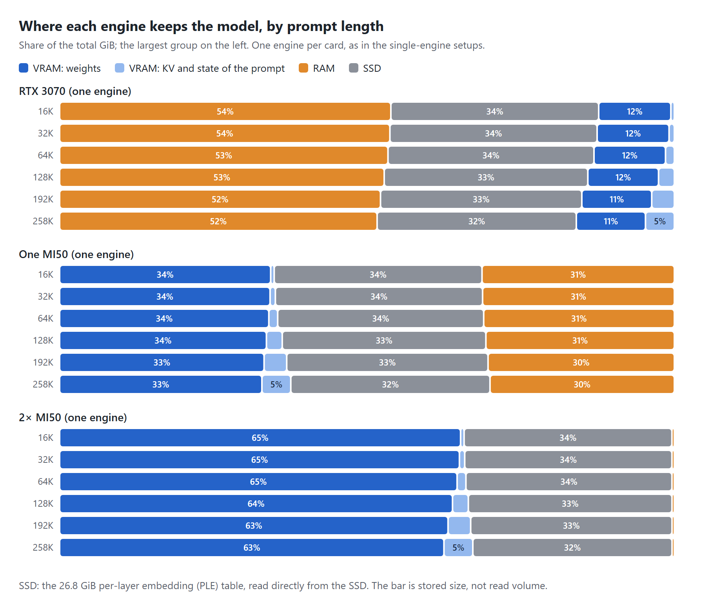

# Split serving on 0.2.7 with gfx906: two MI50s, and an RTX 3070 with MI50s

#4000 proposed running prefill and decode on different GPUs, so that each card does the stage it is best at. 0.2.7 ships
the idea as split serving (`split_serve` in the model config, `docs/SPLIT_SERVE.md`): one engine reads the prompt and
saves the session, a second engine restores it and writes the answer. I measured the shipped version on the hardware of
#4000: what each setup takes, whether every request completes, and whether a split beats the single engine it replaces.

Protocol `strata-qwen38-thinking-v1-draft.1`, still a draft (pilot validation pending), track `custom`. These are not
standard or approved results. Two of the nine standard runs are `nonconforming`; both are kept and listed below.

## Hardware and build

| Role | Hardware |
|---|---|
| Decode | 2× AMD Instinct MI50 32 GB (gfx906), HBM2 at about 1 TB/s each, no MFMA; one or both, depending on the setup. Clocks capped at 1,339 MHz and 170 W by the host |
| Prefill | NVIDIA RTX 3070, a modified 16 GB board (8 GB from the factory); FP16/BF16 issue rate raised with Zagitta/gpu-unlock, clocks locked to 1,500 to 2,100 MHz. cuBLAS FP16 GEMM measures 80.4 TFLOPS on it; a stock RTX 3070 is likely to read prompts slower (not measured) |
| Host | AMD Threadripper 1920X, 96 GB RAM, PCIe 3.0, SATA SSD |
| Software | Ubuntu 22.04 (kernel 6.8), ROCm 7.14 with amdgpu DKMS 6.10.5, CUDA 13.0. The engines ran in Ubuntu 24.04 containers, which is the OS the runner reports |
| Build | Strata 0.2.7 (`5e8a4cca`) with #3986, commit `93f866a7` as the runner reports |
| Model | Qwen3.8-Flash-Next IQ3_S, 256K context |

How to rebuild both engines and rerun every setup is on
[`bench/0.2.7-split-gfx906`](https://github.com/MarcoTool/Strata/tree/bench/0.2.7-split-gfx906/bench/split-gfx906).

## Runs in this pull request

| Setup | Folder | Runner status | Used for |
|---|---|---|---|
| RTX 3070 prefill, one MI50 decode | [`…-a860097c`](../2026-10-30-standard-rtx3070-mi50-split-20261030T135425Z-a860097c/) | nonconforming | long prompts only |
| RTX 3070 prefill, one MI50 decode | [`…-015a0d90`](../2026-10-30-standard-rtx3070-mi50-split-20261030T212228Z-015a0d90/) | complete | standard benchmark |
| RTX 3070 prefill, two MI50s decode | [`…-49b1d21c`](../2026-10-30-standard-rtx3070-2mi50-split-20261030T143323Z-49b1d21c/) | nonconforming | both |
| RTX 3070 (one engine) | [`…-2562bd1d`](../2026-10-30-standard-rtx3070-20261030T150954Z-2562bd1d/) | complete | both |
| One MI50 (one engine) | [`…-5c1a0bcb`](../2026-10-30-standard-mi50-20261030T154523Z-5c1a0bcb/) | complete | both |
| 2× MI50 (one engine) | [`…-bc3d9328`](../2026-10-30-standard-2mi50-20261030T173153Z-bc3d9328/) | complete | both |
| MI50 #0 prefill, MI50 #1 decode | [`…-16d629f2`](../2026-10-30-standard-2mi50-split-20261030T192138Z-16d629f2/) | complete, 1 failed | failure count |
| MI50 #0 prefill, MI50 #1 decode | [`…-15b0880f`](../2026-10-30-standard-2mi50-split-20261030T213507Z-15b0880f/) | complete, 1 failed | standard benchmark |
| MI50 #0 prefill, MI50 #1 decode, `--vram-reserve-mib 2048` | [`…-217cd93d`](../2026-10-31-standard-2mi50-split-reserve2048-20261031T011511Z-217cd93d/) | complete, 1 failed | the VRAM check below |
| MI50 #0 prefill, MI50 #1 decode, long prompts only | [`2026-10-30-long-2mi50-split-rerun`](../2026-10-30-long-2mi50-split-rerun/) | not a protocol run | long prompts |

Each folder has the runner's own output unchanged, the run config as used (`engine-config.json`), the launcher for the
RTX 3070 splits, the split lines, the engine logs that were kept, the long prompts, and a `NOTES.md` with what the runner
could not see. Paths are redacted to `/home/<user>`. [`SHA256SUMS`](SHA256SUMS) lists the hash of every file in the run
folders and this one.

- **Nonconforming runs.** RTX 3070 prefill, one MI50 decode: the first run was marked for an unexpected reuse of the
  prompt; a second run of the same setup is complete. RTX 3070 prefill, two MI50s decode: the runner left
  `performance-prompt-16k-r1` out of the speed summary for an unexpected cache reuse. Both affected requests ended before
  the 512-token cap.
- **Long prompts.** [`long_standard.py`](https://github.com/MarcoTool/Strata/blob/bench/0.2.7-split-gfx906/bench/split-gfx906/long_standard.py)
  sends the benchmark's record lines repeated to 32K, 64K, 128K, 192K and 258K, its summary question and the runner's own
  request settings, three times each, on the same engine after the standard run. It is an extension, not part of the
  protocol. The second RTX 3070 / one MI50 run did not repeat them, so that setup's long prompts come from its first run.
- **Engine logs.** Kept for the MI50 #0 / MI50 #1 runs and the second RTX 3070 / one MI50 run; the other runs were made
  before the run script saved them.

## Short answer

| Setup | What it takes besides 0.2.7 | Standard benchmark, required requests | Sanity checks | Long prompts, 32K to 258K |
|---|---|---|---|---|
| RTX 3070 prefill, one MI50 decode | #3986, and a launcher script as the config's `exe` | 21 of 21 | 12 of 12 | 15 of 15 |
| RTX 3070 prefill, two MI50s decode | the same | 21 of 21 | 12 of 12 | 15 of 15 |
| MI50 #0 prefill, MI50 #1 decode | #3986, and `STRATA_PIN_RESERVE_MIB=12288` | 20 of 21 | 10 of 12 \* | 13 of 15 |

\* The last retrieval check failed, and in this run one tool-call check returned no tool call; the other two runs scored
11 of 12, with only the retrieval check failing.

- **Two alike cards: nothing gets faster.** MI50 #0 prefill, MI50 #1 decode against 2× MI50 (one engine): prefill within
  2.1%, decode -12.8% to +2.3%, and each request adds a hand-over, as SPLIT_SERVE.md says.
- **An RTX 3070 added to read the prompt for an MI50: prefill 2.4 times as fast at 4K, 3.4 times at 16K, 4.0 to 4.3 times
  from 64K.** The answer stays on the MI50.
- **MI50s added to answer for the RTX 3070: decode 7.5% to 32.2% faster with one MI50, 6.8% to 48.3% with two.** Prefill
  stays on the RTX 3070 at the speed of the RTX 3070 alone from 16K. Each request also pays a hand-over of 1.2 to 11.4 s.

Without the additions in the second column, 0.2.7 stops at three points:

- **The gfx906 build fails** in `src/core/dflash2.cpp` (`cudaDeviceGetStreamPriorityRange` and
  `cudaStreamCreateWithPriority` undeclared). #3986 fixes it.
- **Only one of two MI50 engines starts.** Both HIP engines map the shared expert arena, and the amdgpu driver charges it
  to each (#4514, problem 1). `STRATA_PIN_RESERVE_MIB=12288` leaves room for that.
- **One build for both engines.** `split_serve` starts both roles with the same `exe`, so a CUDA card and a gfx906 card
  cannot share a split as shipped. A launcher script picks the build per role.

## Failures of the two-MI50 split

**The last retrieval check stops the prefill engine, in every run.** The prompt has 16,390 tokens. In all three runs the
prefill engine on MI50 #0 read it to its last chunk and exited with code 1; the last line of its log is:

```
prefill gemm: cublasGemmEx f16: cuBLAS status 6
```

The other three retrieval checks complete. It is not VRAM headroom: the third run gave the prefill engine
`--vram-reserve-mib 2048` through `prefill_args`, which left 1,936 MiB free after loading instead of 588 MiB, and the
request failed the same way. The single engines on the same cards pass this check.

After that the decode engine answered every later request alone: in the second run, none of the 15 long prompts has a
`split:` line. SPLIT_SERVE.md says a prefill engine that died is started again and that the decode engine reads the prompt
itself when the prefill engine fails; here the failing request ended with an error and the prefill engine did not come
back. The long prompts of this setup therefore come from a separate run with a freshly started server.

**192K stops the decode engine twice.** Two of the three 192K requests failed while the decode engine on MI50 #1 wrote the
answer, after the hand-over: `mtp: round capture: out of memory`. The first time the engine went on; the second time it
exited and the server started it again, and the three 258K requests after it completed. The decode engine had 465 MiB of
VRAM free at the start of a request, below the 512 MiB the engine warns about.

## Setups

**MI50 #0 prefill, MI50 #1 decode.** The config of SPLIT_SERVE.md, `"split_serve": {"prefill_gpu": 0, "decode_gpu": 1}`,
with `STRATA_PIN_RESERVE_MIB=12288`.

**RTX 3070 with MI50s.** The config names a launcher script as `exe`
([`split-launch.sh`](https://github.com/MarcoTool/Strata/blob/bench/0.2.7-split-gfx906/bench/split-gfx906/split-launch.sh);
the copy used is `launcher.sh` in each run folder):

- the prefill role carries a marker in `prefill_args`; the script removes it and starts the CUDA build on the RTX 3070;
- every other start gets the gfx906 build on the MI50s: both for two MI50s, MI50 #1 only for one.

`serve/split.py` is unchanged. The hand-over passes the restore check because the gfx906 build is the CUDA sources compiled
through HIP and writes `cuda` as the session's backend. The launcher is a workaround, not a general way to run cards from
two vendors on 0.2.7, and the cross-backend check SPLIT_SERVE.md asks for (a KL comparison after a hand-over) was not run.

**The single engines** are the splits' own engines started alone, with the same build, arguments and card:

| Single engine | Arguments beyond the common ones | Experts in VRAM |
|---|---|---|
| RTX 3070 (one engine), the splits' prefill engine | `--vram-reserve-mib 2000 --prompt-cache 48 --prompt-cache-every 8192` | 2,287 of 24,576 (4.4 GiB) |
| One MI50 (one engine), the one-card decode engine | `--remote-expert-opt`, `HIP_VISIBLE_DEVICES=1` | 11,771 (22.3 GiB) |
| 2× MI50 (one engine), the two-card decode engine | `--expert-cache-device1 auto --remote-expert-opt` | all |

Common to every engine: `--kv int8 --kv-resident 262144 --max-context 262144`, MTP drafting (`--mtp`, `--spec 4`,
`--spec-min-p 0.5`), `--expert-cache auto --prefill auto`, one shared expert arena in `/dev/shm`. MI50 engines:
`HSA_OVERRIDE_GFX_VERSION=9.0.6`, `STRATA_GR_SPLIT=1`, `STRATA_GFX906_ATTN_QUERY_SWIZZLE=1`,
`STRATA_GFX906_ATTN_REDUCE12=1`. The MI50 #0 / MI50 #1 split runs both engines with `--remote-expert-opt` and no prompt cache.

## Speed

Left of each arrow is the single engine, right is the split. Each cell is the median of three requests; 4K and 16K are the
standard benchmark's prompts, 32K and longer the long prompts. A split's prefill is the prefill engine's own read, from its
`split:` line; the rate the server reports for a split request is lower, because it counts the hand-over and the decode
engine's start as prompt time. Decode is measured at the client over reasoning and answer together, and varies by up to
about 30% between the three requests of one cell.

**Prefill**

| Split | Replaces | 4K<br>(higher is better) | 16K | 64K | 258K |
|---|---|---|---|---|---|
| MI50 #0 prefill, MI50 #1 decode | 2× MI50 (one engine) | 332 → 325 tok/s (-2.1%) | 395 → 395 tok/s (-0.1%) | 399 → 401 tok/s (+0.6%) | 361 → 361 tok/s (-0.2%) |
| RTX 3070 prefill, one MI50 decode | One MI50 (one engine) | 356 → 853 tok/s (+139.8%) | 417 → 1,401 tok/s (+236.0%) | 403 → 1,634 tok/s (+305.1%) | 365 → 1,552 tok/s (+325.0%) |
| RTX 3070 prefill, one MI50 decode | RTX 3070 (one engine) | 929 → 853 tok/s (-8.3%) | 1,391 → 1,401 tok/s (+0.7%) | 1,625 → 1,634 tok/s (+0.6%) | 1,551 → 1,552 tok/s (+0.0%) |
| RTX 3070 prefill, two MI50s decode | RTX 3070 (one engine) | 929 → 853 tok/s (-8.3%) | 1,391 → 1,407 tok/s (+1.1%) | 1,625 → 1,645 tok/s (+1.2%) | 1,551 → 1,553 tok/s (+0.1%) |

**Decode**

| Split | Replaces | 4K<br>(higher is better) | 16K | 64K | 258K |
|---|---|---|---|---|---|
| MI50 #0 prefill, MI50 #1 decode | 2× MI50 (one engine) | 42.7 → 43.1 tok/s (+1.0%) | 43.8 → 40.5 tok/s (-7.4%) | 39.6 → 38.6 tok/s (-2.7%) | 37.3 → 36.1 tok/s (-3.3%) |
| RTX 3070 prefill, one MI50 decode | One MI50 (one engine) | 40.0 → 41.7 tok/s (+4.3%) | 43.2 → 43.8 tok/s (+1.4%) | 38.0 → 41.2 tok/s (+8.4%) | 35.7 → 36.7 tok/s (+2.8%) |
| RTX 3070 prefill, one MI50 decode | RTX 3070 (one engine) | 32.4 → 41.7 tok/s (+28.6%) | 33.1 → 43.8 tok/s (+32.2%) | 33.4 → 41.2 tok/s (+23.2%) | 34.2 → 36.7 tok/s (+7.5%) |
| RTX 3070 prefill, two MI50s decode | RTX 3070 (one engine) | 32.4 → 48.1 tok/s (+48.3%) | 33.1 → 44.6 tok/s (+34.7%) | 33.4 → 42.3 tok/s (+26.4%) | 34.2 → 36.5 tok/s (+6.8%) |

A second MI50 on the decode side does not make decode clearly faster than one: the medians differ by -6.9% to +15.3%,
within the spread between requests.

**Answer length at which the split catches up with the RTX 3070 alone**

From the measured time to the first token (the prompt, plus the hand-over for a split) and the decode rates; reasoning and
answer tokens together. Rough, since decode varies between requests.

| Split | 4K | 16K | 32K | 64K | 128K | 192K | 258K |
|---|---|---|---|---|---|---|---|
| RTX 3070 prefill, one MI50 decode | about 240 | about 240 | about 770 | about 680 | about 910 | about 1,890 | about 5,830 |
| RTX 3070 prefill, two MI50s decode | about 170 | about 230 | about 600 | about 610 | about 1,220 | about 1,530 | about 6,620 |

**Where each engine keeps the model**

From the engine start logs (RTX 3070 and one MI50 in `logs/server.log` of the second RTX 3070 / one MI50 run; the 2× MI50
engine's start log is not in this pull request), plus the KV and state of the prompt. The SSD part is the per-layer
embedding table on every engine; the bar is stored size, not read volume.



<details>
<summary>Per-setup data: prefill, decode, hand-over, time to first token, whole request</summary>

Medians of three requests. Time to first token and whole request are measured at the client; every request here ran to the
512-token cap.

**MI50 #0 prefill, MI50 #1 decode**

| Prompt | Prefill, tok/s | Decode, tok/s | Session, MiB | Hand-over, s | First token, s | Whole request, s |
|---|---|---|---|---|---|---|
| 4K | 325 | 43.1 | 285 | 1.32 | 14.1 | 26.9 |
| 16K | 395 | 40.5 | 464 | 1.82 | 43.5 | 56.1 |
| 32K | 403 | 38.6 | 702 | 2.20 | 83.7 | 96.9 |
| 64K | 401 | 38.6 | 1,180 | 3.91 | 167.6 | 180.8 |
| 128K | 388 | 38.6 | 2,134 | 6.81 | 345.2 | 358.4 |
| 192K \* | 375 | 36.0 | 3,089 | 8.18 | – | – |
| 258K | 361 | 36.1 | 3,983 | 10.98 | 728.0 | 742.2 |

\* One request, the first after the decode engine had been started again; its first token came at 673.7 s, so its times
are left out.

**2× MI50 (one engine)**

| Prompt | Prefill, tok/s | Decode, tok/s | First token, s | Whole request, s |
|---|---|---|---|---|
| 4K | 332 | 42.7 | 12.4 | 24.2 |
| 16K | 395 | 43.8 | 41.5 | 53.3 |
| 32K | 406 | 44.3 | 80.9 | 92.0 |
| 64K | 399 | 39.6 | 164.5 | 177.0 |
| 128K | 388 | 38.1 | 338.3 | 351.3 |
| 192K | 375 | 35.2 | 524.3 | 539.1 |
| 258K | 361 | 37.3 | 714.8 | 727.5 |

**RTX 3070 prefill, one MI50 decode**

| Prompt | Prefill, tok/s | Decode, tok/s | Session, MiB | Hand-over, s | First token, s | Whole request, s |
|---|---|---|---|---|---|---|
| 4K | 853 | 41.7 | 285 | 1.21 | 6.1 | 18.4 |
| 16K | 1,401 | 43.8 | 464 | 1.73 | 13.6 | 25.2 |
| 32K | 1,483 | 40.6 | 702 | 2.46 | 24.8 | 37.6 |
| 64K | 1,634 | 41.2 | 1,180 | 3.88 | 44.3 | 56.7 |
| 128K | 1,630 | 42.0 | 2,134 | 6.70 | 88.2 | 100.3 |
| 192K | 1,606 | 37.9 | 3,089 | 8.29 | 131.6 | 145.8 |
| 258K | 1,552 | 36.7 | 3,983 | 10.72 | 178.5 | 191.9 |

**RTX 3070 prefill, two MI50s decode**

| Prompt | Prefill, tok/s | Decode, tok/s | Session, MiB | Hand-over, s | First token, s | Whole request, s |
|---|---|---|---|---|---|---|
| 4K | 853 | 48.1 | 285 | 1.25 | 6.2 | 16.8 |
| 16K | 1,407 | 44.6 | 464 | 1.77 | 13.6 | 25.7 |
| 32K | 1,483 | 42.5 | 702 | 2.52 | 24.9 | 36.8 |
| 64K | 1,645 | 42.3 | 1,180 | 3.98 | 44.3 | 56.4 |
| 128K | 1,630 | 39.1 | 2,134 | 6.88 | 88.3 | 102.1 |
| 192K | 1,614 | 39.5 | 3,089 | 8.94 | 131.6 | 144.5 |
| 258K | 1,553 | 36.5 | 3,983 | 11.43 | 179.0 | 191.2 |

**RTX 3070 (one engine)**

| Prompt | Prefill, tok/s | Decode, tok/s | First token, s | Whole request, s |
|---|---|---|---|---|
| 4K | 929 | 32.4 | 4.5 | 20.1 |
| 16K | 1,391 | 33.1 | 11.9 | 27.2 |
| 32K | 1,495 | 35.4 | 22.0 | 36.1 |
| 64K | 1,625 | 33.4 | 40.5 | 55.7 |
| 128K | 1,608 | 32.3 | 81.7 | 97.7 |
| 192K | 1,604 | 32.2 | 122.9 | 138.7 |
| 258K | 1,551 | 34.2 | 166.7 | 181.6 |

**One MI50 (one engine)**

| Prompt | Prefill, tok/s | Decode, tok/s | First token, s | Whole request, s |
|---|---|---|---|---|
| 4K | 356 | 40.0 | 11.6 | 25.0 |
| 16K | 417 | 43.2 | 39.4 | 51.2 |
| 32K | 411 | 40.0 | 79.9 | 92.5 |
| 64K | 403 | 38.0 | 162.6 | 175.2 |
| 128K | 391 | 35.2 | 335.3 | 349.9 |
| 192K | 378 | 35.0 | 519.8 | 534.4 |
| 258K | 365 | 35.7 | 707.1 | 721.3 |

</details>

## Limitations

- Track `custom`, draft protocol; two runs are `nonconforming`.
- The RTX 3070 is modified; a stock card was not measured.
- Engine logs are missing for five of the nine standard runs.
- The long prompts are an extension of the protocol and were not scored; they ask for a summary and stop at the cap, so
  they measure speed only.
- The cross-backend hand-over (CUDA to gfx906) was not checked with the KL comparison SPLIT_SERVE.md describes.
