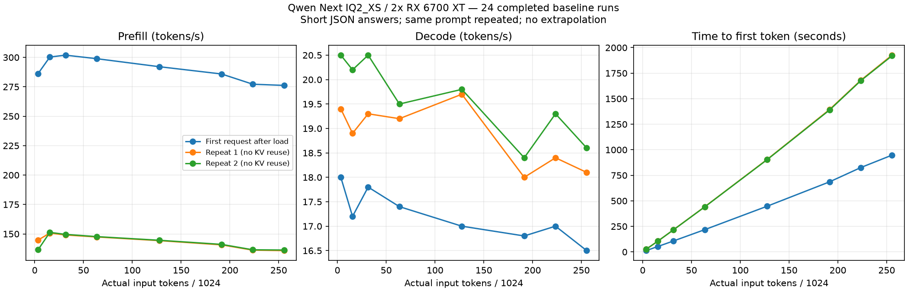
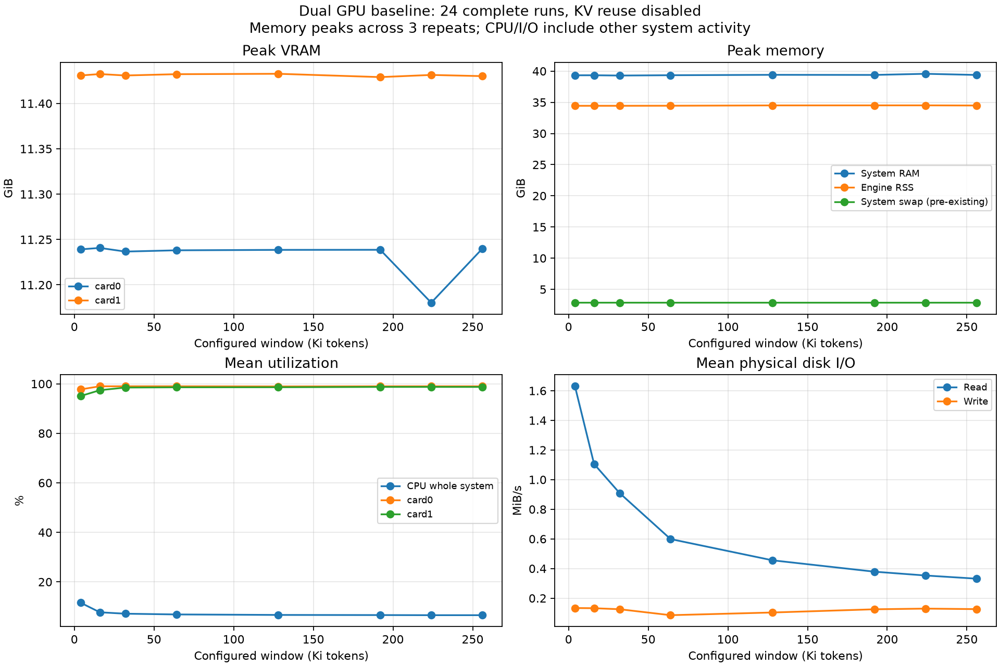
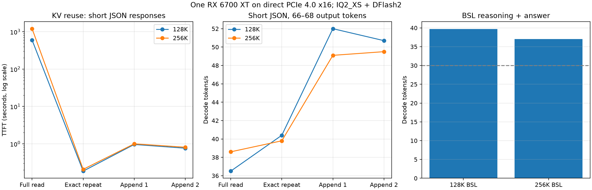

# RX 6700 XT / gfx1031: asymmetric PCIe dual-GPU vs one GPU, long context and prefix reuse

**Community/nonstandard measurements, not an approved standard benchmark. Results only; no engine changes.**

Measurements: 2026-11-03 UTC. All test runs were carried out by GPT-6 Astra, an AI agent operating the owner's hardware (agent identity supplied by the hardware owner). All reported numbers originate from actual API responses or engine logs. No claim of independent human replication is made. The owner authorized publication of these measurements.

## Main observations

On this specific machine, using only the GPU on a direct CPU PCIe 4.0 x16 connection was substantially faster at decode than layer splitting across both cards. The other GPU has an upstream PCIe 3.0 x4 bottleneck despite its endpoint link reporting x16. This is not a general claim that one GPU beats two.

Three matched 3,609-input-token runs: dual-GPU prefill 285.7 / 144.8 / 145.5 tokens/s; one fast GPU 233.0 / 236.4 / 237.6. Single GPU decode 38.2 / 42.4 / 43.0 tokens/s. Expert cache capacity necessarily changes with GPU count. Disabling prefill borrowing did not remove the dual-GPU slowdown (279.4 / 141.9 / 142.9). We have not established the exact internal cause of the repeat-prefill regression.

## Environment and provenance

- Ryzen 9 5950X (AVX2, no AVX512), 67,340,333,056 bytes installed RAM, Ubuntu 24.04, 2 × Radeon RX6700XT12 GB, gfx1031.
- Physical card0: upstream Gen3x4 via chipset, engine transfer probe around3 GB/s. Card1: direct Gen4x16, 28.2 GB/s. No BIOS or driver modifications.
- Strata release0.2.10, control/engine0.1.56, prebuilt RX6000 HIP engine; bundled runtime identifies ROCm7.13.0a20260515. This is not the host kernel driver version; exact host driver and SSD model are not established in this packet.
- Engine archive SHA256: b3c36efa17cfe144d57e709e4e36a10055aa7b29d104b5726b56519821c6517e. Build source identifier c75ab7655503 was recorded; the exact source revision could not be fetched publicly, so binary/source identity is not independently verified.
- Original ISTA-DASLab/Qwen3.8-Flash-Next-GSQ-RCO-GGUF, IQ2_XS, revision ed59f92082b1e93c0e96d60a8b11aab089b52f09.
- Shard1 SHA25692cee27ae5bbadcd732416a0f7a7f0acc092399dbbe8f5a5efa707c2ec0a49d7, shard2 SHA256316b46f3a2dbd68c900f43136ab9449f9dcc3725dfd8c794847c204bc161e113.
- DFlash2 Q4_0 pack SHA2564a42b98220ea7880664002c8edda1563aecbae754b762a2e2f31b2b91ee93ecd. Draft source incoai/Qwen3.8-Flash-Next-DFlash2 revision a22a1744e85c17364dcc54a6a420af7135d4c7f6.
- MemoryHigh48 GiB / MemoryMax52 GiB / swap limit1 GiB. Engine cgroup swap remained0; existing system swap did not grow. Other services remained installed/running but their image-generation queues were empty. Whole-system CPU/I/O include background activity.

## Method

The full eight-window sweep uses the same prompt three times per configuration, prompt-cache0. First means first request after process/model load, not an OS cold-cache run. Later repeats retain warmed expert state. All three results, including degraded repeats, are retained. Answers in this sweep are short JSON (~63–68 tokens), thinking disabled. Actual input lengths, not configured limits, are authoritative.

Rates use native engine timing fields; streaming TTFT uses a client monotonic clock and includes the first nonempty reasoning or answer delta. Reasoning tokens count toward decode. In one BSL run client first-delta time precedes native prompt time by about5s; raw values are retained, not reconciled by inventing a correction. One-second resource sampling may miss short peaks.

## Dual-GPU full-context sweep

| Window | Actual input | Prefill t/s (first/repeat/repeat) | Decode t/s | TTFT s |
|---:|---:|---|---|---|
|4096|3609|286.3 / 144.8 / 136.6|18.0 / 19.4 / 20.5|12.76 / 25.02 / 26.49|
|16384|15889|300.3 / 150.7 / 151.3|17.2 / 18.9 / 20.2|53.08 / 105.50 / 105.07|
|32768|32271|301.9 / 149.1 / 149.6|17.8 / 19.3 / 20.5|107.05 / 216.50 / 215.83|
|65536|65050|298.9 / 147.4 / 147.7|17.4 / 19.2 / 19.5|217.80 / 441.55 / 440.50|
|131072|130588|292.1 / 144.3 / 144.6|17.0 / 19.7 / 19.8|447.34 / 905.39 / 903.31|
|196608|196050|285.9 / 140.7 / 141.1|16.8 / 18.0 / 18.4|685.91 / 1393.75 / 1389.27|
|229376|228850|277.2 / 136.2 / 136.5|17.0 / 18.4 / 19.3|825.94 / 1680.23 / 1676.46|
|262144|261602|276.2 / 135.8 / 136.3|16.5 / 18.1 / 18.6|947.50 / 1926.35 / 1919.98|

## One fast GPU, long context and cache reuse

| Actual first input | First prefill t/s | First decode t/s | First TTFT s | Exact-repeat TTFT s | Appended-turn TTFT s |
|---:|---:|---:|---:|---:|---:|
|130588|218.0|36.5|599.03|0.186|0.764–0.962|
|261602|216.6|38.6|1207.98|0.207|0.810–1.001|

Exact repeats read7 fresh tokens. Appended turns read34–42 and reuse the remaining prefix. Their short repetitive JSON decode reached49–52 t/s with high draft acceptance; this is not a general agent-throughput claim. Fresh BSL reasoning+answer generated1164 tokens at39.7 t/s on129092 input; the260138-input BSL case generated906 at37.0 t/s, with16384 input tokens cached and243754 fresh. Both finished normally.

One-GPU settings: gpu1, kv int8, max-context262144, expert-cache auto, pool-workers16, prefill512, prompt-cache6, conversation-cache-mib0, spec2, draft dflash2, draft-fallback none, vram-reserve-later-mib1010; STRATA_HIP_PROMPT_F16=1. Native capture included up-to4-token verify windows: spec2 does not mean every actual window has length2. The --mtp path supplies draft vocabulary only; no MTP performance claim is made. Configurations are attached.

## Quality, negative findings and limits

- Three embedded codes were retrieved through the largest prompt. Linked arithmetic often returned137 rather than108 with thinking off, despite correct code retrieval.
- Short tool fixture with thinking off repeated a tool call until its step limit (0/3 semantic passes). Thinking on produced correct dependent calls and answer; initial strict JSON failures were Markdown fences. With explicit raw JSON instructions:3/3. Prompt wording changed for the strict-format comparison.
- Single-GPU BSL128K/256K passed numeric, faulty-function and call-chain checks. Proposed fixes were checked mathematically, not compiled/executed in 1C.
- Long tool fixtures at128K/192K passed2/2 each; these are small synthetic scenarios, not broad quality evaluation. Their score summary is attached, but this packet does not include complete tool-loop transcripts; treat these as supplementary observations rather than independently auditable headline claims.
- Full eight-window sweep was not rerun on one GPU. Long BSL has one run at each size. No 24-hour soak, concurrency sweep, IQ3 comparison, driver comparison or exhaustive tuning. No assertion that IQ2 is equivalent to higher quants.
- Other attempted setup/configuration failures are outside this focused performance dataset. The retained dataset does not claim to be the entire experiment history.

## Evidence and reproduction

`raw/` contains original per-request result records (sanitized); `requests/` contains deduplicated exact synthetic payloads. `request-index.json` maps each run to its payload. `logs/` contains explicitly selected startup/timing excerpts, not complete logs. `configs/` contains saved engine configurations; replace pack-relative paths with your verified matching files. Supporting original scripts are in `scripts/`: some orchestration scripts reference the original experiment layout and are not standalone installers.

To reproduce a request, start the exact recorded engine/configuration, wait for readiness, POST its indexed payload to `/v1/chat/completions`, and retain the complete streamed response and engine log. For the dual sweep start a fresh process per window, disable prefix checkpoints and submit the identical payload three times in sequence. For cache scenarios use the recorded turn payloads in order with prompt-cache6. Do not discard failed or capped outcomes. Compare both GPU configurations on the same machine; card numbering and topology must be checked locally.

Aggregated JSONs retain their original names, including `interim`; these are frozen evidence snapshots, not a claim of standard protocol conformance. CPU/I/O are whole-system; process_rss is engine-only. RAM uses bytes, plots GiB; disk summaries bytes/s. See field names and `scripts/strata_resource_summary.py`. Original synthetic prompts and returned reasoning are included; no private user conversations are intended for this package.

## Questions for maintainers

Is the repeat-prefill drop a known limitation of layer splitting on strongly asymmetric PCIe links? What additional trace would distinguish CPU scheduling, inter-device staging and the prefill path? We are reporting an observed workaround, not proposing a default change or claiming a proven engine bug.

## Related reports and 1C context

Related hardware observations: [#3639](https://github.com/Niko1221/Strata/issues/3639) (two RX 6700 XT cards with asymmetric links), [#4696](https://github.com/Niko1221/Strata/issues/4696) (gfx1031 FP16 prefill), and [#4007](https://github.com/Niko1221/Strata/issues/4007) (PCIe expert-share tuning). These use different machines/builds/workloads; we do not treat their results as controlled baselines or claim the same root cause.

The BSL fixtures target 1C:Enterprise development: following procedure/function relationships, finding an arithmetic bug and proposing a corrected BSL expression in a large synthetic module. Russian prompts, BSL identifiers and model answers are retained as evidence. This is LLM analysis of 1C code, not a benchmark executed inside the 1C platform or against a production database.
