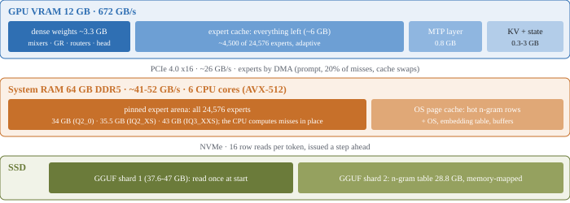

# Strata engine and server reference

This page is the technical reference for the Qwen engine and its server: measured speed, the HTTP API, the settings in
`strata-<model>.json`, memory modes and the speed switches. It is for people who run Strata from a source checkout, tune
an installation or connect their own software. It describes the current release. Dated measurements are in
[History / older measurements](#history--older-measurements) at the end.

New here? Start with the [README](../README.md). Installing is in [INSTALL.md](INSTALL.md), the models are in
[MODELS.md](MODELS.md), common problems are in [TROUBLESHOOTING.md](TROUBLESHOOTING.md). DeepSeek V4.1-Flash has its own
engine and is covered in [MODELS.md](MODELS.md); nothing below applies to it unless stated.

> **On this page:** [Quick start](#quick-start) · [Speed](#speed-measured) · [Which model?](#which-model) ·
> [Windows](#windows) · [Linux](#linux) · [Memory modes](#memory-modes) · [Sharing the GPU](#sharing-the-gpu-with-other-programs-optional) ·
> [API](#using-it) · [MCP tools](#tools-from-mcp-servers) · [MCP server](#manage-strata-from-your-ai-assistant-mcp-server) ·
> [Images](#images-vision) · [Speed settings](#speed-settings) · [CPU workers](#cpu-workers-and-thread-placement) ·
> [Per-card defaults](#rtx-30-series-sm_86-and-tesla-p100-sm_60-bitwise-decode-switches-on-by-default) ·
> [Troubleshooting](#troubleshooting) · [How it works](#how-it-works) · [Credits](#credits-and-licenses) ·
> [History](#history--older-measurements)

**Which flags go where.** `strata launch` has its own flags (`strata launch --help`). The engine and server flags below go
in the `"args"` list of `strata-<model>.json` (source setup writes it) or on the `serve/server.py` command line.
`START-HERE.bat`, `SETUP.bat`, `./setup.sh` and `run-<model>` exist only in a [source checkout](SOURCE_INSTALL.md). An
installed app has none of them.

## Quick start

1. Install and start a model: [INSTALL.md](INSTALL.md) (app or Terminal) or [SOURCE_INSTALL.md](SOURCE_INSTALL.md).
2. Check that the server answers. The default address is `http://127.0.0.1:8080`:

   ```sh
   curl http://127.0.0.1:8080/health
   curl http://127.0.0.1:8080/v1/chat/completions -H "Content-Type: application/json" \
     -d '{"model": "strata", "messages": [{"role": "user", "content": "Write a haiku about GPUs."}], "max_tokens": 512}'
   ```

3. Point your app at `http://127.0.0.1:8080/v1` with any API key, or run `strata connect` to list the apps Strata can configure.
4. Change a setting by editing `strata-<model>.json` and restarting. Setup rewrites the file when you run it again and
   keeps the keys it does not manage.

---

<a id="speed-measured"></a>
## Speed (measured)

**Measured on:** RTX 5070 12 GB, Ryzen 5 7600 (6 cores), 64 GB DDR5-5200, Windows, Qwen3.8-Flash-Next ISTA-DASLab packs,
engine 0.1.26 with the settings setup writes (`--prefill auto`, 8-bit KV above 4K, KV streaming from 64K). One
code-agent prompt per length, 256 generated tokens, MTP speculative decoding on. "262K" is the full context window (a
259,943-token prompt). The IQ2_XS row used Swift 1.5's IQ2_XS, which runs at the original's speed.

### Prompt processing (tokens/s)

| Model | 1K | 4K | 32K | 64K | 128K | 262K |
| --- | ---: | ---: | ---: | ---: | ---: | ---: |
| **Q2_0** | 536 | 1,299 | 2,171 | 2,126 | 2,107 | 1,304† |
| **IQ2_XS** | 534 | 1,256 | 2,092 | 1,754 | 1,752 | 1,181*† |
| **IQ3_XXS** | 482 | 1,007 | 1,745 | 1,609 | 1,602 | - |
| **IQ3_S** | 427 | 913 | 1,624 | 1,640 | 1,443 | - |
| **Coder** | 656 | 1,583 | 2,177 | 2,236 | 2,208 | 1,034** |

† not measured again since 0.1.22. \* measured with images on (the image encoder's VRAM reserve leaves fewer experts
cached). \*\* not measured again since 0.1.14.

### Output (tokens/s)

| Model | 1K | 4K | 32K | 64K | 128K | 262K |
| --- | ---: | ---: | ---: | ---: | ---: | ---: |
| **Q2_0** | 87.3 | 93.0 | 81.8 | 76.2 | 73.7 | 60.3† |
| **IQ2_XS** | 79.6 | 78.6 | 76.3 | 63.7 | 62.7 | 52.8† |
| **IQ3_XXS** | 61.9 | 61.6 | 58.5 | 57.2 | 49.0 | - |
| **IQ3_S** | 52.4 | 53.3 | 48.3 | 46.3 | 45.5 | - |
| **Coder** | 58.9 | 55.1 | 54.9 | 53.2 | 43.0 | 42.8† |

† not measured again since 0.1.14. Raw data: `bench/results/2026-09-29-speed-0126`.

- Output speed depends on the text. Speculative decoding runs faster when more drafted tokens are accepted, so a different
  answer to the same prompt moves it by several percent.
- Time to first token is prompt length divided by prompt speed. With Q2_0 that is about 4 s at 4K, 25 s at 32K, under
  2 minutes at 128K and 4.5 minutes at 262K.
- IQ3_XXS and IQ3_S at 262K are not measured. With 43 and 50 GB of experts, a 260K-token context brings a 64 GB PC to its
  memory limit by setup's estimate, so setup recommends up to 128K there. A longer context that you choose is kept, with a note.
- Other cards, other CPUs and newer engines differ. The 0.1.36 fused prompt kernels and later changes raised these
  numbers on RTX 30 and newer cards: see [History](#history--older-measurements). For your own PC, run the benchmark in
  [BENCHMARK_PROTOCOL.md](BENCHMARK_PROTOCOL.md).

More VRAM matters more than a faster GPU. Every extra GB holds about 700 more experts, and every expert on the GPU is one
the CPU does not have to compute. `tools/make_profile.py` builds an expert profile from your own prompts: run the engine
once with `--dump-routing trace.bin`, then see the tool's help. The shipped profile ranks every expert pair, so a trace
changes the order only with `--reorder` (your trace's pairs first, then the base's, then the rest).

## Which model?

[MODELS.md](MODELS.md) is the page for choosing a model: sizes, memory, providers and what fits. The families are
DeepSeek V4.1-Flash, Qwen3.8-Flash-Next (with its Coder, Swift, Gyro, Unsloth and NVFP4 variants) and Qwen3.6-35B-A3B
([QWEN36.md](QWEN36.md)). The ISTA-DASLab Qwen3.8-Flash-Next packs are:

| Model | Download | RAM it uses | Speed | Quality |
| --- | ---: | ---: | --- | --- |
| **Q2_0** | 66 GB | ~34 GB experts + ~6 GB | fastest | good |
| **IQ2_XS** | 68 GB | ~36 GB experts + ~6 GB | close to Q2_0 | a bit better |
| **IQ3_XXS** | 76 GB | ~43 GB experts + ~6 GB | slower (more CPU work) | best of the three |

IQ3_S is a fourth, larger pack: see [MODELS.md](MODELS.md#pick-by-memory). With 64 GB of RAM these three fit (close the browser
for IQ3_XXS and keep its context at 128K or less). With 48 GB only Q2_0 and IQ2_XS may fit. With 32 GB use the Coder.

### Or: the Coder (half the experts, for code)

[ISTA-DASLab's expert-pruned release](https://huggingface.co/ISTA-DASLab/Qwen3.8-Flash-Next-GSQ-RCO-Coder-GGUF) keeps 256 of
each layer's 512 experts (10 still active per token), chosen on code, agent and vision data. Shard 1 is 29.6 GB (23 GB of
experts in RAM), so it runs on 32 GB of RAM. Images work. Install it with `strata launch --family coder`
(from a source checkout: `START-HERE.bat --setup --family coder`). Details: [MODELS.md](MODELS.md#coder).

### Or: Swift 1.5 (a fine-tune that thinks shorter)

[Swift 1.5](https://huggingface.co/ukisai/Swift-1.5-Qwen3.8-Flash-Next-GSQ-RCO-GGUF) is UkisAI's fine-tune. It has the same
architecture and speed as the original, its own vision encoder, and thinks for fewer tokens. Its authors recommend IQ2_XS.
The license is the Swift Open License 1.0. Install it with `strata launch --family swift --model iq2_xs`
(from a source checkout: `START-HERE.bat --setup --family swift --model IQ2_XS`). Details: [MODELS.md](MODELS.md#swift-15).

<a id="experimental-unsloths-ud-q4_k_xl"></a>

### Unsloth's UD-Q4_K_XL

A 4-bit quantization of the same model (111 GB, 72 GiB of experts). Install it with `--family unsloth --model UD-Q4_K_XL`
(RAM budget: your RAM less 24 GB, the rest read from the SSD). What it does and the manual workflow are in
[UNSLOTH_Q4.md](UNSLOTH_Q4.md).

---

## Windows

On Windows the source wrapper is `START-HERE.bat` ([source installation](SOURCE_INSTALL.md#from-source-windows)). For a
released app, run its installer and open Strata from the Start menu. For the Terminal, use `strata launch`. Watch the
setup plan and the startup log for what is actually chosen on your machine, and see [TROUBLESHOOTING.md](TROUBLESHOOTING.md)
if a component is missing.

Terminal chat from a checkout: `.venv\Scripts\python chat.py`.

### Tuning for your PC (`--calibrate`)

Some engine settings depend on the PC more than on the model:

| Setting | What it controls |
| --- | --- |
| `--pcie-frac` | Share of the experts missing from VRAM that are copied to the GPU instead of computed by the CPU. A fast PCIe link and a slow CPU want more; a laptop's narrow link wants less. |
| `--spec-min-p` | How sure the draft layer must be to add another guess to a check. |
| `--pool-workers` | How many CPU threads compute experts. On CPUs with efficiency cores, fewer can be faster. |
| `--adapt-every`, `--adapt-swaps`, `--adapt-decay` | How busily the VRAM expert cache follows the conversation. A CPU that reads missed experts slowly (DDR3 or DDR4 in few channels) gains from more swaps. |
| `--prefill-pipe` | On two or more cards (layer split), the prompt chunks that keep the cards reading at once. See [MULTI_GPU.md](MULTI_GPU.md). |

The defaults were measured on a Ryzen 5 7600 with an RTX 5070. From a source checkout, `START-HERE.bat --calibrate` (Linux: `./setup.sh --calibrate`)
measures output speed with each setting on your PC and keeps one only when it is more than 3% faster. The result is
remembered per PC and model, and updates keep it. Measuring the worker count restarts the model more than once, so the PC
is busy and can stop responding for a minute or two at each restart.

### Running it at startup (Task Scheduler)

To have the model up at logon, start the server from Task Scheduler or a service. Windows throttles such contexts by
default, and the expert load then crawls.

**Measured on:** RTX 5070 Ti, Ryzen 7 9800X3D, NVMe, a ~40 GB expert load, same binary, arguments and cache state.

| How the server starts | Expert load |
| --- | ---: |
| Double-click, terminal or SSH | 1.42-1.52 GiB/s (~35 s) |
| Task Scheduler with its defaults | 0.05 GiB/s (821-841 s) |
| Task Scheduler with the two settings below | 1.42 GiB/s (35 s) |

In the task's properties set both of these (the defaults are the opposite):

- **Priority level: Normal** (Options tab; the default is Below normal).
- **Run with highest privileges** (General tab). Without it the task runs with a limited token, which also removes
  `SeLockMemoryPrivilege`, the privilege Windows large pages need.

Both were changed at once, so the effect of each alone is not measured. If the model still starts slowly, the engine prints a
hint under its `loaded ... GiB at ...` line.

**Large pages need a new logon.** Granting "Lock pages in memory" (`secpol.msc`, User Rights Assignment) to the account
that runs the engine takes effect at the next logon. Log off and on after granting it. Until then the startup log says
large pages were refused. `tools\windows\enable_large_pages.ps1` (run as Administrator) grants it to the current account.

---

## Linux

These notes are for **source setup**. Normal installs use [the Terminal or AppImage](INSTALL.md).

```bash
./setup.sh
```

Source setup offers choices for the detected machine and can install missing Debian or Ubuntu dependencies with `sudo apt`.
It starts the server on `http://127.0.0.1:8080` unless you configure another address or port. Later runs of `./setup.sh`
or `./run-<model>.sh` start the model directly. The options are the same as on Windows (`./setup.sh --setup`,
`--model Q2_0 --yes`, `--gguf-dir /data/Q2_0`). Terminal chat: `.venv/bin/python chat.py`. Building from git and trying a pull
request: [SOURCE_INSTALL.md](SOURCE_INSTALL.md#build-from-git-on-linux-to-try-a-pull-request-or-change-the-code).

- **Updating:** `git pull`, then `./setup.sh`. It compiles the engine again when its source changed. If the compile
  fails, it says so and starts the engine you had.
- **Other distributions** (Arch, Fedora and others): install the C++ compiler and the CUDA Toolkit 13 with your package
  manager first (Arch: `sudo pacman -S base-devel cuda`). Setup finds `nvcc` on `PATH`, in `/usr/local/cuda*` and in
  `/opt/cuda*`.
- **WSL** works (Ubuntu 24.04 tested) with one limit. The NVIDIA driver pins only about 1 GB there, so KV streaming
  (`--kv-resident`) is off, the KV cache stays in VRAM and experts are copied from unpinned RAM, which makes prompts
  slower than on native Linux.

---

## Memory modes

### KV cache

| Option | What it does |
| --- | --- |
| `--kv int8` (default) | 8-bit KV cache. |
| `--kv q4_0` | Half the KV memory with a Hadamard rotation before 4-bit rounding. About 4% faster at 128K, measurably less precise on long documents (perplexity +8-12%; needle tests still pass). Setup asks above 8K context. |
| `--kv k8v4` | Keys at 8 bits, values as rotated 4-bit: 23% less KV memory than 8-bit, so more experts fit in VRAM. More precise than `q4_0` on long documents. Prompts are 2-5% slower. |
| `--kv-streaming on\|off\|auto` | Keeps the context's KV cache in RAM and only the part attention reads in VRAM (`--kv-resident 32768`), so more experts fit on the GPU. Costs about 13.7 KB of RAM per context token (1.7 GB at 128K). Setup turns it on from 64K when the RAM has room; `on` overrides the RAM test with a note. Never under WSL. |
| `--kv-grow` (or `STRATA_KV_GROW=1`; `--no-kv-grow` turns it off) | The KV takes VRAM only for the cells the requests reach; the expert cache holds the rest and gives slots back as the context grows. Needs one GPU, an expert profile, the whole KV in VRAM and every expert in RAM. Otherwise the engine says so and stays off. On HIP it uses virtual memory management (`STRATA_HIP_VMM=0` turns that off). It pays on cards of about 24 GB or less with contexts of 128K and more. |

`STRATA_KV_HOST_REGISTER=1` forces the KV host copy to be pinned with `cudaHostRegister` (the order WSL2 uses
automatically); `0` forces `cudaHostAlloc` first.

### Low-RAM modes (chosen by setup)

Normally all of a model's experts are copied into RAM (23-50 GB, pinned) and the GPU holds a copy of the most-used ones.
When the RAM cannot hold them beside the system (the experts plus about 10 GB), setup picks one of these:

| Mode | Flag | What it does |
| --- | --- | --- |
| Mapped | `--mmap-experts` | Maps the experts from one file in the model's folder (the pack's `experts.bin`, +23-50 GB of disk), or from the GGUF files themselves for native packs that have no `experts.bin`. The OS file cache holds what the GPU does not and can give that memory back. With a small GPU most experts come from the SSD and it is much slower; setup says so. |
| Resident | `--resident-experts` | When the experts the GPU does not hold fit the RAM, the engine copies exactly those into RAM at start. Nothing is read from the SSD while it answers. |
| RAM budget | `--resident-budget-gib N` | The N GiB of experts the GPU does not hold that the profile ranks hottest are copied into RAM; the rest are read from the files. Implies `--mmap-experts` and leaves 4 GiB of headroom. On Windows the available commit limit also caps N, and a clamped budget is reported. This is what runs [Unsloth's UD-Q4_K_XL](UNSLOTH_Q4.md) on a 64 GB PC. |

- In a source checkout, `START-HERE.bat --setup --low-ram on|off` overrides the choice, and `--low-ram resident|mmap` forces one variant.
- The resident variant keeps 4 GB of the RAM it finds free (`STRATA_RESIDENT_HEADROOM_GIB`). When even the missing experts do
  not fit, it says so and runs the mapped mode. The server log shows per request how many expert reads went to the file
  (`resident RAM: ... blob reads from the file`, 0 in steady use).
- The adaptive tier (`--adapt-every`) keeps following the conversation in the resident mode. `--adapt-async 1` (opt-in,
  `--serve`) moves the swaps between decode windows on a helper thread. With `--batch` slots it works between their
  windows too, but not with `--batch-groups` or `--peer-device`. It is not bit-exact from run to run.
- `STRATA_RAM_ADAPT=<n>` (opt-in, `--serve`, one GPU, needs `--adapt-every`): the RAM copy also follows the conversation.
  A layer swaps up to 4 pairs per window: the experts the windows keep routing to (decayed count 2 or more) take the
  RAM places of unused experts of the same layer (count below 0.5), largest difference first. The incoming expert was
  usually read for the window before; when its blob still sits in that read's stage buffer it is copied from there and
  no file read is made. `n` caps only the pairs that need a file read (`=1` is enough in practice). The log counts how
  many experts moved and how many came out of a stage buffer.
- Several GPUs: setup recommends one GPU in the low-RAM mode and asks. `--gpus 0,1` shares the model across both cards
  ([MULTI_GPU.md](MULTI_GPU.md#using-it)). `--yes` keeps one GPU.
- With a page-locked copy the GPU also takes its share of the misses over PCIe (`--pcie-frac`). `--pcie-frac 0` (or
  `STRATA_RESIDENT_PIN=0`) gives the mapped mode's exact tokens.
- Linux, opt-in: `STRATA_ARENA_MMAP=1` maps a native pack's expert arena read-only from `experts.bin` instead of reading
  it into locked RAM (for example 2x 16 GB GPUs with 32 GB of RAM). Run it with `--pcie-frac 0`.
- Windows, opt-in: `STRATA_FILE_RELEASE=1` trims the file-backed pages of experts after their GPU uploads. It is a
  working-set hint, not an unmap, and it does not reduce committed memory or SSD reads
  ([measurements and limits](../bench/results/2026-10-04-windows-mapped-release/README.md)).
- Windows, opt-in: `STRATA_PIN_BY_NEED=1` (arena on one GPU) registers the profile's non-GPU-resident experts by rank up to
  `STRATA_ARENA_PIN_GIB` (29 by default on Windows) instead of the first ~30 GiB.
- Windows CUDA keeps 640 MiB then 160 MiB of page-lockable memory free while the arena pins (`STRATA_PIN_RESERVE_MIB=N`, `0`
  turns it off, and it sets the reserve on any OS). If a required buffer is still refused, the error ends with
  `[pinned-memory-exhausted]` and names the `STRATA_ARENA_PIN_GIB` to start with.
- `STRATA_EXCHANGE_ROTATE=1` (opt-in): an adaptive swap hands buffer ownership over instead of copying the evicted blob into
  the RAM copy. Same tokens, fewer host copies, about 1.4 GiB more page-locked RAM. See
  [EXCHANGE_ROTATION.md](EXCHANGE_ROTATION.md).

### Linux file tier

When experts are read from GGUF files in place, Linux runs three things by default. Off switches are in brackets.

| Part | Variable | What it does |
| --- | --- | --- |
| Zero-copy | `STRATA_COLD_OVERLAP=4` (`0` = off) | An expert whose three tensors' pages are all in the page cache is computed straight from the mapping, with no staging copy. |
| io prefetch | `STRATA_IO_PREFETCH=1` (`0` = off) | I/O threads read the layer's uncached experts and the router-predicted ones of the next layers with whole-blob `pread`s into the page cache. Tunables: `STRATA_LOOKAHEAD_K`, `STRATA_IO_PREFETCH_DEPTH` (2), `STRATA_IO_PF_THREADS` (8), `STRATA_IO_PF_STAGE=1`, `STRATA_IO_PF_AHEAD=0`. |
| Decode gate | `STRATA_IO_PF_GATE=1` (`0` = off) | Every 16 decode windows the read-ahead is judged. It runs only while the page cache has room for the experts (off below 0.55, on above 0.65: `STRATA_IO_PF_GATE_LO` and `_HI`) and while it pays (`STRATA_IO_PF_GATE_USEFUL`). |

For an `experts.bin` pack, io prefetch and the gate switch on when the page cache has room for at least 55% of the experts
(the tightest cgroup limit or `MemAvailable`, asked once at start). Below that the pack reads as before and the log says so;
`STRATA_IO_PREFETCH=1` forces it. The container RAM check counts a cgroup's clean page cache as available. The startup log
names what is on. Windows and macOS are unchanged. On a Radeon 780M iGPU, prefetch together with the adaptive tier under
memory pressure reset the GPU in most runs; with `--adapt-every 100000` there were none, and the cause is not found.

The weights and the MTP draft files are asked for ahead of their reads at start (madvise and `posix_fadvise` WILLNEED, 128 KiB
steps), which matters on a slow drive: `STRATA_READ_AHEAD=0` turns it off, `STRATA_FILL_AHEAD=N` sets how many fill pairs
are requested ahead (default 256).

The prompt chunk follows the host's memory (Linux, file tier, on by default). When the page cache is smaller than the file
set, a planner picks the chunk and ring with the fewest predicted bytes read per prompt from the RAM copy, the page cache that
is left, the drive class and the PCIe link. It prints `chunk 8192 -> 3840, ring 96 -> 96: ...` when it changes the pick and
`chunk 8192 kept: ...` when it does not. It does nothing when the GPU holds every expert, when the file set fits the cache,
and on Windows. `STRATA_PREFILL_HOST_PLAN=0` turns it off; `STRATA_SSD_GBPS` overrides the drive speed;
`--prefill N` and `STRATA_PREFILL_RING` always win.

### Reading the tiers

With `--stats` the engine prints the tiers of the decode (`expert tiers`: blobs from the RAM copy, blobs and MB from the
files, read time; `routing prefetch`: how many file reads had been warmed). The server log has the same per request, and
`GET /metrics` lists `ram_blobs`, `file_blobs`, `file_mb`, `drafts_offered` and `drafts_accepted` per recent request, with
`totals` since the start. `hit_rate` is the VRAM share of the experts looked up; experts the GPU reads over PCIe
(`--pcie-frac`) are not in it, so a higher `--pcie-frac` raises it even when decoding gets slower. `pcie_share` is their
share of all routed experts. The Monitor tab shows both. The request list in the Monitor tab also shows the prompt's own speed: what the cache already held is not read
again, so it is the fresh tokens (`prompt_tokens` minus `reused`) over the prompt time (`prompt_ms`), and a request that read no
new token shows no number.

Profiling: start the server with `STRATA_DECODE_TIMING=1` (and `STRATA_VERIFY_PROFILE=1` for the GPU side). After each request
the engine log has a `strata decode timing:` line and a `strata decode GPU stages (ms/window):` line. The GPU profile slows
decoding a little: use it to compare, not to measure speed. `STRATA_LOOKAHEAD_STATS=1` scores the next-layer expert
prediction every 100 windows and costs CPU. `tools/replay_cache_policy.py` replays a `--dump-routing` trace through the
adaptive tier's swap policy offline.

In the serial serve loop the timing line lists the wall-time parts in the order they run: `adapt wait + verify +
commit/emit + draft + adapt join + other`. `other` is the decode time minus the named parts, not a step of its own.
The times are host wall times, averaged over every decode window, and the bracketed parts of verify are already inside
verify. The pipelined decode keeps the older line (`ms/window = verify ...`) and batch slots are not covered, so a script
that reads this line must accept `ms/window = adapt wait` for a serial run.

### Draft layer

| Option | Effect |
| --- | --- |
| `--mtp` | Use the model's MTP draft layer (setup passes it). The server also runs without it: drafts then come from the suffix and prompt-lookup drafter only, every token is still verified, and the draft layer's ~0.7-1 GiB of VRAM goes to the expert cache. |
| `--spec N`, `--spec-min-p P` | Draft depth and the confidence needed to add a guess. Setup's default is `--spec 4 --spec-min-p 0.5`. |
| `--draft-vocab en\|cyrillic\|fr` (setup) | The draft layer can only propose tokens from a subset of the vocabulary. The default subset includes every Chinese, Japanese and Korean token. `en` keeps the English and code subset (~110 MiB less VRAM, English 1-2% faster, CJK gets almost no drafts). `cyrillic` and `fr` add those scripts. `tools/draft_vocab.py` builds and inspects subsets. |
| `--lookup-chain-min M`, `--mtp-hnorm stream`, `--mtp-draft-vocab FILE` | Finer controls: the shortest context match `--lookup-chain` extends (default 3), one norm per stream, and a token subset of your own. |

When the start stops with "the draft head does not fit" (a 12 GB card with a long context), the engine says how much it needs
and which smaller subset fits. Setup suggests `--draft-vocab en` on cards under 14 GB; nothing changes unless you pass it.

**Reproducible output.** With the IQ models the CPU rounds one-token expert groups and multi-token groups differently, so the
same prompt at temperature 0 can end in a different, equally good answer when drafting, cache state or a resumed conversation
differ. `STRATA_IQ_MT_MIN=1` uses the multi-token kernels for every group, so the answer no longer depends on drafting (IQ3_S
decode -1 to -3% on a Ryzen 7600). For byte-identical repeats also add `--prompt-cache 0 --adapt-swaps 0 --pcie-frac 0` to
the engine args. `--pcie-frac 0` costs decode speed, so keep it for A/B runs.

---

## Sharing the GPU with other programs (optional)

By default the model stays loaded until you close Strata. Three server options, all off by default and also keys in
`strata-<model>.json`, give the VRAM back:

| Option | Config key | What it does |
| --- | --- | --- |
| `--idle-unload 600` | `"idle_unload_s": 600` | Unload the model after 600 s without requests. The next request loads it again. |
| `--min-free-vram-mib 11000` | `"min_free_vram_mib": 11000` | Load an unloaded model only when that much VRAM is free (it waits up to 15 s for memory being given back). Otherwise answer **503** "the GPU is in use by another program". With several GPUs it checks the first one. |
| `--before-load "cmd"` | `"before_load": "cmd"` or `["cmd", "arg"]` | A command run before the model is loaded again, for example one that unloads another server's model. |
| | `"before_load_timeout_s": 120` | How long that command may run. When it fails or times out, the free VRAM decides: with `min_free_vram_mib` set and not enough free, the request gets **503** with `Retry-After`; otherwise the model loads with a warning. `"before_load_strict": true` always refuses on a failure; `"before_load_ignore_failure": true` always loads. |

`POST /unload` unloads now (`409` while a request is running; `?wait=1` waits for the running turn, up to 300 s, or
`?wait=<seconds>`). `POST /load` loads ahead of a request. Both need `Content-Type: application/json`:

```sh
curl -X POST -H "Content-Type: application/json" localhost:8080/unload
```

`/health` says `"loaded"`, `/v1/models` lists the model as `unloaded` while it is, `/props` sets `is_sleeping` and the
Monitor shows the state. Unloading ends the engine process and the image encoder, so their VRAM and RAM return at once. The
model files stay in the OS file cache, so loading again takes seconds while that RAM is not needed elsewhere.

**Lazy start.** `serve/server.py --engine strata --config strata-<model>.json --lazy` (or `"lazy_load": true`) starts the HTTP
API without the engine or the vision encoder. The first generation request or `POST /load` loads them, including
`before_load` and `min_free_vram_mib`. `POST /v1/load` and `/v1/unload` are JSON control aliases (they need the API key,
`application/json` and no foreign browser Origin, and return **409** while a request is active or queued). `/api/health`
aliases `/health`, and `/v1/status` exposes `loaded` and `auto_load`.

**Giving part of the VRAM back while it keeps serving** (opt-in, one NVIDIA GPU, [VRAM_ELASTIC.md](VRAM_ELASTIC.md)). With
`"vram_elastic": true` (engine flag `--vram-elastic`) the expert cache is allocated in 512 MiB segments
(`"vram_segment_mib"`). `POST /v1/vram` with `{"reserve_mib": 8000}` shrinks it between requests until that much VRAM is free;
`{"reserve_mib": null}` grows it back toward its full size, and `{"reserve_mib": 0}` takes all of it back. The experts of the
segments given back are computed on the CPU, so answers keep coming, slower. Nothing resizes on its own. Not with a layer
split, the helper caches, `--peer-device` or the resident low-RAM mode.

**Keep what the expert cache learned across restarts** (opt-in). `"expert_profile_save": "expert-profile-learned.bin"` saves
the experts in VRAM, then the counted routing, then the shipped order, on a clean exit and every 10 minutes between
requests (`"expert_profile_save_every": 5` for another interval, `0` for exit only). The next start begins from it when it
is a profile of the same model. A relative path is in the Strata folder. The file is a fingerprint of what you used the model
for and stays on your PC. A profile learned from one kind of text speeds that kind up and can slow others, so keep one file
per kind of work. Setup rewrites the config when run again, so add the key again then.

### The expert cache size is a budget

`--expert-cache N` (`"expert_cache": N`) is `N` times the largest expert blob. The engine compares it only with the free VRAM
it reads before the slots are written. `--expert-cache auto` (the default) checks again once the slots are written and
shrinks if they do not fit. Under Windows an over-sized fixed cache does not fail. The driver pages the excess to system
memory, the start looks normal, and only the speed collapses (see the history table for one measurement).

- The startup line `... MiB of VRAM free with everything loaded` is the tell. Below about 256 MiB it adds
  `LOW: requests may stall; add --vram-reserve-mib N` with the value that would have left room.
- Keep the cache on `auto`, or keep an explicit size and raise `--vram-reserve-mib`, which the engine deducts before it sizes
  the cache.
- That figure is read before the verify windows are captured, so it moves down by tens of MiB per captured window or `--batch`
  layout. Each request re-reads the free VRAM and prints `WARNING: only N MiB of VRAM free at the start of this request` below
  1 GiB on Windows (512 MiB elsewhere), with the `--vram-reserve-mib` that would leave room. The fix is a larger
  `--vram-reserve-mib`, a smaller `--max-context` or `--batch`, or the NVIDIA setting `CUDA - Sysmem Fallback Policy` set to
  `Prefer No Sysmem Fallback` for the engine's executable.
- Performance Monitor's `GPU Process Memory` counters did not separate fast from slow runs because they count deliberately
  pinned memory. Use the free line in the log.
- A stall named "request" can be the OS paging the engine's own memory while it parks the outgoing conversation (the stage
  reads `request: parking the previous conversation`). The cure is memory: a smaller `--resident-budget-gib`, a smaller
  `--conversation-cache-mib`, or the pagefile on an SSD.

---

## Using it

The server listens on `http://127.0.0.1:8080` (`--port` in setup, or edit the run script).

| API | Endpoint |
| --- | --- |
| OpenAI Chat Completions (stream and non-stream, tools) | `POST /v1/chat/completions` |
| Anthropic Messages (stream and non-stream, tools) | `POST /v1/messages` |
| OpenAI Responses (stream and non-stream, tools; stateless, [below](#the-responses-api-and-codex-cli)) | `POST /v1/responses` |
| Model list and health | `GET /v1/models`, `GET /models`, `GET /health` |
| Model properties | `GET /props` (also accepts `?model=<loaded-model-id>`) |
| What the model is doing now | `GET /status`, `GET /slots` (busy or idle, with `n_prompt_tokens`; one entry per slot with `--batch`) |
| Save or restore the conversation to a file | `POST /slots/0?action=save\|restore` ([session files](#session-files-disk)) |
| Everything the Monitor tab shows | `GET /metrics` (JSON) |
| The same for Prometheus with vLLM's metric names | `GET /metrics` with `Accept: text/plain` or `?format=prometheus` |
| Request totals in llama-server's metric names | `GET /metrics/prometheus` |
| The MCP servers, their state and tools ([below](#tools-from-mcp-servers)) | `GET /mcp` |
| API request monitor ([below](#api-request-monitor)) | `GET /api-monitor`, `GET /api/requests` |

```python
from openai import OpenAI
client = OpenAI(base_url="http://127.0.0.1:8080/v1", api_key="none")
r = client.chat.completions.create(model="strata", messages=[{"role": "user", "content": "Hello!"}])
print(r.choices[0].message.content)
```

- **Prometheus.** With `Accept: text/plain` the metrics use vLLM's names (`vllm:num_requests_running`, `vllm:kv_cache_usage_perc`,
  token and request counters, `vllm:prefix_cache_queries_total` and `_hits_total`, `vllm:spec_decode_num_draft_tokens_total`
  and `_accepted_tokens_total`, and the time-to-first-token, inter-token and end-to-end histograms), so dashboards written
  for vLLM read this server. Strata's own facts come under `strata:` and are named after their JSON key (for example
  `strata:live_tok_s`, `strata:last_hit_rate`, `strata:gpu_util`, `strata:ram_used_bytes`). A value the server does not have
  has no sample. With an API key, the scraper sends it as a bearer token. Ready-made files are in `docs/monitoring/`:
  `prometheus.yml`, `servicemonitor.yaml` and `grafana-strata.json`.
- **Metadata.** `/models` and `/v1/models` list only the loaded model, with its context limit and input modalities. `/props` exposes
  the chat template, context limit, configured generation defaults, model path and engine version. `n_predict: -1` means no
  fixed output cap. `/slots` uses llama.cpp's names (`n_ctx`, `n_prompt_tokens`). `total_slots` is the number of `--batch` slots
  (1 without). These endpoints require the API key when one is configured and never load, unload or restart models.
- **`chat_template_caps`** (llama.cpp's field names) is checked by rendering small requests when the template loads. A rejected
  feature is `false`. `supports_tools`, `supports_tool_calls`, `supports_parallel_tool_calls`, `supports_system_role` and
  `supports_preserve_reasoning` are hints for clients, not a promise that the model follows a request. Zed's llama.cpp provider
  reads this object to offer tools.

### Thinking levels: none, low, medium, high

The model thinks before it answers (streamed as `reasoning_content`; Anthropic: `thinking` blocks). Choose how much per request
in the chat page, in `chat.py` (`/think low`) or over the API:

| API | How |
| --- | --- |
| OpenAI | `"reasoning_effort": "none" \| "low" \| "medium" \| "high"` (also `"reasoning": {"effort": ...}` or `"chat_template_kwargs": {"enable_thinking": false}`) |
| Anthropic | `"output_config": {"effort": "low" \| "medium" \| "high"}`, `"thinking": {"type": "disabled"}`, or `"thinking": {"type": "enabled", "budget_tokens": N}` (under 2K = low, under 8K = medium, more = high; also the hard budget) |

Without a setting the model uses its own default, **high**. `none` answers at once. The levels are instructions the model was
trained with, not a hard token limit.

### Config keys (`strata-<model>.json`, outside `"args"`)

All are optional. Setup rewrites the config when run again and keeps keys it does not manage. The About tab's Model settings
card edits some of them (the sampling defaults, `reasoning_budget_tokens`, `fit_max_tokens`, `anthropic_thinking`,
`effort_position`, `aliases`, `idle_unload_s`, `lazy_load`, `engine_silence_s`, `api_monitor`, `open_browser` and
`--vram-reserve-mib`). An empty field removes the key, the earlier file is kept as `strata-<model>.json.bak`, and the change
applies at the next start. Network, key, MCP and program keys are not editable there.

| Key | Default | Effect |
| --- | --- | --- |
| `reasoning_effort` | model default (high) | Level for requests that name none. The engine has no such option; `--reasoning-effort` in `"args"` is moved here with a note. A request's level and the web page's shared Chat settings win. |
| `reasoning_budget_tokens` | `0` (no budget) | Caps the thinking at N tokens: the server ends it with a short wrap-up line and `</think>` and the model answers from there. The wrap-up counts as output tokens. A request's own `reasoning_budget_tokens` (or llama.cpp's `thinking_budget_tokens`) wins. |
| `answer_room` | on | A request with thinking on, no budget and `max_tokens` of 1,024 or more gets one: thinking is wrapped up when a quarter of the cap (at least 512 tokens) is left. Requests without `max_tokens` get three quarters of the context. `false` turns it off. Clients should not cap the reply far below what the context allows. |
| `reasoning_close_retry` | off | Closes the thinking once and continues when a reply ended inside its thinking with no answer and no tool call (#1053). |
| `reasoning_loop_recovery` | off | `"stop"` ends, `"recover"` (or `true`) restarts once, a reply whose reasoning repeats whole passages. Checked every 512 output tokens. It can mistake repeated useful code for a loop, so keep the answer quality alongside the completion rate when testing it (#728). |
| `repeat_stop_tokens` | `256` | A reply that repeats one token this many times in a row ends as `"length"`. `0` turns it off. |
| `effort_position` | `"start"` | `"end"` puts a `low` or `medium` effort in a short system turn right before the answer, so a request that only changes the effort reuses the conversation cache. How well the model follows a level in that place is not measured. |
| `anthropic_thinking` | as the template | `"on_request"` renders a `/v1/messages` request that asks for no thinking without thinking, as Anthropic does. Claude Code's short helper calls need it. |
| `tool_call_recovery` | off | Also reads a declared tool's call written as `<parameter=NAME>`, as JSON inside `<tool_call>`, as a `<function=NAME>` block without `<tool_call>`, or as a second call inside one `<tool_call>`. On 1,462 agent turns 98.3% read as intended with it and 92.9% without. |
| `env_to_user` | off | Moves opencode's `<env>` block (working directory, date) to the first user message so the system turn is the same for every session and the disk prefix cache restores it. |
| `return_progress` | off | Per request `"return_progress": true` adds llama.cpp's `prompt_progress` (`total`, `cache`, `processed`, `time_ms`) to the stream, one update per `--prefill` chunk. A prompt shorter than one chunk sends nothing. |
| `prevent_sleep` | off | Windows only: keeps the PC awake while a request runs or waits (`SetThreadExecutionState`). On Linux and macOS one startup line says it does nothing. |
| `sampling` | the model card | Defaults for requests that leave sampling fields out, for example `{"temperature": 1.0, "top_p": 0.95, "top_k": 20}`. |
| `aliases` | none | Extra model names listed in `/v1/models`, like llama-server's `--alias`. Any other name is still served. |
| `fit_max_tokens` | `true` | A request whose `max_tokens` runs past the context gets it shortened to the room left. `false` (or `--no-fit-max-tokens`) returns 400 instead. A prompt that leaves no room is always refused. |
| `engine_silence_s` | `300` | Ends the engine after this many seconds without a line during a request (`0` = wait forever). While a prompt is read, each chunk may take three times the previous one's time. |
| `parallel` | `1` | Up to N requests decoded together in batch slots ([BATCHING.md](BATCHING.md)). |
| `api_monitor` | off | Records requests for `/api-monitor`. |
| `lazy_load` | off | Start without loading the model. |
| `slot_save_path` | none | Enables session files. |
| `host`, `api_key`, `cors_origins`, `trusted_origins`, `allowed_hosts` | local only | See [Network access](#network-access). |
| `codex_thread_titles`, `codex_compaction_cache` | off | See [Codex CLI](#the-responses-api-and-codex-cli). |
| `mcp_servers`, `mcp` | none | See [Tools from MCP servers](#tools-from-mcp-servers). |

### Streaming and tool calls

- With `"stream": true` everything arrives as it is made: thinking, answer and tool calls (the tool's name first, then its
  arguments piece by piece). While the model reads a long prompt the stream sends keep-alives. The server window prints progress
  every 15 s and `GET /status` says what it is doing. Closing the connection or pressing stop in your app stops the model.
- A tool call counts only when it names a tool the request declared. A namespaced tool (`mcp__filesystem.write_file`) is
  that call when the model writes `mcp__filesystem__write_file`, `mcp__filesystem=write_file`, `mcp__filesystem_write_file`,
  or the bare member (`write_file`) and exactly one declared tool has that member. A name with `__` in it (`mcp__playwright__browser_navigate`)
  is also that call when the model writes every `__` as `_` (`mcp_playwright_browser_navigate`), unless two declared tools collapse to the same
  spelling. Any other call, or any call in a request that declared no tools, comes back as the text it was written as. Names are never
  guessed: `bash` is not `shell`, and a reordered name (`server1_label_values` for `label_values_mcp_server1`) is not the declared one.
  A call whose envelope drifted by a token (`<=NAME>`,
  `<function:NAME>` or `<NAME>` instead of `<function=NAME>`) is read as the call when NAME is a declared tool.
- **A call that came back as text because its name was not declared (#3796).** The text stays exactly as the model wrote it and
  `finish_reason` stays `stop` (or `end_turn` on `/v1/messages`). Next to it the reply carries a list, only when there is something in it:
  `"strata_rejected_tool_calls": [{"name": "bash", "reason": "undeclared"}]` (at the top level of a Chat Completions reply, in
  its last streamed chunk, and in the `message_delta` event and the message of `/v1/messages`; up to five names). A client that
  wants to recover can answer the model with the tool names it does have and ask again; Strata never runs or forwards a call for a
  tool the request did not declare. The server window prints the same names (`N <tool_call> block(s) ... went back as text`), and
  `/metrics/prometheus` counts the blocks in `strata:tool_calls_unread_total`. A block that is malformed (not an undeclared name) is counted
  there and in the window, but has no name to list.
- JSON output: `response_format: {"type":"json_object"}` or `{"type":"json_schema", ...}` on `/v1/chat/completions`. The schema
  must accept only JSON objects at its root (`"type":"object"`, or `anyOf`/`oneOf` of object schemas). Local `#` references
  work and remote ones are refused. This is schema prompting followed by server validation, not grammar-constrained
  decoding, with one generation per request. `jsonschema` is used when installed (`python -m pip install "jsonschema>=4.23,<5"`);
  without it the answer is only checked to be one JSON object. Malformed output returns **502** with
  `error.code: structured_output_failed`, an invalid schema **400**. JSON formats combined with tools or MCP are refused.
  Streaming buffers the answer and emits content only after validation. Math answers often hold LaTeX such as `\alpha`, which is
  not a valid JSON escape. Add `"repair_latex_escapes": true` to the `response_format` (or to `text.format` on `/v1/responses`) and,
  only after the strict parse failed, the server doubles the backslashes that are not valid escapes and checks the answer again.
  Valid output is never touched. `\b`, `\f`, `\n`, `\r`, `\t` and `\uXXXX` are valid JSON, so they stay: a `\beta` beside a `\alpha`
  comes back with a backspace. Off by default.
- `logit_bias` and token/bias pair lists work on CUDA and HIP engines without continuous batching ([LOGIT_BIAS.md](LOGIT_BIAS.md)).
- Stop strings (`stop`, `stop_sequences`), `temperature`, `top_p`, `top_k`, `min_p` and `seed` are honored per request.
  `top_k` keeps at most 64 candidates. Penalties (`presence_penalty`, `frequency_penalty`, `repetition_penalty`,
  `penalty_last_n`; llama.cpp's `repeat_penalty` and `repeat_last_n` work too) apply to every token the speculative check
  verifies, as if decoded one at a time, and make a request 1-11% slower because more drafts are rejected.
- Sampling defaults, in order of precedence: the request, the web page's shared Chat settings, the config's `sampling` block,
  then the model card. Without a block, thinking requests get temperature 1.0, top_p 0.95, top_k 20, and non-thinking
  requests get 0.7, 0.8, 20 with presence_penalty 1.5 (Qwen3.6-35B-A3B uses presence_penalty 1.5 in both). Greedy is only for
  whoever asks: `temperature: 0` in the request or `"sampling": {"temperature": 0}` in the config. With the default adaptive
  tier a sampled result is not reproducible from run to run. For seed-reproducible output add `--adapt-every 100000`.
- Sampled drafting is opt-in and not faster in a way that holds up. `STRATA_SPEC_COUPLED=1` (or `--coupled-draft`) and
  `STRATA_SPEC_GUMBEL=1` raise the accepted-draft rate on some machines; `STRATA_SPEC_PROB=1` is speculative rejection
  sampling. `STRATA_SPEC_DEPTH=1` prints acceptance by draft depth and `STRATA_SPEC_MIN_TEMP=0.9` limits sampled drafting
  to hotter requests. Try them on your own card before relying on them.
- **logprobs: how likely each token was (CUDA/HIP).** `"logprobs": true` with `"top_logprobs": 0..20` on
  `/v1/chat/completions`, streamed or not, adds `choices[0].logprobs.content[]` to the reply (`token`, `logprob`,
  `bytes`, `top_logprobs`); with thinking on, the thinking's entries come under `reasoning_content` instead. The
  tokens, joined, spell the reply exactly (a character split across two tokens lands in the one that finishes it).
  A reply is bounded by `max_tokens` -- or by the rest of the context when it is not sent -- and by no cap of our
  own, as on OpenAI and vLLM, neither of which ties a length limit to logprobs. A reply that is not streamed, or
  that answers a `json_schema` (buffered to be validated), does hold every entry until it ends, so a long one holds
  a lot of them; a streamed reply hands each entry out with its chunk and keeps none. `"allowed_token_ids": [ids]`
  keeps only those ids in `top_logprobs`, most likely first, renormalised to sum to 1; the chosen token is one of
  them when it was named (vLLM's field, but vLLM masks generation with it, while here it filters what is reported,
  so a token outside the named ids keeps its own `logprob` and an empty list). An id past the model's vocabulary is
  a 400. A token whose probability could not be read gets no entry, and the reply goes on. On a server started with
  `--parallel`, only a `max_tokens` 1 request gets them: it is the one a batch slot decodes through the single-token
  path, which writes an LP line. A longer reply there is a 400, since the slot's `BT` lines carry none -- entries for
  a prefix only, which a client cannot tell from the model's own answer.
- `STRATA_SPEC_PROB=1` with the default `--spec-min-p` gate: the gate tests the token the draft head drew from its distribution
  q. A draft that fails the gate still counts as a proposal. The verifier keeps q's mass on the tokens that pass the gate
  (not renormalised; call it mu), accepts an offered token D with probability min(1, p(D)/mu(D)), and draws the replacement
  for a rejection or a failed gate from the positive part of p - mu. The older rule checked against the unfiltered q and
  treated a failed gate as a plain sample, which shifts the output: with p = (0.5, 0.5), q = (0.875, 0.125) and a threshold
  of 0.5 it gave (0.5625, 0.4375). `STRATA_SPEC_PROB_GATE=top` gates on q's largest probability before the draw instead and
  keeps the normalised-q rule. The gated rule needs serial decode on one device with `--lookup-chain 0 --adapt-swaps 0
  --pcie-frac 0` and without `STRATA_SPEC_COST`; otherwise the engine says so once and keeps the older rule. This is a
  correctness change, not a speed change. `spec_admission_test` enumerates the rule exactly for a two-token vocabulary,
  `gated_proposal_test` checks the proposal packet and `spec_proposal_parity` checks the GPU verifier against a CPU
  reference. A model-level distribution run is not published yet.
- With `STRATA_SPEC_PROB=1` the CPU experts of a native (IQ) pack compute a token's rows the same way whatever the window
  width: the grouped kernels that round differently from the one-token result are replaced by the one-token arithmetic,
  and the grouped kernels that already match it stay. Prefill and every other decode keep their arithmetic.
  `native_arithmetic_parity` checks every group width from 1 to 8 for the supported formats, bit for bit. Comparing other
  decode modes against each other still needs one target evaluator; `STRATA_IQ_MT_MIN=1` selects the grouped IQ arithmetic
  at every width and also changes prefill, so keep it the same in both arms.
- **Non-finite logits end the request and drop the cached state (on by default).** If a verify window's logits are NaN, the
  window emits no tokens, the request ends, and the next request drops the live session, checkpoints and parked
  conversations and reads its prompt from token 0. The server retries a request that had sent nothing once, transparently.
  A started reply ends as `"length"`, and a second hit on the retry returns an error. `STRATA_NAN_GUARD=0` turns the check off;
  `STRATA_NAN_INJECT=<n>[,<n>...]` flags the n-th checked window to test the path. The one-shot command line and the
  Intel (SYCL) port do not check.

### Context and limits

- Context is chosen in setup (8K-262K). Requests longer than that are refused, never cut silently.
- `max_tokens`, `max_completion_tokens` and `max_output_tokens` of `-1`, `0` or left out mean no cap: the answer may use the room
  left in the context.
- The `model` field is not matched against the loaded model, because one server serves one model and OpenAI clients often
  send names of their own. Only `GET /v1/models` says what is loaded.
- One request at a time unless `"parallel": N` is set. Images only when set up with them. No video.

### Context beyond 262K (rope scaling, experimental, off unless you pick it)

The model was trained on 262,144 positions. Rope scaling rescales the rotation angles so that longer contexts stay usable,
with llama.cpp's types and flag names: `linear` (Position Interpolation) and `yarn`. Use **yarn**. Without the flags
nothing changes. Scaled contexts need proportionally more VRAM and RAM (~13 KB for the KV cache and ~0.26 KB for the rope
tables per token). The scaling is fixed for the whole run, because the KV cache stores keys after rotating them.

- Source setup: `START-HERE.bat --setup --context 393216` picks yarn and derives the factor (final context / 262,144, at least 1).
  `--rope-scaling` and `--rope-scale` override; an explicit `--rope-scaling none` for a context past 262,144 is refused.
- Engine flags: `--rope-scaling none|linear|yarn`, `--rope-scale F`, `--rope-freq-base`, `--rope-freq-scale`,
  `--yarn-orig-ctx` (262,144), `--yarn-ext-factor`, `--yarn-attn-factor`, `--yarn-beta-fast` (32), `--yarn-beta-slow` (1).
  A fine-tune's `rope.scaling.*` keys are the defaults the flags override.
- Within the trained range a scaled run is a slightly different model, so setup turns scaling on only past 262,144.
  Pictures read the same scaled table; that is unmeasured, and the evidence in History is all text.

### Network access

- **Local only by default** (`127.0.0.1`). For other devices on your network run setup with
  `--host 0.0.0.0 --api-key some-long-secret`, or add `"host": "0.0.0.0"` and `"api_key": "..."` to the config. A key is
  recommended, not required: without one the server starts and warns that anyone who can reach the port can use the model
  and its tools. `--no-api-key` (or `"api_key": "none"`) says it is on purpose. The server window prints this PC's addresses.
  For IPv6 use `--host ::` (or `"host": "::"`, all IPv6 interfaces) and put the address in brackets in URLs, for example
  `http://[2001:db8::7]:8080/v1`.
  On Windows allow the port in the firewall for private networks:
  `New-NetFirewallRule -DisplayName "Strata 8080" -Direction Inbound -Protocol TCP -LocalPort 8080 -Action Allow -Profile Private`
  (admin PowerShell).
- **From the internet:** put a tunnel in front, for example `cloudflared tunnel --url http://127.0.0.1:8080`. Set a key first.
  Several keys (one per client, so one can be withdrawn): `--api-key key1,key2`, `"api_key": "key1,key2"` or
  `"api_key": ["key1", "key2"]`. `STRATA_API_KEY` sets one too. Streamed answers carry `X-Accel-Buffering: no`. When you
  open the web page through a proxy or tunnel whose address differs, add it: `"trusted_origins": ["https://strata.example.com"]`.
- **Browser pages (CORS):** off by default. `"cors_origins": ["https://chat.example.com"]` lets those origins call `/v1/*`;
  `["*"]` lets any page and is only sensible with an API key. It never opens `/settings`, `/unload` or the MCP tools. It
  belongs to the engine's own server; the desktop app answers browser pages on its own API address and already allows
  pages of any site there. When you share with other devices or run a tunnel, the shared address answers them too, with an
  API key: the key decides, not the site. The browser's preflight (`OPTIONS`) is answered without a key, since a browser never
  sends one with it; the request that follows still needs the key. Without an API key the shared address sends no CORS
  headers, so a page of another site cannot read your model through it - only devices on your network can.
- **Host names (DNS rebinding):** without an API key the server answers only requests whose `Host` is `localhost`, an IP
  address, the address it listens on, or (when it listens beyond this PC) this PC's name and `host.docker.internal`. Others
  get **403** naming the setting. Add a name with `"allowed_hosts": ["strata.example.com"]` or
  `STRATA_ALLOWED_HOSTS=strata.example.com` (comma-separated). `".example.com"` allows every name below it and `["*"]`
  turns the check off, as does setting `api_key`.
- **Web pages without a key:** a `POST` to `/v1/*` carrying an `Origin` header is answered only for Strata's own page, pages on
  `localhost` or an allowed host, origins in `trusted_origins` or `cors_origins`, and browser extensions and desktop apps, and only with
  a JSON body. Other pages and `Origin: null` get **403**. Clients without an `Origin` (curl, the SDKs) are not affected. With
  an API key, the key decides. `POST /unload`, `/load` and `/slots/0?action=...` also take only JSON from no `Origin`,
  Strata's own page or a trusted origin.

### Connecting apps

- **Any "OpenAI-compatible" app:** base URL `http://127.0.0.1:8080/v1`, any API key. Zed's llama.cpp provider reads `/props`
  and offers tools from `chat_template_caps`. Zed's generic OpenAI-compatible provider does not; add
  `"capabilities": {"tools": true, "chat_completions": true}` on that model in Zed's settings.
- **Claude Code:** set `ANTHROPIC_BASE_URL=http://127.0.0.1:8080` and `ANTHROPIC_MODEL` to a Claude model name it knows
  (Strata ignores the name), plus any `ANTHROPIC_AUTH_TOKEN` (or your `api_key`).
- **OpenCode:** a starting point for `opencode.jsonc`. The field names are OpenCode's, so check its config docs if your version
  differs.

  ```jsonc
  {
    "$schema": "https://opencode.ai/config.json",
    "provider": {
      "strata": {
        "npm": "@ai-sdk/openai-compatible",
        "name": "Strata (local)",
        "options": { "baseURL": "http://127.0.0.1:8080/v1", "apiKey": "none" },  // or your api_key
        "models": {
          "strata": {
            "name": "Qwen3.8-Flash-Next (Strata)",
            // context: what you chose in setup; output: what one reply may use (prompt + output must fit)
            "limit": { "context": 262144, "output": 32768 },
            "options": { "reasoningEffort": "high" },
            "variants": {
              "low": { "reasoningEffort": "low" },
              "medium": { "reasoningEffort": "medium" },
              "none": { "reasoningEffort": "none" }
            }
          }
        }
      }
    },
    "model": "strata/strata"
  }
  ```

  Set `limit.context` to the context you chose in setup and keep `limit.output` well under it. `strata connect` writes
  configurations for these apps for you.
- **Codex CLI:** [below](#the-responses-api-and-codex-cli).

### Conversation cache

A request that continues a chat reads only the part after what the engine already holds: the live session, or one of the
checkpoints in RAM (up to 6, about 118 MB each, taken at the start of each new assistant turn and every 16K prompt tokens). A
checkpoint is used only when the prompt starts with exactly its tokens and pictures. The oldest checkpoint, in practice
the end of the system prompt that every chat of a client shares, is kept for good, so a new chat that shares the prefix
starts after it. A prompt of 2,048 tokens or more is also checkpointed at the end of its system prompt. Claude Code stamps its
system prompt with a billing header that changes on every request; the server pins both stamps so the prompt stays the same.

| Option | Effect |
| --- | --- |
| `--prompt-cache N` | Number of checkpoints (`0` = off, which also disables parking). |
| `--prompt-cache-every N`, `--prompt-cache-root N`, `--turn-token ID` | Checkpoint interval, the system-prompt checkpoint (`0` = none) and the turn token. The interval is not a piece-size setting: [what it does](PROMPT_CACHE_TAIL.md#prompt-cache-every-does-not-set-the-size-of-the-pieces-a-prompt-is-read-in). |
| `--prompt-cache-spread` (opt-in) | The checkpoint that leaves is the one whose removal leaves the smallest gap, so the kept points thin out geometrically back from the end. An agent that rewrites its history a few thousand tokens back then resumes near the edit instead of at the system prompt. Same RAM. |
| `"strata_checkpoint": false` (per request) | A one-shot request that no later request continues saves no checkpoints and keeps no session. |
| `"strata_prefix": {"messages": 1}` (per request, opt-in) | One long document, many questions. Marks where the document ends: `{"messages": 1}`, `{"message": 0, "chars": 210000}` or `{"tokens": 12345}`. The checkpoint at the boundary is pinned, so 20 questions cost one read of the document. One pinned prefix at a time per engine; needs `--prompt-cache 3` or more; a malformed field is a 400. See [RESEARCH_RUNS.md](RESEARCH_RUNS.md). |
| `--conversation-cache-mib N`, `--conversation-cache-slots N` | Park conversations in a bounded host-RAM cache so alternating requests (controller and worker histories, sub-agents) reuse their prompts. Without `--conversation-cache-mib` the budget is 40% of the RAM left above `--conversation-cache-min-free-mib` once the model is loaded, at most 8192 MiB in steps of 256, off when under 1024; the engine log says which. `0` turns it off. It preserves histories; it does not run requests at once. |
| `--conversation-cache-min-tokens N` | Park only conversations of at least N tokens, so short side requests do not evict a long conversation. Default `0` (park all). |
| `--conversation-cache-park-gain N` (opt-in) | Park a conversation again only after it advanced N tokens past the copy it would replace. |
| `--conversation-cache-min-free-mib N` | RAM floor, default 2560. Parking and session files are skipped when less than the snapshot plus the floor is available. |
| `--memory-limit-mib N` (or `STRATA_MEMORY_LIMIT_MIB`) | Total RAM this engine's container may use, for when a container cannot see its own limit. Config `args`: `"--memory-limit-mib", "102400"`. `0` = none. |

The RAM figure the floor is checked against is the smallest of `MemAvailable`, the room under each cgroup limit visible to
the engine (v2 `memory.max` and `memory.high`, v1 `memory.limit_in_bytes`, less clean inactive file cache) and the
`--memory-limit-mib` cap. The startup line `strata generate: memory guard: limit X GiB (source: flag|cgroup|meminfo) ...` names
the source. It covers parking and session files only, not the startup sizing of the arena, the resident budget or the Windows commit check.

Snapshots hold running state, checkpoints, used K/V pages and draft-layer K/V. They add host RAM, not VRAM. Oldest parked entries
are evicted first. A new conversation that starts at a checkpoint inside a parked one (sub-agents that share a system prompt)
restores that prefix and leaves the parked conversation in place (the log says "borrowed"). Oversized snapshots or host
allocation failures fall back to ordinary prompt processing. With `--layer-split` a parked conversation holds one image per
stage. Parked snapshots are not kept across restarts; session files are. `STRATA_SNAPSHOT_FULL_CAPTURE=1` disables K/V
retention for diagnostics. The Monitor tab's **Conversation cache** card shows parked, restored and evicted counts and the
prompt tokens the cache gave back; `/metrics` has the same under `"conversation_cache"`.

### Session files (disk)

The conversation the engine holds can be saved to a file and restored later, also after a restart of the same engine version,
so a long prompt is not read again. Start the server with `--slot-save-path DIR` (or `"slot_save_path"` in the config). The
file format is Strata's own, not llama.cpp's, and there is no erase action.

```bash
curl -X POST "http://127.0.0.1:8080/slots/0?action=save"    -H "Content-Type: application/json" -d '{"filename": "chat1.bin"}'
curl -X POST "http://127.0.0.1:8080/slots/0?action=restore" -H "Content-Type: application/json" -d '{"filename": "chat1.bin"}'
```

- `DIR` becomes an absolute path at start and is created with mode 0700. Files are created with mode 0600 on Linux (on Windows
  they inherit the folder's permissions), nothing deletes them, and they are large (about 1.2 GB per 63K-token conversation).
  Keep `DIR` private to the user that runs Strata.
- `NAME` must be a plain file name inside `DIR`: no path, drive, stream (`:`), Windows device name, control character, leading
  dot or trailing dot or space. A save checks that the disk has room for the whole file plus `--session-min-free-mib` (engine
  argument, default 4096, `0` = no check).
- `--session-save-reclaim` (engine argument, off by default) lets a save that fails its RAM check first release reconstructible
  host caches (retained K/V, oldest unpinned parked conversations, unpinned checkpoints), and the server waits up to 30 s for
  RAM accounting to catch up. It trades later prefix-cache hits for room to save and cannot guarantee a save.
- Clients still send their messages and images; the file holds engine state and token identity, not a chat export. A follow-up
  that continues the restored conversation reuses its state; a short tail may be read again. Only the deepest checkpoint is saved.
- A file is bound to the model files (sampled by size and first and last MiB, not by path) and to the settings that change what
  the cells mean (engine version, CUDA or HIP, `--kv`, `STRATA_KV_ROT`, `--kv-resident`, `--max-context`, `--mtp-window`, the
  rope configuration, a loaded control vector and the arithmetic switches). Sampling, seeds, draft tuning and the expert
  tier are not in it. Do not change model files while their sessions are kept. The hash detects accidental corruption and does
  not authenticate a file: restore only files this engine wrote.
- Errors: `501` without `--slot-save-path` or with parallel requests; `400` for a slot other than 0, an unknown action, a refused
  file name or an invalid file; `404` for a missing file; `503` when the model is not loaded or RAM is short; `507` when the disk has
  no room; `500` for other I/O failures or an engine that ended. `error.published: true` means a save failed after its new
  file had replaced the old one. Requests must be `application/json` (else `415`) and come from no browser page, Strata's own
  page or a trusted origin.
- Not supported with `--layer-split`, `--peer-device`, `--batch` or `--prompt-cache 0`. The engine has been run on Linux and CUDA
  only for this feature. Exact token replay across restarts is not guaranteed: expert residency and CPU/GPU rounding can
  change later output.

### The web page (Chat, Images, Monitor, About)

Open the server's address in a browser. Everything in it runs from the server's own files: no CDN, no outside address. Chats,
settings and the API key stay in the browser.

**Chat settings** (the button next to the message box) holds the sampling and thinking settings and the switches below. Every
switch below is **off by default**; with all of them off the page behaves as it did before.

- **Render math.** Equations written as `\( ... \)`, `\[ ... \]`, `$x$` or `$$ ... $$` are drawn as formulas by KaTeX 0.19.0, which
  ships in `serve/web/vendor/katex` (MIT; `PROVENANCE.json` there lists the package and a hash of every file). The text of a
  message is never changed: copying, the Markdown export and the next request all carry what the model wrote. Code, prices
  (`$5 and $10`) and a formula still being written stay text. A formula KaTeX cannot read stays as its source. A formula can only
  draw: it cannot make a link, load a picture or run anything (`\href`, `\url`, `\includegraphics` and `\htmlClass` are shown as
  their own names).
- **Saved chats list.** Keeps every chat in a list on the left, with search over titles and text, rename, delete (with Undo) and
  days as headings. The chats live in this browser's IndexedDB; a picture or file is kept by name only. Nothing goes to the server.
  In a private window, or when the browser's storage is full, the list stays in memory and the page says so once. Turning it on
  keeps the chat on the screen as the first one in the list; turning it off keeps that chat as the single chat.
- **Edit and rewind messages.** Under each message: **Regenerate** (a new answer to the same question), **Edit answer** (correct its
  text; the old thinking and tool calls go and no request is sent) and **Rewind to here**. Rewind asks what you want. On your
  message, **Edit and send again here** hides it and the messages after it and puts it in the box; on an answer, **Continue from
  here** hides the messages after it. **Branch from here** (needs the saved chats list) starts a new chat from the messages up to
  that point and leaves this chat as it is; the branch keeps a name such as "Branch of ..." and links back to the original. An
  **Undo** bar above the box brings back what was hidden, until your next question, another chat or a reload. A picture or file
  that was only kept by name is not sent again: the page asks you to attach it again.
- **When you send while it is answering.** *Wait* (the default): Send is off until the answer is done. *Send after*: your message
  waits and goes when the answer is done. *Interrupt*: the answer stops where it is, what was written stays and is marked
  interrupted, and your message goes at once; a tool that is running finishes first. Only one message waits, and **Take back**
  returns it to the box. Stop keeps a waiting message for you to send yourself.

An answer's ` ```svg ` or ` ```html ` block gets a **Preview** button. The code is drawn in a frame that is cut off from the page:
an empty sandbox (no scripts, forms, popups or downloads, and no access to the page, its storage or the server), a policy inside
the frame that allows no address at all, and a page header (`Content-Security-Policy: frame-src 'none'`) that keeps a link or a
redirect in the model's HTML from loading a web page into it. An svg is shown as a picture. For an HTML page there is also a
warning button, **Run scripts**: after you confirm, that one block runs with scripts, still with no way to the page and no network,
until you close the preview. It can still use your CPU, and it is code the model wrote.

**Load / Unload** in the header loads the model or frees the GPU (`POST /load`, `POST /unload`). It asks before unloading and is off
while an answer is being written or an image is made.

**Language.** About > Settings lists the page's languages: English (the default), German, Spanish, Japanese, Korean, Portuguese,
Russian and Chinese. The Chat view, its settings and the header are translated; Monitor, Images and About are still English. A
language is a file `serve/web/locales/<lang>.json`; the English text lives in the code next to its key, and
`python tools/web_i18n.py` checks every file for the same keys and placeholders (`--write` rewrites `en.json`). `/?lang=de` shows a
language for one visit.

Tests: `serve/test_web_*.py` and `serve/test_web_*.js` (Node), and a browser run against a stand-in server with no model:
`WEBTEST_MODULES=<folder with puppeteer-core> node tools/webtest/browser_test.mjs`. `tools/webtest/shots.mjs` takes the page's
screenshots.

### API request monitor

Off by default, because it keeps prompts and answers in memory. Turn it on with `"api_monitor": true` or
`serve/server.py --api-monitor`; otherwise the two endpoints answer 404. `/api-monitor` shows the model state, load and unload
controls, active and queued requests, request bodies, output, separate reasoning and response bodies, with load, queue,
first-token and decode timings. `GET /api/requests` returns summaries and `GET /api/requests?id=<id>` one request. The
monitor keeps the newest 100 requests in memory until restart, 262,144 characters per field, with visible truncation flags.
Headers are not recorded. Treat the history as sensitive when Strata is reachable from a network, and set an API key.

---

### The Responses API and Codex CLI

`POST /v1/responses` speaks OpenAI's newer Responses API, which Codex CLI uses. It shares the chat path, so thinking levels,
budgets, the conversation cache and the API key, Host and Origin checks apply. It is **stateless**: the client sends the whole
conversation in `input` every time. `previous_response_id`, `conversation`, `background` and the retrieve, delete and cancel
endpoints are refused with an error that says so.

| Request | What Strata does |
| --- | --- |
| `input` as a string or items | `message` items (`user`, `assistant`, `system`, `developer`; text and images), `reasoning`, `function_call`, `function_call_output`, `custom_tool_call(_output)` |
| `instructions` | The system message (with leading `developer` messages) |
| `tools` | `function`, `namespace` and `custom` tools. Hosted tools (`web_search`, `file_search`, ...) are left out because the model cannot run them |
| `tool_choice` | `"none"` hides the tools; anything else lets the model choose (it cannot be forced) |
| `reasoning.effort` | `none`/`minimal`, `low`, `medium`, `high`/`xhigh`; without it the config's `reasoning_effort`, else the model's default |
| `max_output_tokens` | The output cap, thinking included. Running out ends the response `incomplete`. `0` and `-1` (or leaving it out) mean no cap, as for `max_tokens`; anything below `-1` is a 400 |
| `text.format` | `json_schema` and `json_object` use the JSON formats above (checked, not constrained) |
| `client_metadata["x-codex-turn-metadata"]` thread-title request | Opt-in `"codex_thread_titles": true`: answered without the engine as `{"title": "<the user's line, cut to 36 characters>"}` so the conversation keeps the prompt cache |

The final event (`response.completed` or `response.incomplete`) and a non-streaming reply carry the same top-level `timings` object as
`/v1/chat/completions`.

The thinking comes back as a `reasoning` output item with `reasoning_text` content. The model writes no summaries, so `summary` is
empty. With `"include": ["reasoning.encrypted_content"]` the item also carries an opaque string (base64, not encrypted).
Send reasoning items back with the conversation, as Codex does, so the prompt matches and the cache is reused. Streaming
events are the official ones, in order, ending in `response.completed`, `response.incomplete` or `response.failed`. A
`response.in_progress` event goes out every 15 s while a long prompt is read.

**Codex CLI.** In `~/.codex/config.toml` (Windows: `%USERPROFILE%\.codex\config.toml`):

```toml
model = "strata"                        # any name; Strata answers with its model
model_provider = "strata"
model_context_window = 32768            # the context you chose in setup: Codex compacts before it gets there
show_raw_agent_reasoning = true         # show the model's thinking (it writes no summaries)
# model_reasoning_effort = "medium"     # none, low, medium or high; default: the model's (high)

[model_providers.strata]
name = "Strata (local)"
base_url = "http://127.0.0.1:8080/v1"
wire_api = "responses"
stream_idle_timeout_ms = 600000         # a first, long prompt can take minutes to read
# env_key = "STRATA_API_KEY"            # only if the server has an api_key: the variable holding it
```

Run `codex` (or `codex exec "..."`). Codex warns `Model metadata for ... not found` for a local model name; that is expected.
On Windows, Codex's own sandbox rejected shell commands until it was started with `-c 'windows.sandbox="unelevated"'` (a
Codex setting, not Strata's).

**Codex's compaction** (opt-in: `"codex_compaction_cache": true`). When the context fills up (or on `/compact`), Codex sends the
conversation once more with a summarize request and `tools: []`. The template writes tools at the top of the prompt, so that
prompt would be read again from the start. With the option on, Strata remembers which Codex conversation sent the last
non-compaction prompt (`session_id` and `thread_id`) and the tools it was rendered with, and renders a compaction request from
that same conversation with them. It is one entry, replaced by each such prompt. A compaction of another conversation, a
request without that metadata or a restart renders the request as sent. The prompt of a compaction then differs from the one
the client sent, which is why it is off by default.

---

## Tools from MCP servers

The chat page can give the model tools from [MCP](https://modelcontextprotocol.io) servers, as LM Studio and Claude Desktop do.
List the servers in `strata-<model>.json` under `"mcp_servers"`, the same shape as Claude Desktop's `mcpServers` block (key
`"mcpServers"` also works when pasted as is). Merge these fields into the existing config:

```json
{
  "mcp_servers": {
    "files": {"command": "npx", "args": ["-y", "@modelcontextprotocol/server-filesystem", "C:\\Users\\me\\Documents\\notes"]},
    "search": {"url": "http://127.0.0.1:3000/mcp", "headers": {"Authorization": "Bearer ..."}}
  },
  "mcp": {"timeout_s": 60, "max_result_chars": 20000, "max_rounds": 8}
}
```

Or keep them in their own file and start the server with `--mcp-config path\to\claude_desktop_config.json`. Restart Strata
after a change.

- A **program** (`command`, `args`, optional `env` and `cwd`) is started by Strata and spoken to over stdin and stdout. Node.js is
  needed for `npx` servers. An **address** (`url`, optional `headers`) uses MCP's Streamable HTTP transport (the older SSE-only
  transport is not supported). `"disabled": true` leaves an entry out.
- Servers start with Strata. The server window says what each offers or why it did not start. The Monitor tab lists them, and
  Chat settings has **Use tools from MCP servers** (on by default). A server that stops later is started again at its next call.
- In the chat each call shows as a small block. The model reads the result and goes on, up to `max_rounds` rounds of calls (one round can hold several calls). At the limit
  the model gets one final reply with no tools, using the results already found, so the answer is not cut off. A tool
  that fails or takes longer than `timeout_s` gives the model an `error: ...` result. Results longer than `max_result_chars` are
  cut with a note. Stop stops a running tool too.
- Only the chat page uses them. API clients see the API exactly as before and keep their own tools. A request to
  `/v1/chat/completions` opts in with `"strata_mcp": true`.

**Security.** MCP tools run on your PC with your user's rights, and the model decides when to call them, also because of what
it reads (a web page or file can contain instructions). Give a filesystem server only the folders it needs, prefer read-only
tools and add only servers you trust. If Strata is reachable from other devices, set an API key.

## Manage Strata from your AI assistant (MCP server)

`tools/strata_mcp.py` is an MCP server for Claude Code, Claude Desktop, Cursor, VS Code, Codex and other assistants. Once it is
added you can ask your assistant to install Strata, start it or check whether it is running. In Claude Code:

```bash
claude mcp add strata -- python C:\Users\you\Strata\tools\strata_mcp.py
```

It has tools for status, the model list, install, start, stop, logs, a speed test and connection settings. Install runs
`setup.py` with `--yes` in the background and shows the plan first. The MCP server only ends processes it started itself and
uses only Python's standard library. Config snippets for every client, the tool arguments and the safety rules are in
[MCP_SERVER.md](MCP_SERVER.md). This is the opposite direction from [Tools from MCP servers](#tools-from-mcp-servers) above.

---

## Images (vision)

Qwen3.8-Flash-Next has a vision encoder (`mmproj-Qwen3.8-Flash-Next-BF16.gguf`, 0.9 GB). Qwen3.6-35B-A3B reads pictures the
same way with its own `mmproj-F16.gguf` ([QWEN36.md](QWEN36.md)). Pictures are **on by default** wherever a model can read
them. The app, `strata launch` and setup use one rule for the reader:

| Graphics memory | Default reader | Cost |
| --- | --- | --- |
| Under 24 GB (NVIDIA and AMD) | CPU reader | Nothing from the card, so the experts keep their room. About 3 s for a 300-token picture on 8 cores; more tokens take longer in proportion. |
| 24 GB or more | The card's reader | 0.1-0.5 s per picture (up to 1,024 image tokens). About 1.4 GB of VRAM is kept free, so the expert cache is smaller and text output is a few percent slower. |
| Mac | The GPU (Metal) | Whatever its memory. |

Switch pictures off with `--vision no` (or "No" in the app and `strata launch`), or pick the reader with `--vision gpu` or
`--vision cpu`. Setup downloads the encoder and puts a small helper (`strata-vision`, from llama.cpp's `mtmd` library) beside
the engine. Where no reader exists, pictures stay off and the screen says so (the Intel Arc engine has none yet). On AMD the
card's reader is `strata-vision-hip`; if it cannot start, the server starts the CPU reader and prints one line ([AMD_HIP.md](AMD_HIP.md)).

A picture becomes up to 1,024 tokens of the context (a 640x480 photo: 300). The same picture sent again, as chat apps do on
every turn, is encoded once.

### Vision settings (the `"vision"` section of `strata-<model>.json`)

| Setting | Effect |
| --- | --- |
| `--vision-tokens N` at setup, or `"max_tokens"` | The most tokens a picture becomes. More keep more detail (small text, charts) and take longer, on the CPU most of all. A setup run again keeps the value. |
| `"min_tokens": N` | Scales a small picture up to at least N tokens (passed to the encoder as `--min-tokens`). Qwen-VL grounding tasks want at least 1,024. A larger minimum changes image answers and costs encode time. |
| `"mmproj"` | Points to another mmproj file of this model, for example a Q8_0 one (`llama-quantize mmproj-Qwen3.8-Flash-Next-BF16.gguf mmproj-Qwen3.8-Flash-Next-Q8_0.gguf Q8_0`): 590 MiB against 865 MiB, about 280 MiB less encoder RAM, and it can encode faster on the CPU. **Recommended for `--vision cpu`.** Embedding cosine against BF16 is 0.997-0.999. Setup downloads the BF16 file and keeps a file of your own that still exists. |
| `"cuda_device": N` | Runs the encoder on a spare card (numbered like `nvidia-smi`). Lower `--vram-reserve-mib` in `"args"` to 700 as well. The card needs code in the ready-made encoder (RTX 20/30/40/50). |
| `"elastic": true` (with `"vram_elastic": true`) | Starts the GPU encoder only when a picture arrives, keeping `"elastic_mib"` (default 2048) free, and stops it after `"elastic_idle_s"` (default 120) without one ([VRAM_ELASTIC.md](VRAM_ELASTIC.md#the-image-encoder-on-demand)). It turns `--kv-grow` off. |
| `--flash-attn on\|off\|auto` (`strata-vision`) | Flash attention is turned off on the CPU when ggml has AVX-512 (a build from source), because ggml's fallback kernel is several times slower and accumulates in FP16. Release builds use AVX2 and leave it on. |

On an NVIDIA card under 24 GB the CPU encoder is the default, because the GPU encoder takes ~850 expert slots of a 16 GB card's ~4,500
(about 5% of decode). `--vision gpu` is kept with a note.

### Sending a picture

Terminal chat: type `/image <path>`, press Enter, then type your question. OpenAI API: an `image_url` part (a `data:` URL, an
`http(s)://` URL or a local file path).

```python
import base64
from openai import OpenAI
client = OpenAI(base_url="http://127.0.0.1:8080/v1", api_key="none")
img = base64.b64encode(open("photo.jpg", "rb").read()).decode()
r = client.chat.completions.create(model="strata", messages=[{"role": "user", "content": [
    {"type": "image_url", "image_url": {"url": f"data:image/jpeg;base64,{img}"}},
    {"type": "text", "text": "What is in this picture?"}]}])
print(r.choices[0].message.content)
```

Anthropic API: an `image` block with a `base64` (or `url`) source. JPEG, PNG, BMP, GIF, WebP, TIFF and AVIF work (the last
ones are converted to PNG first). Chat apps with image upload work the same way.

**How it works inside.** The encoder turns the picture into rows of the width of the model's word embeddings. Strata puts them
where the prompt has `<|image_pad|>` tokens and gives each its 2-D position (row and column; interleaved M-RoPE). Answers
match llama.cpp's multimodal implementation token for token on our test images.

---

## Speed settings

Defaults first, then switches you can try. A switch you set yourself, to anything, is never overridden. "Output" means the
bits of the answer: a switch that changes rounding can change a greedy answer at a near tie.

### On by default

| Setting | Applies to | Off switch | What it does |
| --- | --- | --- | --- |
| `STRATA_PREFILL_CPU_SHARE` (`auto`, cap `STRATA_PREFILL_CPU_SHARE_MAX=1024`) | CUDA, one GPU, no `--batch`, prompt chunks under 1,024 tokens | `STRATA_PREFILL_CPU_SHARE=0` | The CPU pool computes the experts few of the chunk's tokens route to, while the GPU works on the rest. `auto` measures per layer how long each side takes and checks that sharing pays. Skipped with one log line when RAM or commit is short. Output changes in the last bits. Layer split, batch slots and HIP keep it off unless you set it. |
| `STRATA_ROUTE_TAIL_SKIP` (7) | CUDA, and HIP gfx1200/gfx1201; one GPU or a layer split | `STRATA_ROUTE_TAIL_SKIP=0` | A missed expert that every token of a verify window routes at rank 7 or lower is neither copied nor computed. Not applied when every expert is in VRAM, with `--batch` slots, with a peer tier or helper GPU, on other HIP and SYCL, or when 90% or more of the experts are cached (`STRATA_TAIL_SKIP_MAX_CACHED=<percent>` moves that line; it is 60% on an AMD layer split). Answers differ slightly from a run without it. |
| PCIe share from the CPU's speed | CUDA, one GPU, no `--pcie-frac` | `--pcie-frac N` always wins; `STRATA_PCIE_FRAC_DEFAULT=old` keeps the probe-only rule | The share starts at the probe's value and is refined in the first decode windows from the CPU pool's time per missed expert: `L / (L + 1.85 R)`, rounded to 0.05 and kept between 0.10 and 0.60, changed at most three times. Each change prints a `PCIe share:` line. On HIP it is the default for gfx1200/gfx1201; `STRATA_PCIE_FRAC_DEFAULT=auto` turns it on for other HIP parts. `STRATA_PCIE_AUTO_SPLIT=1` (HIP, opt-in) refines a two-stage layer split. |
| Chunk follows the host's memory | Linux file tier | `STRATA_PREFILL_HOST_PLAN=0` | See [Linux file tier](#linux-file-tier). |
| Fused int8 prompt experts | gfx12 (R9700): IQ3_S and IQ3_XXS packs. 12.0 NVIDIA cards with 80 or more SMs: IQ2_S, IQ3_XXS, IQ3_S, IQ4_XS gate/up | `STRATA_PF_FUSED=0` | Replaces the MMQ prompt kernels. `STRATA_PF_FUSED=1` opts in every covered format on other cards (on HIP gfx11 and gfx1200/gfx1201 too; see [AMD_HIP.md](AMD_HIP.md)). |
| Bare `--prefill auto` takes 16384-token chunks | gfx12, Linux | `STRATA_GFX12_CHUNK=0` or `STRATA_GFX12_DEFAULTS=0` | An explicit `--prefill N`, `auto:N` or `STRATA_PREFILL_AUTO_MAX` is untouched. |
| Per-architecture bitwise sets | sm_86, sm_60, sm_120 | See [below](#rtx-30-series-sm_86-and-tesla-p100-sm_60-bitwise-decode-switches-on-by-default) | |
| `STRATA_ADAPT_CALLBACK_WARMUP` | Linux | `=0` | Starts the GPU host-callback thread before the CPU pool pins the host thread. |
| `STRATA_ADAPT_SIGNAL` | CUDA | `host` / `copy` | The overlap's per-layer "landed" signal is a stream-ordered copy into pinned memory on Linux and a host function on Windows. |
| `--ple-io direct` | all | `--ple-io ram` or `mmap` | The n-gram table is read unbuffered from the SSD. A startup probe warns when direct reads are slow (under 15K rows/s) but never switches by itself. `STRATA_PLE_AUTO_MMAP=1` brings back the automatic switch to `mmap`. On a rotational disk setup adds `--ple-io ram` when the RAM holds the table. |
| `STRATA_STAGER_SSD` | Linux | `STRATA_STAGER_SSD=1`/`0` forces a profile | A GGUF read in place copies experts with 4 threads when its pages are in the page cache (checked with `mincore` at the first prompt) and with 32 threads and a 128-deep ring when they are on an SSD. `STRATA_STAGER_THREADS` wins. |

`STRATA_STAGER_SLEEP=1` makes the prompt-staging threads sleep while they wait on Windows too (they sleep on Linux and spin on
Windows by default, which is a little faster). Use it when sharing the machine matters more than speed. `=0` forces spinning on Linux.

### Opt-in switches

None changes the default answers unless the table says so. Each was measured against the default with interleaved off/on
pairs of whole engine runs; the numbers are in [History](#history--older-measurements), on the cards named there. Try
them on your own card.

| Switch | Applies to | What it does | Verdict |
| --- | --- | --- | --- |
| `STRATA_ADAPT_OVERLAP=1` | One GPU, the whole arena in RAM, no `--adapt-async`, `--pipeline-windows`, `STRATA_ADAPT_LAG`, `STRATA_ADAPT_NOWAIT`, `STRATA_DMA_BATCH`; never on a layer split | The adaptive tier's copies land while the next window runs, with the same tokens. The startup log names the state and why it cannot run. | Gains on RTX A4000 and Tesla P100 (+4 to +8%), loses on an RTX 5070 under Windows and an RTX 5090 Laptop. Opt-in on every backend. With the per-card defaults set `STRATA_ADAPT_LAG=1 STRATA_ADAPT_NOWAIT=0` beside it. |
| `STRATA_ADAPT_LAG=2` | CUDA | The window takes the adaptive tier's swaps once they are two windows old. | Gains on a Tesla P100; on by default on sm_86 and sm_60. |
| `STRATA_STAGE_PIN=1` | GGUF read in place | Page-locks the stage buffers the cache fill copies from. Unset, it stays off: with it on, IQ3_S decode was corrupted after a 4096-token prompt in an earlier release gate. | Keep off until that is fixed. |
| `STRATA_PCIE_BALANCE=1` | CUDA, one GPU, no `--batch`, no `--pcie-frac` | Each verify layer reads over PCIe the number of its missed experts that balances the two sides. | Helps an RTX A4000 arena (+5.6%), hurts others slightly. |
| `STRATA_GDN_CHUNKED=1` | CUDA, 128 or more SMs by itself (`=2` forces it); HIP gfx1100-gfx1102, gfx1150, gfx1151 | The DeltaNet recurrence of the prompt in chunks of 32 tokens (CUDA) or 16-token WMMA chunks (HIP). Changes rounding. | 1.8x on the recurrence on an RTX 5090; slower on smaller cards. See [AMD_HIP.md](AMD_HIP.md#opt-in-chunked-prompt-gdn-on-gfx11). |
| `STRATA_FS_SLOTS=N` | CUDA | Foresight swap space: N VRAM slots per layer refilled with missed and predicted experts. | The smaller cache cost more than the slots returned in every box measured. Left off. |
| `STRATA_MMQ_DIRECT=1` | CUDA, native packs; needs a build with `-DSTRATA_MMQ_TAB=ON` (off by default because it costs 36-38 MiB of VRAM per GPU) | The prompt's MMQ reads resident experts in their cache slots instead of copying them. Same bits. | Faster "read in" time with every expert resident. |
| `--prefill-head-alias` | `--serve`, one GPU | The output head's VRAM holds the prompt buffers while a prompt is read ([PREFILL_HEAD_ALIAS.md](PREFILL_HEAD_ALIAS.md)). | For 8 GB cards. |
| `STRATA_EMB_REUSE_ACCOUNT=1` | CUDA | The planner counts the VRAM saved because the half-output buffer `bo` reuses the embedding buffer `emb`, so the auto chunk can grow. Changes prompt rounding. | Prompt about +3.9% on an RTX 3060, no KL measurement yet. |
| `STRATA_VERIFY_ASYNC_LAUNCH=1` | CUDA, single-request verifier | Runs the CUDA graph launch of a verify window on a separate host thread so the caller keeps serving CPU expert doorbells. A diagnostic for Compute Sanitizer runs. | |
| `STRATA_CPU_IQ_ALL_EXACT1=1` | AVX2 CPUs without AVX-512 | Strata's AVX-2 decode for one-token i-quant gate/up rows, with ggml's float order, so the output does not change. On by default on sm_86. | End to end +0.4 to +2.5%, so left off elsewhere. |
| `STRATA_Q2_BITPLANE=1` | AVX2 CPUs without AVX-512 | A bit-plane row kernel for Q2_0. Changes the last bits. | |
| `STRATA_NO_AVXVNNI=1` | CPUs with AVX-VNNI | Turns the AVX-VNNI row forms off (they give the same bits, 4-25% faster rows). | A diagnostic. |
| `STRATA_PREFILL_EQUAL=1` | CUDA | A prompt segment is read in chunks of equal size, not full chunks and a short last one. Changes rounding. | |
| `STRATA_OWNED_PRICE=exact` | CUDA | The cache sizing prices the prompt path's own buffers by their real allocation. | |
| `STRATA_IQ_MT_MIN=1`, `STRATA_IQ3S_MT1=1` | CPU | See [Draft layer](#draft-layer) (reproducible output; the second gives IQ3_S the multi-token kernel for one token on Alder Lake and later without AVX-512). | |
| `STRATA_ROUTE_PRIOR`, `STRATA_ROUTE_RESIDENT`, `STRATA_ROUTE_RESIDENT_MTP` | CUDA | Routing changes that add speed and also add KL. | Not recommended, except that 0.2.7 turns `STRATA_ROUTE_PRIOR=1.5` on by itself on a discrete NVIDIA card of 13 GiB or less (the owner approved the quality trade for 12 GB cards; the first 0.2.7 candidates used 2.0, see the 12 GB default in the release notes for why it is 1.5); `STRATA_ROUTE_PRIOR=0` turns it off and an explicit value wins. It is never a default on a Radeon, an integrated GPU or a bigger card. The 1.5 default was checked on an RTX 3060 12 GB (IQ3_XXS) with 80 tasks: no copy or code errors seen; agent loops may finish slightly less often, within the run-to-run spread (out of 10 agent tasks 4.5 passed on average over 4 runs at 1.5, against 5.6 over 7 runs with the prior off, where the off runs alone ranged from 4 to 6). Speed against off: story +15%, code +37%. Off: the Expert-settings row "Faster answers on 12 GB NVIDIA cards" or `STRATA_ROUTE_PRIOR=0`. |
| `STRATA_HOST_CORE=last\|sibling` (or `--host-core`) | Windows | `last` puts the host thread on the last physical core, away from the core that gets the GPU's interrupts. `sibling` keeps it on the first core's other hardware thread, so the workers keep every core. The default `first` leaves a hybrid CPU as it is. | One layer-split box went from a ±6% swing to steady and 8% faster. |
| `--pool-affinity measure` | Hybrid CPUs, native packs | Times the `all` and `p-cores` layouts at start (about a second) and takes the faster. The measurement is taken once; where the E-cores' speed changes while the engine runs, `--pool-affinity p-cores` is the steady choice. | |
| `STRATA_KEEP_EMPTY_TURNS=1`, `STRATA_TOPK_STREAM=0` | | See [TROUBLESHOOTING.md](TROUBLESHOOTING.md). | |
| HIP `STRATA_DENSE_MMQ=1`, `STRATA_HIP_ADAPT_KERNEL_COPY=1` | HIP | See [AMD_HIP.md](AMD_HIP.md#model-and-serving-configuration). | |

### CUDA opt-in kernels (sm_80 and newer)

Each was measured as an A/B on an RTX 3060 and an RTX A4000; the gain is small there and larger on the Turing cards the authors
measured. "Exact" means the 10-prompt and 4K/20K identity gate with the switch on equals the gate with it off.

| Switch | What | Answers |
| --- | --- | --- |
| `STRATA_ATTN_DAILY=1` | Decode attention, two cells per step | Exact; on by default on sm_86 and 12.0 |
| `STRATA_QSA_ROWS=1` ([QSAROWS.md](QSAROWS.md)) | Block scores of a verify window with queries in registers | Exact; on by default on sm_86 |
| `STRATA_EXPDEC=1` ([EXPERTDEC.md](EXPERTDEC.md)) | Gate/up of the window's resident experts with the q8_1 rows in shared memory | Exact |
| `STRATA_SIDE_MIXER=1/2` | The mixer's input-only work on graph branches | Exact; on by default on sm_86, sm_60 and 12.0 |
| `STRATA_B6_MMVQ_ROWS=1` | Exact multi-column MMVQ reusing the activation fragment across rows | Exact; on by default on sm_86 and sm_60 |
| `STRATA_QSA_SPLIT_ATTN=1` | Decode attention split across blocks on the int8 mma path (sm_80+, int8 KV) | Rounding level |
| `STRATA_HC_UPMIX=1` | Hyper-connection up projection and `gr_mix_r` in one kernel (sm_80+) | Exact |
| `STRATA_PROMPT_ATTN_IMMA` | Int8-KV prompt attention on INT8 tensor cores | Rounding level. On by default since 0.2.7 on NVIDIA Ampere and newer (+1.1% to +1.8% prompt at 8K/16K on an RTX PRO 5000 and 2x RTX A4000); `=0` brings the 0.2.6 kernel back. |
| `STRATA_GR_V3` | The hyper-connection read split over two kernels | Rounding level. On by default since 0.2.7 on a discrete compute capability 12.0 card (RTX 50, RTX PRO Blackwell) with more than 13 GiB (RTX PRO 5000: +1.2% decode with identical tokens); slower on sm_86, so off there. `=0` / `=1` forces it off / on. |
| `STRATA_HC_REQ8=1` | Hyper-connection projections as int8 plus a scale per 32 (more expert-cache slots) | Rounding level |
| `STRATA_QUANT_GATHER=1`, `STRATA_PREFILL_GROUP_GATHER=0` | Per-row gather for the MoE input quantization; the short-prompt grouped gather off | No gain measured; keep the defaults |

`STRATA_DEQUANT_WIDE` (wide dequantization of Q4_K, Q5_K, Q6_K and IQ4_XS for the prompt's dense weights) is on by default on
sm_86 and sm_61, bit-exact. `STRATA_DEQUANT_WIDE=0` turns it off.

### RTX 20 (Turing, sm_75) kernels (opt-in)

Kernels by rafatxf (#2069-#2072, #2093, #2220-#2222), imanu86 (#2081) and xrip (#1821) for compute capability 7.5 are bitwise
equal to the ones they replace. Nobody on the team has an sm_75 card to confirm them, so they are off until asked for.
`STRATA_SM75_PERF=1` turns on every bitwise Turing kernel on a 7.5 card (no other card is affected). Each has its own variable
that wins in both directions: `STRATA_SM75_IL`, `STRATA_SM75_EXP`, `STRATA_GR_UP75` / `STRATA_GR_DOWN_TG`, `STRATA_SCORES_HALVE`,
`STRATA_TOPK_SPLIT`, `STRATA_TOPK_SAMPLE`, `STRATA_ATTN_V3`, `STRATA_Q2_WARP`, `STRATA_FUSE_WAIT=2`, `STRATA_QIL`,
`STRATA_TC_SM75`, `STRATA_PA_V1_PREFETCH`, `STRATA_SCORES_THREAD` (a thread-per-head block scorer; `=1` works on any CUDA card).
Options that change answers stay separate: `STRATA_SELECT_SIMT=1|2`, `STRATA_PA_V2T=1`, `STRATA_PF_FUSED=1 STRATA_PF_FUSED_SM75=1`
(Q2_0 pack, 7.5 card only), `STRATA_PF_FUSED_Q2N=1` (the native Q2_0 pack's prompt experts on sm_80+, below) and
`STRATA_BF16_TC=1` with `STRATA_XN_F16`.

### The native Q2_0 pack's prompt experts on the fused int8 kernels (`STRATA_PF_FUSED_Q2N=1`, opt-in, sm_80+)

A PC whose CPU lacks the AVX-512 set that setup looks for gets the native Q2_0 pack. On a CUDA card of sm_80 or newer its
Q2_0 / Q2_0 layers read prompts through MMQ's Q2_0 kernel; the fused int8 kernel for that format (#2145) is set up only on a
7.5 card. `STRATA_PF_FUSED_Q2N=1` sets it up on any sm_80+ card and takes it for those layers. It has its own variable, so
`STRATA_PF_FUSED=1` keeps its bits, and `STRATA_PF_FUSED=0` or `STRATA_PF_FUSED_NATIVE=0` still turn it off. Unset, the engine
is unchanged (first-token logits byte-identical to v0.2.2 on 40 prompts of 1-5K tokens, the author's check). With the switch
the prompt arithmetic changes and the generated text can change.

The author measured it on an RTX 5080 16 GB (sm_120, Linux, CUDA 13.0), i9-14900K, 2,100 experts in VRAM, CPU prompt share off,
against the same build unset. At the same 4,864-token chunk (4 interleaved rounds) the 4K, 16K and 23K prompts read 2-3.5%
faster (4/4 rounds each). With `--prefill auto` (5 rounds) the fused path's smaller buffers make the chunk 5,632 tokens instead of
4,864 and the 16K prompt reads 32-33% faster (2,592 -> 3,438 tok/s), the 23K one 14%, a 4K one 0-2%; so most of the gain is the
larger chunk, not the kernel. One layer (`prefill_fused_iq_test`, Q2_0 / Q2_0) runs at 1.92x / 1.37x / 1.30x the MMQ path at
2,048 / 4,864 / 8,192 tokens. First-token KL against the FP16 prompt path over 30 prompts of 1.5-4.6K tokens: 0.0110 (MMQ
0.0112), top-1 agreement 28/30 (MMQ 29/30). Not measured: a card that holds every expert, other sm_80+ cards, Windows, the
generated text. On an RTX A4000 the same kernel in #2145 stopped matching the old output and read 4K prompts 4.5% slower, so
Ampere is not verified. The ctest entry `prefill_fused_iq_test_q2n` runs the Q2_0 / Q2_0 layer with the switch alone (it skips
below sm_80 and without a card).

---

## CPU workers and thread placement

### How many CPU threads (`--pool-workers`)

Without the setting the engine picks the number of CPU expert workers from the CPU, not from the count of logical threads: one
worker per physical core (never an SMT sibling) except the core of the main thread, one core less on a CPU with 17 or more
cores, only the cores of the main thread's socket on a multi-socket machine, at most 32, no more than a container's CPU limit
allows, and on a hybrid CPU with more efficiency than performance cores the performance cores but one plus half of the
efficiency cores. The start line says what bounded the number (`CPU pool: 31 workers by default (32 physical cores, ...)`).
Workers wait by spinning, so a worker without a core of its own takes time from the others. A count in the config is always
used as given; when it is above what the CPU uses well, the engine prints a warning with the recommended number
(`strata cpu pool: warning: ...`). Setup writes no worker count except the hybrid CPU's, and gives the CPU vision encoder at most 16
threads (`--threads` in the `vision` entry changes that).

`--pool-tasks N` sets the target total number of row tasks in each batched CPU expert gate/up and down phase (the default `0` keeps
three per participating thread; values `1..4096` are capped by each phase's row count). More tasks can reduce imbalance between
cores and add scheduling overhead, so compare against `0` with the same worker count. Add `"--pool-tasks", "192"` to the `args`
list and restart. Setup's `--calibrate` does not tune it.

### Two sockets and NUMA

The default uses the host's socket only. With 2 or more NUMA nodes the pool splits itself by node on Linux: one slice per
node, each with its own task counter, and each node's half of every CPU-side expert's rows is placed in that node's memory. The
default worker count under the split is the physical cores of both sockets minus the host core (minus one more from 16 workers
on, at most 32). An explicit `--pool-workers N` is spread alternately across the sockets.

- It runs when Linux has exactly 2 nodes holding the pool's threads, balanced slices, pinned threads and no
  `STRATA_EXCHANGE_ROTATE=1`; otherwise the log says `NUMA pool off: <reason>` and the pool runs as before. One node is exactly
  the pool as before and logs nothing. Windows reads the node count but does not split yet.
- `STRATA_NUMA_POOL=0` turns it off (also `off`, `false`, `no`) and wins over `STRATA_NUMA_SPLIT=1`. `STRATA_NUMA_SPLIT=1` asks for
  the split on any machine; `=0` is off; `=test` builds the slices on any machine for scheduling tests, not for speed.
- Only native expert layers are split. If a node lacks free memory for its half, the log warns `NUMA placement at risk` and
  after the load prints FAILED when a node holds under 95% of its slice.
- Do not wrap the server in `numactl --cpunodebind` when testing workers across sockets: it pins them to one node.
- Workers on both sockets paid off on one box and cost on another, so measure on yours: `--pool-workers N` with N above one
  socket's cores, a fresh server per value, the same prompt, decode tok/s from the log.
- Check the IOMMU. On a distro kernel where it translates every DMA (`cat /sys/kernel/iommu_groups/*/type | sort | uniq -c`
  shows `DMA-FQ`), pinned copies ran slower than with `iommu=pt` on the kernel command line.

### Which logical processors (`--pool-cores`, experimental)

The engine starts one worker per physical core and keeps the first core for the main thread (the one that waits for the GPU).
The start-up log says where everything sits:

```
strata generate: CPU workers on logical processors 2,4,...,30 (15 workers, one per physical core; host on 0)
```

Windows numbers the two threads of a core next to each other, so the workers sit on the even numbers; Linux usually numbers the first
thread of every core first. The engine reads the pairing from the system (Windows `GetLogicalProcessorInformationEx`, Linux
`/sys/devices/system/cpu/cpu*/topology`) and says so when the OS does not tell it. Only workers and the main thread are pinned
(thread names: `strata-pool-N`, `strata-host`, and `strata-stage`, `strata-adapt`, `strata-io` for helpers), so a task manager
showing only the first logical processors busy does not mean the pool is misplaced. The CPU picture encoder is a separate process
that the OS places.

`--pool-cores LIST` (or `STRATA_POOL_CORES=LIST`, `"pool_cores": "2,4,6,8"` in the config, or `strata launch --pool-cores 2,4,6,8`)
pins the workers to exactly these logical processors, in this order. Use it to leave cores for other programs, use one chiplet
or test a layout. The list is numbers, ranges and `first-last:step` (`0,2,4,6`, `2-14:2`), as Task Manager and `lscpu` show them.
The worker count is the length of the list; `--pool-workers N` takes the first N entries. Nothing is refused. The engine warns
when two entries are the hardware threads of one core, when an entry is the host thread's processor, and when one is not a
processor the process may use (it is left out). The option moves threads only and never changes a result. The Qwen3.6 engine
(`strata-q36`) keeps its own `--pool-workers` and default placement.

### Other threads (`--aux-cpus`, Linux, off by default)

A thread the engine starts after the host thread is pinned inherits the host's one CPU: the adaptive tier's job thread, prefill
helpers, the router look-ahead. `--aux-cpus` puts every thread that is neither a pool worker nor the host on spare CPUs. It
moves threads only and never changes a result.

- `--aux-cpus auto` (or `STRATA_AUX_CPUS=auto`): the SMT siblings of the host's core first, then the CPUs of physical cores
  that have no pool worker. A list (`--aux-cpus 24,26` or `24-27`) is used as given, minus the host's and the workers' CPUs.
  `--aux-cpus off` is the default. When no CPU is spare the feature does nothing and the start-up line says so.
- Threads the engine starts pin themselves first; threads started by someone else (the CUDA driver's) are moved by a sweep over
  `/proc/self/task` once the pool exists and again at the start of each request. An explicit `STRATA_ADAPT_JOB_CPU` wins for the
  adaptive tier's job thread. `STRATA_AUX_STAGER=0` leaves the prefill copy threads where they started.
- Per request: `"strata_tune": {"aux_cpus": 1}` moves the threads to the set; `0` puts them back.
- It prints `strata aux cpus: threads that are neither pool workers nor the host go to CPUs 24 (on; N threads placed so far)`.
- Not covered: other processes and the engine's host thread. The measurement is one machine: see [History](#history--older-measurements).

---

<a id="experimental-speed-projection"></a>
## Experimental speed projection (experimental, off by default)

This is an experiment. It ships with Strata and stays off unless you turn it on. It is a 480 KB control vector for the original
Qwen3.8-Flash-Next (`data/experimental-speed-projection/`, not Swift 1.5). After each of layers 4-44 the engine removes one
direction from every hyper-connection stream: `h -= (h . v) v`.

**What it changes.** The vector's package describes it as a **refusal-direction projection**. With it the model declines far fewer
requests, and removing refusals removes a safety behavior, so you are responsible for what the model writes with it on. It also
shifts ordinary answers a little and costs 0.2-0.4% per token. What a chat's tokens/s does depends on the text, so measure it on
your own prompts. The Monitor marks every request ESP or stock.

**Turning it on.** In a source checkout, `START-HERE.bat --setup` asks "Turn on the experimental speed projection?" (default no), or pass
`--experimental-speed-projection on` (`off`, or a path to another vector GGUF). It writes these engine flags into `strata-<model>.json`:

```
--control-vector-scaled <Strata>\data\experimental-speed-projection\Qwen3.8-Flash-Next-experimental-speed-projection.gguf:1.0
--control-vector-layer-range 4 44 --cvec-mode project --cvec-dir per-layer
```

The engine log then says `control vector mode = project, dir = per-layer, layers 4..44 (41 steered)`. A loaded vector is on for
every request unless it says otherwise: Chat settings has a switch, and the API takes `"experimental_speed_projection": false`
(config default: `"sampling": {"experimental_speed_projection": false}`). Switching drops the conversation cache once. Switched
off, the output is token for token the stock model's.

---

## RTX 30 series (sm_86) and Tesla P100 (sm_60): bitwise decode switches on by default

Switches that are bit-exact on every card are on by default per architecture (`include/strata/core/nv_defaults.hpp`, set before
the engine reads its switches; a switch you set yourself, to anything, is kept). The table is used when every visible card has
that one compute capability. The identity gate (10 prompts plus exact_pp 4K/20K, fixed flags) is identical with the sets on.

| Architecture | On by default | Off switch |
| --- | --- | --- |
| sm_86 (RTX 3050-3090, RTX A2000-A6000) | `STRATA_ADAPT_NOWAIT=1`, `STRATA_ADAPT_LAG=2`, `STRATA_CPU_IQ_ALL_EXACT1=1`, `STRATA_SIDE_MIXER=2`, `STRATA_ATTN_DAILY=1`, `STRATA_GR_UP75=1`, `STRATA_GU_SWIGLU=1`, `STRATA_QSA_ROWS=1`, `STRATA_B6_MMVQ_ROWS=1` | `STRATA_SM86_PERF=0` |
| sm_60 (Tesla P100) | `STRATA_ADAPT_NOWAIT=1`, `STRATA_ADAPT_LAG=2`, `STRATA_SIDE_MIXER=2`, `STRATA_FUSE_WAIT=2`, `STRATA_B6_MMVQ_ROWS=1`, `STRATA_FUSE_DECODE=1`, `STRATA_GR_UP75=1` | `STRATA_SM60_PERF=0` |
| sm_120 (RTX 50 and RTX PRO Blackwell) | `STRATA_SIDE_MIXER=2`, `STRATA_ATTN_DAILY=1`, `STRATA_GR_UP75=1`, `STRATA_GR_DOWN_TG=1`, `STRATA_GU_SWIGLU=1` | `STRATA_SM120_PERF=0` |

`STRATA_ADAPT_OVERLAP=1` does not run beside `STRATA_ADAPT_LAG` / `STRATA_ADAPT_NOWAIT`: set `STRATA_ADAPT_LAG=1
STRATA_ADAPT_NOWAIT=0` with it. Switches that did not pay or were mixed are left out of every set: `STRATA_EXPDEC`,
`STRATA_GR_NORM_FAST`, `STRATA_RAM_ADAPT`, `STRATA_KV_HOST_REGISTER`, `STRATA_HOST_CORE`, `STRATA_GR_DOWN_TG` (sm_86),
`STRATA_DEQUANT_WIDE` beyond its own default. `STRATA_EXCHANGE_ROTATE` never reached READY on the RTX 3060 and
`STRATA_PCIE_BALANCE` is slower on a single card.

On 12.0 cards (sm_120) these also apply:

- The interleaved small-batch matvec (`native_mmvq_il`, [MMVQ_IL_TABLE.md](MMVQ_IL_TABLE.md)) runs 5 to 8 tokens, with a 12.0 table
  and, on cards with 80 or more SMs, its own 2-4 token table. `STRATA_MMVQ_IL_WIDE=0` and `STRATA_MMVQ_IL_120=0` turn them off.
  RTX 40 cards (compute capability 8.9) have their own 2-4 token tables and a one-token Q3_K row, on by default in 0.2.7 and not yet measured
  on an RTX 40 card by us (same output bit for bit): `STRATA_MMVQ_IL_89=0` or `STRATA_DEFAULTS=026` turns them off.
- With 80 or more SMs the native packs' prompt experts run on the fused int8 kernels (`STRATA_PF_FUSED`) for IQ2_S, IQ3_XXS,
  IQ3_S and IQ4_XS gate/up. IQ2_XXS and IQ2_XS keep MMQ. Smaller 12.0 cards (an RTX 5070 with 48 SMs) keep MMQ because the fused
  kernels were 4.7% slower on 20K prompts there. `STRATA_PF_FUSED=0` keeps MMQ.
- `--spec 4 --spec-min-p 0.5` stays the default depth.
- Setup (Linux, not WSL): when the RAM covers the model's need plus the n-gram table plus 16 GB (Q2_0 93 GB, IQ3_S 107 GB), the table
  is kept in RAM (`--ple-io ram`), so a new prompt does not wait for its rows from the SSD. With RAM short, ram mode costs
  prompt time and start-up time, which is why smaller PCs keep the SSD reads.

A prompt chunk above 8192 (`--prefill auto:16384` or `auto:32768`) is not bit-exact on CUDA, so the default stays 8192 on
NVIDIA. It is exact on gfx12, where 16384 is the default. `STRATA_ROUTE_PRIOR` raises KL, so below 0.2.7 it was opt-in; 0.2.7 sets 1.5 by itself only on a discrete NVIDIA card of 13 GiB or less. An 80-task check of 1.5 on an RTX 3060 saw no copy or code errors; agent loops may finish slightly less often, within the run-to-run spread; story +15%, code +37%.

---

## Troubleshooting

[TROUBLESHOOTING.md](TROUBLESHOOTING.md) is the main page. These are the cases specific to the server and engine.

| Symptom | What to do |
| --- | --- |
| `the NVIDIA driver is too old` | Update the driver, restart, run setup again. |
| Python or the build tools could not be installed | Install what it names (links are printed), then run it again. Everything already done is kept. |
| `port 8080 is already in use` | Strata is already running, or another program uses the port: `strata launch --port 8081` (source checkout: `START-HERE.bat --port 8081`). |
| `cudaHostRegister ... out of memory` in the log | Normal on Windows: the engine pins the experts in per-layer slices instead. A problem only if the load then fails. |
| `ExpertCache: cudaMalloc(...) failed: out of memory` although VRAM is free | Windows' page file is off or tiny. Every allocation on the card is also charged to Windows' commit (RAM + page file). Set a fixed page file size, the same initial and maximum (for example 65536 MB), and restart. The engine retries with a smaller cache, and setup warns about a page file under 4 GB. |
| The first start takes minutes, or the PC freezes for a few minutes | The engine is reading 34-55 GB into RAM, pinning part of it and sizing the expert cache. Wait. The second start is faster while the files are in the OS cache. Still frozen after 10 minutes: restart, close other programs, or pick a smaller size. |
| `the engine stopped unexpectedly (exit code ...)` | The engine ended mid-answer, usually out of RAM (Linux ends the biggest program: `sudo dmesg \| grep -i -E 'killed process\|out of memory'`). The next request starts it again. If it repeats, close other programs or pick a smaller size. The server warns at start when the experts leave less than ~6 GB of RAM. |
| Slow output, disk light busy | Not enough free RAM: close other programs, or choose Q2_0 or IQ2_XS. |
| `prompt ... exceeds the context` | The request is longer than the context you chose: run setup again with a bigger `--context`. |
| Slower than the tables | A monitor plugged into the GPU and other GPU programs take VRAM from the expert cache. RAM below its rated speed (enable EXPO or XMP in the BIOS) slows the CPU half. |
| `this server was started without the vision encoder` | The model was set up for text only: run setup again with `--vision gpu` or `--vision cpu`. |
| Setup puts the model on an old drive after you moved or reinstalled Strata | Setup remembers the data folder in its settings file (`%APPDATA%\Strata\settings.json` on Windows, `~/.config/strata/settings.json` on Linux; the `data_dir` entry). Choose another place with `--data-dir DIR` (model files, packs, MTP layer) or `--models-dir DIR` (the GGUF files only), or delete the `data_dir` line. `--gguf-dir DIR` uses GGUF files you already have without copying. |
| A picture is refused or `cannot read the image` | The file is not a picture Pillow can open (JPEG, PNG, WebP, GIF, BMP, TIFF, AVIF work). |
| Pictures are slow (3-30 s) | The encoder runs on the CPU, the default under 24 GB of graphics memory. Run setup again with `--vision gpu` (needs ~1.4 GB of VRAM, taken from the expert cache). |
| Output much slower than the tables, only with a large `--context`, and the start shows a small `... MiB of VRAM free with everything loaded` | The expert cache does not fit the card at that context. Use `--expert-cache auto`, a smaller number, or a larger `--vram-reserve-mib`. See [The expert cache size is a budget](#the-expert-cache-size-is-a-budget). |
| A request ends with `no progress for ... s ... (issue #29)`, with a stall report under it | A request that stops moving ends with an error after 2 minutes, and the next request starts the engine again. `STRATA_WATCHDOG_S` sets the time in seconds (`0` turns it off). Open an issue with the line, the stall report and, on Windows, the `strata-stall-<pid>.dmp` file. |
| `no progress for 60 s ... reading the prompt` on Linux with `threads waiting on the disk (state D)` in the stall report | The engine waits for the drive: the n-gram table is read at random (`--ple-io direct`), which a rotational disk cannot keep up with. `--ple-io ram` (needs RAM for the table) or the model on an SSD fixes it. Setup adds `--ple-io ram` itself on a rotational disk when the RAM holds the table. |
| `the engine said nothing for ... s during the request` | The engine and the server lost step. The server ends the engine after `engine_silence_s` (300 by default), the request ends with an error and the next request starts the engine again. If it repeats, add the end of the engine log to issue #481. |
| `the engine said nothing for ... s and used no CPU or disk in that time (frozen ...)` | A quicker version of the check above for an engine that stopped, not slowed: after 90 s the server ends it. `STRATA_ENGINE_STALL_S=180` sets the time, `0` turns it off (needs `psutil`, which setup installs). |
| The desktop app or the Terminal could not find an engine, or a Mac says an app is "damaged" | [TROUBLESHOOTING.md](TROUBLESHOOTING.md#the-desktop-app-and-the-terminal). |
| Anything else | The engine log is `strata-<model>.log` in this folder. In the app: Settings, Engine, Diagnostics, View logs, Save logs. In the Terminal: `strata doctor`. |

---

## How it works

<p align="center"></p>

- **GPU (VRAM):** attention and DeltaNet mixers, the gated-residual weights, routers, shared experts, the output head, the MTP draft
  layer, the KV cache (from 64K only its most-read part; the rest streams from RAM) and an **expert cache** that fills the rest of
  VRAM with the most-used experts and adapts to the conversation.
- **RAM:** all 24,576 experts, pinned. The CPU computes the experts that are not on the GPU in place, at the same time as the GPU
  works on the cached ones (AVX-512 and AVX2 kernels, ggml's for the i-quants).
- **SSD:** the 28.8 GB n-gram table, a few rows per token, read unbuffered past the OS cache (`--ple-io direct`). The engine reads the
  table in the format the GGUF has it: IQ4_NL (the default table), Q4_0, Q5_0, Q5_1, Q8_0, FP8 (E4M3 with a scale) or BF16. Setup does not
  offer another table.
- **Speculation:** the model's own MTP layer drafts up to 3 tokens and one pass over all 48 layers checks them, for 2.4-3.2 tokens
  per pass on average. When the reply repeats the context (code edits, quoted text), prompt lookup drafts up to 5 tokens from the
  earlier copy, but only where its measured acceptance and cost say it pays. Drafts are checked like the MTP's, so the output is the
  same.
- **Prompts** are processed in chunks of up to 8,192 tokens (`--prefill auto`; 32,768 opt-in) with the experts streamed to the GPU
  over PCIe. The streamed ring is sized in bytes for the pack, and `--prefill auto` picks the largest chunk that keeps that ring
  full. `STRATA_RING_BYTES=0` restores the earlier ring, loan and chunk choice.

The full story, with measurements, bottlenecks and what comes next: **[docs/paper/Strata-Paper.pdf](paper/Strata-Paper.pdf)**.

---

## Credits and licenses

Strata itself: [MIT](../LICENSE). The model files are not part of it; their licenses apply to them.

- Model: [Qwen/Qwen3.8-Flash-Next](https://huggingface.co/Qwen/Qwen3.8-Flash-Next) by the Qwen team; quantizations:
  [ISTA-DASLab/Qwen3.8-Flash-Next-GSQ-RCO-GGUF](https://huggingface.co/ISTA-DASLab/Qwen3.8-Flash-Next-GSQ-RCO-GGUF). The Coder:
  [ISTA-DASLab/Qwen3.8-Flash-Next-GSQ-RCO-Coder-GGUF](https://huggingface.co/ISTA-DASLab/Qwen3.8-Flash-Next-GSQ-RCO-Coder-GGUF)
  (Apache-2.0 per its card); its support in Strata came from @pjgmobile's PR #54. Swift 1.5:
  [ukisai/Swift-1.5-Qwen3.8-Flash-Next-GSQ-RCO-GGUF](https://huggingface.co/ukisai/Swift-1.5-Qwen3.8-Flash-Next-GSQ-RCO-GGUF) by UkisAI.
  Their licenses apply to the weights.
- [llama.cpp / ggml](https://github.com/ggml-org/llama.cpp) (MIT): the i-quant formats, the GPU dot products and dequantizers
  transcribed in `src/kernels/cuda/iq_kernels.cu`, the CPU backend linked for the i-quant experts, the `mtmd` library behind the
  image encoder (`tools/vision/`), and `gguf-py` used by the tools. See `third_party/ggml/LICENSE`.
- Ideas from [Splash](https://github.com/incoai/splash), [ninfer](https://github.com/Neroued/ninfer) and
  [HyperQwen](https://github.com/syv-ai/HyperQwen); references in the paper.
- The web app's font: [Outfit](https://github.com/Outfitio/Outfit-Fonts) (SIL Open Font License 1.1, see `serve/web/fonts/OFL.txt`). Its
  Monitor tab started from @code-martin's dashboard idea (PR #22).
  Math is drawn by [KaTeX](https://katex.org) (MIT, vendored in `serve/web/vendor/katex`). The chat page's wide-window layout, svg/html preview, math, Load/Unload, saved
  chats, edit and rewind came from PRs #3176 (@mnott), #1628 (@thoives), #2972 and #2974 (@CC-David-CC), #3550 (@sakuumomo), #1787 (@Scotty-Hudson) and
  #2615 (@uppet), and the rewind choice and sending while answering from issues #3823 and #4004 (@xvcezrqpbxtpzblrt).
- The experimental speed projection's vector (`data/experimental-speed-projection/`): Qwen Community License 1.0, made from the model's
  activations (see its README).

---

## History / older measurements

Dated results. They were measured on the engine version and hardware named in each row. They are evidence for the defaults
above, not claims about the current release or other machines. Where a row says "default", the setting is now on or off as
described in the sections above. Raw data is in [`bench/results/`](../bench/results/).

### Engine speed tables and tuning

| Engine | Measured on | Result |
| --- | --- | --- |
| 0.1.5 | RTX 5070 12 GB, Q2_0, 262K | KV streaming: 50.9 -> 62.6 tok/s output (1,589 -> 3,872 experts in VRAM); about +6% at 128K |
| 0.1.8 | Setup, `--kv q4_0` | 4-bit KV (Hadamard-rotated): about 4% faster at 128K, perplexity +8-12%. [`bench/results/2026-09-27-kv-q4`](../bench/results/2026-09-27-kv-q4/README.md) |
| 0.1.13 | RTX 5070 12 GB, 64 GB RAM, 32K prompt | Prompt chunks of 8,192, quantized MMQ kernels: Q2_0 572 -> 1,290 tok/s, IQ3_S 383 -> 1,208. Through the server (Q2_0, 128K context): 999 tokens 353 -> 438 tok/s, 6,927 tokens 529 -> 1,077, 28,584 tokens 584 -> 1,249. Output speed unchanged. [`bench/results/2026-09-28-prefill-speed`](../bench/results/2026-09-28-prefill-speed/README.md) |
| 0.1.14 | RTX 5070, 4K prompt, back to back | Output 88.5 tok/s (0.1.12: 85.7). Tables before 0.1.13: [`bench/results/2026-09-24-final`](../bench/results/2026-09-24-final/matrix.md); 0.1.14: [`bench/results/2026-09-28-speed-0114`](../bench/results/2026-09-28-speed-0114/README.md) |
| 0.1.25 | RTX 3090, Coder, 198K context, `--kv k8v4` | 99 instead of 85 tok/s output, same needle results, prompts 2-5% slower. On an RTX 2060 SUPER 8 GB at 128K: +780 expert slots over resident K8V4 |
| 0.1.36 (#136) | RTX 5070, Q2_0, fused int8 kernels (RTX 30 and newer) | Prompt 4K 1,294 -> 1,570, 32K 2,170 -> 2,653, 128K 2,123 -> 2,468 tok/s (+16-22%), teacher-forced KL 0.009 at 32K vs 0.012 before. Decode on thread-block clusters (RTX 50, sm_90+): Q2_0 output 4K 89 -> 93.5, 128K 64.5 -> 76.4 tok/s. `STRATA_PF_FUSED=0` keeps the previous prompt kernels; `STRATA_QSA_CLUSTER=0` and `STRATA_ARGMAX_MULTI=0` turn the decode kernels off. IQ2_XS prompts with `STRATA_PF_FUSED=1`: +12% at 4K, +3% at 32K |
| 0.1.38 | AMD RX 7900 XTX (gfx1100), ROCm 10.2 nightly, tuned hipBLASLt-100500 table ([#755](https://github.com/Niko1221/Strata/pull/755)), Ryzen 9 7900X 96 GB, IQ3_S, median of 3 | Prompt 1K 760, 4K 1,275, 32K 1,641, 64K 1,594, 128K 1,494 tok/s (32K-128K 8-28% faster than 0.1.22); output 65.1, 60.4, 64.4, 61.8, 59.2 tok/s |
| 0.1.30 | Ryzen 7600 (AVX-512) | `STRATA_IQ_MT_MIN=1`: IQ3_S decode -1 to -3%, others the same. IQ3_XXS, 3.6K prompt, 4 repeats: all three reproducibility switches 1 answer of 4, without `--pcie-frac 0` 2 of 4, defaults 2 of 4 |
| 0.1.27, 0.1.39 | RTX 5070 Q2_0 (CJK); RTX 5070 IQ3_XXS (fr); RTX 5090 | `--draft-vocab` CJK answers 15-38% faster; `cyrillic` 83 -> 109 tok/s (NVFP4 fork, RTX 5090); `fr` drafts accepted 0.51 -> 0.60 (English 0.61 -> 0.63, code 0.77 -> 0.78), 141 -> 158 tok/s in French on an RTX 5090 (IQ3_S, the reporter's number) |
| not stated | Serving without `--mtp`, 8 GB card (A/B) | Expert-cache slots 1,000 -> 1,678 |
| 0.1.40 | Radeon AI PRO R9700, `--vram-reserve-mib 17084`, Q2_0, `--max-context 196608`, 5 interleaved pairs | `--kv-grow`: slots 6,213 -> 7,968, decode 96.3 -> 98.5 tok/s (x1.023, 5/5). At `--max-context 262144` the default engine did not start; `--kv-grow` started with 7,877 slots (94.4 tok/s) |
| 0.1.40 | 4060 Ti + 5080 layer split, i9-14900KF | `--host-core last`: a decode that swung ±6% became steady, 8% faster on average |
| 0.1.41 | Core i7-13700K (8 P + 8 E), RTX 5090, 64 GB, Windows 11, Swift 1.5 IQ3_XXS, 128K | `--pool-affinity measure`: `all` (15 workers) 6.7 ms per verify window in the CPU pool, 148 tok/s; `p-cores` (7 workers) 2.2 ms, 188-191 tok/s. Over four starts of one day `all` read 14.8, 21.9 and 25.3 ms against 6.1 to 6.2 for `p-cores`, and once `all` won |
| 0.1.45 | Ryzen 5 5600X etc. | `STRATA_CPU_IQ_ALL_EXACT1`: per expert, one thread, IQ3_S -32% on Threadripper PRO 3975WX, -11% on Ryzen 5 5600X; Core Ultra 7 265 IQ3_S -60%. End to end: Xeon E5-2643 v3 + RTX A4000 CPU part -5% (decode +0.5%, +2.5% on story and code), Core Ultra 7 265 + RTX 3060 +0.4%, Threadripper + R9700 +0.4% |

### Images

| Engine | Measured on | Result |
| --- | --- | --- |
| before 0.1.13 | RTX 5070, 4K context | Images off / on, prompt tok/s: Q2_0 541 / 531, IQ2_XS 468 / 458, IQ3_XXS 411 / 401; output tok/s: 90.7 / 86.9, 77.1 / 74.0, 64.7 / 59.5 (the encoder's VRAM costs ~1,000 experts, so 2-8% slower) |
| before 0.1.13 | Same card, a 640x480 newspaper page (300 image tokens, 328-token prompt), encoder on the GPU | Answer in 1.9 s (Q2_0), 2.3 s (IQ2_XS), 2.7 s (IQ3_XXS); picture encoded in ~0.1 s |
| not stated (#660) | Ryzen 7 7700X, 8 threads, F16 mmproj, 1024x1024 picture | Encode time and peak memory: AVX2 with flash attention 8.3 / 9.9 s, 1,152 MiB; AVX2 without 15.2 / 14.0 s, 2,194 MiB; AVX-512 with flash attention 43.5 s; AVX-512 without 13.3 s |
| 0.1.45 (#2406) | Linux, IQ3_S on a Tesla P100 and IQ3_XXS on an RTX A4000, 65K context, KV 8-bit, 5 rounds | GPU vs CPU encoder, decode 31.1 vs 32.6 tok/s (P100) and 46.0 vs 48.4 (A4000); expert slots 3,819 vs 4,522 and 4,686 vs 5,435. The elastic encoder matched the CPU encoder's text speed at 65K and not at 196K with q4_0 KV. A CPU picture takes 4-6 s (300 tokens), the GPU encoder 2.7 s on the P100, 1.7 s on the A4000 |
| not stated (#2189) | Radeon AI PRO R9700 32 GB, gfx1201, Linux, UD-IQ4_XS | Elastic encoder: took 1,339 MiB, started in 4.7 s (2.7 s the next time); a request with one picture 8.6 s with the start; 2 / 5 / 10 pictures with the encoder running 3.8 / 5.6 / 9.0 s |

### Other GPUs (estimated, before engine 0.1.13)

Not measured. Estimated from the runs above (same CPU, 64 GB RAM): the GPU part scaled by memory bandwidth, the CPU part by how
many more experts the card's VRAM holds. Treat as ±20%. Numbers are *prompt / output* tokens/s. The prompt figures predate 0.1.13,
which about doubled prompt speed on the measured card.

| GPU | Model | 1K | 4K | 32K | 64K | 128K | 262K |
| --- | ---: | ---: | ---: | ---: | ---: | ---: | ---: |
| RTX 5060 Ti 16GB | Q2_0 | ~341 / ~80 | ~472 / ~87 | ~501 / ~81 | ~492 / ~72 | ~476 / ~62 | ~435 / ~53 |
|  | IQ2_XS | ~291 / ~80 | ~406 / ~77 | ~434 / ~63 | ~426 / ~62 | ~413 / ~51 | ~383 / ~47 |
|  | IQ3_XXS | ~249 / ~66 | ~359 / ~65 | ~381 / ~56 | ~374 / ~54 | ~363 / ~45 | - |
| RTX 3090 24GB | Q2_0 | ~355 / ~128 | ~491 / ~140 | ~521 / ~130 | ~512 / ~115 | ~495 / ~100 | ~453 / ~85 |
|  | IQ2_XS | ~303 / ~131 | ~422 / ~128 | ~451 / ~103 | ~444 / ~102 | ~430 / ~85 | ~398 / ~78 |
|  | IQ3_XXS | ~260 / ~106 | ~374 / ~103 | ~396 / ~89 | ~390 / ~85 | ~378 / ~71 | - |

### Memory modes and the file tier

| Engine | Measured on | Result |
| --- | --- | --- |
| 0.1.26 | Coder | Low-RAM mode: committed memory 36 -> ~13 GB, same answers |
| 0.1.31 | Coder | Mapped mode without `experts.bin`: 64 greedy tokens from `experts.bin` and from the GGUF gave identical tokens and logits |
| 0.1.31 | RX 6900 XT, UD-Q4_K_XL, budget 71 GiB with 7.5 GiB unused | The prompt path's lent slots keep their experts in RAM: 0.5-2.6 GB of file reads per agent turn and 1.9-2.8 GB from the SSD per fresh 8K-16K prompt went to zero, fresh prompts read 3-8% faster |
| 0.1.32 | RTX 5070 12 GB, 64 GB RAM | UD-Q4_K_XL with a RAM budget: 7-8.5 tok/s at N = 40 against ~3 before |
| not stated | Gen3 NVMe, RTX 5090, 32 GB, Q2_0 resident, 262K | Read-ahead at start: ready in 70 s instead of ~920 s; the fill went from 39 MB/s to 3.2 GB/s |
| 0.1.39 | 2x 16 GB GPUs, 32 GB RAM | `STRATA_ARENA_MMAP=1`: ~1 GB -> 25 GB available while serving |
| 0.1.40.2 | RTX 3060 and Radeon 780M, interleaved A/B, 10 pairs, 200-token greedy, page cache dropped | io prefetch with staging (`STRATA_IO_PF_STAGE=1`) vs fill: RTX 3060 32 GB IQ3_XXS +25.7%; 16 GB -32.6%; Radeon 780M 16 GB Q2_0 -19% |
| 0.2.0 | RTX PRO 5000 emulating a 12 GB card (`--expert-cache 4448`, Q2_0 GGUF in place, cgroup RAM limit), 3 interleaved pairs | Zero-copy, io prefetch and the decode gate vs 0.1.4x: 32 GB RAM decode 1.70 / 2.56 / 2.88x (story / code / doc8k; 34.0 / 28.0 / 21.7 -> 57.6 / 71.7 / 62.6 tok/s), prompts 1.54 / 1.91x; 16 GB decode 1.16 / 1.25 / 1.25x (the gate stays closed), prompts 1.63 / 1.68x. On a real RTX 3060 12 GB (32 GB cgroup) zero-copy alone gave 1.14 / 1.44 / 1.47x decode |
| 0.2.1 | RTX 3060 12 GB, IQ3_XXS `experts.bin` pack (43 GB), `--mmap-experts`, cgroup RAM limit, 5 pairs | io prefetch and the gate: 32 GB decode 1.38x / 1.21x / 1.33x (story / code / doc8k), prompts 4K 1.04x, 20K 1.06x. At 16 GB decode +3..8% but the cold 4K prompt 4-6% slower, so it stays off (room 38%) |
| 0.1.43 | RTX 3060 12 GB, 32 GB, Linux, IQ2_XS, 20.5 GiB experts in RAM, v0.1.43 as baseline, 47 frozen Korean requests replayed in fresh engines | `STRATA_RAM_ADAPT`: decode 43.26 -> 50.40 tok/s (+16.5%); file-tier demand reads per generated token 14.15 -> 2.67. One machine, one quantization |
| 0.2.1 (#3060) | RTX 3060 12 GB, 32 GB RAM, Linux NVMe, IQ2_XS and IQ3_XXS read in place, 20.5 GiB of experts in RAM, `--adapt-async 1`, `--spec 3`, fresh engine and dropped page cache per run, 3 interleaved runs | `STRATA_RAM_ADAPT` with the stage-buffer copy and `=1` against `=8` before it, 120 ShareGPT requests: IQ2_XS decode 48.71 -> 51.40 tok/s, prompt 137.4 -> 141.5, storage reads 408 -> 308 GB; IQ3_XXS decode 33.07 -> 38.71, prompt 97.8 -> 104.2, reads 1105 -> 717 GB (off: 37.70 and 23.24 tok/s). `standard-v1`: within noise. One machine; the author's numbers, not yet repeated here |
| 0.1.45.3 | RTX 3060 12 GB, IQ2_XS, 20 GiB of experts in RAM, cgroup 34 GB, SATA emulated at 450 MB/s, 5 pairs | Prompt-chunk planner `8192 -> 3840`: 4,101 tokens 138.1 vs 138.2 tok/s (one chunk either way); 20,400 tokens 334.0 -> 822.3 tok/s (2.46x, drive read 26.1 -> 2.7 GB, decode after 25.4 -> 42.6); 28,887 tokens 418.8 -> 910.4 (2.17x). With a real NVMe and a 32 GB cap it picks 8192 again |
| 2026-10-11 reports | RTX 3090 + Ryzen 5 5600X | `--adapt-async 1` on the arena: x1.07-1.11 decode, 12 of 12 prompts faster ([report](../bench/results/2026-10-11-community-rtx3090-5600x-arena-async/README.md)). `STRATA_PIN_BY_NEED=1`: prompt read +5-7% at 56K-117K tokens ([report](../bench/results/2026-10-11-community-rtx3090-5600x-arena-pin-by-need/README.md)) |
| 2026-10-11 report | RTX 5090 / Ryzen 9 9950X, paired 4K three-prompt test | `STRATA_ADAPT_CALLBACK_WARMUP`: 142.82 -> 207.75 tok/s ([report](../bench/results/2026-10-11-rtx-5090-callback-affinity/README.md)) |
| 2026-10-04 report | 32 GB Windows 11 laptop, RTX 4080 Laptop + Thunderbolt RTX 3090, IQ2_XS, `--mmap-experts --layer-split 12 --trim-stage-weights` | `STRATA_FILE_RELEASE=1`: median available RAM 0.51 -> 12.19 GiB across 1K/4K/16K prompts, prefill 3.7-4.4% lower |
| not stated | Swift 1.5 IQ3_S, RTX 5090, 64 GB RAM, Windows, ~30 swaps per verify window | `STRATA_EXCHANGE_ROTATE=1`: 164 -> 188 tok/s on one 1,500-token text, 155 -> 178 over 23 coding-agent turns ([EXCHANGE_ROTATION.md](EXCHANGE_ROTATION.md)); RTX 3060 IQ3_XXS decode 58.96 -> 62.03 tok/s (+5.2%, 5/5) |

### Expert cache over-sizing (Windows)

**Measured on:** RTX 4080 SUPER 32 GB, IQ3_S, engine 0.1.39, `--max-context 1048576` (yarn factor 4), fresh 43,969 / 45,670 / 47,956-token
prompts with 200 generated each, one engine start per row (configuration in `bench/results/2026-10-04-community-rtx-4080s-iq3s`;
issue #781).

| Expert cache | Slots | VRAM free at start | Decode tok/s |
| --- | ---: | --- | --- |
| `--expert-cache 8900` | 11,631 | 0 MiB (`LOW`, suggests `--vram-reserve-mib 1212`) | 13.7 / 14.7 |
| `auto` | 11,178 | 217 MiB (`LOW`) | 102.1 / 122.3 |
| `auto` with `--vram-reserve-mib 1500` | 10,766 | 1,075 MiB | 88.9 / 96.5 / 101.4 |
| `--expert-cache 7000` | 9,148 | 4,130 MiB | 94.1 / 97.3 |
| 11,631-slot cache at `--max-context 524288` | 11,631 | 299 MiB | 113.2 / 107.9 |

453 slots (0.86 GiB) separate 13.7 from 102 tok/s, and the slower run had the higher cache hit rate, so being at 0 MiB free is
what costs 7x. A second card, a 16 GB RTX 5080 at 786,432 context with UD-IQ4_XS, INT8 KV and `Prefer No Sysmem Fallback`: taking
`--vram-reserve-mib` from 770 to 0 grew the cache from 2,782 to 3,115 slots while decode fell from 40.9 to 16.6 tok/s. An RTX 4090 D
with `--batch 2` at 262,144 context saw 538 MiB at the free line become 395 MiB after the last capture (#2065). In #2049 a 64 GB PC with
`--resident-budget-gib 40`, an 8 GiB conversation cache and a 256K context stalled for more than 60 s five times while parking.

### Defaults introduced by measurement

| Engine | Measured on | Change | Result |
| --- | --- | --- | --- |
| 0.1.41 | RTX 3060, Tesla P100, RTX 5070, 8 interleaved rounds | `STRATA_PREFILL_CPU_SHARE` on by default for chunks under 1,024 tokens | 512 tokens -28 to -34% and 1,000 tokens -20 to -26% prompt time, 8/8 pairs each; mean KL 0.004 (max 0.025). Prompt time (off / auto, ms, `--expert-cache 1500`, 10 pairs): RTX 5070 Q2_0 1,376 / 1,019 at 512 tokens, 1,788 / 1,392 at 1,000; RTX 3060 IQ3_XXS 1,620 / 1,159 and 2,196 / 1,770; Tesla P100 IQ3_XXS 4,805 / 3,126 and 6,821 / 5,085; 2K, 4K, 16K unchanged |
| not stated | Ryzen 9 5900XT, 96 GB DDR4-3200, Windows 11, `--mmap-experts`, q4_0 KV, 5 rounds | Share up to 3,072 tokens with mapped experts | RTX 5070 Ti (PCIe 3.0 x8), Swift 1.5 IQ3_XXS: 512 / 1,000 / 2,000 / 3,000 tokens 3,322 / 1,706, 3,990 / 2,357, 5,413 / 3,354, 5,525 / 4,309 ms (-49, -41, -38, -22%). RTX 3060 + RTX 5070 Ti layer split IQ3_S: -41, -41, -39, -24%. A coding agent's conversation (100K start, 8 turns): 137.4 s off, 130.6 s auto |
| 0.1.42 | RTX 3060 12 GB IQ3_XXS; RTX A4000 16 GB Q2_0; 28 chat prompts, ~6,000 scored tokens per set | `STRATA_ROUTE_TAIL_SKIP` on by default (CUDA) | KL against 0.1.41 behavior, greedy / sampled: 0.0058 / 0.0056 (3060), 0.0032 / 0.0030 (A4000); top-1 agreement 97.7% / 97.5% and 98.2% / 98.2%; perplexity x1.011 and x1.005; same-engine floor 0.0006-0.0007. HumanEval (82) 76 and 78 vs 78 (3060), 76 and 76 vs 76 (A4000): the runs do not separate the settings |
| 0.1.42 | Same cards, 5 interleaved rounds, story / code / 6K document | Decode, default over `=0` | RTX 3060 IQ3_XXS 1.104 / 1.197 / 1.241 (all three 1.156, 5/5); RTX A4000 Q2_0 1.151 / 1.135 / 1.101 (1.129, 5/5); Tesla P100 IQ3_XXS `--pcie-frac 0.29` 1.149 / 1.182 / 1.118 (1.146, 5/5); two RTX A4000 layer split (99.7% hit rate) 0.998 (1/5). Tesla V100 32 GB Coder IQ1_M, 94.8% cached: drafts accepted 70.1% -> 68.2%, decode 1-2% slower, which is why the 90% line exists |
| 0.1.42 | 3 cards, interleaved pairs, tail skip on | PCIe share from the CPU's speed | RTX 3060 IQ3_XXS pool 32-37 us per expert, share 0.55 -> 0.20, decode x1.300 (5/5); Tesla P100 84-97 us, 0.29 -> 0.20-0.25, x1.011 (4/5); RTX A4000 Q2_0 97-115 us, 0.30 unchanged. KL against the old default 0.0015 on the 3060 (floor 0.0013). Canonical Q2_0 pack on an RTX 5070 under Windows: code +2.5%, short answer -3.3%. HIP `STRATA_PCIE_AUTO_SPLIT=1` on 2x R9700 (16 GB-eq): Q2_0 story +4.5%, code +9.9%, 4K +8.8%; IQ3_S story -2.1%, code +8.0%, 4K +23.3% |
| 0.1.45 | RTX 3060 12 GB, RTX A4000 16 GB (one card), Tesla P100 16 GB, IQ3_XXS, 8 interleaved pairs, noise arm | sm_86 and sm_60 bitwise sets | The 16-switch set gave +9.6% (3060), +14.6% (A4000), +17.8% (P100) decode, 8/8 pairs each. Engine 0.1.45.3 per-architecture sets: 3060 60.36 -> 66.52 tok/s (+10.2%), A4000 51.16 -> 57.82 (+13.0%), P100 36.56 -> 41.76 (+14.2%); with the off switches 1.002, 0.994 and 0.991 of before. A prompt chunk of 16384 / 32768 changed prompt speed by -3 to +8% at 20K but is not bit-exact on CUDA. `STRATA_ROUTE_PRIOR=0.5` on an RTX 3060: KL 0.0126 against a floor of 0.0012 |
| not stated | RTX PRO 5000 Blackwell 72 GB (110 SMs, sm_120), Linux, CUDA 13.2, IQ3_S all experts in VRAM, `--spec 4 --spec-min-p 0.5`, 6 pairs, 300-token greedy | sm_120 set, wider matvec table, fused prompt experts | Decode story 168.8 -> 192.0 tok/s (+13.8%), code 224.6 -> 260.0 (+15.8%), 8K document 186.6 -> 211.9 (+13.6%); prompts 4K / 20K / 98K 3829 / 4613 / 4767 -> 4212 / 4870 / 4929 (+9.9 / +5.4 / +3.4%), 6/6 each. A fixed 4-token verify round 13.70 -> 11.80 ms. KL against MMQ 0.0002; HumanEval 156/164. Deeper speculation (`--spec 3` to `--spec 8`) was 1.03-1.18x of before, `--spec 4` stays. `--ple-io ram` on this card: 4K -18%, 20K -9%, 98K -2% |
| not stated | R9700, 1 card, IQ3_S / IQ3_XXS packs | Fused int8 prompt experts on gfx12 | Prompt 4K +15.7%, 16K +13..+17%, 32K +19..+20%, 96K +16%; first-token KL equal to MMQ within noise (IQ3_XXS 0.00613 vs 0.00683, IQ3_S 0.00416 vs 0.00372) |
| 0.1.45 | RTX 3060 / RTX A4000, IQ3_XXS, 5 pairs, decode after a 30K prompt | CUDA opt-in kernels | `STRATA_ATTN_DAILY` +3.2% (5/5) / +0.7%; `STRATA_QSA_ROWS` -0.3% / +0.3%; `STRATA_EXPDEC` +0.5% / +1 to +5% (short context); `STRATA_SIDE_MIXER` +0.5% / -0.6%; `STRATA_B6_MMVQ_ROWS` +0.2..1% / +0.5..2%; `STRATA_QSA_SPLIT_ATTN` +2.8% / +3.5% (KL 0.0016 vs floor 0.0012); `STRATA_HC_UPMIX` prompt +0.6% / +0.4%; `STRATA_PROMPT_ATTN_IMMA` prompt +2.5%; `STRATA_HC_REQ8` -0.2% / +2.2%. `STRATA_DEQUANT_WIDE`: time to first token of a 150 / 300 / 450-token prompt -11 to -15% (3060), -6 to -10% (A4000), 5/5 pairs |

### Opt-in switches measured and left off (0.1.41 and later)

| Switch | Measured on | Result |
| --- | --- | --- |
| `STRATA_GDN_CHUNKED=1` | RTX 3060 (28 SMs), RTX 5070 (48 SMs) | Recurrence 0.73x and 0.87x of the default at 2K-32K; prompt time RTX 5070 2K 1.01x, 8K 1.00x; RTX 3060 no pair faster. HIP Radeon 8060S (gfx1151): recurrence 1.6x faster, 4K-128K prompt 1.4-2.1% |
| `STRATA_FS_SLOTS=N` | 4 slots, 6 pairs | Decode B/A: RTX 3060 0.95 (0/6) misses only, 0.91 (0/6) with look-ahead; Tesla P100 0.97 (2/6) and 1.00 (4/6); 16 slots on the P100 0.96 (0/6); RTX 5070 0.98 (1/6); 2x RTX 3090 the same |
| `STRATA_STAGE_PIN=1` | 6 pairs | Tesla P100 with RAM capped at 24 GB: 13.9 -> 15.0 tok/s (+8%, 6/6); RTX 5070 `--mmap-experts` +1.2% (5/6); RTX 3060 -0.1% (5/6) |
| `STRATA_ADAPT_LAG=2` | 6 pairs | Tesla P100 (PCIe 3.0 x16) +3.5% (6/6), RTX 5070 +0.2% (4/6), RTX 3060 -1.3% (0/6). On a Xeon E5-2673 v3 with DDR3 and an RTX 4060 Ti on PCIe 3.0 x8, 160 swaps every window measured +7.9% (#906) |
| `STRATA_ADAPT_OVERLAP=1` | 6 interleaved pairs each | RTX A4000: Q2_0 16 GB 62.5 -> 66.2 (+5.9%), Q2_0 as a 12 GB card 51.3 -> 54.2 (+5.7%), IQ3_XXS 16 GB 48.6 -> 52.6 (+8.3%), IQ3_XXS as 12 GB 39.3 -> 41.5 (+5.5%), 6/6 each; Tesla P100 +4.4%; RTX 5070 Windows -2.6% on Q2_0; RTX 5090 Laptop (WSL2, Core Ultra 9 275HX, native IQ3_XXS pack, `--expert-cache-per-layer`) 84.6 vs 106.6 tok/s, -21% (#2010) |
| `STRATA_PCIE_BALANCE=1` | 5 pairs, IQ3_XXS | RTX A4000 arena 48.45 -> 51.15 tok/s (+5.6%, 5/5); RTX 3060 resident 59.12 -> 58.15 (-1.6%); Tesla P100 37.95 -> 37.48 (-1.3%) |
| `STRATA_MMQ_DIRECT=1` | 4x RTX 3090, UD-IQ4_XS, split `12,24,36`, `--trim-stage-weights`, `--batch 16`, medians of 8 | "Read in" time of a 170-token prompt 331 -> 251 ms (-24%) and 369 -> 290 ms (-21%); a 1,217-token prompt 773 -> 634 ms (-18%) and 838 -> 675 ms (-19%). One RTX 3090 with most experts streamed from RAM: within 1.5%. Greedy tokens identical to a build without it |
| `--prefill-head-alias` | 8 GB RTX PRO 2000 Laptop, Windows, IQ3_XXS, 590 MiB reserve, 29,854-token prompt | Prefill 292.5 -> 667.1 tok/s (2,048-token chunks instead of 512); reads of up to 512 fresh tokens cost 0.6-0.75 s more; 0 MiB free while decoding |
| `STRATA_EMB_REUSE_ACCOUNT=1` | RTX 3060, IQ3_XXS | Chunk 6400 -> 6656 tokens, 1652 -> 1670 borrowed slots, prompt about +3.9% |
| `STRATA_SPEC_COUPLED` / `STRATA_SPEC_GUMBEL` | Ryzen AI Max+ 395 (Radeon 8060S, Linux, ROCm 7.14.1), UD-Q4_K_XL, `--spec 4 --mtp`, temperature 1.0, 12-13 requests per arm | Drafts accepted 52.8% -> 59.9%, output 41.1 -> 44.9 tok/s (+9%). RTX 3060 IQ3_XXS, 12 interleaved pairs: 62.1% -> 66.9% -> 68.0% accepted, decode 43.3 vs 42.8 tok/s, inside the run-to-run spread |
| `STRATA_SPEC_COUPLED` / `STRATA_SPEC_PROB` (0.1.40.2) | RTX 3060 IQ3_XXS, 200-token answers, 10 pairs | Median tok/s at temperature 0.3 / 0.7 / 1.0: default 42.4 / 43.2 / 43.3, coupled 40.6 / 42.4 / 43.3, rejection sampling 41.0 / 42.6 / 42.6 |
| `STRATA_STAGER_SLEEP=1` | Ryzen 9 7940HS laptop, RTX 4070, IQ3_S, 64K (issue #1101) | Prompts of 5,914 and 22,305 tokens read 5-6% slower; whole-machine CPU use 77-90% -> 21-25%. An RTX 5070 read an 8K Q2_0 prompt 1.2% faster with spinning |
| Stager threads for a GGUF read in place | Big-RAM box, 124K-token Q8 prompt | 57 -> 350-410 tok/s with the 4-thread RAM profile instead of the 32-thread SSD profile (#1353) |
| `STRATA_VRAM_FREE=device` (Windows, NVIDIA, #1911) | RTX 5090 (WDDM), Core i7-13700K, 64 GB, 128K context, image encoder loaded, `--expert-cache auto` | The switch reads the free VRAM of the whole card through NVML: with 6 GiB held by another process CUDA still read 30,994 MiB free where NVML read 24,348. Default starts ended with 336 to 602 MiB free (0.1.42, three starts) and 93 MiB to 10 GiB (0.1.40.3 and 0.1.41, six starts); with the switch and `--vram-reserve-mib 1500` 973 to 1,392 MiB free over seven starts and 1,107 to 1,288 over three on 0.1.42. A run that filled the card to 0 MiB free decoded 80-115 tok/s where the same text ran at 205-230 with 900 MiB or more free. The cache can only get smaller. Not measured: AMD cards and Linux (the switch is compiled for Windows CUDA builds only). |

### Threads, sockets and sessions

| Engine | Measured on | Result |
| --- | --- | --- |
| not stated | 20-core CPU; 32-core EPYC | 24 workers decoded 44% slower than the default; 63 workers 35% slower |
| #3201 | 2x Xeon Gold 6226 (2x12 cores, 4 of 6 memory channels per socket), RTX 3090, IQ4_XS at 262K, about 25% of experts on the CPU | Default (11 workers) 52.6 tok/s, 22 workers 50.3 (lower, noisier) |
| #3201 | 2x Xeon E5-2670 v2 (AVX only), 2x CMP 50HX, IQ3_XXS at 393K, 98% VRAM hit rate | Default (9 workers) 65.5 tok/s, `--pool-workers 19` 75.1 (+15%, six runs). Prompt speed unchanged in both. IOMMU: pinned copies 7.7 to 9.2 GB/s with it translating (`DMA-FQ`), 12.3 GB/s with `iommu=pt`, about 30% prompt speed |
| 0.2.2 | Dual Xeon Gold 6226, RTX 3090, PCIe 3.0, `iommu=pt`, IQ4_XS pack at 262K, 12 samples | NUMA split 59.3 tok/s against 54.05 for the 0.2.0 default (+9.7%; +14% and +11.5% in two earlier sessions without `iommu=pt`); without the split 22 workers 43.25; the split at 12 workers 51.45. Prompt speed unchanged. Not run by us on a two-socket machine |
| not stated | Ryzen AI MAX+ 395 (16 cores), Windows 11, Balanced, every expert in VRAM | Unpinned threads sat on logical processors 0-15 and 16-31 were parked; pool alone on random expert data: 8 workers on 1-8 read 67 GB/s, 8 on real cores 2,4,...,16 94 GB/s, default 15 on 2,4,...,30 146 GB/s, 31 on 1-31 123 GB/s. CPU picture encoder 16 threads 10.1 s for a 1024x1024 picture; pinned one per core 74 to 193 s; 8 threads pinned to 8 cores 12.3 s |
| not stated | 2x RTX 3080 20 GB at 220 W, Xeon E5-2696 v4 (24 logical CPUs, 16 workers), UD-Q4_K_XL, layer split 23, `--batch-mtp`, two slots | `--aux-cpus auto` vs off: solo decode 79.7 and 80.4 against 72.1 and 72.4 tok/s; two streams 90.8 and 90.7 against 80.8 and 82.8; prompt reads independent of the flag; host-thread context switches over ten minutes 43.8k and 42.8k off, 3.9k and 2.8k with `auto`. A/A control 0.985 and 0.990 |
| 0.1.38 | RTX 4070 Ti 12 GB, Ryzen 9 5900X, 64 GB, NVMe ext4, IQ3_XXS, 63,025-token conversation | Session file 1.20 GB, save 0.65 s, restore 1.05 s in a new engine, next 32-token turn 1.14 s against 1.00 s without a restart; the cold first turn takes 25.5 s |
| not stated | 2x RTX 3080 20 GB, UD-Q4_K_XL, 90 GiB container, resident RAM mode, 2 slots, 308 requests | `--memory-limit-mib 101376`: 135 parks, 0 skips. With 78000 the container sat above the cap and all 8 parking attempts were skipped while requests were served normally (median of 6 decodes 79.6 tok/s) |
| not stated | 4-GPU split | A 9,276-token conversation restored in 51 ms and decoded exactly the tokens it does when the conversation never left (`tools/parking_test.py`) |
| not stated | 2x CMP 50HX layer split, IQ3_XXS, pi coding agent | `--prompt-cache-spread`: a 210,528-token prompt that matched the session for 204,349 tokens resumed at 9,525 and read 201,003 again (100 s); with the flag, an 82,593-token conversation with a turn ~6 steps back rewritten resumed at 73,610 tokens (10.2 s against 40.0 s) |
| not stated | RTX 5070 Ti Laptop, Swift 1.5 IQ3_XXS, a new opencode session in a second folder | `env_to_user`: first request 14,073 tokens with 13,693 from the cache, 1.1 s, against 14,753 read, 11.9 s |
| 0.1.40.2 | Tesla P100 | A question after a long document re-reads up to 16K tokens (55 s at 262K) without `strata_prefix` |
| not stated | Codex CLI 0.160.0, Q2_0, RTX 5070 | First prompt 9,443 tokens in 10 s; later tool-loop turns reused about 96% from the cache and read the new part in 1-2 s. Compaction after an 85,000-token conversation reused 84,895 of 84,997 tokens with `codex_compaction_cache` and 41 of 80,683 without |
| not stated | Signalnine/q27's drift corpus, 1,462 agent turns (Qwen3.8 under Claude Code) | `tool_call_recovery`: 98.3% read as intended, 92.9% without |
| not stated | RTX 3080, RVN IQ3_S config, 8-turn chat replay on a 16K-token system prompt | NaN guard on and off: byte-identical answers in 3 pairs; cost 4.8 us of GPU time a window (7.8 us at most), 0.009% of decode time |

### Context beyond 262K (contributors' runs, RTX 5080, IQ3_S, native path, PR #84)

Per-position perplexity on the same tokens, only the scaling flag changed. At 293K tokens (1.12x the trained length) `yarn` with
factor 2 lowered the NLL by 0.18 nats against `none` and `linear` 2 (2.04 vs 2.22 and 2.22), 3-4x the path noise. `linear` 2 was
indistinguishable from `none`, and at 2.7K and 32K no arm separated from the noise. Needle tests do not tell the arms apart (the unscaled
model also finds a needle at 413K). Long real-document Q&A worked with `yarn` 2 at 421K and `yarn` 4 at 714K (8/8 each), and a
1M-token `yarn` 4 run read end to end. One machine and one quant.

### n-gram table formats and the prompt ring

**Measured on:** 4,000 random rows against the checkpoint's own BF16 table, and 700 teacher-forced tokens on the Q2_0 model. Mean per-row
error: Q8_0 0.53%, FP8 2.64%, Q5_1 3.78%, Q5_0 4.25%, IQ4_NL 7.60%, Q4_1 7.80%, Q4_0 8.55% (a Q8_0 table is 54 GB, an IQ4_NL one
28.8 GB). Mean KL against the BF16 table: 0.0117 (Q5_0), 0.0121 (Q5_1), 0.0125 (Q8_0), 0.0128 (FP8), 0.0140 (Q4_0), 0.0146 (IQ4_NL), perplexity within
1% of BF16's either way.

RTX 5070, 32K prompts against `STRATA_RING_BYTES=0`, 2-3 interleaved rounds (engine 0.1.39b, #583): IQ3_XXS +18.5% at a 1,500-slot cache and
+9% in another memory state, the Coder +3%, IQ3_S unchanged; 4K prompts unchanged. Teacher-forced over 2,001 tokens of a long document
against the FP16 prompt path (IQ3_XXS): 8K prompt KL 0.042 (0.1.39: 0.054), top-1 agreement 93.5% (92.2%); 32K prompt KL 0.020 (0.019),
top-1 95.3% (95.0%).

### Experimental speed projection

**Measured on:** Q2_0, fixed experts, 2,557 teacher-forced tokens of code, a document and a chat. The top-1 token changes at 10% of positions,
mean KL from the stock model 0.063 nats (max 4.1), perplexity +15% on code, +2.3% on the document, +0.4% on the chat. Details:
`bench/results/2026-09-27-esp/`.

### Older runs of the quality checks

- Our small Swift 1.5 check (8 reasoning questions, default thinking, IQ2_XS): both models got 8/8; Swift used 1,234 output tokens in 28 s,
  the original 2,682 in 46 s. Speed: 4K IQ2_XS 465 prompt / 78.7 output tokens/s against 467 / 78.3 for the original.
- UD-Q4_K_XL on a 64 GB PC with a 12 GB RTX 5070: 7-8.5 tok/s, picks the same tokens as llama.cpp on the same file at 97.5-99% of the
  positions of short greedy answers and 90-91% after a 16K prompt ([UNSLOTH_Q4.md](UNSLOTH_Q4.md#quality-against-llamacpp-on-the-same-file)).

## Conversation cache copies on a slow host link (CUDA, opt-in)

Where the card sits behind a slow host link, the conversation cache's copies are on the critical path of the next request. A turn checkpoint copies the DeltaNet state (118 MB on Qwen3.8-Flash-Next) from the card to the host. Parking a conversation copies its K/V and its checkpoints before the next prompt can start. These switches move the copies card-to-card in VRAM or onto background threads. All are off unless you set them. On HIP, gfx906 and Metal `STRATA_CKPT_ASYNC`, `STRATA_CKPT_GATHER` and `STRATA_PARK_ASYNC` stay off, and so do the two slot switches that need them. The answers and the parked images are the same bytes.

The times below were measured by the author of the change (linxuhao, PR #3779) on one CMP 170HX (GA100, sm_80) on a PCIe Gen2 x4 link. We have no sm_80 card and did not measure them. Some of their park figures were taken with other opt-in switches set.

| Switch | What | Reporter's figure (CMP 170HX) |
|---|---|---|
| `STRATA_CKPT_ASYNC=1` | A turn checkpoint's state is copied card-to-card into a VRAM stage and moved to the host by a background thread. A reader waits only for the copy it needs. The stage is one buffer the size of the state, allocated at the first save; if the allocation fails the save copies as before. | checkpoint 104-105 -> 34-35 ms (fresh vectors), 71.4 -> 0.9 ms (reused vectors) |
| `STRATA_CKPT_VRAM_SLOTS=N` (0-16, with `STRATA_CKPT_ASYNC=1`) | The last N saved states also stay in VRAM (N x 118 MB, only while 1.5 GB stay free). A restore from one copies card-to-card. | restore 114-126 -> 28-47 ms |
| `STRATA_PARK_ASYNC=1` | A park copies the K/V card-to-card into a VRAM stage (only while 1.5 GB stay free) and moves it to the host in the background. The checkpoints the request drops move into the parked image instead of being copied. | park of a 3.3K / 13K-token conversation 212-217 / 329-334 -> 64-75 / 68 ms |
| `STRATA_CKPT_POOL_READY=N` (1-16, with `STRATA_CKPT_POOL=1`) | The checkpoint pool keeps N ready checkpoints, sized at start and topped up in the background, so a save never faults in a fresh vector. It holds N x 118 MB of host memory from start-up. `STRATA_CKPT_POOL=1` alone is unchanged: it reuses dropped checkpoints and allocates nothing ahead of time. | with `STRATA_PARK_ASYNC=1` and `STRATA_CKPT_GATHER=1`: park 21.5-40.1 / 26.9 ms |
| `STRATA_CKPT_GATHER=1` | A checkpoint's 37 small card-to-host copies are gathered into one buffer and fetched with one copy. Not tested with a layer split across cards. | (in the row above) |
| `STRATA_PARK_VRAM_MIB=N` (with `STRATA_PARK_ASYNC=1`) | A park also keeps the K/V in VRAM slots (64 MiB granules, up to N MiB, only while 1.5 GB stay free). Switching back restores it card-to-card. | second and later restores of a run 33-51 -> 7-13 ms; the first is not faster |
| `STRATA_PARK_TRACE=1` | Diagnostic: the park's joins and timers on stderr. | - |

An independent user (bitaccesscomau, one RTX 3090 on PCIe 3.0 x16) tried the `STRATA_CKPT_ASYNC=1` commit on its own on 0.2.6: the checkpoint save went from 73.2 to 62.4 ms, the first token of a short prompt came about 13 ms of 350 ms sooner (median of 4 pairs), and the answers were byte-identical. On a fast link the gain is small.

The serve loop's `strata trace:` lines (`STRATA_TRACE`) now end with `@<ms>`, a steady-clock timestamp.

## CUDA opt-in decode switches measured on a CMP 170HX (sm_80; off unless you set them)

The author of the change (linxuhao, PR #3779) measured these on one CMP 170HX (GA100, 70 SMs) with the Qwen3.8-Flash-Next IQ3_S native pack, `--spec 3`, decode after a prompt of about 3,000 words, a fresh engine per run, reference and switch runs interleaved. We have no sm_80 card and did not measure them. Both switches keep every output bit by construction (the greedy answers to 11 prompts were the same with the switch on and off, on their card). Neither does anything on HIP, gfx906 or Metal.

| Switch | What | Answers | Reporter's figure (CMP 170HX) |
|---|---|---|---|
| `STRATA_GRAPH_PRIO=1` | The verify window graph's kernel nodes run at their capturing stream's priority (`cudaGraphInstantiateFlagUseNodePriority`): the GDN gates and the QSA indexer branch at the highest, the shared expert at the lowest. Nothing changes on a card whose priority range is 0..0. | bit-exact | decode +1.8 % with `STRATA_QIL=1` (both runs above every reference run) |
| `STRATA_MMVQ_IL_PF=1` | Hoisted-load, exact-integer kernels for the interleaved small-batch matvec where the sm_80 table picks them (Q6_K only so far, [MMVQ_IL_TABLE.md](MMVQ_IL_TABLE.md)). On a card that is not sm_80 the value 1 does nothing. `=2` to `=6` force one variant everywhere (A/B only). | bit-exact | decode +1.4 % (two reference / on / reference / on sets) |

Two sm_80 defaults come with the same change and are on without a switch, only on a compute capability 8.0 card: the wide dense dequant kernels (`STRATA_DEQUANT_WIDE=0` turns them off) and the sm_80 rows tables of the interleaved matvec (`STRATA_MMVQ_IL_SM80=0` turns them off). Both are bitwise. The reporter's figures: prompt GPU time of a 3,259-token prompt 857 -> 792 ms for the dequant, decode +2.7..+3.2 % for the tables.

## CUDA opt-in prompt switches for sm_80 cards (off unless you set them)

Also from PR #3779, measured by its author on the same CMP 170HX; none of the figures was measured here. `STRATA_PF_FUSED_NT=256` and `STRATA_PF_BATCH=N` keep every output bit. `STRATA_PF_FUSED_F16=1`, `STRATA_PF_FUSED_WS=1` and `STRATA_GDN_TC=1` change the output at rounding level: the author's teacher-forced KL against the bitwise base on 20 prompts is mean 0.0062 (F16 / WS) and 0.0157 (GDN_TC), top-1 agreement 100 %.

| Switch | What | Reporter's figure (CMP 170HX) |
|---|---|---|
| `STRATA_PF_FUSED_NT=256` | The fused prompt-expert kernels with 256 threads and two blocks a multiprocessor (bitwise). Adds device code to every CUDA build. | one MoE layer of 3,256 tokens 8.27 ms |
| `STRATA_PF_BATCH=N` | Up to N experts per launch (above 128 only with the 256-thread kernels; bitwise). | with NT=256: prompts +7.6 % (4K), +4.9 % (16K), +4.3 % (52K) |
| `STRATA_PF_FUSED_F16=1` | f16 mma instead of the int8 products in the 256-thread kernels (rounding level). | 7.90 ms for the same layer |
| `STRATA_PF_FUSED_WS=1` | Warp-specialized kernel with the same F16 products; needs about 101 KB of shared memory, so sm_80 and sm_90 only (it says "not available" elsewhere). | 7.65 ms for the same layer |
| `STRATA_GDN_TC=1` | The DeltaNet recurrence of a prompt as a chunked scan on the tensor cores; needs 122 KB of shared memory a block (sm_80, sm_90). | recurrence 105 -> 34 ms at 3.3K tokens; prompts +3.9 % (4K), +6.0 % (16K), +6.7 % (52K) |
| `STRATA_PLE_COMPACT=1`, `STRATA_PLE_COPY_STREAM=1`, `STRATA_EMBED_VRAM=1`, `STRATA_DEQUANT_SIDE=1` | The PLE rows go up raw and are dequantized on the card, on their own stream; the token-embedding table in VRAM; the dense dequant on a side stream (CUDA only). All bitwise. | prompts +2.2 % to +2.6 % for the four together |
