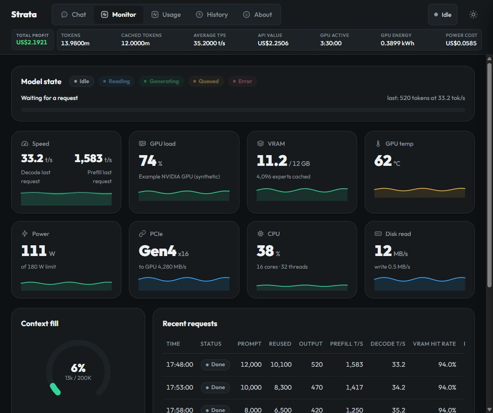
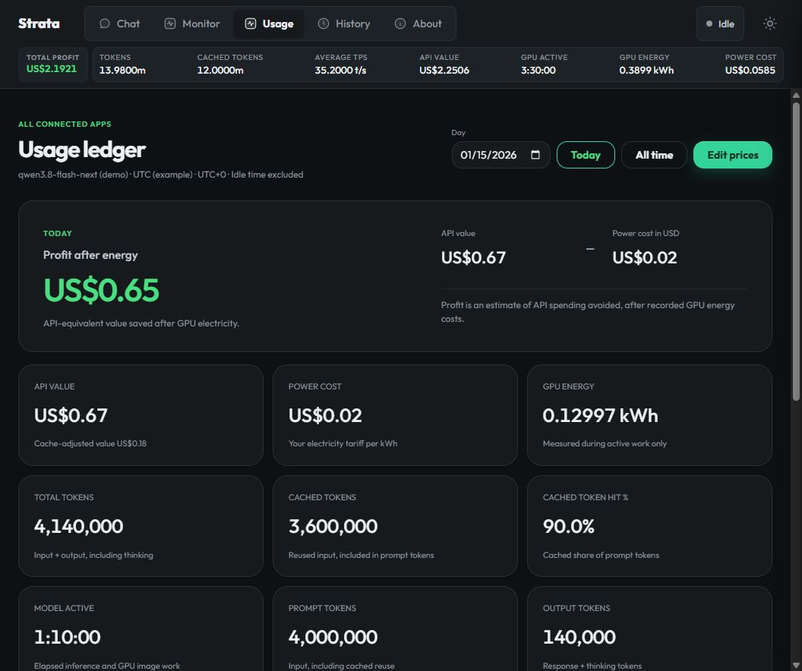
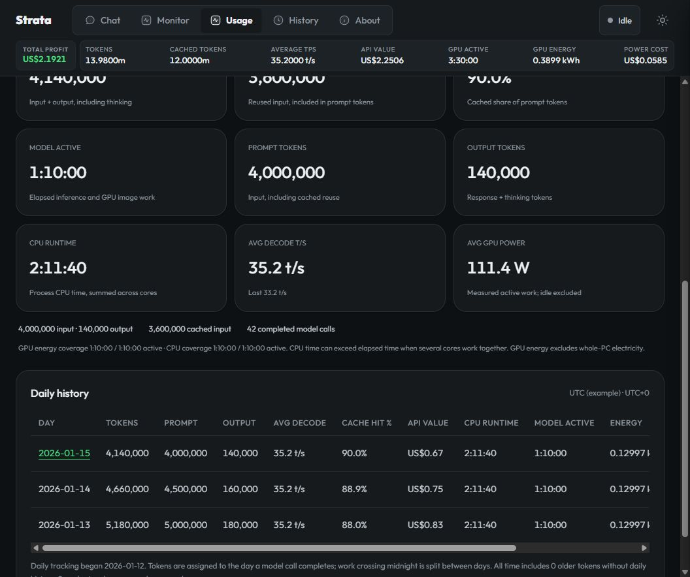
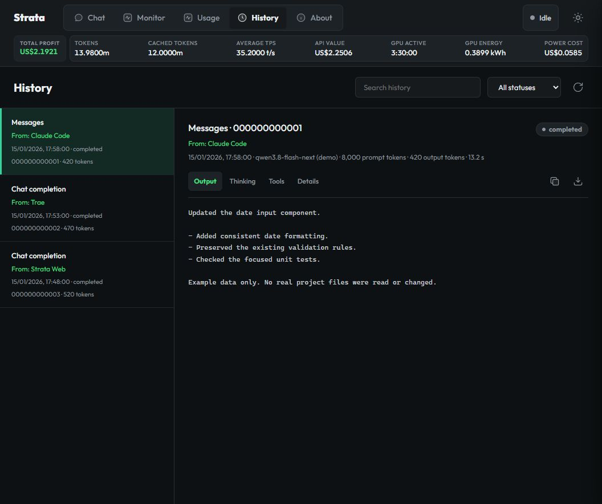

# Usage, Output History, And Remote Access

These optional Python/web features do not replace Strata's installation or
native engine. First follow [AI setup](AI_SETUP.md) and verify a local model.

## Example Screens

These screenshots use the real components with **synthetic example data**,
not measured benchmarks or saved user conversations. No credentials, real
public hostname, private project content or runtime databases are included.

### Monitor Dashboard



Monitor retains its state, hardware, context, request timing and cache views.
With usage enabled, the shared header adds persistent totals; Average TPS is
immediately after Cached tokens.

### Usage





The twelve cards show API value / power cost / GPU energy; total / cached /
cache hit; model active / prompt / output; CPU runtime / decode speed / average
GPU power. Choose Today, a local date, or All time. Edit prices changes
valuation, not the model.

### History



History has source/status labels, Output, Thinking, Tools and Details panes,
search, pagination, copy and full-text download.

Reproduce the screens without a GPU or personal data:

```powershell
python tools/preview_dashboard.py --port 8096 --seconds 300
```

Open `http://127.0.0.1:8096/#monitor`, `#usage`, or `#history`. This uses the
real web files/handlers, binds loopback only, invokes neither Tailscale nor a
native model, and removes temporary data on exit. Stop with Ctrl+C or let
the timer finish. Do not publish this synthetic preview.

## Enable Features

Back up your existing `strata-<model>.json`, then merge only the keys wanted.
Preserve its engine paths, arguments and other settings:

```json
{
  "usage_tracker": true,
  "output_history": true,
  "remote_access": true
}
```

Restart Strata when idle. Omitted features are off. Usage and History work
without Tailscale. Remote startup currently applies only to Windows servers
using the Strata engine on loopback port 8080. Cloning alone does not publish
anything, record output, or hold the PC awake. About's Output history switch
also saves the option; a restart is still required.

Leave the separate experimental `unlimited_output` option absent/false for the
normal finite-output path. Its optional context rollovers, not infinite model
memory, are explained in [DETAILS.md](DETAILS.md). These dashboard/remote
updates add no sampling defaults, thinking cap, custom loop recovery or automatic
conversation summarization. Context is finite; clients can impose smaller caps.

## Accounting

| Figure | Definition |
| --- | --- |
| Prompt tokens | Completed-call input, including cached reuse. |
| Output tokens | Reported generated output, including thinking. |
| Total tokens | Prompt plus output, without adding cached tokens again. |
| Cached tokens | Reused input; reuse on another call counts again. |
| Cached token hit % | Cached input divided by prompt tokens, not total tokens. |
| Average TPS / Avg decode t/s | Recorded engine-decoded tokens divided by summed decode seconds, not an arithmetic mean of speeds. |
| Live / last decode | Current measured speed or last completed request's speed. |
| Model active / GPU active | Elapsed active inference/encoder work including prefill; overlapping work counts once. |
| CPU runtime | Engine/encoder process CPU seconds summed across cores, not elapsed time or CPU energy. |
| GPU energy | Whole-board energy in measured active intervals, excluding idle. |
| Avg GPU power | Measured Wh divided by measured active seconds, times 3600. |
| API value | Configurable price benchmark, not a bill. |
| Power cost | Recorded GPU kWh times your tariff. |
| Profit | Estimated API spending avoided minus GPU electricity, not income. |

Energy uses NVML board-energy counter deltas when available, otherwise sampled
power integration. Missing readings/counter resets retain unmeasured coverage,
not invented zero consumption. Other GPU programs can contribute; CPU/RAM,
PSU losses, idle draw and other system power are excluded. Sensor/interval
accuracy means this is **not exact per-model or whole-PC consumption**. For
example, 0.39 kWh over 3.5 measured active hours is about 111 W average power.

Decode averages exclude prefill, idle, inserted control tokens and untimed
history. Older counts without timings cannot yield a truthful lifetime rate.
Daily buckets use the host's local time zone. Active work crossing midnight
is split; tokens are assigned on call completion. Imported undated counts
remain undated. Coverage and unavailable readings are shown in Usage.

Enter token rates, tariff and currency using Edit prices. Non-USD tariffs need
an exchange rate in local units per USD. No live prices, tariffs or exchange
rates are fetched. Rate changes revalue all retained history, not only new
requests; this is not a historical invoice ledger.

## History And Source

New OpenAI Chat Completions, Anthropic Messages and Responses are recorded,
streaming or not. History saves emitted output/thinking/tool arguments and
available usage, timing, status, finish and error metadata. Parser-held or
never-emitted thoughts are not a raw engine trace. Earlier requests cannot
be recovered; active entries at shutdown become Interrupted on restart.

`From` prioritizes `X-Strata-App`, `X-Client-Name`, or `X-App-Name`, then known
editor products in User-Agent. Strata Web and the optional Claude Code profile
identify themselves. Generic SDK identifiers remain Unknown. Add a custom
header such as `X-Strata-App: Trae` where an editor supports it. Do not guess
identities from prompts or assign all Unknown traffic to one editor. Labels
are self-reported, not authenticated identities; old Unknown entries cannot
be reliably backfilled.

History shows the actual model. A compatibility alias remains `requested_model`
in Details; API responses are unchanged. Claude Code's own UI/cost estimate may
still show a Claude alias, which does not mean Claude performed inference.
See [the optional profile](../claude-code/README.md). Locally synthesized Codex
thread-title replies can have no model output to record.

Copy copies loaded text; Load more fetches another part; Download exports the
complete saved request. Search/status filters cover persisted records. A bounded
background queue handles writes. Full disk or overload shows a recording
warning/incomplete entry without failing the model request. Recording changes
neither prompts, sampling, caps nor API events. See [recording details](LOCAL_OUTPUT_HISTORY.md).

## Public API Setup (Windows)

### Prerequisites

1. Verify local `http://127.0.0.1:8080/health` and `/v1/models`.
2. Install official Node.js; confirm `node --version` in a new terminal.
   The gateway uses only Node's standard library.
3. Install/sign in to Tailscale, approve the PC if required, keep its service
   connected, and confirm `tailscale status` reports a connected device.
4. Enable MagicDNS, HTTPS certificates and Funnel using
   [Tailscale's setup](https://tailscale.com/docs/features/tailscale-funnel).
   Follow the activation link and final enable action. Signing in alone does
   not enable Funnel; tailnet administrator approval may be needed.
5. Keep Strata on loopback. Do not forward router/firewall ports 8080 or 8787.
   Direct non-loopback Strata access must use `--api-key`.

Funnel is public HTTPS; other devices need no Tailscale client. It differs
from tailnet-only Tailscale Serve. A URL is not authentication.

### Start And Connect

With Strata running, from the installation root:

```powershell
powershell -NoProfile -ExecutionPolicy Bypass -File .\remote-access\Start-Remote.ps1
```

The helper protects `%LOCALAPPDATA%\StrataRemote` for the current Windows user
and SYSTEM, generates a key once, starts the loopback gateway, checks ownership
of all HTTPS port 443 handlers, and publishes it. Unrelated proxies, extra paths,
malformed and foreground configurations are refused, not replaced or exposed.
Read private `editor-settings.txt` in that runtime directory for your own
URL/key/model. Never commit or post it. If local Strata requires a key, first
set `upstreamApiKey` in private `gateway.json` to it. Gateway and upstream keys
can differ; editor credentials are removed and the upstream key is injected.

| Client setting | Value |
| --- | --- |
| OpenAI-compatible base URL | `https://<device>.<tailnet>.ts.net/v1` |
| Anthropic / Claude Code base URL | `https://<device>.<tailnet>.ts.net` without `/v1` |
| API-key field | Raw saved key, without adding `Bearer` |
| Model | `/v1/models` ID or a client-required compatibility alias |
| Optional source header | `X-Strata-App: My Editor` |

Clients send Bearer authorization or `x-api-key`. This contribution requires
auth and has no public no-key mode. Do not remove auth to solve 401. A URL
does not add custom-provider support to an incompatible editor.

Test on the other device, using a private environment variable for the key:

```powershell
$headers = @{ Authorization = 'Bearer ' + $env:STRATA_REMOTE_KEY }
Invoke-RestMethod -Uri 'https://<device>.<tailnet>.ts.net/v1/models' -Headers $headers
$body = @{model='<model-id>'; messages=@(@{role='user'; content='Reply READY'}); max_tokens=64} | ConvertTo-Json -Depth 5
Invoke-RestMethod -Method Post -Uri 'https://<device>.<tailnet>.ts.net/v1/chat/completions' -Headers $headers -ContentType 'application/json' -Body $body
```

Also verify the editor's actual streaming/tool workflow. Model listing alone
does not prove tool compatibility. Allowed routes are model listing, Chat
Completions, Responses, Messages and Messages token counting. Streams pass
through incrementally; request bodies are limited to 32 MiB with 16 concurrent
API connections.

## Remote Dashboard

Initially only model APIs are published. Merge `"exposeDashboard": true` into
private `%LOCALAPPDATA%\StrataRemote\gateway.json`, preserving key/port, and
rerun Start-Remote.ps1. Open the public root URL without `/v1`. Private
`dashboard-settings.txt` contains username `strata`, password the saved gateway
key. Bearer/x-api-key also work on dashboard routes. Browser Basic-auth POSTs
need a same-origin Origin; missing/foreign origins are rejected to prevent
misuse of remembered browser login. Native clients use Bearer/x-api-key.

Dashboard/API pools each allow 16 connections. Dashboard access is **trusted
administrative access**, not read-only: History, usage, config, model controls
and configured MCP capabilities are available. A gateway key also grants
trusted API access, including upstream MCP/local-image capabilities. Share
only with trusted apps/devices. Set `exposeDashboard` false to remove the
dashboard without disabling editor API access.

Browser chat stays in each browser's local storage; it is not synchronized.
Server-side Usage and optional output History are shared.

## Startup, Recovery, Stop

Set `remote_access: true` in the **model config**, then use `START-HERE.bat` or
`run-<model>.bat`. Once the server listens, a supervisor launches a watchdog
bound to the server's lifetime. Crashes retry after five seconds; a singleton
avoids duplicates and a startup mutex serializes gateway/credential creation.
Healthy saved keys are not regenerated.

Checks every 30 seconds cover gateway auth/revision, Tailscale and Funnel
ownership. About every minute public ingress is checked with external DNS and
validated TLS. Two public failures trigger an owned endpoint refresh; resolver
failure alone does not. Checks use metadata, not inference. Owned stale gateways
reload code/credentials; unrelated processes/services are not stopped.

The app-scoped Windows sleep guard prevents automatic idle sleep, but permits
display sleep. It does not change power plans or override manual sleep/shutdown.
Power loss, internet outages, expired Tailscale credentials and the other
device's network are outside recovery. Clients must retry dropped connections;
this is not an uptime guarantee.

```powershell
powershell -NoProfile -ExecutionPolicy Bypass -File .\remote-access\Stop-Remote.ps1
```

The disabled marker is respected by recovery. Only owned gateway/Funnel state
is stopped. Manual Start-Remote.ps1 or a new opted-in Strata launch resumes.
To disable persistently, stop first, set `remote_access: false`, then restart.
Changing config alone does not remove persisted Funnel background state.
Optional `Start-Remote.ps1 -InstallStartup` installs a Windows sign-in helper;
`Stop-Remote.ps1 -RemoveStartup` removes it. Neither starts the model. Funnel
`--bg` persists; Strata must still run for inference.

For rotation, stop remote access, privately replace `apiKey` with a new random
key of at least 32 characters (or remove only gateway.json to regenerate on
start), restart and update clients. Config is reread per request; malformed
config fails closed. Already authorized streams can finish; rotation cannot
recall output already sent.

## Storage And Privacy

| File | Contents |
| --- | --- |
| `<config>.usage.json` | Counts, daily history, coverage, rates; no prompts. |
| `<config>.history.sqlite3` with `-wal`/`-shm` | Plaintext emitted output/thinking/tools and whitelisted metadata. |
| `<config>.shared-settings.json` | Existing shared request defaults. |
| `%LOCALAPPDATA%\StrataRemote\gateway.json` | Private credentials/preferences. |
| `editor-settings.txt`, `dashboard-settings.txt` | Private connection/login instructions. |
| `autostart.log`, `watchdog.log`, `gateway-error.log` | Recovery diagnostics, no deliberate prompt/key logging. |

History has no automatic age/text retention limit; the bounded in-memory API
inspector is separate. Full input prompts and raw headers are not persisted,
but output/tool arguments can contain secrets. Keep the DB private and watch
disk space. Stop Strata before archiving/removing the DB and sidecars together;
never remove only a live WAL. Next enabled start creates a new DB. Disabling
recording does not erase old data.

## Troubleshooting

| Symptom | Check |
| --- | --- |
| Editor 401 | Current key, auth header, correct URL, no extra `Bearer` in key field. |
| Browser API 401 | Expected without key; use dashboard root/login or authenticated API client. |
| Browser POST 403 | Dashboard's own origin; native clients use Bearer/x-api-key. |
| Dashboard/History 404 | Enable dashboard sharing; enable output_history and restart. |
| 502/refused connection | Local 8080 model, 8787 gateway, Funnel status/recovery logs. |
| Funnel not enabled | Complete account/device activation and final enable action. |
| HTTPS port has another handler | Resolve intentionally; do not reset all Tailscale services. |
| Local works, public fails | Public DNS/TLS, internet, host sleep, Tailscale/key expiry, security software. |
| Unknown source | Client sent no recognized label; add custom headers where supported. |
| Missing older output/average | Unrecorded output/timings cannot be reconstructed. |
| Context-window 400 | Prompt plus output must fit; use client compaction or opt-in fit_max_tokens. |

Never post keys, DB exports, prompts or unredacted configs in issue reports.
Include versions, route/status, local/public distinction and redacted logs.

## Maintainer Checks

No native source changes. Tests use no GPU; gateway checks use isolated
ephemeral loopback fixtures, not actual Funnel state or the real 8080 model:

```powershell
python -m unittest serve.test_usage serve.test_monitor serve.test_gateway serve.test_remote_access serve.test_remote_startup
python -m unittest discover -s serve -p "test_*.py"
node --check remote-access/gateway.mjs
node --check serve/web/history.js
```

Check desktop/mobile, three APIs with/without streaming, default-off behavior,
key rotation, origin rejection and Funnel ownership before changing defaults.
Local tests do not establish PC reboot, Linux/HIP/SYCL hardware, current external
prices or another device's actual editor workflow. Screenshots are UI examples,
not evidence of model quality or measured throughput.

References: [Funnel](https://tailscale.com/docs/features/tailscale-funnel),
[CLI](https://tailscale.com/docs/reference/tailscale-cli/funnel),
[History](LOCAL_OUTPUT_HISTORY.md), [Claude Code](../claude-code/README.md).
