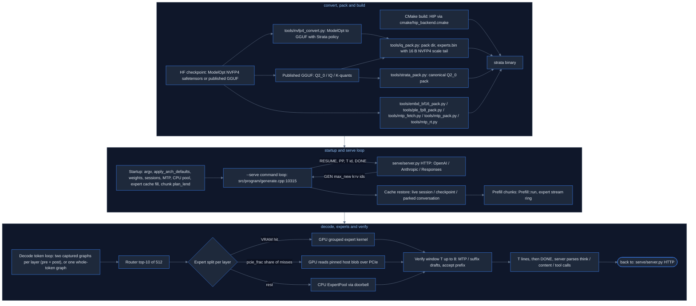
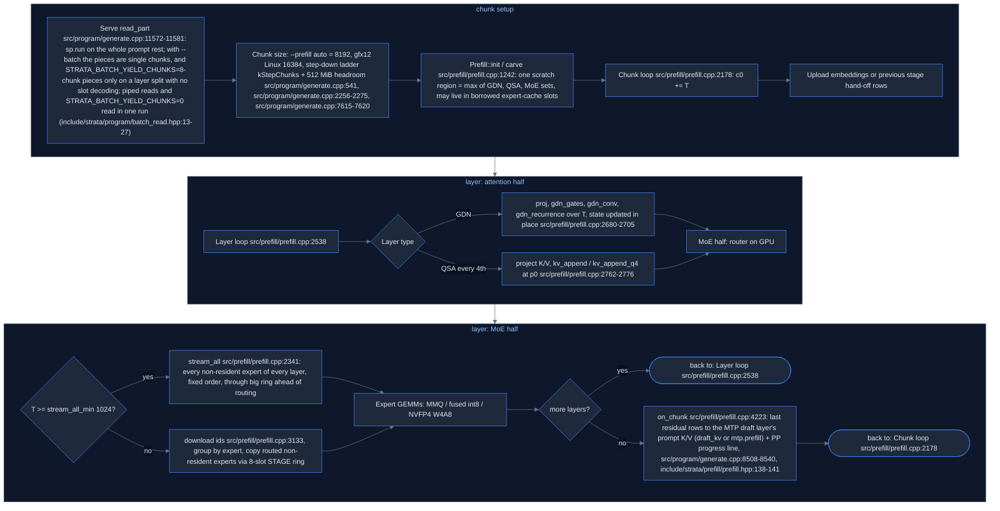
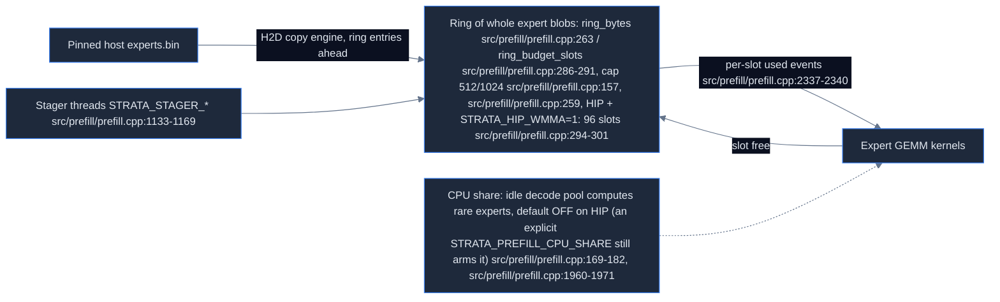
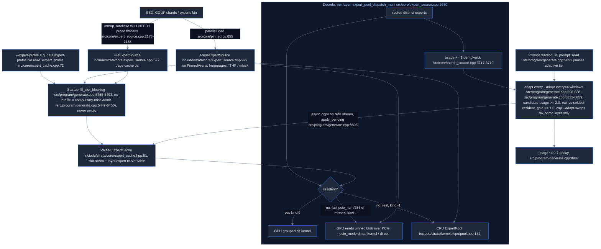
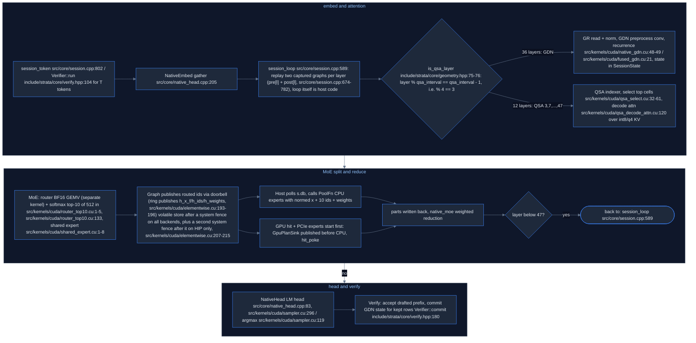
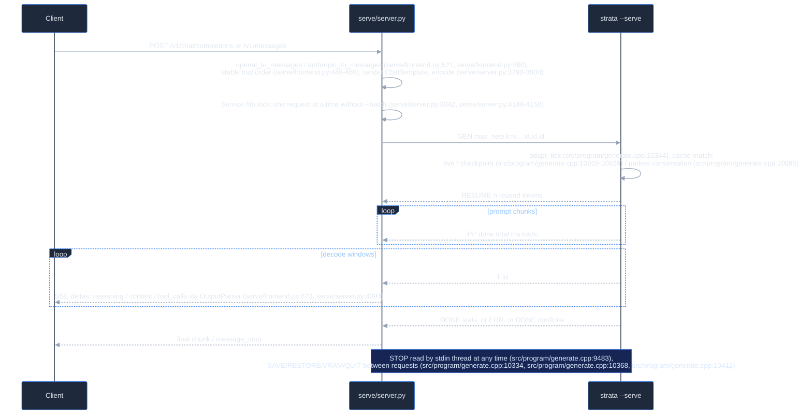
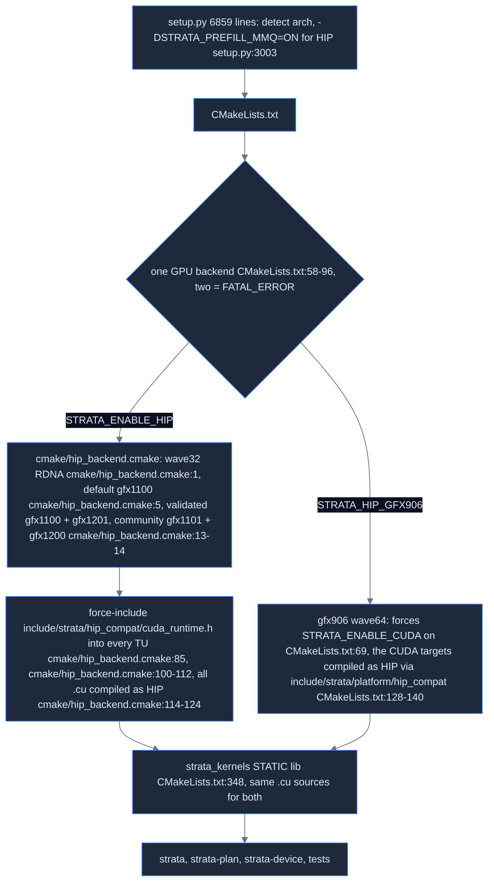

# Strata (original upstream) — human-readable map

> AMD/HIP-focused version of this map. The full multi-backend map is [README.md](README.md); the AMD index is [index-amd.tsv](index-amd.tsv).

Source mapped: upstream Strata @ `296b59d2` (project version 0.1.44.1). Machine-readable index: [index-amd.tsv](index-amd.tsv) (`area  kind  name  file:line  how`).

All `file:line` refs come from the area docs. Paths are relative to the Strata repo root.

---

## 1. What Strata is (plain English)

Strata is an inference engine built for exactly one model shape: **Qwen3.8-Flash-Next** (GGUF arch `qwen4exp`): 48 layers (36 GDN linear-attention + 12 QSA full-attention, every 4th layer), 512 routed experts with top-10, hidden 2560, expert FFN 640, vocab 248,320. The model is ~125B-class, far too big for one gaming GPU, so Strata:

1. keeps **dense weights** on the GPU,
2. keeps the **hot experts** in a VRAM cache (filled from a frequency profile),
3. keeps **all experts** in pinned system RAM (or mmapped from SSD),
4. for each token, computes VRAM-hit experts on the GPU, reads a share of misses over **PCIe**, and computes the rest on the **CPU** expert pool — at the same time,
5. uses **speculative decoding** (MTP drafter + n-gram/suffix lookup, verify windows up to 8 tokens),
6. reads prompts in big **chunks** (8192, or 16384 on Linux HIP gfx12) while streaming experts through a ring.

The engine is one C++ binary (`strata`, main in `src/program/generate.cpp`, 14,182 lines) driven by a Python HTTP server (`serve/server.py`) over a **text line protocol** on stdin/stdout. Kernels are CUDA `.cu` files that also compile as **HIP** for AMD (there are no `.hip` files). Intel (SYCL) and Apple (Metal) are separate sibling trees.

Doctrine (tools/strata_pack.py:1-4): the Python pack builder implements docs/pack-format.md and is the reference for a C++ `strata-pack` port, which is not in this tree (CMakeLists.txt:3-5 adds it only when its sources exist); "if the two disagree the C++ is wrong".

## 2. Repo layout → area maps

| Area map | Covers | One-line summary |
|---|---|---|
| [gpu-cpu-kernels](gpu-cpu-kernels.md) | `src/kernels/` (cuda/, cpu/, parity/bench) | All GPU+CPU compute kernels: MMVQ GEMV, NVFP4/IQ dot, router, GDN, QSA, sampler, verify |
| [engine-core](engine-core.md) | `src/core/`; `include/strata/core`; `include/strata/artifact` | Arenas, weight load, per-layer graphs, session_loop + doorbell, Verifier, MTP, expert cache/source, KV VMM |
| [prefill](prefill.md) | `src/prefill/`; `src/plan/`, prefill parts of src/program/generate.cpp | Chunked prompt path, expert streaming ring, CPU share, KV append, memory planner |
| [moe-experts](moe-experts.md) | experts end-to-end | VRAM cache / pinned RAM / file tier, profile fill, hit/PCIe/CPU split, adaptive swaps |
| [server](server.md) | `serve/`, `chat.py` | Python HTTP (OpenAI/Anthropic/Responses), template, tool-call parse, engine pipe |
| [generate-program](generate-program.md) | src/program/generate.cpp:1-7185 | Startup pipeline: argv, arch defaults, weights, sessions, pool, cache sizing, chunk choice |
| [generate-program](generate-program.md) | src/program/generate.cpp:7186-14182 | Serve loop, cache restore, prompt windows, decode/spec windows, DONE |
| [model-spec-ngram-platform](model-spec-ngram-platform.md) | `src/qwen35`; `src/spec`; `src/ngram`; `src/artifact`; `src/platform` | q36 (Qwen3.6, NOT Flash-Next) engine, spec policy, suffix drafter, PLE reader (SSD reader for layer 1's per-layer embedding table, rows n-gram-hashed; not spec drafting), direct I/O |
| [artifacts-platform-misc](artifacts-platform-misc.md) | include/strata/artifact, include/strata/platform, include/strata/plan and include/strata/ngram headers, cmake, docs index | GGUF reader, planner, mlock/readahead, hip_compat mapping, docs list |
| [build-system](build-system.md) | CMakeLists.txt; cmake/hip_backend.cmake, setup.py, Docker | Backend selection, arch lists, feature flags, install + pack pipeline |
| [tools-and-scripts](tools-and-scripts.md) | `tools/`, `ref/`, `data/` | NVFP4 convert/verify, iq_pack, strata_pack, MTP tools, quality tools |
| [tests-bench-docs](tests-bench-docs.md) | `tests/`; `docs/`; `bench/`, README | Test inventory, docs, published and community AMD GPU numbers |
| [plan-vision-imagegen](plan-vision-imagegen.md) | `src/plan/` + include/strata/plan/plan.hpp; `tools/vision/`; `tools/image/` | strata-plan VRAM planner (Q2_0 blob constants, not used by src/program/generate.cpp), strata-vision mtmd encoder (SVE1/GENI), Qwen-Image sd-cli + native DiT kernels |
| [bench-results](bench-results.md) | `bench/results/` entries 1..1043 | Bench packets (part 1): formats, AMD results (R9700 Win IQ2_XS 1,231.7 prompt @128K / 99.8 decode @4K), no NVFP4 results |
| [bench-results](bench-results.md) | `bench/results/` entries 1044..2086 | Bench packets (part 2): R9700 Linux IQ3_S 768.1 prompt @4K / 101.9 decode @1K (WMMA off, Tensile), gfx11/gfx12 results, no Strata NVFP4 |
| [ci-and-repo-root](ci-and-repo-root.md) | `.github/` + repo-root files | No CI workflows; setup.sh / update.sh / UPDATE.bat, CUDA-only Docker + flake, setup.py ROCm wheel/system pick, AMD GPU detection |
| [speculative-decoding](speculative-decoding.md) | `src/spec/` + its callers in src/program/generate.cpp | CPU-only spec helpers: SuffixDrafter (trigram lookup), DraftPolicy (lookup vs MTP, chain length), DraftSource; Controller has no engine caller (unit test only) |
| [hip-amd-tools](hip-amd-tools.md) | `tools/hip/` | hipBLASLt tuner + per-arch/version tables (gfx120x: gfx1200 100202, gfx1201 100202/100500), bench_prefill, Windows build/package tools |

## 3. Big picture

## 4. Prefill chunk pipeline and expert streaming ring

Prompt reading. Entry `Prefill::run` src/prefill/prefill.cpp:4338 → `run_impl` src/prefill/prefill.cpp:2087. No graph capture in prefill; every chunk is a fresh host-driven launch sequence. `Prefill::run_impl` routing does **not** update expert placement; but prompt parts ≤ `--short-read` (64) go through verify windows, which do feed `usage` (src/program/generate.cpp:663, src/program/generate.cpp:11226-11231, src/program/generate.cpp:11783 → drive_pool_multi src/program/generate.cpp:1032).

## 5. Expert tiers and adaptive swaps

`pcie_frac`: probe 4×256 MiB pinned H2D (src/program/generate.cpp:1662-1664), frac = base × min(1, GB/s ÷ 20) (src/program/generate.cpp:1725-1726); base **0.25 for NVFP4** packs, 0.55 native, 0.2 Q2_0 (src/program/generate.cpp:2861). PcieAuto refinement (src/program/generate.cpp:1729-1736) is CUDA-only by default.

## 6. Decode: one token through 48 layers

Dense GEMV is MMVQ dp4a on q8_1 activations (src/kernels/cuda/native_mmvq.cu:1-3, src/kernels/cuda/native_mmvq.cu:155); NVFP4 experts are **w4a8** (src/kernels/cuda/iq_kernels.cu:570-600), not FP4×FP4.

## 7. Serve request lifecycle

**Other engine output lines**

| Line | When | Where |
|---|---|---|
| `READY <max_context> stop` | At startup | `src/program/generate.cpp:9671` |
| `YIELDED <slot> <tokens>` | Just before DONE when a prompt read yields | `src/program/generate.cpp:12935` |
| `BADM <slot> <0\|1>` | `--batch` admission | `src/program/generate.cpp:12984` |
| `DONE ...` | 15 fixed fields, plus 5 more with `--lookup-chain` | `src/program/generate.cpp:12936`; `src/program/generate.cpp:12924-12930` |

```mermaid
---
config: {"theme":"base","themeVariables":{"darkMode":true,"background":"#0b1020","fontFamily":"Inter, 'Segoe UI', Roboto, 'Helvetica Neue', Arial, sans-serif","fontSize":"14px","primaryColor":"#1e293b","primaryTextColor":"#e2e8f0","primaryBorderColor":"#3b82f6","secondaryColor":"#1e293b","secondaryTextColor":"#e2e8f0","secondaryBorderColor":"#3b82f6","tertiaryColor":"#111827","tertiaryTextColor":"#e2e8f0","tertiaryBorderColor":"#334155","mainBkg":"#1e293b","nodeBorder":"#3b82f6","textColor":"#e2e8f0","titleColor":"#93c5fd","lineColor":"#64748b","clusterBkg":"#0f172a","clusterBorder":"#334155","edgeLabelBackground":"#0b1020","noteBkgColor":"#172554","noteTextColor":"#dbeafe","noteBorderColor":"#3b82f6","actorBkg":"#1e293b","actorTextColor":"#e2e8f0","actorBorder":"#3b82f6","actorLineColor":"#475569","signalColor":"#94a3b8","signalTextColor":"#e2e8f0","labelBoxBkgColor":"#1e293b","labelBoxBorderColor":"#3b82f6","labelTextColor":"#e2e8f0","loopTextColor":"#93c5fd","activationBkgColor":"#334155","activationBorderColor":"#3b82f6"},"flowchart":{"curve":"basis","nodeSpacing":34,"rankSpacing":40,"padding":12,"wrappingWidth":260,"htmlLabels":true},"sequence":{"actorFontFamily":"Inter, 'Segoe UI', Roboto, 'Helvetica Neue', Arial, sans-serif","messageFontFamily":"Inter, 'Segoe UI', Roboto, 'Helvetica Neue', Arial, sans-serif","noteFontFamily":"Inter, 'Segoe UI', Roboto, 'Helvetica Neue', Arial, sans-serif"},"fontFamily":"Inter, 'Segoe UI', Roboto, 'Helvetica Neue', Arial, sans-serif"}
---
flowchart TD
  subgraph R0["resume lookup"]
    direction LR
    G["GEN parsed src/program/generate.cpp:10635"]
    W["ver.wait_commit src/program/generate.cpp:10867"]
    N{"nan_flush set? non-finite seen"}
    Z["drop live, checkpoints, parked, slots: read from 0"]
    R["resume = longest live/checkpoint prefix of ids, max n-1, same cvec src/program/generate.cpp:10855-10858, src/program/generate.cpp:10921-10925"]
    P["parked conversation deeper? conversations.best src/program/generate.cpp:10985, validate snapshot src/program/generate.cpp:10986-11011"]
    CS["park outgoing branch src/program/generate.cpp:11023, restore incoming src/program/generate.cpp:11069-11071"]
    RS["print RESUME src/program/generate.cpp:11214"]
    G --> W
    W --> N
    N -- "yes" --> Z
    N -- "no" --> R
    R --> P
    P --> CS
    Z --> RS
    CS --> RS
  end
  subgraph R1["read, decode, done"]
    direction LR
    PR["read rest of prompt: read_windows src/program/generate.cpp:11349 / read_windows_pl src/program/generate.cpp:11263"]
    CK["checkpoints: root / message / pin src/program/generate.cpp:11720-11760"]
    DE["decode + spec src/program/generate.cpp:11859-12900"]
    DN["DONE src/program/generate.cpp:12936"]
    PR --> CK
    CK --> DE
    DE --> DN
  end
  R0 --> R1
```

**GDN state on cancelled prefill**: GDN recurrence + conv1d history are updated in place per prompt chunk (src/prefill/prefill.cpp:2690-2701) with no pre-chunk snapshot. Prefill checks cancel only at chunk start (src/prefill/prefill.cpp:2179; wired to stop_req, src/program/generate.cpp:9500). The serve loop sets live_ok=false at request start (src/program/generate.cpp:11139) and pp_exact=false while a batched/pipelined part runs (src/program/generate.cpp:11782). A cancelled read keeps the session only if pp_exact (stopped between windows or between serve-level parts, src/program/generate.cpp:12798-12807); a cancel inside a batched part, a layer-split read, or a BADM admission discards it, and the next request resumes from the longest checkpoint, a parked conversation/slot, or token 0. Non-stop errors print ERR and exit the process (src/program/generate.cpp:11795-11807). Spec verify writes state only in Verifier::commit (src/core/verify.cpp:2645, replay src/core/verify.cpp:2100-2104) or one-token self-commit (src/core/verify.cpp:1175-1183, src/core/verify.cpp:2655).

**State split**: live SessionState + host live/checks is the truth while running; ConversationCheckpoint = running state without K/V (include/strata/core/conversation_cache.hpp:23-34; rewind; draft ring via mtp.kv_restore, src/program/generate.cpp:11197); SavedConversation = live checkpoint + its checkpoints + K/V (park/disk; include/strata/core/conversation_cache.hpp:148-158), it replaces live on restore and may then be rewound to one of its checkpoints; sampling is stateless Philox(seed,pos) (include/strata/kernels/sampler.hpp:25, include/strata/core/verify.hpp:127), not saved.

## 8. Build and backends

### Build tree quirks

- ROCm pin is code, not a comment: `ROCM_VERSION_DEFAULT = "7.10.0a20251120"` (setup.py:2086); per-family nightlies `ROCM_FAMILY_PINS` (gfx103X-all, gfx110X-all, gfx1151) at setup.py:2087-2089; `STRATA_ROCM_VERSION` env override read at setup.py:2090.
- This tree has `tests/` but no `tests/CMakeLists.txt`, so the tests default is effectively OFF here (CMakeLists.txt:98-102).
- NVFP4 parity span CMakeLists.txt:1526-1617 is mixed: CUDA NVFP4 CMakeLists.txt:1526-1534, HIP MMQ block CMakeLists.txt:1535-1579, CPU `nvfp4_avx512_parity` CMakeLists.txt:1608, CUDA NVFP4 decode CMakeLists.txt:1612-1617.
- `tools/mtp_fetch.py` also has an `inventory` subcommand (tools/mtp_fetch.py:7, tools/mtp_fetch.py:183).

### CI and update scripts

- No CI: `.github/` has 6 files (3 issue templates + .github/ISSUE_TEMPLATE/config.yml + .github/pull_request_template.md + .github/FUNDING.yml) and no `workflows/`; there is no other CI config. Contributors must build every touched backend themselves before review (AGENTS.md:31).
- setup.sh deletes `.venv` twice: silently when an existing .venv's python has no pip (setup.sh:10-13), and with an error message when `python -m venv` fails (setup.sh:66). Its header comment (setup.sh:4) says apt/dnf only, but a pacman branch exists (setup.sh:51-52). The uv path needs STRATA_UV=1 or NixOS **and** `uv` on PATH (setup.sh:18-19).
- update.sh / UPDATE.bat (general updaters, update.sh:2-5; the history-rewrite branch runs only when git pull --ff-only fails, update.sh:16-19) create a `pre-cleanup-backup*` branch and `checkout -B <branch> origin/main` (update.sh:31-36; UPDATE.bat:20-62, checkout UPDATE.bat:52), and on failure **also `git branch -D` that backup** (update.sh:41, UPDATE.bat:54). They create and delete branches. UPDATE.bat differs from update.sh: merge-base test before the shallow test (UPDATE.bat:23-25), `%RANDOM%` backup suffix (UPDATE.bat:43) vs timestamp (update.sh:33), ends with `START-HERE.bat --update` (UPDATE.bat:78) not `setup.sh --update` (update.sh:61).

---

## 9. What matters on AMD RDNA4 (gfx120x) with NVFP4

"Opt-in" = off by default.

**Build / arch detection**
- HIP default arch is **gfx1100**; raw cmake needs `-DCMAKE_HIP_ARCHITECTURES=gfx1200` or `gfx1201` (cmake/hip_backend.cmake:5; validated gfx1201 / community gfx1200 cmake/hip_backend.cmake:13-14). setup.py auto-detects.
- gfx120x gets **no** `STRATA_WMMA_GFX11` define (cmake/hip_backend.cmake:96-98), but that macro gates only the RDNA3 FP16 GEMM src/prefill/wmma_gemm.cu (also runtime-gated to gfx11, src/prefill/wmma_gemm.cu:270-272). gfx12 WMMA needs no macro: `__builtin_amdgcn_wmma_*_gfx12` in src/kernels/cuda/qsa_prompt_attn.cu:1131-1199 (intrinsic wrapper src/kernels/cuda/qsa_prompt_attn.cu:1181, kernel `prompt_attn_wmma_kernel` src/kernels/cuda/qsa_prompt_attn.cu:1199; opt-in STRATA_HIP_WMMA), src/kernels/cuda/qsa_select.cu (opt-in STRATA_SELECT_WMMA src/kernels/cuda/qsa_select.cu:1129), and int8 WMMA in src/prefill/moe_fused_iq.cu:710.
- Empty `CMAKE_HIP_FLAGS_<CONFIG>` cached by a failed configure once left Release at -O0; the build now refills empty ones from CMake's defaults (cmake/hip_backend.cmake:46-56).
- Arch checks are string compares on gcnArchName: include/strata/kernels/gfx_arch.hpp:16, include/strata/kernels/gfx_arch.hpp:30, include/strata/kernels/gfx_arch.hpp:36 (`gfx_arch_is_gfx12` = gfx1200||gfx1201).
- Two hip_compat trees: `include/strata/hip_compat/` (RDNA) vs `include/strata/platform/hip_compat/` (gfx906, enabled by STRATA_HIP_GFX906 CMakeLists.txt:64, separate from STRATA_ENABLE_HIP, CMakeLists.txt:65-67).

**Startup defaults on gfx12**
- `apply_arch_defaults` (src/program/generate.cpp:2252, src/core/arch_defaults.cpp:14-31): sets STRATA_GDN_HEAD=1, GDN_PP=2, GDN_CONVL2=1, GDN_NOY=1, CVEC_FUSE=1 unless STRATA_GFX12_DEFAULTS=0. Only the prompt half of the gfx1151 table.
- Bare `--prefill auto` (no `auto:N` cap: `prefill_auto_bare && prefill_auto_cap == 0`, src/program/generate.cpp:2257) on Linux HIP gfx12, with neither STRATA_GFX12_CHUNK nor STRATA_GFX12_DEFAULTS starting with '0' (src/program/generate.cpp:2262-2265) → chunk 16384 (src/program/generate.cpp:2256-2275). Off with STRATA_GFX12_CHUNK=0. Undone to 8192 on layer split or low RAM (src/program/generate.cpp:6612-6660).
- Chunk step-down keeps **512 MiB headroom** because gfx1201 hipBLAS GEMMs failed to launch and the prompt hung (src/program/generate.cpp:7616-7620).

**Correctness / sync**
- RDNA4 mapped-pinned store can sit in L2 until stream sync → doorbell stores are volatile, and on RDNA4 the volatile store alone can still sit in L2 until the stream syncs (#697), so HIP adds a second `__threadfence_system()` after it, on top of the fence before the store on every backend (src/kernels/cuda/elementwise.cu:206-214; tests/hip/handoff.cpp:121).
- No cudaStreamLegacy on HIP: residency uploads sync on stream 0 (src/program/generate.cpp:6409).
- src/kernels/cuda/verify_kernels.cu:1402 assumes wall_clock64 at 100 MHz on gfx10.3/11/12.
- HIP greedy nondeterminism ~1/10 starts (docs/AMD_HIP.md:370-371).
- `DONE.. nonfinite` drops every cache; the server sends a request that had produced nothing once more and returns 503 only if it hits nonfinite again; a reply that had started ends as "length" (src/program/generate.cpp:8403-8411; serve/server.py:4323-4344, serve/server.py:5528-5531).

**NVFP4 specifics**
- Block = 64 values, 4×UE4M3 scales + 32 B E2M1 split-half codes, GGUF type 40 (src/kernels/cuda/iq_kernels.cu:570-600; include/strata/artifact/gguf_reader.hpp:113, include/strata/artifact/gguf_reader.hpp:216; tools/gguf_reader.py:27, tools/gguf_reader.py:47).
- Decode dot is dp4a **w4a8** against q8_1 (`Fmt<40>` src/kernels/cuda/iq_kernels.cu:655, `Split<40>` src/kernels/cuda/iq_kernels.cu:1007, n_ff=640 sub-warp paths src/kernels/cuda/iq_kernels.cu:1120, src/kernels/cuda/iq_kernels.cu:1167).
- Per-expert global FP32 scales s_gate/s_up/s_down in the blob tail, applied to FP32 outputs (src/kernels/cuda/iq_kernels.cu:1348-1352); 16 B tail written by tools/iq_pack.py:204, tools/iq_pack.py:455-464.
- Prefill NVFP4 = W4A8 int8 MMQ by default on all CUDA GPUs (Blackwell included); HIP has no NVFP4 MMQ, so its NVFP4 prompt experts take the non-MMQ path (src/prefill/moe_mmq.cu:215-217, src/prefill/moe_mmq.cu:373, include/strata/prefill/moe_mmq.hpp:21); W4A4 is an opt-in, Blackwell-only FP4×FP4 mode; `fp16` (dequant + FP16 GEMM) is the reference mode; any other value exits (include/strata/prefill/moe_mmq.hpp:23-27, src/prefill/moe_mmq.cu:188-196, STRATA_PREFILL_NVFP4). docs/NVFP4.md:189-190: NVFP4 MMQ/W4A8 unit CUDA-only — a HIP gap.
- Conversion: ModelOpt HF → tools/nvfp4_convert.py → GGUF → tools/iq_pack.py. tools/nvfp4_convert.py needs third_party/llama.cpp (tools/nvfp4_convert.py:34), as does tools/nvfp4_verify.py (tools/nvfp4_verify.py:26); the tree does not vendor it; setup.py downloads llama.cpp at the pinned commit into third_party/llama.cpp (setup.py:168, setup.py:1968-1973), so these tools need a setup.py run first. Setup marks NVFP4 `nvidia_only` and asks before installing it on HIP (setup.py:299, setup.py:304, setup.py:6191-6193).
- pcie_frac base 0.25 for NVFP4 (src/program/generate.cpp:2861). Route tail-skip is default ON on gfx1200/1201 but **OFF for NVFP4** (KL 0.035 ≈ quant error; src/program/generate.cpp:8618-8660).

**NVFP4 byte layout**
- `block_nvfp4` { uint8 d[4] UE4M3; uint8 qs[32] } = 36 B / 64 values, third_party/ggml/ggml-common.h:221-227.
- Split-half order: in sub-block s, value j = low nibble of qs[8s+j], value j+8 = high nibble (src/kernels/cpu/nvfp4_avx2.cpp:3-4). ModelOpt order differs (2j low, 2j+1 high; tools/nvfp4_verify.py:40).
- `kvalues_fp4` is the **doubled** E2M1 table {0,1,2,3,4,6,8,12,...} (third_party/ggml/ggml-common.h:1124-1128), so the scale decode carries ×0.5 (`ue4m3_to_f32_half`, src/kernels/cuda/iq_kernels.cu:573).
- experts.bin NVFP4 blobs are not 64-B aligned: blob += 16 B tail (tools/iq_pack.py:464), offset += blob × n_expert (tools/iq_pack.py:472); ALIGN 64 is for the dense pool only.

**Performance paths on RDNA4 (gfx120x)**
- Default decode is dp4a MMVQ, not matrix cores. MMVQ rows choice for gfx120x (dev_class via gfx_arch_is_gfx12, measured on gfx1201): src/kernels/cuda/native_mmvq.cu:1264-1302 (`dev_class`, STRATA_NO_MMVQ_ROWS2).
- WMMA prompt attention (int8 KV only) opt-in STRATA_HIP_WMMA=1 (src/kernels/cuda/qsa_prompt_attn.cu:1402-1407; only a value starting with '1' enables; code allows gfx11 and gfx12, docs/AMD_HIP.md:337 says gfx12 only). It switches ONLY the prompt QSA attention (+ 96-slot ring), not MoE/GEMM; =0 is the same as unset except it silences the start hint (src/program/generate.cpp:4752-4758). Not bit-identical; R9700 4K 1784→2427 tok/s (docs/AMD_HIP.md:339-349). Also sets the prefill ring to 96 slots for chunks ≥ stream_all_min, else the 8-slot STAGE ring (src/prefill/prefill.cpp:295-301).
- WMMA QSA select opt-in STRATA_SELECT_WMMA=1 (src/kernels/cuda/qsa_select.cu:1129); kRegMinBlocks=7168 tuned on gfx1201 (src/kernels/cuda/qsa_select.cu:1333).
- AMD fast bit-identical S6 router (src/kernels/cuda/router_top10.cu:267) is the default on RDNA; opt out with STRATA_HIP_ROUTER_OLD (src/kernels/cuda/router_top10.cu:431). STRATA_HIP_ROUTER_FAST (src/kernels/cuda/router_top10.cu:429) exists only in gfx906 builds.
- On gfx12 "native kernels only": `fused::enabled()` false (src/prefill/prefill.cpp:244-246) applies to the Q2_0 pack only; native packs run fused. In code, native fused-IQ int8 WMMA is **default ON on gfx12 for IQ3_S / IQ3_XXS gate/up only** (src/prefill/moe_fused_iq.cu:1123-1138; STRATA_PF_FUSED=0 off, =1 all covered formats), matching docs/DETAILS.md:2028. gu_covered (src/prefill/moe_fused_iq.cu:1076-1080) has no NVFP4, so NVFP4 prompt experts get no default WMMA.
- Prefill CPU share default OFF on HIP: only the default arming is compiled out, an explicit STRATA_PREFILL_CPU_SHARE still arms it (src/prefill/prefill.cpp:182, src/prefill/prefill.cpp:1961-1971); PcieAuto CUDA-only (src/program/generate.cpp:1729); `--vram-elastic` is turned off on HIP with a message (src/program/generate.cpp:5313-5318); VMM segmented expert cache CUDA-only (src/core/expert_cache.cpp:6-7).
- With a file-backed arena (STRATA_ARENA_MMAP=1, AMD Linux) adaptive swaps through ROCclr staging blocked the host, so pin_blobs locks the pages for the async copies (src/program/generate.cpp:168-183); STRATA_HIP_ADAPT_KERNEL_COPY=1 (opt-in) copies adaptive swaps with a kernel instead of a copy-engine (SDMA) memcpy to avoid the #884 hang (src/program/generate.cpp:185-194); ROCclr userptr bloat → STRATA_ARENA_MMAP raises GPU_PINNED_MIN_XFER_SIZE (src/program/generate.cpp:1821-1828).
- hipBLASLt tables per arch in tools/hip/ (gfx120x: gfx1200 has 100202, gfx1201 has 100202 and 100500; tools/hip/gfx1200-hipblaslt-100202.txt:2, tools/hip/gfx1201-hipblaslt-100202.txt:2, tools/hip/gfx1201-hipblaslt-100500.txt:2); tests/prefill/tuning_header_arch_family_test.cpp:1-2 treats gfx1200↔gfx1201 as one family. Version must match exactly (src/prefill/hipblaslt_tuning.hpp:67-70); a mismatch is printed to stderr `prefill gemm:..; using hipBLASEx` (src/prefill/gemm.cu:215), not silent. Under HSA_OVERRIDE→gfx1200, setup (exact-arch lookup) finds a gfx1200 table only on hipBLASLt 1.2.2; none exists for 1.5.0 (src/prefill/hipblaslt_tuning.hpp:53; setup.py:2947-2957; tools/hip/gfx1200-hipblaslt-100202.txt:2).
- Server watchdogs (ENGINE_SILENCE_S=300, PP_FLOOR_TOK_S=50; serve/server.py:224-233) may trip on a slow bring-up; engine watchdog 60 s STRATA_WATCHDOG_S (src/program/generate.cpp:9617-9618).

**Decode, GDN and parity**
- Decode IS graph-captured (pre + post graph per layer, src/core/session.cpp:674-782; a whole-token graph by default except on native packs or a layer split, src/program/generate.cpp:6483-6490; src/program/generate.cpp:7; `--no-capture`, `--graph-only`, `--no-token-graph`, `--gpu-stages`). Prefill has no graph capture.
- On HIP the GDN prompt recurrence is always `gdn_rec_cols_pipe_kernel`; `gdn_rec_kh_kernel` needs CUDA sm_80+ (src/prefill/kernels.cu:565, src/prefill/kernels.cu:689, STRATA_GDN_KEYHEAD read at src/prefill/kernels.cu:697).
- The gfx12 16K chunk needs `prefill_auto_cap == 0` (src/program/generate.cpp:2257) and a layer split takes 8192 back unless STRATA_SPLIT_CHUNK16K=1 (src/program/generate.cpp:546, env read src/program/generate.cpp:6621).
- Fused norm+RoPE is opt-in on AMD "until rope_parity check 6 passes" (src/kernels/cuda/native_rope.cu:180).
- qsa_prompt_attn_parity skips both FP16-KV and Q4_0-KV runs on AMD (src/kernels/qsa_prompt_attn_parity.cpp:326-330): Q4_0 prompt-attention parity is untested on HIP.
- `sel_gfx12_device()` also returns true for gfx11 WMMA parts (src/kernels/cuda/qsa_select.cu:453-455). MMVQ one-row policy also applies to sm_86 for n_out ≥ 2048 (src/kernels/cuda/native_mmvq.cu:1268).
- STRATA_EC_NO_VMM and STRATA_HIP_ARCHS are compile-time macros, not env vars (src/core/expert_cache.cpp:6-7, include/strata/core/device.hpp:33). The segmented VRAM expert cache and elastic KV are both off on HIP.
- The CPU expert pool PoolFn is `expert_pool_dispatch` (include/strata/core/expert_source.hpp:490-491), wired via `drive_pool` (src/program/generate.cpp:997, src/program/generate.cpp:5940).
- qwen35moe is refused only by the core path; main() hands it to the separate qwen35 engine (include/strata/qwen35/engine.hpp:1-3, src/program/generate.cpp:1867).
- The dense pack format (WeightKind) is decided by tools/pack_index.py (include/strata/core/weights.hpp:38).
- `draft_kv` accepts a ring KV by default (declines only with STRATA_MTP_BATCH_RING=0), and declines hybrid, non-paged/ring, other-device or STRATA_MTP_BATCH=0 (src/prefill/prefill.cpp:1396-1403).

**Reference numbers (RDNA4 / gfx1201)**: maintainer Coder IQ1_M 4K 982 prefill / 45.5 decode, 16K 1402/48.3 (docs/AMD_HIP.md:287-294); community Linux IQ3_S 633-768 prefill / 88-102 decode (bench/results/2026-10-08-community-r9700-linux/README.md:83-88; that box ran ROCm 7.2.3 (bench/results/COMMUNITY.md:107) with Tensile, hipBLASLt tuning empty and WMMA off (bench/results/2026-10-08-community-r9700-linux/README.md:59, bench/results/2026-10-08-community-r9700-linux/README.md:70-72) — not like-for-like with the Windows IQ2_XS run that used the 100500 table, bench/results/2026-10-03-community-r9700-windows/README.md:127). ctest 42/45 on R9700 (docs/AMD_HIP.md:281-284).

**PLE and startup hints**
- **PLE = layer 1's per-layer embedding** (`per_layer_token_embd.weight`, six `blk.1.ple_*` tensors; include/strata/core/layer.hpp:543-554; include/strata/ngram/ple_reader.hpp:4). Rows are gathered by an n-gram hash of recent tokens (16 rows/token) and streamed from SSD by PleReader. Formats: 90 B IQ4_NL or 160 B FP8 E4M3 rows (include/strata/ngram/ple_reader.hpp:3). It is separate from spec-decode n-gram drafting (src/spec).
- If PleRun.table is null (no table, or a pack without `blk.1.ple_*`), block_layer_pre skips the PLE module entirely (include/strata/core/layer.hpp:556-558); the header records that the module was once never called (include/strata/core/layer.hpp:545).
- STRATA_HIP_WMMA in src/program/generate.cpp:4752-4758 is only a startup hint (gfx12 + `--kv int8`, env unset): "about 30% faster" prompts, output bits change. It enables nothing there.
- STRATA_PREFILL_CPU_SHARE is also a real getenv at src/program/generate.cpp:7221 not only a comment.
- Community R9700 Windows medians vary ±10-15% between sessions (bench/results/2026-10-03-community-r9700-windows/README.md:15-20).

**Serving and residency**
- VRAM residency also changes outside the adaptive tier: prefill slot lend/refill (src/program/generate.cpp:11773-11779), kv-grow heat swap (src/program/generate.cpp:6798-6833), ForesightSwap slots (opt-in STRATA_FS_SLOTS > 0; asked by the verify pool, include/strata/core/foresight_swap.hpp:2-8). None is driven by Prefill-chunk routing.
- Greedy output: with no temperature (or temperature ≤ 0) sampling is greedy (src/program/generate.cpp:11660-11662); a fixed seed only makes sampling reproducible, and without seed the engine seeds from steady_clock (src/program/generate.cpp:11666-11667). A config `sampling` block (serve/server.py:6469-6476) can make plain clients sample, and reasoning-loop recovery raises temperature ≥1.0 / presence_penalty ≥1.5 mid-request (serve/server.py:4347-4354). top_k 0 or above 64 is sent as 64; a negative or non-int top_k is not sent (serve/server.py:1140-1143).
- `serve/server.py --engine` defaults to `mock` (serve/server.py:6625); chat.py defaults to port 8080 (chat.py:37) vs server 8095 (serve/server.py:6634). `req_pin` needs prompt_cache ≥3 (src/program/generate.cpp:11019).

**AMD detection and ROCm**
- AMD GPU detection on Linux is the KFD topology `/sys/class/kfd/kfd/topology/nodes/*` `gfx_target_version`, no ROCm needed (setup.py:2424-2439). The PCI-ID table 0x7590 → gfx1200 and 0x7550/0x7551 → gfx1201 (setup.py:2539-2540) and the `\b9060\b` (gfx1200) / `\b9070\b|R9700` name regexes (setup.py:2548-2549) are **Windows only** (comment setup.py:2526). /dev/kfd + render nodes must be read/write for the user (render/video groups; setup.py:2326-2337).
- ROCm pick: a system ROCm in `ROCM_PATH` or `/opt/rocm` with hipcc + libhipblas + dev files and version ≥7.0 is used **instead of** the TheRock nightly wheels (setup.py:2880-2889; ROCM_SYSTEM_MIN setup.py:2092).
- Wheel pin is soft: `ROCM_VERSION_DEFAULT = 7.10.0a20251120` (setup.py:2086); `ROCM_FAMILY_PINS` (setup.py:2087-2089) has no gfx120X entry; if the index pruned the default, `rocm_pick` (setup.py:2136-2150) takes the newest 7.10.x, then newest 7.x, with a warning. STRATA_ROCM_VERSION (read setup.py:2090) forces an exact version.
- hipBLASLt tuning tables (tools/hip/gfx1200-hipblaslt-100202.txt / tools/hip/gfx1201-hipblaslt-100202.txt / tools/hip/gfx1201-hipblaslt-100500.txt) load only on an exact hipBLASLt version match; otherwise prompt GEMMs use plain hipBLAS (setup.py:2933-2961).
- Bench: **no Strata NVFP4 benchmark exists on any GPU** in bench/results. The only NVFP4 data is an NInfer Qwen3.8-27B model whose weights **and** KV are NVFP4 (swift-1m bench/results/2026-10-09-community-rtx5090-9800x3d-swift-1m/data/overlap-prototype-manifest.json:141-149), not Strata.
- Bench: neither community R9700 packet is a ceiling. Windows IQ2_XS run (2026-10-03, best 1,231.7 prompt @128K, 99.8 decode @4K; bench/results/2026-10-03-community-r9700-windows/README.md:3-13) did not use STRATA_HIP_WMMA=1 (bench/results/2026-10-03-community-r9700-windows/README.md:285-287); Linux IQ3_S run (2026-10-08, frozen 0.1.40.3 d5ea713; bench/results/2026-10-08-community-r9700-linux/README.md:3-4, bench/results/2026-10-08-community-r9700-linux/README.md:13) used STRATA_HIP_WMMA=0, Tensile BLAS, ROCBLAS_USE_HIPBLASLT=0 (bench/results/2026-10-08-community-r9700-linux/README.md:59, bench/results/2026-10-08-community-r9700-linux/README.md:70-72).

**Qwen3.5 engine on HIP**
- STRATA_PREFILL_MMQ defaults to OFF in raw CMake (CMakeLists.txt:72; setup.py's HIP build passes -DSTRATA_PREFILL_MMQ=ON, setup.py:3001-3003), so in a raw-CMake default HIP build MMQ::built() is false (src/prefill/prefill.cpp:61-64): the q36 engine's prompt experts run on native grouped kernels, and its `STRATA_MMQ_KQ=1` setenv (src/qwen35/q36_engine.cu:2407) does nothing.
- q36 engine HIP build: shim is include/strata/hip_compat/ (not include/strata/platform/hip_compat/, which lacks Sgemm/StridedBatchedEx; include/strata/hip_compat/cublas_v2.h:55-57). GDN V→K head map is `h % HK` (src/qwen35/q36ref.cu:218, src/qwen35/q36_engine.cu:610).

## 10. Key knobs

| Knob | Default | Where | What |
|---|---|---|---|
| `--prefill CHUNK\|auto[:N]` | auto, max 8192 (gfx12 Linux 16384; Windows HIP bare auto 6144, include/strata/platform/host_limits.hpp:19-25) | src/program/generate.cpp:2041-2062; src/program/generate.cpp:541; src/program/generate.cpp:2256-2275; src/program/generate.cpp:7231-7232 | prompt chunk; required by --serve |
| `--spec N` | 0 (serve needs ≥2) | src/program/generate.cpp:564; src/program/generate.cpp:2074; src/program/generate.cpp:7231-7232 | verify window; kVerifyMaxT 8. With the suffix drafter on (default 3, src/program/generate.cpp:675) and --mtp-max-t 0: mtp_max_t=spec, spec=min(spec+2,8) (src/program/generate.cpp:2567-2569), so setup's --spec 4 (setup.py:6571) gives window 6, MTP 4 |
| `--mtp DIR` | none | src/program/generate.cpp:2089; src/program/generate.cpp:7243 | MTP drafter (optional in serve) |
| `--expert-cache N\|auto` | 0 | src/program/generate.cpp:472; src/program/generate.cpp:2025-2027, sizing src/program/generate.cpp:5079-5300 | VRAM expert slots |
| `--expert-profile` | none | src/program/generate.cpp:2201 | ranked startup fill |
| `--expert-cache-per-layer` | off | src/program/generate.cpp:2194 | slots/n_layers per layer |
| `--pcie-frac` / `--pcie-mode` | probed / auto | src/program/generate.cpp:2091 / src/program/generate.cpp:2102 | share of misses over PCIe |
| `--adapt-every/-swaps/-decay/-min-gain` | 4 / 96 / 0.7 / 1.5 | src/program/generate.cpp:598-628; src/program/generate.cpp:2092-2094; src/program/generate.cpp:2192 | adaptive tier |
| `--adapt-async` | 0 | src/program/generate.cpp:603-606; src/program/generate.cpp:2095 | async swaps (not bit-exact) |
| `--vram-reserve-mib` | 700 | src/program/generate.cpp:525; src/program/generate.cpp:2038 | VRAM headroom |
| `--max-context` / `--max-new` | 4096 / 16 | src/program/generate.cpp:1915, src/program/generate.cpp:1914 (src/program/generate.cpp:341, src/program/generate.cpp:340) | sizes |
| `--prompt-cache` | 6 | src/program/generate.cpp:632; src/program/generate.cpp:2106; src/program/generate.cpp:11019 | checkpoint level (≥3 enables pin=) |
| `--short-read` | 64 | src/program/generate.cpp:663 decl; src/program/generate.cpp:2131 parse (help src/program/generate.cpp:818) | short prompts go through decode windows |
| `--no-token-graph` | graph on (not with native packs or a layer split) | src/program/generate.cpp:517; src/program/generate.cpp:2233; src/program/generate.cpp:6483-6484 | whole token as one graph |
| STRATA_GFX12_DEFAULTS | on | src/core/arch_defaults.cpp:21-22; src/program/generate.cpp:2263-2265 | gfx12 GDN prompt switches + 16K chunk |
| STRATA_GFX12_CHUNK | on | src/program/generate.cpp:2262-2265; src/program/generate.cpp:6636; src/program/generate.cpp:6650 | 16K chunk on gfx12 (=1 forces) |
| STRATA_HIP_WMMA | 0 | src/kernels/cuda/qsa_prompt_attn.cu:1406; src/prefill/prefill.cpp:298 | RDNA4 WMMA prompt attention |
| STRATA_SELECT_WMMA | 0 | src/kernels/cuda/qsa_select.cu:1129-1130 | WMMA QSA scorer |
| STRATA_NO_MMVQ_ROWS2 | arch rule | src/kernels/cuda/native_mmvq.cu:1266-1269; src/kernels/cuda/native_mmvq.cu:1297-1298 | MMVQ rows per block |
| STRATA_PREFILL_NVFP4 | w4a8 (CUDA; no NVFP4 MMQ on HIP, src/prefill/moe_mmq.cu:215-217) | include/strata/prefill/moe_mmq.hpp:23-25; src/prefill/moe_mmq.cu:190-195 | NVFP4 prompt experts: w4a8 / w4a4 (opt-in Blackwell) / fp16 (reference); other values exit(1) |
| STRATA_ROUTE_TAIL_SKIP | on HIP gfx1200/gfx1201 and CUDA; off with NVFP4 experts, --batch slots, a peer GPU, or when ≥90% of experts are cached (60% on a HIP layer split) | src/program/generate.cpp:8618-8642 | skip low-weight tail experts (=7 opt-in NVFP4) |
| STRATA_PREFILL_STREAM_MIN | 1024 | src/prefill/prefill.cpp:165-167 | stream-all threshold |
| STRATA_PREFILL_CPU_SHARE | auto on CUDA with one GPU and no --batch slots; off on HIP, a layer split or batch slots | src/prefill/prefill.cpp:178-187 | CPU computes rare experts in prefill |
| STRATA_HIP_ADAPT_KERNEL_COPY | off | src/program/generate.cpp:185-194 | kernel copy instead of a copy-engine (SDMA) memcpy (#884 hang) |
| STRATA_ARENA_MMAP | off (only a value starting with '1' enables) | src/program/generate.cpp:1826; include/strata/core/expert_source.hpp:981 | ROCclr userptr workaround |
| STRATA_WATCHDOG_S | 60 | src/program/generate.cpp:9617-9618 | engine stall watchdog |
| STRATA_KV_ROT | off | src/program/generate.cpp:2554-2555 | Hadamard INT8 K/V |
| STRATA_ENGINE_STALL_S / _READY_S | 90 / 900 | serve/server.py:256 / serve/server.py:268 | server-side watchdogs |

### Planner, speculative decoding and hipBLASLt

- Planner ≠ engine sizing: include/strata/plan/plan.hpp (expert_blob=1382400 = canonical Q2_0, include/strata/plan/plan.hpp:63; constant vram_pool_bytes include/strata/plan/plan.hpp:125) is used only by src/plan/plan_main.cpp and src/core/device_main.cpp, not src/program/generate.cpp. The engine's expert-cache sizing is src/program/generate.cpp:5085-5200. Real R9700 IQ3_S auto cache: 13,021 slots / 24.71 GiB (bench/results/2026-10-08-community-r9700-linux/README.md:61).
- The lookup first-token gate (lookup only if its first token = MTP's first) is unconditional only in pick_lookup (src/program/generate.cpp:12150-12154); serve paths src/program/generate.cpp:12578 / src/program/generate.cpp:13765 apply it only when MTP is on (`!use_mtp || sbuf[0]==drafts[0]`).
- The lookup-chain rewrite (src/program/generate.cpp:2572-2575) needs --lookup-chain>0 and spec>=2; it sets mtp_max_t=spec if 0, then spec=max(spec,min(mtp_max_t+K,8)).
- Controller (src/spec/controller.cpp) has no engine caller: only its unit test src/spec/controller_test.cpp (CMakeLists.txt:1168-1170) uses it, and metal/src/engine/stubs.cpp:112 only includes its header.
- DraftPolicy::chain probes when p_mtp*c >= 0.6 (src/spec/draft_policy.cpp:134, src/spec/draft_policy.cpp:138), not choose's q>=0.85. Other MTP flags: --mtp-q4 all|proj|head (src/program/generate.cpp:2146-2152), --batch-mtp (src/program/generate.cpp:2084). --mtp-hnorm pooled|stream (src/program/generate.cpp:2138, applied src/program/generate.cpp:4618 → src/core/mtp.cpp:906 / src/prefill/prefill.cpp:1516) and --mtp-draft-vocab FILE (src/program/generate.cpp:2153, applied src/program/generate.cpp:4620 → include/strata/core/mtp.hpp:211, src/core/mtp.cpp:691) are independent; draft-vocab also gates mtp_first_ok (src/program/generate.cpp:3500-3506).
- gfx1200-hipblaslt-100202 T buckets are 37/48/256/512/2560/4096 (no 8192). gfx1201-100202 has 14 geometries vs 16 in 100500; missing bf16 N=10240 K=2560 and bf16 N=4 K=10240 (tools/hip/gfx1200-hipblaslt-100202.txt:2-69; tools/hip/gfx1201-hipblaslt-100202.txt:2-26; tools/hip/gfx1201-hipblaslt-100500.txt:2-34). Table-making command: docs/AMD_HIP.md:541-545. An unshipped user-made gfx1201-hipblaslt-100401 table is mentioned (docs/AMD_HIP.md:547, docs/AMD_HIP.md:607-610); the 1.4.1 gain was only 0-3% (docs/AMD_HIP.md:301-304).
- TuningTable::closest (src/prefill/hipblaslt_tuning.hpp:110-123) needs exact dtype/N/K/ldy, then nearest T bucket (tie → smaller). T is the GEMM's real row count, unclamped (src/prefill/gemm.cu:655, src/prefill/gemm.cu:748 → src/prefill/gemm.cu:234). A 16384-row GEMM on gfx1201-100500 picks the T=8192 row (T>6144 → 8192); on gfx1201-100202 the 8192 row where present, else the only row (bf16 N=1 → 4096), and bf16 N=4 / N=10240 K=2560 have no row → hipBLASEx; gfx1200-100202 takes each geometry's largest bucket (mostly 2560) and lacks many shapes. The id is re-validated for the real T (src/prefill/gemm.cu:251-265, workspace src/prefill/gemm.cu:310), rejects fall back to hipBLASEx (cached per shape, src/prefill/gemm.cu:228-230). Sub-batched GEMMs: src/prefill/prefill.cpp:2569-2577 (SB loop src/prefill/prefill.cpp:2554-2556) and MTP src/prefill/prefill.cpp:1525, src/prefill/prefill.cpp:1527 see T ≤ batch; routed experts src/prefill/prefill.cpp:3947, src/prefill/prefill.cpp:3950 see per-expert rows.

### Planner, vision and image generation

- plan.hpp's 1,382,400 B expert blob is a Q2_0 2.25 bpw pack (include/strata/kernels/cpu/expert.hpp:41-49: QK=64, BB=18 B/block; src/prefill/prefill.cpp:262 `Q2_0_BLOB`), NOT NVFP4.
- src/core/device_main.cpp:87 calls make_plan(20480, Geometry{}, Costs{}) → state_bytes=0 (Costs default, include/strata/plan/plan.hpp:68, include/strata/plan/plan.hpp:133-135) and the 5.943e9 table pool (include/strata/plan/plan.hpp:125-126), so its FITS/DOES NOT FIT line (src/core/device_main.cpp:90-92) only compares that constant to free VRAM; meaningless as a fit check.
- strata-plan silently falls back to the 5.943e9 pool when --dense + --embd >= --vram (src/plan/plan_main.cpp:61-66) instead of refusing (contra include/strata/plan/plan.hpp:6-7). include/strata/plan/plan.hpp:146 counts the slot remainder as used.
- strata-vision's AVX-512 FA-off path (tools/vision/strata_vision.cpp:129) is hit only by a native build (setup.py -DSTRATA_PORTABLE=OFF, setup.py:3040, setup.py:3974); the default STRATA_PORTABLE=ON forces GGML_AVX512* OFF (tools/vision/CMakeLists.txt:32-42). Measured on 7700X 1024x1024 (tools/vision/strata_vision.cpp:127-128): AVX2 8-10 s FA vs 14-15 s no-FA; AVX-512 44 s FA (26% off FP32) vs 13 s. CPU mode skips warm-up (tools/vision/strata_vision.cpp:158-160).
- tools/image/sdcpp_native/qi21-native.cu has 9 __global__ kernels (header tools/image/sdcpp_native/qi21-native.cu:7-11 lists 5): k_res_ln_mod4 tools/image/sdcpp_native/qi21-native.cu:41, k_tanh tools/image/sdcpp_native/qi21-native.cu:80, k_res_ln_mod tools/image/sdcpp_native/qi21-native.cu:86, k_qkv_post tools/image/sdcpp_native/qi21-native.cu:115, k_qkv_post_w tools/image/sdcpp_native/qi21-native.cu:163, k_swiglu tools/image/sdcpp_native/qi21-native.cu:191, k_attn_causal tools/image/sdcpp_native/qi21-native.cu:201, k_attn_wmma tools/image/sdcpp_native/qi21-native.cu:272 (HIP, RDNA3||RDNA4 gate tools/image/sdcpp_native/qi21-native.cu:277), k_attn_mma tools/image/sdcpp_native/qi21-native.cu:418 (NVIDIA sm_80+ only, `#if !defined(GGML_USE_HIP)` tools/image/sdcpp_native/qi21-native.cu:374; not built for HIP).
- gfx12 WMMA image attention is OFF unless STRATA_QI_GFX12_ATTN starts with '1' (unset = off; tools/image/sdcpp_native/qi21-native.cu:557-559; the tools/image/sdcpp_native/qi21-native.cu:551-552 comment's "=0" is stale) and is unmeasured on gfx12. RDNA3 always on.
- STRATA_QI_FAST_LN effective default is OFF: member init `true` (tools/image/sdcpp_native/qwen_image_2_1_native.hpp:59) is overwritten by `getenv(...) != nullptr` (tools/image/sdcpp_native/qwen_image_2_1_native.hpp:88) → scalar qi21_res_ln_mod path (tools/image/sdcpp_native/qwen_image_2_1_native.hpp:329-330). fuse_qkv default ON (STRATA_QI_NO_QKV_FUSE disables, tools/image/sdcpp_native/qwen_image_2_1_native.hpp:87).
- tools/image/install.py picks backend/quant via setup.image_backend_choice (tools/image/install.py:69 → setup.py:3188, setup.py:3195 QI.pick_quant) and builds via setup.build_image_engine (setup.py:3127), not qimage directly. tools/image/sdcpp_native/apply.py is run by setup.py:3117 apply_native_runner (importlib setup.py:3121, apply setup.py:3124) from build_image_engine setup.py:3141-3142 for cuda/hip (tools/image/qimage.py:170) on every stamp-mismatched image-engine build (stamp includes native_hash, tools/image/qimage.py:173-186); build_image_engine is called from setup.py:3218 and tools/image/install.py:73; tools/test_qimage.py:178-190 calls apply directly. RDNA4 in the pinned sd.cpp ggml d25b121c (tools/image/qimage.py:25; fetched at build time, not in this tree): its HIP vendor header does `#if defined(__GFX12__) #define RDNA4`; clang defines __GFX12__ for gfx1201 → tools/image/sdcpp_native/qi21-native.cu:242 gfx12 WMMA path (tools/image/sdcpp_native/qi21-native.cu:246).
