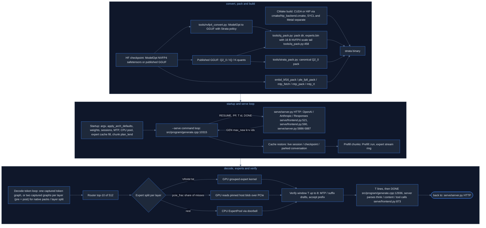
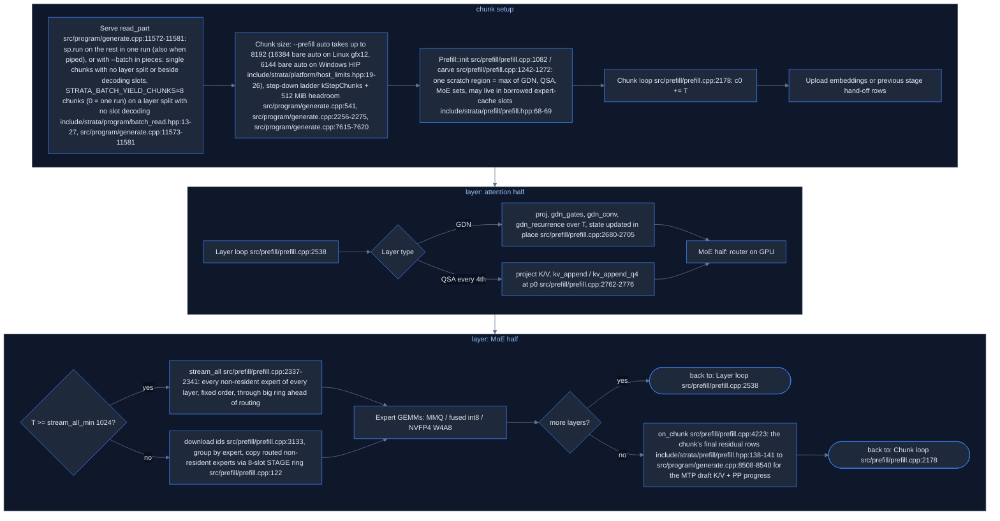
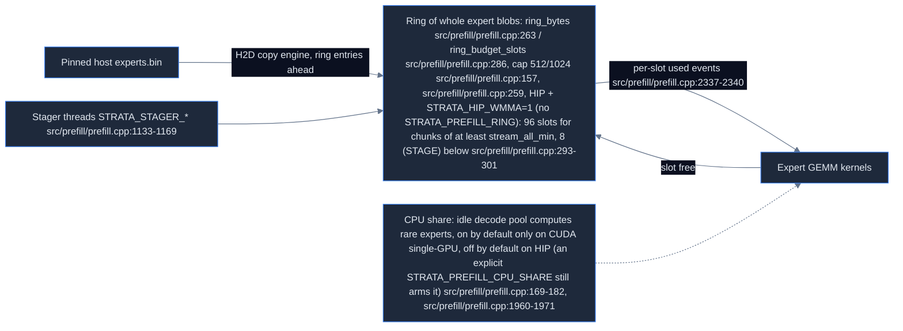
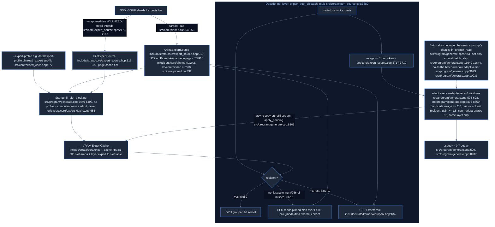
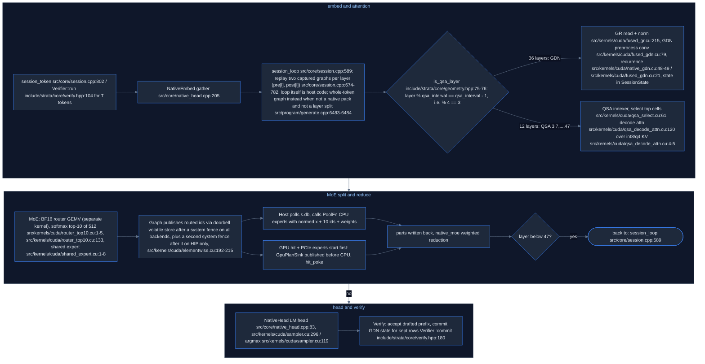
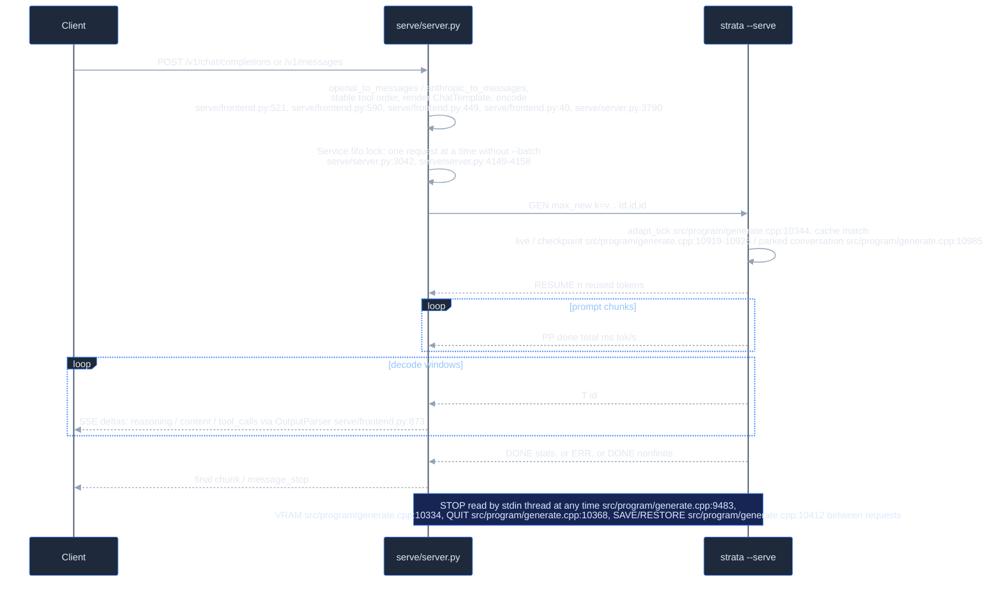
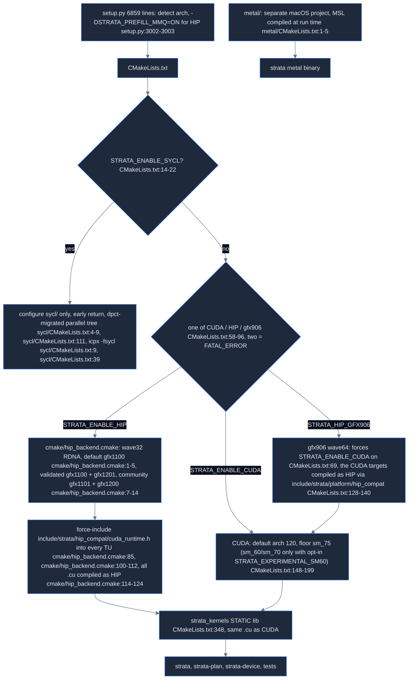

# Strata (original upstream) — human-readable map

Source mapped: upstream Strata @ `296b59d2` (project version 0.1.44.1). Machine-readable index: [index.tsv](index.tsv) (`area  kind  name  file:line  how`).

All `file:line` refs come from the area docs. Paths are relative to the Strata repo root.

---

## 1. What Strata is (plain English)

Strata is an inference engine built for exactly one model shape: **Qwen3.8-Flash-Next** (GGUF arch `qwen4exp`): 48 layers (36 GDN linear-attention + 12 QSA full-attention, every 4th layer), 512 routed experts with top-10, hidden 2560, expert FFN 640, vocab 248,320. The model is ~125B-class, far too big for one gaming GPU, so Strata:

1. keeps **dense weights** on the GPU,
2. keeps the **hot experts** in a VRAM cache (filled from a frequency profile),
3. keeps **all experts** in pinned system RAM (or mmapped from SSD),
4. for each token, computes VRAM-hit experts on the GPU, reads a share of misses over **PCIe**, and computes the rest on the **CPU** expert pool — at the same time,
5. uses **speculative decoding** (MTP drafter + n-gram/suffix lookup, verify windows up to 8 tokens),
6. reads prompts in big **chunks** (`--prefill auto`, which setup passes, takes up to 8192; 16384 on Linux gfx12, 6144 on Windows HIP: setup.py:6571, src/program/generate.cpp:541, src/program/generate.cpp:2256-2275, include/strata/platform/host_limits.hpp:19-26) while streaming experts through a ring.

The engine is one C++ binary (`strata`, main in `src/program/generate.cpp`, 14,182 lines) driven by a Python HTTP server (`serve/server.py`) over a **text line protocol** on stdin/stdout. Kernels are CUDA `.cu` files that also compile as **HIP** for AMD (there are no `.hip` files). Intel (SYCL) and Apple (Metal) are separate sibling trees.

Doctrine (tools/strata_pack.py:1-4): the Python pack builder implements docs/pack-format.md and is the reference for a C++ `strata-pack` port, which is not in this tree (CMakeLists.txt:3-5 adds it only when its sources exist); "if the two disagree the C++ is wrong".

## 2. Repo layout → area maps

| Area map | Covers | One-line summary |
|---|---|---|
| [gpu-cpu-kernels](gpu-cpu-kernels.md) | `src/kernels/` (cuda/, cpu/, parity/bench) | All GPU+CPU compute kernels: MMVQ GEMV, NVFP4/IQ dot, router, GDN, QSA, sampler, verify |
| [engine-core](engine-core.md) | `src/core/`; `include/strata/core`; `include/strata/artifact` | Arenas, weight load, per-layer graphs, session_loop + doorbell, Verifier, MTP, expert cache/source, KV VMM |
| [prefill](prefill.md) | `src/prefill/`; `src/plan/`, prefill parts of src/program/generate.cpp | Chunked prompt path, expert streaming ring, CPU share, KV append, memory planner |
| [moe-experts](moe-experts.md) | experts end-to-end | VRAM cache / pinned RAM / file tier, profile fill, hit/PCIe/CPU split, adaptive swaps |
| [server](server.md) | `serve/`, `chat.py` | Python HTTP (OpenAI/Anthropic/Responses), template, tool-call parse, engine pipe |
| [generate-program](generate-program.md) | src/program/generate.cpp:1-7185 | Startup pipeline: argv, arch defaults, weights, sessions, pool, cache sizing, chunk choice |
| [generate-program](generate-program.md) | src/program/generate.cpp:7186-14182 | Serve loop, cache restore, prompt windows, decode/spec windows, DONE |
| [model-spec-ngram-platform](model-spec-ngram-platform.md) | `src/qwen35`; `src/spec`; `src/ngram`; `src/artifact`; `src/platform` | q36 (Qwen3.6, NOT Flash-Next) engine, spec policy, suffix drafter, PLE reader (SSD reader for layer 1's per-layer embedding table, rows n-gram-hashed; not spec drafting), direct I/O |
| [artifacts-platform-misc](artifacts-platform-misc.md) | include/strata/artifact, include/strata/platform, include/strata/plan and include/strata/ngram headers, cmake, docs index | GGUF reader, planner, mlock/readahead, hip_compat mapping, docs list |
| [build-system](build-system.md) | CMakeLists.txt; cmake/hip_backend.cmake, setup.py, Docker | Backend selection, arch lists, feature flags, install + pack pipeline |
| [tools-and-scripts](tools-and-scripts.md) | `tools/`, `ref/`, `data/` | NVFP4 convert/verify, iq_pack, strata_pack, MTP tools, quality tools |
| [tests-bench-docs](tests-bench-docs.md) | `tests/`; `docs/`; `bench/`, README | Test inventory, docs, published and community GPU numbers |
| [intel-sycl-backend](intel-sycl-backend.md) | `sycl/` | Intel Arc port (dpct-migrated parallel tree); no NVFP4 |
| [apple-metal-backend](apple-metal-backend.md) | `metal/` | Apple Silicon engine (MSL + Window + SSD expert stream); no NVFP4 |
| [plan-vision-imagegen](plan-vision-imagegen.md) | `src/plan/` + include/strata/plan/plan.hpp; `tools/vision/`; `tools/image/` | strata-plan VRAM planner (Q2_0 blob constants, not used by src/program/generate.cpp), strata-vision mtmd encoder (SVE1/GENI), Qwen-Image sd-cli + native DiT kernels |
| [bench-results](bench-results.md) | `bench/results/` entries 1..1043 | Bench packets (part 1): result formats and per-GPU prompt/decode numbers |
| [bench-results](bench-results.md) | `bench/results/` entries 1044..2086 | Bench packets (part 2): further per-GPU prompt/decode numbers |
| [ci-and-repo-root](ci-and-repo-root.md) | `.github/` + repo-root files | No CI workflows; setup.sh / update.sh / UPDATE.bat, CUDA-only Docker + flake, setup.py toolkit and GPU detection |
| [speculative-decoding](speculative-decoding.md) | `src/spec/` + its callers in src/program/generate.cpp | CPU-only spec helpers: SuffixDrafter (trigram lookup), DraftPolicy (lookup vs MTP, chain length), DraftSource; Controller is dead code |
| [hip-amd-tools](hip-amd-tools.md) | `tools/hip/` | HIP backend tools: GEMM tuner and tables, bench_prefill, Windows build/package tools |
| [qwen35-engine](qwen35-engine.md) | `src/qwen35/` (src/qwen35/q36ref.cu; src/qwen35/q36_engine.cu; src/qwen35/q36_main.cpp); `include/strata/qwen35`; `tools/qwen35` | qwen35moe (Qwen3.6-35B-A3B) reference exe + engine: GDN/gated-attn/MoE math, MTP spec, hybrid experts; no NVFP4 |

## 3. Big picture

## 4. Prefill chunk pipeline and expert streaming ring

Prompt reading. Entry `Prefill::run` src/prefill/prefill.cpp:4338 → `run_impl` src/prefill/prefill.cpp:2087. No graph capture in prefill; every chunk is a fresh host-driven launch sequence. `Prefill::run_impl` routing does **not** update expert placement; but prompt parts ≤ `--short-read` (64) go through verify windows, which do feed `usage` (src/program/generate.cpp:663, src/program/generate.cpp:11226-11231, src/program/generate.cpp:11783 → drive_pool_multi src/program/generate.cpp:1027-1032 → src/core/expert_source.cpp:3717-3719).

## 5. Expert tiers and adaptive swaps

`pcie_frac`: probe 4×256 MiB pinned H2D (src/program/generate.cpp:1662-1667), frac = base × min(1, GB/s ÷ 20) (src/program/generate.cpp:1725-1726); base **0.25 for NVFP4** packs, 0.55 native, 0.2 Q2_0 (src/program/generate.cpp:2861). PcieAuto refinement (src/program/generate.cpp:1729-1736) is CUDA-only by default.

## 6. Decode: one token through 48 layers

Dense GEMV is MMVQ dp4a on q8_1 activations (src/kernels/cuda/native_mmvq.cu:1-3, src/kernels/cuda/native_mmvq.cu:27, src/kernels/cuda/native_mmvq.cu:155); NVFP4 experts are **w4a8** (src/kernels/cuda/iq_kernels.cu:570-600), not FP4×FP4.

## 7. Serve request lifecycle

**Other engine output lines**

| Line | When | Where |
|---|---|---|
| `READY <max_context> stop` | At startup | `src/program/generate.cpp:9671` |
| `YIELDED <slot> <tokens>` | Just before DONE when a prompt read yields | `src/program/generate.cpp:12935` |
| `BADM <slot> <0\|1>` | `--batch` admission | `src/program/generate.cpp:12984` |
| `DONE ...` | 15 fixed fields, plus 5 more with `--lookup-chain` | `src/program/generate.cpp:12936`; `src/program/generate.cpp:12924-12930` |

```mermaid
---
config: {"theme":"base","themeVariables":{"darkMode":true,"background":"#0b1020","fontFamily":"Inter, 'Segoe UI', Roboto, 'Helvetica Neue', Arial, sans-serif","fontSize":"14px","primaryColor":"#1e293b","primaryTextColor":"#e2e8f0","primaryBorderColor":"#3b82f6","secondaryColor":"#1e293b","secondaryTextColor":"#e2e8f0","secondaryBorderColor":"#3b82f6","tertiaryColor":"#111827","tertiaryTextColor":"#e2e8f0","tertiaryBorderColor":"#334155","mainBkg":"#1e293b","nodeBorder":"#3b82f6","textColor":"#e2e8f0","titleColor":"#93c5fd","lineColor":"#64748b","clusterBkg":"#0f172a","clusterBorder":"#334155","edgeLabelBackground":"#0b1020","noteBkgColor":"#172554","noteTextColor":"#dbeafe","noteBorderColor":"#3b82f6","actorBkg":"#1e293b","actorTextColor":"#e2e8f0","actorBorder":"#3b82f6","actorLineColor":"#475569","signalColor":"#94a3b8","signalTextColor":"#e2e8f0","labelBoxBkgColor":"#1e293b","labelBoxBorderColor":"#3b82f6","labelTextColor":"#e2e8f0","loopTextColor":"#93c5fd","activationBkgColor":"#334155","activationBorderColor":"#3b82f6"},"flowchart":{"curve":"basis","nodeSpacing":34,"rankSpacing":40,"padding":12,"wrappingWidth":260,"htmlLabels":true},"sequence":{"actorFontFamily":"Inter, 'Segoe UI', Roboto, 'Helvetica Neue', Arial, sans-serif","messageFontFamily":"Inter, 'Segoe UI', Roboto, 'Helvetica Neue', Arial, sans-serif","noteFontFamily":"Inter, 'Segoe UI', Roboto, 'Helvetica Neue', Arial, sans-serif"},"fontFamily":"Inter, 'Segoe UI', Roboto, 'Helvetica Neue', Arial, sans-serif"}
---
flowchart TD
  subgraph R0["resume lookup"]
    direction LR
    G["GEN parsed src/program/generate.cpp:10635-10636"]
    W["ver.wait_commit src/program/generate.cpp:10867"]
    N{"nan_flush set? non-finite seen"}
    Z["drop live, checkpoints, parked, slots: read from 0 src/program/generate.cpp:10895-10917"]
    R["resume = longest live/checkpoint prefix of ids, max n-1, same cvec src/program/generate.cpp:10856-10858, src/program/generate.cpp:10919-10926"]
    P["parked conversation deeper? conversations.best src/program/generate.cpp:10985, validate snapshot src/program/generate.cpp:10986-11011"]
    CS["park outgoing branch src/program/generate.cpp:11023, restore incoming src/program/generate.cpp:11069-11071"]
    RS["print RESUME src/program/generate.cpp:11214"]
    G --> W
    W --> N
    N -- "yes" --> Z
    N -- "no" --> R
    R --> P
    P --> CS
    Z --> RS
    CS --> RS
  end
  subgraph R1["read, decode, done"]
    direction LR
    PR["read rest of prompt: read_windows src/program/generate.cpp:11349 / read_windows_pl src/program/generate.cpp:11263"]
    CK["checkpoints: root / message / pin src/program/generate.cpp:11720-11760"]
    DE["decode + spec src/program/generate.cpp:11859-12900"]
    DN["DONE src/program/generate.cpp:12936"]
    PR --> CK
    CK --> DE
    DE --> DN
  end
  R0 --> R1
```

**GDN state on cancelled prefill**: GDN recurrence + conv1d history are updated in place per prompt chunk (src/prefill/prefill.cpp:2690-2701) with no pre-chunk snapshot. Prefill checks cancel only at chunk start (src/prefill/prefill.cpp:2179; wired to stop_req, src/program/generate.cpp:9500). The serve loop sets live_ok=false at request start (src/program/generate.cpp:11139) and pp_exact=false while a batched/pipelined part runs (src/program/generate.cpp:11782). A cancelled read keeps the session only if pp_exact (stopped between windows or between serve-level parts, src/program/generate.cpp:12798-12807); a cancel inside a batched part, a layer-split read, or a BADM admission discards it, and the next request resumes from the longest checkpoint, a parked conversation/slot, or token 0. Non-stop errors print ERR and exit the process (src/program/generate.cpp:11795-11807). Spec verify writes state only in Verifier::commit (src/core/verify.cpp:2645, replay src/core/verify.cpp:2100-2104) or one-token self-commit (src/core/verify.cpp:1175-1183, src/core/verify.cpp:2655).

**State split**: live SessionState + host live/checks is the truth while running; ConversationCheckpoint = running state without K/V (include/strata/core/conversation_cache.hpp:23-34; rewind; draft ring via mtp.kv_restore src/program/generate.cpp:11197); SavedConversation = live checkpoint + checkpoints + K/V (include/strata/core/conversation_cache.hpp:148-158; park/disk), it replaces live on restore and may then be rewound to one of its checkpoints; sampling is stateless Philox(seed,pos) (include/strata/kernels/sampler.hpp:25), not saved.

## 8. Build and backends

### Build tree quirks

- This tree has `tests/` but no `tests/CMakeLists.txt`, so the tests default is effectively OFF here (CMakeLists.txt:97-102).
- NVFP4 parity span CMakeLists.txt:1526-1617 is mixed: CUDA NVFP4 CMakeLists.txt:1526-1534, HIP MMQ block CMakeLists.txt:1535-1601, CPU `nvfp4_avx512_parity` CMakeLists.txt:1608, CUDA NVFP4 decode CMakeLists.txt:1612-1617.
- `tools/mtp_fetch.py` also has an `inventory` subcommand (tools/mtp_fetch.py:7, tools/mtp_fetch.py:183).

### CI and update scripts

- No CI: `.github/` has 6 files (3 issue forms + .github/ISSUE_TEMPLATE/config.yml + .github/pull_request_template.md + .github/FUNDING.yml) and no `workflows/`; there is no other CI config. Contributors must build every touched backend themselves before review (AGENTS.md:31).
- setup.sh deletes `.venv` twice: silently when the existing .venv has no working pip (setup.sh:11-13), and with a message when `python -m venv` fails (setup.sh:66). Its header comment (setup.sh:4) says apt/dnf only, but a pacman branch exists (setup.sh:51-52). The uv path needs STRATA_UV=1 or NixOS **and** `uv` on PATH (setup.sh:18-19).
- update.sh / UPDATE.bat (general updaters, update.sh:2-5; on a clone of the pre-2026-10-06 history, update.sh:17-19) create a `pre-cleanup-backup*` branch and `checkout -B <branch> origin/main` (update.sh:31-36; UPDATE.bat:20-62, checkout UPDATE.bat:52), and on failure **also `git branch -D` that backup** (update.sh:41, UPDATE.bat:54). They create and delete branches. UPDATE.bat differs from update.sh: merge-base test before the shallow test (UPDATE.bat:23-25; update.sh:19 tests shallow first), `%RANDOM%` backup suffix (UPDATE.bat:43) vs timestamp (update.sh:33), ends with `START-HERE.bat --update` (UPDATE.bat:78) not setup.sh (update.sh:61).

---

## 9. Key knobs

| Knob | Default | Where | What |
|---|---|---|---|
| `--prefill CHUNK\|auto[:N]` | 0 (token path); auto takes up to 8192 (16384 bare auto on Linux gfx12, 6144 bare auto on Windows HIP) | src/program/generate.cpp:535-545; src/program/generate.cpp:2041-2062; include/strata/platform/host_limits.hpp:19-26; src/program/generate.cpp:541; src/program/generate.cpp:2256-2275; src/program/generate.cpp:7231-7232 | prompt chunk; required by --serve |
| `--spec N` | 0 (serve needs ≥2) | src/program/generate.cpp:564; src/program/generate.cpp:2074; src/program/generate.cpp:7231-7232 | verify window; kVerifyMaxT 8. With the suffix drafter on (default, src/program/generate.cpp:675) and --mtp-max-t 0: mtp_max_t=spec, spec=min(spec+2,8) (src/program/generate.cpp:2567-2569), so setup's --spec 4 (setup.py:6571) gives window 6, MTP 4 |
| `--mtp DIR` | none | src/program/generate.cpp:588; src/program/generate.cpp:2089; src/program/generate.cpp:7243 | MTP drafter (optional in serve) |
| `--expert-cache N\|auto` | 0 | src/program/generate.cpp:472; src/program/generate.cpp:2025-2027, sizing src/program/generate.cpp:5079-5304 | VRAM expert slots |
| `--expert-profile` | none | src/program/generate.cpp:501; src/program/generate.cpp:2201 | ranked startup fill |
| `--expert-cache-per-layer` | off | src/program/generate.cpp:483; src/program/generate.cpp:2194; src/core/expert_cache.cpp:622-630 | slots/n_layers per layer |
| `--pcie-frac` / `--pcie-mode` | probed / auto | src/program/generate.cpp:592, src/program/generate.cpp:1662-1667, src/program/generate.cpp:2091 / src/program/generate.cpp:595, src/program/generate.cpp:2102 | share of misses over PCIe |
| `--adapt-every/-swaps/-decay/-min-gain` | 4 / 96 / 0.7 / 1.5 | src/program/generate.cpp:598-628; src/program/generate.cpp:2092-2094; src/program/generate.cpp:2192 | adaptive tier |
| `--adapt-async` | 0 | src/program/generate.cpp:606; src/program/generate.cpp:2095 | async swaps (not bit-exact) |
| `--vram-reserve-mib` | 700 | src/program/generate.cpp:525; src/program/generate.cpp:2038 | VRAM headroom |
| `--max-context` / `--max-new` | 4096 / 16 | src/program/generate.cpp:1915, src/program/generate.cpp:1914 (src/program/generate.cpp:341, src/program/generate.cpp:340) | sizes |
| `--prompt-cache` | 6 | src/program/generate.cpp:632; src/program/generate.cpp:2106; src/program/generate.cpp:11752 | checkpoint level (≥3 enables pin=) |
| `--short-read` | 64 | src/program/generate.cpp:663 decl; src/program/generate.cpp:2131 parse (help src/program/generate.cpp:818) | short prompts go through decode windows |
| `--no-token-graph` | graph on (not for native packs or a layer split) | src/program/generate.cpp:517; src/program/generate.cpp:2233; src/program/generate.cpp:6483-6484 | whole token as one graph |
| STRATA_SELECT_WMMA | 0 | src/kernels/cuda/qsa_select.cu:1126-1132 | gfx12 (RDNA4) WMMA QSA scorer, opt-in (other targets keep the warp kernel) |
| STRATA_NO_MMVQ_ROWS2 | arch rule | src/kernels/cuda/native_mmvq.cu:1296-1302 | MMVQ rows per block |
| STRATA_PREFILL_NVFP4 | w4a8 (CUDA only; NVFP4 is not an MMQ type on HIP) | include/strata/prefill/moe_mmq.hpp:23-25; src/prefill/moe_mmq.cu:190-195; src/prefill/moe_mmq.cu:215-217 | NVFP4 prompt experts: w4a8 / w4a4 (opt-in Blackwell) / fp16 (reference); other values exit(1) |
| STRATA_ROUTE_TAIL_SKIP | on for CUDA and HIP gfx1200/gfx1201; off with NVFP4 experts, --batch slots, a peer GPU, or when 90% of experts are cached (60% on a HIP layer split) | src/program/generate.cpp:8618-8659 | skip low-weight tail experts (=7 opt-in NVFP4) |
| STRATA_PREFILL_STREAM_MIN | 1024 | src/prefill/prefill.cpp:165-167 | stream-all threshold |
| STRATA_PREFILL_CPU_SHARE | auto on CUDA with one GPU and no batch slots; off on HIP and the layer split | src/prefill/prefill.cpp:178-186 | CPU computes rare experts in prefill |
| STRATA_ARENA_MMAP | off (only a value starting with '1' enables) | src/program/generate.cpp:1820-1827; include/strata/core/expert_source.hpp:981 | ROCclr userptr workaround |
| STRATA_WATCHDOG_S | 60 | src/program/generate.cpp:9617-9618 | engine stall watchdog |
| STRATA_KV_ROT | off | src/program/generate.cpp:2554-2555 | Hadamard INT8 K/V |
| STRATA_ENGINE_STALL_S / _READY_S | 90 / 900 | serve/server.py:256 / serve/server.py:268 | server-side watchdogs |

### Planner and speculative decoding

- Planner ≠ engine sizing: include/strata/plan/plan.hpp (expert_blob=1382400 = canonical Q2_0, include/strata/plan/plan.hpp:63, src/prefill/prefill.cpp:262; constant vram_pool_bytes include/strata/plan/plan.hpp:125) is used only by src/plan/plan_main.cpp and src/core/device_main.cpp, not generate.cpp. The engine's expert-cache sizing is src/program/generate.cpp:5079-5304. Real R9700 IQ3_S auto cache: 13,021 slots / 24.71 GiB (bench/results/2026-10-08-community-r9700-linux/README.md:61).
- The lookup first-token gate (lookup only if its first token = MTP's first) is unconditional only in pick_lookup (src/program/generate.cpp:12150-12154); the serve path src/program/generate.cpp:12578 and the plain generate command's spec loop src/program/generate.cpp:13765 apply it only when MTP is on (`!use_mtp || sbuf[0]==drafts[0]`).
- The lookup-chain rewrite (src/program/generate.cpp:2572-2575) needs --lookup-chain>0 and spec>=2; it sets mtp_max_t=spec if 0, then spec=max(spec,min(mtp_max_t+K,8)).
- Controller (src/spec/controller.cpp) has no engine user, only its unit test (src/spec/controller_test.cpp:1-2, built at CMakeLists.txt:1168); metal/src/engine/stubs.cpp:112 only includes its header.
- DraftPolicy::chain probes when p_mtp*c >= 0.6 (src/spec/draft_policy.cpp:134, src/spec/draft_policy.cpp:138), not choose's q>=0.85 (src/spec/draft_policy.cpp:79, src/spec/draft_policy.cpp:84). Other MTP flags: --mtp-q4 all|proj|head (src/program/generate.cpp:2146-2152), --batch-mtp (src/program/generate.cpp:2084). --mtp-hnorm pooled|stream (src/program/generate.cpp:2138-2140, applied src/program/generate.cpp:4618 → src/core/mtp.cpp:906 / src/prefill/prefill.cpp:1516) and --mtp-draft-vocab FILE (src/program/generate.cpp:2153, applied src/program/generate.cpp:4620 → include/strata/core/mtp.hpp:211, src/core/mtp.cpp:690-693) are independent; draft-vocab also gates mtp_first_ok (src/program/generate.cpp:3500-3506).

### Planner, vision and image generation

- plan.hpp's 1,382,400 B expert blob is a Q2_0 2.25 bpw pack (include/strata/kernels/cpu/expert.hpp:41-49: QK=64, BB=18 B/block; src/prefill/prefill.cpp:262 `Q2_0_BLOB`), NOT NVFP4.
- src/core/device_main.cpp:87 calls make_plan(20480, Geometry{}, Costs{}) → state_bytes=0 (include/strata/plan/plan.hpp:68) and the 5.943e9 table pool (include/strata/plan/plan.hpp:125-130), so its FITS/DOES NOT FIT line (src/core/device_main.cpp:90-92) only compares that constant to free VRAM; meaningless as a fit check.
- strata-plan silently falls back to the 5.943e9 pool when --dense + --embd >= --vram (src/plan/plan_main.cpp:29-34, src/plan/plan_main.cpp:61-66; include/strata/plan/plan.hpp:125-126) instead of refusing (contra include/strata/plan/plan.hpp:6-7). include/strata/plan/plan.hpp:146 sets vram_used to the pool minus the slot remainder; its comment calls the remainder unusable, not free.
- strata-vision's AVX-512 FA-off path (tools/vision/strata_vision.cpp:129) is hit only by a native build (setup.py -DSTRATA_PORTABLE=OFF, setup.py:3040, setup.py:3974); the default STRATA_PORTABLE=ON forces GGML_AVX512* OFF (tools/vision/CMakeLists.txt:17, tools/vision/CMakeLists.txt:32-42). Measured on 7700X 1024x1024 (tools/vision/strata_vision.cpp:127-128): AVX2 8-10 s FA vs 14-15 s no-FA; AVX-512 44 s FA (26% off FP32) vs 13 s. CPU mode skips warm-up (tools/vision/strata_vision.cpp:158-160).
- tools/image/sdcpp_native/qi21-native.cu has 9 __global__ kernels (header tools/image/sdcpp_native/qi21-native.cu:7-11 lists 5): k_res_ln_mod4 tools/image/sdcpp_native/qi21-native.cu:41, k_tanh tools/image/sdcpp_native/qi21-native.cu:80, k_res_ln_mod tools/image/sdcpp_native/qi21-native.cu:86, k_qkv_post tools/image/sdcpp_native/qi21-native.cu:115, k_qkv_post_w tools/image/sdcpp_native/qi21-native.cu:163, k_swiglu tools/image/sdcpp_native/qi21-native.cu:191, k_attn_causal tools/image/sdcpp_native/qi21-native.cu:201, k_attn_wmma tools/image/sdcpp_native/qi21-native.cu:272 (HIP, RDNA3||RDNA4 gate tools/image/sdcpp_native/qi21-native.cu:277), k_attn_mma tools/image/sdcpp_native/qi21-native.cu:418 (NVIDIA sm_80+ only, `#if !defined(GGML_USE_HIP)` tools/image/sdcpp_native/qi21-native.cu:374-375; not built for HIP).
- STRATA_QI_FAST_LN effective default is OFF: member init `true` (tools/image/sdcpp_native/qwen_image_2_1_native.hpp:59) is overwritten by `getenv(...) != nullptr` (tools/image/sdcpp_native/qwen_image_2_1_native.hpp:88) → scalar qi21_res_ln_mod path (tools/image/sdcpp_native/qwen_image_2_1_native.hpp:329-330). fuse_qkv default ON (STRATA_QI_NO_QKV_FUSE disables, tools/image/sdcpp_native/qwen_image_2_1_native.hpp:87).
- tools/image/install.py picks backend/quant via setup.image_backend_choice (tools/image/install.py:69 → setup.py:3188, setup.py:3195 QI.pick_quant) and builds via setup.build_image_engine (setup.py:3127), not qimage directly. tools/image/sdcpp_native/apply.py is run by setup.py:3117 apply_native_runner (importlib setup.py:3121, apply setup.py:3124) from build_image_engine setup.py:3141-3142 for cuda/hip (tools/image/qimage.py:170) on every stamp-mismatched image-engine build (stamp includes native_hash, tools/image/qimage.py:173, tools/image/qimage.py:186); build_image_engine is called from setup.py:3218 and tools/image/install.py:73; tools/test_qimage.py:178-190 calls apply directly. RDNA4 in the pinned sd.cpp ggml d25b121c (tools/image/qimage.py:25; fetched at build time, not in this tree): its HIP vendor header does `#if defined(__GFX12__) #define RDNA4`; clang defines __GFX12__ for gfx1200 / gfx1201 (gfx120x) → tools/image/sdcpp_native/qi21-native.cu:242 gfx12 WMMA path (tools/image/sdcpp_native/qi21-native.cu:246), used only when STRATA_QI_GFX12_ATTN starts with '1' (otherwise ggml's attention stays on gfx12; RDNA3 always uses it, tools/image/sdcpp_native/qi21-native.cu:551-559).
