# Strata map: artifacts, platform, plan and misc headers

Source: Strata commit `296b59d2`. Paths are relative to the Strata repo root.

## Overview

- `src/artifact/` is tiny: the GGUF reader and dequantizers are header-only in `include/strata/artifact/` (see engine-core.md). `src/artifact/gguf_reader.cpp` (67 L) = `strata-gguf` CLI; `src/artifact/dequant.cpp` (123 L) = `strata-dequant` CLI, only compiled with `STRATA_DEQUANT_SELFTEST`; `src/artifact/gguf_reader_test.cpp` (129 L).
- `src/plan/plan_main.cpp` (73 L) = `strata-plan` CLI over header-only `include/strata/plan/plan.hpp` (168 L, VRAM census + planner that REFUSES to overcommit via `DoesNotClose`).
- `src/platform/`: `src/platform/memory.cpp` (260 L: mlock/VirtualLock pinning, read-ahead hints, /proc IO sampling, DXGI budget), `src/platform/direct_file.cpp` (371 L: O_DIRECT async reader with a thread pool), `src/platform/memory_test.cpp`. CPU pinning is header-only in `include/strata/platform/aux_cpus.hpp` (361 L), not under src/platform.
- `src/ngram/ple_reader.cpp` (548 L) = SSD-streamed per-layer-embedding/n-gram row table reader (row cache + DirectFile + keep-alive), test 514 L.
- `cmake/` contains only `cmake/hip_backend.cmake` (128 L).

## Data flow

```mermaid
---
config: {"theme":"base","themeVariables":{"darkMode":true,"background":"#0b1020","fontFamily":"Inter, 'Segoe UI', Roboto, 'Helvetica Neue', Arial, sans-serif","fontSize":"14px","primaryColor":"#1e293b","primaryTextColor":"#e2e8f0","primaryBorderColor":"#3b82f6","secondaryColor":"#1e293b","secondaryTextColor":"#e2e8f0","secondaryBorderColor":"#3b82f6","tertiaryColor":"#111827","tertiaryTextColor":"#e2e8f0","tertiaryBorderColor":"#334155","mainBkg":"#1e293b","nodeBorder":"#3b82f6","textColor":"#e2e8f0","titleColor":"#93c5fd","lineColor":"#64748b","clusterBkg":"#0f172a","clusterBorder":"#334155","edgeLabelBackground":"#0b1020","noteBkgColor":"#172554","noteTextColor":"#dbeafe","noteBorderColor":"#3b82f6","actorBkg":"#1e293b","actorTextColor":"#e2e8f0","actorBorder":"#3b82f6","actorLineColor":"#475569","signalColor":"#94a3b8","signalTextColor":"#e2e8f0","labelBoxBkgColor":"#1e293b","labelBoxBorderColor":"#3b82f6","labelTextColor":"#e2e8f0","loopTextColor":"#93c5fd","activationBkgColor":"#334155","activationBorderColor":"#3b82f6"},"flowchart":{"curve":"basis","nodeSpacing":34,"rankSpacing":40,"padding":12,"wrappingWidth":260,"htmlLabels":true},"sequence":{"actorFontFamily":"Inter, 'Segoe UI', Roboto, 'Helvetica Neue', Arial, sans-serif","messageFontFamily":"Inter, 'Segoe UI', Roboto, 'Helvetica Neue', Arial, sans-serif","noteFontFamily":"Inter, 'Segoe UI', Roboto, 'Helvetica Neue', Arial, sans-serif"},"fontFamily":"Inter, 'Segoe UI', Roboto, 'Helvetica Neue', Arial, sans-serif"}
---
flowchart LR
  D[(GGUF on NVMe)] --> G[GgufFile header-only\ninclude/strata/artifact/gguf_reader.hpp]
  G -->|tensor infos, offsets, data_start| P[plan.hpp make_plan\nVRAM pool split KV/expert slots]
  G -->|mmap'd dense/expert bytes| M[platform/memory.cpp]
  M -->|advise_willneed madvise/posix_fadvise 128KiB steps| PC[page cache]
  M -->|lock_resident mlock| RAM[pinned host RAM]
  RAM -->|cudaHostRegister->hipHostRegister via hip_compat| CORE[core: expert cache / H2D copies]
  D --> DF[DirectFile O_DIRECT pread pool\nSTRATA_IO_THREADS=16]
  DF --> PLE[PleReader row cache\nngram/PLE table rows]
  PLE --> CORE
  AUX[aux_cpus pin_current_thread] -.pins.-> DF
  AUX -.pins.-> PLE
```

(GGUF mmap include/strata/artifact/gguf_reader.hpp:415; experts mmap src/core/expert_source.cpp:974, src/core/expert_source.cpp:1173, src/core/expert_source.cpp:4529 (STRATA_ARENA_MMAP=1); arena reserve src/core/pinned.cu:222, src/core/pinned.cu:241, src/core/pinned.cu:266 (Win VirtualAlloc src/core/pinned.cu:127, src/core/pinned.cu:144); cudaHostRegister src/core/pinned.cu:423, src/core/pinned.cu:443, src/core/pinned.cu:549, src/core/pinned.cu:605, src/core/expert_source.cpp:2992, src/core/expert_source.cpp:3031, src/program/generate.cpp:222 — via include/strata/hip_compat/cuda_runtime.h:76 on HIP.)

## Behavior table

| behavior | file:line | how |
|---|---|---|
| GGUF CLI summary + `--check` geometry bracket | src/artifact/gguf_reader.cpp:7-66 | sorts tensors by offset; size must be ≤ gap to next < size+32 (src/artifact/gguf_reader.cpp:52-54); `check_architecture` guard (src/artifact/gguf_reader.cpp:57) |
| dequant CLI gated | src/artifact/dequant.cpp:5 | `#ifdef STRATA_DEQUANT_SELFTEST` |
| Planner refuses overcommit | include/strata/plan/plan.hpp:118, include/strata/plan/plan.hpp:140 | `DoesNotClose` thrown by `make_plan` |
| Planner geometry hardcoded Qwen3.8-Flash-Next | include/strata/plan/plan.hpp:23-30 | 48 layers, 12 full-attn, 2 KV heads, hd 256, INT8 KV group 64 |
| plan CLI defaults | src/plan/plan_main.cpp:58-63 | state bytes from geometry; pool = free VRAM − dense − embd |
| Linux pinning | src/platform/memory.cpp:164-188 | `mlock` per region; note "raise ulimit -l" on failure |
| Windows pinning | src/platform/memory.cpp:23-110 | grow working-set min by bytes+512 MiB, `VirtualLock` in 1 GiB chunks |
| GPU shared-memory budget | src/platform/memory.cpp:112-152 (Win DXGI) / src/platform/memory.cpp:190-194 (Linux stub) | Linux always returns false, "DXGI is Windows-only" |
| total RAM | src/platform/memory.cpp:196-199 | sysconf PHYS_PAGES*PAGE_SIZE |
| read-ahead on by default | src/platform/memory.cpp:205-211 | `STRATA_READ_AHEAD` unset or ≠0; Windows: always off (src/platform/memory.cpp:160) |
| WILLNEED hints | src/platform/memory.cpp:213-232 | madvise / posix_fadvise (macOS F_RDADVISE) in 128 KiB steps (src/platform/memory.cpp:202) |
| IO/fault telemetry | src/platform/memory.cpp:235-258 | /proc/self/io read_bytes, /proc/self/stat majflt |
| DirectFile Linux | src/platform/direct_file.cpp:264-371 | `open(O_RDONLY\|O_DIRECT)` (src/platform/direct_file.cpp:313), pool of blocking `pread` threads (src/platform/direct_file.cpp:285), default 16 (src/platform/direct_file.cpp:319) |
| DirectFile Windows | src/platform/direct_file.cpp:70-261 | overlapped I/O, 4 threads (src/platform/direct_file.cpp:187) |
| Alignment enforced | src/platform/direct_file.cpp:337-338 | offset/length/buffer must be aligned else "unaligned request"; buffers via posix_memalign (src/platform/direct_file.cpp:37) |
| IO workers pinned | src/platform/direct_file.cpp:320 | `aux_cpus::pin_current_thread()` |
| PleReader open | src/ngram/ple_reader.cpp:336-379 | max_inflight 1..1024, row_bytes ≤4096, slab 2 pages/inflight, optional worker thread |
| SSD keep-alive | include/strata/ngram/ple_reader.hpp:75-80 | reads one page if idle `period_ms` (anti NVMe power-state stalls) |
| Aux CPU pinning (Linux only) | include/strata/platform/aux_cpus.hpp:1-19, include/strata/platform/aux_cpus.hpp:150-343; stubs include/strata/platform/aux_cpus.hpp:345-358 | `--aux-cpus`/STRATA_AUX_CPUS; sweep /proc/self/task; non-Linux empty fns |
| Host chunk/commit limits | include/strata/platform/host_limits.hpp:24-41 | auto chunk cap (Win HIP), commit verdict |

## HIP-specific behavior & Linux stubs

- Linux stub: `gpu_shared_memory_budget` src/platform/memory.cpp:190-194 → false (DXGI only on Windows). So on Linux no shared-memory budget is ever reported.
- aux_cpus is Linux-only; other OS stubs include/strata/platform/aux_cpus.hpp:346-357.
- cmake/hip_backend.cmake: default arch gfx1100 (cmake/hip_backend.cmake:5); validated {gfx1100,gfx1201} (cmake/hip_backend.cmake:13), community {gfx1101,gfx1200} (cmake/hip_backend.cmake:14), unvalidated list (cmake/hip_backend.cmake:15) else FATAL_ERROR (cmake/hip_backend.cmake:31). Archs passed as `STRATA_HIP_ARCHS` define for runtime device check (cmake/hip_backend.cmake:43, cmake/hip_backend.cmake:89). hipBLAS <1.0 → also rocBLAS (cmake/hip_backend.cmake:63-66); hipBLASLt optional → `STRATA_HIPBLASLT_AVAILABLE` (cmake/hip_backend.cmake:75-80). Forces PIC (cmake/hip_backend.cmake:83). Force-includes `include/strata/hip_compat/cuda_runtime.h` into every CXX/HIP TU (cmake/hip_backend.cmake:100-112). All `.cu` in src/bench/tests compiled as HIP (cmake/hip_backend.cmake:114-121). `STRATA_WMMA_GFX11=1` only when arch matches gfx11 (cmake/hip_backend.cmake:96-97); gfx12 targets get no WMMA define. Option `STRATA_GFX1012_PORTABLE_DOT` (cmake/hip_backend.cmake:90).
- There are TWO hip_compat trees: `include/strata/hip_compat/` (used by cmake/hip_backend.cmake, RDNA) and `include/strata/platform/hip_compat/` (`include/strata/platform/hip_compat/strata_hip.h` 306 L, gfx906 wave64 path enabled by `STRATA_HIP_GFX906`, referenced CMakeLists.txt:60, CMakeLists.txt:138, CMakeLists.txt:141).

## hip_compat mapping (include/strata/hip_compat/cuda_runtime.h, 146 L)

cudaDevAttr* → hipDeviceAttribute* (include/strata/hip_compat/cuda_runtime.h:18-23); cudaDeviceGetAttribute/CanAccessPeer/EnablePeerAccess/Synchronize/Prop → hip equivalents (include/strata/hip_compat/cuda_runtime.h:24-28); errors (include/strata/hip_compat/cuda_runtime.h:30-34); events (include/strata/hip_compat/cuda_runtime.h:35-44); cudaFree/FreeHost (include/strata/hip_compat/cuda_runtime.h:45-49, version-gated hipHostFree/hipFreeHost); func attrs (include/strata/hip_compat/cuda_runtime.h:51-52); device query (include/strata/hip_compat/cuda_runtime.h:53-57); graphs (include/strata/hip_compat/cuda_runtime.h:58-64); cudaHostAlloc → hipHostMalloc, its flags hipHostMalloc* or hipHostAlloc* by HIP_VERSION_MAJOR (include/strata/hip_compat/cuda_runtime.h:65-74); host register family (include/strata/hip_compat/cuda_runtime.h:75-80); cudaLaunchHostFunc (include/strata/hip_compat/cuda_runtime.h:81); cudaMalloc (include/strata/hip_compat/cuda_runtime.h:82); **cudaMallocHost → `strata::hip_compat::malloc_host` wrapper (include/strata/hip_compat/cuda_runtime.h:83)**; **cudaMemGetInfo → `strata::hip_compat::mem_get_info` wrapper or hipMemGetInfo (include/strata/hip_compat/cuda_runtime.h:92, include/strata/hip_compat/cuda_runtime.h:94)**; memcpy/memset family (include/strata/hip_compat/cuda_runtime.h:96-105); stream capture (include/strata/hip_compat/cuda_runtime.h:109-112). cublas_v2.h (63 L): rocBLAS branch for old hipBLAS (include/strata/hip_compat/cublas_v2.h:5-24: handle, gemm algo, datatypes) and hipBLAS branch (include/strata/hip_compat/cublas_v2.h:43-57: GemmEx, Sgemm, StridedBatched). include/strata/hip_compat/intrinsics.hpp (163 L): dot4 mapping incl. RDNA2 `v_dot4_i32_i8` (include/strata/hip_compat/intrinsics.hpp:27). include/strata/hip_compat/cuda_runtime_api.h: 2 L forwarder.

## Header-only parts outside core/artifact (line counts)

platform: aux_cpus 361, direct_file 60, host_limits 58, memory 80. plan: plan 168. ngram: ple_reader 100. prefill: gemm 105, kernels 143, mmq_kq_abi 30, moe_fused 66, moe_fused_iq 42, moe_mmq 123, prefill 217, share_rules 62, xmx_moe 20. program: batch_groups 71, batch_read 30, conv_cache 80, draft_kv_plan 44, logits_selection 30, message_boundary 20, split_ring 36, split_rules 115. spec: controller 73, draft_policy 64, draft_source 62, suffix_drafter 59. qwen35: engine 13. kernels/: 52 files; see gpu-cpu-kernels.md.

## STRATA_* names in area (first mention file:line)

**Verified getenv:**

| Name | Where / notes |
|---|---|
| `STRATA_IO_THREADS` | src/platform/direct_file.cpp:64 |
| `STRATA_READ_AHEAD` | src/platform/memory.cpp:207 |

**Documented in headers:**

| Name | Where / notes |
|---|---|
| `STRATA_AUX_CPUS` | include/strata/platform/aux_cpus.hpp:9 |
| `STRATA_SSD_KEEPALIVE` | include/strata/ngram/ple_reader.hpp:80 |
| `STRATA_PREFILL_AUTO_MAX` | include/strata/platform/host_limits.hpp:23 |
| `STRATA_BATCH_MTP_SERIAL` | include/strata/program/batch_groups.hpp:9 |
| `STRATA_SPLIT_MTP_BATCH` | include/strata/program/draft_kv_plan.hpp:5 |
| `STRATA_SPLIT_RING` | include/strata/program/split_ring.hpp:9 |
| `STRATA_BF16_TC` | include/strata/prefill/gemm.hpp:30 |
| `STRATA_HCD_EXACT` | include/strata/prefill/gemm.hpp:34 |
| `STRATA_PF_PAD` | include/strata/prefill/gemm.hpp:44 |
| `STRATA_DENSE_MMQ` | include/strata/prefill/gemm.hpp:46 |
| `STRATA_DENSE_F32` | include/strata/prefill/gemm.hpp:94 |
| `STRATA_HIP_PROMPT_F16` | include/strata/prefill/gemm.hpp:100 |
| `STRATA_HC_UPMIX` | include/strata/prefill/kernels.hpp:28 |
| `STRATA_CVEC_FUSE` | include/strata/prefill/kernels.hpp:35 |
| `STRATA_GDN_REC_HEADS` | include/strata/prefill/kernels.hpp:65 |
| `STRATA_GDN_XE` | include/strata/prefill/kernels.hpp:68 |
| `STRATA_MMQ_KQ` | include/strata/prefill/mmq_kq_abi.hpp:22 |
| `STRATA_MMQ_KQUANTS` | include/strata/prefill/moe_mmq.hpp:16 |
| `STRATA_PREFILL_NVFP4` | include/strata/prefill/moe_mmq.hpp:23 |
| `STRATA_PF_FUSED` | include/strata/prefill/moe_fused.hpp:2 |
| `STRATA_PF_XMX` | include/strata/prefill/xmx_moe.hpp:1 |
| `STRATA_PF_XMX_GU_MAX` | include/strata/prefill/xmx_moe.hpp:13 |
| `STRATA_PREFILL_CPU_SHARE` | include/strata/prefill/prefill.hpp:38 |
| `STRATA_MTP_BATCH` | include/strata/prefill/prefill.hpp:52 |
| `STRATA_PREFILL_STREAM_MIN` | include/strata/prefill/prefill.hpp:84 |
| `STRATA_PREFILL_RING` | include/strata/prefill/prefill.hpp:87 |
| `STRATA_RING_BYTES` | include/strata/prefill/prefill.hpp:124 |
| `STRATA_PREFILL_HELP` | include/strata/prefill/prefill.hpp:170 |
| `STRATA_PREFILL_CPU_SHARE_MAX` | include/strata/prefill/prefill.hpp:184 |

**Build macros (not env):**

| Name | Where / notes |
|---|---|
| `STRATA_DEQUANT_SELFTEST` | CMakeLists.txt:246 |
| `STRATA_GGUF_MAIN_DISABLED` | include/strata/artifact/dequant.hpp:27 |
| `STRATA_KQ_ABI_VERSION/STRATA_KQ_LIB_NAME` | include/strata/prefill/mmq_kq_abi.hpp:6, include/strata/prefill/mmq_kq_abi.hpp:9 |
| `STRATA_ENABLE_HIP` | CMakeLists.txt:16 |
| `STRATA_HIP_GFX906` | CMakeLists.txt:64 |
| `STRATA_SHFL_W*` | include/strata/platform/hip_compat/strata_hip.h:194-199 |
| `STRATA_USE_HIP` | cmake/hip_backend.cmake:89 |
| `STRATA_HIP_ARCHS` | cmake/hip_backend.cmake:43 |
| `STRATA_WMMA_GFX11` | cmake/hip_backend.cmake:97 |
| `STRATA_GFX1012_PORTABLE_DOT` | cmake/hip_backend.cmake:90 |
| `STRATA_HIPBLASLT_AVAILABLE` | cmake/hip_backend.cmake:76; CMakeLists.txt:615 |

## docs index (one line each, from title + first line)

- A770_SPEED_SPEC: Intel Arc A770 decode ≥20 tok/s optimization spec.
- AI_SETUP: install instructions written for AI coding agents.
- AMD_HIP: HIP backend for gfx1100/1101/1200/1201/1030 — build, support matrix.
- AMD_HIP_PERFORMANCE: RX 7900 XTX (gfx1100) performance evidence.
- BATCHED_DMA: experimental `STRATA_DMA_BATCH=1` with `--pcie-mode dma`.
- BATCHING: multiple request slots (`parallel: N`).
- COMMUNITY_BENCHMARKS: user-submitted results. DETAILS: all numbers, API, settings. HOW_IT_WORKS: lay explanation of expert streaming tiers.
- DISJOINT_EXPERT_CACHE: avoid duplicate expert slots across helper/primary GPUs. EXCHANGE_ROTATION: resident RAM↔GPU expert exchange buffer rotation.
- IMAGES: /v1/images/generations (Qwen-Image). INSTALL: Win/Linux install & config. INTEL / INTEL_ARC: SYCL port. MAC: Metal engine.
- KV_PREFETCH: overlap streamed KV uploads with prefill. LLAMA_SWAP: running behind llama-swap. LOGIT_BIAS: per-request biases (CUDA/HIP).
- MCP_SERVER: tools/strata_mcp.py. MESSAGE_BOUNDARY_CACHE: reuse history when last user msg edited. PROMPT_CACHE_TAIL: `--prompt-cache-tail` checkpoint.
- MMVQ_IL_TABLE: measuring the `STRATA_MMVQ_IL` interleaved small-batch matvec table per card.
- MODELS: model sizes/what fits. QUANTS / UNSLOTH_Q4 / UNSLOTH_Q6 / ORCA / ORCA_Q4_K_S: quant formats & specific GGUFs.
- NVFP4: NVFP4 routed experts as ModelOpt stores them (64-value blocks).
- MULTI_GPU: layer split across NVIDIA cards. SECOND_GPU: CUDA1–3 expert experiment. NVIDIA_V100 / OLDER_GPUS: community/legacy builds.
- PREFILL_HEAD_ALIAS: lend output head VRAM to prompt path. RESEARCH_RUNS: one long document, many questions. STRIX_HALO: gfx1151 build.
- TEST_REQUESTS: hardware wanted. TROUBLESHOOTING: common problems. VRAM_ELASTIC: POST /v1/vram.
- paper/Strata-Paper.pdf + tiers.svg. benchmarks/: gfx1100 JSONs + gfx1030 workers md. media/: SVG figures + make_figures.py. monitoring/: monitoring assets.
