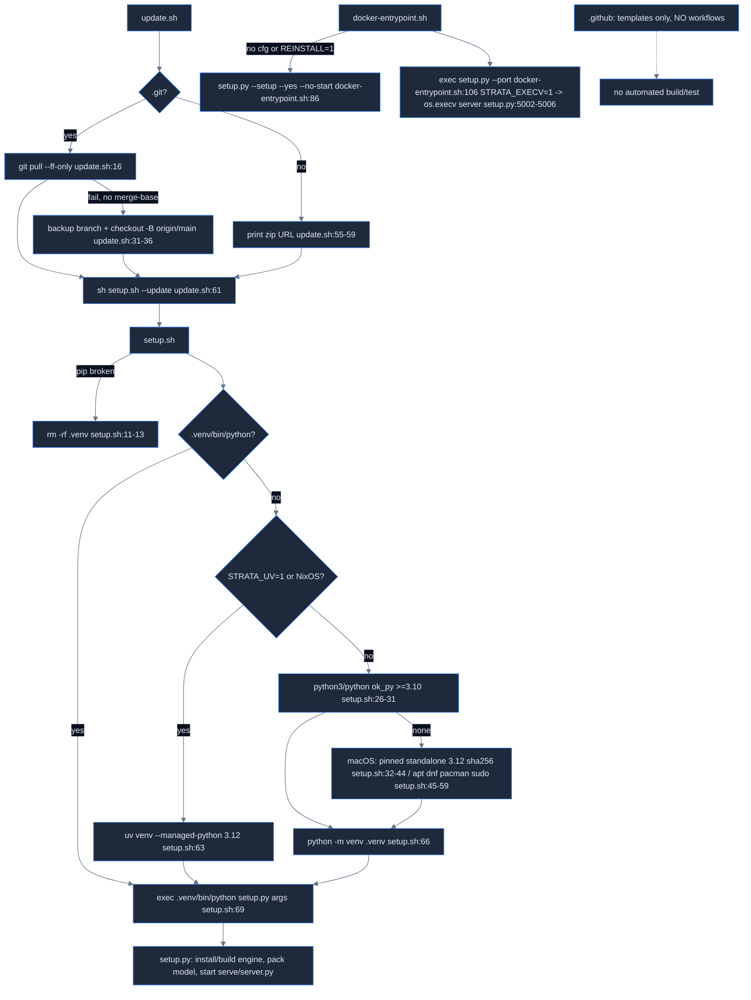

# Strata map: `.github` and repo-root files

Source: Strata commit `296b59d2`. Paths are relative to the Strata repo root. Complements build-system.md, which covers CMake, setup.py options and Docker/flake basics.

## 1. Headline findings

1. **There is no CI.** `.github/` has 6 files and no `workflows/` directory. Nothing builds/tests CUDA, HIP or SYCL upstream automatically; no AMD/HIP job exists. Contributors must "Build every backend a file touches (CUDA, HIP, SYCL) before asking for review" by hand (AGENTS.md:31).
2. Upstream AGENTS.md (36 lines) is a contributor/agent rulebook: opt-in features, default path byte-identical to last release, change defaults only with measurements (AGENTS.md:28-32).
3. Docker image and flake.nix are **CUDA-only** (Dockerfile:42 `nvidia/cuda:13.0.0-devel-ubuntu24.04`, Dockerfile:82 `-DSTRATA_ENABLE_CUDA=ON`; flake.nix:15, flake.nix:19 `cudaSupport`, `cudaPackages_13_0`). No ROCm container/shell.
4. The gfx1201 (RDNA4) path is setup.sh → setup.py, which pulls ROCm from TheRock nightly wheels `gfx120X-all` pinned `7.10.0a20251120` (setup.py:2076, setup.py:2086) unless a system ROCm ≥7.0 with hipcc+hipBLAS exists (setup.py:2070, setup.py:2092).
5. update.sh/UPDATE.bat handle the **2026-10-06 history rewrite**: on failed ff-pull with no merge-base they make a `pre-cleanup-backup` branch and `checkout -B <branch> origin/main` (update.sh:17-36). With local changes to tracked files it refuses and changes nothing (update.sh:23-29).

## 2. File table

| Path | Lines | Purpose |
|---|---|---|
| .github/FUNDING.yml | 1 | buy_me_a_coffee: strataengine (.github/FUNDING.yml:1) |
| .github/pull_request_template.md | 12 | Title/Issue, Summary, What changed, Extra Notes (.github/pull_request_template.md:1-12) |
| .github/ISSUE_TEMPLATE/bug_report.yml | 37 | label bug; required "What happened" + "version, GPU, OS"; optional engine log `strata-<model>.log` (.github/ISSUE_TEMPLATE/bug_report.yml:4, .github/ISSUE_TEMPLATE/bug_report.yml:11-32) |
| .github/ISSUE_TEMPLATE/config.yml | 5 | blank issues allowed; link to docs/DETAILS.md#troubleshooting (.github/ISSUE_TEMPLATE/config.yml:1-5) |
| .github/ISSUE_TEMPLATE/feature_request.yml | 18 | label enhancement (.github/ISSUE_TEMPLATE/feature_request.yml:4) |
| .github/ISSUE_TEMPLATE/question.yml | 22 | label question; optional benchmark numbers (.github/ISSUE_TEMPLATE/question.yml:4, .github/ISSUE_TEMPLATE/question.yml:16-22) |
| AGENTS.md | 36 | upstream rules for agents/contributors |
| BENCH.bat / bench.sh | 16 / 10 | wrappers → `.venv` python `tools/strata_bench.py` (BENCH.bat:13, bench.sh:7) |
| chat.py | 116 | stdlib terminal chat client for /v1/chat/completions streaming |
| docker-entrypoint.sh | 106 | env → `setup.py --setup --yes … --no-start` (docker-entrypoint.sh:76-86), then `setup.py --port` (docker-entrypoint.sh:102-106) |
| Dockerfile | 119 | CUDA 13.0 image, builds engine+vision at build time |
| flake.nix / flake.lock | 49 / 27 | NixOS CUDA 13.0 devShell; nixpkgs rev 6510408d (flake.lock:9) |
| setup.sh | 69 | Linux bootstrap: find/install Python ≥3.10, make .venv, exec setup.py |
| START-HERE.bat / SETUP.bat | 52 / 3 | Windows bootstrap (winget/python.org); SETUP.bat = START-HERE --setup |
| update.sh / UPDATE.bat | 63 / 81 | git pull --ff-only (+history-rewrite migration) → setup --update |
| requirements.txt | 23 | pinned pip deps |
| SECURITY.md | 44 | private reporting + what the server exposes |
| README.{de,es,fr,ja,pt-BR,zh-CN}.md | 239/233/238/229/234/217 vs 243 | translations |

## 3. Flow

## 4. How it works

### Upstream AGENTS.md (full summary)

- Scope: Strata runs Qwen3.8-Flash-Next MoE (+ Coder, Swift 1.5, Unsloth variants) on one NVIDIA or AMD GPU + system RAM, Windows/Linux; engine `src/`,`include/`; Python server OpenAI+Anthropic API + web app `serve/`; installer `setup.py` via START-HERE.bat/setup.sh (AGENTS.md:3-6).
- Installing for a user: follow docs/AI_SETUP.md (check PC, pick model by RAM, non-interactive setup, start+verify, connect apps). **Never expose beyond 127.0.0.1 without `--api-key`**. MCP server (docs/MCP_SERVER.md) offers same steps as tools (AGENTS.md:10-13).
- Working on code: docs/DETAILS.md + paper (docs/paper/Strata-Paper.pdf) (AGENTS.md:17-18); AMD HIP build/validation docs/AMD_HIP.md, multi-GPU docs/MULTI_GPU.md (AGENTS.md:19); setup tests run without GPU/downloads: `python tools/test_setup_<name>.py` e.g. tools/test_setup_amd.py, tools/test_setup_choices.py (AGENTS.md:20-21); doc style: plain words, measured numbers with hardware, no claims without measurement (AGENTS.md:22-23).
- Contributing: search issues/PRs first (AGENTS.md:27); use the fitting issue form (AGENTS.md:28); one change per PR, say what it changes and leaves alone (AGENTS.md:29); new features opt-in, default path byte-identical to last release, say how checked (AGENTS.md:30); build every backend touched (CUDA, HIP, SYCL) (AGENTS.md:31); change a default only where measured faster, show numbers (AGENTS.md:32); outside-hardware reports welcome per docs/COMMUNITY_BENCHMARKS.md, compare with same-day run, state untested parts (AGENTS.md:33-35); open test requests in docs/TEST_REQUESTS.md (AGENTS.md:36).

### .github

Templates only. PR template has 4 sections (.github/pull_request_template.md:1-12). Bug form asks version from About tab or `GET /v1/status` → `engine` (.github/ISSUE_TEMPLATE/bug_report.yml:22), placeholder "0.1.31 · RTX 5070 12GB · Windows 11" (.github/ISSUE_TEMPLATE/bug_report.yml:23). Repo slug Niko1221/Strata (.github/ISSUE_TEMPLATE/bug_report.yml:10).

### setup.sh (Linux)

`ok_py` requires `venv` + `ensurepip` + ≥3.10 (setup.sh:9). Broken half-made .venv is deleted (setup.sh:11-13). uv only on NixOS or `STRATA_UV=1` (setup.sh:18) — default stays a standard venv (setup.sh:16). Package install branches for apt/dnf/pacman (setup.sh:47-52) — the pacman path uses `sudo pacman -S --noconfirm python python-pip` (setup.sh:52). Ends `exec .venv/bin/python setup.py "$@"` (setup.sh:69).

### update.sh / UPDATE.bat

Whole body in `main()` so git pull rewriting the script is safe (update.sh:7-8; UPDATE.bat:9 same idea with a paren block). Shallow clones skip migration (update.sh:19). Dirty tracked files → refuses, prints manual steps (update.sh:23-29). Non-git copy → prints zip URL, still runs checks (update.sh:55-59). Finally `sh ./setup.sh --update` (update.sh:61); setup.py `--update` = update engine, packages, model settings without starting (setup.py:5772-5774).

### START-HERE.bat

Finds Python via `py -3`, `python`, then %LOCALAPPDATA% Python313..310 (START-HERE.bat:44-52), 64-bit check `sys.maxsize > 2**32` (START-HERE.bat:47); installs via winget Python.Python.3.12 user scope (START-HERE.bat:15) or python.org 3.12.10 (START-HERE.bat:20-21).

### chat.py

POST `http://{host}:{port}/v1/chat/completions` (chat.py:44) body model "strata", stream, max_tokens, `reasoning_effort` (chat.py:23-24); parses SSE `data:` deltas `reasoning_content`/`content` (chat.py:29-32); reasoning in gray (chat.py:45, chat.py:93-95). Commands /image /think /reset /quit (chat.py:56-79). Images as base64 data URL (chat.py:75-77). Timeout 3600 s (chat.py:26).

### Docker

- Build args `CUDA_ARCHITECTURES=75;80;86;89;120`, `BUILD_VISION=1` (Dockerfile:59-60).
- Inline python imports setup and calls `get_llama_cpp`, `find_nvcc`, `cmake_build` (Dockerfile:72-88), writes `engine/BUILD.json` {source local, version, archs, vision, cuda_dirs, src hash} so first start reuses the engine (Dockerfile:98-103).
- Deletes build trees (Dockerfile:107).
- Healthcheck `/health` start-period 600 s (Dockerfile:116-117).
- Entry: AVX2 warning only (docker-entrypoint.sh:12-17); config tag `<family>-<lowercase MODEL>`, with an empty prefix for qwen (docker-entrypoint.sh:41-43); config precedence CONFIG > existing link into /data/config > MODEL cfg (docker-entrypoint.sh:55-94); LOW_RAM always passed because /proc/meminfo shows host RAM (docker-entrypoint.sh:51-53).

### requirements.txt

Pinned (requirements.txt:1): numpy 2.5.3/2.4.6/2.2.6 by Python version (requirements.txt:4-6), jinja2 3.1.6, regex 2026.9.10, pyyaml 6.0.3, tqdm 4.70.1, requests 2.34.2, **cmake 4.4.3, ninja 1.13.2** (requirements.txt:12-13), pillow 12.3.0, psutil 7.2.2; colorama win32 only (requirements.txt:23). Read by setup.py (setup.py:200, setup.py:2014).

### SECURITY.md

- Private reports via GitHub advisories (SECURITY.md:5-9); only latest release supported (SECURITY.md:15).
- Default listen 127.0.0.1, `--host 0.0.0.0` warns without key (SECURITY.md:23-24).
- `api_key` / `STRATA_API_KEY` gates /v1/* and state endpoints and every POST, constant-time compare (SECURITY.md:25-28).
- Host check vs DNS rebinding and Origin check since 0.1.38 (SECURITY.md:29-37); `allowed_hosts`, `trusted_origins`, `cors_origins` (SECURITY.md:31-38); MCP tools opt-in (SECURITY.md:39-40); `api_monitor` off by default (SECURITY.md:41-42); no outside audit (SECURITY.md:44).

### README translations

All 7 share the same language switcher (README.md:3 and line 3 of each translation) and 12 headings (12 `#` headings each); they are straight translations of README.md with slightly shifted line numbers (e.g. "How fast is it?" README.md:16 = README.de.md:16; "Which model" README.md:121 vs README.de.md:117). Lengths 217-243 lines; zh-CN shortest. Code blocks, tables, links and images are identical in all 7; table numbers match (es/fr/pt-BR only add locale punctuation).

## 5. Env vars & flags (beyond build-system.md)

| name | default | file:line |
|---|---|---|
| STRATA_UV | unset (uv only on NixOS) | setup.sh:18 |
| STRATA_EXECV | 1 in Docker; unset elsewhere | Dockerfile:47, setup.py:5002 |
| STRATA_CPUINFO | /proc/cpuinfo | docker-entrypoint.sh:12 |
| STRATA_DATA, FAMILY, MODEL, CONTEXT, VISION, HOST, PORT, API_KEY | /data, qwen, IQ2_XS, 32768, no, 0.0.0.0, 8080, "" | docker-entrypoint.sh:19-26 |
| KV, GPUS, GPU, LAYER_SPLIT, GGUF_DIR, RESIDENT_BUDGET_GIB, KV_STREAMING, CONFIG | empty (setup defaults) | docker-entrypoint.sh:27-35 |
| LOW_RAM | auto | docker-entrypoint.sh:31 |
| REINSTALL | 0 | docker-entrypoint.sh:61, docker-entrypoint.sh:70 |
| STRATA_ROCM_VERSION | unset → 7.10.0a20251120 | setup.py:2085-2090 |
| STRATA_EXPERIMENTAL_GFX1103 | unset | setup.py:2095 |
| STRATA_API_KEY | unset | SECURITY.md:25 |
| CUDA_HOME/CUDA_PATH/CUDAHOSTCXX/LD_LIBRARY_PATH | set by devShell | flake.nix:40-44 |
| chat.py --port/--host/--think/--no-think/--max-tokens | 8080/127.0.0.1/medium/off/4096 | chat.py:37-42 |
| bench --clients N / --long / --compare DIR | 0 / off / none (tools/strata_bench.py:928-932) | bench.sh:4 |
| setup.py --yes/--setup/--no-start/--update | off (store_true) | setup.py:5769-5774 |

## 6. Gotchas

- No CI: any "upstream tested" claim is manual only (no `.github/workflows`).
- setup.sh deletes `.venv` silently if pip missing (setup.sh:11-13)
- Flake comment: CUDA 13.2.0/13.2.1 miscompile for sm_120 (flake.nix:18).
- Docker AVX2 build; non-AVX2 hosts may stop with an illegal instruction (exit 132) (docker-entrypoint.sh:9-16).
- Docker RAM detection reads host /proc/meminfo, so caps need LOW_RAM=on (Dockerfile:31-33; docker-entrypoint.sh:50-53).
- MIN_ENGINE 0.1.44.1 changelog string mentions RDNA4 gfx1200/gfx1201 defaults in v0.1.43: route tail skip, measured PCIe share, 16K prompt chunks, fused IQ3 prompt experts (setup.py:196).

## 7. AMD RDNA4 (gfx1201, HIP) notes

- On Windows, setup.py maps RDNA4 cards (RX 9070 series, AI PRO R9700) to gfx1201 in win_amd_arch (setup.py:2609-2614): PCI device IDs 0x7550/0x7551 in _WIN_AMD_DID (setup.py:2540), name regex `\b9070\b|R9700` in _WIN_AMD_NAME (setup.py:2548), label (setup.py:2101), TheRock index gfx120X-all (setup.py:2076). No ready-made AMD Linux engine; compiled locally (setup.py:2069-2070).
- Docker/flake give nothing for HIP. AGENTS.md:19 points to docs/AMD_HIP.md for HIP validation.

## Quick index

| Area | Kind | Name | Where | Notes |
|---|---|---|---|---|
| ci | gotcha | no workflows | `.github/` | 6 template files, no .github/workflows; no automated build/test, no HIP job |
| ci | behavior | pr template | `.github/pull_request_template.md:1-12` | Title/Issue, Summary, What changed, Extra Notes |
| ci | behavior | bug form | `.github/ISSUE_TEMPLATE/bug_report.yml:11-32` | requires what happened + version/GPU/OS; optional strata-<model>.log |
| agents | behavior | opt-in features | `AGENTS.md:30` | new feature opt-in, default path byte-identical to last release |
| agents | behavior | build all backends | `AGENTS.md:31` | build CUDA, HIP, SYCL for any touched file before review |
| agents | behavior | measured defaults | `AGENTS.md:32` | change defaults only with measured speedup + hardware |
| agents | tool | setup tests | `AGENTS.md:20-21` | python tools/test_setup_<name>.py, no GPU needed |
| agents | gotcha | api key | `AGENTS.md:11-12` | never expose beyond 127.0.0.1 without --api-key |
| root | env | STRATA_UV | `setup.sh:18` | 1 = use uv venv (also auto on NixOS) |
| root | behavior | venv repair | `setup.sh:11-13` | rm -rf .venv if pip missing |
| root | behavior | pacman install | `setup.sh:51-52` | Arch python install via sudo pacman |
| root | behavior | exec setup | `setup.sh:69` | exec .venv/bin/python setup.py args |
| root | behavior | history rewrite | `update.sh:17-36` | no merge-base → backup branch + checkout -B origin/main |
| root | flag | --update | `setup.py:5772-5774` | update engine/packages/settings without start |
| root | tool | chat.py | `chat.py:22-32` | SSE client to /v1/chat/completions with reasoning_effort |
| root | flag | --think | `chat.py:39` | none/low/medium/high default medium |
| root | tool | bench | `bench.sh:7` | .venv python tools/strata_bench.py |
| root | env | STRATA_EXECV | `setup.py:5002-5006` | os.execv server (PID 1) instead of child |
| docker | const | CUDA_ARCHITECTURES | `Dockerfile:59` | 75;80;86;89;120 |
| docker | const | base image | `Dockerfile:42` | nvidia/cuda:13.0.0-devel-ubuntu24.04 |
| docker | behavior | BUILD.json | `Dockerfile:98-103` | engine metadata so setup reuses image engine |
| docker | env | MODEL | `docker-entrypoint.sh:21` | default IQ2_XS |
| docker | env | LOW_RAM | `docker-entrypoint.sh:31` | default auto, always passed |
| docker | gotcha | AVX2 | `docker-entrypoint.sh:12-17` | warn only; non-AVX2 may stop with exit 132 |
| nix | gotcha | CUDA 13.2 sm_120 | `flake.nix:18` | 13.2.0/13.2.1 miscompile sm_120; pinned 13.0 |
| nix | const | nixpkgs rev | `flake.lock:9` | 6510408d147d8c5e6d76043e899e9251756f6a75 |
| deps | const | cmake/ninja pins | `requirements.txt:12-13` | cmake 4.4.3, ninja 1.13.2 |
| sec | env | STRATA_API_KEY | `SECURITY.md:25` | gates /v1/\* state endpoints and POST |
| sec | behavior | host/origin check | `SECURITY.md:29-37` | since 0.1.38 without api key |
| amd | const | ROCM gfx1201 index | `setup.py:2076` | rocm.nightlies.amd.com/v2/gfx120X-all/ |
| amd | const | ROCM_VERSION_DEFAULT | `setup.py:2086` | 7.10.0a20251120 |
| amd | env | STRATA_ROCM_VERSION | `setup.py:2090` | force exact ROCm wheel version |
| amd | const | ROCM_SYSTEM_MIN | `setup.py:2092` | system ROCm <7.0 ignored |
| amd | const | gfx1201 pci ids | `setup.py:2540` | 0x7550/0x7551 → gfx1201 |
| amd | behavior | RDNA4 defaults | `setup.py:196` | v0.1.43 gfx1200/1201: route tail skip, PCIe share, 16K chunks, fused IQ3 |
