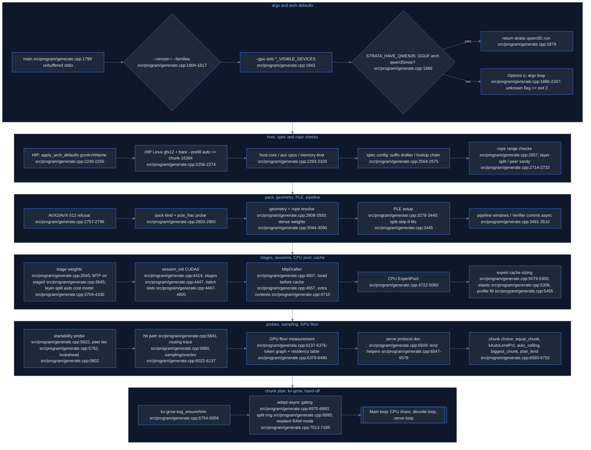
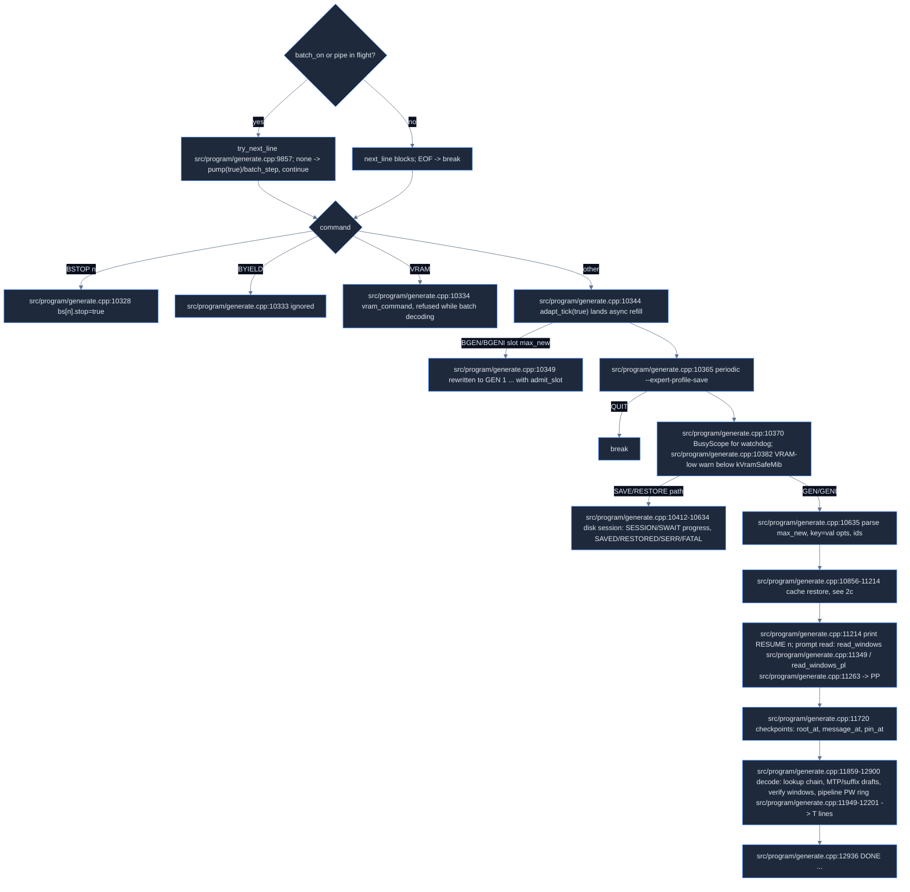
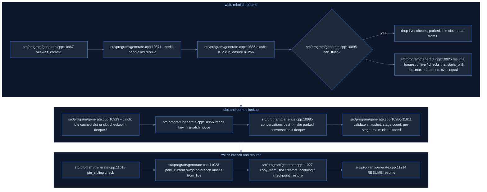

# Strata map: `src/program/generate.cpp` (generate and serve)

Source: Strata commit `296b59d2`. Paths are relative to the Strata repo root. `src/program/generate.cpp` is 14,182 lines; one `main()` runs from line 1799 to the end.

## Part 1: startup (lines 1-7185)

### 1. Overview

- Everything in src/program/generate.cpp:1-1798 is file-scope helpers and the `Options` struct.
- `main` starts at **src/program/generate.cpp:1799** and is one huge function that runs well past line 7185.
- In this part, `main` is a straight-line **startup pipeline**: version/family probe, then argv parse, then arch defaults (HIP/gfx12), then CPU/ISA checks, then model and geometry/rope resolution, then dense weights and PLE, then layer-split planning, then sessions (K/V), then the MTP drafter and head, then the CPU expert pool, then expert-cache sizing and fill, then the hit path, routing trace and token graph, then the serve-protocol doc block, then **prompt chunk selection (`plan_lend`)**, then elastic K/V (`--kv-grow`), then resident RAM mode.
- Neither the token-by-token generate loop nor the serve loop is in this range; both begin after line 7185 (Part 2 below).
- Spec decoding is *configured* here (`--spec`, suffix drafter, lookup chain, MTP drafter, Verifier commit mode) and *run* in Part 2 and in src/core/verify.cpp (engine-core.md).

### 2. Control flow (main, src/program/generate.cpp:1799-7185)

### 3. Functions / blocks

| behavior | file:line | how it works |
|---|---|---|
| WDDM detection / VRAM note | src/program/generate.cpp:144; src/program/generate.cpp:154 | `under_wddm`, `vram_free_note` strings for logs |
| pin adaptive blobs | src/program/generate.cpp:177 `pin_blobs_on`; src/program/generate.cpp:190 `adapt_copy_h2d`; src/program/generate.cpp:209, src/program/generate.cpp:235 pin/unpin | host-register expert blobs for async H2D. On HIP, `STRATA_HIP_ADAPT_KERNEL_COPY` (src/program/generate.cpp:193) picks a kernel copy instead of a ROCclr staged copy |
| rss probe / refill mode | src/program/generate.cpp:242; src/program/generate.cpp:256 | `STRATA_RSS_TRACE`, `STRATA_REFILL_BLOCKING` |
| resident swap staging | src/program/generate.cpp:283 `SwapHome`; src/program/generate.cpp:289 `resident_stage_swaps` | layer split + resident RAM: copies an evicted expert back from the owning card |
| Options | src/program/generate.cpp:337-698 | every CLI default (see §5) |
| usage text | src/program/generate.cpp:699 | `--help` |
| spec helper | src/program/generate.cpp:949 `chain_tail` | tail from SuffixDrafter for the lookup chain |
| extra sources | src/program/generate.cpp:958, src/program/generate.cpp:961 | reset/append tokens for the suffix drafter corpus |
| list parse | src/program/generate.cpp:965 `parse_i64_list` | comma lists (eos ids, layer split etc.) |
| CPU pool drivers | src/program/generate.cpp:986 Drive; src/program/generate.cpp:997 `drive_pool`; src/program/generate.cpp:1027 `drive_pool_multi`; src/program/generate.cpp:1052 SplitDrive; src/program/generate.cpp:1062 `drive_pool_split`; src/program/generate.cpp:1078 GpuStage | callbacks the session/verify use to run the CPU expert pool for one token / T tokens / GPU+CPU split |
| memory sampling | src/program/generate.cpp:1102; src/program/generate.cpp:1108 MemSample; src/program/generate.cpp:1111; src/program/generate.cpp:1155 `file_tier_activity` | RAM/avail/major-fault notes |
| disk diagnostics | src/program/generate.cpp:1203 `on_rotational_disk`; src/program/generate.cpp:1223 | warns about HDD-backed models |
| pipeline diag | src/program/generate.cpp:1251 PlDiag; src/program/generate.cpp:1257 | `STRATA_PIPELINE_DEBUG` (src/program/generate.cpp:267) |
| launch blocking / stall report | src/program/generate.cpp:1278; src/program/generate.cpp:1297; src/program/generate.cpp:1355 `mem_mark` (STRATA_TRACE) | debug |
| adapt knobs | src/program/generate.cpp:1374 nowait; src/program/generate.cpp:1384 lag; src/program/generate.cpp:1395 overlap | env readers (see moe-experts.md) |
| JobThread | src/program/generate.cpp:1410 | worker thread for async adaptive tier (`STRATA_ADAPT_JOB_CPU` src/program/generate.cpp:1461) |
| conversation checkpoint | src/program/generate.cpp:1502 fnv1a; src/program/generate.cpp:1510; src/program/generate.cpp:1520 save; src/program/generate.cpp:1528 restore | hash + copy of GDN/QSA state for prefix reuse |
| control vectors | src/program/generate.cpp:1539 `load_control_vectors` | `--control-vector*` |
| PCIe | src/program/generate.cpp:1623 `pcie_auto_split_ok`; src/program/generate.cpp:1662 `probe_pcie_h2d_gbps`; src/program/generate.cpp:1725 `pcie_frac_for_gbps`; src/program/generate.cpp:1736 PcieAuto | 4x256 MiB pinned H2D probe. frac = base*min(1,gbps/20) (moe-experts.md) |
| PLE rate | src/program/generate.cpp:1778 `ple_direct_rows_per_s` | measures direct PLE row reads |
| **main** | src/program/generate.cpp:1799 | unbuffered stdout/stderr (src/program/generate.cpp:1800) |
| version / families | src/program/generate.cpp:1804-1817 | exit before any GPU work |
| arena mmap / module loading | src/program/generate.cpp:1821-1835 | `STRATA_ARENA_MMAP` (AMD ROCclr userptr issue); sets `CUDA_MODULE_LOADING` eager (src/program/generate.cpp:1832) |
| --gpu | src/program/generate.cpp:1843-1865 | sets the visible devices before the first CUDA call |
| family switch | src/program/generate.cpp:1866-1882 | reads GGUF arch of `--native`/`--model`; `qwen35moe` goes to `strata::qwen35::run` (separate engine; src/qwen35) |
| argv parse | src/program/generate.cpp:1886-2247 | if/else chain on `a == "--x"`; unknown flag prints usage and returns 2 (src/program/generate.cpp:2240-2245) |
| **HIP arch defaults** | src/program/generate.cpp:2248-2255 | `apply_arch_defaults(gcnArchName)` (src/core/arch_defaults.cpp; gpu-cpu-kernels.md §gfx12) |
| **gfx12 16K chunk** | src/program/generate.cpp:2256-2274 | HIP && !_WIN32 && bare `--prefill auto`: if `gfx_arch_is_gfx12`, prefill_auto_max = prefill_chunk = 16384 and `prefill_gfx12_16k` = true |
| gfx906 wave64 guard | src/program/generate.cpp:2276-2290 | refuses wave32 cards on a gfx906 build |
| host core / aux cpus / mem limit | src/program/generate.cpp:2293-2320 | `STRATA_HOST_CORE`, `STRATA_AUX_CPUS`, `STRATA_MEMORY_LIMIT_MIB` |
| layer split notes | src/program/generate.cpp:2346-2460 | `--layer-split`, `--split-device`, STRATA_SPLIT_OWN src/program/generate.cpp:2454 |
| KV rot | src/program/generate.cpp:2552-2557 | `STRATA_KV_ROT=1` INT8 K/V via Hadamard (opt-in) |
| **spec config** | src/program/generate.cpp:2564-2575 | suffix drafter on by default: if spec>=2, mtp_max_t = spec and spec = min(spec+2, 8). lookup chain: spec = max(spec, min(mtp_max_t+K, 8)). 8 = kVerifyMaxT |
| rope checks | src/program/generate.cpp:2657 | range-only validation of the rope flags |
| peer / graph-measure refusals | src/program/generate.cpp:2714; src/program/generate.cpp:2731 | incompatible flag combos refused early |
| ISA guard | src/program/generate.cpp:2757-2796 | needs AVX2. The canonical Q2_0 pack's CPU experts need AVX-512 VNNI+VBMI (src/program/generate.cpp:2757; src/program/generate.cpp:2898) |
| pack kind / pcie base | src/program/generate.cpp:2803-2900 | native pack needs --native and --spec. pcie_frac base 0.25 NVFP4, 0.55 native, 0.2 Q2_0 (src/program/generate.cpp:2861; moe-experts.md) |
| geometry + rope resolve | src/program/generate.cpp:2908-2930 | file metadata overrides the compiled shape; explicit flag > file keys > defaults |
| dense weights | src/program/generate.cpp:3044-3090 | native tensors are not also loaded canonical unless `--keep-canonical`; stage trim (`STRATA_STAGE_TRIM` src/program/generate.cpp:3074) |
| hyper-conn / vision / cvec / stream / dump arming | src/program/generate.cpp:3179; src/program/generate.cpp:3197; src/program/generate.cpp:3215; src/program/generate.cpp:3233; src/program/generate.cpp:3247 | before `session_capture` |
| PLE | src/program/generate.cpp:3278-3440 | PLE table I/O mode, probe (`STRATA_PLE_PROBE` src/program/generate.cpp:3313, `STRATA_PLE_AUTO_MMAP` src/program/generate.cpp:3324), SSD keepalive src/program/generate.cpp:3301 |
| split-skip-if-fits | src/program/generate.cpp:3445 | drop the split if CUDA0 holds everything |
| pipeline windows | src/program/generate.cpp:3491-3510 | `Verifier::set_commit_async(!multi_gpu)` src/program/generate.cpp:3491; `STRATA_PIPELINE_AUTO` |
| stage weights / MTP stage0 | src/program/generate.cpp:3545-3700 | `STRATA_MTP_STAGE0` src/program/generate.cpp:3651, `STRATA_PEER_HOT` src/program/generate.cpp:3673 |
| layer-split auto cost model | src/program/generate.cpp:3704-4330 | per-layer ms ~ 1/(SMs x clock), miss ~190 ms per routed-mass unit (`STRATA_SPLIT_MISS_MS`), scaled by link. Exhaustive up to 4 GPUs. `STRATA_LAYER_SPLIT_GATE` src/program/generate.cpp:4045 |
| sessions | src/program/generate.cpp:4384-4460 | `session_init(g, max_context, K, …)` src/program/generate.cpp:4414 (CUDA0); src/program/generate.cpp:4447 (stages); K/V grow (`STRATA_KV_GROW` src/program/generate.cpp:4394) |
| batch slots | src/program/generate.cpp:4467-4600 | `--batch`, `--batch-groups auto` (one per stage), `--batch-mtp` |
| MTP drafter + head | src/program/generate.cpp:4605-4720 | `MtpDrafter mtp` src/program/generate.cpp:4607; head allocated before cache and arena (src/program/generate.cpp:4657) |
| CPU ExpertPool | src/program/generate.cpp:4722-5060 | IO prefetch/threads, pin-by-need, unbuffered load; `ExpertPool pool(...)` src/program/generate.cpp:5050 |
| expert cache sizing | src/program/generate.cpp:5079-5300 | owned prompt buffers (`STRATA_OWNED_PRICE` src/program/generate.cpp:5100). `--expert-cache auto` (moe-experts.md) |
| elastic VRAM | src/program/generate.cpp:5306 | `--vram-elastic` segments (refused on HIP; VMM absent on HIP) |
| profile fill | src/program/generate.cpp:5455-5620 | fill from `--expert-profile`; `STRATA_FILL_AHEAD` src/program/generate.cpp:5472 |
| startability probe | src/program/generate.cpp:5622-5760 | exact fit check on live free VRAM |
| peer tier / disjoint adapt / lookahead | src/program/generate.cpp:5762; src/program/generate.cpp:5783; src/program/generate.cpp:5802-5830 | second-GPU tier; RouterLookahead (`STRATA_LOOKAHEAD*`, `STRATA_IO_PREFETCH_DEPTH`) |
| hit path / routing trace | src/program/generate.cpp:5841; src/program/generate.cpp:5890 | requirements for `hits_ready()`; `--dump-routing` |
| `--no-capture` vs experts | src/program/generate.cpp:5977 | mutually exclusive |
| sampling / logits dump | src/program/generate.cpp:6022-6099 | `sample_tokens` takes device pointers; R holds both input and output; oracle residual snapshot |
| one-token prefill / GPU floor | src/program/generate.cpp:6119; src/program/generate.cpp:6137-6376 | `--graph-only`, `--gpu-only-full` measurement modes (early `return 0` at src/program/generate.cpp:6294, src/program/generate.cpp:6324, src/program/generate.cpp:6376) |
| token graph / residency | src/program/generate.cpp:6379-6490 | token path allocates nothing; whole token as ONE graph (`TokenGraph` src/program/generate.cpp:6399) unless `--no-token-graph`; device-side hit decision from a profile-filled cache (src/program/generate.cpp:6404) |
| host-term notes / serve doc | src/program/generate.cpp:6493; src/program/generate.cpp:6509-6545 | the stdin protocol GEN/T/DONE/RESUME/PP/REUSED/ERR/STOP/QUIT (server.md) |
| lend helpers | src/program/generate.cpp:6547-6578 | slots<->bytes, `request_chunk` (rounds to 256) |
| equal_chunk | src/program/generate.cpp:6580-6597 | `STRATA_PREFILL_EQUAL=1`: equal chunks of ceil(tokens/n), rounded up to 256 |
| kAutoLendPct | src/program/generate.cpp:6598-6611 | 90 if pinned share >= 0.9, else 85; `STRATA_PREFILL_LEND_PCT` |
| auto_ceiling | src/program/generate.cpp:6612-6660 | max(8192, min(auto_max, max_context)); split caps gfx12 to 8192 unless `STRATA_SPLIT_CHUNK16K`; a RAM check drops 16384 to 8192 unless avail >= pin + extra + 6144 MiB (`STRATA_GFX12_CHUNK=1` forces) |
| biggest_chunk | src/program/generate.cpp:6668-6676 | bisection on the 256 grid (bytes_needed is monotone in T) |
| **plan_lend** | src/program/generate.cpp:6677-6752 | old_rule list {32768..256}, constraint k+128 <= slots and k*100 <= pct*slots. Auto (default since 0.1.39b): largest chunk that leaves the stream ring full (byte budget, kRingMin 16). Explicit N: halve until it fits |
| elastic K/V | src/program/generate.cpp:6754-6958 | `kvg_ensure`/trim; `STRATA_KV_GROW_STEP` src/program/generate.cpp:6776, `_FLOOR` src/program/generate.cpp:6778; trimmed slots go back to the cache and are refilled from the profile |
| adapt-async gating | src/program/generate.cpp:6970-6993 | lists why `--adapt-async 1` falls back to blocking |
| split ring | src/program/generate.cpp:6995 | `STRATA_SPLIT_RING` decides the ring before lend regions are sized |
| resident RAM mode | src/program/generate.cpp:7013-7185 | `pin_cache_complement`; soft fallback; a warning when chunk > 8192 lends more than RAM holds; `STRATA_PROMPT_DIRECT` src/program/generate.cpp:7177 |

### 4. Environment variables (startup part)

Meanings for the variables read in a block covered by section 3 are given there.

| Variable | First read |
|---|---|
| `STRATA_ADAPT_CALLBACK_WARMUP` | `src/program/generate.cpp:5039` |
| `STRATA_ADAPT_JOB_CPU` | `src/program/generate.cpp:1461` |
| `STRATA_ADAPT_LAG` | `src/program/generate.cpp:1385` |
| `STRATA_ADAPT_NOWAIT` | `src/program/generate.cpp:1375` |
| `STRATA_ADAPT_OVERLAP` | `src/program/generate.cpp:1397` |
| `STRATA_ARENA_MMAP` | `src/program/generate.cpp:179`; `src/program/generate.cpp:1826` |
| `STRATA_ARENA_RELEASE` | `src/program/generate.cpp:6441` |
| `STRATA_AUX_CPUS` | `src/program/generate.cpp:2303` |
| `STRATA_BATCH_MTP` | `src/program/generate.cpp:4491` |
| `STRATA_BATCH_MTP_SERIAL` | `src/program/generate.cpp:4488` |
| `STRATA_DISJOINT_ADAPT` | `src/program/generate.cpp:5786` |
| `STRATA_EARLY_REMOTE_CONTEXTS` | `src/program/generate.cpp:2837` |
| `STRATA_FETCH_THREADS` | `src/program/generate.cpp:4831` |
| `STRATA_FILL_AHEAD` | `src/program/generate.cpp:5472` |
| `STRATA_FS_AHEAD` | `src/program/generate.cpp:5809` |
| `STRATA_FS_SLOTS` | `src/program/generate.cpp:5808` |
| `STRATA_GFX12_CHUNK` | `src/program/generate.cpp:2262`; `src/program/generate.cpp:6636` |
| `STRATA_GFX12_DEFAULTS` | `src/program/generate.cpp:2263` |
| `STRATA_HIP_ADAPT_KERNEL_COPY` | `src/program/generate.cpp:193` |
| `STRATA_HIP_WMMA` | `src/program/generate.cpp:4755` |
| `STRATA_HOST_CORE` | `src/program/generate.cpp:2296` |
| `STRATA_IO_PF_STAGE` | `src/program/generate.cpp:4881` |
| `STRATA_IO_PF_THREADS` | `src/program/generate.cpp:4871` |
| `STRATA_IO_PREFETCH` | `src/program/generate.cpp:4870` |
| `STRATA_IO_PREFETCH_DEPTH` | `src/program/generate.cpp:5828` |
| `STRATA_IO_STATS` | `src/program/generate.cpp:4897` |
| `STRATA_KV_GROW` | `src/program/generate.cpp:4394` |
| `STRATA_KV_GROW_FLOOR` | `src/program/generate.cpp:6778` |
| `STRATA_KV_GROW_INIT` | `src/program/generate.cpp:4406` |
| `STRATA_KV_GROW_STEP` | `src/program/generate.cpp:6776` |
| `STRATA_KV_ROT` | `src/program/generate.cpp:2554` |
| `STRATA_LAYER_SPLIT_GATE` | `src/program/generate.cpp:4045` |
| `STRATA_LAYER_SPLIT_PROBE` | `src/program/generate.cpp:5628` |
| `STRATA_LOOKAHEAD` | `src/program/generate.cpp:5813` |
| `STRATA_LOOKAHEAD_K` | `src/program/generate.cpp:5824` |
| `STRATA_LOOKAHEAD_STATS` | `src/program/generate.cpp:5811` |
| `STRATA_MEMORY_LIMIT_MIB` | `src/program/generate.cpp:2314` |
| `STRATA_MTP_FULL_HEAD` | `src/program/generate.cpp:3502` |
| `STRATA_MTP_STAGE0` | `src/program/generate.cpp:3651` |
| `STRATA_NO_IQ128` | `src/program/generate.cpp:2904` |
| `STRATA_NO_IQ256` | `src/program/generate.cpp:2907` |
| `STRATA_OWNED_PRICE` | `src/program/generate.cpp:5100` |
| `STRATA_PCIE_AUTO_CANON` | `src/program/generate.cpp:2867` |
| `STRATA_PCIE_AUTO_SPLIT` | `src/program/generate.cpp:1624` |
| `STRATA_PCIE_FRAC_DEFAULT` | `src/program/generate.cpp:2863` |
| `STRATA_PEER_HOT` | `src/program/generate.cpp:3673` |
| `STRATA_PEER_HOT_AT` | `src/program/generate.cpp:3675` |
| `STRATA_PIN_BY_NEED` | `src/program/generate.cpp:4929` |
| `STRATA_PIN_BY_NEED_SKIP` | `src/program/generate.cpp:4940` |
| `STRATA_PIPELINE_ADAPT_ASYNC` | `src/program/generate.cpp:6980` |
| `STRATA_PIPELINE_AUTO` | `src/program/generate.cpp:3509` |
| `STRATA_PIPELINE_AUTO_MIN_STAGES` | `src/program/generate.cpp:3510` |
| `STRATA_PIPELINE_DEBUG` | `src/program/generate.cpp:267` |
| `STRATA_PLE_AUTO_MMAP` | `src/program/generate.cpp:3324` |
| `STRATA_PLE_PROBE` | `src/program/generate.cpp:3313` |
| `STRATA_PREFILL_AUTO_MAX` | `src/program/generate.cpp:2045` |
| `STRATA_PREFILL_EQUAL` | `src/program/generate.cpp:6587` |
| `STRATA_PREFILL_LEND_PCT` | `src/program/generate.cpp:3904`; `src/program/generate.cpp:5634`; `src/program/generate.cpp:6608` |
| `STRATA_PROMPT_DIRECT` | `src/program/generate.cpp:7177` |
| `STRATA_REFILL_BLOCKING` | `src/program/generate.cpp:257` |
| `STRATA_RESIDENT_HEADROOM_GIB` | `src/program/generate.cpp:2216` |
| `STRATA_RESIDENT_PIN` | `src/program/generate.cpp:2214` |
| `STRATA_RSS_TRACE` | `src/program/generate.cpp:243` |
| `STRATA_SPLIT_CHUNK16K` | `src/program/generate.cpp:6621` |
| `STRATA_SPLIT_COVER_B` | `src/program/generate.cpp:3882` |
| `STRATA_SPLIT_LINK_ABS` | `src/program/generate.cpp:3848` |
| `STRATA_SPLIT_MISS_MS` | `src/program/generate.cpp:3856` |
| `STRATA_SPLIT_NEAR_TIE_PCT` | `src/program/generate.cpp:4302` |
| `STRATA_SPLIT_OWN` | `src/program/generate.cpp:2454` |
| `STRATA_SPLIT_OWN_BUFFERS` | `src/program/generate.cpp:7048` |
| `STRATA_SPLIT_OWN_PLACE` | `src/program/generate.cpp:3798` |
| `STRATA_SPLIT_RING` | `src/program/generate.cpp:7006` |
| `STRATA_SSD_KEEPALIVE` | `src/program/generate.cpp:3301` |
| `STRATA_SSD_KEEPALIVE_WINDOW` | `src/program/generate.cpp:3302` |
| `STRATA_STAGE_TRIM` | `src/program/generate.cpp:3074` |
| `STRATA_TEST_CACHE_FAIL` | `src/program/generate.cpp:5367` |
| `STRATA_TEST_PINNED_SHARE` | `src/program/generate.cpp:6544` |
| `STRATA_TRACE` | `src/program/generate.cpp:1356` |
| `STRATA_UNBUFFERED_LOAD` | `src/program/generate.cpp:4850` |
| `STRATA_VERIFY_COMPLEMENT` | `src/program/generate.cpp:5517` |
| `CUDA_LAUNCH_BLOCKING` | `src/program/generate.cpp:1282` |
| `CUDA_MODULE_LOADING` | `src/program/generate.cpp:1832` |

Named only in comments in lines 1-7185 (read later in `main` or in other files): `STRATA_RING_BYTES`, `STRATA_PREFILL_RING`, `STRATA_SPLIT_SMALL_OWN`, `STRATA_ISA_FLOOR` (build).

### 5. CLI flags

Parse line in the argv loop of `main`; defaults come from `Options`.

| Group | Flag | Parsed at | Default |
|---|---|---|---|
| general | `--version` / `-V` | `src/program/generate.cpp:1806` | none (prints the version and exits) |
| general | `--families` | `src/program/generate.cpp:1811` | none (prints the families and exits) |
| general | `--gpu` | `src/program/generate.cpp:1847` | unset (the caller's visible GPUs) |
| general | `--native` / `--model` | `src/program/generate.cpp:1871` | unset |
| general | `--help` | `src/program/generate.cpp:1893` | none (prints usage and exits) |
| general | `--pack` | `src/program/generate.cpp:1895` | `pack/full`, `src/program/generate.cpp:338` |
| general | `--tokens` | `src/program/generate.cpp:1896` | unset, `src/program/generate.cpp:339` |
| general | `--tokens-file` | `src/program/generate.cpp:1902` | unset, `src/program/generate.cpp:339` |
| general | `--max-new` | `src/program/generate.cpp:1914` | 16, `src/program/generate.cpp:340` |
| general | `--max-context` | `src/program/generate.cpp:1915` | 4096, `src/program/generate.cpp:341` |
| rope | `--rope-scaling` | `src/program/generate.cpp:1916` | unset, `src/program/generate.cpp:374` |
| rope | `--rope-scale` | `src/program/generate.cpp:1917` | 0, `src/program/generate.cpp:375` |
| rope | `--rope-freq-base` | `src/program/generate.cpp:1918` | 0, `src/program/generate.cpp:376` |
| rope | `--rope-freq-scale` | `src/program/generate.cpp:1919` | 0, `src/program/generate.cpp:377` |
| rope | `--yarn-orig-ctx` | `src/program/generate.cpp:1920` | 0, `src/program/generate.cpp:378` |
| rope | `--yarn-ext-factor` | `src/program/generate.cpp:1921` | -1 |
| rope | `--yarn-attn-factor` | `src/program/generate.cpp:1922` | 1 |
| rope | `--yarn-beta-fast` | `src/program/generate.cpp:1923` | 32 |
| rope | `--yarn-beta-slow` | `src/program/generate.cpp:1924` | 1 |
| sampling | `--greedy` | `src/program/generate.cpp:1925` | true |
| sampling | `--seed` | `src/program/generate.cpp:1926` | 0, `src/program/generate.cpp:343` |
| sampling | `--top-k` | `src/program/generate.cpp:1927` | 20 |
| sampling | `--top-p` | `src/program/generate.cpp:1928` | 0.95 |
| sampling | `--temperature` | `src/program/generate.cpp:1929` | 1.0 |
| dumps | `--dump-logits` | `src/program/generate.cpp:1930` | unset, `src/program/generate.cpp:347` |
| dumps | `--logits-stride` | `src/program/generate.cpp:1931` | 1, `src/program/generate.cpp:348` |
| dumps | `--dump-residual` | `src/program/generate.cpp:1938` | unset, `src/program/generate.cpp:408` |
| dumps | `--dump-mixed` | `src/program/generate.cpp:1939` | unset, `src/program/generate.cpp:411` |
| dumps | `--dump-layers` | `src/program/generate.cpp:1940` | unset, `src/program/generate.cpp:416` |
| dumps | `--dump-halves` | `src/program/generate.cpp:1941` | unset, `src/program/generate.cpp:420` |
| dumps | `--dump-routing` | `src/program/generate.cpp:1942` | unset, `src/program/generate.cpp:425` |
| dumps | `--dump-final-r` | `src/program/generate.cpp:2073` | unset, `src/program/generate.cpp:557` |
| PLE | `--ple-gguf` | `src/program/generate.cpp:1943` | unset, `src/program/generate.cpp:355` |
| PLE | `--no-ple` | `src/program/generate.cpp:1944` | off, `src/program/generate.cpp:356` |
| PLE | `--ple-io` | `src/program/generate.cpp:1945` | `direct`, `src/program/generate.cpp:399` |
| PLE | `--ple-row-cache` | `src/program/generate.cpp:1946` | 1<<20 |
| PLE | `--ple-inflight` | `src/program/generate.cpp:1947` | 256 |
| PLE | `--ple-delay-us` | `src/program/generate.cpp:1948` | 0, `src/program/generate.cpp:403` |
| PLE | `--ple-sync-submit` | `src/program/generate.cpp:1949` | off, `src/program/generate.cpp:404` |
| PLE | `--no-ple-prefetch` | `src/program/generate.cpp:2018` | off, `src/program/generate.cpp:496` |
| KV | `--kv` | `src/program/generate.cpp:1950` | `fp16`, `src/program/generate.cpp:405` |
| KV | `--kv-resident` | `src/program/generate.cpp:1951` | 0, `src/program/generate.cpp:406` |
| KV | `--kv-grow` | `src/program/generate.cpp:1952` | off, `src/program/generate.cpp:407` |
| KV | `--no-kv-grow` | `src/program/generate.cpp:1953` | off, `src/program/generate.cpp:407` |
| A/B native pins | `--stream-token` | `src/program/generate.cpp:1954` | off, `src/program/generate.cpp:357` |
| A/B native pins | `--check-logits` | `src/program/generate.cpp:1955` | off, `src/program/generate.cpp:358` |
| A/B native pins | `--gr-fp32-activations` | `src/program/generate.cpp:1956` | off, `src/program/generate.cpp:359` |
| A/B native pins | `--gr-native-mmvf` | `src/program/generate.cpp:1957` | off, `src/program/generate.cpp:360` |
| A/B native pins | `--native-bf16` | `src/program/generate.cpp:1958` | off, `src/program/generate.cpp:361` |
| A/B native pins | `--native-bf16-extra` | `src/program/generate.cpp:1959` | off, `src/program/generate.cpp:362` |
| A/B native pins | `--native-ple-key` | `src/program/generate.cpp:1960` | off, `src/program/generate.cpp:363` |
| A/B native pins | `--native-moe-combine` | `src/program/generate.cpp:1961` | off, `src/program/generate.cpp:364` |
| A/B native pins | `--native-gdn` | `src/program/generate.cpp:1962` | off, `src/program/generate.cpp:365` |
| A/B native pins | `--native-flash-attn-short` | `src/program/generate.cpp:1963` | off, `src/program/generate.cpp:366` |
| A/B native pins | `--native-qsa-indexer` | `src/program/generate.cpp:1964` | off, `src/program/generate.cpp:367` |
| A/B native pins | `--native-qsa` | `src/program/generate.cpp:1965` | off, `src/program/generate.cpp:368` |
| A/B native pins | `--native-rope` | `src/program/generate.cpp:1966` | off, `src/program/generate.cpp:383` |
| A/B native pins | `--native-ple-postops` | `src/program/generate.cpp:1967` | off, `src/program/generate.cpp:384` |
| A/B native pins | `--native-router` | `src/program/generate.cpp:1968` | off, `src/program/generate.cpp:385` |
| A/B native pins | `--cpu-oracle-q8-0` | `src/program/generate.cpp:1969` | off, `src/program/generate.cpp:386` |
| A/B native pins | `--native-head-gguf` | `src/program/generate.cpp:1971` | unset, `src/program/generate.cpp:387` |
| A/B native pins | `--embd-gguf` | `src/program/generate.cpp:1972` | unset, `src/program/generate.cpp:397` |
| A/B native pins | `--native-dense-gguf` | `src/program/generate.cpp:1973` | unset, `src/program/generate.cpp:388` |
| execution | `--no-capture` | `src/program/generate.cpp:1974` | off, `src/program/generate.cpp:426` |
| execution | `--no-pool` | `src/program/generate.cpp:1975` | off, `src/program/generate.cpp:427` |
| execution | `--sync-every-layer` | `src/program/generate.cpp:1976` | off, `src/program/generate.cpp:428` |
| execution | `--stage-timing` | `src/program/generate.cpp:1977` | off, `src/program/generate.cpp:431` |
| execution | `--graph-only` | `src/program/generate.cpp:1978` | off, `src/program/generate.cpp:435` |
| execution | `--gpu-only-full` | `src/program/generate.cpp:1979` | off, `src/program/generate.cpp:436` |
| execution | `--pool-workers` | `src/program/generate.cpp:1980` | 0, `src/program/generate.cpp:437` |
| execution | `--pool-tasks` | `src/program/generate.cpp:1981` | 0 (automatic), `src/program/generate.cpp:438` |
| execution | `--host-core` | `src/program/generate.cpp:1991` | unset, `src/program/generate.cpp:442` |
| execution | `--aux-cpus` | `src/program/generate.cpp:1998` | unset, `src/program/generate.cpp:444` |
| execution | `--pool-affinity` | `src/program/generate.cpp:2007` | all, `src/program/generate.cpp:440` |
| execution | `--no-host-worker` | `src/program/generate.cpp:2017` | off, `src/program/generate.cpp:448` |
| execution | `--coupled-draft` / `--no-coupled-draft` | `src/program/generate.cpp:2019`; `src/program/generate.cpp:2020` | from the environment (`coupled_draft_env()`), `src/program/generate.cpp:449` |
| expert cache | `--expert-cache` | `src/program/generate.cpp:2025` | 0 |
| expert cache | `--expert-cache-device1..3` | `src/program/generate.cpp:2029` | 0 per device, `src/program/generate.cpp:473` |
| expert cache | `--remote-expert-opt` | `src/program/generate.cpp:2035` | off, `src/program/generate.cpp:475` |
| expert cache | `--expert-cache-remote-placement` | `src/program/generate.cpp:2036` | `stripe`, `src/program/generate.cpp:476` |
| expert cache | `--vram-reserve-mib` | `src/program/generate.cpp:2038` | 700 |
| expert cache | `--vram-reserve-later-mib` | `src/program/generate.cpp:2039` | -1, `src/program/generate.cpp:533` |
| expert cache | `--expert-cache-cpu-order` | `src/program/generate.cpp:2193` | off, `src/program/generate.cpp:477` |
| expert cache | `--expert-cache-per-layer` | `src/program/generate.cpp:2194` | off, `src/program/generate.cpp:483` |
| expert cache | `--expert-profile` | `src/program/generate.cpp:2201` | unset, `src/program/generate.cpp:501` |
| expert cache | `--expert-profile-save` | `src/program/generate.cpp:2202` | unset, `src/program/generate.cpp:505` |
| expert cache | `--expert-profile-save-every` | `src/program/generate.cpp:2203` | 10 (minutes), `src/program/generate.cpp:506` |
| expert cache | `--mmap-experts` | `src/program/generate.cpp:2206` | off, `src/program/generate.cpp:450` |
| expert cache | `--shared-expert-arena` | `src/program/generate.cpp:2207` | unset, `src/program/generate.cpp:451` |
| expert cache | `--resident-cpu-experts` | `src/program/generate.cpp:2208` | off, `src/program/generate.cpp:452` |
| expert cache | `--resident-experts` | `src/program/generate.cpp:2209` | off, `src/program/generate.cpp:450` |
| expert cache | `--resident-budget-gib` | `src/program/generate.cpp:2219` | 0 (no budget), `src/program/generate.cpp:463` |
| expert cache | `--no-hit-poke` | `src/program/generate.cpp:2200` | off, `src/program/generate.cpp:510` |
| prefill | `--prefill N\|auto[:max]` | `src/program/generate.cpp:2041` | auto_max 8192, `src/program/generate.cpp:541` |
| prefill | `--no-split-rows` | `src/program/generate.cpp:2068` | off, `src/program/generate.cpp:547` |
| prefill | `--no-prefill-borrow` | `src/program/generate.cpp:2069` | off, `src/program/generate.cpp:550` |
| prefill | `--prefill-until` | `src/program/generate.cpp:2072` | 0, `src/program/generate.cpp:554` |
| prefill | `--short-read` | `src/program/generate.cpp:2131` | 64, `src/program/generate.cpp:663` |
| prefill | `--prefill-head-alias` | `src/program/generate.cpp:2132` | off, `src/program/generate.cpp:664` |
| VRAM | `--vram-elastic` | `src/program/generate.cpp:2070` | off, `src/program/generate.cpp:529` |
| VRAM | `--vram-segment-mib` | `src/program/generate.cpp:2071` | 512 |
| spec | `--spec` | `src/program/generate.cpp:2074` | 0; Metal 2, `src/program/generate.cpp:562-564` |
| spec | `--spec-oracle` | `src/program/generate.cpp:2085` | unset, `src/program/generate.cpp:579` |
| spec | `--spec-corrupt` | `src/program/generate.cpp:2086` | 0, `src/program/generate.cpp:580` |
| spec | `--spec-follow` | `src/program/generate.cpp:2087` | unset, `src/program/generate.cpp:584` |
| spec | `--window-hashes` | `src/program/generate.cpp:2088` | unset, `src/program/generate.cpp:586` |
| spec | `--mtp` | `src/program/generate.cpp:2089` | unset, `src/program/generate.cpp:588` |
| spec | `--mtp-window` | `src/program/generate.cpp:2090` | 32768 |
| spec | `--spec-min-p` | `src/program/generate.cpp:2096` | 0.0, `src/program/generate.cpp:609` |
| spec | `--spec-split` | `src/program/generate.cpp:2098` | off, `src/program/generate.cpp:613` |
| spec | `--no-spec-split` | `src/program/generate.cpp:2186` | off, `src/program/generate.cpp:613` |
| spec | `--suffix-draft` | `src/program/generate.cpp:2134` | 3, `src/program/generate.cpp:675` |
| spec | `--mtp-max-t` | `src/program/generate.cpp:2135` | 0, `src/program/generate.cpp:677` |
| spec | `--lookup-chain` | `src/program/generate.cpp:2136` | 0, `src/program/generate.cpp:681` |
| spec | `--lookup-chain-min` | `src/program/generate.cpp:2137` | 3, `src/program/generate.cpp:682` |
| spec | `--mtp-hnorm` | `src/program/generate.cpp:2138` | pooled, `src/program/generate.cpp:685` |
| spec | `--mtp-q4` | `src/program/generate.cpp:2146` | off, `src/program/generate.cpp:687` |
| spec | `--mtp-draft-vocab` | `src/program/generate.cpp:2153` | unset, `src/program/generate.cpp:689` |
| spec | `--stop-eos` | `src/program/generate.cpp:2097` | off, `src/program/generate.cpp:611` |
| spec | `--eos-ids` | `src/program/generate.cpp:2187` | 248044, 248046, `src/program/generate.cpp:612` |
| batch | `--batch` | `src/program/generate.cpp:2075` | 0, `src/program/generate.cpp:569` |
| batch | `--slots` | `src/program/generate.cpp:2076` | 0, `src/program/generate.cpp:569` |
| batch | `--batch-groups` | `src/program/generate.cpp:2078` | 1, `src/program/generate.cpp:575` |
| batch | `--batch-mtp` | `src/program/generate.cpp:2084` | off, `src/program/generate.cpp:578` |
| multi-GPU | `--trim-stage-weights` | `src/program/generate.cpp:2077` | off, `src/program/generate.cpp:572` |
| multi-GPU | `--layer-split` | `src/program/generate.cpp:2099` | unset, `src/program/generate.cpp:616` |
| multi-GPU | `--split-device` | `src/program/generate.cpp:2100` | unset, `src/program/generate.cpp:619` |
| multi-GPU | `--split-skip-if-fits` | `src/program/generate.cpp:2101` | off, `src/program/generate.cpp:623` |
| multi-GPU | `--gpu-stages` | `src/program/generate.cpp:2205` | off, `src/program/generate.cpp:513` |
| multi-GPU | `--pipeline-windows` | `src/program/generate.cpp:2133` | -1, `src/program/generate.cpp:670` |
| multi-GPU | `--peer-device` | `src/program/generate.cpp:2195` | -1, `src/program/generate.cpp:487` |
| multi-GPU | `--peer-reserve-mib` | `src/program/generate.cpp:2196` | 600 |
| multi-GPU | `--peer-slots` | `src/program/generate.cpp:2197` | 0, `src/program/generate.cpp:489` |
| multi-GPU | `--peer-adapt-swaps` | `src/program/generate.cpp:2198` | -1, `src/program/generate.cpp:490` |
| multi-GPU | `--peer-prefill-rows` | `src/program/generate.cpp:2199` | -1, `src/program/generate.cpp:493` |
| PCIe/adapt | `--pcie-frac` | `src/program/generate.cpp:2091` | -1.0, `src/program/generate.cpp:592` |
| PCIe/adapt | `--pcie-mode` | `src/program/generate.cpp:2102` | `auto`, `src/program/generate.cpp:595` |
| PCIe/adapt | `--adapt-every` | `src/program/generate.cpp:2092` | 4 |
| PCIe/adapt | `--adapt-decay` | `src/program/generate.cpp:2093` | 0.7 |
| PCIe/adapt | `--adapt-min-gain` | `src/program/generate.cpp:2094` | 1.5 |
| PCIe/adapt | `--adapt-async` | `src/program/generate.cpp:2095` | 0 |
| PCIe/adapt | `--adapt-swaps` | `src/program/generate.cpp:2192` | 96 |
| serve | `--serve` | `src/program/generate.cpp:2103` | off, `src/program/generate.cpp:625` |
| serve | `--vision` | `src/program/generate.cpp:2104` | off, `src/program/generate.cpp:627` |
| serve | `--session-save-reclaim` | `src/program/generate.cpp:2105` | off, `src/program/generate.cpp:645` |
| serve | `--prompt-cache` | `src/program/generate.cpp:2106` | 6 |
| serve | `--conversation-cache-mib` / `-slots` | `src/program/generate.cpp:2107` | 0/4, `src/program/generate.cpp:633`; `src/program/generate.cpp:634` |
| serve | `--conversation-cache-min-free-mib` / `-min-tokens` | `src/program/generate.cpp:2108` | 2560/0, `src/program/generate.cpp:635`; `src/program/generate.cpp:639` |
| serve | `--session-min-free-mib` / `--memory-limit-mib` | `src/program/generate.cpp:2109` | 4096 / -1, `src/program/generate.cpp:644`; `src/program/generate.cpp:642` |
| serve | `--prompt-cache-tail` / `-every` / `-root` | `src/program/generate.cpp:2126-2128` | `-tail` off, `-every` 16384, `-root` 2048, `src/program/generate.cpp:647`; `src/program/generate.cpp:648`; `src/program/generate.cpp:651` |
| serve | `--turn-token` | `src/program/generate.cpp:2129` | 248045, `src/program/generate.cpp:654` |
| serve | `--tail-role-token` | `src/program/generate.cpp:2130` | -1, `src/program/generate.cpp:659` |
| control vectors | `--control-vector` | `src/program/generate.cpp:2154` | none, `src/program/generate.cpp:693` |
| control vectors | `--control-vector-scaled` | `src/program/generate.cpp:2155` | none, `src/program/generate.cpp:693` |
| control vectors | `--control-vector-layer-range` | `src/program/generate.cpp:2170` | -1 -1 (llama.cpp defaults), `src/program/generate.cpp:694` |
| control vectors | `--cvec-mode` | `src/program/generate.cpp:2174` | add, `src/program/generate.cpp:695` |
| control vectors | `--cvec-dir` | `src/program/generate.cpp:2180` | per-layer, `src/program/generate.cpp:696` |
| A/B off-switches | `--stats` | `src/program/generate.cpp:2230` | off, `src/program/generate.cpp:514` |
| A/B off-switches | `--shared-late` | `src/program/generate.cpp:2231` | off, `src/program/generate.cpp:515` |
| A/B off-switches | `--keep-canonical` | `src/program/generate.cpp:2232` | off, `src/program/generate.cpp:516` |
| A/B off-switches | `--no-token-graph` | `src/program/generate.cpp:2233` | off, `src/program/generate.cpp:517` |
| A/B off-switches | `--no-fused-gr` | `src/program/generate.cpp:2234` | off, `src/program/generate.cpp:518` |
| A/B off-switches | `--no-fast-attn` | `src/program/generate.cpp:2235` | off, `src/program/generate.cpp:519` |
| A/B off-switches | `--no-publish-kernel` | `src/program/generate.cpp:2236` | off, `src/program/generate.cpp:520` |
| A/B off-switches | `--no-fused-gdn` | `src/program/generate.cpp:2237` | off, `src/program/generate.cpp:521` |
| A/B off-switches | `--no-fast-select` | `src/program/generate.cpp:2238` | off, `src/program/generate.cpp:522` |

### 6. Hardcoded constants

| Constant | Value | Where |
|---|---|---|
| `kVerifyMaxT` | 8 | `src/program/generate.cpp:2569`; `src/program/generate.cpp:2574`; `strata::kernels::kVerifyMaxT` at `src/program/generate.cpp:4517` |
| Suffix drafter spec widening | +2 | `src/program/generate.cpp:2569` |
| Prefill auto ceiling | 8192 (gfx12: 16384) | `src/program/generate.cpp:2267-2268`; `src/program/generate.cpp:6616` |
| RAM margin | 6144 MiB | `src/program/generate.cpp:6650` |
| `kAutoLendPct` | 90 / 85 | `src/program/generate.cpp:6608-6610` |
| Slot reserve | +128 | `src/program/generate.cpp:6688`; `src/program/generate.cpp:6733`; `src/program/generate.cpp:6750` |
| Chunk grid | 256 tokens | `src/program/generate.cpp:6670` |
| `kAutoChunks` | 32768, 16384, 8192, 6144, 4096, 3072, 2048, 1024, 512, 256 | `src/program/generate.cpp:6682` |
| `kRingMin` | 16 | `src/program/generate.cpp:6707` |
| `vram_reserve` | 700 MiB | `src/program/generate.cpp:525` |
| `peer_reserve` | 600 MiB | `src/program/generate.cpp:488` |
| Adapt every / swaps / decay / min gain | 4 / 96 / 0.7 / 1.5 | `src/program/generate.cpp:598`; `src/program/generate.cpp:628`; `src/program/generate.cpp:599`; `src/program/generate.cpp:602` |
| `mtp_window` | 32768 | `src/program/generate.cpp:589` |
| `max_context` | 4096 | `src/program/generate.cpp:341` |
| `max_new` | 16 | `src/program/generate.cpp:340` |
| `top_k` / `top_p` | 20 / 0.95 | `src/program/generate.cpp:344-345` |
| PCIe probe | 4 × 256 MiB, knee 20 GB/s | `src/program/generate.cpp:1664`; `src/program/generate.cpp:1663`; `src/program/generate.cpp:1726` |
| Split miss cost | about 190 ms per unit | comment at `src/program/generate.cpp:3708` |
| Conversation minimum free | 2560 MiB | `src/program/generate.cpp:635` |

### 7. HIP / gfx12 (RDNA4) notes

- src/program/generate.cpp:2248-2255 `apply_arch_defaults` on HIP device 0, before any switch is read. On gfx12 this turns on the GDN prompt switches (gpu-cpu-kernels.md / engine-core.md src/core/arch_defaults.cpp:14-31).
- src/program/generate.cpp:2256-2274 the gfx12 16K prefill chunk applies only to a *bare* `--prefill auto` on Linux HIP. Opt out with STRATA_GFX12_CHUNK=0 or STRATA_GFX12_DEFAULTS=0.
- src/program/generate.cpp:6612-6660 the 16K default is undone (back to 8192) on a layer split unless STRATA_SPLIT_CHUNK16K=1, and when RAM is short (src/program/generate.cpp:6650). STRATA_GFX12_CHUNK=1 forces 16384.
- src/program/generate.cpp:6619 comment: on two 32 GB RDNA4 cards, 8192 chunks gave pp32k +14% over 16384 in a split.
- src/program/generate.cpp:193 STRATA_HIP_ADAPT_KERNEL_COPY. src/program/generate.cpp:1821-1828 ROCclr userptr pinning of pageable >=1 MiB sources caused RAM bloat, hence STRATA_ARENA_MMAP. src/program/generate.cpp:4755 STRATA_HIP_WMMA read here (startup hint only, src/program/generate.cpp:4752-4758; see gpu-cpu-kernels.md src/kernels/cuda/qsa_prompt_attn.cu:1406).
- src/program/generate.cpp:6409 HIP has no cudaStreamLegacy, so residency uploads sync on stream 0.
- src/program/generate.cpp:2276 gfx906 wave64 build guard; it is compiled only into a `STRATA_HIP_GFX906` build (src/program/generate.cpp:2275) and refuses any GPU whose warp size is not 64 (src/program/generate.cpp:2282-2286).
- No NVFP4-specific compute is in this range. NVFP4 appears only as pcie_frac base 0.25 (comment src/program/generate.cpp:2855).

### 8. Cross-links

engine-core.md (session_init, Verifier, MtpDrafter, arch_defaults, vmm/kv-grow) · prefill.md (Prefill::bytes_needed, ring, stream_all_min_tokens, borrow) · moe-experts.md (cache sizing src/program/generate.cpp:5079-5300, PcieAuto, adaptive tier, resident mode) · server.md (stdin protocol doc src/program/generate.cpp:6509) · model-spec-ngram-platform.md (spec Controller/DraftPolicy, qwen35 family) · gpu-cpu-kernels.md (gfx12 switches) · apple-metal-backend.md (spec=2 default on Metal) · Part 2 below (src/program/generate.cpp:7186 to the end).

---

## Part 2: generate and serve loops (7186 to end)

### 1. Overview

- **There is no function boundary at or after src/program/generate.cpp:7100.** `int main(int argc, char** argv)` starts at **src/program/generate.cpp:1799** and runs to **src/program/generate.cpp:14182**. Lines src/program/generate.cpp:7100-14182 continue the same main(). Its structure is a chain of large lambdas plus one big `if (o.serve) {.. return 0; }` block (**src/program/generate.cpp:7231-13148**).
- src/program/generate.cpp:7100-7230: end of expert-source setup (file tier, `STRATA_PROMPT_DIRECT` src/program/generate.cpp:7177, mapping drop src/program/generate.cpp:7190) and the CPU-share gate `share_default_ok` (src/program/generate.cpp:7204).
- src/program/generate.cpp:7231-13148: **`--serve` engine**. Startup checks, prompt-path sizing, verifier stages, conversation cache, adaptive expert tier, stdin reader thread, watchdog, batch slots and pipeline groups, the command loop, the per-request body (cache match, prompt read, decode/spec windows, DONE).
- src/program/generate.cpp:13150-13505: plain `generate` (no serve). Batched prefill then the token-by-token loop at src/program/generate.cpp:13284.
- src/program/generate.cpp:13506-13995: speculative decoding for plain generate.
- src/program/generate.cpp:13997-14182: dump files closed, `--stats` report (src/program/generate.cpp:14080), frees, `return 0`.

### 2. Control flow

#### 2a. main() after startup

```mermaid
---
config: {"theme":"base","themeVariables":{"darkMode":true,"background":"#0b1020","fontFamily":"Inter, 'Segoe UI', Roboto, 'Helvetica Neue', Arial, sans-serif","fontSize":"14px","primaryColor":"#1e293b","primaryTextColor":"#e2e8f0","primaryBorderColor":"#3b82f6","secondaryColor":"#1e293b","secondaryTextColor":"#e2e8f0","secondaryBorderColor":"#3b82f6","tertiaryColor":"#111827","tertiaryTextColor":"#e2e8f0","tertiaryBorderColor":"#334155","mainBkg":"#1e293b","nodeBorder":"#3b82f6","textColor":"#e2e8f0","titleColor":"#93c5fd","lineColor":"#64748b","clusterBkg":"#0f172a","clusterBorder":"#334155","edgeLabelBackground":"#0b1020","noteBkgColor":"#172554","noteTextColor":"#dbeafe","noteBorderColor":"#3b82f6","actorBkg":"#1e293b","actorTextColor":"#e2e8f0","actorBorder":"#3b82f6","actorLineColor":"#475569","signalColor":"#94a3b8","signalTextColor":"#e2e8f0","labelBoxBkgColor":"#1e293b","labelBoxBorderColor":"#3b82f6","labelTextColor":"#e2e8f0","loopTextColor":"#93c5fd","activationBkgColor":"#334155","activationBorderColor":"#3b82f6"},"flowchart":{"curve":"basis","nodeSpacing":34,"rankSpacing":40,"padding":12,"wrappingWidth":260,"htmlLabels":true},"sequence":{"actorFontFamily":"Inter, 'Segoe UI', Roboto, 'Helvetica Neue', Arial, sans-serif","messageFontFamily":"Inter, 'Segoe UI', Roboto, 'Helvetica Neue', Arial, sans-serif","noteFontFamily":"Inter, 'Segoe UI', Roboto, 'Helvetica Neue', Arial, sans-serif"},"fontFamily":"Inter, 'Segoe UI', Roboto, 'Helvetica Neue', Arial, sans-serif"}
---
flowchart TD
  subgraph R0["tail and one-shot generate"]
    direction LR
    A[src/program/generate.cpp:7100 expert source / file tier finish]
    B[src/program/generate.cpp:7204 share_default_ok]
    C{src/program/generate.cpp:7231 o.serve?}
    P5[src/program/generate.cpp:13150 batched prefill: Prefill::arm_cpu_share src/program/generate.cpp:13156, chunk loop src/program/generate.cpp:13166]
    TL[src/program/generate.cpp:13284 token loop pos_start..]
    P6{src/program/generate.cpp:13513 spec_pos>0?}
    SP[src/program/generate.cpp:13506-13995 speculative rounds: apply_pending src/program/generate.cpp:13588, adapt src/program/generate.cpp:13615]
    END[src/program/generate.cpp:13997 close dumps / src/program/generate.cpp:14080 --stats / frees / return 0]
    A --> B
    B --> C
    C -- no --> P5
    P5 --> TL
    TL --> P6
    P6 -- yes --> SP
    P6 -- no --> END
    SP --> END
  end
  subgraph R1["serve setup"]
    direction LR
    S1[src/program/generate.cpp:7232 check: needs --spec>=2 and --prefill, else return 2]
    S2[src/program/generate.cpp:7316-7790 cache_slots_for / fits / scan: prompt chunk size; init_prompt_paths src/program/generate.cpp:7589; kStepChunks src/program/generate.cpp:7615]
    S3[src/program/generate.cpp:7791 stage_ver/stage_ver_p, src/program/generate.cpp:8074 pl_prepare/pl_drain]
    S4[src/program/generate.cpp:8146 session_identity, src/program/generate.cpp:8217 park_current_body, src/program/generate.cpp:8438 checkpoint_at, src/program/generate.cpp:8508 sp.on_chunk -> PP lines]
    S1 --> S2
    S2 --> S3
    S3 --> S4
  end
  subgraph R2["serve threads and loop"]
    direction LR
    S5[src/program/generate.cpp:8618 ROUTE_TAIL_SKIP defaults, src/program/generate.cpp:8680 pcie_auto_step, src/program/generate.cpp:8833 adapt + a_* async tier src/program/generate.cpp:9089-9398]
    S6[src/program/generate.cpp:9451 stdin reader thread; src/program/generate.cpp:9492 next_line; src/program/generate.cpp:9617 watchdog thread]
    S7[src/program/generate.cpp:9714 vram_command, src/program/generate.cpp:9811-10313 batch: copy_to/from_slot, batch_step src/program/generate.cpp:9951, pump src/program/generate.cpp:10196, pipe_drain src/program/generate.cpp:10310]
    LOOP[src/program/generate.cpp:10315 serve command loop]
    Q[QUIT -> src/program/generate.cpp:13140 Metal _Exit / return 0]
    S5 --> S6
    S6 --> S7
    S7 --> LOOP
    LOOP --> Q
  end
  R0 -->|"yes"| R1
  R1 --> R2
```

#### 2b. Serve command loop (src/program/generate.cpp:10315-13138)

#### 2c. Conversation / prompt cache restore (per GEN, src/program/generate.cpp:10856-11214)

### 3. Behavior table

| behavior | file:line | how |
|---|---|---|
| serve preconditions | src/program/generate.cpp:7231-7237 | needs `--spec>=2` and `--prefill CHUNK` (plus the hit-path profile when graphed). Otherwise exit 2. |
| MTP optional in serve | src/program/generate.cpp:7243 | `use_mtp = !o.mtp.empty()`. Without it, drafting falls back to suffix/lookup or plain decode. |
| helper-cache prompt source | src/program/generate.cpp:7254 | `STRATA_PREFILL_HELPER_SOURCE`: RemotePrefillSource when there is a single GPU, no stages and no --batch |
| prompt chunk fit scan | src/program/generate.cpp:7316-7588 | lambdas `cache_slots_for`, `part_slots`, `fits`, `ring_room`, `old_pick`, `scan`/`probe` |
| prompt path init | src/program/generate.cpp:7589 | `init_prompt_paths()` returns 0 ok, 1 fail, 2 "do not fit" |
| chunk ladder | src/program/generate.cpp:7615 | `kStepChunks = {6144,4096,3072,2048,1536,1024,512}`, `kHeadroom = 512 MiB` (src/program/generate.cpp:7620; gfx1201 hipBLAS hang note src/program/generate.cpp:7618) |
| per-stage verifiers | src/program/generate.cpp:7791; src/program/generate.cpp:7805 | `stage_ver(st)`, `stage_ver_p(st, parity)` (double-buffered pipeline) |
| session identity for SAVE files | src/program/generate.cpp:8146-8215 | SessionConfig: version, backend "hip"/"cuda" (src/program/generate.cpp:8182), kv, ctx, rope, `STRATA_KV_ROT` |
| park conversation | src/program/generate.cpp:8217; src/program/generate.cpp:8384 | `park_current_body` / `park_current(held)` checks the host-memory admit (`--conversation-cache-min-free-mib` src/program/generate.cpp:8314) |
| non-finite guard | src/program/generate.cpp:8403 | `nonfinite_hit` sets nan_flush |
| checkpoint at length L | src/program/generate.cpp:8438 | `checkpoint_at(L, parts, as_tail)` |
| prompt progress | src/program/generate.cpp:8508; src/program/generate.cpp:8540 | `sp.on_chunk` prints `PP done total ms..` |
| tail-skip default | src/program/generate.cpp:8618-8660 | `STRATA_ROUTE_TAIL_SKIP` is on by default (CUDA, HIP gfx1200/1201), off for NVFP4 experts, off with --batch/peer. Threshold `STRATA_TAIL_SKIP_MAX_CACHED` |
| PCIe auto share | src/program/generate.cpp:8680 | `pcie_auto_step(req_pcie_frac)`. `drive.d.pcie_num = round(pcie_frac*256)` at src/program/generate.cpp:8615 |
| adaptive expert tier | src/program/generate.cpp:8798-9415 | `res_upload`, `apply_pending`, `adapt`, async steps `a_pick/a_back/a_from/a_in/a_ready/a_gap`, `adapt_tick` src/program/generate.cpp:9253, `adapt_quiesce` src/program/generate.cpp:9386 |
| expert profile save | src/program/generate.cpp:9416 | `save_profile(why)`. Periodic at src/program/generate.cpp:10367, also at QUIT |
| stdin reader | src/program/generate.cpp:9451-9490 | detached thread using raw `read(0)`, not std::cin, so exit() cannot hang. `STOP` sets an atomic flag directly and is never queued |
| watchdog | src/program/generate.cpp:9616-9670 | default 60 s, `STRATA_WATCHDOG_S` (0=off). I/O allowance `STRATA_WATCHDOG_IO_S` = 10x. "busy" means file tier activity >=16/s |
| VRAM command | src/program/generate.cpp:9714 | `vram_command` between requests |
| batch slots | src/program/generate.cpp:9811-10178 | `BSlot bs[]`, `copy_to_slot` src/program/generate.cpp:9865, `copy_from_slot` src/program/generate.cpp:9906, `batch_step` src/program/generate.cpp:9951 -> `BDONE` src/program/generate.cpp:10065; src/program/generate.cpp:10082 |
| pipelined groups (layer split) | src/program/generate.cpp:10179-10313 | `PGroup pg[]`, `pump(may_start)` src/program/generate.cpp:10196 -> BDONE src/program/generate.cpp:10223; src/program/generate.cpp:10240, `pipe_drain` src/program/generate.cpp:10310 |
| VRAM low warning | src/program/generate.cpp:10382-10399 | below `kVramSafeMib` (src/program/generate.cpp:1290-1294; 1024 on Windows, 512 otherwise), once per 128 MiB lower |
| disk sessions | src/program/generate.cpp:10412-10634 | SAVE/RESTORE `<path>` -> `SAVED`/`RESTORED tokens bytes ms` (src/program/generate.cpp:10552; src/program/generate.cpp:10630), `SERR`, `FATAL`, `SESSION`, `SWAIT` |
| GEN request parse | src/program/generate.cpp:10635-10740 | `GEN max_new [k=v...] ids` / `GENI max_new [k=v] file ids`. Keys at src/program/generate.cpp:10683-10699 (see 4c) |
| logit_bias + batch | src/program/generate.cpp:10716-10718 | refused under --batch ("continuous batching is not supported") |
| prompt cache match | src/program/generate.cpp:10925-10933 | needs `o.prompt_cache>0` and equal cvec state. Live session, then the deepest checkpoint |
| parked conversations | src/program/generate.cpp:10985-11011 | `conversations.best/take`, then `conversation_snapshot_validate` per stage |
| pin sibling | src/program/generate.cpp:11018-11021 | pin=N at `--prompt-cache>=3`: the sibling's suffix is not parked |
| RESUME line | src/program/generate.cpp:11214 | printed before reading: count of reused tokens |
| prompt windows | src/program/generate.cpp:11226-11410 | `read_windows_pl` (2-stage pipeline), `read_windows` (unless `STRATA_LOGPOS`), refill/lend src/program/generate.cpp:11416-11476 |
| batch decode share / yield | src/program/generate.cpp:11560; src/program/generate.cpp:11576 | `STRATA_BATCH_DECODE_SHARE`, `STRATA_BATCH_YIELD_CHUNKS` |
| root / message / pin checkpoints | src/program/generate.cpp:11720-11760 | root at first `--turn-token` >= `--prompt-cache-root`. `message_checkpoint_boundary` when `STRATA_CACHE_MESSAGE_BOUNDARY=1` and single GPU |
| decode pipeline | src/program/generate.cpp:11949-12201 | PW ring with parity, `snap_take`, `pump0`, `make_b`, `pl_adapt`, `pick_lookup` |
| token output | src/program/generate.cpp:12420; src/program/generate.cpp:12713 | `T <id>` |
| state-hash debug | src/program/generate.cpp:12809-12870 | `STRATA_STATE_HASH(_GDN)`, `hash_dev/hash_cells/kv_arrays` |
| DONE line | src/program/generate.cpp:12936 | `DONE` with 15+ fields (field meanings: README §7 note; parser in server.md) |
| Metal exit | src/program/generate.cpp:13140-13146 | under `STRATA_GPU_METAL`, `_Exit(0)` after QUIT (mutex abort on macOS) |
| plain prefill | src/program/generate.cpp:13156-13283 | `Prefill::arm_cpu_share`, borrowed expert slots, `--prefill-until` |
| plain token loop | src/program/generate.cpp:13284 | a native pack jumps straight to spec (T=1). Exceeding `--max-context` is exit 2 |
| plain spec | src/program/generate.cpp:13506-13995 | verify window [last, drafts...], accepts up to the first mismatch |
| stats | src/program/generate.cpp:14080-14170 | per-token host phases, CPU pool phases, VRAM expert-cache hits, elastic K/V, ring latency |

### 4. Knobs

#### 4a. CLI flags

| Flag | Parsed at | First use | Meaning |
|---|---|---|---|
| `--serve` | `src/program/generate.cpp:2103` | `src/program/generate.cpp:7231` | stdin/stdout engine mode |
| `--spec` | `src/program/generate.cpp:2074` | `src/program/generate.cpp:7232` | verify window T (serve needs >=2) |
| `--prefill` | `src/program/generate.cpp:2041` | `src/program/generate.cpp:7119` (o.prefill_chunk) | batched prompt chunk. Required by serve |
| `--mtp` | `src/program/generate.cpp:2089` | `src/program/generate.cpp:7243` | MTP drafter file (optional in serve) |
| `--batch` | `src/program/generate.cpp:2075` | `src/program/generate.cpp:7255` | continuous-batch slots |
| `--batch-groups` | `src/program/generate.cpp:2078` | `src/program/generate.cpp:9610` | pipelined groups (see batch_groups_test) |
| `--prompt-cache` | `src/program/generate.cpp:2106` | `src/program/generate.cpp:7271` | checkpoint level (>=3 enables pin=) |
| `--prompt-cache-every` / `-tail` / `-root` | `src/program/generate.cpp:2127`; `src/program/generate.cpp:2126`; `src/program/generate.cpp:2128` | `src/program/generate.cpp:8545`; `src/program/generate.cpp:8548`; `src/program/generate.cpp:11727` | periodic, tail and root checkpoints |
| `--conversation-cache-mib` / `-slots` / `-min-tokens` / `-min-free-mib` | `src/program/generate.cpp:2107-2108` | `src/program/generate.cpp:7271`; `src/program/generate.cpp:8140`; `src/program/generate.cpp:8140`; `src/program/generate.cpp:8314` | parked conversation budget |
| `--session-save-reclaim` / `--session-min-free-mib` | `src/program/generate.cpp:2105`; `src/program/generate.cpp:2109` | `src/program/generate.cpp:10492`; `src/program/generate.cpp:10534` | SAVE behavior |
| `--turn-token` | `src/program/generate.cpp:2129` | `src/program/generate.cpp:11707` | turn token id for the turn and root splits |
| `--max-context` / `--max-new` / `--tokens` | `src/program/generate.cpp:1915`; `src/program/generate.cpp:1914`; `src/program/generate.cpp:1896` | `src/program/generate.cpp:7398`; `src/program/generate.cpp:13191`; `src/program/generate.cpp:13222` | sizes |
| `--adapt-swaps` / `--adapt-every` / `--adapt-async` | `src/program/generate.cpp:2192`; `src/program/generate.cpp:2092`; `src/program/generate.cpp:2095` | `src/program/generate.cpp:7130`; `src/program/generate.cpp:7136`; `src/program/generate.cpp:7130` | adaptive expert tier |
| `--pcie-frac` / `--pcie-mode` | `src/program/generate.cpp:2091`; `src/program/generate.cpp:2102` | `src/program/generate.cpp:7844`; `src/program/generate.cpp:7991` | share of missed experts over PCIe |
| `--spec-min-p` / `--spec-split` | `src/program/generate.cpp:2096`; `src/program/generate.cpp:2098` | `src/program/generate.cpp:9605`; `src/program/generate.cpp:7990` | draft floor, split spec |
| `--suffix-draft` / `--lookup-chain` / `--mtp-max-t` | `src/program/generate.cpp:2134`; `src/program/generate.cpp:2136`; `src/program/generate.cpp:2135` | `src/program/generate.cpp:9602`; `src/program/generate.cpp:11859`; `src/program/generate.cpp:9601` | drafters |
| `--pipeline-windows` | `src/program/generate.cpp:2133` | `src/program/generate.cpp:7800` | layer-split pipelining |
| `--prefill-head-alias` | `src/program/generate.cpp:2132` | `src/program/generate.cpp:7529` | rebuild the prompt path per request (src/program/generate.cpp:10871) |
| `--vram-reserve-mib` | `src/program/generate.cpp:2038` | `src/program/generate.cpp:9530` | VRAM headroom (WDDM guidance) |
| `--eos-ids` / `--stop-eos` | `src/program/generate.cpp:2187`; `src/program/generate.cpp:2097` | `src/program/generate.cpp:10038`; `src/program/generate.cpp:13493` | stop tokens |
| `--vision` | `src/program/generate.cpp:2104` | `src/program/generate.cpp:8208` | allow GENI |
| `--expert-profile-save` | `src/program/generate.cpp:2202` | `src/program/generate.cpp:8711` | heat profile output |
| `--no-prefill-borrow` | `src/program/generate.cpp:2069` | `src/program/generate.cpp:13169` | no slot loan to prefill |
| `--stats` | `src/program/generate.cpp:2230` | `src/program/generate.cpp:14080` | report |

Other `o.*` fields (`dump_*`, `native_*`, `no_fused_*`, `peer_*`, `ple_*`) are read once in this part:

- Most are set by the CLI flags in Part 1 section 5 (parsed at `src/program/generate.cpp:1930-1973`, `src/program/generate.cpp:2073`, `src/program/generate.cpp:2195-2199`, `src/program/generate.cpp:2234`, `src/program/generate.cpp:2237`).
- `ple_io_explicit` is set by `--ple-io` (`src/program/generate.cpp:1945`).
- `native_shards` (`src/program/generate.cpp:2581`) and `native_head_shards` (`src/program/generate.cpp:2741`) come from `--native` / `--native-head-gguf`.
- The `--native` preset turns on 10 of the 11 `native_*` pins, all but `native_flash_attn_short` (`src/program/generate.cpp:2610-2612`), and defaults `native_head_gguf` / `native_dense_gguf` to the preset shards (`src/program/generate.cpp:2613-2626`).
- `--prefill` is stored as `o.prefill_chunk`: parsed at `src/program/generate.cpp:2041`, set at `src/program/generate.cpp:2049`.

#### 4b. Environment variables (generate and serve part)

Names below drop the `STRATA_` prefix.

| First read | Variable | Notes |
|---|---|---|
| `src/program/generate.cpp:7177` | `PROMPT_DIRECT` | =1 direct prompt reads |
| `src/program/generate.cpp:7190` | `KEEP_MAPPING` | keep the experts.bin mapping |
| `src/program/generate.cpp:7221` | `PREFILL_CPU_SHARE` | explicit CPU share |
| `src/program/generate.cpp:7254` | `PREFILL_HELPER_SOURCE` | opt-in helper-cache prompt source |
| `src/program/generate.cpp:7490` | `SPLIT_OWN_BUFFERS` | =0: every layer-split stage borrows its prompt buffers instead of owning them |
| `src/program/generate.cpp:7722`; `src/program/generate.cpp:7724` | `SPLIT_SMALL_OWN` / `SPLIT_SMALL_MAX` | S / M: requests of at most M prompt tokens read in S-token chunks on split stages with nothing lent |
| `src/program/generate.cpp:7770-7774` | `ROUTE_RESIDENT` / `ROUTE_RESIDENT_MTP` / `ROUTE_RESIDENT_RANKS` | "lo-hi" |
| `src/program/generate.cpp:8191` | `KV_ROT` | =1, recorded in the session config |
| `src/program/generate.cpp:8507` | `SPLIT_MTP_BATCH` | draft_kv plan |
| `src/program/generate.cpp:8533` | `SNAPSHOT_VERIFY` | set: logs the draft-prefill path |
| `src/program/generate.cpp:8624` | `ROUTE_TAIL_SKIP` | =0 off, =7 opt-in for NVFP4 |
| `src/program/generate.cpp:8636` | `TAIL_SKIP_MAX_CACHED` | %; default 90, or 60 on a HIP split |
| `src/program/generate.cpp:8748` | `ADAPT_OVERLAP_RESIDENT` | =1 allows the adaptive overlap in resident RAM mode |
| `src/program/generate.cpp:8763` | `ADAPT_SIGNAL` | `copy` or `host`: how adaptive copies signal they landed |
| `src/program/generate.cpp:8792` | `ADAPT_OVERLAP` | =0 turns the adaptive overlap off |
| `src/program/generate.cpp:8910` | `ADAPT_OVERLAP_SLOW_US` | test hook: slows each layer's copies by N us |
| `src/program/generate.cpp:9502` | `TRACE` | one stderr line per request step |
| `src/program/generate.cpp:9617` | `WATCHDOG_S` | 60 |
| `src/program/generate.cpp:9621` | `WATCHDOG_IO_S` | 10x |
| `src/program/generate.cpp:11117` | `SNAPSHOT_FULL_CAPTURE` | set: skips the full-capture path when a parked conversation is restored |
| `src/program/generate.cpp:11145` | `KV_GROW_HOLD` | =1 keeps K/V as long as the longest parked conversation |
| `src/program/generate.cpp:11166` | `CKPT_REREAD` | set: re-reads a mounted checkpoint |
| `src/program/generate.cpp:11352` | `LOGPOS` | set: reads every window's logits (serial loop) |
| `src/program/generate.cpp:11390` | `LOGPOS_EXTRA` | extra token id; default 248046 |
| `src/program/generate.cpp:11449` | `REFILL_SERIAL` | =1 refills stage after stage |
| `src/program/generate.cpp:11560` | `BATCH_DECODE_SHARE` | decode share beside a prompt read; default 0.5 |
| `src/program/generate.cpp:11576` | `BATCH_YIELD_CHUNKS` | prompt chunks per yield; default 8, 0 = one run |
| `src/program/generate.cpp:11734` | `CACHE_MESSAGE_BOUNDARY` | =1 enables message-boundary checkpoints |
| `src/program/generate.cpp:11875` | `LOOKUP_CHAIN_FIXED` | set: lookup chain without the policy gate |
| `src/program/generate.cpp:11884` | `DECODE_TIMING` | =1 logs where decode time goes, one line per request |
| `src/program/generate.cpp:12665` | `DUMP_FIRST_LOGITS` | =<path> dumps each request's first-window logits |
| `src/program/generate.cpp:12809` | `STATE_HASH` | set: hashes the state after each finished request |
| `src/program/generate.cpp:12847` | `STATE_HASH_GDN` | set: per-GDN-layer hashes |
| `src/program/generate.cpp:13081` | `SPLIT_TIMING` | set: per-stage host time per window |
| `src/program/generate.cpp:13110` | `SPEC_DEPTH` | set: MTP drafts tested/accepted by depth |
| `src/program/generate.cpp:13591` | `TRACE_ADAPT` | =1 traces whether a round's copies landed |

Also read in this part, through `pipe_dbg_env` (`src/program/generate.cpp:266`) or other helpers, so a plain `getenv(` search misses them: `PIPELINE_{SWITCH,TRACE,SPEC_DEPTH,SNAP_OVERLAP,PRESTAGE,LOOKUP_PON,DOOM_SKIP,AGREE,THETA,LOG,FORCE_MISS}`, `DMA_BATCH`, `ADAPT_{PICK_INLINE,NOWAIT,ASYNC_WAIT,ASYNC_BATCH,LAG}`, `PREFILL_RING`, `REFILL_BLOCKING`, `SPEC_COUPLED`, `SPEC_PROB`, `MTP_TOP2`, `PCIE_AUTO_SPLIT`, `RING_BYTES`, `FS_SLOTS`, `IQ_MT_MIN`, `VERIFY_DEVICE_PLAN`.

Compile-time macros: `STRATA_USE_HIP` (`src/program/generate.cpp:8182`, `src/program/generate.cpp:8631`), `STRATA_GPU_METAL` (near `src/program/generate.cpp:13140`), `STRATA_VERSION`, `STRATA_VOLTA_BUILD` (comment at `src/program/generate.cpp:7238`).

#### 4c. Serve wire protocol (engine side)

**In:** `GEN`, `GENI`, `BGEN slot max_new..`, `BGENI`, `BSTOP slot`, `BYIELD`, `STOP` (reader thread), `VRAM..`, `SAVE path`, `RESTORE path`, `QUIT`

**GEN keys:**

- `temperature`, `top_p`, `min_p`, `seed`, `logit_bias`
- `top_k`: default 20; the sampled path needs 1..64
- `penalty_last_n`, `penalty_repeat`, `penalty_freq`, `penalty_present`
- `cvec=0|1`, `ckpt=0|1`, `pin=N`, `pcie_frac`, `spec_min_p`, `aux_cpus`, `img_keys=hex,...`
- Unknown keys are skipped. **Default:** greedy, no penalties.

**Out:** `PP`, `RESUME n`, `T id`, `DONE..`, `BDONE slot n fin ms`, `ERR`, `SAVED` / `RESTORED`, `SERR kind published reason`, `FATAL`, `SESSION done total`, `SWAIT phase s`

### 5. Hardcoded constants

| Constant | Value | Where |
|---|---|---|
| `kVramSafeMib` | 512 (1024 on WDDM) | `src/program/generate.cpp:1294`; `src/program/generate.cpp:1292` |
| `kStepChunks` | 6144 down to 512 | `src/program/generate.cpp:7615` |
| `kHeadroom` | 512 MiB | `src/program/generate.cpp:7620` |
| Watchdog | 60 s, 10× for I/O | `src/program/generate.cpp:9618-9622` |
| File-tier busy threshold | 16 per s | `src/program/generate.cpp:9640` |
| VRAM warning step | 128 MiB | `src/program/generate.cpp:10389` |
| K/V grow (serve) | n + 256 | `src/program/generate.cpp:10885` |
| K/V grow (plain) | n_prompt + max_new + 64 | `src/program/generate.cpp:13191` |
| `pcie_num` scale | 256 | `src/program/generate.cpp:8615` |
| Tail-skip rank | ≥ 7 | `src/program/generate.cpp:8619` |
| Max cached | 0.90 (0.60 on a HIP split) | `src/program/generate.cpp:8631-8635` |
| `top_k` default | 20 | `src/program/generate.cpp:344` |
| SESSION block | 16 MiB | comment at `src/program/generate.cpp:10408` |
| stdin read chunk | 4096 | `src/program/generate.cpp:9457` |

### 6. HIP / gfx12 notes

- src/program/generate.cpp:7618: a chunk that fit "to the last MiB" left hipBLAS no room, its GEMMs **failed to launch on gfx1201 and the prompt hung**. That is the reason for the 512 MiB headroom.
- src/program/generate.cpp:8618: ROUTE_TAIL_SKIP has been on by default on HIP gfx1200/gfx1201 since 0.1.43.
- src/program/generate.cpp:8631: on a HIP layer split the max-cached default is 0.60, measured on two 32 GB RDNA4 cards (Q2_0 -6.2% at 70% cached; IQ3_S +6..15% at 44-52%).
- src/program/generate.cpp:8640-8645: NVFP4 experts get **no tail-skip default** (KL 0.035 is about the same as the quantization error).
- src/program/generate.cpp:8182: session files record backend "hip", so a CUDA-saved session will not match on HIP.
- Most WDDM notes (src/program/generate.cpp:8759, src/program/generate.cpp:8964, src/program/generate.cpp:9509-9563) are Windows-only and do not apply on Linux.

### 7. Test files (src/program, header-only CPU tests)

| file | lines | header under test | checks |
|---|---|---|---|
| src/program/batch_groups_test.cpp | 112 | include/strata/program/batch_groups.hpp | `auto_groups` takes the most groups that divide the slots, at most one per stage. Defaults to auto with a layer split and batch>=2. --batch-mtp gets dropped for the pipeline unless STRATA_BATCH_MTP_SERIAL is set. --adapt-async 1 forces one group. Explicit values are honored |
| src/program/conv_cache_test.cpp | 92 | include/strata/program/conv_cache.hpp | `eviction_victim`: LRU over leaves with the root never evicted. A mount bumps the stamp. A budget of 1 means no pin. Ties go to the earlier index. Tail checkpoints are evicted first except the newest. pin flags protect an item, and when everything is pinned the oldest pin goes |
| src/program/draft_kv_plan_test.cpp | 62 | include/strata/program/draft_kv_plan.hpp | `split_env_on` parsing of STRATA_SPLIT_MTP_BATCH. Batched draft-K/V pass: always on one GPU; on a split only when the env var is set, declined with a reason when there is no GGUF token table |
| src/program/message_boundary_test.cpp | 33 | include/strata/program/message_boundary.hpp | `message_checkpoint_boundary(ids,resume,turn,token)`: the last message token before the turn, strictly after resume, with tail-size cases (1..2048). Token 248045 |
| src/program/split_ring_test.cpp | 84 | include/strata/program/split_ring.hpp | sizing of the layer-split ring from the expert-cache prefix-sum offsets (2.4-3.6 MB blobs). |

### 8. Cross-links

Python driver of this protocol: server.md (serve/server.py StrataEngine). Prefill class, chunk loan and `arm_cpu_share`: prefill.md. Verifier, SessionState, conversation_snapshot/file, ExpertCache: engine-core.md. Native kernels behind the windows: gpu-cpu-kernels.md. Tests are built from build-system.md / tests-bench-docs.md. Lines 1-7185 (option parse src/program/generate.cpp:1886-2247, usage src/program/generate.cpp:699, helpers, `checkpoint_save` src/program/generate.cpp:1520 and `checkpoint_restore` src/program/generate.cpp:1528): Part 1 above.
