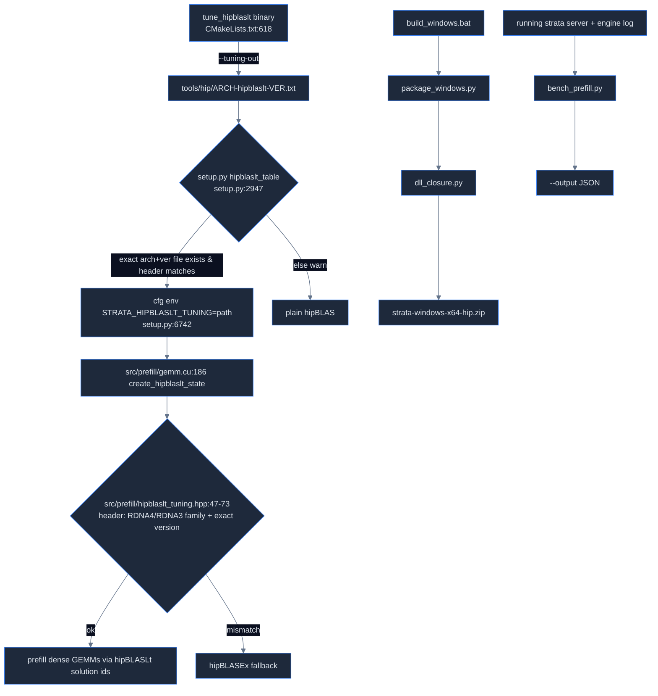

# Strata map: HIP and AMD tooling (`tools/hip/`)

Source: Strata commit `296b59d2`. Paths are relative to the Strata repo root. 

## Files

| path | lines | purpose |
|---|---|---|
| tools/hip/tune_hipblaslt.cpp | 420 | GPU tuner: for each prefill GEMM shape, try hipBLASLt heuristic algos, accuracy-gate vs hipblasGemmEx, time, write tuning table |
| tools/hip/gfx1201-hipblaslt-100202.txt | 26 | **R9700 (gfx1201)** table for hipBLASLt 100202 (24 rows) |
| tools/hip/gfx1201-hipblaslt-100500.txt | 34 | **gfx1201** table for hipBLASLt 100500 (32 rows) |
| tools/hip/gfx1200-hipblaslt-100202.txt | 69 | gfx1200 (RDNA4 sibling) table, hipBLASLt 100202, extra T buckets |
| tools/hip/gfx1100-hipblaslt-100100.txt | 32 | RDNA3 (7900 XTX) table |
| tools/hip/gfx1100-hipblaslt-100200.txt | 28 | RDNA3 (7900 XTX) table |
| tools/hip/gfx1100-hipblaslt-100202.txt | 28 | RDNA3 (gfx1100) table |
| tools/hip/gfx1100-hipblaslt-100401.txt | 45 | RDNA3 (7900 XTX) table |
| tools/hip/gfx1100-hipblaslt-100500.txt | 34 | RDNA3 (7900 XTX) table |
| tools/hip/gfx1150-hipblaslt-100401.txt | 146 | gfx1150 table |
| tools/hip/gfx1151-hipblaslt-100400.txt | 92 | Strix Halo table |
| tools/hip/gfx1151-hipblaslt-100401.txt | 92 | Strix Halo table |
| tools/hip/gfx1151-hipblaslt-100500.txt | 34 | Strix Halo table |
| tools/hip/bench_prefill.py | 75 | Prefill/decode probe against a running Strata server; parses engine log timing line |
| tools/hip/build_windows.bat | 87 | Windows HIP build (TheRock ROCm wheels + MSVC) then packaging |
| tools/hip/package_windows.py | 173 | Builds `strata-windows-x64-hip.zip` (exes, ROCm DLLs, GEMM libs, kpacks, BUILD.json) |
| tools/hip/dll_closure.py | 117 | Pure-Python PE import-table walker: DLL dependency closure |
| total | 1532 | all files above |

## Flow

## tools/hip/tune_hipblaslt.cpp — how it works

- Built as target `tune_hipblaslt` only when STRATA_ENABLE_HIP and STRATA_HIPBLASLT_AVAILABLE (CMakeLists.txt:614-619, links hip::host, roc::hipblas, roc::hipblaslt).
- CLI (tools/hip/tune_hipblaslt.cpp:207-228): `--workspace-mib N`, `--shape T,N,K` (adds f16 AND bf16, ldy=N; tools/hip/tune_hipblaslt.cpp:170-175), `--case dtype,T,N,K,ldy` (tools/hip/tune_hipblaslt.cpp:176-183), `--shapes-file PATH` (regex-parses JSON-ish objects with dtype,N,K,ldy; tools/hip/tune_hipblaslt.cpp:189-206), `--tokens T1,T2` (default `{4096, 8192}`, tools/hip/tune_hipblaslt.cpp:53), `--tuning-out PATH`.
- Defaults: workspace 32 MiB (tools/hip/tune_hipblaslt.cpp:51). With no explicit shapes: 6 cases at T=8192: N,K,ldy = (10240,2560,10240), (320,10240,320), (2560,320,2560) × f16/bf16 (tools/hip/tune_hipblaslt.cpp:230-235). Note usage text says "original three shapes … T=8192" (tools/hip/tune_hipblaslt.cpp:210).
- Constants (tools/hip/tune_hipblaslt.cpp:67-72): WARMUPS=2, REPS=3, MAX_ALGOS=16, REL_L2_TOL=1e-4, MAX_ABS_TOL=1e-2, PADDING_CANARY=123456.25f.
- GEMM convention (tools/hip/tune_hipblaslt.cpp:271-274, tools/hip/tune_hipblaslt.cpp:289-294): A = weights K×N transposed (OP_T), B = activations K×T (OP_N), C fp32 N×T with ldc=ldy; compute 32F; inputs HIP_R_16F/16BF.
- Inputs random uniform[-1,1] via mt19937, seed `0x5A17C3 + case_id*0x10001 + (bf16?0xB16:0xF16)` (tools/hip/tune_hipblaslt.cpp:110-111, tools/hip/tune_hipblaslt.cpp:277-278).
- Baseline: `hipblasGemmEx` HIPBLAS_GEMM_DEFAULT, 2 warmups + 3 timed (tools/hip/tune_hipblaslt.cpp:300-309); its output is the reference.
- Candidates: `hipblasLtMatmulAlgoGetHeuristic` up to 16 (tools/hip/tune_hipblaslt.cpp:311-313); skip if state≠success or workspace>limit (tools/hip/tune_hipblaslt.cpp:324-327); run once on canary-filled output, reject on accuracy gate incl. writes into ldy padding (tools/hip/tune_hipblaslt.cpp:336-353, tools/hip/tune_hipblaslt.cpp:146-149); time 3 reps (tools/hip/tune_hipblaslt.cpp:365-367); fastest mean wins (tools/hip/tune_hipblaslt.cpp:372-375).
- Output: stdout lines `meta`, `baseline`, `case`, `lt`, `lt_skip`, `lt_reject`, `lt_unsupported`, `lt_best`, plus `candidate_json=` / `best_json=` (tools/hip/tune_hipblaslt.cpp:242-266, tools/hip/tune_hipblaslt.cpp:308-386, tools/hip/tune_hipblaslt.cpp:411). Table file (tools/hip/tune_hipblaslt.cpp:392-399): header `STRATA_HIPBLASLT_TUNING_V1 <arch> <version>`, rows **`dtype N K ldy T solution_id`** (column order is N,K,ldy,T — not T first).
- Arch = `gcnArchName` stripped at ':' (tools/hip/tune_hipblaslt.cpp:239-241, tools/hip/tune_hipblaslt.cpp:410); version from `hipblasLtGetVersion` (tools/hip/tune_hipblaslt.cpp:408), so a table is tied to the runtime GPU + library.
- Timing uses hipEvents plus `hipDeviceSynchronize` (tools/hip/tune_hipblaslt.cpp:114-124); mean of only 3 reps (tools/hip/tune_hipblaslt.cpp:365-367).

## Tuning tables (tools/hip/<arch>-hipblaslt-<ver>.txt)

- Line 1 comment, line 2 header, then rows (e.g. tools/hip/gfx1201-hipblaslt-100500.txt:1-3).
- gfx1201 shapes (100500, tools/hip/gfx1201-hipblaslt-100500.txt:3-34): bf16 N=1 K=2560 (T 4096/8192), N=4 K=10240, N=48 K=2560 ldy=96, N=128 K=2560, N=320 K=10240, N=512 K=2560, 2560×2560, N=10240 K=320, N=10240 K=2560; f16 N=512/640/2560/6144/10240/12288 with K=2560 or 640/6144. T buckets 4096 and 8192 only. Solution ids 110001-110549 (bf16) and 135187-135740 (f16).
- tools/hip/gfx1201-hipblaslt-100202.txt:3-26 — 24 rows, no N=4 / no bf16 10240×2560 rows, ids 73715-74196 / 88192-88307.
- tools/hip/gfx1200-hipblaslt-100202.txt has T buckets incl. 37, 48, 256, 512, 2560 besides 4096 (tools/hip/gfx1200-hipblaslt-100202.txt:3-69; e.g. tools/hip/gfx1200-hipblaslt-100202.txt:3 `bf16 10240 2560 10240 2560 30831`).
- Engine loader accepts a gfx1200 table on gfx1201 and vice versa (same RDNA4 family), but **version must match exactly** (src/prefill/hipblaslt_tuning.hpp:52-70). Comment there: an R9700 under `HSA_OVERRIDE_GFX_VERSION=12.0.0` reports gfx1200 (src/prefill/hipblaslt_tuning.hpp:53).
- setup.py, however, only picks `tools/hip/<arch>-hipblaslt-<ver>.txt` with exact arch in the filename/header (setup.py:2952-2955), then sets `STRATA_HIPBLASLT_TUNING` (setup.py:6742). Comment claims +40-60% prompt speed on 7900 XTX (setup.py:6737-6738).

## tools/hip/bench_prefill.py

- Run: `python tools/hip/bench_prefill.py --model M --engine-log LOG --output OUT.json --label L [--url http://127.0.0.1:8080]` (tools/hip/bench_prefill.py:21-25). Does not start/stop servers (tools/hip/bench_prefill.py:4-5).
- Env: `STRATA_API_KEY` → Bearer header (tools/hip/bench_prefill.py:35-36).
- Request: /v1/chat/completions, max_tokens=128, temperature 0, top_k 1, seed 42, reasoning_effort 'none' (tools/hip/bench_prefill.py:31-37), timeout 360 s (tools/hip/bench_prefill.py:40).
- Parses engine log after request offset with regex `prompt N tokens = R reused + F read in MS ms (TPS tok/s), G generated in..` (tools/hip/bench_prefill.py:15, tools/hip/bench_prefill.py:30); waits up to 2 s (tools/hip/bench_prefill.py:44); requires exactly one match (tools/hip/bench_prefill.py:52-53); fresh run must have reused==0 (tools/hip/bench_prefill.py:55-56).
- Schedule: warmup, then 4 trials with n = 140, 280, 140, 280 generated JS rule lines, each fresh + followup (tools/hip/bench_prefill.py:65-71).
- Writes whole results list to `--output` JSON after each request and prints the row (tools/hip/bench_prefill.py:61-62).

## tools/hip/build_windows.bat / tools/hip/package_windows.py / tools/hip/dll_closure.py

- tools/hip/build_windows.bat env (all optional, tools/hip/build_windows.bat:14-26): `STRATA_HIP_ARCHS` default `gfx1100;gfx1101;gfx1102;gfx1200;gfx1201;gfx1030;gfx1031;gfx1151`, `STRATA_ROCM_VERSION` 10.2.0a20260930, `STRATA_ROCM_INDEX` nightly.repo.amd.com whl-next, `ROCM_VENV`, `BUILD_DIR`, `DIST_DIR`, `STRATA_GGML_DIR`; arg `tests` → `STRATA_BUILD_TESTS=ON` (tools/hip/build_windows.bat:27-28, tools/hip/build_windows.bat:69). Sets HIP_PLATFORM=amd, HIP_PATH, ROCM_PATH, PATH (tools/hip/build_windows.bat:59-62).
- CMake flags (tools/hip/build_windows.bat:68-74): `STRATA_ENABLE_HIP=ON`, `STRATA_ENABLE_CUDA=OFF`, `STRATA_PREFILL_MMQ=ON`, `STRATA_NATIVE_EXPERTS=ON`, `STRATA_PORTABLE=ON` (AVX2 baseline, tools/hip/build_windows.bat:64), `CMAKE_HIP_ARCHITECTURES`. Builds `strata strata-device` only unless tests (tools/hip/build_windows.bat:76-80).
- Comment: ROCm 10.2 nightly ran on an RX 9070 XT (tools/hip/build_windows.bat:8-9).
- tools/hip/package_windows.py: copies exes (tools/hip/package_windows.py:83-84), follows llvm-objdump imports through ROCm DLLs (tools/hip/package_windows.py:54-56, tools/hip/package_windows.py:78-102), CRT from `VCToolsRedistDir` (tools/hip/package_windows.py:59-65, tools/hip/package_windows.py:103-107), HIP runtime closure beside the exe via dll_closure (tools/hip/package_windows.py:108-117), rocBLAS/hipBLASLt libraries filtered to archs (tools/hip/package_windows.py:119-132), `blas_lib_<arch>.kpack` required per arch (tools/hip/package_windows.py:39, tools/hip/package_windows.py:133-141), licenses+NOTICE (tools/hip/package_windows.py:143-150), BUILD.json with `hipblaslt_version = MAJOR*100000+MINOR*100+PATCH` (tools/hip/package_windows.py:152-158) — this number is what tuning file names use (setup.py:2949-2952, setup.py:6740).
- tools/hip/dll_closure.py: `python tools/hip/dll_closure.py DIR amdhip64_7.dll amd_comgr.dll` (tools/hip/dll_closure.py:3); parses PE import (dir 1) and delay-import (dir 13) tables (tools/hip/dll_closure.py:58-77); follows only DLLs present in DIR (tools/hip/dll_closure.py:83-104). Reason: error 126 → System32 fallback → hipErrorInvalidDeviceFunction (tools/hip/dll_closure.py:5-10).

## Gotchas

1. Table row order is `dtype N K ldy T id` (tools/hip/tune_hipblaslt.cpp:398), not CLI order T,N,K (tools/hip/tune_hipblaslt.cpp:208).
2. Solution ids are only valid for the exact hipBLASLt version (src/prefill/hipblaslt_tuning.hpp:67-70); upgrading ROCm drops to hipBLASEx with a stderr message (src/prefill/gemm.cu:214-215).
3. setup.py exact-arch lookup vs engine family tolerance (setup.py:2952 vs src/prefill/hipblaslt_tuning.hpp:61-63): setup reads the arch from KFD sysfs gfx_target_version (setup.py:2429, setup.py:2439-2444), not from the HSA runtime, so an R9700 under HSA_OVERRIDE_GFX_VERSION=12.0.0 still gets the gfx1201 table, which the engine (seeing gfx1200) accepts through the RDNA4 family gate (src/prefill/hipblaslt_tuning.hpp:52-63).
4. Only 3 timed reps, no outlier rejection (tools/hip/tune_hipblaslt.cpp:68, tools/hip/tune_hipblaslt.cpp:366-367).
5. Default tuner shapes (tools/hip/tune_hipblaslt.cpp:232-233) do not cover the shipped tables; they were made with --case rows taken from an existing table (docs/AMD_HIP.md:541-545). gfx1201-100500: ROCm 10.2.0a20260914, hipBLASLt 1.5.0 d3164197, 16 geometries × T 4096/8192 (docs/AMD_HIP.md:576-585); gfx1201-100202: 24 of gfx1100's 26 shapes, hipBLASLt 1.2.2 (docs/AMD_HIP.md:307-310).
6. The packaging and DLL-closure tools are Windows-only (tools/hip/build_windows.bat:2, tools/hip/package_windows.py:2, tools/hip/dll_closure.py:5-10).
7. T is unclamped; nearest bucket, tie→smaller; 16384 → 8192 row on gfx1201-100500, re-validated per real T (src/prefill/gemm.cu:234, src/prefill/hipblaslt_tuning.hpp:110-117, tools/hip/gfx1201-hipblaslt-100500.txt:3-34, src/prefill/gemm.cu:251-265).

## AMD RDNA4 (gfx1201) notes

- The only gfx1201 tuning artifacts: tools/hip/gfx1201-hipblaslt-100202.txt and tools/hip/gfx1201-hipblaslt-100500.txt. The installed ROCm's hipBLASLt version must equal 100202 or 100500 (or gfx1200 100202) or tuning is refused (src/prefill/hipblaslt_tuning.hpp:57-70, tools/hip/gfx1201-hipblaslt-100202.txt:2, tools/hip/gfx1201-hipblaslt-100500.txt:2, tools/hip/gfx1200-hipblaslt-100202.txt:2).
- Retuning: target `tune_hipblaslt` (CMakeLists.txt:618) takes `--shapes-file`/`--case` + `--tuning-out` (tools/hip/tune_hipblaslt.cpp:207-229). It is a benchmark that runs on the GPU (tools/hip/tune_hipblaslt.cpp:402-416).
- Shapes encode the model: K/N 2560 (hidden), 640 (expert FFN), 10240, 320, 6144 (include/strata/core/geometry.hpp:24-55), and 12288, the Qf width (src/prefill/prefill.cpp:1280).
- Small-N rows: N=1 shared-expert gate (src/prefill/prefill.cpp:3015), N=4 K=10240 hc_*_inject (src/prefill/prefill.cpp:2668, ne1==HC src/prefill/prefill.cpp:2630), N=48/ldy96 ssm_alpha/beta (src/prefill/prefill.cpp:2694-2695), N=128 indexer.k_proj (src/prefill/prefill.cpp:2721; idx_raw T*128 src/prefill/prefill.cpp:1281); indexer.q_proj is N=512 (src/prefill/prefill.cpp:2722, src/prefill/prefill.cpp:1281) and the router is N=n_expert (src/prefill/prefill.cpp:2946, src/prefill/prefill.cpp:1288); N=320/K=10240 and N=10240/K=320 are hc_*_down/up (src/prefill/prefill.cpp:2638, src/prefill/prefill.cpp:2667).

## Quick index

| Area | Kind | Name | Where | Notes |
|---|---|---|---|---|
| hip-amd-tools | tool | tune_hipblaslt | `tools/hip/tune_hipblaslt.cpp:402` | CMake target CMakeLists.txt:618; benches hipBLASLt algos vs hipblasGemmEx, writes table (tools/hip/tune_hipblaslt.cpp:300, tools/hip/tune_hipblaslt.cpp:415-416) |
| hip-amd-tools | flag | --workspace-mib | `tools/hip/tune_hipblaslt.cpp:218` | workspace MiB, default 32 (tools/hip/tune_hipblaslt.cpp:51) |
| hip-amd-tools | flag | --shape | `tools/hip/tune_hipblaslt.cpp:222` | T,N,K adds f16+bf16 with ldy=N (tools/hip/tune_hipblaslt.cpp:170-175) |
| hip-amd-tools | flag | --case | `tools/hip/tune_hipblaslt.cpp:223` | dtype,T,N,K,ldy (tools/hip/tune_hipblaslt.cpp:176-183) |
| hip-amd-tools | flag | --shapes-file | `tools/hip/tune_hipblaslt.cpp:224` | regex JSON objects dtype,N,K,ldy × tokens (tools/hip/tune_hipblaslt.cpp:189-206) |
| hip-amd-tools | flag | --tokens | `tools/hip/tune_hipblaslt.cpp:225` | T buckets, default 4096,8192 (tools/hip/tune_hipblaslt.cpp:53) |
| hip-amd-tools | flag | --tuning-out | `tools/hip/tune_hipblaslt.cpp:226` | write STRATA_HIPBLASLT_TUNING_V1 table (tools/hip/tune_hipblaslt.cpp:392-399) |
| hip-amd-tools | const | WARMUPS; REPS; MAX_ALGOS | `tools/hip/tune_hipblaslt.cpp:67-69` | 2/3/16 |
| hip-amd-tools | const | REL_L2_TOL, MAX_ABS_TOL | `tools/hip/tune_hipblaslt.cpp:70-71` | 1e-4 / 1e-2 accuracy gate vs hipblasGemmEx (tools/hip/tune_hipblaslt.cpp:146-149, tools/hip/tune_hipblaslt.cpp:300, tools/hip/tune_hipblaslt.cpp:347-349) |
| hip-amd-tools | const | PADDING_CANARY | `tools/hip/tune_hipblaslt.cpp:72` | 123456.25f; any write into ldy padding rejects algo (tools/hip/tune_hipblaslt.cpp:140-149) |
| hip-amd-tools | behavior | default shapes | `tools/hip/tune_hipblaslt.cpp:232-234` | (10240,2560),(320,10240),(2560,320) f16+bf16 T=8192 |
| hip-amd-tools | behavior | table row format | `tools/hip/tune_hipblaslt.cpp:398` | dtype N K ldy T solution_id |
| hip-amd-tools | kernel | gfx1201 table 100500 | `tools/hip/gfx1201-hipblaslt-100500.txt:2` | R9700 (docs/AMD_HIP.md:576), 32 rows, T 4096/8192 (tools/hip/gfx1201-hipblaslt-100500.txt:3-34) |
| hip-amd-tools | kernel | gfx1201 table 100202 | `tools/hip/gfx1201-hipblaslt-100202.txt:2` | R9700 (docs/AMD_HIP.md:307-309), 24 rows (tools/hip/gfx1201-hipblaslt-100202.txt:3-26) |
| hip-amd-tools | kernel | gfx1200 table 100202 | `tools/hip/gfx1200-hipblaslt-100202.txt:2` | RDNA4 sibling, extra T buckets (37,48,256,512,2560) (tools/hip/gfx1200-hipblaslt-100202.txt:3-69) |
| hip-amd-tools | env | STRATA_HIPBLASLT_TUNING | `src/prefill/gemm.cu:187-188` | path to table; unset = hipBLASEx |
| hip-amd-tools | behavior | header family gate | `src/prefill/hipblaslt_tuning.hpp:57-70` | gfx1200/1201 interchangeable; version exact |
| hip-amd-tools | gotcha | setup exact arch lookup | `setup.py:2952` | setup only picks tools/hip/<arch>-hipblaslt-<ver>.txt |
| hip-amd-tools | env | STRATA_HIPBLASLT_TUNING set by setup | `setup.py:6740-6742` | auto when table matches |
| hip-amd-tools | tool | bench_prefill | `tools/hip/bench_prefill.py:19` | fresh/followup prefill probe vs running server (tools/hip/bench_prefill.py:2, tools/hip/bench_prefill.py:69-71) |
| hip-amd-tools | env | STRATA_API_KEY | `tools/hip/bench_prefill.py:35-36` | Bearer auth |
| hip-amd-tools | behavior | timing regex | `tools/hip/bench_prefill.py:15` | parses engine log completion line |
| hip-amd-tools | gotcha | fresh must not reuse | `tools/hip/bench_prefill.py:55-56` | restart server between arms |
| hip-amd-tools | tool | build_windows.bat | `tools/hip/build_windows.bat:2` | Windows HIP build + zip |
| hip-amd-tools | env | STRATA_HIP_ARCHS | `tools/hip/build_windows.bat:21` | default includes gfx1200;gfx1201 |
| hip-amd-tools | env | STRATA_ROCM_VERSION | `tools/hip/build_windows.bat:22` | 10.2.0a20260930 |
| hip-amd-tools | flag | cmake HIP flags | `tools/hip/build_windows.bat:69-70` | ENABLE_HIP, PREFILL_MMQ, NATIVE_EXPERTS, PORTABLE |
| hip-amd-tools | tool | package_windows | `tools/hip/package_windows.py:68` | zip exes+ROCm DLLs+libs+kpack+BUILD.json (tools/hip/package_windows.py:7-17) |
| hip-amd-tools | const | hipblaslt_version encoding | `tools/hip/package_windows.py:156` | MAJOR\*100000+MINOR\*100+PATCH |
| hip-amd-tools | function | dll_closure | `tools/hip/dll_closure.py:83-104` | recursive PE import closure within dir |
| hip-amd-tools | gotcha | System32 HIP fallback | `tools/hip/dll_closure.py:5-8` | missing deps -> hipErrorInvalidDeviceFunction |
