# Strata map: planner, vision and image generation

Source: Strata commit `296b59d2`. Paths are relative to the Strata repo root.

## Files

| path | lines | purpose |
|---|---|---|
| src/plan/plan_main.cpp | 73 | `strata-plan` CLI: prints the VRAM memory plan or why it does not fit |
| include/strata/plan/plan.hpp | 168 | Geometry, Costs, make_plan |
| tools/vision/CMakeLists.txt | 61 | builds `strata-vision` against llama.cpp mtmd |
| tools/vision/strata_vision.cpp | 239 | resident image encoder: image -> SVE1 embeddings file for `GENI` |
| tools/image/install.py | 101 | adds Qwen-Image-2.1-Turbo image generation (sd-cli build + downloads + config) |
| tools/image/qimage.py | 203 | pins (sd.cpp commit, HF revisions, SHA-256), quant/backend choice, cmake defs |
| tools/image/sdcpp_native/apply.py | 75 | patches Strata's native DiT runner into an sd.cpp checkout |
| tools/image/sdcpp_native/qi21-native.cu | 679 | CUDA/HIP kernels for the Qwen-Image DiT (LN-mod, qkv post, swiglu, attn, WMMA FA) |
| tools/image/sdcpp_native/qwen_image_2_1_native.hpp | 601 | host runner replacing QwenImage21Runner::compute |

## Flow

```mermaid
---
config: {"theme":"base","themeVariables":{"darkMode":true,"background":"#0b1020","fontFamily":"Inter, 'Segoe UI', Roboto, 'Helvetica Neue', Arial, sans-serif","fontSize":"14px","primaryColor":"#1e293b","primaryTextColor":"#e2e8f0","primaryBorderColor":"#3b82f6","secondaryColor":"#1e293b","secondaryTextColor":"#e2e8f0","secondaryBorderColor":"#3b82f6","tertiaryColor":"#111827","tertiaryTextColor":"#e2e8f0","tertiaryBorderColor":"#334155","mainBkg":"#1e293b","nodeBorder":"#3b82f6","textColor":"#e2e8f0","titleColor":"#93c5fd","lineColor":"#64748b","clusterBkg":"#0f172a","clusterBorder":"#334155","edgeLabelBackground":"#0b1020","noteBkgColor":"#172554","noteTextColor":"#dbeafe","noteBorderColor":"#3b82f6","actorBkg":"#1e293b","actorTextColor":"#e2e8f0","actorBorder":"#3b82f6","actorLineColor":"#475569","signalColor":"#94a3b8","signalTextColor":"#e2e8f0","labelBoxBkgColor":"#1e293b","labelBoxBorderColor":"#3b82f6","labelTextColor":"#e2e8f0","loopTextColor":"#93c5fd","activationBkgColor":"#334155","activationBorderColor":"#3b82f6"},"flowchart":{"curve":"basis","nodeSpacing":34,"rankSpacing":40,"padding":12,"wrappingWidth":260,"htmlLabels":true},"sequence":{"actorFontFamily":"Inter, 'Segoe UI', Roboto, 'Helvetica Neue', Arial, sans-serif","messageFontFamily":"Inter, 'Segoe UI', Roboto, 'Helvetica Neue', Arial, sans-serif","noteFontFamily":"Inter, 'Segoe UI', Roboto, 'Helvetica Neue', Arial, sans-serif"},"fontFamily":"Inter, 'Segoe UI', Roboto, 'Helvetica Neue', Arial, sans-serif"}
---
flowchart TD
  subgraph plan[strata-plan]
    A[CLI flags src/plan/plan_main.cpp:27-50] --> B[state default = state_bytes Geometry src/plan/plan_main.cpp:58]
    B --> C[pool = vram - dense - embd src/plan/plan_main.cpp:61-63]
    C --> D[make_plan include/strata/plan/plan.hpp:129]
    D -->|kv+fixed > pool| E[DoesNotClose -> exit 1 src/plan/plan_main.cpp:69-71]
    D --> F[cache_slots = rest / 1,382,400 include/strata/plan/plan.hpp:144-145]
  end
  subgraph vision[multimodal]
    S[serve/server.py] -->|ENC img out| V[strata-vision tools/vision/strata_vision.cpp:186-233]
    V -->|SVE1 file| S
    S -->|GENI max_new file ids serve/server.py:1516| G[src/program/generate.cpp:10635 reads SVE1 at src/program/generate.cpp:10758]
  end
  subgraph image[image gen]
    I[install.py / setup.py --images] --> Q[qimage.py pick_backend/pick_quant]
    Q --> P[apply.py patches sd.cpp] --> SD[sd-cli + native runner qi21-native.cu]
    SD --> SI[serve/images.py POST /v1/images/generations tools/image/install.py:96]
  end
```

## 1. strata-plan (src/plan + include/strata/plan/plan.hpp)

**What:** pure arithmetic, no GPU (src/plan/plan_main.cpp:3-5). Splits a VRAM pool between INT8 KV + indexer keys, fixed costs, and expert-cache slots; refuses rather than overcommits (include/strata/plan/plan.hpp:6-7, include/strata/plan/plan.hpp:115-120).

**Inputs / defaults**
- `ctx = 20480` (src/plan/plan_main.cpp:14); `free_vram = 12e9` "RTX 5070 nominal" (src/plan/plan_main.cpp:15).
- Flags: `--max-context` `--vram` `--dense` `--embd` `--workspace` `--state` `--pool` `--help` (src/plan/plan_main.cpp:27-50). Unknown arg -> exit 2 (src/plan/plan_main.cpp:52-53).
- No env vars.

**Geometry constants** (include/strata/plan/plan.hpp:23-58): 48 layers, 12 QSA, 2 KV heads, head_dim 256, kv_group 64, qsa_block 4, indexer key heads 1 x dim 128 (q heads 4 cost no cache, include/strata/plan/plan.hpp:45-47), ssm_state 128, v_heads 48, d_conv 4, conv channels 10240; GDN layers = 48-12 = 36 (include/strata/plan/plan.hpp:58).

**Formulas**
- Expert blob = 1,382,400 B (include/strata/plan/plan.hpp:63).
- State per sequence = 36 x (128*48*128*4 + 3*10240*4) = 36 x 3,268,608 = **117,669,888 B** ("117.7 MB, 85 slots", include/strata/plan/plan.hpp:73-87).
- KV per token = 12 x [(2*2*256)*1 + (1024/64)*2 + 1*128/4] = 12 x (1024+32+32) = **13,056 B/token** (include/strata/plan/plan.hpp:91-99). => 20K ctx 267 MB; 128K 1.71 GB; 256K 3.42 GB.
- fixed = dense+embd+mtp+workspace+state (include/strata/plan/plan.hpp:138); throw if kv+fixed > pool (include/strata/plan/plan.hpp:139-143); cache_bytes = pool-kv-fixed, slots = cache/blob (include/strata/plan/plan.hpp:144-145); zero slots -> throw (include/strata/plan/plan.hpp:147-149).
- Fallback pool `vram_pool_bytes() = 5,943,000,000` taken from a table, not derived (include/strata/plan/plan.hpp:122-127); used only when computed pool is 0 (src/plan/plan_main.cpp:66).
- Default run (12e9, dense=0): 12e9 - 267,386,880 - 117,669,888 => 8402 slots.

**Ties:**

- CMake `strata_plan` INTERFACE lib + `strata-plan` exe (CMakeLists.txt:297-302); linked into strata_core (CMakeLists.txt:317).
- Used by src/core/device_main.cpp:87-88 (make_plan(20480, Geometry{}, Costs{}) -> default 5.943 GB pool).
- **src/program/generate.cpp does not include include/strata/plan/plan.hpp** (no `plan::` references there) — the live engine sizes its cache elsewhere (see generate-program.md); setup.py has its own `kv_bytes_per_token` table (setup.py:454, setup.py:5572).

## 2. strata-vision (tools/vision)

**What:**

- image -> embeddings that replace `<|image_pad|>` tokens, using llama.cpp mtmd + mmproj (tools/vision/strata_vision.cpp:1-5).
- Text model opened vocab-only (tools/vision/strata_vision.cpp:115-117).
- **Flags:** `--mmproj` `--model` (required) `--gpu` `--threads` `--max-tokens` `--min-tokens` `--flash-attn on|off|auto` (tools/vision/strata_vision.cpp:69-80, tools/vision/strata_vision.cpp:83-86).
- **Env:** sets `CUDA_VISIBLE_DEVICES=-1` when not `--gpu` (tools/vision/strata_vision.cpp:90-96; measured 0.4-0.7 GB VRAM / 150-260 expert slots saved, tools/vision/strata_vision.cpp:88-89).
- `STRATA_READ_AHEAD=0` disables posix_fadvise read-ahead in 128 KiB steps (tools/vision/strata_vision.cpp:103-113).
- **Defaults:** FA auto, but forced off on CPU with AVX-512 (head size 72 slow path; tools/vision/strata_vision.cpp:124-129).
- CPU threads = hw_concurrency/2 (tools/vision/strata_vision.cpp:132). n_embd from `clip.vision.projection_dim` (tools/vision/strata_vision.cpp:145-153).
- **GPU warm-up:** encodes a 2048x2048 grey image before READY so the engine sizes its expert cache after the encoder's buffers exist (tools/vision/strata_vision.cpp:154-182).
- **Protocol:** `READY <n_embd>` (tools/vision/strata_vision.cpp:183); per line `ENC  <out>` -> `OK n nx ny ms` / `ERR..`; `QUIT` (tools/vision/strata_vision.cpp:11-13, tools/vision/strata_vision.cpp:186-233).
- Output record: int32 {0x31455653 'SVE1', n, nx, ny, n_embd} + float32[n][n_embd] (tools/vision/strata_vision.cpp:14-15, tools/vision/strata_vision.cpp:219-222); non-rectangular grid is an error (tools/vision/strata_vision.cpp:215).
- **Build:** portable AVX2 default `STRATA_PORTABLE=ON`, `STRATA_VISION_CUDA=OFF` (tools/vision/CMakeLists.txt:16-17, tools/vision/CMakeLists.txt:32-52); GGML_CUDA follows the option (tools/vision/CMakeLists.txt:54).
- **No HIP option** — GPU encode is CUDA-only in this CMake. setup.py builds with `-DSTRATA_PORTABLE=OFF` (setup.py:3040, setup.py:3974).
- **src/program/generate.cpp ties:** `--vision` help (src/program/generate.cpp:783), GENI parsing (src/program/generate.cpp:10635-10637), SVE1 header check including `hdr[4] == g.n_embd` (src/program/generate.cpp:10758-10759), rows placed at image pad 248056 with M-RoPE t=p, h=p+y, w=p+x, text resumes at p+max(nx,ny) (src/program/generate.cpp:9682-9686).
- Server: `STRATA_VISION_READY_S`/`STRATA_VISION_ENCODE_S` default 300 s (serve/server.py:266-267).

## 3. Image generation (tools/image)

- tools/image/install.py: flags `--backend --arch --quant --gpu-gb --models-dir --config --gpu-policy auto|keep|shrink|unload --gpu --native on|off (EXPERIMENTAL, default off) --build-only --print --yes` (tools/image/install.py:46-58). GPU detect: NVIDIA first, else AMD (tools/image/install.py:26-41). HIP/CUDA need an arch (tools/image/install.py:70-71). Downloads + SHA-256 checks quant, vae, llm (tools/image/install.py:82-86); writes config "images" (tools/image/install.py:93-96).
- tools/image/qimage.py: pins sd.cpp `2988060a` / ggml `d25b121c` (tools/image/qimage.py:24-25); file table with sizes/SHAs (tools/image/qimage.py:44-55): Q4_K_M 4.20 GB, Q6_K 6.27 GB, Q8_0 7.64 GB, VAE 0.68 GB, Qwen3-VL-8B Q4_K_XL text encoder 5.15 GB.
  - `pick_quant`: <=8 GB Q4_K_M, <=12 GB Q6_K, else Q8_0 (tools/image/qimage.py:65-71).
  - `pick_backend`: AMD discrete on Linux -> hip; APU or Windows -> vulkan (tools/image/qimage.py:88-97; APU list tools/image/qimage.py:76-77).
  - `default_args`: `--diffusion-fa` (+ VAE tiling on Vulkan) (tools/image/qimage.py:100-104). Defaults 8 steps, CFG 1, euler (docstring tools/image/qimage.py:13).
  - HIP cmake: `-DSD_HIPBLAS=ON -DGPU_TARGETS=<gfx>` with ROCm clang (tools/image/qimage.py:124-135).
  - native runner only for cuda/hip (tools/image/qimage.py:170, tools/image/qimage.py:198).
- tools/image/sdcpp_native/apply.py: copies the .cu into ggml-cuda (compiled by ggml-hip too) and the .hpp into src/model/diffusion; edits model_builders.cpp and CMakeLists (SD_QI_NATIVE when SD_CUDA or SD_HIPBLAS) (tools/image/sdcpp_native/apply.py:50-51, tools/image/sdcpp_native/apply.py:63-70). Native runner only with `--model-args qwen_image_2_1_native=1` (tools/image/sdcpp_native/apply.py:1-8).
- tools/image/sdcpp_native/qi21-native.cu kernels listed at tools/image/sdcpp_native/qi21-native.cu:7-11. QI_D=128 (tools/image/sdcpp_native/qi21-native.cu:20). HIP WMMA: gfx12 uses `__builtin_amdgcn_wmma_f32_16x16x16_f16_w32_gfx12`, KL=8 (tools/image/sdcpp_native/qi21-native.cu:243-246); gfx11 builtin KL=16 (tools/image/sdcpp_native/qi21-native.cu:248-251). Tiles FA_BQ=128, FA_BKV=64, 8 waves (tools/image/sdcpp_native/qi21-native.cu:255). **gfx12 WMMA attention is OFF unless `STRATA_QI_GFX12_ATTN=1`** ("not measured yet") (tools/image/sdcpp_native/qi21-native.cu:551-560). `STRATA_QI_OLD_QKV` (tools/image/sdcpp_native/qi21-native.cu:601).
- tools/image/sdcpp_native/qwen_image_2_1_native.hpp: DiT dims C=4096, D=128, H=32, F=12288 (tools/image/sdcpp_native/qwen_image_2_1_native.hpp:50); 32 blocks on image tokens, text prefix K/V cached (tools/image/sdcpp_native/qwen_image_2_1_native.hpp:7-9); falls back to stock runner for CPU/Vulkan/low VRAM (tools/image/sdcpp_native/qwen_image_2_1_native.hpp:12-13). Env: `STRATA_QI_TIMING`, `STRATA_QI_QSPLIT`, `STRATA_QI_EXACT_ATTN`, `STRATA_QI_NO_QKV_FUSE`, `STRATA_QI_FAST_LN` (tools/image/sdcpp_native/qwen_image_2_1_native.hpp:84-88), `STRATA_QI_GGML_ATTN` (tools/image/sdcpp_native/qwen_image_2_1_native.hpp:470).
- No tie to src/program/generate.cpp: sd-cli is a separate process run by serve/images.py (tools/image/qimage.py:4; tools/image/install.py:96).
- gpu_policy: serve/images.py:329-345 resolve_policy (auto: uma/fits→keep, --vram-elastic→shrink, else unload); _make_room serve/images.py:410, _give_back serve/images.py:440, restore_session serve/images.py:457.
- setup.py image path: image_backend_choice setup.py:3188, build_image_engine setup.py:3127 (stamp-gated incl. native_hash; applies native runner for cuda/hip), amd_gpus setup.py:2423-2469 (KFD topology → gfxNNNN).

## Gotchas

1. plan_main subtracts dense+embd from free VRAM to form the pool (src/plan/plan_main.cpp:61-63), then make_plan subtracts them again inside `fixed` (include/strata/plan/plan.hpp:138) — passing `--dense` double-counts it.
2. `Plan::dram_experts` is set to dense+embd (include/strata/plan/plan.hpp:136) but printed as "expert arena (DRAM)" (include/strata/plan/plan.hpp:163) — mislabeled, not the 33.97 GB arena.
3. `--pool` just overwrites free_vram, so dense/embd still get subtracted from it (src/plan/plan_main.cpp:40-43).
4. 5.943 GB fallback pool only when the computed pool is 0 (src/plan/plan_main.cpp:66); device_main uses it unconditionally (src/core/device_main.cpp:87).
5. `to_string` divides by 1e9 (decimal GB) (include/strata/plan/plan.hpp:155).
6. Geometry is hard-coded for Qwen3.8-Flash-Next; no GGUF read (include/strata/plan/plan.hpp:22-58, src/plan/plan_main.cpp:65).
7. strata-vision GPU mode is CUDA-only build; on HIP boxes it runs on CPU (tools/vision/CMakeLists.txt:16, tools/vision/CMakeLists.txt:54).
8. A CMake build folder keeps an old STRATA_PORTABLE value (tools/vision/CMakeLists.txt:10-11).

## HIP builds

- Vision encoder: CPU-only on HIP (no HIP option); FA auto is turned off when the CPU has AVX-512 (tools/vision/strata_vision.cpp:129).
- Image gen: on a discrete AMD card under Linux the backend is hip (APU or Windows -> vulkan), with quant Q8_0 above 12 GB (tools/image/qimage.py:65-71, tools/image/qimage.py:96); gfx12 WMMA attention is opt-in via `STRATA_QI_GFX12_ATTN=1` (tools/image/sdcpp_native/qi21-native.cu:551-560).

## Quick index

| Area | Kind | Name | Where | Notes |
|---|---|---|---|---|
| plan | tool | strata-plan | `src/plan/plan_main.cpp:1` | CLI prints VRAM plan or DoesNotClose (exit 1) |
| plan | flag | --max-context | `src/plan/plan_main.cpp:27` | default 20480 (src/plan/plan_main.cpp:14) |
| plan | flag | --vram | `src/plan/plan_main.cpp:29` | default 12e9 (src/plan/plan_main.cpp:15) |
| plan | flag | --dense; --embd; --workspace; --state; --pool | `src/plan/plan_main.cpp:31` | costs overrides; --pool overwrites free_vram |
| plan | behavior | state default from geometry | `src/plan/plan_main.cpp:58` | 117,669,888 B when --state absent |
| plan | behavior | pool = vram-dense-embd | `src/plan/plan_main.cpp:61` | fallback 5.943e9 if 0 (src/plan/plan_main.cpp:66) |
| plan | const | expert_blob | `include/strata/plan/plan.hpp:63` | 1,382,400 B per expert slot |
| plan | function | state_bytes | `include/strata/plan/plan.hpp:83` | 36\*(128\*48\*128\*4+3\*10240\*4) |
| plan | function | kv_bytes_per_token | `include/strata/plan/plan.hpp:91` | 12\*(1024+32+32)=13,056 B |
| plan | const | vram_pool_bytes | `include/strata/plan/plan.hpp:125` | 5,943,000,000 table constant |
| plan | function | make_plan | `include/strata/plan/plan.hpp:129` | slots=(pool-kv-fixed)/blob; throws if no fit |
| plan | gotcha | dense double subtract | `include/strata/plan/plan.hpp:138` | plan_main already removed dense/embd from pool |
| plan | gotcha | dram_experts mislabel | `include/strata/plan/plan.hpp:136` | prints dense+embd as expert arena |
| plan | behavior | device_main uses planner | `src/core/device_main.cpp:87` | make_plan(20480, defaults) |
| vision | tool | strata-vision | `tools/vision/strata_vision.cpp:1` | mtmd encoder, READY/ENC/QUIT protocol |
| vision | flag | --mmproj; --model; --gpu; --threads; --max-tokens; --min-tokens; --flash-attn | `tools/vision/strata_vision.cpp:69` | CLI |
| vision | env | CUDA_VISIBLE_DEVICES=-1 | `tools/vision/strata_vision.cpp:94` | set on CPU mode to save VRAM |
| vision | env | STRATA_READ_AHEAD | `tools/vision/strata_vision.cpp:105` | 0 disables fadvise read-ahead |
| vision | behavior | FA off on AVX-512 CPU | `tools/vision/strata_vision.cpp:129` | unless --flash-attn given |
| vision | behavior | GPU warm-up 2048x2048 | `tools/vision/strata_vision.cpp:163` | reserve buffers before engine sizes cache |
| vision | const | SVE1 header | `tools/vision/strata_vision.cpp:220` | int32 magic,n,nx,ny,n_embd + floats |
| vision | behavior | GENI SVE1 read | `src/program/generate.cpp:10758` | checks magic, grid, n_embd |
| vision | const | kImagePad | `src/program/generate.cpp:9686` | 248056 image token; M-RoPE t=p,h=p+y,w=p+x |
| vision | flag | STRATA_VISION_CUDA | `tools/vision/CMakeLists.txt:16` | OFF default; no HIP option |
| vision | flag | STRATA_PORTABLE | `tools/vision/CMakeLists.txt:17` | ON default AVX2 baseline |
| image | tool | tools/image/install.py | `tools/image/install.py:1` | build sd-cli, download, write images config |
| image | flag | --gpu-policy | `tools/image/install.py:52` | auto\|keep\|shrink\|unload |
| image | flag | --native | `tools/image/install.py:54` | experimental native DiT, default off |
| image | const | SD_CPP_COMMIT | `tools/image/qimage.py:24` | 2988060a pinned sd.cpp |
| image | function | pick_quant | `tools/image/qimage.py:65` | <=8 Q4_K_M, <=12 Q6_K, else Q8_0 |
| image | function | pick_backend | `tools/image/qimage.py:88` | AMD discrete Linux -> hip |
| image | function | cmake_defs hip | `tools/image/qimage.py:124` | SD_HIPBLAS, GPU_TARGETS=gfx |
| image | tool | tools/image/sdcpp_native/apply.py | `tools/image/sdcpp_native/apply.py:63` | patch native runner into sd.cpp |
| image | const | QI_WMMA gfx12 | `tools/image/sdcpp_native/qi21-native.cu:246` | wmma_f32_16x16x16_f16_w32_gfx12 |
| image | env | STRATA_QI_GFX12_ATTN | `tools/image/sdcpp_native/qi21-native.cu:558` | =1 enables WMMA attn on RDNA4 (unmeasured) |
| image | env | STRATA_QI_OLD_QKV | `tools/image/sdcpp_native/qi21-native.cu:601` | old qkv path |
| image | const | DiT dims | `tools/image/sdcpp_native/qwen_image_2_1_native.hpp:50` | C4096 D128 H32 F12288 |
| image | env | STRATA_QI_TIMING; STRATA_QI_QSPLIT; STRATA_QI_EXACT_ATTN; STRATA_QI_NO_QKV_FUSE; STRATA_QI_FAST_LN | `tools/image/sdcpp_native/qwen_image_2_1_native.hpp:84` | runner toggles |
| image | env | STRATA_QI_GGML_ATTN | `tools/image/sdcpp_native/qwen_image_2_1_native.hpp:470` | keep ggml attention |
