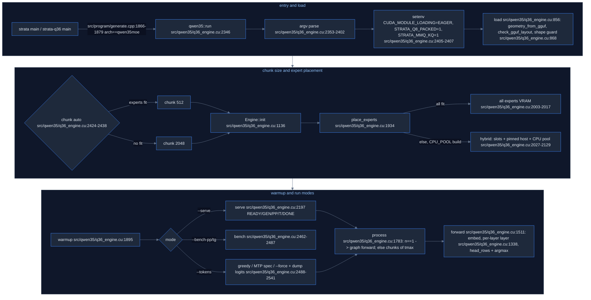

# Strata map: Qwen3.6-35B-A3B engine (`src/qwen35/`)

Source: Strata commit `296b59d2`. Paths are relative to the Strata repo root.

## 1. What it is (plain English)

A **separate engine for a different model**: Qwen3.6-35B-A3B, GGUF arch `qwen35moe` (src/qwen35/q36_engine.cu:1-3). It is NOT the Flash-Next (`qwen4exp`) path; it sits beside it so "the Flash-Next identity gate cannot move" (src/qwen35/q36_engine.cu:2-3). Hybrid GDN + gated attention + MoE with shared expert, with these sizes: 40 layers, 256 experts top-8, hidden 2048 (src/qwen35/q36ref.cu:11-23; src/qwen35/q36ref.cu:28-29). Two programs:

| path | Lines | purpose |
|---|---|---|
| src/qwen35/q36ref.cu | 832 | `strata-q36ref`: exactness-first **reference**: one GPU, whole model in VRAM, one token at a time, fp32 activations, GGUF weights dequantised by its own plain kernels (`--kernels plain`) or Strata's native MMVQ/fused GDN (`--kernels strata`, default) (src/qwen35/q36ref.cu:1-7) |
| src/qwen35/q36_engine.cu | 2542 | the real engine library `strata_qwen35`: serve protocol, chunked prompt, decode CUDA graph, MTP speculative decode, hybrid VRAM/CPU experts (src/qwen35/q36_engine.cu:1-18) |
| src/qwen35/q36_main.cpp | 5 | `strata-q36` = `main` calling `strata::qwen35::run` (src/qwen35/q36_main.cpp:5) |
| include/strata/qwen35/engine.hpp | 13 | declares `run(argc, argv)` (include/strata/qwen35/engine.hpp:6-11) |
| tools/qwen35/*.py; tools/qwen35/q36_llama_dump.cpp | 442 total | parity vs llama.cpp (tools/qwen35/parity.py), teacher-forced KL (tools/qwen35/kl.py), dump compare (tools/qwen35/compare_dumps.py), llama.cpp dumper (tools/qwen35/q36_llama_dump.cpp:1) |

## 2. Build and invocation

- CMakeLists.txt:628 `add_executable(strata-q36ref src/qwen35/q36ref.cu)`, links strata_kernels (CMakeLists.txt:630).
- CMakeLists.txt:634 `add_library(strata_qwen35 STATIC src/qwen35/q36_engine.cu)` linking strata_prefill + strata_kernels (CMakeLists.txt:636).
- CMakeLists.txt:637-641 with `STRATA_NATIVE_EXPERTS`: links strata_kernels_cpu and defines `STRATA_Q36_CPU_POOL=1` (hybrid mode).
- CMakeLists.txt:642 `strata-q36` exe; CMakeLists.txt:644 `strata` links strata_qwen35; CMakeLists.txt:645 `STRATA_HAVE_QWEN35=1` on strata.
- **Family switch**: src/program/generate.cpp:1866-1882: scans argv for `--native`/`--model`, reads the GGUF header, if `model_family == Qwen35Moe` returns `strata::qwen35::run(argc, argv)` (src/program/generate.cpp:1879) before any Flash-Next state.
- tools/strata_inspect.py:32 PREVIEW_ARCHS and CMakeLists.txt:626-627 still say the family does not run; both are outdated (CMakeLists.txt:631-645 builds strata_qwen35 and links it into strata, CMakeLists.txt:644-645; src/program/generate.cpp:1879).

## 3. The forward math (both programs agree)

Spec is written at src/qwen35/q36ref.cu:9-23 (mirrors llama.cpp src/models/qwen35moe.cpp):

- **Residual layer**: `h = rms(x)*attn_norm; x += mixer(h); h2 = rms(x)*post_attention_norm; x += moe(h2)` (src/qwen35/q36ref.cu:11; src/qwen35/q36ref.cu:20; src/qwen35/q36_engine.cu:8, src/qwen35/q36_engine.cu:1439, src/qwen35/q36_engine.cu:1504).
- **Layer kind**: GDN when `l % 4 != 3`, attention when `l % 4 == 3` (src/qwen35/q36ref.cu:12; src/qwen35/q36ref.cu:17), decided by `strata::core::is_qsa_layer` (src/qwen35/q36ref.cu:576; src/qwen35/q36ref.cu:616; src/qwen35/q36_engine.cu:931).
- **GDN** (src/qwen35/q36ref.cu:12-16, kernels src/qwen35/q36ref.cu:200-256):
  - qkv = W_qkv h (8192 ch), z = W_gate h (4096), beta = sigmoid(W_beta h), a = W_alpha h (32 V heads); causal 4-tap conv with 3-sample state then SiLU (src/qwen35/q36ref.cu:200-209); q,k = L2norm over 16 K heads of 128, v over 32 V heads; g = softplus(a + dt_bias) * ssm_a, `S *= exp(g)` (src/qwen35/q36ref.cu:224); `d = (v - S k) * beta; S += d k^T; o = S q / sqrt(128)` (src/qwen35/q36ref.cu:226-238; engine applies 1/sqrt(128) to the output at src/qwen35/q36_engine.cu:639; src/qwen35/q36_engine.cu:703); `o = rms(o) * ssm_norm * silu(z)` per V head (src/qwen35/q36ref.cu:250-256); y = W_ssm_out o.
  - V head h uses K head `h % HK` (src/qwen35/q36ref.cu:218; src/qwen35/q36_engine.cu:610). softplus has a >20 passthrough (src/qwen35/q36ref.cu:197; src/qwen35/q36_engine.cu:82).
  - L2 uses `x/sqrt(sum x^2 + eps)` (src/qwen35/q36ref.cu:220-222; src/qwen35/q36_engine.cu:588).
- **Engine GDN kernels**: `k_conv_seq` (src/qwen35/q36_engine.cu:567-596, history layout [channel][3], taps [c][4]); `k_gdn_seq` decode/verify (src/qwen35/q36_engine.cu:601-656, state layout [row][head][col], 4 row groups x 32 rows in registers); prompt `k_gdn_seq_cols` (src/qwen35/q36_engine.cu:663-708, column-split, 4 col groups) + `k_gdn_norm` (src/qwen35/q36_engine.cu:710-723). Alpha/beta: `k_gdn_ab` warp-per-row for T<=8 (src/qwen35/q36_engine.cu:176-194), else f32 GEMM + `k_gdn_gb` (src/qwen35/q36_engine.cu:1356-1360).
- **Attention** (src/qwen35/q36ref.cu:17-19; src/qwen35/q36_engine.cu:238-329):
  - attn_q output is per-head [q 256 | gate 256] (src/qwen35/q36ref.cu:264-287); q,k RMS-normed with q_norm/k_norm; NEOX RoPE over first `n_rot`=64 dims, base 1e7 (src/qwen35/q36ref.cu:275-283; src/qwen35/q36_engine.cu:255-262); GQA 16 q / 2 kv (src/qwen35/q36ref.cu:18, src/qwen35/q36_engine.cu:10); scale 1/sqrt(256)=1/16 (src/qwen35/q36ref.cu:19; src/qwen35/q36ref.cu:649); out *= sigmoid(gate) (src/qwen35/q36ref.cu:326; src/qwen35/q36_engine.cu:328).
  - Text positions: all M-RoPE sections carry the same position (src/qwen35/q36ref.cu:18) so plain 1-D NEOX RoPE is used.
  - Engine decode: split-K over 256-cell chunks + log-sum-exp merge (src/qwen35/q36_engine.cu:276-329, kChunkCells src/qwen35/q36_engine.cu:77, HD hard-coded 256 src/qwen35/q36_engine.cu:278; src/qwen35/q36_engine.cu:314).
  - Engine prompt (T>8): FP16 cuBLAS strided-batched QK^T and PV with FP32 accumulate, causal softmax to FP16 probs in between (src/qwen35/q36_engine.cu:1383-1423, src/qwen35/q36_engine.cu:410-424).
- **MoE** (src/qwen35/q36ref.cu:21-22): softmax over all 256 router logits, top-8, renormalise; tie-break lower id (src/qwen35/q36ref.cu:663-679); SwiGLU experts; **shared expert** scaled by `sigmoid(w_shexp_gate. h2)` (src/qwen35/q36ref.cu:339-345; src/qwen35/q36_engine.cu:1490-1505). Engine fuses router + shared gate into one [n_expert+1][N] f32 product for T==1 (`router_ext`, src/qwen35/q36_engine.cu:957-961, src/qwen35/q36_engine.cu:1442). Combine in pick order with FMA (src/qwen35/q36_engine.cu:148-173). Router and alpha/beta stay **FP32** "as llama.cpp keeps them" (src/qwen35/q36_engine.cu:1281-1282).
- **Head**: `logits = W_output (rms(x)*output_norm)` (src/qwen35/q36ref.cu:23; src/qwen35/q36ref.cu:702-703); greedy argmax lowest-id on ties (src/qwen35/q36_engine.cu:460-497).
- **MTP** (src/qwen35/q36_engine.cu:763-768; src/qwen35/q36_engine.cu:1540-1551): GGUF-native block `blk.<n_layers>`: `eh_proj([enorm(e) | hnorm(h)])`, then one attention+MoE layer, `shared_head_norm`, main head. Spec step: chain D drafts then verify window T=D+1 (src/qwen35/q36_engine.cu:1831-1888); GDN state is not written in a verify window, `commit(n_keep)` replays kept rows (src/qwen35/q36_engine.cu:1555-1565). q36ref does not load the MTP block (src/qwen35/q36ref.cu:499-500).

## 4. GGUF metadata and tensors read

- Geometry from `strata::core::geometry_from_gguf` + `check_gguf_layout` (src/qwen35/q36ref.cu:482-488; src/qwen35/q36_engine.cu:860-866). Family must be Qwen35Moe (src/qwen35/q36_engine.cu:861).
- Keys (prefix `qwen35moe.`): `attention.layer_norm_rms_epsilon` -> eps (default 1e-6), `rope.freq_base` -> base (default 1e7), `rope.dimension_count` -> n_rot (default 64) (src/qwen35/q36ref.cu:489-492; src/qwen35/q36ref.cu:446-448; src/qwen35/q36_engine.cu:872-875; src/qwen35/q36_engine.cu:769-771). top_k default 8 (src/qwen35/q36_engine.cu:769).
- Engine shape guard: head_dim 256, ssm_state 128, d_conv 4, n_expert <= 512, top_k <= 15 (src/qwen35/q36_engine.cu:868-870).
- Tensors per layer (src/qwen35/q36_engine.cu:932-985): attn_norm, post_attention_norm; GDN: attn_qkv, attn_gate, ssm_out, ssm_alpha, ssm_beta, ssm_dt.bias, ssm_a, ssm_conv1d, ssm_norm; attention: attn_q/k/v/output, attn_q_norm, attn_k_norm; MoE: ffn_gate_inp, ffn_{gate,up,down}_shexp, ffn_gate_inp_shexp, ffn_{gate,up,down}_exps. MTP: nextn.eh_proj/enorm/hnorm/shared_head_norm (src/qwen35/q36_engine.cu:989-992). Globals: output_norm, output, token_embd (src/qwen35/q36_engine.cu:994-1006).
- Weight formats: q36ref dequantises F32/F16/BF16/Q8_0/Q4_K/Q5_K/Q6_K (src/qwen35/q36ref.cu:64-142). Engine: dense via `native_mmvq_supported` (src/qwen35/q36_engine.cu:898); 1-D/projection vectors widened to f32 from F32/BF16/F16/Q8_0 (src/qwen35/q36_engine.cu:831-849); experts must pass `native_expert_supported` (Q6_K needs -DSTRATA_Q6K_EXPERTS=ON, src/qwen35/q36_engine.cu:971-974). **No NVFP4 path anywhere in this area.**

## 5. CLI flags

- strata-q36ref (src/qwen35/q36ref.cu:725-764): `--model`, `--tokens`, `--tokens-file`, `--n` (64), `--ctx` (4096), `--dump-layers` (f32 [pos][layer][2048]), `--dump-logits` (top-2 per step), `--force`, `--kernels strata|plain` (default strata, src/qwen35/q36ref.cu:394), `--dump-full-logits` ([step][vocab] f32), `--act q8|f32` (default q8 = llama.cpp-style q8_1 activation rounding, src/qwen35/q36ref.cu:367-386). strata-q36 / strata on qwen35moe (src/qwen35/q36_engine.cu:2360-2401): `--model|--native`, `--max-new`, `--no-token-graph`/`--no-graph`, `--pool-workers`/`--cpu-threads`, `--gpu` (ignored here; applied by strata), `--greedy` (no-op), `--serve`, `--max-context|--ctx` (32768, src/qwen35/q36_engine.cu:2348), `--chunk|--prefill` (auto=0; 0..4096, src/qwen35/q36_engine.cu:2413), `--tokens`, `--n`, `--force`, `--dump-full-logits`, `--bench-pp`, `--bench-tg`, `--no-warmup`, `--mtp N` (0..7 drafts; a non-number is ignored, src/qwen35/q36_engine.cu:2377-2383; src/qwen35/q36_engine.cu:2412), `--expert-vram GiB`, `--expert-slots`, `--hybrid-rows` (128).
- In serve mode unknown `--x [val]` is skipped with a warning (src/qwen35/q36_engine.cu:2388-2394).
- Serve request keys (src/qwen35/q36_engine.cu:2248-2256): temperature, top_p, top_k (20), min_p, penalty_last_n/repeat/freq/present, seed.

## 6. Env vars

| var | file:line | effect |
|---|---|---|
| CUDA_MODULE_LOADING | src/qwen35/q36_engine.cu:2405 | set to EAGER if unset |
| STRATA_Q8_PACKED | src/qwen35/q36_engine.cu:2406; src/qwen35/q36_engine.cu:908-919 | default 1: lossless packed Q8_0 decode copy (extra VRAM) |
| STRATA_MMQ_KQ | src/qwen35/q36_engine.cu:2407 | default 1: K-quant MMQ prompt kernels |
| STRATA_Q36_NO_MMQ | src/qwen35/q36_engine.cu:1168 | prompt experts on native grouped kernels instead of MMQ |
| STRATA_Q36_BLAS_F32 | src/qwen35/q36_engine.cu:1288 | use cuBLAS/hipBLAS SGEMM instead of own k_sgemm_nt for f32 projections |
| STRATA_Q36_STREAM_ALL | src/qwen35/q36_engine.cu:1583 | hybrid prompt streams whole layer from host |
| STRATA_Q36_FIXED_SLOTS | src/qwen35/q36_engine.cu:1703 | disable slot rebalancing |
| STRATA_Q36_NO_MTP_CPU | src/qwen35/q36_engine.cu:1961; src/qwen35/q36_engine.cu:1986 | don't put MTP-block experts on CPU |
| STRATA_Q36_KEEP_PACKED | src/qwen35/q36_engine.cu:1964 | keep packed Q8_0 copies even if that forces hybrid |
| STRATA_Q36_PLACE_DEBUG | src/qwen35/q36_engine.cu:2439 | log the chunk rule |

## 7. Defaults / constants

kThreads 256 (src/qwen35/q36_engine.cu:76; q36ref 128 at src/qwen35/q36ref.cu:156); kChunkCells 256 (src/qwen35/q36_engine.cu:77); kGemmT 8 = decode/prompt boundary (src/qwen35/q36_engine.cu:1314); kVerify 8 (src/qwen35/q36_engine.cu:1054); kSplitK 16 (src/qwen35/q36_engine.cu:1064); att score buffer 64M floats=256 MB (src/qwen35/q36_engine.cu:1068); kRebalanceEvery 32 (src/qwen35/q36_engine.cu:1118); hybrid_swaps_after_prompt 2048 (src/qwen35/q36_engine.cu:1823); VRAM reserve 768 MiB (src/qwen35/q36_engine.cu:1949); kMmqTail 4096 zero bytes (src/qwen35/q36_engine.cu:780); attention batch 64 query tokens (src/qwen35/q36_engine.cu:1223); EOS ids 248044, 248046 (src/qwen35/q36_engine.cu:2194); warmup filler token 198 (src/qwen35/q36_engine.cu:1898).

## 8. Gotchas

- Decode vs verify must be **bitwise identical** so MTP greedy == plain greedy: engine deliberately avoids Strata's fused single-token GDN kernels because `fused_gdn_conv_l2` contracts FMAs differently (1-ulp) (src/qwen35/q36_engine.cu:1361-1365). q36ref uses them (src/qwen35/q36ref.cu:623-630).
- q36ref `--act q8` emulates llama.cpp's q8_1 activation rounding; f32 drifts from llama.cpp (src/qwen35/q36ref.cu:367-370).
- Recurrent state can't step back: serve reuses state only when the new prompt extends `live` exactly, else reset (src/qwen35/q36_engine.cu:2273-2279).
- Engine Q8_0 packed copies double dense Q8_0 VRAM; dropped automatically if that lets all experts fit (src/qwen35/q36_engine.cu:1952-1976).
- Hybrid mode disables the decode graph (host in every layer) (src/qwen35/q36_engine.cu:2029); spec drafts are clamped to not cross a 32-pos rebalance boundary (src/qwen35/q36_engine.cu:1833).
- `k_group` uses shared arrays of 512 -> hard limit n_expert<=512 (src/qwen35/q36_engine.cu:336; src/qwen35/q36_engine.cu:868).
- `k_moe_out` pick pointer array is 16 -> top_k<=15 (src/qwen35/q36_engine.cu:152; src/qwen35/q36_engine.cu:868).
- `k_attn_prep` buf[256] & block 256 -> head_dim<=256 (src/qwen35/q36_engine.cu:237-242); split-K kernels hard-code HD=256 (src/qwen35/q36_engine.cu:278; src/qwen35/q36_engine.cu:314).
- GDN kernels hard-code state S=128, 4-wide conv, `C/128` blocks (src/qwen35/q36_engine.cu:567-604; src/qwen35/q36_engine.cu:1366).
- `k_conv_seq` L2 reduction assumes 128 threads = 4 warps of 32 (src/qwen35/q36_engine.cu:582-588); `__shfl_xor_sync(0xffffffff)` everywhere assumes warp 32 (src/qwen35/q36_engine.cu:190; src/qwen35/q36_engine.cu:216; src/qwen35/q36_engine.cu:583; src/qwen35/q36_engine.cu:642; src/qwen35/q36_engine.cu:716).
- Prompt K/V copied to FP16 for cuBLAS (precision loss vs decode fp32 path) (src/qwen35/q36_engine.cu:399-407; src/qwen35/q36_engine.cu:1392).

## 9. Backend notes

- **Reference program**: src/qwen35/q36ref.cu is an 832-line, plain, fp32, one-token GDN + gated-attention + MoE forward with no caches/graphs; its formulas (src/qwen35/q36ref.cu:9-23; src/qwen35/q36ref.cu:200-345) cover hybrid GDN/attn every 4th layer, gated q, and a shared expert w/ sigmoid gate. It has no NVFP4 dequant.
- Engine limits: <=512 experts, top_k<=15 (src/qwen35/q36_engine.cu:868); the engine refuses non-qwen35moe files (src/qwen35/q36_engine.cu:861) and has no NVFP4.
- CUDA-only surface: `cublas_v2.h` / `cublasGemmStridedBatchedEx` / `cublasSgemm` (src/qwen35/q36_engine.cu:34; src/qwen35/q36_engine.cu:1305; src/qwen35/q36_engine.cu:1400; src/qwen35/q36_engine.cu:1414), CUDA graphs (src/qwen35/q36_engine.cu:1767-1778), `cudaHostAlloc` pinned memory (src/qwen35/q36_engine.cu:2047), `__half` (src/qwen35/q36_engine.cu:35). A HIP compat shim exists at include/strata/hip_compat/ (main HIP build, cmake/hip_backend.cmake:85); include/strata/platform/hip_compat/ is gfx906-only (CMakeLists.txt:128-142), and src/qwen35/q36_engine.cu:1288 / src/qwen35/q36_engine.cu:2434 comments mention hipBLAS and gfx1201, so this was built for HIP too.
- Notable kernels: split-K decode attention w/ LSE merge (src/qwen35/q36_engine.cu:276-329); register-resident GDN prompt scan (src/qwen35/q36_engine.cu:601-708); on-device expert grouping (src/qwen35/q36_engine.cu:333-359) and route count/scan/scatter for MMQ (src/qwen35/q36_engine.cu:434-458); warp-per-row f32 router GEMV (src/qwen35/q36_engine.cu:205-218).
- Hybrid expert scheme: VRAM slots + pinned host + CPU pool + rebalance by halved counts (src/qwen35/q36_engine.cu:1700-1749; src/qwen35/q36_engine.cu:1934-2131).

## Quick index

| Area | Kind | Name | Where | Notes |
|---|---|---|---|---|
| qwen35-engine | tool | strata-q36ref | `CMakeLists.txt:628` | reference exe for qwen35moe, fp32 one token at a time |
| qwen35-engine | tool | strata_qwen35 | `CMakeLists.txt:634` | static lib from src/qwen35/q36_engine.cu, linked into strata |
| qwen35-engine | tool | strata-q36 | `src/qwen35/q36_main.cpp:5` | thin main -> strata::qwen35::run |
| qwen35-engine | behavior | family switch | `src/program/generate.cpp:1866` | arch qwen35moe in --native/--model GGUF -> qwen35::run (`src/program/generate.cpp:1879`) |
| qwen35-engine | const | STRATA_Q36_CPU_POOL | `CMakeLists.txt:640` | defined with STRATA_NATIVE_EXPERTS; enables hybrid CPU pool |
| qwen35-engine | behavior | forward spec | `src/qwen35/q36ref.cu:9` | full qwen35moe forward formulas in comment |
| qwen35-engine | behavior | layer kind | `src/qwen35/q36ref.cu:12` | GDN l%4!=3, attention l%4==3 via is_qsa_layer |
| qwen35-engine | kernel | k_conv | `src/qwen35/q36ref.cu:200` | causal 4-tap conv + SiLU, ref |
| qwen35-engine | kernel | k_gdn | `src/qwen35/q36ref.cu:212` | gated delta rule step, ref fp32 |
| qwen35-engine | kernel | k_gated_norm | `src/qwen35/q36ref.cu:250` | rms(o)\*w\*silu(z) per V head |
| qwen35-engine | kernel | k_attn_prep(ref) | `src/qwen35/q36ref.cu:260` | q/k rms-norm, NEOX rope n_rot, KV append, gate split |
| qwen35-engine | kernel | k_attn(ref) | `src/qwen35/q36ref.cu:294` | softmax attention GQA times sigmoid(gate) |
| qwen35-engine | kernel | k_moe_sum | `src/qwen35/q36ref.cu:339` | routed weighted sum + sigmoid-gated shared expert |
| qwen35-engine | kernel | k_act_q8 | `src/qwen35/q36ref.cu:371` | llama.cpp q8_1 activation rounding emulation |
| qwen35-engine | function | router host | `src/qwen35/q36ref.cu:663` | softmax all, top-k, renorm, low-id tiebreak |
| qwen35-engine | flag | --kernels | `src/qwen35/q36ref.cu:748` | strata (default) or plain |
| qwen35-engine | flag | --act | `src/qwen35/q36ref.cu:754` | q8 (default) or f32 |
| qwen35-engine | flag | --dump-layers | `src/qwen35/q36ref.cu:745` | f32 [pos][layer][N] hidden dumps |
| qwen35-engine | flag | --dump-full-logits | `src/qwen35/q36ref.cu:753` | f32 [step][vocab] for KL |
| qwen35-engine | flag | --force | `src/qwen35/q36ref.cu:747` | teacher-forced continuation |
| qwen35-engine | const | ref defaults | `src/qwen35/q36ref.cu:446` | top_k 8 eps 1e-6 rope 1e7 n_rot 64 |
| qwen35-engine | behavior | gguf meta keys | `src/qwen35/q36_engine.cu:872` | qwen35moe.attention.layer_norm_rms_epsilon, rope.freq_base, rope.dimension_count |
| qwen35-engine | gotcha | shape guard | `src/qwen35/q36_engine.cu:868` | head 256, state 128, conv 4, <=512 experts, top_k<=15 |
| qwen35-engine | gotcha | family only | `src/qwen35/q36_engine.cu:861` | refuses non-qwen35moe files |
| qwen35-engine | function | load | `src/qwen35/q36_engine.cu:856` | tensors to device, experts repacked [gate\|up\|down] |
| qwen35-engine | function | upload_f32 | `src/qwen35/q36_engine.cu:831` | F32/BF16/F16/Q8_0 vectors widened to f32 |
| qwen35-engine | kernel | k_gdn_ab | `src/qwen35/q36_engine.cu:176` | alpha/beta warp-per-row with epilogues, T<=8 |
| qwen35-engine | kernel | k_attn_part | `src/qwen35/q36_engine.cu:276` | split-K decode attention per 256-cell chunk |
| qwen35-engine | kernel | k_attn_merge | `src/qwen35/q36_engine.cu:312` | LSE merge of chunks times sigmoid(gate) |
| qwen35-engine | kernel | k_group | `src/qwen35/q36_engine.cu:333` | device grouping of routed entries per expert |
| qwen35-engine | kernel | k_route_scatter | `src/qwen35/q36_engine.cu:450` | sort entries by expert for MMQ |
| qwen35-engine | kernel | k_moe_out | `src/qwen35/q36_engine.cu:148` | combine + shared gate + residual + next rms |
| qwen35-engine | kernel | k_sgemm_nt | `src/qwen35/q36_engine.cu:507` | f32 split-K GEMM for router/alpha/beta prompts |
| qwen35-engine | kernel | k_conv_seq | `src/qwen35/q36_engine.cu:567` | GDN conv+SiLU+L2 for T tokens one launch |
| qwen35-engine | kernel | k_gdn_seq | `src/qwen35/q36_engine.cu:601` | GDN step+gated norm T tokens, decode/verify |
| qwen35-engine | kernel | k_gdn_seq_cols | `src/qwen35/q36_engine.cu:663` | column-split GDN for prompts |
| qwen35-engine | kernel | k_gdn_norm | `src/qwen35/q36_engine.cu:710` | SiLU-gated RMS norm after cols kernel |
| qwen35-engine | kernel | k_argmax | `src/qwen35/q36_engine.cu:462` | two-stage greedy argmax low-id ties |
| qwen35-engine | function | Engine::layer | `src/qwen35/q36_engine.cu:1338` | one layer for T rows: GDN or attn, then MoE |
| qwen35-engine | function | Engine::forward | `src/qwen35/q36_engine.cu:1511` | embed, layers, head |
| qwen35-engine | function | forward_mtp | `src/qwen35/q36_engine.cu:1540` | MTP block eh_proj over [enorm e \| hnorm h] |
| qwen35-engine | function | commit | `src/qwen35/q36_engine.cu:1555` | replay kept verify rows into GDN state |
| qwen35-engine | function | spec_step | `src/qwen35/q36_engine.cu:1831` | MTP drafts + verify window |
| qwen35-engine | function | process | `src/qwen35/q36_engine.cu:1783` | 1 token via graph, else chunks of tmax |
| qwen35-engine | function | place_experts | `src/qwen35/q36_engine.cu:1934` | all-VRAM or hybrid slots + CPU pool |
| qwen35-engine | function | rebalance | `src/qwen35/q36_engine.cu:1702` | slot swaps by halved routing counts |
| qwen35-engine | function | serve | `src/qwen35/q36_engine.cu:2197` | READY/GEN/PP/T/DONE/STOP protocol |
| qwen35-engine | function | run | `src/qwen35/q36_engine.cu:2346` | entry: argv, env, load, init, place, warmup, mode |
| qwen35-engine | gotcha | no fused single-token GDN | `src/qwen35/q36_engine.cu:1361` | 1-ulp FMA diff would break MTP exactness |
| qwen35-engine | gotcha | state no rewind | `src/qwen35/q36_engine.cu:2273` | reuse only when prompt extends live tokens |
| qwen35-engine | gotcha | cuBLAS prompt attention | `src/qwen35/q36_engine.cu:1400` | FP16 strided-batched GEMMs, CUDA API via hip shim |
| qwen35-engine | gotcha | CUDA graphs | `src/qwen35/q36_engine.cu:1767` | decode/verify/MTP captured graphs |
| qwen35-engine | gotcha | warp32 shuffles | `src/qwen35/q36_engine.cu:190` | __shfl_xor_sync full mask; assumes 32-lane warps |
| qwen35-engine | gotcha | hybrid no graph | `src/qwen35/q36_engine.cu:2029` | hybrid main layers disable decode graph |
| qwen35-engine | behavior | chunk auto | `src/qwen35/q36_engine.cu:2424` | 512 if experts fit else 2048 |
| qwen35-engine | const | kGemmT | `src/qwen35/q36_engine.cu:1314` | T>8 uses GEMM path, else MMVQ |
| qwen35-engine | const | kVerify | `src/qwen35/q36_engine.cu:1054` | verify window max 8 |
| qwen35-engine | const | kChunkCells | `src/qwen35/q36_engine.cu:77` | attention split-K 256 cells |
| qwen35-engine | const | EOS | `src/qwen35/q36_engine.cu:2194` | 248044, 248046 |
| qwen35-engine | const | VRAM reserve | `src/qwen35/q36_engine.cu:1949` | 768 MiB |
| qwen35-engine | env | CUDA_MODULE_LOADING | `src/qwen35/q36_engine.cu:2405` | EAGER default |
| qwen35-engine | env | STRATA_Q8_PACKED | `src/qwen35/q36_engine.cu:2406` | default 1 packed Q8_0 copies |
| qwen35-engine | env | STRATA_MMQ_KQ | `src/qwen35/q36_engine.cu:2407` | default 1 K-quant MMQ |
| qwen35-engine | env | STRATA_Q36_NO_MMQ | `src/qwen35/q36_engine.cu:1168` | disable MMQ prompt experts |
| qwen35-engine | env | STRATA_Q36_BLAS_F32 | `src/qwen35/q36_engine.cu:1288` | BLAS SGEMM for f32 projections |
| qwen35-engine | env | STRATA_Q36_STREAM_ALL | `src/qwen35/q36_engine.cu:1583` | stream whole layer from host |
| qwen35-engine | env | STRATA_Q36_FIXED_SLOTS | `src/qwen35/q36_engine.cu:1703` | no rebalance |
| qwen35-engine | env | STRATA_Q36_NO_MTP_CPU | `src/qwen35/q36_engine.cu:1961` | MTP experts not on CPU |
| qwen35-engine | env | STRATA_Q36_KEEP_PACKED | `src/qwen35/q36_engine.cu:1964` | keep packed copies |
| qwen35-engine | env | STRATA_Q36_PLACE_DEBUG | `src/qwen35/q36_engine.cu:2439` | log chunk rule |
| qwen35-engine | flag | --mtp | `src/qwen35/q36_engine.cu:2377` | N drafts 0..7 |
| qwen35-engine | flag | --max-context | `src/qwen35/q36_engine.cu:2367` | default 32768 |
| qwen35-engine | flag | --chunk | `src/qwen35/q36_engine.cu:2368` | auto or 1..4096 |
| qwen35-engine | flag | --expert-vram | `src/qwen35/q36_engine.cu:2384` | GiB budget for experts |
| qwen35-engine | flag | --expert-slots | `src/qwen35/q36_engine.cu:2386` | slots per layer |
| qwen35-engine | flag | --hybrid-rows | `src/qwen35/q36_engine.cu:2387` | default 128 |
| qwen35-engine | flag | --serve | `src/qwen35/q36_engine.cu:2366` | serve protocol |
| qwen35-engine | flag | --bench-pp | `src/qwen35/q36_engine.cu:2373` | llama-bench style prompt bench |
