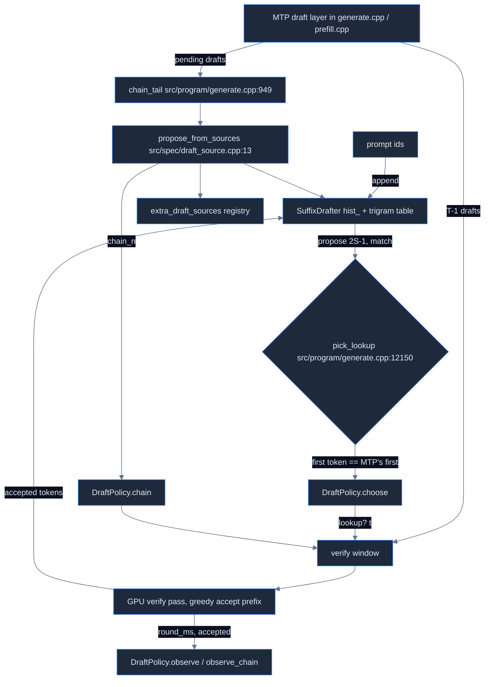

# Strata map: speculative decoding (`src/spec/`)

Source: Strata commit `296b59d2`. Paths are relative to the Strata repo root.

## 1. Overview

`src/spec/` is small and **CPU only**. It holds no MTP model, no verify kernel, and no GPU code. CMakeLists.txt:1157-1159 builds it as `strata_spec` ("speculation components that need no GPU"), which links into `strata` (CMakeLists.txt:624). It has four parts:
- **SuffixDrafter**: prompt lookup / n-gram drafting from a trigram hash table over prompt + accepted output.
- **DraftPolicy**: picks the window for each verify round (the MTP window or a lookup window) and sizes the `--lookup-chain` extension. It learns costs and acceptance online.
- **DraftSource / PromptLookupSource / propose_from_sources**: a plug-in interface for draft sources used by `--lookup-chain`.
- **Controller / CostModel** (src/spec/controller.cpp): an older planner. **No caller outside src/spec**: only src/spec/controller_test.cpp uses it. The MTP drafter itself (draft layer forward, batched MTP) lives in src/program/generate.cpp, src/prefill/prefill.cpp:1381 and src/core/verify.cpp (see engine-core.md and generate-program.md). The GPU verifier of probabilistic draft acceptance (STRATA_SPEC_PROB) has a parity test, `spec_verify_parity` (CMakeLists.txt:919-923).

## 2. File table

| path | lines | purpose |
|---|---|---|
| src/spec/suffix_drafter.cpp | 98 | trigram index, longest-suffix match, propose / propose_after |
| src/spec/draft_policy.cpp | 161 | DraftPolicy: choose / observe / chain / observe_chain, cost EMA |
| src/spec/controller.cpp | 73 | Controller + CostModel::step_ms (unused by the engine) |
| src/spec/draft_source.cpp | 36 | extra_draft_sources registry, propose_from_sources |
| src/spec/suffix_drafter_test.cpp | 158 | test (main at src/spec/suffix_drafter_test.cpp:135) |
| src/spec/draft_policy_test.cpp | 119 | test (main at src/spec/draft_policy_test.cpp:24) |
| src/spec/controller_test.cpp | 74 | test (main at src/spec/controller_test.cpp:16) |
| include/strata/spec/suffix_drafter.hpp | 59 | header with the design notes |
| include/strata/spec/draft_policy.hpp | 64 | header with the design notes |
| include/strata/spec/draft_source.hpp | 62 | header with the design notes |
| include/strata/spec/controller.hpp | 73 | header with the design notes |

## 3. Flow

## 4. How it works

### SuffixDrafter (src/spec/suffix_drafter.cpp)

- Constructor: min_match is clamped to >= 3 (src/spec/suffix_drafter.cpp:19). The table size is a power of two >= 2x capacity, so the load factor stays <= 0.5 (src/spec/suffix_drafter.cpp:20-22). Header defaults are min 3, max 32, capacity 2^19 (include/strata/spec/suffix_drafter.hpp:23). WAYS=4 recent end positions per trigram (include/strata/spec/suffix_drafter.hpp:21).
- key_at hashes 3 tokens with splitmix-style mixing. `|1` keeps the key from ever being 0 (src/spec/suffix_drafter.cpp:33-36). Linear probing is in find_slot (src/spec/suffix_drafter.cpp:38-48). When the table is full, appends silently stop indexing (src/spec/suffix_drafter.cpp:48, src/spec/suffix_drafter.cpp:56-57).
- propose: looks up the current trigram, extends each candidate match backwards up to max_match, keeps the longest (most recent on ties, src/spec/suffix_drafter.cpp:72-78), and rejects matches shorter than min_match (src/spec/suffix_drafter.cpp:80). The continuation may run into the current suffix (periodic text) (src/spec/suffix_drafter.cpp:83).
- propose_after temporarily appends the unverified drafts (not indexed), proposes, then truncates (src/spec/suffix_drafter.cpp:88-96).
- The engine builds it as `SuffixDrafter sfx(max(1,o.suffix_draft), 64, max_context+4096)` (src/program/generate.cpp:9680, src/program/generate.cpp:13733). The engine uses max_match 64, not the header default of 32.

### DraftPolicy (src/spec/draft_policy.cpp, design notes in include/strata/spec/draft_policy.hpp:1-15)

- kMaxT=8, 4 buckets (include/strata/spec/draft_policy.hpp:24-25). Default margin 0.03 (include/strata/spec/draft_policy.hpp:27). Buckets: match <6, <12, <24, >=24 (src/spec/draft_policy.cpp:30-32).
- The lookup rate is a Beta-like prior: (ok + 4*priorQ)/(ok+bad+4), with priorQ {0.75,0.88,0.93,0.96} (src/spec/draft_policy.cpp:18-19, src/spec/draft_policy.cpp:34-37).
- cost_ms(t): the measured EMA for t (alpha 0.1). Unmeasured sizes are scaled from measured ones by kShape {0,1,1.35,…,3.6}, taken from RTX 5070 measurements (src/spec/draft_policy.cpp:9-13, src/spec/draft_policy.cpp:39-51).
- MTP expected tokens: EMA alpha 0.05, prior 1+0.7(t-1) (src/spec/draft_policy.cpp:14, src/spec/draft_policy.cpp:55-58).
- choose(): computes E(k)=1+q+…+q^k over cost(k+1) and takes lookup only if it beats the MTP rate by the margin (src/spec/draft_policy.cpp:60-81). Probing: an unmeasured size or one stale for >300 rounds (kStaleRounds, src/spec/draft_policy.cpp:23) is forced when q>=0.85 (src/spec/draft_policy.cpp:20-23, src/spec/draft_policy.cpp:79, src/spec/draft_policy.cpp:84-87).
- observe: lookup counts decay by 0.97 (kDecay, src/spec/draft_policy.cpp:15).
- chain()/observe_chain(): the expected tokens are e0 + p_mtp*(c+…+c^k). The chain prior is {0.45,0.65,0.8,0.9}. A chain the window never reached gives no lookup evidence (src/spec/draft_policy.cpp:110-160).

### DraftSource (include/strata/spec/draft_source.hpp, src/spec/draft_source.cpp)

- PromptLookupSource wraps the SuffixDrafter. propose passes only the pending drafts as `extra` (include/strata/spec/draft_source.hpp:43-48).
- propose_from_sources asks the request's own source first, then every registered extra source. The longest match >= min_match wins, and on a tie the earlier source is kept (src/spec/draft_source.cpp:13-34). The extra-source registry is a function-static vector (src/spec/draft_source.cpp:8-11). Nothing in the tree registers one (only reads at src/program/generate.cpp:959, src/program/generate.cpp:962 and sycl twin sycl/src/program/generate.cpp:966, sycl/src/program/generate.cpp:969; no push/emplace anywhere — always empty).

### Controller (src/spec/controller.cpp, unused)

- step_ms is dense + CPU-miss + sync + draft (src/spec/controller.cpp:8-18). Its defaults are dense 11 ms, cpu_all_miss 15.8 ms, hit 0.55, sync 2.4 ms, MTP 1.2 ms/draft (include/strata/spec/controller.hpp:26-34). MTP prior 0.86 per position (src/spec/controller.cpp:23). Lookup priors {0.35,0.6,0.8,0.92} (src/spec/controller.cpp:24). min_gain 5% (include/strata/spec/controller.hpp:51, src/spec/controller.cpp:49).

### Callers (in src/)

- src/program/generate.cpp includes the headers (src/program/generate.cpp:78-80). Option docs and defaults are at src/program/generate.cpp:558-564 and src/program/generate.cpp:671-682.
- Option rewriting (src/program/generate.cpp:2565-2574): if suffix_draft>0 && spec>=2 && mtp_max_t==0, then mtp_max_t=spec and spec=min(spec+2, 8). With lookup_chain>0, spec=max(spec, min(mtp_max_t+lookup_chain, 8)).
- Serve path 1: sfx/policy at src/program/generate.cpp:9680-9681. pick_lookup at src/program/generate.cpp:12150-12160 requires `pl_sbuf[0] == chain0[0]`: the lookup's first token must equal the MTP's first guess. The chain path is at src/program/generate.cpp:11874-11875 and src/program/generate.cpp:12583-12590.
- Serve/generate path 2: src/program/generate.cpp:13733-13739, src/program/generate.cpp:13766, src/program/generate.cpp:13780-13783.
- chain_tail (keeps the last 64 tokens with pending drafts at the end) and extra_sources_reset/append: src/program/generate.cpp:949-963.
- **src/prefill does not call src/spec.** src/prefill/prefill.cpp:1381-1463 is the batched MTP drafter pass (env STRATA_MTP_BATCH*, STRATA_DRAFT_TIMING).

## 5. CLI flags and env

| name | default | file:line | effect |
|---|---|---|---|
| --spec N | 0 (2 on Metal) | src/program/generate.cpp:562-564; src/program/generate.cpp:2074 | verify window size, 0 = plain decode |
| --suffix-draft N | 3 | src/program/generate.cpp:675; src/program/generate.cpp:2134 | SuffixDrafter min_match, 0 = off |
| --mtp-max-t N | 0 (=spec) | src/program/generate.cpp:677; src/program/generate.cpp:2135 | MTP window cap |
| --lookup-chain K | 0, clamp 0..7 | src/program/generate.cpp:681; src/program/generate.cpp:2136 | chained lookup after MTP drafts |
| --lookup-chain-min M | 3, >=3 | src/program/generate.cpp:682; src/program/generate.cpp:2137 | min match for chain |
| --mtp PATH / --mtp-window | "" (no MTP), 32768 | src/program/generate.cpp:2089-2090; src/program/generate.cpp:589 | MTP weights / attention window |
| --spec-min-p | 0.0 | src/program/generate.cpp:609; src/program/generate.cpp:2096; per-request key src/program/generate.cpp:10697 | min draft probability to keep verifying (0..1) |
| --spec-oracle/--spec-corrupt/--spec-follow/--spec-split | ""/0/""/off | src/program/generate.cpp:2085-2087; src/program/generate.cpp:2098 | test hooks |
| STRATA_LOOKUP_CHAIN_FIXED | unset | src/program/generate.cpp:11875; src/program/generate.cpp:13783 | skip the policy gate for chains |
| STRATA_SPEC_DEPTH | unset | src/program/generate.cpp:11872; src/program/generate.cpp:13110 | per-depth MTP accept stats |
| STRATA_MTP_BATCH / _RING / _F16, STRATA_DRAFT_TIMING | on/on/off/off | src/prefill/prefill.cpp:1391; src/prefill/prefill.cpp:1396; src/prefill/prefill.cpp:1432; src/prefill/prefill.cpp:1463 | batched MTP drafter |
| STRATA_SNAPSHOT_VERIFY, STRATA_SPLIT_MTP_BATCH, STRATA_MTP_FULL_HEAD, STRATA_MTP_STAGE0 | unset/off/off/auto | src/program/generate.cpp:8533; src/program/generate.cpp:8507; src/program/generate.cpp:3502; src/program/generate.cpp:3651 | MTP/verify internals |

## 6. Gotchas

- The effective `--spec` differs from what the user passed. With the default suffix_draft=3, `--spec 4` becomes a verify window of 6 with an MTP cap of 4 (src/program/generate.cpp:2567-2569).
- A lookup window is used only if its first token equals the MTP's first draft (src/program/generate.cpp:12154).
- The policy's cost prior shape is from RTX 5070 measurements (src/spec/draft_policy.cpp:9-12). On a new GPU it is relearned, but sizes are probed only kProbes=3 times (src/spec/draft_policy.cpp:20).
- Controller/CostModel looks authoritative but is dead code for the engine.
- A full SuffixDrafter table stops indexing silently. Capacity is max_context+4096 (src/program/generate.cpp:9680), so it only overflows past that.
- Speculation only changes speed, never output (include/strata/spec/draft_source.hpp:3-4; include/strata/spec/draft_policy.hpp:15). Verification is greedy unless STRATA_SPEC_PROB=1 (probabilistic draft acceptance, off by default; include/strata/core/spec_prob.hpp:1).

## Quick index

| Area | Kind | Name | Where | Notes |
|---|---|---|---|---|
| spec | function | SuffixDrafter::propose | `src/spec/suffix_drafter.cpp:64` | longest trigram-anchored suffix match, continuation copy |
| spec | function | SuffixDrafter::propose_after | `src/spec/suffix_drafter.cpp:88` | temp-append pending drafts, propose, truncate |
| spec | gotcha | table full stops indexing | `src/spec/suffix_drafter.cpp:48` | find_slot returns nullptr, append skips |
| spec | const | WAYS=4 | `include/strata/spec/suffix_drafter.hpp:21` | positions per trigram |
| spec | function | DraftPolicy::choose | `src/spec/draft_policy.cpp:60` | lookup vs MTP by E/cost with margin 0.03 |
| spec | function | DraftPolicy::chain | `src/spec/draft_policy.cpp:117` | lookup-chain length after MTP window |
| spec | const | kShape | `src/spec/draft_policy.cpp:12` | RTX5070 cost prior shape by window |
| spec | const | kStaleRounds=300 | `src/spec/draft_policy.cpp:23` | re-probe stale sizes |
| spec | const | kMaxT=8 | `include/strata/spec/draft_policy.hpp:24` | max verify window |
| spec | function | propose_from_sources | `src/spec/draft_source.cpp:13` | longest match >= min wins across sources |
| spec | gotcha | Controller unused | `src/spec/controller.cpp:36` | no callers outside src/spec |
| spec | flag | --spec | `src/program/generate.cpp:2074` | verify window, default 0 (Metal 2) |
| spec | flag | --suffix-draft | `src/program/generate.cpp:2134` | min match, default 3 |
| spec | flag | --mtp-max-t | `src/program/generate.cpp:2135` | MTP window cap |
| spec | flag | --lookup-chain | `src/program/generate.cpp:2136` | 0..7 chained lookup |
| spec | flag | --lookup-chain-min | `src/program/generate.cpp:2137` | >=3 |
| spec | behavior | spec rewrite +2 | `src/program/generate.cpp:2567-2569` | suffix on: mtp_max_t=spec, spec=min(spec+2,8) |
| spec | behavior | lookup first-token gate | `src/program/generate.cpp:12154` | lookup needs pl_sbuf[0]==MTP first |
| spec | env | STRATA_LOOKUP_CHAIN_FIXED | `src/program/generate.cpp:11875` | no policy gate |
| spec | env | STRATA_SPEC_DEPTH | `src/program/generate.cpp:13110` | depth accept stats |
| spec | env | STRATA_MTP_BATCH | `src/prefill/prefill.cpp:1391` | 0 disables batched MTP drafter |
| spec | kernel | spec_verify_parity | `CMakeLists.txt:920` | verify kernel parity test (outside src/spec) |
