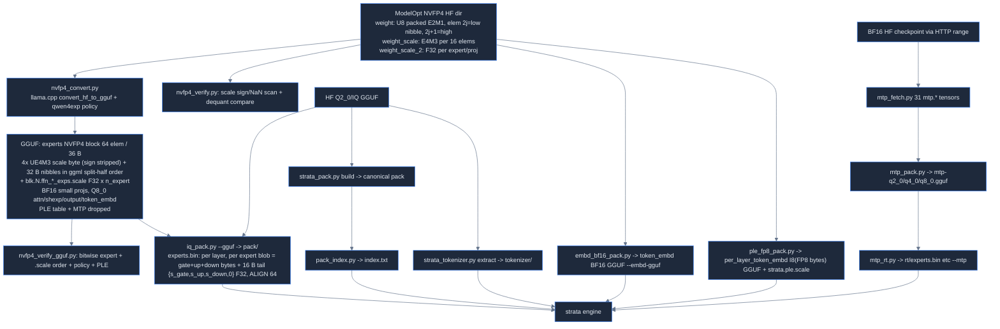

# Strata map: tools, reference code and scripts

Source: Strata commit `296b59d2`. Paths are relative to the Strata repo root. See also build-system.md (setup.py, line counts of pack tools), tests-bench-docs.md (tools/test_*.py).

## Overview

- tools/ (158 files) = Python reference implementations ("spec of record") + converters/packers + benches + 68 setup/serve tests.
- Doctrine (tools/strata_pack.py:1-6): Python is written first; C++ is a port; "if the two disagree the C++ is wrong".
- Two model routes: (A) GGUF from HF (Q2_0 / IQ / K-quants) -> tools/strata_pack.py or tools/iq_pack.py; (B) ModelOpt NVFP4 HF checkpoint -> tools/nvfp4_convert.py (llama.cpp converter + policy) -> GGUF -> tools/iq_pack.py (NVFP4 expert blobs + 16 B scale tail).

## Conversion pipeline

- NVFP4 byte facts: block (64 elems, 36 B) tools/gguf_reader.py:47 (type id 40, tools/gguf_reader.py:27); ModelOpt nibble order tools/nvfp4_verify.py:38-41; E2M1 LUT tools/nvfp4_verify.py:32; repack = nibble move to split-half + E4M3->UE4M3 by stripping sign (tools/nvfp4_verify.py:5-7); exact ggml split-half nibble order inside a 16-elem sub-block is defined in llama.cpp.
- Scale tail tools/iq_pack.py:204, tools/iq_pack.py:455-464; tail-only (no GGUF offsets) index line for NVFP4 tools/iq_pack.py:470-473.
- Full dequant = E2M1 x E4M3 x weight_scale_2 (tools/nvfp4_verify.py:42-43).

## Key tools table

| tool | purpose | key logic file:line | in -> out |
|---|---|---|---|
| tools/nvfp4_convert.py (128) | ModelOpt NVFP4 -> GGUF with Strata type policy | BF16_SUFFIXES tools/nvfp4_convert.py:44-50, tensor_force_quant tools/nvfp4_convert.py:61-69, PLE drop tools/nvfp4_convert.py:71-78, run converter --outtype q8_0 tools/nvfp4_convert.py:97-102, manifest tools/nvfp4_convert.py:111-122 | HF dir → .gguf + .manifest.json |
| tools/nvfp4_verify.py (121) | prove repack lossless | modelopt_dequant tools/nvfp4_verify.py:35-43, check_scales tools/nvfp4_verify.py:46, check_experts tools/nvfp4_verify.py:77 | HF dir (+torch as reference) -> report |
| tools/nvfp4_verify_gguf.py (161) | GGUF vs checkpoint bitwise | check_experts tools/nvfp4_verify_gguf.py:43-70 (reshape(512,-1)[expert] tools/nvfp4_verify_gguf.py:54, scale==weight_scale_2 tools/nvfp4_verify_gguf.py:67), check_policy tools/nvfp4_verify_gguf.py:74, check_ple tools/nvfp4_verify_gguf.py:104 | HF dir + GGUF -> report |
| tools/iq_pack.py (644) | native pack keeping GGUF quants (IQ/K/NVFP4) | BF16 conversion convert tools/iq_pack.py:227, index_standalone tools/iq_pack.py:275, expert_layout tools/iq_pack.py:430-488, NVFP4_TAIL tools/iq_pack.py:204 | GGUF shards -> pack dir (experts.bin, dense) |
| tools/strata_pack.py (452) | Q2_0 canonical pack build/verify/info | pack_codes tools/strata_pack.py:60, canonicalise tools/strata_pack.py:98, build tools/strata_pack.py:220, verify tools/strata_pack.py:366 | GGUF -> pack + manifest |
| tools/pack_layer.py (123) | Q2_0 expert blob 1,382,400 B, gate/up rows interleaved | doc tools/pack_layer.py:1-23, blob_offsets tools/pack_layer.py:54, build tools/pack_layer.py:68 | GGUF -> arena |
| tools/pack_index.py (260) | manifest JSON -> flat index.txt for C++ | main tools/pack_index.py:99 | manifest -> index.txt |
| tools/mtp_fetch.py, mtp_pack.py, mtp_rt.py | MTP head fetch (range GET), quantize, runtime blobs | fetch tools/mtp_fetch.py:213, q2_0 tools/mtp_pack.py:58, blob_of tools/mtp_rt.py:48 | HF -> GGUF -> rt/ |
| tools/embd_bf16_pack.py (87) | BF16 token_embd GGUF | main tools/embd_bf16_pack.py:38 | ckpt -> gguf |
| tools/ple_fp8_pack.py (123) | FP8 PLE table bit-exact as I8 GGUF (51.2 GB) | doc tools/ple_fp8_pack.py:6-14, main tools/ple_fp8_pack.py:44 | ckpt -> gguf |
| tools/quant_formats.py (154) | per-layer quant summary, local or HF range | summarize tools/quant_formats.py:92 | GGUF headers -> text/json |
| tools/gguf_reader.py (142) / tools/gguf_writer.py (234) | gguf-py-free reader; writer incl. Q2_0 | BLOCK_GEOMETRY tools/gguf_reader.py:39-48; quantize_q2_0 tools/gguf_writer.py:42, dequantize_q2_0 tools/gguf_writer.py:64 | GGUF ↔ arrays |
| tools/strata_tokenizer.py (368) | tokenizer reference (gpt2 BPE, 248,320 tokens) | Tokenizer tools/strata_tokenizer.py:67, extract tools/strata_tokenizer.py:307 | GGUF -> tokenizer/ |
| tools/canonical_xcheck.py (799) | bit-exact canonical-form round-trip per GGML type | to_/from_ pairs tools/canonical_xcheck.py:58-558 | GGUF -> pass/fail |
| tools/ab_engine.py (139) | A/B two engine builds, alternating rounds | main tools/ab_engine.py:67 | config + arms -> timings |
| tools/quant_quality.py (380) | teacher-forced top-1/KL vs Q8_0 on data/quant_quality/v1 | cmd_run tools/quant_quality.py:103, compare tools/quant_quality.py:284 | engine runs -> metrics |
| tools/quant_bound.py (59) | decode bandwidth bounds from quant_formats json | main tools/quant_bound.py:35 | quant_formats JSON -> bounds |

## ref/ and correctness

- ref/ holds only ref/load.py (212 lines): GGUF -> FP32 with lazy per-(layer,expert) dequant (doc ref/load.py:1-16).
- Dequant via gguf-py, except Q2_0 via gguf_writer.dequantize_q2_0 (ref/load.py:41-57) so bugs can't hide behind one decoder.
- GEOM (ref/load.py:34-38) mirrors block_geometry() (include/strata/artifact/gguf_reader.hpp:125).
- Note GEOM lacks NVFP4 -> ref/ cannot dequant NVFP4 GGUFs (ref/load.py:35-38 has no NVFP4 entry).
- Shard discovery is a correctness requirement (PLE in shard 2) ref/load.py:64-80.
- Correctness ladder: canonical_xcheck (bit-exact packing) -> strata_pack verify -> nvfp4_verify(_gguf) -> quant_quality (KL/top-1) -> tools/qwen35/parity.py + tools/qwen35/kl.py vs llama.cpp.

## Hip tools

tools/hip/build_windows.bat, tools/hip/package_windows.py, tools/hip/dll_closure.py (see build-system.md); tools/hip/tune_hipblaslt.cpp (420) generates gfx*-hipblaslt-<rocmver>.txt solution tables (gfx1100/1150/1151/1200/1201; gfx1201 has 100202 and 100500); tools/hip/bench_prefill.py (75) fresh/follow-up prefill probe against idle server.

## Rest (one line each)

- Benches: tools/strata_bench.py (community harness, bench.sh), agent_turns_bench, needle_bench, research_run, serve_load, bench_eviction, tools/h2d_bench.cu, sm60_dp4a_check.cu.
- Cache/serving live tests: conversation_cache_*, batch_*, cancel_park/parking/early_close/stop_resend/session_pressure, replay_cache_policy, split_mtp_batch_parity, logit_bias_*.
- Expert profile: make_profile(.py/_mix) -> data/expert-profile*.bin; tools/draft_vocab.py -> data/draft_vocab*.bin.
- Inspection: strata_inspect (fingerprints, data/gguf_fingerprints.json), quantscope, calibrate, check_isa_guard, collect_profile_traces, iq_fixture (kernel parity fixtures).
- qwen35/: Qwen3.6-35B-A3B parity vs llama.cpp (tools/qwen35/parity.py, tools/qwen35/kl.py, tools/qwen35/compare_dumps.py, tools/qwen35/q36_llama_dump.cpp).
- image/: Qwen-Image via stable-diffusion.cpp (tools/image/install.py, tools/image/qimage.py, sdcpp_native). vision/: strata-vision mtmd binary. windows/: enable_large_pages.ps1.
- tools/strata_mcp.py: MCP server. test_*.py: see tests-bench-docs.md.
- data/: draft vocabs, expert profiles, fingerprints, quant_quality/v1 text set + data/quant_quality/v1/set.ids.json, experimental-speed-projection GGUF+json.
- Root: chat.py (116, stdlib terminal chat client), bench.sh (-> tools/strata_bench.py), update.sh (git pull + setup.py refresh), docker-entrypoint.sh/Dockerfile/flake.nix (CUDA container, build-system.md), AGENTS.md (pointers to docs/AI_SETUP.md, docs/DETAILS.md, docs/AMD_HIP.md).
