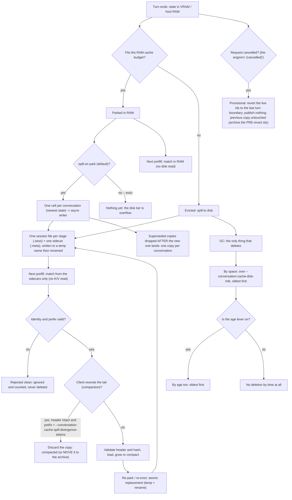
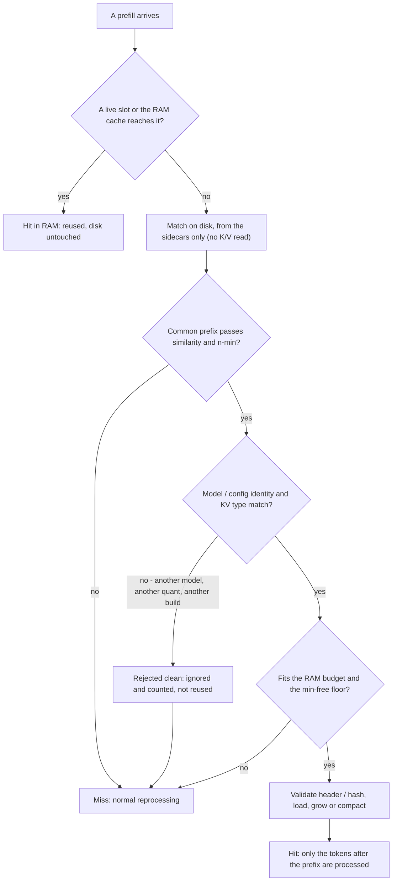
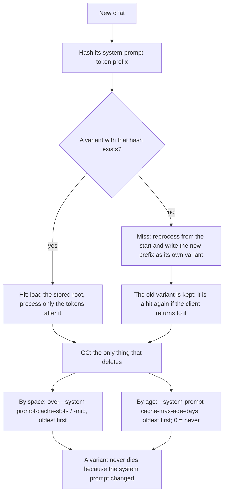

# Keeping conversations and the system prompt on disk

Two opt-in functions of `strata --serve` write a checkpoint to disk and read it back instead of reading a prompt
again: the **disk tier** keeps a conversation the RAM cache evicts, and the **system-prompt cache** keeps the
checkpoint that ends the system prompt. Both are off by default. With no flags, the engine behaves exactly like
upstream. Every flag is listed in [FLAGS.md](FLAGS.md).

## Why this helps

A long chat that comes back after a few turns is not free: the engine has to hold, or re-read, the history in
front of the new message. Upstream keeps that in host RAM (`--conversation-cache-mib`), but the RAM cache is
bounded and does not survive a restart. The disk tier closes that gap: a conversation is written to a folder as an
ordinary session file, and a later request — or a restart — reads it back instead of reading the whole prompt
again. The file is the same format the manual slot save/restore API writes, so a spilled conversation and a
hand-saved one are interchangeable.

The tier has two modes (`--conversation-cache-spill-on`). The default, **mirror** (`park`), writes the state the
moment a request ends and its session is parked, so an abrupt close loses at most the request in flight. The
opt-out, **overflow** (`evict`), is the delta-1 behaviour: only a conversation the RAM cache evicts reaches disk.
In both modes the folder holds **one copy per conversation**, and the copy is only replaced once its successor is
on disk.

The system prompt in front of every chat is (for one client) the same on every new chat, and it can be thousands
of tokens. Re-reading it costs time on the first request of each chat. The system-prompt cache persists the
checkpoint at the end of that prefix, so a new chat reads only what comes after it. It is a resume point for the
prefix, never a conversation tail.

## Slot lifecycle

A slot is one request's state. When its turn ends the state is parked; the RAM cache holds it, and the disk tier
mirrors it (default) or catches what the RAM cache drops (`evict`). The write happens when a request **ends**,
never mid-generation, and a burst of parks of one conversation collapses to its newest state: one cell per
conversation, drained by one background writer.

**Compaction.** The sidecar carries the conversation's own token ids, so the check needs no K/V. A stored copy
whose common prefix with the incoming prompt is shorter than `--conversation-cache-spill-divergence-tokens`
(4096 by default) **while its header still matches** describes a history the client has rewritten (a compaction or
an edited history): it can never be a hit, so it is discarded — index and file — and counted (`compacted`). A copy
the prompt extends is the normal turn and is kept; a copy whose header differs is another conversation and is left
alone.

**Cancellation.** A request the client aborts (Escape-Escape in a TUI) ends with the engine's own `(cancelled)`
line. That state is provisional: the live ids are reverted to the last turn boundary the read actually reached
(`--turn-token`), no durable copy is published of it, and the previous good copy is left exactly as it was — it is
the prefix the client resends on the retry. The harness does not matter: the decision uses only the turn token and
the engine's cancellation signal.

**Archive instead of discarding (opt-in, delta 5a).** By default the three paths that discard the parking copy —
the compaction above, the copy a re-park supersedes, and the provisional state of a cancelled request — remove it.
With `--conversation-cache-archive-mode ids` (or `state`) the tier **moves** the copy into a subdirectory
(`--conversation-cache-archive-dir`, default `<spill-dir>\archive`) instead of removing it. `ids` keeps only the
sidecar (the token and image ids, no K/V); `state` moves the session file — the K/V included — with its sidecar.
The cancellation path archives the state **before** the revert, so it keeps the tokens the request actually
produced (archiving after the revert would store a copy identical to the previous one). The archive is **never a
reuse candidate**: its entries are not in the tier's index, so `best()` cannot return one — it is evidence and
recovery, and a client that reverts a compaction can restore it in `state` mode. It has its **own** budget
(`--conversation-cache-archive-mib`) and its **own** GC (per-conversation `keep`, then the budget, oldest first,
plus `--conversation-cache-archive-max-age-days` if set), separate from the tier's `--conversation-cache-disk-mib`;
the tier's GC never touches the archive and the archive never counts as a tier eviction.

**Risk and retention of the archive.** The archive keeps what the tier would have deleted, so it is a larger and
longer-lived exposure surface. It is **plaintext**: the `.meta` holds token ids and image keys and, in `state`
mode, the `.sess` holds the whole K/V. There is **no encryption** and **no secure delete** — removal is an ordinary
file unlink. Keep the archive folder as private as the spill folder (restrictive permissions, private volume) and
set a retention rule deliberately: `--conversation-cache-archive-keep` (copies per conversation),
`--conversation-cache-archive-mib` (byte total) and, optionally, `--conversation-cache-archive-max-age-days`. With
`-max-age-days 0` (the default) an archived copy persists as long as it fits the byte budget: there is **no
deletion by time** unless you ask for it. A conversation whose archived copy alone exceeds `-mib` is **not
archived** (it is discarded exactly as without the archive): the archive's budget is never exceeded by one copy.

## Prefill decision tree

A new prompt is first offered to the live slots and the RAM cache; only then to the disk tier. A disk match is
loose (a common prefix), and the candidate is restored only if the exact prefix passes; otherwise the prompt is
read normally.

## System-prompt variants

The cache does not hold one system prompt but a small set of variants. A variant is keyed by the exact hash of
its system-prompt token prefix (plus `--system-prompt-cache-key` and the model/config identity), so only a prompt
that begins with exactly those tokens can attach it.

## Use and limits

**Turn it on.**

- Disk tier: `--conversation-cache-mib > 0`, `--prompt-cache > 0`, `--conversation-cache-slots > 0` and a nonzero
  `--conversation-cache-disk-mib` (default 8192 MiB). `--conversation-cache-spill-dir DIR` names the folder; when
  the flag is absent the engine resolves one (`<Strata dir>\slots`, or `<user profile>\.strata\slots` when the Strata
  folder is on the system drive or cannot be created) and logs the choice, so the tier turns on without the flag.
  `--conversation-cache-spill-on` chooses `park` (default once the tier is on: a mirror, written at the park) or
  `evict` (the delta-1 overflow);
  `--conversation-cache-spill-when-full` chooses `evict-oldest` (default) or `reject`;
  `--conversation-cache-spill-max-age-days` adds optional age pruning (0 = off);
  `--conversation-cache-spill-divergence-tokens` (4096) and `--conversation-cache-spill-park-throttle-s` (0) tune
  the compaction check and the rewrite rate.
  The **archive** is opt-in and off by default: `--conversation-cache-archive-mode ids|state`
  (`--conversation-cache-archive-dir`, default `<spill-dir>\archive`; `--conversation-cache-archive-mib`, default
  2048; `--conversation-cache-archive-keep`, default 4; `--conversation-cache-archive-max-age-days`, default 0 =
  no retention by time). With the mode `off` nothing is archived and nothing is created: the tier is
  **byte-for-byte identical** to the behaviour without these flags.
- Parking destination: `--conversation-cache-park` (default `ram`) sends a capture to host RAM, spills it to disk,
  or lets `auto` resolve the two at start; `--conversation-cache-park-min-free-mib` (default 512 MiB) is the transient
  floor a disk-destined copy may take. See [FLAGS.md](FLAGS.md), section D.
- System-prompt cache: `--system-prompt-cache` with `--system-prompt-cache-dir DIR`. It also needs
  `--prompt-cache > 0`, `--prompt-cache-root > 0`, a turn token and `--mtp` (without MTP the feature reports
  itself off rather than capturing a different artifact). Its folder is separate from the spill folder.

Both can be set in a config's `args` and edited from the Settings page (see `serve/runconfig.py`). The Monitor
shows their counters under `/metrics` in `conversation_cache` (`disk` and `system_prompt_cache`).

**Limits.**

- The disk tier works with `--layer-split`: one session file per stage plus one joint sidecar.
- The system-prompt cache works with `--layer-split` too, the same way: one session file per stage under the
  variant's key, and a joint sidecar holding the stage count (its sidecar is version 2; a version 1 file, the
  single-file form, is still read). It also loads a variant whose K/V was stored while the engine kept part of
  the context in host RAM.
- A disk hit is read into host RAM before it is restored: it must fit `--conversation-cache-mib` and leave a
  physical-memory floor available, or the request reads the prompt normally. A copy destined to disk reads under the
  smaller `--conversation-cache-park-min-free-mib` (default 512 MiB) when the `--conversation-cache-min-free-mib`
  floor does not hold, because its RAM is transient.
- The scan never deletes. A file of another identity, a broken or missing sidecar, an orphan session file and a
  leftover temporary are ignored and counted (`foreign`, `stale`, `orphan`), never removed. Only the GC removes,
  by budget and (if enabled) by age, oldest first.
- **Known limitation: the divergence discard can name the wrong copy** when the chat template puts few-shot turns
  **inside the system prompt**. `discard_diverged_impl`
  ([`src/core/conversation_spill.cpp`](../src/core/conversation_spill.cpp)) decides which stored copy a rewritten
  tail belongs to from the end of the stored conversation's header - `conversation_header_length`, the start of its
  first assistant turn - and keeps a copy whose shared prefix reaches past that marker
  (`header == 0 || common < header` skips it). Few-shot turns inside the system prompt move that marker into the
  root the conversations share, so a **sibling** conversation (same system prompt, a different first exchange) also
  satisfies the guard, and its copy is the one removed - **discarded from disk, not archived**, in this version. The
  fix is a property guard: only the copy sharing the **longest prefix** with the prompt is a rewrite candidate, a tie
  between copies that disagree discards nothing, and a trace line names the `conversation_key` of the copy removed.
  It is written and tested on a sibling branch and arrives as the next stacked PR against this branch; this delta
  ships without it.
- With the RAM cache off (`--conversation-cache-mib 0`, the default) nothing is written: no folder is created and no
  byte is written. With the RAM cache on, the disk tier resolves a default folder and turns on even when
  `--conversation-cache-spill-dir` is absent. The mirror writes at the **end of a request** (the park), never
  mid-generation, and collapses a burst of parks of one conversation to its newest state; the disk cost is bounded by
  `--conversation-cache-disk-mib` either way.
- The **archive** (`--conversation-cache-archive-mode`, delta 5a) is off by default: with `off` the tier is
  **byte-for-byte identical** to the behaviour without the archive flags (no directory, no byte, counters at 0).
  When on it keeps what the three discard paths would destroy, in its own subdirectory, with its **own** budget and
  GC, separate from the tier's `bytes_`/`disk_evictions`/age levers. It is **never a reuse candidate** (`best()`
  cannot return one) and it **does not speed up** any read. `state` costs like a session file per copy (~30 KB/token
  at the measured geometry), so bound it with `--conversation-cache-archive-mib`. The archive must not be the spill
  folder itself (refused at start, so its entries can never be indexed as reuse candidates). It is **plaintext and
  has no secure delete** (see the risk note above); retention is `-keep` + `-mib` + optional `-max-age-days`, and a
  copy that alone exceeds `-mib` is not archived. In a cancelled request the archive always keeps the pre-revert
  **ids only** (the `.meta`), never the K/V, even in `state` mode: the `--conversation-cache-archive-mode` row of
  FLAGS.md states exactly that.
- The **mirror** pays a host copy of the parked image per park (the writer owns its own copy, so the RAM cache's
  entry is never aliased). The copy is synchronous at the park; the disk write itself is asynchronous.

## Validation environment

- The session-file numbers below were measured on an **RTX 4070 Ti (12 GB), Ryzen 9 5900X, 64 GB RAM, NVMe ext4,
  IQ3_XXS**, on a 63,025-token conversation, with engine 0.1.38 carrying the session-file change (binary sha256
  `3bbe4fc3...`). They measure the **session-file SAVE/RESTORE path**, which the spill reuses; they are not a
  measurement of the automatic spill.
- The KV-streaming figure (~13.7 KB of RAM per context token) is measured on the setups in
  [DETAILS.md](DETAILS.md#speed-measured) (KV streaming, engine 0.1.5; ~1.7 GB at 128K).
- The layer's own host-only tests (conversation cache / memory / file / spill / prompt cache) build and pass with
  `-DSTRATA_BUILD_CONVERSATION_TESTS=ON`. That is a correctness check, not a speed measurement.
- Against this tree's base - upstream `v0.1.41` (`fb58e0d`) - what has been verified is: the CUDA build exits 0;
  the `strata.exe` the verification ran against is sha256
  `C1D54A4F5A405F076A0D5F1EB0384DECB5A5E422C3A109A7AD6CD7B86A26FB99`; its `--help` lists all 17 flags of this
  layer; an unknown flag is fatal (`unknown argument`, exit 2); the full host-only battery passes **12/12**
  (`ctest` exit 0); and the layer's own anchor/flag verifier (kept beside this series, not part of the diff)
  reports 39 anchors and 17 flags OK, exit 0.
- **A live run against this base exists now.** That same `strata.exe` (sha256
  `C1D54A4F5A405F076A0D5F1EB0384DECB5A5E422C3A109A7AD6CD7B86A26FB99`, the digest of the binary that was launched -
  the run log itself records `build_info`, not a digest) served `127.0.0.1:5012` on the verification machine on a
  clone of the production serve config, and reported `/props` `build_info='Strata 0.1.41'` with `n_ctx=196608`
  (`qwen3.8-flash-next-unsloth-ud-iq4_xs`), ready in **156.6 s** in both runs. A four-test battery (smoke, streamed
  throughput, repeated system prompt, two conversations that spill) ran against it **twice**, the second time after
  a server restart with the tier's folders left in place: `bench-20261009-051623.log` and
  `bench-20261009-061613.log` (`OVERALL: PASS`). The first run reported `OVERALL: FAIL` for one reason only: its
  harness (v1.0.0) could not compute a throughput figure at `max_tokens=256`; the second run (harness v1.1.0, no
  output cap) passed all four tests. The logs are kept with the harness, not in this repository. The numbers are
  under [Measured benefit](#measured-benefit) and what they do not show is under [Non-claims](#non-claims).

## Measured benefit

**Session files (what both functions write).** On the setup above, a 63,025-token conversation is a **1.20 GB**
file: **save 0.65 s**, **restore 1.05 s** in a new engine process, and the next 32-token turn then takes
**1.14 s** (1.00 s for the same turn without a restart). The cold first turn of that conversation takes 25.5 s.
The file reported `n_written = 1,198,691,396` bytes, that is **about 19,019 bytes per token** at this geometry.
Each extra checkpoint is about **118 MB**. These are single runs.

**KV streaming.** Holding the context's K/V in host RAM costs about **13.7 KB per context token** (1.7 GB at
128K). This is the dominant term when sizing a spill folder.

**This layer, end to end (live, the first two runs).** On the engine above, with the tier's folders left in place
between the runs:

- **Cold prefill against a restore after a process restart.** Two ~8k-token conversations (`prompt_tokens=8016`)
  took **29.76 s** and **30.10 s** in the first run (a fresh process, nothing on disk for them) and **1.98 s**
  each in the second one (a new process, both already on disk), with the engine counting `restores=4` in that
  second run against `restores=0` in the first. The 33,409-character system-prompt test has the same shape:
  **30.296 s** for the first call of the first run (nothing reused) against **2.298 s** for the first call of the
  second one.
- **The tier wrote, and its counters moved.** After the second run the engine reported
  `disk: enabled=True spills=2 bytes=2153775104 restores=4` over a folder of 19 files / 2,154,484,304 bytes, and
  `sysprompt: enabled=True variants=3 hits=1 misses=0 bytes=719323136`.
- **What the same binary serves** (a property of the build, not of the layer): with no output cap and a natural
  stop, three reps produced 472 / 480 / 458 tokens (`finish=stop`) at a median TTFT of **0.452 s**, at **28.11
  tok/s** decoding (27.39 tok/s end to end).

**What those numbers are not.** Both runs used the same binary with the layer **on**, so what is measured is
**cold prefill against a restore from disk after a restart** - nothing more. It is not a comparison against
upstream, not a speedup ratio for the layer, and not a throughput claim about it. `restores=4` and `hits=1` are
**one run each**: a working signal, not a rate. The `conversations=0` on that same counter line is what the engine
reports and is not interpreted here. The system-prompt test of the second run (TTFT 1.096 s then 1.52 s, with
`reused=7920/7925` already warm) is one sample of a warm prefix, not a regression - and the **-92.6 %** of the
first run is a cold-prefill KV-reuse figure (that run read `sysprompt hits=0`), so it is not a property of the
system-prompt cache either.

## Sizes by KV type

The KV cache is the part that scales with its type. `int8` is the type measured here; `f16` and `q4_0` are
**derived** from it by the nominal width (f16 = 2 bytes/value, int8 = 1, q4_0 = 18 bytes per 32 values = 0.5625),
so they are estimates, not measurements. The derivation ignores the per-block scale bytes and does not separate
the parts that do not scale with the KV (running state, checkpoints); treat them as a lower bound on the total
disk a folder will use.

Measured `int8` anchors: **~14,029 B (≈13.7 KB) per context token** for the KV in host RAM (streaming), and
**19,019 B per token** for the session file on disk (63,025 tokens → 1.20 GB).

| KV type | KV in host RAM (B/token) | 17k | 63k | 384k | Session file on disk (B/token) | 17k | 63k | 384k |
| --- | ---: | ---: | ---: | ---: | ---: | ---: | ---: | ---: |
| **f16** | ~28,058 *(derived)* | ~455 MiB | ~1.65 GiB | ~10.0 GiB | ~38,038 *(derived)* | ~617 MiB | ~2.23 GiB | ~13.6 GiB |
| **int8** | ~14,029 *(measured)* | ~227 MiB | ~0.82 GiB | ~5.0 GiB | 19,019 *(measured)* | ~308 MiB | 1.20 GB *(measured at 63,025)* | ~6.80 GiB |
| **q4_0** | ~7,891 *(derived)* | ~128 MiB | ~0.46 GiB | ~2.8 GiB | ~10,698 *(derived)* | ~173 MiB | ~0.63 GiB | ~3.83 GiB |

Sizes are powers of 1024 (MiB, GiB) except the measured 1.20 GB, which is the decimal figure upstream reports.

## The per-segment tier (layer/segmentos-t3, opt-in)

The disk tier above writes **one growing `.sess` per conversation**: every park rewrites the whole state (63 025
tokens ≈ 1.20 GB). The per-segment tier removes that: each phase of a turn is its **own file** and the conversation is
the **ordered list of references** to those files - the state is the **sum of the segments**, not a file that grows.

- **Layout.** Beside the `.sess` files two families live in the same folder: the manifest
  `strata-conv-<serial>.segs` (the list of refs) and the segment files `<seg_id>.seg` (and `<seg_id>.stage<k>.seg`
  with `--layer-split`). A segment file is an ordinary session file (`session_file_write`), byte-for-byte a `.sess`
  of its own slice. The name `<seg_id>` **is** the content address, so two conversations that share a segment point
  at the **same** file - that is the deduplication, materialized in the tree. The old scan never indexes a
  `<seg_id>.seg` (it only takes names starting with `strata-conv-`) and counts `<stem>.segs` as an unknown file it
  **never deletes**, so running the ported tree beside these files is safe (the `.sess` + `.meta` v2 path is the
  compatibility path and is read unchanged).
- **The address includes the precedent.** `seg_id = H(prev_frontier ‖ kind ‖ domain ‖ tokens ‖ role_token ‖ model ‖
  config)`, with `prev_frontier(0) = H(model ‖ config)`. The tokens and the model/config are **not enough**:
  attention is causal and the GDN/QSA/PLE state is *all-or-nothing*, so a segment with the same tokens after a
  **different** history is a different segment. Folding the previous address in makes the dedup **correct by
  construction** - it fires where the prefix chain coincides (the systemprompt, a resume, sister prefixes) and
  **not** where it does not.
- **Restore by frontier.** `best()` matches from the manifests alone (no K/V read): it hashes the prompt's tokens at
  each ref's range and compares them to the stored address. The longest contiguous run from the head that is an
  exact prefix of the prompt is the reusable prefix; a divergence, a hole, or a missing segment file cuts the run
  there (and everything after is re-prefilled). `load()` reads **only** the segments `0..k` (the sum) and never
  opens the later ones.
- **The effort frontier is anchored at the `<|im_start|>` opener, not the role token.** `segment_plan_split` cuts the
  effort turn at the `<|im_start|>` that opens it (the engine's `turn_at`), one token **before** the
  `--tail-role-token` (measured on the pack's real tokenizer: opener `248045`, role `system` `8678` at opener + 1).
  The engine checkpoints at the opener, so a frontier cut at the role token landed one token past every checkpoint:
  its running state never travelled and the chain broke exactly at the effort turn. A role token that does **not**
  immediately follow an opener keeps the old frontier (declared, not fixed): the engine's own `#458` requires the
  same adjacency.
- **The sum is of the attention K/V, not of the recurrence.** The attention K/V of the prefix is the concatenation
  of the segments' slices; the recurrent state is **the last segment's snapshot** (a running summary, not a sum),
  valid only under its exact chain.
- **Budget and GC are the tier's own.** `segment_bytes_` and `segment_evictions_` are separate from the `.sess`
  tier's `bytes_` and `disk_evictions_`. The refcount is recomputed on `open()` from the union of the manifests (it
  is never persisted). The GC removes a segment only when its refcount is ≤ 1: an orphan (0) first, then the
  volatile kinds (`think`/`answer`/`tool`) before `read`/`write`; a shared systemprompt (refcount > 1) is **never**
  removed.

**The thinking-effort case (the measurable criterion).** For two prompts `P = [sys][pre][effort][answer]` that differ
only in the effort turn and its answer, the restore's frontier is `len(sys)+len(pre)` and the tokens re-read are
`read_tokens = len(effort) + len(answer)`, **independent of the prefix**. The host-only test fixes this: with a small
and a large `pre`, `read_tokens` is the same, and `best()` does **not** return the whole live. If the design were
reverted (the frontier computed after the effort turn, or `best()` matching the whole live), `read_tokens` would jump
to `len(effort)+len(answer)+len(pre)` and the test would fail.

**Status.** `include/strata/core/conversation_segments.hpp`, `src/core/conversation_segments.cpp` and
`src/core/conversation_segment_test.cpp`. The engine now **parses the three flags** (`docs/FLAGS.md`, section G) and,
with `--conversation-cache-segments on` beside a live spill tier, opens the store on the **same** spill directory as
the `.sess` tier. With every flag absent the tree is the ported layer, byte for byte (D-7). It is a **writer and a
reader** (`layer/segwriter-t3`): at the point the disk tier writes a conversation (the eviction in `spill_evicted`,
and the park mirror) `mirror_segments()` splits the captured image with `segment_plan_split()` and `store_image()`
writes each phase as its own content-addressed `<seg_id>.seg`, the manifest last; the restore path matches a chain
from the manifest alone and reads only the segments `0..k`. The writer slices **one segment at a time** and skips any
segment already on disk, so a growing chat pays only for its new tail and a shared systemprompt is written once. The
host-only test (174 checks) covers the effort and systemprompt invariants red/green, the exact reconstruction of the
image from the sum, idempotency and the incremental write. The recurrent snapshot travels with its own frontier: the
last segment carries the captured live state and a segment whose end is a checkpoint of the image carries that
checkpoint, so the effort frontier restores with state.

## The restore ladder (`STRATA_RESTORE_LADDER=1`, opt-in)

When the parked image the serve loop picked does **not** validate as a whole, the shipped path throws the whole prefix
away and falls back to the slot's own prefix (empty on a new request, so a long context is re-prefilled from zero).
With the flag on the engine no longer discards the whole image: it descends the image's **own** running-state
checkpoints (the turn-boundary prefixes the sidecar already carries) largest first, and restores the largest one that
validates, re-reading only the tokens after it. If no checkpoint of the image validates, it falls back to the parked
RAM copy the tiers above may have beaten - still a usable shorter prefix.

Why a shorter checkpoint is usable at all: attention is causal, so the K/V the image holds for `[0, N)` is
byte-for-byte the K/V of every shorter prefix. The restore keeps the image's K/V **whole** and puts the checkpoint's
running state (GDN/QSA/PLE) in place of the image's live state; the caller sets its resume point to the checkpoint's
length, so the request rewrites every cell from there on and never reads the stale tail. Under `--layer-split` every
stage part must validate for the same checkpoint (matched by ids); a stage-count mismatch is logged with both numbers
and falls through to the RAM copy - restoring some stages and re-reading others is refused, never attempted.

The ladder's pure half (`include/strata/core/conversation_restore_ladder.hpp`) is host-tested (ordering, the `floor`,
strict prefix, stable ties, and the flag-off decision). The leaf reuses the **same** validation and transfer as the
whole-image restore (`conversation_snapshot_validate_at` / `conversation_snapshot_restore_at`), so a chosen rung
cannot fail later - there is no second validation path to drift. With the flag off nothing is called: the reject path
is the one that shipped. The discard messages carry the numbers (reason and the two counts) whether or not the flag is
on, so a failed restore is readable from the log without reconstructing it by hand.

## Measured on this machine (2026-10-14)

One machine, one model (`qwen3.8-flash-next-unsloth-ud-q4_k_xl`, ctx 196608, `parallel=4`), one pass per cell unless
noted. Hardware: RTX 4080 SUPER (×16) + RTX 3090 (×4 of the chipset), 119 GiB usable. These are live `--serve`
measurements, not a benchmark suite.

**Reload after eviction (disk tier vs. re-reading the prompt).** The same large prompt is sent, the engine is
restarted so the RAM cache is empty, and the prompt is sent again.

| size | cold prefill | reload (disk/checkpoint) | factor |
| --- | ---: | ---: | ---: |
| 171.5k tokens | 158 649 ms | **6 589 ms** (`restored 171516 tokens … in 656.9 ms`) | **24×** |
| 100k tokens | 118 297 ms | **5 384 ms** (`restored 99715 tokens … in 438.9 ms`) | **22×** |

The **official release 0.1.44.1** (sha256 `DC676A68…`) keeps the conversation in RAM only - its park does not write to
disk - so after a restart it re-prefills the whole prompt (156.7 s / 104.8 s). Reload factor main vs. this branch:
**23.8×** (171k) and **19.5×** (100k).

**Restore by stage when the effort changes (`effort_position: end`).** `reused` is the engine's own counter.

| case | prompt tokens | reused | read | % reused |
| --- | ---: | ---: | ---: | ---: |
| same prompt, warm | 5858 | 5853 | 5 | 99.91% |
| `xhigh` → `low` | 5888 | 5853 | 35 | 99.41% |
| stop → continue, same effort | 5900 | 5886 | 14 | 99.76% |
| stop → continue → `low` | 5930 | 5895 | 35 | 99.41% |
| revisit an evicted conversation | 5858 | 5853 | 5 | 99.91% (disk, `restored … in 84.2 ms`) |

**Slots 1→4.** With a **stable** topic decode holds ~28-29 tok/s (peak 40.2); with **distinct** topics it falls
27.1 → 19.9 tok/s as slots are added. The segment tier deduplicates the `Sys` between conversations (the same
`head = H(model‖config)`), so a shared system prompt is stored once.

## Declared limitations

1. **`--layer-split auto` is non-deterministic between starts.** In the 100k reload the first attempt **failed**
   (`unreadable chain … saved with another layer range`) and re-prefilled; the retry with a stable split restored
   99 715/99 722. A reload is not guaranteed when the auto-split picks a different partition; pinning the split is
   the mitigation.
2. **The park writes on the next turn or on clean shutdown, not at the end of the request.** A force-kill loses that
   copy (the mirror is queued at the park, which fires when the *next* request arrives).
3. **The effort frontier is not page-aligned.** If the cut lands on a position that is not a multiple of `page_size`,
   the live restoration of that frontier can be rejected.
4. **The segment plan cuts three pieces today** (`Sys`, `Other`, `Answer`). The `Think`/`Read`/`Write`/`ToolCall`/
   `ToolResult` kinds exist in the enum but are not materialized (the cutter is missing).

## Non-claims

- **The live run is a functional pass, not a benchmark.** The non-claim that used to sit here - that no instance of
  this tree was ever started on the `v0.1.41` base - is **withdrawn**: the two runs under [Validation
  environment](#validation-environment) started a real engine on this base and read real counters. What replaces it
  is narrower. They are **two runs of one harness on one machine**, with the layer **on** in both, so there is
  still no run with the layer off to compare against and **no speedup over upstream is claimed anywhere in this
  diff**. The battery covers four scenarios (a short completion, a streamed throughput set, a repeated system
  prompt, two conversations that spill and restore); it does **not** cover `--head-device` card order, a layer
  split, `--batch-mtp`, a cancelled request, the GC's age and budget levers, or the compaction path (when a rewrite
  happens is the harness's decision, and this delivery carries no archive tier) - those stay unverified at runtime.
  That the layer is **inert with the flags off under load** is likewise still unshown: both runs had it on.
- **Attention is causal.** A token's K/V was computed against the system prompt that was in front of it, so the
  tail of a conversation (its K/V) cannot be kept under a _different_ system prompt: everything after the
  divergence is **reprocessed**. If the change is at the **end** of the system prompt, only the tail is paid; if it
  is at the **beginning**, everything after it is paid.
- A file from **another model or another configuration** (including **another KV quant**) is **rejected**, not
  reused. The same identity check that guards the slot save/restore API guards the spill.
- The disk tier **does not speed up the path that already reuses**. It does not fix the per-turn cost and it does
  not change VRAM residency; those are `--kv-resident` and the slot count (`parallel`). The disk tier only avoids
  re-reading a prompt that would otherwise be read again.
- There is a real, documented case in the field in which a client that **mutates the head of the prompt** (a
  per-request attribution/version block) destroys reuse: the system-prompt prefix hash changes every request, so
  every request is a miss. The cache does not fix that; it makes it visible (a `hash_changes` counter).
- **The end-to-end numbers are two runs, not a profile.** The live figures under [Measured
  benefit](#measured-benefit) are one harness's four tests on one machine, read twice: one `restores=4`, one
  `hits=1`, one median TTFT, one conversation length. There is **no hit rate and no tokens-saved total** (both runs
  read `tokens_saved=0`), no distribution, no second machine and no second model.
- **The known limitation of the divergence discard is declared here, not tested on this base.** The defect is in this
  layer's own code - the guard quoted under [Use and limits](#use-and-limits) is what this branch ships - so it is
  present on `v0.1.41` as it was on `v0.1.40.1`. The test that reproduces it (red on the base, green under the fix)
  was written against the sibling base `v0.1.40.1`, **not** against `v0.1.41`, and has not been re-run here. The fix
  is deliberately not backported into this delta: it arrives as a separate stacked PR against this branch.

**The per-segment tier (layer/segmentos-t3) adds its own non-claims.**

- **Wired as a writer and a reader, not measured end-to-end.** The module and its host-only test exist (174 checks).
  The engine parses `--conversation-cache-segments`, opens the store on the spill directory, **writes** the phase
  segments and the manifest at the park/eviction point (`store_image`, slicing one segment at a time so the whole K/V
  is never copied), and the restore path consults `best()` and `load()`. What is **unmeasured** is everything that
  needs a live run with a model: the dedup **rate**, the tokens saved and the latency. There is **no live run of the
  segment tier** with a model on this base. The phase cuts are a **heuristic** over the token ids
  (`--turn-token`/`--tail-role-token`); with neither present the writer emits one whole-prompt segment, so the effort
  frontier does not exist for that request.
- **It does not improve the hot path.** When the conversation is warm in RAM, upstream's in-RAM checkpoint already
  resolves a change that only touches the tail; the segment gains appear only when the state is **on disk**.
- **The dedup is real only where the prefix chain coincides.** A conversation with a unique history and no
  repetition does **not** deduplicate: it pays one (small) file per segment, bounded by the materialization threshold.
  It is **not** claimed that total disk always falls; what is claimed is that the file rewritten each turn stops
  growing and that a shared systemprompt or a repeated-prefix block is stored once.
- **The recurrent state is not a sum.** "The state is the sum of files" holds for the attention K/V; the recurrent
  state (GDN/QSA/PLE) is the last segment's snapshot, valid only under its chain.
- **No non-prefix reuse**, and the effort case is not cheaper than upstream while the conversation is warm.
- **The per-segment K/V slice is a declared convention, not yet exercised with a model.** A captured image is sliced
  at the byte boundary `size * token / cells` (`cells` = the image's page-aligned row count, the row count the buffer
  holds), computed once per boundary so the slices tile the buffer **exactly** and the last segment keeps the buffer
  tail (the partial page and the indexer's moving spare row). This is exact for the attention K/V parts; the
  indexer/`pooled` part is sliced by the same proportional rule. The host test builds images whose K/V is proportional
  to `cells` and proves the sum reconstructs the image byte for byte, but the mapping is **not** validated against a
  live model here - a per-request live check is a later node.
- **The RAG-file association is not in this delivery.** Only the identity and the manifest are left stable
  (`seg_id`, `kind`, `domain`, the token ranges, the frontier hashes); writing per-segment evidence tied to RAG files
  is a later wave.
- **The two tiers are independent copies.** The segment tier never removes, counts or bounds a `.sess` file, and the
  `.sess` GC never touches a `.seg`/`.segs` file (the `.sess` scan reads only `strata-conv-*` names it understands).
  A `.sess`+`.meta` pair with no manifest is read by the `.sess` tier unchanged - the compatibility path.

**What we do not claim (2026-10-14, one machine).**

- The tables above are **one machine, one model, one pass per cell** - not a benchmark and not a throughput promise.
  There is no second machine, no second model, no run with the layer off to compare against.
- The `tok/s` figures are **contaminated by concurrent traffic** on the live server, so they measure the session, not
  the engine's capacity.
- The shared-`Sys` deduplication is **not conclusively measured**: the `.seg` counts moved as expected but the pass
  was not isolated from concurrent traffic, so no dedup rate is claimed.
- No **absolute** PCIe bytes were measured (no DCGM on this box; the engine's own per-request proxies were used).
- The restore ladder's `restore ladder: image rejected` branch did **not** fire in this session's live matrix: the
  reject path is host-tested, the in-serve effect of that specific branch is not a measured number.

## Credits

This layer is authored and directed by Shahrokh Zargarpour. It was written and verified with the Grok TUI Build
coding agent - first on DeepSeek Flash, currently on Qwen3.8 flash-next UD iq4_xs, the local inference runtime the
layer was developed and verified against.
