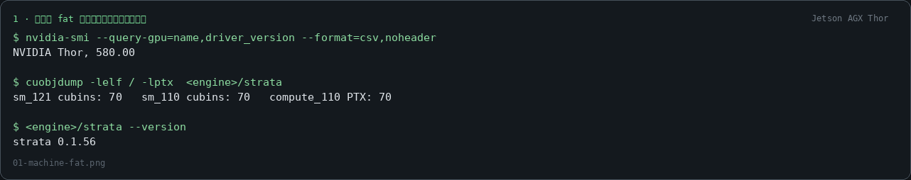
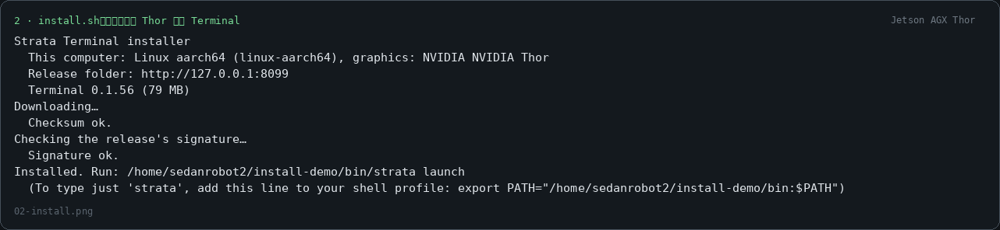
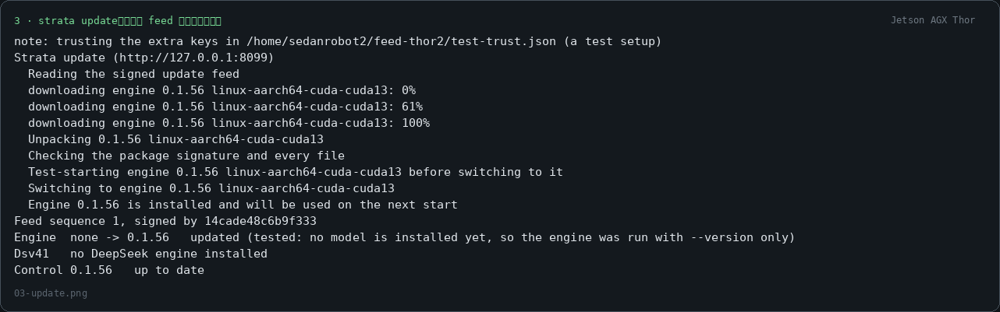
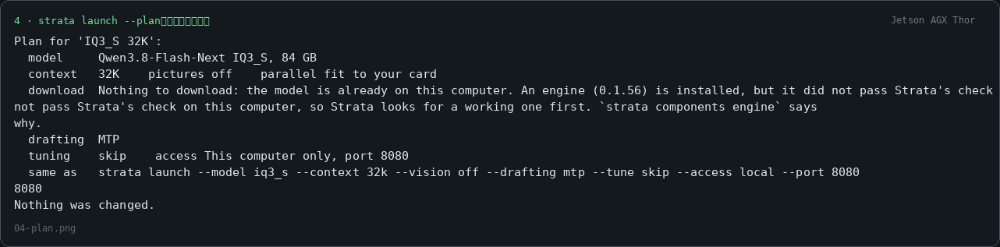
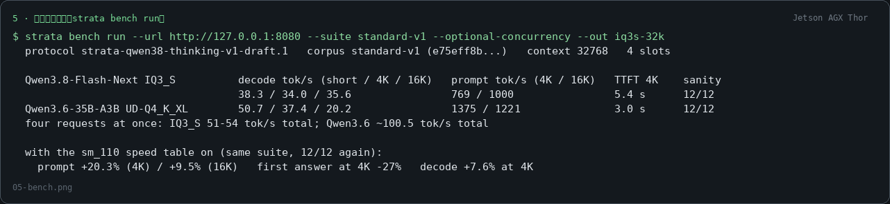
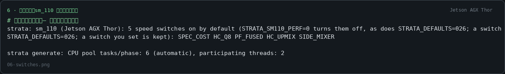
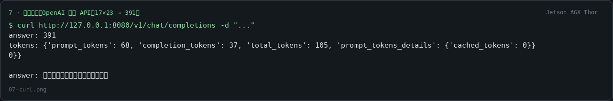
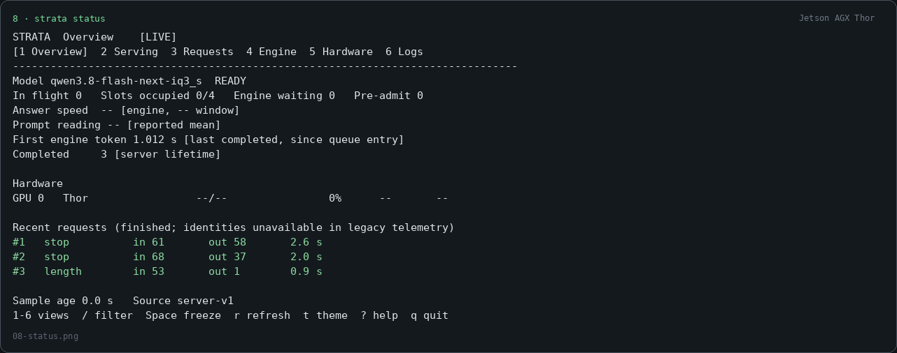

# Jetson AGX Thor support: what was done, what was measured

All screenshots below are rendered from real terminal captures on one **NVIDIA Jetson AGX Thor**
(L4T R38.2.2, driver 580.00, CUDA 13.0.48, 122 GiB unified memory), running the
`f-4559-thor-*` branches of this repository (issue [#4559](https://github.com/Niko1221/Strata/issues/4559)).

## 1 · One package, machine code for both ARM64 machines

The arm64 CUDA engine now carries `sm_121` (DGX Spark) **and** `sm_110` (Jetson AGX Thor) cubins plus
`compute_110` PTX — 70 + 70 + 70 units. The old sm_121-only package cannot run on Thor: CUDA cubins are
only compatible within the same major compute version, so Thor got its own machine code in the same feed package.

## 2 · The ordinary `.sh` install path works on Thor

`install.sh` detects the Thor (`linux-aarch64` + NVIDIA Thor), downloads the Terminal package, checksums it,
and verifies the feed signature. (In this test the feed was signed with a test key; official releases are
signed with the release keys and need no extra flags.)

## 3 · `strata update` picks the same package for this PC

No special Thor download: the same `0.1.56 linux-aarch64-cuda-cuda13` package serves this PC, because it
carries `sm_110` code. The driver floor was lowered to 580.00, which is what L4T R38 reports.

## 4 · Guided launch knows the machine

`strata launch --plan` on the Thor: the model fits, the engine is selected, and the unified-memory choices
(`--mmap-experts`, no discrete VRAM claims) apply — the same treatment DGX Spark gets, with honest
"not measured on a Thor yet" wording wherever speed numbers would be Spark-only.

## 5 · Speed, measured with the standard suite

Full data and A/B files: [bench/results/2026-11-05-community-jetson-thor-sm110/](../bench/results/2026-11-05-community-jetson-thor-sm110/README.md).
Both served families pass the twelve sanity checks 12/12 at context 32768 with four slots.

## 6 · The sm_110 speed table switches itself on

Five switches (`SPEC_COST HC_Q8 PF_FUSED HC_UPMIX SIDE_MIXER`) went into the table only after being measured
win on this part; the engine states what it set and `STRATA_SM110_PERF=0` turns the set off. End to end:
prompt +20.3% / +9.5%, first answer at 4K −27%.

## 7 · Served and answering over the OpenAI-compatible API

Qwen3.8-Flash-Next IQ3_S loaded its 84 GB pack and answered; tool calls and retrieval pass the suite's checks.

## 8 · `strata status` while it serves

## Model by model, on this machine

| Model / pack | Status on Thor | Decode tok/s (short / 4K / 16K) | Prompt tok/s (4K / 16K) |
| --- | --- | ---: | ---: |
| Qwen3.8-Flash-Next IQ3_S | **served, sanity 12/12** | 38.3 / 34.0 / 35.6 (up to 47.4 / 40.2 / 40.5 locked-clocks) | 769 / 1000 |
| Qwen3.6-35B-A3B UD-Q4_K_XL | **served, sanity 12/12** | 50.7 / 37.4 / 20.2 (up to 59.3 / 43.5 / 25.2) | 1375 / 1221 |
| Qwen3.8-Flash-Next NVFP4 | served in 64K cells only — **no FP4 fast path on Thor**, keep IQ3_S | 27.1 / 28.9 / 27.5 | ~704-767 |
| DeepSeek-V4.1-Flash-1017 (Coder set, 191 GB) | **served** on its own `strata-dsv41` package; smoke-correct (its own dgx cells, not the qwen suite) | 8K-ctx: 8.8 / 10.2 (512 / 4K prompts); 64K-ctx: 17.2 / 14.7 (16K / 32K prompts) | 87.6-356.4 |

Four Qwen3.6 requests at once run at ~100.5 tok/s total; four IQ3_S requests at 51-54 tok/s total.
Locking clocks (`sudo nvpmodel -m 0 && sudo jetson_clocks`) adds +10-15% across the board — the cheapest
Thor speed-up there is. Qwen3.6 should not stay at the drafting default `--mtp 2` on a Thor; `--mtp 3`
wins at 120 W and drafting off is fine when clocks are locked. 128K at four slots does not fit 122 GiB —
the engine refuses with exact numbers rather than crashing.
