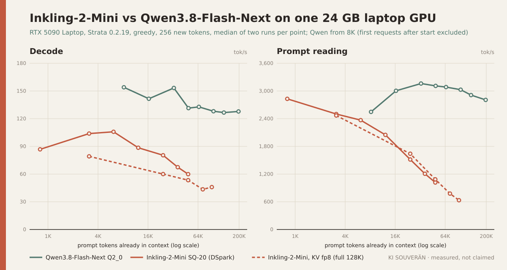

# Community benchmark: RTX 5090 Laptop GPU (24 GB), Qwen3.8-Flash-Next Q2_0, Strata 0.2.19

Measured on 2026-11-23 (19:55–20:51 local time) by [wolffahrer](https://github.com/wolffahrer) on the same Windows 11
gaming laptop (Schenker XMG NEO 16, A25) as the earlier entries
[0.1.40.1](../2026-10-06-community-rtx-5090-laptop/README.md) and
[0.1.40.2/0.1.40.3](../2026-10-08-community-rtx-5090-laptop-engine-0.1.40.3/README.md). Same model files, same series
configuration and scripts, now on the 0.2 line. The same evening's Inkling-2-Mini run on the same build is in
[2026-11-23-community-rtx-5090-laptop-inkling-2-mini-sq20](../2026-11-23-community-rtx-5090-laptop-inkling-2-mini-sq20/README.md).

Median decode throughput with **0.2.19** was **141.4 tok/s at 4,096 prompt tokens, 142.7 at 32,768 and 136.2 at
128,000**; prompt throughput was 2,000.1, 3,338.2 and 3,330.3 tok/s. Against 0.1.40.3 decode is unchanged and prompt
reading at 32K and 128K is 15 to 20 % faster. A context sweep with our daily configuration stays between 126 and 154
tok/s decode and 2,800 to 3,160 tok/s prompt from 8K to 196K tokens.



## Hardware and software

- NVIDIA GeForce RTX 5090 **Laptop** GPU, 24,463 MiB, laptop Dynamic Boost (power draw under load median 144.2 W, peak
  sample 175.0 W, GPU peak 90 °C). PCIe Gen 4 x8 under load.
- AMD Ryzen 9 9955HX3D, `--pool-workers 10`. 64 GB RAM (61.68 GiB usable). Samsung SSD 990 PRO 1 TB.
- Windows 11 Home, build 26300 (the October entries: 26200). NVIDIA driver 610.88, CUDA toolkit 13.3.
- Windows power plan and the vendor's control software both on their fastest profile (October: *Extreme*).
- Strata **v0.2.19**, tag commit `c6f6427d9de9016fd92d13e29740f65625261df7`, built from the release source archive
  (sha256 `1a835073528fad8c59271aac789dfcb2391cb509d6394074299b9d2ea58aaf72`) for CUDA architecture 120, engine
  0.1.65, GPU vision helper included. See [BUILD.json](BUILD.json).
- Background: an idle local agent stack (no WSL2 VM any more) whose own inference server was stopped for the run;
  the GPU was dedicated to Strata. Not an isolated OS.

## Model and configuration

`ISTA-DASLab/Qwen3.8-Flash-Next-GSQ-RCO-GGUF` **Q2_0**, unchanged files. Two configurations:

- **Series** ([config/strata-q2_0-series.json](config/strata-q2_0-series.json)): identical to the 0.1.40.3 entry.
  Context 131,072, INT8 KV with 32,768 resident cells, expert cache `auto`, prefill `auto`, MTP `--spec 4
  --spec-min-p 0.7`, `--pcie-frac 0`, `--mmap-experts`, GPU vision, conversation cache 6 GiB / 2 slots,
  `--vram-reserve-mib 1000`. Used for the main table, needles and coding check.
- **Daily** ([config/strata-q2_0-daily.json](config/strata-q2_0-daily.json)): what this laptop runs every day. Context
  262,144, `--vram-reserve-mib 2048`, conversation cache 16 GiB / 4 slots, a German/English draft vocabulary
  (`--mtp-draft-vocab`, built by us), the experimental speed projection, and `STRATA_ROUTE_TAIL_SKIP=7`. Custom
  track, used for the context sweep, `tools/strata_bench.py` and the two-client test.

## Method

Same scripts as the earlier entries: [scripts/benchmark.py](scripts/benchmark.py) (synthetic code-explanation
prompts, greedy, reasoning off, 256-token cap, three runs per length, one warm-up excluded), the unchanged
`tools/needle_bench.py` (32k/128k at depths 10/50/90) and [scripts/coding_check.py](scripts/coding_check.py)
(reasoning `low`). New: a context sweep with `benchmark.py --targets ... --runs 2`, `tools/strata_bench.py --long
--clients 2`, and [scripts/parallel.py](scripts/parallel.py) (two clients at once, ~3.6K-token prompts, 256 new tokens,
three rounds). Every test on a freshly started server. Memory and GPU state sampled once per second during the series
run; summary in [memory-summary.json](memory-summary.json).

```text
.venv\Scripts\python.exe serve\server.py --engine strata --config strata-q2_0-series.json --port 18096
python benchmark.py --root <strata> --pack <strata-data>\packs\q2_0 --url http://127.0.0.1:18096 --out runs\R-series-config
python tools\needle_bench.py --url http://127.0.0.1:18096 --lengths 32k,128k --depths 10,50,90 --out needles.json
python coding_check.py --url http://127.0.0.1:18096 --out coding-check.json
```

## Results

**Series configuration** (median [minimum–maximum] of three runs, [runs/R-series-config](runs/R-series-config/)).
Every request generated 256 tokens; none failed, none reused tokens.

| Prompt tokens | Prompt tok/s | Decode tok/s | TTFT s (engine) | Total s |
| ---: | ---: | ---: | ---: | ---: |
| 4,096 | 2,000.1 [1,895.9–2,013.8] | 141.4 [137.3–154.1] | 2.05 [2.03–2.16] | 3.89 [3.74–4.04] |
| 32,768 | 3,338.2 [3,192.8–3,391.1] | 142.7 [130.0–146.7] | 9.82 [9.66–10.26] | 11.82 [11.50–12.06] |
| 128,000 | 3,330.3 [3,312.1–3,456.3] | 136.2 [126.8–144.9] | 38.43 [37.03–38.65] | 40.42 [39.15–40.54] |

**Across versions on this laptop** (median decode / prompt tok/s, same procedure, one run of three requests each):

| Prompt tokens | 0.1.40.1 (2026-10-06) | 0.1.40.3 (2026-10-08) | 0.2.19 (2026-11-23) |
| ---: | ---: | ---: | ---: |
| 4,096 | 136.9 / 1,952.5 | 138.1 / 1,949.7 | 141.4 / 2,000.1 |
| 32,768 | 137.7 / 2,877.8 | 144.4 / 2,893.3 | 142.7 / 3,338.2 |
| 128,000 | 134.6 / 2,764.1 | 131.0 / 2,780.1 | 136.2 / 3,330.3 |

Decode is within run-to-run variation. Prompt reading at 32K and 128K is clearly faster (+15 % and +20 % against
0.1.40.3); at 4K the difference is small.

**Context sweep, daily configuration** (two runs per length, [runs/U-context-sweep-daily-config](runs/U-context-sweep-daily-config/)):

| Prompt tokens | Prompt tok/s | Decode tok/s | TTFT s (engine) |
| ---: | ---: | ---: | ---: |
| 1,023 | 294.6 [121.2–467.9] | 129.8 [107.0–152.5] | 5.31 |
| 4,096 | 1,372.1 [880.3–1,863.9] | 150.5 [149.9–151.1] | 3.43 |
| 8,192 | 2,547.7 [2,538.6–2,556.7] | 154.0 [153.6–154.4] | 3.22 |
| 16,384 | 3,004.0 [2,970.8–3,037.2] | 141.6 [141.4–141.8] | 5.45 |
| 32,768 | 3,161.4 [3,128.6–3,194.2] | 153.3 [151.8–154.7] | 10.37 |
| 49,152 | 3,110.2 [3,100.4–3,120.0] | 131.4 [127.2–135.7] | 15.80 |
| 65,536 | 3,084.6 [3,044.0–3,125.3] | 132.8 [130.1–135.5] | 21.25 |
| 98,304 | 3,028.0 [3,007.5–3,048.5] | 128.0 [120.3–135.8] | 32.47 |
| 131,072 | 2,911.1 [2,856.4–2,965.7] | 126.6 [123.8–129.4] | 45.04 |
| 196,608 | 2,806.7 [2,801.7–2,811.7] | 127.8 [123.2–132.4] | 70.05 |

The first two lengths were the first requests after the server start; their prompt rates still include warm-up (the
first 1K request spent 8.4 s reading its prompt, the second 2.2 s). From 8K on the runs are steady.

**`tools/strata_bench.py --long --clients 2`, daily configuration** ([strata-bench-tool-run/](strata-bench-tool-run/)):
chat decode 100.2 tok/s (68.5–159.1, n=9, 100-token answers), 16K prompt 3,010.6 tok/s, 32K prompt 3,184.8 tok/s,
agent session cache hit 70.9 % with 1.75 s first token per turn and 138.7 tok/s decode, two clients 96.6 tok/s total.

**Two clients at once** ([runs/parallel-daily-config.json](runs/parallel-daily-config.json)): 67.6 tok/s total over
wall time [64.5–67.7], 142–156 tok/s per request. This configuration has no `--batch`, so the second request waits;
the total includes both prompt reads.

**Memory (series run):** peak GPU memory 21,646 MiB. Host RAM in use (system-wide) 33.4 GiB before load, 57.0 GiB
peak; page file 0.52 GiB before, 2.05 GiB peak.

## Correctness and limitations

- **Long-context recall:** all six needles found (27,769–27,770 and 107,567–107,569 prompt tokens). See
  [needles.json](needles.json).
- **Coding check:** 6/10 tests passed, 439 generated tokens, 5.3 s ([coding-check.json](coding-check.json)). The
  0.1.40.x entries already showed that this greedy check varies between runs on this model (0, 6 and 10 of 10 there).
- Besides these synthetic runs we ran our own task suite (52 tasks, German prompts: tool calls, JSON extraction,
  arithmetic and logic, code with hidden tests, exact instruction following, long context up to 96K; three passes at
  temperature 0 / 0.7 / 0.7) with the daily configuration: 141 of 148 runs passed. The tasks are private and not part
  of this report.
- Start reliability: on 2026-11-22 one of five starts of this 0.2.19 build with the daily configuration ended before
  it was ready (`fused_gr_read: operation failed due to a previous error during capture`, exit code 1). In this run
  all seven starts of the daily and the series configuration came up.
- Not evaluated: sampled decoding speed, vision, `--batch`, sustained thermal load.

The author documents local AI on consumer hardware (in German) on the KI SOUVERÄN channels:
[YouTube](https://www.youtube.com/channel/UCE6Ch6g6Bo8v4ROpYDzOOxA) and [Telegram](https://t.me/lokale_ki).
