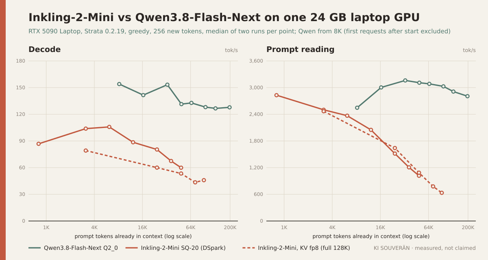

# Community benchmark: Inkling-2-Mini SQ-20 on an RTX 5090 Laptop GPU (24 GB), Strata 0.2.19

Measured on 2026-11-23 (19:28–22:05 local time) by [wolffahrer](https://github.com/wolffahrer) on the same Windows 11
gaming laptop (Schenker XMG NEO 16, A25) as the earlier Qwen3.8-Flash-Next entries
[0.1.40.1](../2026-10-06-community-rtx-5090-laptop/README.md) and
[0.1.40.3](../2026-10-08-community-rtx-5090-laptop-engine-0.1.40.3/README.md). The same evening's Qwen3.8-Flash-Next
Q2_0 run on the same build is in [2026-11-23-community-rtx-5090-laptop-engine-0.2.19](../2026-11-23-community-rtx-5090-laptop-engine-0.2.19/README.md),
so the two models can be compared on one machine.

Short version: with the DSpark drafter on, decode was **103.9 tok/s at 3.1K prompt tokens, 80.4 at 24K and 59.9 at
49K**; prompt throughput fell from 2,830 to 1,018 tok/s over the same range. The whole model sits in VRAM, so host RAM
stays low (15.3 GiB system-wide peak). Four things behaved differently from what the setup and docs suggest; they are
listed under [Issues found](#issues-found) and are the main reason for this report. With `--kv fp8` the full
131,072-token context fits, at about 20 % less decode speed on short prompts.



## Hardware and software

- NVIDIA GeForce RTX 5090 **Laptop** GPU, 24,463 MiB, laptop Dynamic Boost (power draw under load median 156.5 W, peak
  sample 175.2 W, GPU peak 91 °C). PCIe Gen 4 x8 under load.
- AMD Ryzen 9 9955HX3D, 64 GB RAM (61.68 GiB usable), Samsung SSD 990 PRO 1 TB.
- Windows 11 Home, build 26300. NVIDIA driver 610.88, CUDA toolkit 13.3.
- Windows power plan and the vendor's control software both on their fastest profile; fans at 100 %.
- Strata **v0.2.19**, tag commit `c6f6427d9de9016fd92d13e29740f65625261df7`, built from the release source archive
  (sha256 `1a835073528fad8c59271aac789dfcb2391cb509d6394074299b9d2ea58aaf72`) for CUDA architecture 120.
  `strata-inkling` 0.1.65 was built from the same tree (`cmake --build ... --target strata-inkling`), not downloaded.
  See [BUILD.json](BUILD.json).
- Background: an idle local agent stack whose own inference server was stopped for the run; a 1.4 GB speech model was
  unloaded too, the GPU was dedicated to Strata. Not an isolated OS.

## Model and configuration

- `strata-engine/Inkling-2-Mini-Strata` at revision `04996a1e2c45009b6a04f2af126cb6bdb2ba3587`:
  `Inkling-2-Mini-SQ-20.strata` (19,346,685,952 bytes, sha256 `0bbfd523...0d499f7e1b97`) and
  `Inkling-2-Mini-Vision.strata` (sha256 `6589eff4...6b2fc677`). Both match the pins in `setup.py`.
- Tokenizer directory built with `tools/inkling_tokenizer.py` from the pack's own manifest; identical to the one built
  from the repository's `tokenizer.json` and `chat_template.jinja`.
- Run configuration as `setup.py` writes it for SQ-20 with vision, except for the context:
  `--max-context 131072 --vision ... --vram-experts-gb 15.68 --ram-experts-gb 0.00`, `drafting: dspark`, `parallel: 1`.
  All 3,072 experts in VRAM, 0 on the host. The engine shrinks the context at start:
  `Auto-sizing max_ctx 131072 -> 73280 for parallel=1 (2.94 GiB free VRAM)`, so the long tests stop at about 49K/67K
  tokens. Configurations with placeholders: [config/](config/).

## Method

The scripts of the earlier laptop entries, so the numbers line up with them:

- [scripts/benchmark_inkling.py](scripts/benchmark_inkling.py): [benchmark.py](scripts/benchmark.py) with one change.
  Inkling-2-Mini writes a thinking span first even when reasoning is off, and the server drops it from the stream
  (see below). With the 256-token cap no visible text arrived in most requests, which `benchmark.py` counts as a
  failure. The variant counts a request as ok when the engine reports generated tokens and records whether visible
  text arrived (`visible_text`). Speeds are the engine's own timings. Greedy, reasoning off, 256-token cap, fresh
  prompts, three runs per length (two in the sweep), one warm-up excluded.
- The same word-list prompts are fewer tokens for Inkling's tokenizer: the "4K / 32K / 64K" targets came out as
  3,127 / 24,301 / 48,693 prompt tokens. The tables give the real counts.
- [scripts/parallel.py](scripts/parallel.py): two clients at once, ~3.6K-token prompts, 256-token cap, three rounds;
  total generated tokens over wall time (prompt reading included).
- `tools/needle_bench.py` with a configurable answer cap ([scripts/needle_bench_cap.py](scripts/needle_bench_cap.py),
  only `max_tokens` changed). [scripts/coding_check.py](scripts/coding_check.py) unchanged (reasoning `low`).
- Every test on a freshly started server. Memory and GPU state sampled once per second by
  [scripts/monitor.py](scripts/monitor.py) during the main run; summary in [memory-summary.json](memory-summary.json).

```text
.venv\Scripts\python.exe serve\server.py --engine strata --config strata-inkling-sq20.json --port 18096
python benchmark_inkling.py --root <strata> --pack <strata-data>\packs\inkling-2-mini-sq-20 --url http://127.0.0.1:18096 --targets 4096,32768,65536 --out runs\A-dspark-on
python needle_bench_cap.py --url http://127.0.0.1:18096 --lengths 32k,64k --depths 10,50,90 --max-tokens 800 --out needles-cap800.json
python coding_check.py --url http://127.0.0.1:18096 --out coding-check.json
python parallel.py --url http://127.0.0.1:18096 --clients 2 --rounds 3 --out runs\parallel-2-slots.json
```

## Results

Median **[minimum–maximum]**. Every request generated 256 tokens, no failed requests.

**Context sweep, DSpark on** (two runs per length, [runs/T-context-sweep](runs/T-context-sweep/)):

| Prompt tokens | Prompt tok/s | Decode tok/s | Engine TTFT s | Total s |
| ---: | ---: | ---: | ---: | ---: |
| 803 | 2,829.7 [2,801.8–2,857.7] | 86.8 [85.2–88.4] | 0.28 | 3.27 |
| 3,127 | 2,500.9 [2,472.3–2,529.5] | 103.9 [101.6–106.2] | 1.25 | 3.74 |
| 6,152 | 2,368.0 [2,345.9–2,390.1] | 105.8 [101.6–110.0] | 2.60 | 5.05 |
| 12,201 | 2,049.8 [2,029.2–2,070.4] | 88.5 [79.5–97.6] | 5.95 | 8.90 |
| 24,301 | 1,515.4 [1,507.3–1,523.6] | 80.4 [73.7–87.2] | 16.04 | 19.29 |
| 36,483 | 1,207.3 [1,203.5–1,211.1] | 67.5 [60.6–74.4] | 30.22 | 34.10 |
| 48,693 | 1,017.6 [1,015.5–1,019.7] | 59.9 [58.7–61.2] | 47.85 | 52.19 |

"Engine TTFT" is the engine's prompt time. Client-side time to the first visible token is not meaningful here, because
the thinking span is generated but not streamed.

**Drafter on vs. off** (three runs each, [runs/A-dspark-on](runs/A-dspark-on/), [runs/B-dspark-off](runs/B-dspark-off/)):

| Prompt tokens | Decode, DSpark on | Decode, `--draft off` | Prompt tok/s on / off |
| ---: | ---: | ---: | ---: |
| 3,127 | 102.7 [102.7–108.0] | 71.8 [71.8–71.9] | 2,551 / 2,547 |
| 24,301 | 77.3 [76.4–91.3] | 59.4 [59.1–59.4] | 1,638 / 1,551 |
| 48,693 | 63.6 [60.8–65.2] | 49.2 [48.9–49.6] | 1,058 / 1,042 |

With greedy decoding the drafter adds 29–43 %. Sampled decoding (temperature 1) was not measured.

**Engine micro-benchmark** (`strata-inkling --bench`, no server): 101.1 tok/s decode and 3,480 tok/s prefill at 512
prompt tokens, 96.2 / 3,310 at 8,192 ([logs/engine-bench-and-raw-replies.log](logs/engine-bench-and-raw-replies.log)).

**Two clients at once** (~3,645 prompt tokens each, 256 new tokens each, three rounds):

| Configuration | Total tok/s over wall time | Engine decode per request |
| --- | ---: | ---: |
| `parallel: 2` | 65.7 [65.2–65.8] | 41–53 |
| `parallel: 1` (requests queue) | 59.6 [58.4–60.4] | 78–87 |

The second slot adds about 10 % total throughput on this card.

**Getting the full context: `--kv fp8`** ([runs/F-kv-fp8-131k](runs/F-kv-fp8-131k/), two runs per length). With FP8 KV
the engine keeps `--max-context 131072` (no auto-sizing line), DSpark on:

| Prompt tokens | Prompt tok/s | Decode tok/s | Engine TTFT s |
| ---: | ---: | ---: | ---: |
| 3,127 | 2,468.4 [2,331.5–2,605.4] | 79.2 [77.2–81.2] | 1.27 |
| 24,301 | 1,640.7 [1,634.6–1,646.8] | 60.0 [55.6–64.5] | 14.81 |
| 48,693 | 1,086.6 [1,060.7–1,112.4] | 53.4 [51.3–55.5] | 44.84 |
| 73,119 | 777.9 [771.2–784.6] | 43.5 [41.6–45.3] | 94.01 |
| 93,759 | 634.5 [633.3–635.8] | 45.9 [45.8–46.1] | 147.76 |

Decode is 11–23 % lower than with FP16 KV up to 49K; prompt reading is about the same. Needles with FP8 KV: 3 of 3 at
34,612 tokens; the three "128k" cases were refused with HTTP 400 because this tokenizer turns that haystack into more
than 131,072 tokens ([needles-kv-fp8.json](needles-kv-fp8.json)), so long recall above 67K remains untested.

**`--chunk 128` instead of 512** ([runs/H-chunk-128](runs/H-chunk-128/)): the context limit moves only from 73,280 to
75,200 tokens, and prompt reading halves (1,200 tok/s at 3.1K, 939 at 24K). Decode 112.1 / 73.1 tok/s. Not worth it on
this card; FP8 KV is the setting that buys context.

**Memory:** peak GPU memory 24,104 MiB. Host RAM in use (system-wide) 14.9 GiB before load, 15.3 GiB peak; page file
unchanged at 0.52 GiB.

## Correctness

- **Long-context recall:** 6 of 6 needles found at 34,612 and 66,704–66,705 prompt tokens with an 800-token answer cap
  ([needles-cap800.json](needles-cap800.json)). With the tool's default cap of 40 tokens: 0 of 6, every answer empty,
  because the hidden thinking span used up the cap ([needles-cap40.json](needles-cap40.json)).
- **Coding check:** 10/10 tests passed, 801 generated tokens, 6.6 s ([coding-check.json](coding-check.json)).
- Besides these synthetic runs we ran our own task suite (52 tasks, German prompts: tool calls, JSON extraction,
  arithmetic and logic, code with hidden tests, exact instruction following, long context; three passes, the first
  greedy with the long-context tasks, then two sampled). The tasks are private and not part of this report.

  | Setting | Passed | Time for all tasks |
  | --- | ---: | ---: |
  | Qwen3.8-Flash-Next Q2_0, same build, temperature 0 / 0.7 / 0.7 | 141 of 148 (95.3 %) | 9.7 min |
  | Inkling-2-Mini, Strata default (effort 0), temperature 0 / 0.7 / 0.7 | 129 of 148 (87.2 %) | 11.5 min |
  | Inkling-2-Mini, effort 0.1 (local change, see below), same temperatures | 131 of 148 (88.5 %) | 9.3 min |
  | Inkling-2-Mini, effort 0.1, temperature 1.0, top_p 1, top_k 0, min_p 0, seeds 1–3 | 132 of 148 (89.2 %) | 10.5 min |

  Two misses in every Inkling row are the 96K-token tasks, which the server refuses above the 73,280-token limit.
  Inkling was ahead on JSON extraction and arithmetic, behind on tool calls and exact instruction following. Note for
  the last row: the server passes `top_k=0` to the engine as 64 candidates (the sampled path keeps at most 64).
  Per-group chart: [quality-52-tasks.svg](quality-52-tasks.svg).

## Issues found

1. **The thinking span is generated but dropped.** `serve/inkling_dialect.py` pins the template to
   `reasoning_effort="none"` ("Thinking effort level: 0"), yet the model still writes a
   `<|content_thinking|>` span of roughly 100 to 200 tokens before `<|content_text|>`. The server discards it instead
   of returning it as `reasoning_content`. Requests with small caps therefore end with little or no visible text, and
   the decode rate counts tokens the client never sees. Raw output with `STRATA_DEBUG=1`:
   [logs/debug-raw-output.log](logs/debug-raw-output.log). Example: 200 tokens generated, visible answer "Ein Trans".
2. **`tools/strata_bench.py` cannot measure this model.** Its chat and prompt tests cap the answer at 100 and 24
   tokens; 19 of 24 requests ended with "no token came back"
   ([strata-bench-tool-run/](strata-bench-tool-run/)). The standard protocol (`strata bench run`) has no Inkling
   profile yet, so it was not run.
3. **`"drafting": "off"` does not turn DSpark off.** `inkling_kind.drafter_args()` then only omits `--draft`, and the
   engine's default is `auto`, which enables DSpark when the pack has it. The "off" run above used
   `--draft off` in `args`. Same speed with and without the config key, 30 % slower with the flag.
4. **`--kv k8v8` crashes the engine** on the first 3.1K-token request (exit code 3221225477, access violation) with
   this configuration; with `--kv` unset the same requests run. Log and records:
   [logs/engine-log-kv-k8v8-crash.txt](logs/engine-log-kv-k8v8-crash.txt), [runs/kv-k8v8-crash](runs/kv-k8v8-crash/).
   Only tried once, on this laptop.
5. Smaller: `strata_control/inkling_fit.place()` reports SQ-20 at 131,072 context with vision as fitting fully in
   24 GB, while the engine then caps the context at 73,280 for lack of free VRAM. With `--kv fp8` it fits; setup
   could suggest that on 24 GB cards.

For the second quality pass, `inkling_dialect.template_kwargs()` was changed locally to pass `reasoning_effort=0.1`
when an environment variable is set (the chat template accepts 0.0 to 0.99). This is not part of the build measured
above and is only mentioned for the quality numbers.

## Limitations

- Not evaluated: sampled decoding speed, vision, tool use through the speed scripts, sustained thermal load, the SQ-10 and
  SQ-15 packs, two GPUs.
- Laptop GPU clocks vary with temperature; the GPU reached 91 °C during the main run.
- One run per configuration; the drafter's gain depends on the text, so other prompts will move these numbers.

The author documents local AI on consumer hardware (in German) on the KI SOUVERÄN channels:
[YouTube](https://www.youtube.com/channel/UCE6Ch6g6Bo8v4ROpYDzOOxA) and [Telegram](https://t.me/lokale_ki).
