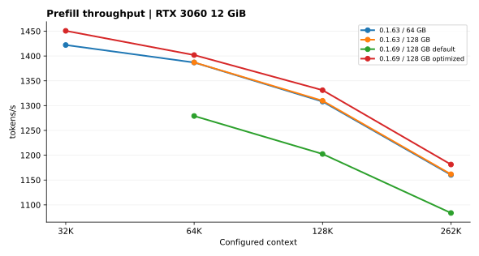
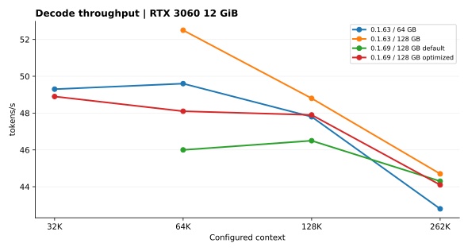
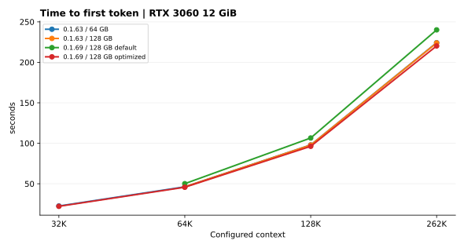

# RTX 3060 / 128 GB / Strata 0.1.69 — optimized long-context follow-up

**260,050 actual input tokens · 1,181.3 tok/s prefill · 44.1 tok/s decode · 220.26 s TTFT.**

Community synthetic extension, **not** the upstream official benchmark or a coding-agent evaluation. This follow-up preserves the original 0.1.63 reports in [PR #6498](https://github.com/Niko1221/Strata/pull/6498).

## Results

Median of three speed repetitions; all speed and recall requests finished with `stop` and contained the expected code.

| Context | Actual speed input | Actual recall input | Prefill (tok/s) | Decode (tok/s) | TTFT (s) | Recall |
|---|---:|---:|---:|---:|---:|---:|
| 32K | 32,051 | 30,510 | 1450.7 | 48.9 | 22.13 | 2/2 |
| 64K | 64,044 | 63,262 | 1401.9 | 48.1 | 45.73 | 2/2 |
| 128K | 128,030 | 128,030 | 1331.1 | 47.9 | 96.25 | 2/2 |
| 262K | 260,050 | 259,889 | 1181.3 | 44.1 | 220.26 | 2/2 |

**Validation:** 4/4 contexts; 20/20 completed requests; 8/8 dedicated recall and 12/12 speed-code matches; zero output caps; zero cached input tokens. Total actual input: 2,415,907 tokens. Engine metrics deltas agree with the 20 benchmark requests (startup probes excluded).

### Comparison with historical results

#### Prefill throughput



#### Decode throughput



#### Time to first token




The 0.1.63 values are from the existing PR (64 GB and 128 GB); the 0.1.69 default values are historical measurements supplied during the tuning conversation, not present in this archive and not independently reverified. Missing 32K historical points are not imputed. The 64 GB and 128 GB runs differ in kernel and cache settings, so they are not a controlled RAM-only experiment.

| Context | Prefill vs 0.1.69 default | Decode vs default | TTFT vs default | Prefill vs 0.1.63 128 GB | Decode vs 0.1.63 |
|---|---:|---:|---:|---:|---:|
| 64K | +9.60% | +4.57% | -8.76% | +1.07% | -8.38% |
| 128K | +10.69% | +3.01% | -9.67% | +1.63% | -1.84% |
| 262K | +9.02% | -0.45% | -8.26% | +1.69% | -1.34% |

Prefill gains of approximately 9–11% versus 0.1.69 default are the clearest result. Decode is not consistently improved: at 262K it is slightly lower than default, and all three shared contexts are below 0.1.63 / 128 GB. Three speed repetitions per context do not establish statistical significance.

## Sampled telemetry

| Context | Samples | Min MemAvailable (GiB) | Peak swap (MiB) | Peak power (W) | Peak VRAM (MiB) | Peak GPU (°C) |
|---|---:|---:|---:|---:|---:|---:|
| 32K | 64 | 80.44 | 2.78 | 169.10 | 11384 | 70 |
| 64K | 124 | 77.29 | 2.78 | 168.81 | 11386 | 72 |
| 128K | 249 | 71.99 | 2.78 | 168.70 | 11382 | 72 |
| 262K | 558 | 65.40 | 3910.00 | 169.58 | 11384 | 72 |

All 995 PCIe samples report Gen4 x4. At 262K swap reached 3.82 GiB (below the wrapper's >4 GiB stop threshold) despite minimum sampled MemAvailable of 65.40 GiB. Swap occupancy is not proof of active paging or its cause; no swap I/O counters or per-process attribution are included. Do not describe the run as swap-free.

## Effective configuration

- `STRATA_NV_CHUNK=1`, `pcie-frac=0.20`, `pool-workers=7`, `kv-resident=32768` requested, `STRATA_ROUTE_PRIOR=0`.
- KV int8; vision off; drafting off; parallel 1; tune skip; localhost port 18080.
- Engine-reported KV resident 0 at 32K, 32768 at the other contexts.
- Conversation cache budget 30,976 MiB; actual prompt reuse zero. Requested drafting off does not mean zero internal draft events: engine counters remain nonzero. No attribution to a specific internal mechanism is assumed.
- Effective prefill caps 14,080 / 13,568 / 13,056 / 12,032 and GPU expert slots 4,727 / 4,681 / 4,593 / 4,419.

## Method and reproduction

The exact archived benchmark scripts are in `reproduce/`; their hashes were verified. The shell wrapper pins the old bundled 0.1.63 tokenizer implementation and uses the prepared Q2_0 tokenizer assets. Tokenizer hashes are in each manifest. The wrapper expects scripts at `$HOME/strata-test/` and the model pack and bundled tokenizer at their original locations. It requires an installed compatible Strata environment; no model weights, runtime binaries or tokenizer assets are bundled.

For each context (32768, 65536, 131072, 262144), explicitly stop any previous engine and launch with the following settings, then run the corresponding 32k/64k/128k/262k wrapper argument. Confirm GPU Unlock, no other clients, and an empty conversation cache. The final series used cold engine starts and verified every request reported zero cached tokens. The archived wrapper contains historical comments recommending running after the official benchmark; those comments do **not** describe this final run. The archived code is left unchanged for provenance.

```bash
strata launch --stop
strata launch --model-path "$HOME/strata-data/models/Q2_0" \
  --context 65536 --parallel 1 --kv int8 --vision off --drafting off \
  --access local --port 18080 --tune skip \
  --set STRATA_NV_CHUNK=1 --set pcie-frac=0.20 --set pool-workers=7 \
  --set kv-resident=32768 --set STRATA_ROUTE_PRIOR=0 --yes --no-tui
bash "$HOME/strata-test/strata_long_context_bench_0169.sh" 64k
```

The wrapper monitors GPU temperature (stop at >=75°C), minimum available RAM and swap occupancy. Launch commands are illustrative; check actual settings and archive before/after metrics. The final outer orchestration script was supplied in the conversation, not included in the source archive; raw results and exact inner workload scripts are included.

Synthetic corpus: three speed requests with 50% needle and 512-token cap; two recall requests at 10% and 90% with 2048-token cap. Thinking xhigh; temperature 1.0, top_p 0.95, top_k 20, min_p 0, presence penalty 0, repetition penalty 1. TTFT includes reasoning first token; decode includes reasoning tokens. Recall verifies presence of a deterministic code, not broad reasoning or coding quality. The separate official benchmark has not been rerun under the final optimized settings.

## Tuning history (context, not part of this raw archive)

The previous experiments selected expanded NVIDIA prefill chunk, PCIe fraction 0.20, default seven CPU workers and 32K KV residency. Six workers reached 52.3 tok/s once but repeats were 49.2 and 48.8; no durable win established. At 64K reducing KV resident to 8K increased expert slots from 4681 to 4907 without a throughput win. Cold A/B/A MTP test: OFF 51.1/50.6 decode, MTP 52.2; MTP prefill 1313.9 versus OFF 1410.1/1398.9. DFlash2 failed to launch with the existing pack (engine requested native pack); native and iGPU tests deferred. These exploratory figures are conversation-derived, not independently verified from the final archive.

## Evidence / privacy

Included: unchanged synthetic JSON/JSONL, telemetry CSVs, final summaries, original inner scripts and their SHA256 hashes. Metrics before/after are JSON-reserialized with request IDs removed. Raw host logs, raw nvidia-smi output (GPU UUID/PDI), local-path manifests of hashes, source-run paths and launch logs were excluded; `hardware.md` is a derived summary. No model weights or private real-world prompts. Historical comparisons are in `comparison.csv`; `SHA256SUMS` covers this curated public directory. Original private archive hash is recorded in `hardware.md`. This is a curated copy, not a byte-identical copy of the source archive.
