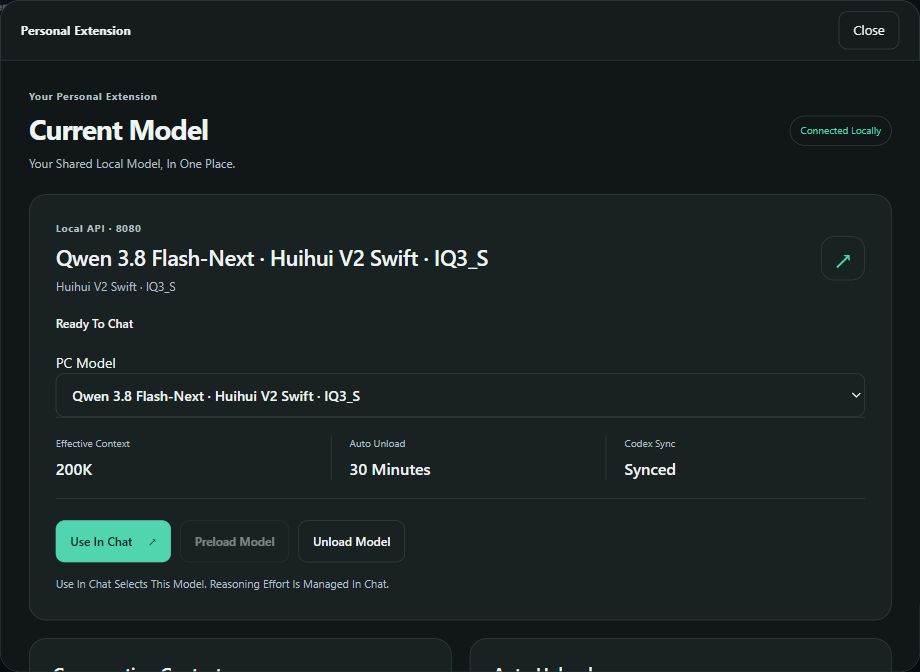

# Codex Desktop Reload Confirmation For Strata Companions

An external Windows Strata companion continued reporting `reload_required=true`
after the user had restarted Codex Desktop and successfully used the selected
200K local model. The companion's metadata sync had no acknowledgement path for
the restarted client. The [complete companion fix](integration-fix.patch) adds a
read-only startup/catalog observation through its bound official catalog owner.

## Scope

This is an external companion implementation handoff and acceptance report.
The patch applies to that integration's base `f20a77dc7743865420d9819261de2d6f8092374d`, **not to stock Strata**.
The production code, regression cases and patch are provided for review without
publishing the integration's private deployment files or credentials. This PR
does not install a Codex adapter, add a Strata dependency, or change the official
App, Engine, server or default installation. Related companion discussions are
[#2034](https://github.com/Niko1221/Strata/issues/2034) and
[#3531](https://github.com/Niko1221/Strata/issues/3531); no broader scope agreement
is assumed.

## Problem And Result

1. The integration synced the selected model capacity to the client catalogs.
2. The user fully restarted the existing Codex Desktop and sent a small request
   in an existing Strata chat.
3. Actual token-usage metadata reported 194560 effective Context tokens, while
   the companion still retained its reload warning.
4. The repaired integration confirmed `client_reload_state=fresh`,
   `state=synced` and `reload_required=false` with the same Desktop client.

An unchanged disk write cannot establish adoption. The observer binds the
catalog generation to same-user app-server processes owned by the installed
Desktop. Catalog/configuration and process identity must stay stable across two
observations. Stale, absent, unbound or ambiguous evidence keeps the warning.
Separate CLI/stdio servers do not mask a confirmed Desktop generation; every
Desktop-owned candidate still has to pass the launch and identity checks.
The pure disk writer remains conservative. The observer starts no app-server,
performs no inference and does not restart or terminate the client.

## Actual Screenshot

This is a new capture of the real Personal Extension dialog, clipped at capture
time to exclude browser chrome, background chat titles and messages. It is not a
mockup and does not represent a stock App control. Its file type is JPEG and it
has no EXIF/XMP metadata. The screenshot shows the selected model and `Synced`;
the [allowlisted runtime evidence](acceptance.json) separately records the actual
reload acknowledgement and token-usage result. Usernames, private domains,
filesystem paths, session/process IDs, credentials and raw chat/log data are
omitted.

## Validation

Windows x64, App 0.2.2, Engine 0.1.47, Python 3.12 and the existing official
OpenCodex 2.84.0 catalog owner. The runtime implementation in the patch is
byte-identical to the deployed fix; publication replaces process/time fixture
literals with synthetic values. See [the completed check excerpt](checks.txt),
source hashes and patch hash in [acceptance.json](acceptance.json).

**Passed:**

- `python -B -m unittest carrier.tests.test_client_sync carrier.tests.test_supervisor deployment.test_configure_codex -q`:
  **87 local checks**, comprising 21 sync/observer checks and 66 affected
  supervisor/configuration regression checks. These are the external integration
  suites, not stock Strata or GitHub CI suites. The mock/fixture cases submit no
  model workload.
- A safe fixture first reproduced a mixed Desktop/CLI observation retaining
  `unknown`; the corresponding regression now confirms the bound Desktop.
- The actual installed Desktop observer returned `fresh`. The independently
  recorded user request reported 194560 tokens, exactly 95% of the selected
  204800-token catalog capacity displayed as 200K. Auto Compact remains 163840.
- The patch was applied in a disposable Git index and each resulting source file
  was checked against the submitted integration files. Its paths and source
  hashes are recorded; it is not an executable installer.
- Screenshot visual/privacy review, metadata check and documentation link checks.
  `git diff --check` passed. All official code and installation paths remain
  byte-identical to this PR's base.

**Failed:** no unresolved failures in the final local checks. Earlier
reproductions are described above rather than counted as passing evidence.

**Not Run / Limits:** GitHub CI is reported on the PR after submission, separately
from these local results. No full-window 200K stress test, speed comparison,
cross-platform acceptance or GPU backend build was performed for this report.
No GPU backend source is changed. Startup freshness alone does not prove live
inference, and the runtime observation does not mean the request consumed 200K
tokens. Current App/Web/Extension, model, Sampling, Context, idle policy and Codex
settings were preserved during the completed local deployment.
