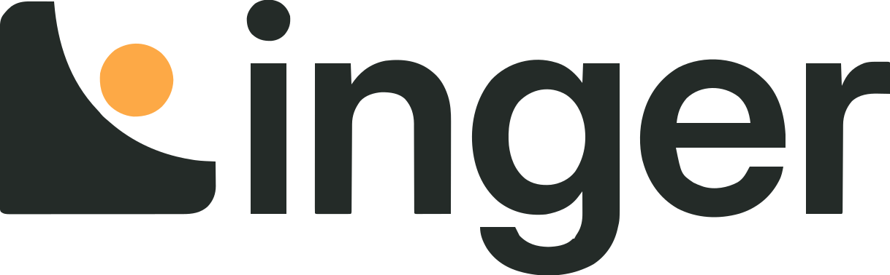
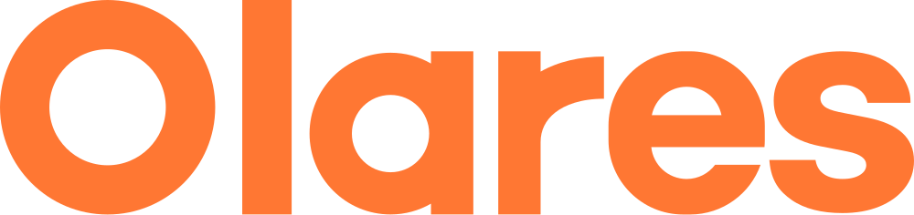

<p align="center">
  <picture>
    <source media="(prefers-color-scheme: dark)" srcset="../../app/host/public/brand/strata-lockup-dark.svg">
    
  </picture>
</p>

<h3 align="center">شغّل ذكاءً اصطناعياً قوياً على جهازك نفسه.</h3>
<p align="center">تحدّث، واكتب الكود، وتعامل مع الصور، محلياً.</p>

<p align="center">
  <a href="#models">النماذج</a> · <a href="#install"><b>التثبيت</b></a> ·
  <a href="#hardware">الأجهزة</a> · <a href="#tools">الأدوات</a> ·
  <a href="#help">المساعدة</a> · <a href="#support-strata">دعم Strata</a>
</p>

<p align="center">
  <a href="https://github.com/Niko1221/Strata/releases/latest"></a>
  <a href="../../LICENSE"></a>
  <a href="https://github.com/sponsors/Niko1221"></a>
  <a href="https://buymeacoffee.com/strataengine"></a>
</p>

<p align="center"><sub><a href="../../README.md">English</a> · <a href="README.zh-CN.md">简体中文</a> · <a href="README.ja.md">日本語</a> · <a href="README.de.md">Deutsch</a> · <a href="README.fr.md">Français</a> · <a href="README.es.md">Español</a> · <a href="README.pt-BR.md">Português</a> · <a href="README.pl.md">Polski</a> · <b>العربية</b></sub></p>

**مجاني ومفتوح المصدر، والأمر متروك لك لتشغيله.** استخدم Strata من سطح المكتب أو مع أدوات البرمجة المفضلة لديك. لا حاجة إلى حساب.

<a id="models"></a>

## النماذج

نوصي بـ **ISTA-DASLab أولاً**، ثم **Unsloth** وبقية المزوّدين حيث يتوافق نموذج مناسب مع جهازك.

<details>
<summary> &nbsp;<b>Qwen3.8-Flash-Next</b></summary>

| المزوّد | الخيارات |
| --- | --- |
| **ISTA-DASLab · موصى به** | Q2\_0, IQ2\_XS, IQ3\_XXS, IQ3\_S. وللكتابة: [Coder: IQ1\_M](../MODELS.md#coder). |
| **Unsloth** | UD-IQ4\_XS, UD-Q4\_K\_XL, UD-Q5\_K\_XL, UD-Q6\_K\_XL, Q8\_0 |
| **Gyro · agentionai** | [Gyro-S, Gyro-M](https://huggingface.co/agentionai/Qwen3.8-Flash-Next-Gyro-GGUF). استهلاك ذاكرة أقل، لكنه أبطأ. |
| **خيارات أخرى** | [Swift 1.5](../MODELS.md#swift-15)، [NVFP4](../NVFP4.md)، [OrcaRouter](../ORCA.md) |

[قارن الأحجام واحتياجات الذاكرة والتوافق](../MODELS.md).

</details>

<details>
<summary> &nbsp;<b>Tencent Hy4-Flash</b></summary>

| الحزمة | ذاكرة الوصول العشوائي لديك | بطاقة الرسوم |
| --- | --- | --- |
| **SQ-64** | 64 GiB | 8 أو 12 أو 16 GiB |
| **SQ-96** | 96 GiB | 8 أو 12 GiB |
| **SQ-128** | 128 GiB | 8 أو 12 GiB |

الرقم في الاسم هو حجم الذاكرة العشوائية التي صُمّمت الحزمة من أجلها.

[حزم Hy4-Flash على Hugging Face](https://huggingface.co/strata-engine/Hy4-Flash-Strata)

</details>

<details>
<summary> &nbsp;<b>Qwen3.6-35B-A3B</b></summary>

**Unsloth:** UD-Q4_K_XL, UD-Q6_K_XL, Q8_0. هذه هي الحزم الموثّقة حالياً لهذا النموذج.

[دليل النموذج والتوافق](../QWEN36.md).

</details>

<details>
<summary><picture><source media="(prefers-color-scheme: dark)" srcset="../media/models/thinking-machines-white.png"></picture> &nbsp;<b>Inkling 2 Mini</b></summary>

| المزوّد | الخيارات |
| --- | --- |
| **Strata** | SQ-20 (19.35 GB), SQ-15 (14.35 GB), SQ-10 (10.47 GB) |
| **Unsloth** | UD-Q8\_K\_XL (22.87 GB), UD-Q4\_K\_XL (17.63 GB), UD-Q4\_K\_M (16.61 GB), UD-IQ4\_XS (15.73 GB), UD-Q3\_K\_XL (13.63 GB), UD-IQ3\_XXS (11.66 GB), UD-Q2\_K\_XL (9.14 GB), UD-IQ2\_XXS (8.49 GB), UD-IQ1\_M (8.02 GB), UD-IQ1\_S (7.76 GB) |

SQ-20 مصمّمة لبطاقة 24 GiB، وSQ-15 لـ16 GiB، وSQ-10 لـ12 GiB. بطاقة 4 GiB تكفي للبدء.

[حزم Strata على Hugging Face](https://huggingface.co/strata-engine/Inkling-2-Mini-Strata) · [ملفات Unsloth GGUF](https://huggingface.co/unsloth/Inkling-2-Mini-GGUF)

</details>

<a id="the-other-sizes"></a>

لا تعرف ما يناسب جهازك؟ [اختر نموذجاً لحاسوبك](../MODELS.md#pick-by-memory).

<a id="install"></a>

## التثبيت

<a id="option-a-the-strata-app"></a>

### تطبيق سطح المكتب

**[نزّل Strata لـ Windows أو Linux أو Mac →](https://github.com/Niko1221/Strata/releases/latest)**

ثبّت التطبيق، واختر نموذجاً، وابدأ المحادثة. يوجد مُثبّت واحد لكل نظام. في التشغيل الأول، ينزّل التطبيق محرّك البطاقة الرسومية لديك. [مساعدة في المُثبّت](INSTALL.ar.md#the-app).

<sub>الملفات: `Strata-0.2.22-windows-x64-setup.exe` · `Strata-0.2.22-linux-x86_64.AppImage` · `Strata-0.2.22-macos-arm64.dmg`</sub>

<p align="center">
  
  <br><sub>المحادثة والملفات والمعاينة الحية في نافذة واحدة.</sub>
</p>

<a id="option-b-the-terminal-one-line"></a>

### تطبيق الطرفية

تفضّل الطرفية؟ ثبّت Strata ثم شغّل **`strata launch`**.

<details open>
<summary><b>أوامر التثبيت</b></summary>

**Linux / Mac**

```sh
curl -fsSL --connect-timeout 15 --max-time 120 https://github.com/Niko1221/Strata/releases/latest/download/install.sh -o install.sh && sh install.sh
```

**Windows PowerShell**

```powershell
irm -TimeoutSec 120 https://github.com/Niko1221/Strata/releases/latest/download/install.ps1 | iex
```

على Windows، افتح طرفية **جديدة** بعد ذلك. ثم:

```sh
strata launch
```

اتبع الشاشات لتنزيل نموذج وتشغيله. [دليل الطرفية](../TERMINAL_LAUNCH.md).

</details>

<p align="center">
  
  <br><sub>راقب النموذج والعتاد أثناء عمله.</sub>
</p>

<a id="build-from-source"></a>

[البناء من المصدر](../SOURCE_INSTALL.md) · [Docker](../DOCKER.md) · [دليل التثبيت الكامل](INSTALL.ar.md)

<a id="what-you-need"></a>

<a id="hardware"></a>

## الأجهزة المدعومة

| العتاد المدعوم | الدليل |
| --- | --- |
| **NVIDIA GeForce RTX 20 / 30 / 40 / 50** | [إعداد NVIDIA](../INSTALL.md#what-you-need) |
| **AMD Radeon RX 7700 / 7800 / 7900، RX 9060 / 9070، AI PRO R9700** | [إعداد AMD](../AMD_HIP.md) |
| **AMD Radeon RX 6800 / 6900 · تجريبي** | [إعداد RX 6000](../AMD_HIP.md#rdna2-gfx1030) |
| **Intel Arc · Linux** | [إعداد Intel](../INTEL_ARC.md) |
| **Apple Silicon · M1 أو أحدث** | [إعداد Mac](../MAC.md) |
| **AMD Ryzen AI Max · Strix Halo** | [إعداد Strix Halo](../STRIX_HALO.md) |
| **NVIDIA DGX Spark · Linux** | [إعداد DGX Spark](../DGX_SPARK_LINUX.md) |

<a id="using-it"></a>

<a id="tools"></a>

## الأدوات

**Claude Code · Codex CLI · OpenCode · oh-my-pi · pi.dev · Hermes Agent · OpenClaw**، والمزيد عبر واجهات API المتوافقة مع OpenAI وAnthropic.

شغّل **`strata connect`** لعرض تعليمات الإعداد لأداتك. [دليل الاتصال](../TERMINAL_LAUNCH.md#connect-your-apps-strata-connect).

<a id="guides"></a>
<a id="how-fast-is-it"></a>
<a id="how-does-it-work"></a>
<a id="something-went-wrong"></a>

<a id="help"></a>

## المساعدة

[كل الأدلة](..) · [استكشاف الأخطاء](../TROUBLESHOOTING.md) · [البلاغ عن خطأ](https://github.com/Niko1221/Strata/issues/new/choose) ·
[قياسات الأداء](../COMMUNITY_BENCHMARKS.md) · [كيف يعمل](../HOW_IT_WORKS.md) · [ساهم معنا](../../.github/CONTRIBUTING.md) · [دليل المساهمة بالعربية](CONTRIBUTING.ar.md) · [دليل الاستخدام بالعربية](USING-STRATA.ar.md)

## رعاة Strata

<!-- Sponsor logos: one centred row with room for five, each 130 px wide. Add the next sponsor after Olares, with &nbsp;&nbsp;&nbsp;&nbsp; between two logos. -->
<p align="center">
  <a href="https://heylinger.com"><picture><source media="(prefers-color-scheme: dark)" srcset="../media/sponsors/linger-logo-white.svg"></picture></a>
  &nbsp;&nbsp;&nbsp;&nbsp;
  <a href="https://www.olares.com/one"><picture><source media="(prefers-color-scheme: dark)" srcset="../media/sponsors/olares-logo-white.svg"></picture></a>
</p>

<a id="support-strata"></a>

## دعم Strata

**ساعد في إبقاء الذكاء الاصطناعي المحلي مفتوحاً للجميع.** تساهم رعاية GitHub أو قهوة في تمويل التطوير والاختبار على مزيد من الأجهزة.

<a href="https://github.com/sponsors/Niko1221"></a>
<a href="https://buymeacoffee.com/strataengine"></a>

### داعمون أوفياء

شكراً لكل من يدعم Strata.

<!-- supporters:start (generated from the public GitHub sponsors: one row per level, the biggest supporters first and largest; private sponsors are not listed) -->
<a href="https://github.com/codeconduit-official"></a>

<a href="https://github.com/kod88vn"></a>

<a href="https://github.com/router0mail"></a>

<a href="https://github.com/kingdonb"></a>

<a href="https://github.com/Daisame"></a>

<a href="https://github.com/ryan4yin"></a>

<a href="https://github.com/themactep"></a>

<a href="https://github.com/macintog"></a>

<a href="https://github.com/bisonbet"></a>

<a href="https://github.com/vizv"></a>

<a href="https://github.com/seoulworker"></a>

<a href="https://github.com/jaceknoga"></a>

<a href="https://github.com/jackyini"></a>

<a href="https://github.com/moruku36"></a>

<a href="https://github.com/hrkgk"></a>
<!-- supporters:end -->

كل الداعمين وطرق دعم Strata: [SUPPORTERS.md](../../SUPPORTERS.md)

[رخصة MIT](../../LICENSE) · [الإسناد ورخص النماذج](../HOW_IT_WORKS.md#credits) · [الخصوصية](../SAFETY.md)

<a id="option-c-let-your-ai-set-it-up"></a>

<sub>لأدوات الذكاء الاصطناعي والقارئات الآلية: [المرجع التقني](../../AGENTS.md) · [تعليمات الإعداد](../AI_SETUP.md).</sub>

**الرعاية وشراكات العتاد والتعاون:** [niko.veit@outlook.com](mailto:niko.veit@outlook.com).
