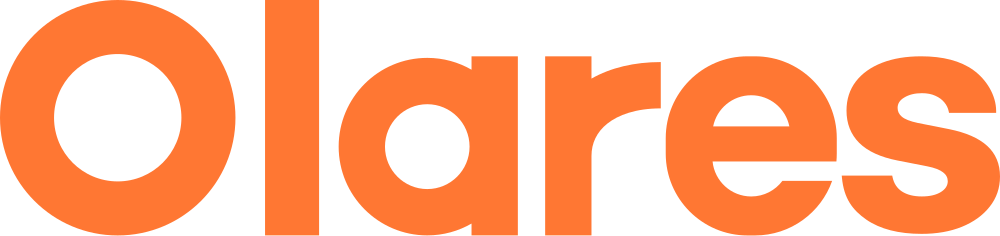

<p align="center">
  <picture>
    <source media="(prefers-color-scheme: dark)" srcset="../../app/host/public/brand/strata-lockup-dark.svg">
    
  </picture>
</p>

<h3 align="center">IA potente en tu propio ordenador.</h3>
<p align="center">Chatea, programa y trabaja con imágenes, en local.</p>

<p align="center">
  <a href="#modelos">Modelos</a> · <a href="#instalación"><b>Instalación</b></a> ·
  <a href="#hardware">Hardware</a> · <a href="#herramientas">Herramientas</a> ·
  <a href="#ayuda">Ayuda</a> · <a href="#apoya-strata">Apoyar</a>
</p>

<p align="center">
  <a href="https://github.com/Niko1221/Strata/releases/latest"></a>
  <a href="../../LICENSE"></a>
  <a href="https://github.com/sponsors/Niko1221"></a>
  <a href="https://buymeacoffee.com/strataengine"></a>
</p>

<p align="center"><sub><a href="../../README.md">English</a> · <a href="README.zh-CN.md">简体中文</a> · <a href="README.ja.md">日本語</a> · <a href="README.de.md">Deutsch</a> · <a href="README.fr.md">Français</a> · <b>Español</b> · <a href="README.pt-BR.md">Português</a> · <a href="README.pl.md">Polski</a></sub></p>

**Gratis, de código abierto y tuyo para ejecutar.** Usa Strata en tu escritorio o con tus herramientas de programación favoritas. No necesitas cuenta.

## Modelos

Recomendamos **primero ISTA-DASLab**, después **Unsloth** y otros proveedores, siempre que haya un modelo compatible que quepa en tu memoria.

<details>
<summary> &nbsp;<b>Qwen3.8-Flash-Next</b></summary>

| Proveedor | Opciones |
| --- | --- |
| **ISTA-DASLab · recomendado** | Q2\_0, IQ2\_XS, IQ3\_XXS, IQ3\_S. [Coder: IQ1\_M](../MODELS.md#coder) para programar. |
| **Unsloth** | UD-IQ4\_XS, UD-Q4\_K\_XL, UD-Q5\_K\_XL, UD-Q6\_K\_XL, Q8\_0 |
| **Gyro · agentionai** | [Gyro-S, Gyro-M](https://huggingface.co/agentionai/Qwen3.8-Flash-Next-Gyro-GGUF). Usa menos memoria, pero es más lento. |
| **Otras opciones** | [Swift 1.5](../MODELS.md#swift-15), [NVFP4](../NVFP4.md), [OrcaRouter](../ORCA.md) |

[Compara tamaños, necesidades de memoria y compatibilidad](../MODELS.md).

</details>

<details>
<summary> &nbsp;<b>Tencent Hy4-Flash</b></summary>

| Paquete | Tu RAM | Tarjeta gráfica |
| --- | --- | --- |
| **SQ-64** | 64 GiB | 8, 12 o 16 GiB |
| **SQ-96** | 96 GiB | 8 o 12 GiB |
| **SQ-128** | 128 GiB | 8 o 12 GiB |

El número del nombre indica la memoria RAM para la que está pensado el paquete.

[Paquetes de Hy4-Flash en Hugging Face](https://huggingface.co/strata-engine/Hy4-Flash-Strata)

</details>

<details>
<summary> &nbsp;<b>Qwen3.6-35B-A3B</b></summary>

**Unsloth:** UD-Q4_K_XL, UD-Q6_K_XL, Q8_0. Son los paquetes documentados actualmente para este modelo.

[Guía del modelo y compatibilidad](../QWEN36.md).

</details>

<details>
<summary><picture><source media="(prefers-color-scheme: dark)" srcset="../media/models/thinking-machines-white.png"></picture> &nbsp;<b>Inkling 2 Mini</b></summary>

| Proveedor | Opciones |
| --- | --- |
| **Strata** | SQ-20 (19.35 GB), SQ-15 (14.35 GB), SQ-10 (10.47 GB) |
| **Unsloth** | UD-Q8\_K\_XL (22.87 GB), UD-Q4\_K\_XL (17.63 GB), UD-Q4\_K\_M (16.61 GB), UD-IQ4\_XS (15.73 GB), UD-Q3\_K\_XL (13.63 GB), UD-IQ3\_XXS (11.66 GB), UD-Q2\_K\_XL (9.14 GB), UD-IQ2\_XXS (8.49 GB), UD-IQ1\_M (8.02 GB), UD-IQ1\_S (7.76 GB) |

SQ-20 está pensado para una tarjeta gráfica de 24 GiB, SQ-15 para 16 GiB y SQ-10 para 12 GiB. Con una tarjeta de 4 GiB basta para empezar.

[Paquetes de Strata en Hugging Face](https://huggingface.co/strata-engine/Inkling-2-Mini-Strata) · [Archivos GGUF de Unsloth](https://huggingface.co/unsloth/Inkling-2-Mini-GGUF)

</details>

<a id="the-other-sizes"></a>

¿No sabes qué cabe? [Elige un modelo para tu ordenador](../MODELS.md#pick-by-memory).

## Instalación

<a id="option-a-the-strata-app"></a>

### Aplicación de escritorio

**[Descargar Strata para Windows, Linux o Mac →](https://github.com/Niko1221/Strata/releases/latest)**

Instala la aplicación, elige un modelo y empieza a chatear. Hay un instalador por sistema. En el primer arranque, la aplicación descarga el motor para tu tarjeta gráfica. [Ayuda con el instalador](../INSTALL.md#the-app).

<sub>Archivos: `Strata-0.2.20-windows-x64-setup.exe` · `Strata-0.2.20-linux-x86_64.AppImage` · `Strata-0.2.20-macos-arm64.dmg`</sub>

<p align="center">
  
  <br><sub>Chat, archivos y vista previa en vivo en una sola ventana.</sub>
</p>

<a id="option-b-the-terminal-one-line"></a>

### Aplicación de Terminal

¿Prefieres la terminal? Instala Strata y ejecuta **`strata launch`**.

<details open>
<summary><b>Comandos de instalación</b></summary>

**Linux / Mac**

```sh
curl -fsSL --connect-timeout 15 --max-time 120 https://github.com/Niko1221/Strata/releases/latest/download/install.sh -o install.sh && sh install.sh
```

**Windows PowerShell**

```powershell
irm -TimeoutSec 120 https://github.com/Niko1221/Strata/releases/latest/download/install.ps1 | iex
```

En Windows, abre una terminal nueva después. Luego:

```sh
strata launch
```

Sigue las indicaciones para descargar e iniciar un modelo. [Guía del Terminal](../TERMINAL_LAUNCH.md).

</details>

<p align="center">
  
  <br><sub>Observa tu modelo y tu hardware mientras se ejecuta.</sub>
</p>

<a id="build-from-source"></a>

[Compilar desde el código fuente](../SOURCE_INSTALL.md) · [Docker](../DOCKER.md) · [Guía de instalación completa](../INSTALL.md)

<a id="what-you-need"></a>

## Hardware

| Hardware compatible | Guía |
| --- | --- |
| **NVIDIA GeForce RTX 20 / 30 / 40 / 50** | [Instalación en NVIDIA](../INSTALL.md#what-you-need) |
| **AMD Radeon RX 7700 / 7800 / 7900, RX 9060 / 9070, AI PRO R9700** | [Instalación en AMD](../AMD_HIP.md) |
| **AMD Radeon RX 6800 / 6900 · experimental** | [Instalación en RX 6000](../AMD_HIP.md#rdna2-gfx1030) |
| **Intel Arc · Linux** | [Instalación en Intel](../INTEL_ARC.md) |
| **Apple Silicon · M1 o posterior** | [Instalación en Mac](../MAC.md) |
| **AMD Ryzen AI Max · Strix Halo** | [Instalación en Strix Halo](../STRIX_HALO.md) |
| **NVIDIA DGX Spark · Linux** | [Instalación en DGX Spark](../DGX_SPARK_LINUX.md) |

<a id="using-it"></a>

## Herramientas

**Claude Code · Codex CLI · OpenCode · oh-my-pi · pi.dev · Hermes Agent · OpenClaw**, y más, mediante las API compatibles con OpenAI y Anthropic.

Ejecuta **`strata connect`** para ver las instrucciones de tu herramienta. [Guía de conexión](../TERMINAL_LAUNCH.md#connect-your-apps-strata-connect).

<a id="guides"></a>
<a id="how-fast-is-it"></a>
<a id="how-does-it-work"></a>
<a id="something-went-wrong"></a>

## Ayuda

[Todas las guías](..) · [Solución de problemas](../TROUBLESHOOTING.md) · [Informar de un error](https://github.com/Niko1221/Strata/issues/new/choose) ·
[Benchmarks](../COMMUNITY_BENCHMARKS.md) · [Cómo funciona](../HOW_IT_WORKS.md) · [Contribuir](../../.github/CONTRIBUTING.md)

## Patrocinadores de Strata

<!-- Sponsor logos: one centred row with room for five, each 130 px wide. Add the next sponsor after Olares, with &nbsp;&nbsp;&nbsp;&nbsp; between two logos. -->
<p align="center">
  <a href="https://www.olares.com/one"><picture><source media="(prefers-color-scheme: dark)" srcset="../media/sponsors/olares-logo-white.svg"></picture></a>
</p>

## Apoya Strata

**Ayuda a mantener la IA local abierta a todos.** Un patrocinio en GitHub o un café ayuda a financiar el desarrollo y las pruebas en más hardware.

<a href="https://github.com/sponsors/Niko1221"></a>
<a href="https://buymeacoffee.com/strataengine"></a>

### Apoyos fieles

Gracias a todas las personas que apoyan Strata.

<!-- supporters:start (generated from the public GitHub sponsors: one row per level, the biggest supporters first and largest; private sponsors are not listed) -->
<a href="https://github.com/codeconduit-official"></a>

<a href="https://github.com/kod88vn"></a>
<a href="https://github.com/router0mail"></a>
<a href="https://github.com/kingdonb"></a>
<a href="https://github.com/Daisame"></a>

<a href="https://github.com/ryan4yin"></a>
<a href="https://github.com/themactep"></a>
<a href="https://github.com/macintog"></a>
<a href="https://github.com/bisonbet"></a>
<a href="https://github.com/vizv"></a>
<a href="https://github.com/seoulworker"></a>
<a href="https://github.com/jaceknoga"></a>
<a href="https://github.com/jackyini"></a>
<a href="https://github.com/moruku36"></a>
<a href="https://github.com/hrkgk"></a>
<!-- supporters:end -->

Todas las personas que apoyan Strata y cómo apoyar el proyecto: [SUPPORTERS.md](../../SUPPORTERS.md)

[Licencia MIT](../../LICENSE) · [Créditos y licencias de los modelos](../HOW_IT_WORKS.md#credits) · [Privacidad](../SAFETY.md)

<a id="option-c-let-your-ai-set-it-up"></a>

<sub>Para herramientas de IA y lectores automáticos: <a href="../../AGENTS.md">referencia técnica</a> · <a href="../AI_SETUP.md">instrucciones de instalación</a>.</sub>

**Patrocinios, alianzas de hardware o colaboraciones:** [niko.veit@outlook.com](mailto:niko.veit@outlook.com).
