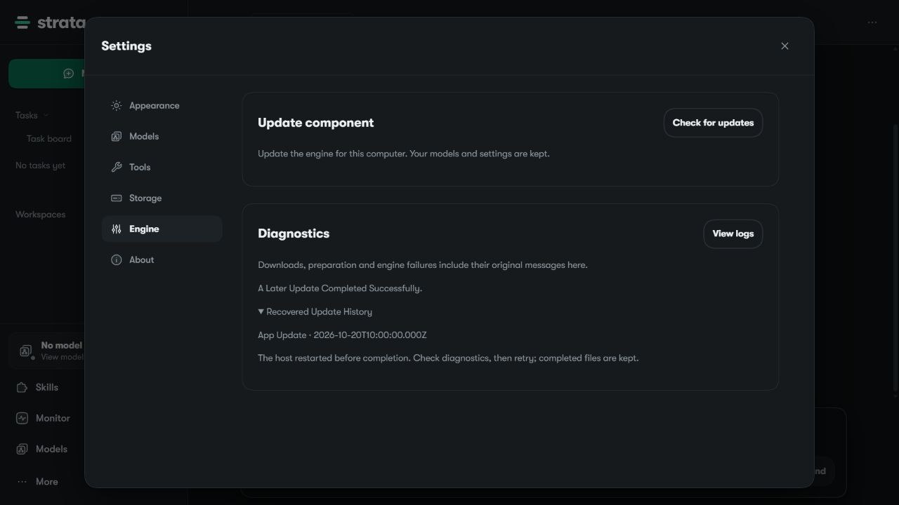
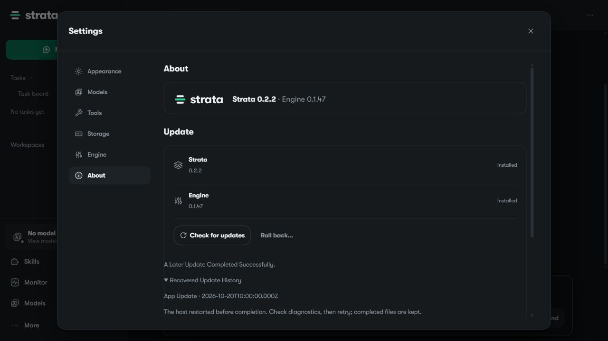

# App 0.2.2 Update Recovery Validation

Measured on 2026-10-22, Windows x64, Node v24.12.0. Current main
`011c9e600a93bbc9fd451c563501b5831c32bbca` was merged normally into #3578;
tested merge `b1cab16e396f6b2512bbd164d942a281e7f83152`. The earlier 28-test
record used App 0.2.1. Main changed SettingsUpdates, native data types and
update-cache behavior, so the affected checks and render acceptance were run
again against the merged App 0.2.2 source. No dependency versions changed.

## Passed

From `apps/host`:

```text
node --test --test-isolation=none tests/native-update-recovery.test.mjs tests/update-cache.test.mjs tests/ui4-fixes.test.mjs
# 29 passed, 0 failed, 0 skipped.
npm run typecheck
npm run build
```

Type checking and the production Vite build passed. The existing large-chunk
advisory remains a warning. The source hashes and TAP hash are in the JSON
receipt. `git diff --check origin/main...HEAD` passed.

The actual built App 0.2.2 browser UI was served by a disposable, anonymous
loopback fixture using synthetic update jobs. Both Settings > Engine and
Settings > About showed Recovered Update History instead of a current alert.
Opening each history exposed the original restart-interruption text. About
reported Strata 0.2.2 / Engine 0.1.47. The repository tests also preserve input
jobs and retain ordinary/newer failures, invalid dates and incomplete retries
as alerts.

All fixture mutations return HTTP 501; a direct POST confirmed that refusal.
No Host, model, updater or installer backend was started. The QA tab and
fixture listener were closed; fixture process exit code was 0.





These are unedited browser captures with synthetic job IDs/timestamps, no
accounts or real logs, no private paths and no text/EXIF metadata. Installed
version labels are fixture values. They do not certify an actual installation.

## Failed

No unresolved failure in the checks above. The original pre-fix render
reproduction is retained in the PR history; it showed the obsolete alert.

## Not Run And Limits

A real installer/update restart, signed installer, native desktop shell,
GPU/model work and unknown historical error strings were not exercised.
This is job-classification and UI compatibility evidence. No GPU backend
source is changed by the PR, so CUDA/HIP/SYCL/Metal builds are not applicable.

Machine-readable evidence: [validation-app-0.2.2.json](validation-app-0.2.2.json).
