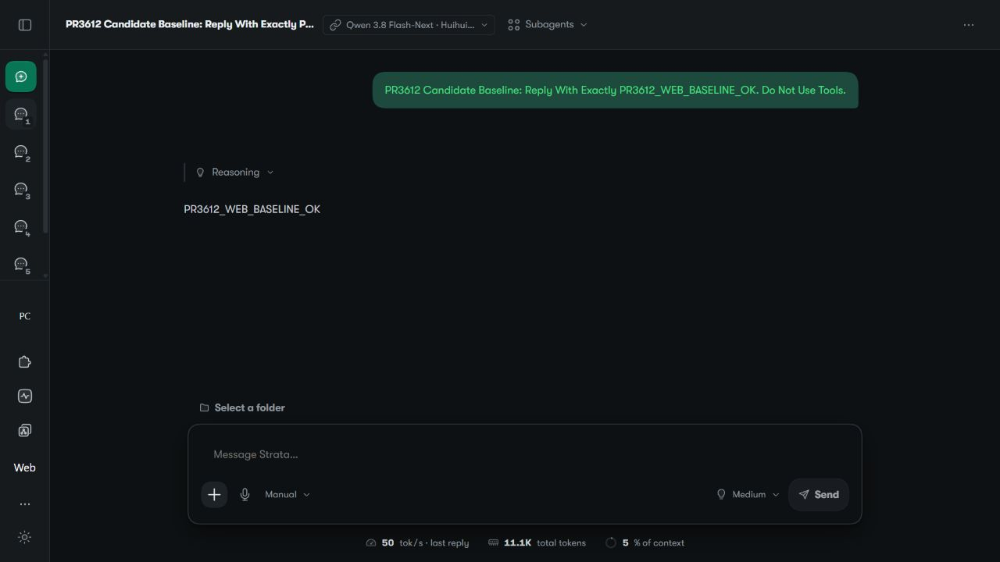
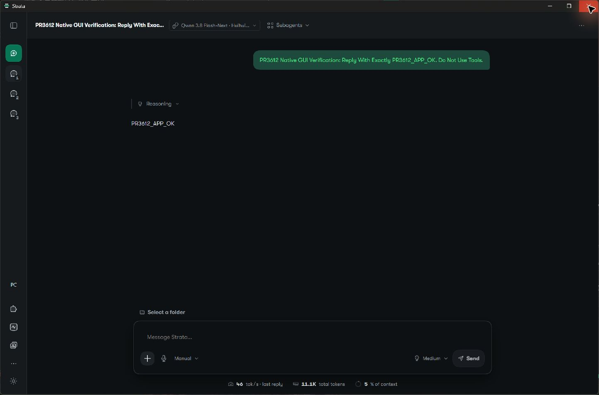
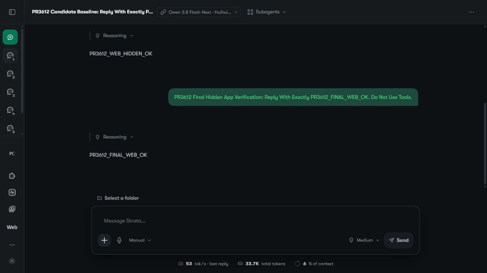
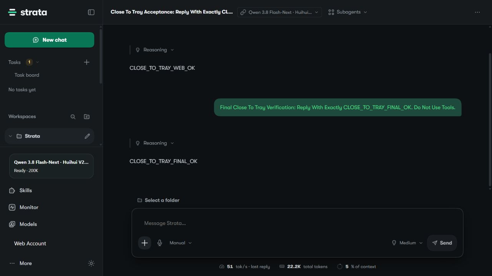

# Windows Close To Tray Acceptance

This opt-in candidate keeps the existing App Host alive when a main-window X
hides the Windows App. A companion supplies its own live process ID and absolute
image path; the shell holds the verified process handle. Starting the App again
uses the existing single-instance restore path. Explicit `--quit` and owner exit
use the existing Host shutdown path.

Normal X without a verified opt-in owner still closes the App. The existing
resource lookup, updater, Host command, shutdown token and Windows Job stay in
place. Linux and macOS do not compile or call the new module. No Engine, Control,
server or frontend code is changed. The separate Tray proposal is #3365; its
managed-mode scope remains separate from this native lifecycle hook.

## Reproduce The Opt-In Behavior

Use a disposable App installation and a real, visible companion. Supply the
three environment values described in [Closing](../CLOSING.md#optional-windows-close-to-tray)
when launching `strata-desktop.exe`. Do not start the App inside a companion Job
that is meant to contain only its server workers.

1. Record the App, Host, companion and listener identities. Confirm the App UI
   and an authenticated owner browser surface both reach the same Host.
2. Click the actual native X. Confirm that the window disappears while the same
   App and Host remain, and that browser metadata and Monitor still work.
3. Launch the same App executable again from the companion. Confirm the same
   window returns with unchanged App and Host identities.
4. Hide it again. If hardware testing is intended, send one short prompt through
   the owner browser and confirm the completed reply. Metadata alone is not
   evidence of inference.
5. Send `strata-desktop.exe --quit`. Confirm the App and its Host exit cleanly.
   A cold `--quit` must not start a Host. Test owner exit separately.

## Submitted Candidate: Live Web Baseline

The native executable from [Windows CI run 39632085918](https://github.com/medking82/Strata/actions/runs/39632085918)
was run on Windows x64 with the unchanged official App 0.2.2 Host, UI and Control
resources. The executable was built from candidate commit
`6a4202de18bd8c5b77ac3512875c8230722c0f16`; its SHA-256 is
`2e08024cbbcda10415af59d53462e173c7f3e7aa424e858aef18ffbc3f1db4c2`.
Its source and checksum match the CI provenance artifact. No native source was
patched for this local test. This was an unbundled candidate, not an installer.

The running Tray opened this candidate. The authenticated owner Web then used
the loaded Huihui V2 Swift IQ3_S model and completed `PR3612_WEB_BASELINE_OK`.
Models metadata and Monitor returned HTTP 200. Effective Context stayed at
204800 (200K), idle unload at 1800 seconds, and Codex Sync reported `synced`.
The existing Tray and 8080/8081 listener identities were retained.

After the capture, explicit `--quit` ended the candidate and its Host. The real
Tray reopened the original native Extension. Its original settings and activation
pointer were restored byte for byte. Preservation checks passed for 17 private
files and all 29,400 official resource files. The original model, Context, idle
unload and synchronized Codex state were retained; shared listeners were not
restarted.



This was the initial Web baseline. A Windows Security firewall prompt for the
copied Node executable interrupted the first native GUI attempt. The user later
allowed that executable manually; automation did not operate the security dialog.
The App Host and both shared API listeners still bound only to loopback. The
completed native GUI acceptance below supersedes that earlier blocker.

The screenshot contains only QA text and generic UI. It contains no account
identity, private path, hostname, credential or unrelated chat. Incidental usage
figures are not a benchmark.

## Submitted Candidate: Completed GUI Acceptance

The same CI executable and unchanged official resources were tested on
2026-10-22 (Asia/Kuala_Lumpur). No Rust or build input changed after the successful
CI run. The [sanitized observation record](gui-acceptance.json) contains the
source/checksum, identity comparisons and preservation results, without private
paths, process IDs, account details or conversation identifiers.

- The native App completed `PR3612_APP_OK`. Clicking the actual title-bar X
  removed its window from the visible Windows inventory while the same App,
  official Node Host, Tray and 8080/8081 listeners remained alive.
- The running companion's real `StrataTray.exe --open-app` entry restored the
  exact same native window, App and Host. This invokes its normal Open App
  handler; the physical notification-area icon was not clicked by automation.
- After a second actual X, the owner Web completed `PR3612_FINAL_WEB_OK` while
  the native window stayed hidden. The same on-demand model was loaded for that
  request. Authenticated Models metadata and Monitor each returned HTTP 200.
- Effective Context remained 204800 (200K), idle unload remained 1800 seconds
  (30 Minutes), and Codex Sync reported `synced`. This does not establish that an
  already running Codex client has reloaded its catalog.
- Explicit candidate `--quit` ended the candidate App and Host. The real Tray
  reopened the original native Extension. All 17 recorded private files and all
  29,400 official resource files passed preservation checks. The original native
  activation pointers and on-demand, unloaded model state were restored.





GUI acceptance exposed a separate companion bug: its Win32 restore shortcut
reported success while this hidden native window stayed hidden. Launching the
same App executable directly restored it. The companion was corrected to always
use its validated launcher and the App's own single-instance restore entry;
313 companion assertions and its build passed. The final GUI run above used
that corrected companion. Its C# implementation and site-specific deployment
are external to this native PR; they are not presented as submitted Rust changes.

These are real QA captures, not mockups. The collapsed sidebar and QA-only chat
avoid exposing unrelated conversations. The published JPEGs have no
EXIF/XMP/IPTC/comment metadata. Their incidental usage figures are not a benchmark.

## Separate Deployed Reference

The screenshot below is an actual acceptance capture of a separately deployed
native Extension derived from official App 0.2.2 commit
`011c9e600a93bbc9fd451c563501b5831c32bbca`, not a mockup. Its integration source
was `b1308ce6dbbcbe5bd859953486f1a5acfc625ddd`, native package
`0.1.0-ef4a4e88db40`, on Windows x64 with Engine 0.1.47, an RTX 5080 16 GB,
61.4 GB usable RAM and a local Huihui V2 Swift IQ3_S model.

During that test, native X removed the App from the visible-window inventory;
App, Host, companion and 8080/8081 listener identities stayed unchanged. The
running Tray's real Open App command restored the same native window. Physical
taskbar-icon clicking was not automated. The window was hidden again before
owner Web generated `CLOSE_TO_TRAY_FINAL_OK`. Models metadata and Monitor each
returned HTTP 200. The model was loaded at effective Context 204800 (200K), with
1800-second idle unload and the current model's Sampling baseline preserved.
Explicit Quit and a subsequent Tray cold-open were also observed.

The public screenshot contains only QA text, generic App UI, a public model
display label and incidental usage figures. It contains no account identity,
private path, hostname, credentials, original user screenshot or unrelated chat.
The usage figures are not a benchmark or a speedup claim.



The reference Extension also selected installed resources and handled companion
startup outside its server Job. Those site-specific launcher/deployment changes
are not part of this upstream candidate. The screenshot does not establish that
the submitted candidate was installed or that a future App version will work.

## Candidate Checks And Limits

Run on native Windows from `apps/desktop/src-tauri`:

```text
cargo test --locked -- --test-threads=1
cargo build --locked --release
```

The targeted Windows workflow runs these against the submitted Rust source in a
disposable build checkout. It substitutes an inert compile-only page and no
bundled resources; it does not create a distributable installer, download an
Engine, run the App or start a model. The existing crash-report test now checks
the package version rather than a stale literal 0.2.0; runtime logging is unchanged.
New regressions check missing/mismatched owners, an exact live executable handle,
owner exit, and exact `--quit` argument handling.

Windows CI passed 25 Rust tests and the release build. The native source and
build inputs remain identical to tested commit `6a4202de18bd8c5b77ac3512875c8230722c0f16`.
The live baseline and completed GUI run above use that submitted native candidate.
The deployed reference remains separate evidence. Physical Tray-icon clicking,
signed-installer update, updater exit, Windows logoff, actual candidate owner-exit
execution, other App versions and Linux/macOS builds remain unverified. Owner-exit
logic is covered by the Windows Rust tests; that is distinct from GUI execution.
Scope agreement for this optional native hook is requested in #2034.
