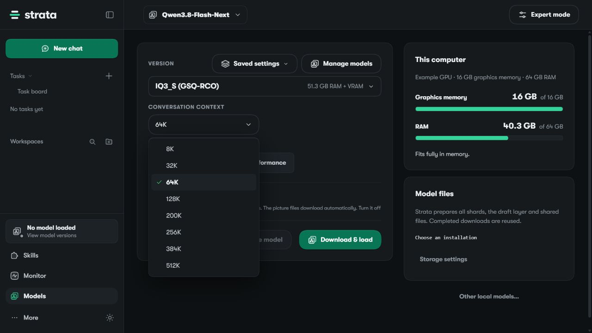
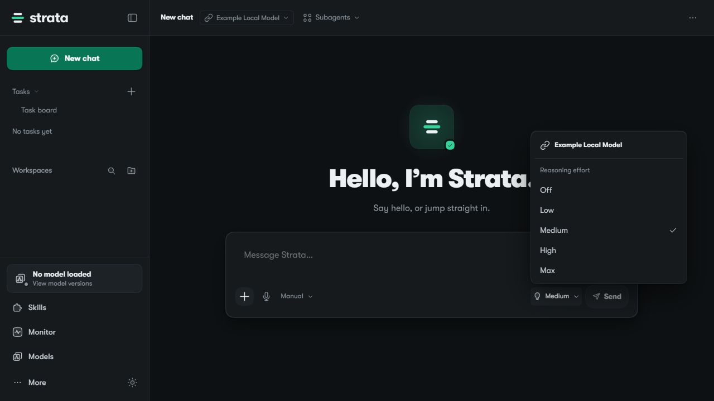

# App Surface Contract

An opt-in, offline helper for Tray and Web companion authors. It reads the installed
official App's own Model Catalog, recommendations and native idle-setting bounds.
It can copy the App's unmodified Web assets to a new candidate directory and verify
that candidate against a fresh App/Control source identity.

This tool is not part of the default App startup, installer or update path. It
does not start an engine, serve a production Web host, change a model, manage
credentials or activate a deployment. Existing Tray and Local Model Extension
proposals remain separate (#3365, #3373). Scope discussion: #3531.

## Snapshot

Use Node 24.12 or later. `--host` is the absolute `host` directory in an existing
trusted App installation, containing `package.json`, `server` and `dist`.

```text
node tools/app-surface-contract/cli.mjs snapshot --host <installed-host-directory>
```

The reader uses that App's `findControl` rule, its selected bundled Python and the
read-only `strata_models` tool. The App/Control own hardware fit and recommendations;
the helper adds no estimates or model allowlist. Context values come from the actual
catalog, checked against the tested contract. Idle bounds come from `NATIVE_FIELDS`.
The 5/10/30-minute values are shortcuts within that setting, not separate timers.
Reasoning Effort stays in the official Composer. Installation stays in the official
App/Control updater; this helper never checks, downloads or installs updates.

The snapshot contains a schema version, App/Control versions, a source fingerprint,
allowlisted catalog fields and control ownership. It excludes paths, commands,
credentials and unknown fields. Treat it as local owner metadata: hardware facts
are not meant for anonymous publication. It does not confirm that a model is loaded
or that a client has adopted a context length.

App 0.2.1 and 0.2.2 are the tested contracts. Missing components, unknown versions or changed
Context/Idle/host interfaces produce `needs_validation` and a nonzero exit. Do not
turn a failed read into invented defaults. A source fingerprint is an identity check
for files in the installation the user trusts; it does not replace vendor signatures.

## Reviewed Surface Ownership

The snapshot also exports `surface.schema: 1`, the inspected version in
`surface.appVersion` (`"0.2.1"` or `"0.2.2"`) and
`surface.validation: "source-anchors-only"`. Each `surface.areas` entry contains an
`area`, its `owner` and representative `routes` with only `path` and `method`.
The version of this section is independent of the snapshot/asset manifest schema.
Consumers should require a reviewed surface version before using these descriptors.

The section covers Models, Monitor, provider selection, lifecycle, Context/Idle,
Chat, Tools/Search, research, Skills, Tasks, Workspaces, Files, image-model
configuration and updates. `official-host` means the native Node Host;
`official-app-control` means the official App and bundled Control;
`official-harness` means the agent machinery owned by that Host. Reasoning Effort
and update installation retain their existing official ownership fields.

Fixed route/method and owner-call string anchors are checked in the selected
trusted Host's `server/index.mjs` before importing metadata modules. Missing or
changed anchors fail with `needs_validation`; later source drift invalidates the
same fingerprint used by the snapshot and asset manifest. The helper never calls
these APIs. These descriptors are not a complete API inventory or an authorization
proxy. `GET` describes reviewed read usage even where the Host has no method guard.
String anchors do not verify all payload schemas, handler wiring, live state or
future API semantics; unchanged strings can still conceal behavioral changes.

See [Consuming The Contract](CONSUMING.md) for state and ownership boundaries a
companion must preserve. This remains an optional compatibility/export helper;
scope agreement for #3531 is still pending.

## Export And Verify Official Web Assets

Export creates a new directory exclusively. Its parent must already exist. The
directory must be outside the App installation; an interrupted candidate is kept
as evidence and is not an overwrite target.

```text
node tools/app-surface-contract/cli.mjs export --host <installed-host-directory> --output <new-candidate-directory>
```

Keep the returned `manifestSha256` with the caller's reviewed deployment record.
Before using the candidate, verify it with that exact pin and the current App:

```text
node tools/app-surface-contract/cli.mjs verify --host <installed-host-directory> --candidate <candidate-directory> --manifest-sha256 <returned-SHA256>
```

The manifest binds every asset's path, size and SHA256, the allowlisted metadata
snapshot and the shared App/Control source fingerprint. Reads reject links, unsafe
paths, extra files, oversized input and changed bytes. Export checks the source
again after copying. Verification checks the complete inventory and fresh source
identity. No frontend files are rebuilt, injected or rewritten.

Successful verification means **assets and source identity**, not production
deployment, live Context allocation, authentication, model inference or future
App compatibility. There is no automatic updater, polling worker or rollback.
After an official App/Control update, revalidate the contract and explicitly export
a new candidate. Keep private account/history/research integrations outside the
official React root and preserve their own authentication and data owners.

## Anonymous UI Examples

The examples show the unchanged official App 0.2.1 frontend with synthetic metadata.
They do not represent a running model, GPU memory measurements or installed updates.
No personal paths, account data, original user screenshots or credentials are used.

To reproduce them after export, start the explicit loopback-only fixture:

```text
node tools/app-surface-contract/examples/fixture.mjs --candidate <candidate-directory> --manifest-sha256 <returned-SHA256> --port 18128
```

Open the printed loopback URL. The fixture uses only the candidate's frozen source
identity; it does not verify a current installed App. Its catalog is the exported
catalog with anonymous hardware labels. Its API connection is `Example Local Model`.
Every mutation returns HTTP 501, including Chat, so no inference can run. Close the
fixture after use. Do not expose it as a production gateway.

The native Models page's initial 64K is a download recommendation; the example API
connection's 200K is separate. The official Composer supplies its own Effort menu.




## Checks

From the repository root:

```text
node --test tools/app-surface-contract/contract.test.mjs tools/app-surface-contract/assets.test.mjs
```

Tests use disposable files and metadata fixtures. They do not prove real hardware
fit or inference. The feature changes no default App, engine, server, setup,
packaging or installer file. Compare against the recorded base before submitting:

```text
git diff <base-revision> -- . ":!tools/app-surface-contract"
```

The [App 0.2.2 Windows acceptance report](validation-app-0.2.2.md) records the
installed metadata read, byte-preserving export and fresh verification separately
from the fixture suite. Support is limited to the two explicitly reviewed
versions; unchanged version labels do not bypass source or contract drift checks.
