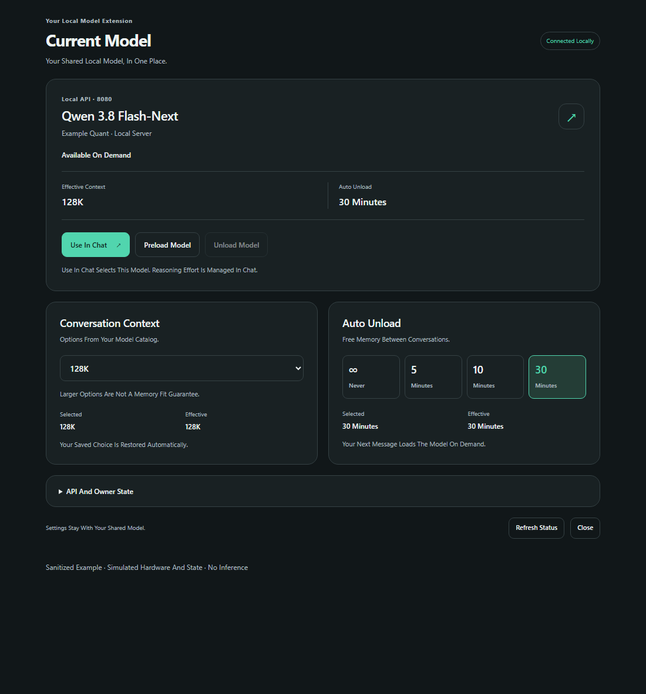
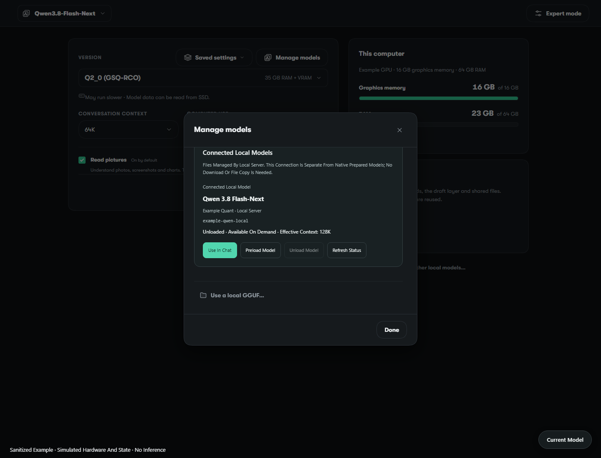
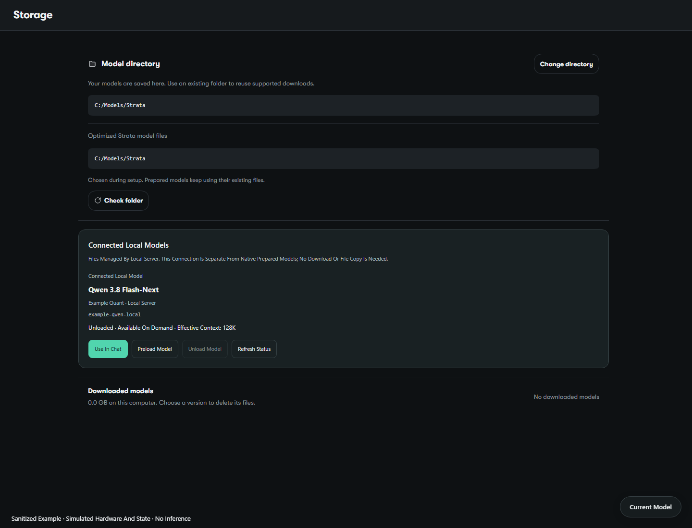

# Local Model Extension (Draft)

An optional Windows companion for an existing local Strata server. It adds
**Current Model** controls and a **Connected Local Models** card inside the
App's **Manage Models** and **Storage** views. The official catalog and prepared
model library remain available.

Scope discussion: [#3369](https://github.com/Niko1221/Strata/issues/3369).
Requires the optional managed Windows Tray's `app_extension` protocol from
[#3365](https://github.com/Niko1221/Strata/pull/3365). This is a draft integration
candidate, not an existing upstream plugin API or a supported release feature.

## Behavior

- Select the connected physical model with **Use In Chat**. The App must already
  have exactly one matching OpenAI-compatible connection under **Settings →
  Models**. Its API URL and physical model ID must match the managed server.
  Existing authentication and unrelated model rows are preserved.
- Choose **Conversation Context** from the App's actual native catalog. The
  current catalog offers 8K, 32K, 64K, 128K, 200K, 256K, 384K and 512K. This
  extension defines no substitute tiers. Availability is not a memory-fit claim.
- Choose **Never**, **5 Minutes**, **10 Minutes** or **30 Minutes** for idle
  unload, or explicitly **Preload Model** / **Unload Model**.
- Selected values and confirmed effective values stay separate. Stale owner
  metadata, mismatched identity and unknown capacity disable controls.
- Reasoning effort remains in the official Chat composer. This package does not
  override effort, Fast, permissions or client configuration.

The Tray remains the sole owner of the server and its serial lifecycle worker.
The extension never launches another inference server and never calls HTTP
load/unload directly. Connected models do not increase native download counts,
change storage directory fields, or move/copy weight files.

## Setup

Prerequisites: the Windows App 0.2.x, its Node 24+ host, Python 3.10+, and the
managed Tray candidate. Keep these tools and their state outside the App's
installation directory in a private location writable by your account.

1. Enable `"app_extension": true` in the managed Tray JSON, then restart that
   Tray. The default is false. Its existing `<tray-config-stem>.state` directory
   will contain `extension-status.json`. Keep that directory private.
2. Add the local API connection in the App's **Settings → Models**, using the
   managed server's `/v1` URL, authentication and exact physical model ID. The
   extension supports different loopback ports and IDs; no personal model list
   or machine-specific configuration is built in.
3. Copy `extension.example.json` to your private `extension.json`. Replace
   `app_executable`, `owner_directory`, `base_url` and `extension_root` with your
   paths. The extension root's final directory must be `strata-local-models`.
   The example paths are placeholders. `model_labels` may map physical IDs to
   `{ "name": "Qwen 3.8 Flash-Next", "variant": "Local GGUF" }` for display;
   identifiers sent to the server remain unchanged. If the model API requires
   authentication, `api_key_env` names its existing environment variable.
4. Install the versioned UI package, then close the App and use this launcher:

   ```powershell
   python.exe tools/local-model-extension/extension_manager.py install --source tools/local-model-extension/package --root C:/Strata/extensions/strata-local-models --activate
   python.exe tools/local-model-extension/launch.py --config C:/Strata/extension.json --check
   python.exe tools/local-model-extension/launch.py --config C:/Strata/extension.json
   ```

   Use your actual `python.exe` path if necessary. `--check` validates the launch
   plan; it does not establish a running App or model connection. An already
   running App must exit first so its host inherits the opt-in preload.

Only the explicitly launched App host receives the bridge. `NODE_OPTIONS` is
preserved and extended for that child; the exact host entrypoint and listening
port are checked. Normal App launch remains unchanged. No official executable,
frontend asset, engine, server, updater or model file is patched on disk.

## Updates And Recovery

The official App and Engine updaters continue to own their updates. UI packages
live in immutable releases outside the App and use an atomic activation pointer.
To update, install a new package version with `--activate`. Existing preferences
and the previous release are retained. To disable or roll back:

```powershell
python.exe tools/local-model-extension/extension_manager.py disable --root C:/Strata/extensions/strata-local-models
python.exe tools/local-model-extension/extension_manager.py rollback --root C:/Strata/extensions/strata-local-models
```

Missing, disabled, changed or incompatible packages leave the original host
listener in place. Only App 0.2.x, Bridge API 1 and the tested DOM anchors are
accepted. Future layout changes may require a compatibility update; this is not
a guarantee across arbitrary App releases. Unsupported Manage Models layouts
offer the separate Current Model panel instead of rewriting native controls.
Launch the App normally to bypass this companion entirely.

## Local Owner Protocol

The opt-in Tray publishes schema-1 status every normal poll (roughly two
seconds), including physical model identity, loopback API URL, selected/effective
settings and loaded state. The bridge cross-checks fresh status (at most ten
seconds old) against `/health`, `/v1/status` and `/v1/models`.

An explicit UI action atomically publishes one `extension-request.json` with a
UUID, `expectedModel`, and `context`, `idle`, `load` or `unload`. The existing
worker rechecks identity at execution, claims it as `extension-running.json`,
and preserves its normal drain/admission/authentication rules. A terminal
acknowledgment is persisted before removing the claim. The UI waits for observed
effective state as well as the acknowledgment; it never retries mutations.
Interrupted claims are not replayed. Inspect the local Tray state/logs before
manual recovery. Filesystem access to this private directory is part of the
local trust boundary; do not share it or publish its contents.

## Examples

These are anonymous, simulated fixtures rendered from the actual extension
assets and the actual `NativeModels` / `SettingsStorage` React components.
They are not captures of a running model. No original user screenshot, private
path, account detail, API credential or real hardware measurement is included.
These images predate the App 0.2.2 Storage correction; the current connected card
appears once, after the native Storage sections. See the
[App 0.2.2 acceptance report](validation-app-0.2.2.md).







[Current Model opened inside the App fixture](examples/current-model-in-app.png).
The panel and native dialogs scroll normally when their content exceeds the
available viewport. Reproduce using the App's existing development dependencies,
its built styles, and a local Chrome installation:

```powershell
node.exe tools/local-model-extension/examples/render.mjs
```

`CHROME_PATH` may select another Chrome executable. The fixture binds a disposable
loopback port, blocks external requests, disables GPU rendering and verifies
that no model mutation was requested. No inference is run.

## Validation

[App 0.2.2 acceptance](validation-app-0.2.2.md) records native App launch,
Current Model/Manage Models/Storage integration, the Storage duplication fix,
real owner controls, 300-second idle unload and disable/rollback. It separates
the successful direct chat from the default agent's 8K output-budget limit.

```powershell
node.exe --test tools/local-model-extension/owner_api.test.mjs tools/local-model-extension/extension_bridge.test.mjs tools/local-model-extension/host-preload.test.mjs tools/local-model-extension/package/ui.test.mjs
python.exe -B -m unittest discover -s tools/local-model-extension -p test_*.py
```

The owner API suite exercises disposable local HTTP servers and real temporary
IPC files. Its cross-language IPC case also consumes commands through the real
Tray module when available. For a separate Tray checkout, set
`STRATA_TRAY_SOURCE` to its `tools/windows-tray` directory and
`STRATA_TEST_PYTHON` to the actual `python.exe`. Without that candidate, this one
case is explicitly skipped; the independent API checks still run.

Fixture/unit checks and the bounded App 0.2.2 acceptance do not establish an
installed App upgrade, arbitrary memory capacity, other GPU backends or future
App layout compatibility. See the acceptance report for passed, limited and
not-run checks.
