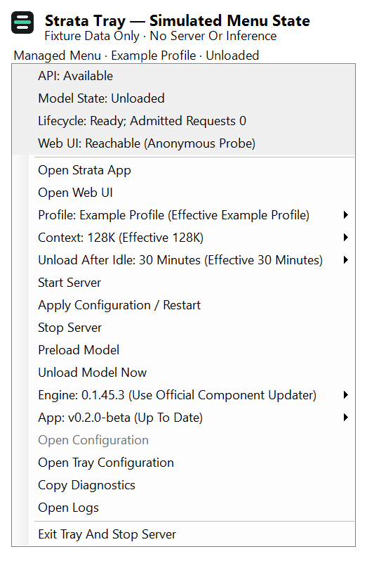
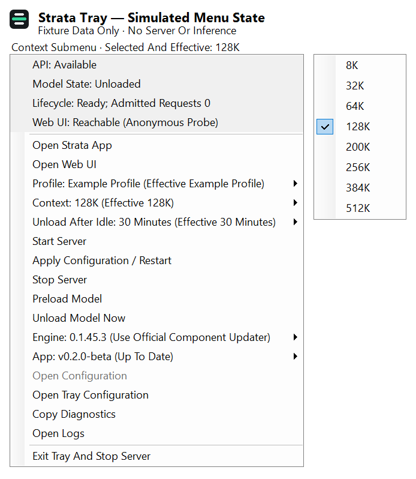

# Optional Windows Tray

Windows 10/11 x64 and .NET Framework 4.8 are required. The Tray uses the official
desktop App icon, PerMonitorV2 scaling and system menu colors. It is not installed or
started by the default Strata installer.

No Codex or OpenCodex client is required in either mode. The Tray does not manage
external client catalogs or verify their reload. Context and lifecycle status
describe Strata itself; restarting an unrelated client is not a Strata readiness
requirement.

## Build

From the repository root in PowerShell:

```powershell
.\tools\windows-tray\Build.ps1
```

Keep the entire `dist/windows-tray` directory together, including
`StrataTray.exe.config` and `managed/`. No .NET SDK or NuGet restore is needed.
Right-click the notification-area icon to open the menu; double-click opens the
Web UI, or the App when `desktop_app` is configured. Windows may place the icon in the taskbar overflow.

## Use an existing server

```powershell
.\dist\windows-tray\StrataTray.exe --port 8095
```

This anonymous read-only mode keeps its previous behavior: API/model status,
Open Web UI, Refresh status, Copy diagnostics, and Exit Tray (keep server
running). It never manages that server. A protected API reports `auth required`.
Only one read-only instance per port is allowed in a Windows session.

## Let the Tray manage Strata

1. Finish the normal Strata setup first. Keep its original model JSON files.
2. Install the optional sidecar dependency in that Python environment:

   ```powershell
   .\.venv\Scripts\python.exe -m pip install -r tools/windows-tray/managed/requirements.txt
   ```

3. Copy `tools/windows-tray/tray.example.json` to
   `tools/windows-tray/tray.json`. Set `python`, `repository`, and each entry in
   `profiles` to your Python executable, official checkout and existing model
   JSON respectively. Relative paths are resolved from the Tray JSON directory.
   The example model filename is a placeholder; use the JSON made by your setup.
4. Stop any separate launcher on the chosen ports. `port` is the stable public
   **loopback-only** endpoint (default 8095); `upstream_port` is the distinct
   private loopback port (default 8096). Occupied ports are refused, never adopted.
5. To open the installed App from this Tray, optionally add `desktop_app` with
   the absolute path to your existing `strata-desktop.exe`. **Open Strata App**
   passes the managed loopback endpoint through `STRATA_SERVER_URL`; it does
   not edit App storage settings or import model weights. Existing App instances
   keep the connection they started with. Restart the App to change it.
6. Launch:

   ```powershell
   .\dist\windows-tray\StrataTray.exe --config tools/windows-tray/tray.json
   ```

Managed mode requires Python 3.10+ and the official server's Python dependencies.
It starts the API with `--lazy`, leaving the chosen model unloaded until the
first inference request or an explicit **Preload model** action. Boot, restart,
profile/context changes and upgrades do not automatically preload. Status polling
does not load a model. Idle unload defaults to five minutes when absent; existing
profile values and saved choices (including thirty minutes) remain authoritative. A Windows Job contains only the owned
sidecar/server descendants; closing the owning Tray forcibly during inference
can interrupt that inference. Use the menu's graceful Exit for normal shutdown.
Do not launch a second Tray against the same config/state directory.

Every profile needs `model_name`, string `args` containing exactly one
`--max-context` plus its value, and an existing `exe` for the Strata engine.
Other official settings and model paths are preserved. Profiles must share the
same authentication and origin policy. A policy edit requires restarting the
Tray. Credentials stay in the original profile/environment; the proxy forwards
client authentication unchanged and never supplies its control credential to
an anonymous inference request.

## Optional App Extension

The companion local-model extension can use this same managed owner. Set
`"app_extension": true` in the Tray JSON and restart the Tray to opt in. The
default is `false`: no extension state files are read, written or consumed.
This does not install an extension or change the official App frontend.

When enabled, the owner atomically publishes `extension-status.json` in the
existing `<tray-config-stem>.state` directory every normal status cycle (about
two seconds). It contains the existing snapshot plus `schema: 1`, `modelId`
(the current configuration's physical `model_name`, or `null`),
`apiBaseUrl` (`http://127.0.0.1:<port>/v1`), and `loaded`. The latter is `true`
or `false` only for known loaded/unloaded state; other states are `null`.
`captured` is an ISO UTC timestamp, `active` counts admitted requests, and
`selected` and `effective` remain distinct. A configured context is not proof
of GPU allocation. Keep this directory private; it includes model identity
and the existing generated profile and logs.

The extension publishes one `extension-request.json` by hardlinking a fully
written temporary file into the empty slot, without overwriting it. For example:

```json
{
  "schema": 1,
  "id": "11111111-1111-4111-8111-111111111111",
  "expectedModel": "example-physical-model",
  "action": "context",
  "value": 131072
}
```

Requests are limited to 4 KiB. Use a fresh UUID and the physical `modelId` from a fresh snapshot. Only these
fields are accepted: `context` requires one of the eight official token values
(8192/32768/65536/131072/204800/262144/393216/524288); `idle` requires
0/300/600/1800 seconds. `load` and `unload` require no `value`. No profile,
restart, update, arbitrary command or inference action is exposed.

The owner claims the slot as `extension-running.json` without overwriting an
existing claim, then uses its existing serial worker, authentication and drain
rules. Physical identity is checked again at execution, including the source
profile for a context/idle change. The snapshot acknowledges
`request: {id, state: "running"|"done"|"error", error?: "ExceptionClass"}`.
Errors include a class name only; an unreadable/invalid UUID is acknowledged
with `id: null`. A durable terminal acknowledgment precedes claim removal;
the last acknowledgment remains in subsequent snapshots. After load/unload,
wait for the observed `loaded` value as well as the acknowledgment: the next
status poll confirms it. The extension must reject stale snapshots and must
not resubmit a mutation automatically.

A running file left by a crashed owner blocks new requests. The next owner
reports `InterruptedError` for an unfinished request and never replays it.
After stopping the owner, inspect the actual outcome and local logs before
manually clearing stale request/running files. A crash after acknowledgment
may already have applied the action. Restart the owner before issuing a new
explicit request; deleting a running file while it is active is unsafe.

## Menu guide

- **Model Profile**, **Context** (8K/32K/64K/128K/200K/256K/384K/512K, the
  official App choices), and **Unload After Idle**
  (never/5/10/30 minutes) persist the selection. The current profile's other
  context/idle values are preserved until a choice is made. Selected and
  effective values are shown separately; an error is not reported as applied.
- **Start server**, **Apply configuration / Restart**, **Stop server**,
  **Preload model**, and **Unload model now** control the owned server. Changes
  close admission, wait for admitted requests/streams and official activity to
  drain, then act. New requests receive HTTP 503 during this boundary. A drain
  timeout fails the action without killing an active request.
- **Open configuration** opens the selected profile's original JSON using its
  default Windows application. Save the file, then choose **Apply configuration
  / Restart**. Saving alone does not restart inference. Missing files disable
  the action. **Open Tray configuration** opens the profile-list/port settings;
  those settings take effect on the next Tray launch. If the saved selection no longer
  matches the profile list, the next launch resets selections to the first profile
  and the configured defaults.
- **Open Web UI** opens the stable loopback endpoint in your browser. Its
  anonymous reachability status does not verify a signed-in session or generation.
- **Open logs** opens the adjacent `<tray-config-stem>.state/logs` directory.
  Logs are local and can contain private server information; inspect before sharing.
- **Copy diagnostics** copies an allowlisted snapshot: timestamps, lifecycle,
  API/model state, active requests, context/idle selections and update state.
  Paths, profile labels, model IDs, credentials, prompts and raw errors are omitted.
- **Exit Tray and stop server** drains requests, then closes the owned processes.
  It does not stop a separately launched server.

Selections, generated runtime config and update records live in
`<tray-config-stem>.state` beside the Tray JSON. Keep it private: the generated
profile retains the original API key. Original profile files are never rewritten.
Do not place this directory in a public repository or a shared writable folder.

## Updates

The **Engine** submenu checks the official stable GitHub release on startup and daily,
with a manual **Check Engine Updates** action. Checking does not install anything.
Automatic installation is opt-in (`automatic_upgrade: false` by default).
This staging path supports legacy engine release assets only. When a release
contains the signed `strata-feed.json` used by 0.2.0, the menu says **Use Official
Component Updater** and offers no Tray installation. Use the App's Engine
settings or the official `strata update` command. The Tray does not replace the
official signature and component activation checks.
To enable installation, add the asset matching your installed official engine:

| Backend | `update_asset` |
| --- | --- |
| CUDA 13 | `strata-windows-x64.zip` |
| CUDA 12 | `strata-windows-x64-cuda12.zip` |
| Windows HIP | `strata-windows-x64-hip.zip` |

Choose **Install Available Engine Update**, or enable **Automatically Upgrade When
Idle**. Automatic activation waits for at least 60 seconds of idle time, then
uses the same admission/drain boundary. The updater stages a new runtime without
changing your Git checkout or overwriting the previous runtime. It requires the
published asset size and SHA-256, rejects unsafe ZIP entries, checks backend
metadata and unchanged Python requirements, and verifies API model identity,
context metadata and engine version before recording the new active runtime.
The API stays unloaded: context before first use is configured capacity, not
proof of native GPU allocation. Runtime version is independent of Git source pins. Source
comes from the fixed official GitHub tag URL over HTTPS; its hash is recorded.
These checks trust the official release publisher; they are not code signing.

Changed Python requirements, unknown backend metadata, custom vision/library
profiles, unavailable assets and incompatible runtime families require a manual
update using official setup. Locally compiled/SYCL engines are not rebuilt by
the Tray. An unrecognized engine version is shown as unknown and prevents automatic
version comparison, but does not prevent normal startup. Failures disable automatic
installation and show an error; there is
no silent rollback or repeated activation loop. Previous files are retained.
Use local logs to resolve the cause, then explicitly restart or install again.
The separate **App** submenu is enabled when `desktop_app` is configured. Its
manual **Check App Updates** reads the same official `latest.json` metadata as
the App and compares the installed App's product version. This does not verify
the installer signature or install an update. **Open App To Update** leaves
signature verification, installation and restart to the App's own updater.
Engine automatic upgrade does not install App updates.

Tray UI code itself is updated by rebuilding this directory, not by replacing a
running executable. No login gateway, remote host or machine-specific model
configuration is included.

## Screenshots and verification


The candidate uses the official App icon and native styling. Multi-monitor transitions
and a real GPU upgrade need hardware acceptance; mock tests do not establish them.

[Native menu examples](screenshots/README.md) show anonymous simulated state,
rendered offscreen from the production WinForms menu with `DrawToBitmap`.
They are not captures of a running server or evidence of GPU behavior.





```powershell
.\tools\windows-tray\Build.ps1 -Test
.\dist\windows-tray\TrayTests.exe
.\.venv\Scripts\python.exe -B tools/windows-tray/managed/test_managed.py
.\.venv\Scripts\python.exe -B tools/windows-tray/managed/test_extension.py
```

The managed suite uses disposable loopback ports, the unmodified official mock
server and a streaming fixture. No model download or GPU load is required.
MockEngine always reports loaded and a fixed 32768 context; tests do not claim
real GPU unload or allocation coverage. Existing engine, server, frontend and
setup source files are unchanged by this feature.
